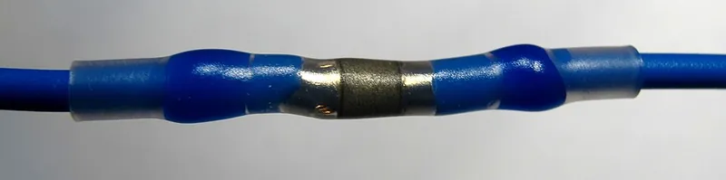
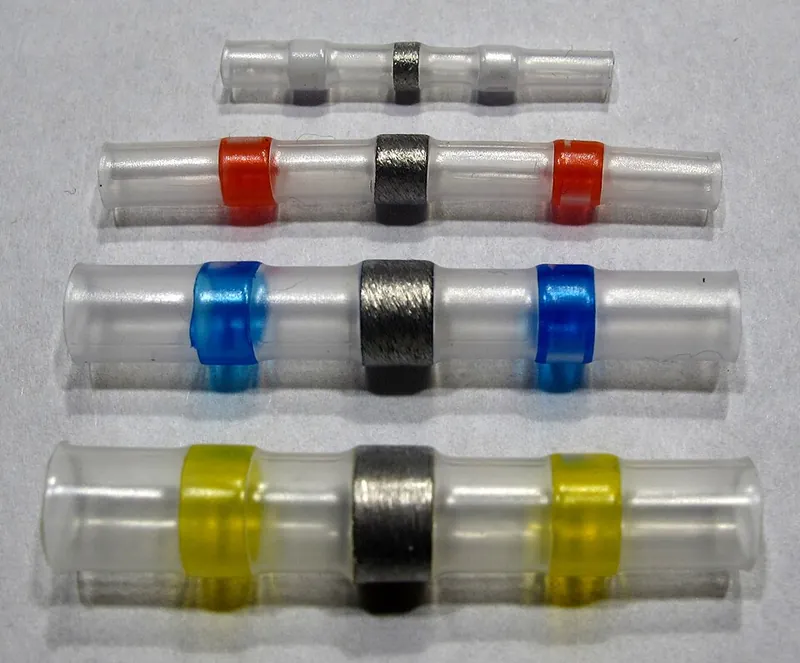

<figure class="eoc-pic eoc-pic-main"><figcaption><strong>How it works.</strong> <a href="https://commons.wikimedia.org/wiki/File:Geschrumpfter_L%C3%B6tverbinder_auf_Litzendraht.JPG">Geschrumpfter Lötverbinder auf Litzendraht</a> by Photograph: wdwd, <a href="https://creativecommons.org/licenses/by-sa/4.0">CC BY-SA 4.0</a>, from Wikimedia Commons.</figcaption></figure>
<figure class="eoc-pic"><figcaption><strong>Photo.</strong> <a href="https://commons.wikimedia.org/wiki/File:L%C3%B6tverbinder_versch_Durchmesser.JPG">Lötverbinder versch Durchmesser</a> by Photograph: wdwd, <a href="https://creativecommons.org/licenses/by-sa/4.0">CC BY-SA 4.0</a>, from Wikimedia Commons.</figcaption></figure>

A clear heat-shrink tube with a built-in ring of flux-cored solder and two rings of hot-melt glue: heated with a hot-air gun over two overlapped bare wire ends, the solder melts into the wires while the tube shrinks and the glue seals onto the insulation, giving a soldered, insulated, splash-proof splice you can inspect through the tube.

**In plain words:** A short see-through shrink tube with a ring of solder in the middle and a ring of meltable glue near each end: you push two stripped wire ends into it, warm it with a hot-air gun, and it solders, insulates and seals the joint in one go, with no soldering iron. **Proper term:** Solder sleeve (solder-seal splice; heat-shrinkable soldering device).

**Also called:** solder seal connector, solder seal wire connector, solder seal butt connector (the usual shop names; Hackaday 2023; Vetco); solder butt connector, heat-shrink solder connector, soldering heat-shrink butt connector, waterproof solder connector (shop names; Markertek; Vetco); solder sleeve splice; 'heat shrinkable soldering device' and 'heat-shrinkable solder termination device with meltable sealing preforms at ends' (NASA-STD-8739.4A §3.2 Definitions, §7.2.39, §19.6); 'Lötverbinder' (German name) (German Wikipedia 'Lötverbinder'); solder sleeve shield terminator: the same idea used to solder a ground wire onto a cable's braided screen (NASA-STD-8739.4A §11, Fig. 11-2; TE RPIP-688-00); solder sleeve wire terminator: a stepped sleeve that solders a wire onto a connector pin, post or component lead (TE RPIP-824-00 §4.4); crimp/solder shrink butt connector: a hybrid with a metal barrel to crimp as well as a solder ring (Quick Cable 165605); SolderSleeve (TE Connectivity / Raychem, brand) (TE catalogue; Raychem SolderSleeve data sheet). History: Raychem patented a 'heat shrinkable connector with preplaced solder therein' (US 3,316,343, priority 1966), and a 'sealed solder connector' with the glue rings was patented in 1988 (US 4,883,925) (Google Patents).

## How it works

You strip both wires, overlap (or lightly twist) the bare ends and slide the sleeve on so the solder ring sits over the bare copper and the glue rings sit over the insulation (NASA-STD-8739.4A §19.6.1a; TE RPIP-824-00 §4.2). Hot air shrinks the tube, which squeezes the softening solder ring onto the wires; the flux cleans the copper so the molten solder flows in and wets it, and the glue rings melt and seal round the insulation at each end (TE catalogue p. 3-4; Hackaday 2023). Because the tube is clear you can check the result: a good joint shows no trace of the ring's original shape and a smooth solder [fillet](../glossary.md#chamfer--fillet) along the wires (NASA §19.6.1c, §20.5.1g; TE RPIP-824-00 §4.2.3).

## Parts

A single ready-made part (a small assembly that acts as one unit): a transparent heat-shrinkable plastic tube (polyolefin or, in aerospace types, PVDF); a ring (preform) of solder with flux in the middle; and two rings of meltable thermoplastic glue (sealing rings) near the ends, often coloured to show the wire size (TE catalogue p. 4; German Wikipedia 'Lötverbinder'; Markertek). Some versions add a pre-fitted ground lead (shield terminators) or a metal crimp barrel (Raychem SolderSleeve data sheet; Quick Cable).

## Everyday examples

- Repairing or extending wires in cars, trailers, boats and caravans, where the joint must keep water out (German Wikipedia 'Lötverbinder'; Hackaday 2023)
- Car wiring repairs: Wikipedia notes pre-cut heat-shrink with a solder blob in the middle 'was specified by Daimler-Benz for automotive electrical repairs' (Wikipedia 'Heat-shrink tubing')
- Aircraft and spacecraft wiring, where solder sleeves join wires and attach ground wires to cable screens (NASA-STD-8739.4A §11, §19.6; TE catalogue)
- Colour-coded assortments sold for car, boat, RV and home wiring repairs (Vetco; Markertek)

## When to use it

Use a solder sleeve for a permanent, sealed, low-voltage splice when you don't have (or can't use) a soldering iron: repairing or lengthening wires in vehicles, boats, outdoor lighting and robots, and splices that must keep out splashes and damp. It is quick, needs only a heat gun and strippers, joins different wire sizes in one size of sleeve, and its clear tube lets you check every joint (TE catalogue p. 3; Hackaday 2023; German Wikipedia 'Lötverbinder'). Solder-style splices are also smaller and lighter than crimp splices (NASA-STD-8739.4A §19.3). Variants terminate a cable's screen or solder a wire to a pin.

## When not to use it

Don't use it in mains wiring or in anything that plugs into the mains: wiring rules decide which splices are allowed, and in US workplaces a soldered splice must first be 'mechanically and electrically secure without solder' (OSHA 29 CFR 1910.303(c)(3)(i)), which two overlapped wire ends in a sleeve are not; a Hackaday commenter doubted 'most inspectors' would accept them (Hackaday 2023). Use the connector your local rules require, or an electrician. Avoid it where the wire flexes or vibrates hard (moving robot joints, engine-mounted harnesses): use a Crimped butt splice with strain relief instead. Avoid low-melt (tin-bismuth) sleeves near engines, exhausts, heaters or lamps, since the solder starts melting at about 138 °C (Markertek). Don't use it where you will want to disconnect the wires (use a plug, lever connector or screw terminal), next to heat-sensitive parts, sensors or optics (NASA-STD-8739.4A §7.2.39, §7.2.41), or on wire whose insulation can't take the heat (NASA §7.2.21).

## Details

- **What it does (jobs):**
  - join and hold: makes a permanent soldered splice between two (or more) wires, or a wire and a pin or cable screen (the finder reaches this entry through the 'electrical connections' family)
  - seal it, or pass cables or fluid through: the glue rings and the shrunk tube keep water and dirt out of the joint and out from under the wire insulation (German Wikipedia 'Lötverbinder'; TE catalogue p. 7)
- **Movement:** none: the finished splice is a stiff section of wire, and it must not sit where the cable flexes (NASA-STD-8739.4A §7.2.36).
- **Directions it can move (degrees of freedom):** 0: the joined wires are fixed to each other.
- **Special behaviour:**
  - none: it simply joins and seals. Its one clever feature is that it combines soldering, insulating and sealing in a single heating step, and the clear tube lets you inspect the joint afterwards (TE catalogue p. 3).
- **How it holds:**
  - [material bond](../glossary.md#form-fit--force-fit--material-bond) (glue, solvent or melting): molten solder wets both wires and sets into a metal bridge (NASA-STD-8739.4A §19.6.1c), and the melted glue rings bond the tube to the insulation
  - friction or clamping (force-fit): the shrunk tube grips the wires tightly, which gives some strain relief (TE catalogue p. 3: the sleeve 'conforms to cable contours, and provides strain relief')
- **Input and output:** not applicable
- **Power:** passive (no power needed): heat is used only to make the joint.
- **Load:** Electrical: up to about 30 A, extra-low voltage only. The splice carries what its wire carries: sleeves come in colour-coded sizes for 26-24, 22-18, 16-14 and 12-10 AWG wire (Vetco; Markertek), and TE quotes a voltage drop of only 2.0 mV across its splices (TE catalogue p. 12); no seller publishes a current rating for the sleeve itself ⚑ [uncertain]. Shop packets state 600 V (Quick Cable) or 1 kV (Markertek) insulation ratings, but that is not an approval for mains wiring (see safety_notes). Mechanical: medium in a straight pull when well made (TE: tensile strength 'exceeds strength of conductor', catalogue p. 12); weak against bending and vibration, which crack the wire where the stiff soldered section ends (NASA-STD-8739.4A §7.2.36), as with any soldered splice. Cheap sleeves vary: one hobbyist found in destructive tests that many 'had not wetted the copper and the wires were only physically held together by the plastic' (Hobby-Machinist forum, 2021) ⚑ [uncertain: forum report].
- **Play and precision:** not applicable
- **Taking it apart:** permanent: the usual repair is to cut the splice out and fit a new one. TE's procedure for a badly overheated shield terminator is to score the sleeve lengthwise with a blade, soften it with the heat gun and [peel](../glossary.md#peel-vs-shear) it off (TE RPIP-688-00 §6.2).
- **How often it can be reused:** once: each sleeve is used once. An under-heated sleeve can be reheated until the solder flows (TE RPIP-688-00 §6.1), but a finished splice is cut out, not taken apart.
- **Sealing:** watertight: the melted glue rings seal the tube to the wire insulation so moisture can't reach the joint or [creep](../glossary.md#creep) under the insulation (German Wikipedia 'Lötverbinder'; Hackaday 2023: 'a tough, waterproof joint'). Grades differ: TE rates its everyday B-155 and CWT splices only as 'splashproof' and its D-1744 aerospace series as 'immersion sealed' (TE catalogue p. 7), so treat cheap sleeves as splash-proof rather than fit for long immersion ⚑ [uncertain].
- **Adjustable:** no: once heated the splice is fixed.
- **Access needed:** both sides: you need room all round the splice to slide the sleeve on, wrap hot air round it and see through it; the wires must be fed into the sleeve from both ends (TE RPIP-824-00 §4.2.2). Hot air also reaches nearby parts, so NASA forbids splices where neighbouring parts, wires or joints can't be shielded from the heat (NASA-STD-8739.4A §7.2.41).
- **Materials:** Wires: copper, bare or tinned, solid or stranded; TE's splice tables cover 26 to 10 AWG, with 'Micro SolderSleeve' parts for finer wire (TE catalogue p. 8-11). Wires 16 AWG and larger, or with more than 19 strands, should be pre-tinned with an iron first (TE catalogue p. 7; RPIP-824-00 §4.2.1). Solder alloy and flux must suit the wire's plating (NASA-STD-8739.4A §7.2.40); aluminium and stainless steel are hard to solder at all (Wikipedia 'Soldering'). Sleeve: radiation-crosslinked polyolefin (low-temperature types) or PVDF (high-temperature types) (TE catalogue p. 12). Solder: most shop sleeves use lead-free tin-bismuth Sn42Bi58, which melts at about 138 °C (Markertek; Quick Cable; Wikipedia 'Solder alloys' lists the similar Bi57Sn43 at 139 °C); TE's own range uses Sn42Bi58 (B-155), tin-lead Sn63Pb37 (D-110, D-1744) or tin-lead-cadmium Sn50Pb32Cd18 (CWT) (TE catalogue p. 12). The wire insulation must survive installation: TE lists a minimum wire temperature rating of 85 °C for its low-temperature B-155 and CWT splices and 125 °C for D-110 and D-1744 (TE catalogue p. 7), and NASA allows solder sleeves only 'where wire insulation temperatures permit' (NASA-STD-8739.4A §7.2.21).
- **Heat, cold, water and wear:** Heat: TE's low-temperature splices are rated -55 to +125 °C and its D-110/D-1744 series -55 to +150 °C (TE catalogue p. 12); shop sleeves with Sn42Bi58 solder are rated -55 to +125 °C (Markertek) or to 110 °C (Quick Cable), with the solder starting to melt at about 138 °C. Tin-bismuth solder mixed with lead-tin from previously tinned wire can melt far lower, and bismuth joints are 'prone to cracking' (Wikipedia 'Solder'; Wikipedia 'Solder alloys': 'Combination with lead-tin solder may dramatically lower melting point and lead to joint failure'). Water: the glue rings keep out splashes and damp (TE: 'splashproof'; D-1744: 'immersion sealed') (TE catalogue p. 7). Sunlight: coloured and clear heat-shrink resists UV less well than black, and 'only black is recommended for outdoor applications' (Wikipedia 'Heat-shrink tubing'), so shade clear sleeves outdoors or cover them ⚑ [uncertain: no UV data found for solder sleeves]. Vibration and flexing: like any soldered splice, the wire [fatigues](../glossary.md#fatigue) where the stiff section ends (NASA-STD-8739.4A §7.2.36).

## Making it

- **Ways to make or get it:**
  - off-the-shelf part: bought ready-made and fitted with a hot-air gun
  - 3D print (FDM): only helpers, such as a clamp that holds the two wires in line while the sleeve is heated, and cable clamps that keep bending away from the splice
- **Printing it in one piece (print in place):** no: the sleeve is a bought part; only holding jigs can be printed (one popular [print-in-place](../glossary.md#print-in-place) wire clamp is listed in make_it_yourself).
- **Tools:** Hot-air gun, ideally with a reflector nozzle that wraps the heat round the sleeve; TE's procedure lists hot-air guns set to about 650 ± 50 °F (about 340 °C), or infrared heaters (TE RPIP-824-00 §2.0), and suppliers advise against a lighter for heat-shrink (Wikipedia 'Heat-shrink tubing'). Wire strippers. Something to hold the wires and sleeve still while it heats and cools: TE sells a holding fixture (TE RPIP-824-00 §4.2.2), or use a printed wire clamp. A soldering iron is needed only to pre-tin thick or fine-stranded wires (TE RPIP-824-00 §4.2.1). No crimp tool, except for crimp/solder hybrids.
- **Difficulty:** easy: no soldering-iron skill is needed, just stripping, positioning and even heating; the main skill is judging when to stop heating, which the clear tube makes possible (Hackaday 2023; TE RPIP-824-00 §4.2.3). Getting a properly wetted joint with cheap sleeves takes care (iATN teardown, 2013).

### 3D printing tips

The sleeve itself can't be printed, but prints help around it. 1) A wire-holding jig keeps the overlap centred under the solder ring and stops the wires moving while the solder sets; TE recommends a holding fixture for exactly this (TE RPIP-824-00 §4.2.2). Leave the jaws far enough apart that the sleeve and the hot air sit in free space between them, not against plastic. 2) Keep printed parts out of the hot-air stream: the gun runs at around 340 °C (TE RPIP-824-00 §2.0) and the solder only melts at about 138 °C or more (Markertek), far hotter than PLA or PETG can stand, so print jigs in a heat-tolerant filament and point the gun away from them ⚑ [uncertain: no printed-jig heat test found]. 3) In a printed enclosure, grip the cable's outer jacket with a clamp, [gland](../glossary.md#gland) or cable-tie anchor so pulls and bends never reach the splice (NASA-STD-8739.4A §7.2.36; see Cable gland and strain relief). 4) Leave room in cable channels for the splice, which is fatter and stiffer than the wire: sleeves are about 25-40 mm long (German Wikipedia 'Lötverbinder'), and staggering several splices keeps a bundle slim (NASA §7.2.35). 5) Don't shrink sleeves with the wires already inside a printed housing; make and inspect the splice first, then fit it.

### Buying one (off-the-shelf parts)

Solder seal (solder sleeve) butt connectors, sold in assortments colour-coded by wire size (26-24, 22-18, 16-14, 12-10 AWG) with clear tubes and coloured glue rings (Vetco; Markertek); crimp/solder hybrid shrink butt connectors (Quick Cable); TE/Raychem SolderSleeve families: wire splices (B-155, CWT, D-110, D-1744/NAS 1744), shield terminators with or without pre-fitted ground leads (B-155-XX, CWT, S01/S02, M83519), wire-to-pin terminators and [coaxial](../glossary.md#coaxial) cable terminators (TE catalogue p. 5); military specifications SAE AS81824 (splices) and SAE AS83519 (shield terminators) (TE catalogue cover). Hot-air guns with reflector nozzles; heat-shrink and solder-sleeve holding fixtures; wire strippers.

## Rules of thumb

- Position: the solder ring goes over the middle of the bare, overlapped conductors and the sealing rings over the insulation, before any heat (NASA-STD-8739.4A §19.6.1a; TE RPIP-824-00 §4.2.2).
- Strip lengths (TE B-155/CWT splices): wires up to 18 AWG with 19 or fewer strands, strip 9.5 mm and overlap at least 6.0 mm; all other wires, strip 12.5 mm, pre-tin, and overlap 9.5 mm (TE RPIP-824-00 §4.2.1, §4.2.3).
- Small wires (up to 1 mm²) can be twisted together first where a mechanical hold is needed, keeping strands aligned so none poke through the sleeve; otherwise lay the strands parallel (TE RPIP-824-00 §4.2.2).
- Heat until the ring's outline has disappeared and a solder fillet at least 4.5 mm long (8.0 mm for 12.5 mm strips) is visible along one side of the wires, the tube has shrunk onto the wires and the sealing rings have closed round the insulation, then stop (TE RPIP-824-00 §4.2.3; NASA-STD-8739.4A §19.6.1c).
- Use a heat gun that gives even heat at the sleeve maker's recommended temperature (NASA-STD-8739.4A §19.6.1b); TE lists about 650 ± 50 °F (about 340 °C) with a reflector nozzle (TE RPIP-824-00 §2.0), and as low as 300 °C for wires whose insulation is not cross-linked (TE RPIP-688-00 §2.0).
- Pick the sleeve size from the total copper cross-section of all the wires going in, not just one wire size (TE catalogue p. 11-12).
- Don't place splices where the cable flexes (NASA-STD-8739.4A §7.2.36), near sensors or optics that flux fumes could contaminate (§7.2.39), or where nearby parts can't be shielded from the heat (§7.2.41).
- Low-melt sleeves: the common Sn42Bi58 solder starts melting at about 138 °C, while sellers rate the finished splice for use up to 125 °C (Markertek) or 110 °C (Quick Cable); the two figures differ, so keep these splices well away from hot spots.

## Common failures

Under-heating: the ring's outline is still visible, the solder hasn't flowed and the joint is weak or open; reheat until the ring disappears and a fillet shows (TE RPIP-824-00 §4.2.3; TE RPIP-688-00 §5.2.2, §6.1). Tube sealed before the solder collapsed: with too little heat the tube shrinks and seals first, leaving an air pocket, and the solder melts without being pressed into the wires (iATN teardown, 2013). Solder squeezed in but not wetted: in the same teardown the solder 'did not penetrate the joint or flow well' even when the sleeve looked perfect, until heat was kept on after shrinking; one forum tester found many cheap sleeves held only by the plastic (Hobby-Machinist forum, 2021) ⚑ [uncertain: forum and technician reports]. Give each splice a firm tug and look for a smooth fillet. Overheating: a dark-brown or charred sleeve, scorched insulation, or no visible fillet because the solder has run away (TE RPIP-688-00 §5.2.2-5.2.3); NASA rejects split, burned or damaged sleeves (NASA-STD-8739.4A §20.5.2g). Strands poking through the sleeve or bare metal left uncovered (NASA §20.5.2g; TE RPIP-824-00 §4.2.3). Sleeve too large or too small for the total wire size (TE catalogue p. 11-12). Wire breaking at the end of the sleeve after bending or vibration (NASA §7.2.36). Low-melt solder softening in hot places (see environment_limits).

## Safety

Burns: the heat gun and the splice get hot; TE warns 'allow tool and the assembly to cool down before handling' (TE RPIP-824-00 §4.0). Fire and fumes: overheated heat-shrink 'can melt, scorch or catch fire like any other plastic' (Wikipedia 'Heat-shrink tubing'), and TE warns that 'charring or burning the product will produce fumes that may cause eye, skin, nose and throat irritation'; use adequate ventilation (TE RPIP-824-00 §4.0). The flux in the solder ring is a fume source too: rosin-based flux fume 'is a top cause of occupational asthma' (HSE 'Solderer'). Metals: shop sleeves are usually lead-free tin-bismuth, but some sleeves contain lead (Sn63Pb37) or even cadmium (Sn50Pb32Cd18 in TE's CWT range) (TE catalogue p. 12; Quick Cable carries a California lead warning), so check the packet, don't overheat, and wash your hands. Mains: this entry gives no mains wiring steps. It is still soldering, so the same mains limits as Soldered wire joint apply: mains work must follow local law (for example, in England, Approved Document P covers electrical installation work in homes, and even non-notifiable repairs must still comply (Approved Document P 2013, §2.7)); in US workplaces OSHA requires soldered splices to be mechanically secure before soldering (29 CFR 1910.303(c)(3)(i)). A voltage figure printed on a sleeve packet is not a mains approval.

## Related

- Soldered wire joint (soldered splice): the baseline; stronger control of the solder and better for odd joints, but needs an iron, skill and a separate cover
- Heat-shrink tubing (incl. adhesive-lined): the same tube without solder; covers and seals a joint made some other way
- Crimped butt splice: a metal tube squeezed onto both wires; no heat, better against vibration, but needs the right crimp tool; glue-lined heat-shrink versions also seal
- Twist-on wire connector (wire nut): a removable cap for twisted wires, used in North American mains junction boxes; not sealed unless gel-filled
- Spring-clamp wire connector (lever connector): tool-free and reusable, but bulky and not sealed
- Insulation-displacement connector (Scotchlok-type splices): no stripping and gel-filled versions seal, but only for small solid or matched wires
- Cable gland and strain relief: what stops pulls and bends reaching the splice
- Historic self-soldering sleeve (WWII, Special Operations Executive): a copper sleeve whose solder was melted by a built-in burning composition lit with a striker, with no heat gun (Wikimedia Commons 'Soe self-solder sleeve 2.jpg', photo of the original instructions)

## Make it yourself

- [Soldering Helping Hands / Clamp for Wire Soldering (Print Hive, Printables) (URL from Printables API, page not opened)](https://www.printables.com/model/1341728-soldering-helping-hands-clamp-for-wire-soldering): Print-in-place clamp, no supports or assembly, that holds two wires in line; usable to hold wires while a solder sleeve is heated between the jaws. Recommended plastic PETG or ABS, PLA also works *(licence: Creative Commons Attribution-NonCommercial-NoDerivatives)*
- [Wire soldering clamp (PDX3D, Printables) (URL from Printables API, page not opened)](https://www.printables.com/model/1700782-wire-soldering-clamp): Mostly print-in-place mini clamp with two jaws about 25.6 mm apart that holds two wires up to about 4-6 mm diameter end to end, with no metal springs *(licence: Creative Commons Attribution)*

## Pictures, videos and models

- [Geschrumpfter Lötverbinder auf Litzendraht (shrunk solder sleeve on stranded wire), Wikimedia Commons, photo by wdwd](https://commons.wikimedia.org/wiki/File:Geschrumpfter_L%C3%B6tverbinder_auf_Litzendraht.JPG): A finished solder sleeve on stranded wire: the solder area and contact ring in the middle and the two blue sealing rings closed round the insulation either side *(licence: CC BY-SA 4.0)*
- [Lötverbinder versch Durchmesser (solder sleeves of different diameters), Wikimedia Commons, photo by wdwd](https://commons.wikimedia.org/wiki/File:L%C3%B6tverbinder_versch_Durchmesser.JPG): Unused solder sleeves in several sizes, showing the clear tube, the solder ring and the coloured glue rings *(licence: CC BY-SA 4.0)*
- [Lötverbinder - verlötet (solder sleeve after soldering), Wikimedia Commons, by Hkoschinski](https://commons.wikimedia.org/wiki/File:L%C3%B6tverbinder_-_verl%C3%B6tet.jpg): A solder sleeve after heating, with the melted solder visible through the tube *(licence: CC0 (public domain dedication))*
- [TE Connectivity RPIP-824-00 rev. G, SolderSleeve One-Step Wire and Cable Terminators: Installation Procedures for CWT and B-155 Products (2018)](https://www.electrokit.com/upload/quick/e6/ca/3736_specifications.pdf): Drawings of strip lengths and overlaps, and acceptable versus unacceptable (under-heated, ring still visible) splices and shield terminations *(licence: link only (TE copyright))*
- [NASA-STD-8739.4A (2016), §19.6 'Solder Sleeve', Figures 19-13 and 19-14, p. 70-71](https://nepp.nasa.gov/files/27631/nstd87394a.pdf): Photos of a solder sleeve splice before heating and fully melted, plus a shield termination with a solder sleeve (Fig. 11-2, Fig. 19-3) *(licence: US government (NASA) publication, generally public domain in the US ⚑ [uncertain])*

## Needs confirming

⚑ marks something nobody has confirmed yet: a fact the research could not confirm from a source, a finder value that is a best guess, or an open point from the research notes. Corrections are welcome (see `research/needs-confirming.md`).

- ⚑ 7 sentences on this page marked [uncertain].
- ⚑ Finder value `load_max` = light (best guess): electrical entry whose mechanical load has no light/medium/heavy band; set to light
- ⚑ Finder value `wire_use` = splice (best guess): carried over from the finder's old rule on entry names (R33), for "What are you connecting?" under "Connect wires or power"
- ⚑ Research note: *Solder sleeve*: sellers' operating ratings for Sn42Bi58 sleeves disagree (Markertek 125 °C, Quick Cable 110 °C); both recorded. TE's CWT series uses a cadmium-bearing solder (Sn50Pb32Cd18), worth a safety line when publishing. Reports of sleeves that looked good but had not bonded (an iATN teardown, a Hobby-Machinist thread) are labelled as forum and technician reports. No one publishes a current rating for the sleeve itself; its 'up to about 30 A' band, like that of *Standard plug-and-socket connector*, is the agent's judgement, explained in the text.

## Sources

- <https://en.wikipedia.org/wiki/Heat-shrink_tubing>
- <https://en.wikipedia.org/wiki/Solder>
- <https://en.wikipedia.org/wiki/Solder_alloys>
- <https://en.wikipedia.org/wiki/Soldering>
- <https://de.wikipedia.org/wiki/L%C3%B6tverbinder>
- <https://nepp.nasa.gov/files/27631/nstd87394a.pdf>
- <https://www.electrokit.com/upload/quick/e6/ca/3736_specifications.pdf>
- <https://static.chipdip.ru/lib/025/DOC027025500.pdf>
- <https://docs.rs-online.com/a831/A700000013653945.pdf>
- <https://nonprod.docs.rs-online.com/2984/0900766b80020e9d.pdf>
- <https://nonprod.docs.rs-online.com/29bc/0900766b803074f4.pdf>
- <https://hackaday.com/2023/12/18/ask-hackaday-what-do-you-do-when-you-cant-solder/>
- <https://patents.google.com/patent/US4883925A/en>
- <https://www.markertek.com/product/ups-butcon-1210/waterproof-heat-shrink-butt-connector-with-internal-lead-free-solder-for-12-10awg-wire-100-pack>
- <https://quickcable.com/product/165605>
- <https://vetco.net/products/soldering_heat_shrink_butt_connector_50_pack>
- <https://www.hobby-machinist.com/threads/solder-seal-wire-connectors.94958/>
- <https://www.iatn.net/forums/18/79277/electrical-connections-again-the-inspection>
- <https://www.osha.gov/laws-regs/regulations/standardnumber/1910/1910.303>
- <https://assets.publishing.service.gov.uk/government/uploads/system/uploads/attachment_data/file/441872/BR_PDF_AD_P_2013.pdf>
- <https://www.hse.gov.uk/asthma/solderers.htm>
- <https://commons.wikimedia.org/wiki/File:Geschrumpfter_L%C3%B6tverbinder_auf_Litzendraht.JPG>
- <https://commons.wikimedia.org/wiki/File:L%C3%B6tverbinder_versch_Durchmesser.JPG>
- <https://commons.wikimedia.org/wiki/File:L%C3%B6tverbinder_-_verl%C3%B6tet.jpg>
- <https://commons.wikimedia.org/wiki/File:Soe_self-solder_sleeve_2.jpg>
- <https://api.printables.com/graphql/>
