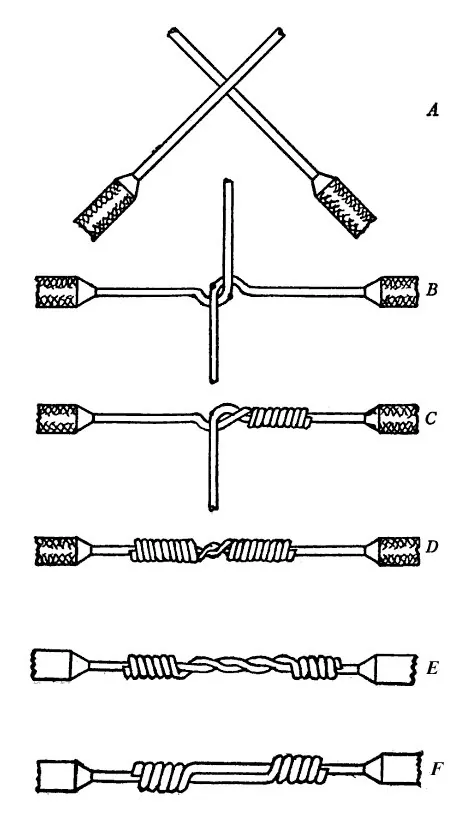
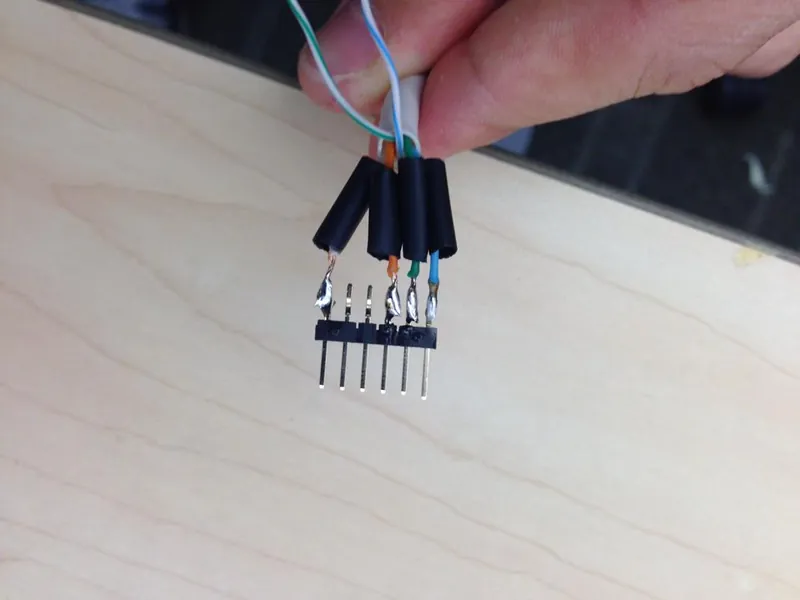
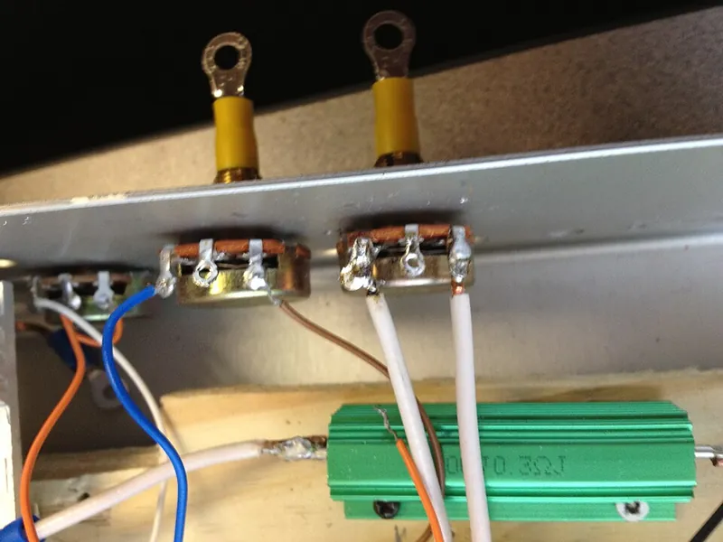

<figure class="eoc-pic eoc-pic-main"><figcaption><strong>Diagram.</strong> <a href="https://commons.wikimedia.org/wiki/File:Western_Union_splice.jpg">Western Union splice</a> by John MacLaren Sharp, Public domain, from Wikimedia Commons.</figcaption></figure>
<figure class="eoc-pic"><figcaption><strong>Photo.</strong> <a href="https://commons.wikimedia.org/wiki/File:Soldered_new_motor_shield_connector.jpg">Soldered new motor shield connector</a> by Agashi5859, <a href="https://creativecommons.org/licenses/by-sa/3.0">CC BY-SA 3.0</a>, from Wikimedia Commons.</figcaption></figure>
<figure class="eoc-pic"><figcaption><strong>Photo.</strong> <a href="https://commons.wikimedia.org/wiki/File:De-soldered_wires_on_potentiometer.JPG">De-soldered wires on potentiometer</a> by Nathanhall78, <a href="https://creativecommons.org/licenses/by-sa/3.0">CC BY-SA 3.0</a>, from Wikimedia Commons.</figcaption></figure>

Stripped wire ends are twisted, hooked or laid side by side, molten solder is flowed into them with a soldering iron so it bonds to the copper, and the finished joint is covered with heat-shrink tubing; it is the basic permanent wire joint that crimps, solder sleeves, lever connectors and wire nuts are compared with.

**In plain words:** Two wires (or a wire and a metal pin or pad) are twisted or laid together and melted metal called solder is run into them with a hot soldering iron, so they set into one permanent joint that carries electricity well; a shrink-on plastic sleeve then covers it. **Proper term:** Soldered wire joint (soldered splice; soft-soldered electrical connection).

**Also called:** soldered splice, solder splice, wire splice, electrical splice (a joint directly connecting lengths of cable; Wikipedia 'Line splice'); Western Union splice, lineman splice, lineman's splice: hooked and tightly wrapped wires, then soldered (Wikipedia 'Western Union splice'; NASA-STD-8739.4A §19.7); lap splice: wire ends laid side by side, overlapping, and soldered (NASA-STD-8739.4A §19.4); lash splice: a lap splice bound with turns of thin solid wire before soldering (NASA-STD-8739.4A §19.5); rat-tail splice, twist splice, pig-tail splice: two or more wires twisted together round a common axis (Wikipedia 'Rat-tail splice'); T-splice, tap: a branch wire joined to the middle of a main wire (Wikipedia 'T-splice'); SparkFun calls the soldered version a 'Western T-splice'; solder cup, solder bucket: the hollow cup on the back of a connector pin that is filled with solder and the wire pushed in (Wikipedia 'Electrical connector'); tinning, pre-tinning: coating stripped wire with solder before joining (NASA-STD-8739.4A §10.1.2, §19.4.1); solder ferrule splice: wires soldered inside a small metal tube (NASA-STD-8739.4A §19.8); solder joint, soldered connection; 'cold joint' and 'dry joint' for faulty ones (Wikipedia 'Soldering').

## How it works

The wires are first held together: twisted round each other (rat-tail or Western Union splice), laid side by side (lap splice), or pushed into a cup or hole. The iron heats the copper above the solder's melting point (183 °C for 63/37 tin-lead, about 217-220 °C for lead-free tin-silver-copper), and the flux in the solder cleans off oxide so the molten solder flows into the gaps and wets the metal (Wikipedia 'Soldering'). When it cools the solder sets into a metal bridge bonded to both wires, giving a low-resistance path; in NASA pull tests on soldered Western Union splices the wire broke beside the splice, never at it (Wikipedia 'Western Union splice'). The solder also soaks a little way along stranded wire (wicking), making it stiff up to that point and flexible beyond, so bending concentrates there and the joint needs strain relief (NASA-STD-8739.4A §13.3.1).

## Parts

A few parts: the two (or more) stripped wire ends, or a wire and a terminal, pin, solder cup or circuit-board pad; solder (usually wire solder with flux in its core); and an insulating cover, usually a length of heat-shrink tubing slid onto one wire before joining (SparkFun 'Working with Wire'; NASA-STD-8739.4A §19). Sometimes a few turns of thin solid wire to bind a lash splice (NASA §19.5) or a small metal ferrule (NASA §19.8).

## Everyday examples

- Wires soldered to the solder cups or tabs on the back of plugs and sockets, often hidden under a backshell (Wikipedia 'Electrical connector')
- Battery leads of drones and radio-controlled models soldered into high-current plugs (Holybro 'Connector & Wire Rating')
- Wires and components soldered onto LED strips, switches and small circuit-board pads in hobby kits; SparkFun shows a resistor and jumper wires added with a T-splice (SparkFun 'Working with Wire')
- Early telegraph and knob-and-tube house wiring, which used the Western Union splice and the T-splice (Wikipedia 'Western Union splice', 'T-splice')

## When to use it

Use a soldered joint for small, permanent, low-resistance joints in low-voltage wiring when you have a soldering iron: lengthening or repairing wires inside a project, attaching wires to switches, LEDs, motors, battery packs and circuit-board pads, adding a component partway along a wire (T-splice), and wiring solder-cup connectors. It is small and light (solder-style splices give 'a smaller, more compact splice termination, with significant weight reductions over crimp-style splices'; NASA-STD-8739.4A §19.3), needs no crimper matched to each terminal size, copes with mixed wire sizes, and carries the full current of the wire. A Western Union splice suits solid wire that may be pulled (Wikipedia 'Western Union splice'; SparkFun), and a lap or lash splice gives the slimmest joint (NASA §19.4-19.5).

## When not to use it

Don't use it in fixed mains wiring or inside anything that plugs into the mains: wiring rules set which joints are allowed there, so use the connector the rules require, or a qualified electrician (OSHA 29 CFR 1910.303; Wikipedia 'Rat-tail splice'; Approved Document P). Avoid it where the wire vibrates, flexes or is pulled (vehicles, robot arms, moving print heads): the stiff solder-soaked section cracks at its edge, so use a proper crimp (Crimped butt splice, Crimp terminals), which is 'highly resistant to vibration and thermal shock' (Wikipedia 'Crimp (joining)'), plus strain relief. Don't solder-tin wire ends that go into screw terminals; fit a Wire-end ferrule instead (Wikipedia 'Screw terminal'). Avoid it where the joint gets hot, because soft solder 'loses strength, and eventually melts' (Wikipedia 'Soldering'). If you will want to disconnect it, use a plug-and-socket connector, a lever connector or a screw terminal. Outdoors or in water, seal it with glue-lined heat-shrink or use a solder sleeve. Don't solder where nearby plastic parts, sensors or other joints can't be protected from the heat (NASA-STD-8739.4A §7.2.41).

## Details

- **What it does (jobs):**
  - join and hold: makes a permanent electrical and mechanical join between wires, or between a wire and a pin, cup, tag or pad (the finder reaches this entry through the 'electrical connections' family)
- **Movement:** none: the joint is rigid, and the wire next to it must not be flexed repeatedly (NASA-STD-8739.4A §7.2.36: splices 'shall not be located in areas of the cable where flexing may occur').
- **Directions it can move (degrees of freedom):** 0: the joined wires cannot move relative to each other.
- **Special behaviour:**
  - none: it simply joins. (A joint made with a deliberately low-melting solder can act as a heat-triggered release, but that is the separate Burn-wire and fusible-link release entry.)
- **How it holds:**
  - [material bond](../glossary.md#form-fit--force-fit--material-bond) (glue, solvent or melting): molten solder wets both metals and sets into a metal bridge (Wikipedia 'Soldering')
  - shape (the parts interlock; form-fit): in twisted, Western Union and lash splices the wraps hold the wires together before soldering; the Western Union wrap 'causes the join to tighten as the conductors pull against each other' (Wikipedia 'Western Union splice'), and US workplace rules require soldered splices to be 'mechanically and electrically secure without solder' first (OSHA 29 CFR 1910.303(c)(3)(i))
- **Input and output:** not applicable
- **Power:** passive (no power needed): heat is needed only to make or undo the joint, not to hold it.
- **Load:** Electrical: above about 30 A (the joint has no rating of its own: a well-made soldered joint carries whatever its wire and connector are rated for, from signal wires up to e.g. 45 A continuous for an XT90-type plug soldered to 10 AWG wire and 150 A for an AS300-type plug on 6 AWG wire (Holybro 'Connector & Wire Rating')); extra-low voltage only (as a maker's joint: soldered splices in mains wiring are restricted or banned by wiring rules, see safety_notes). Mechanical: medium in a straight pull, since soldered Western Union splices on 16 and 22 AWG wire broke outside the splice in NASA tests (Wikipedia 'Western Union splice'); weak against bending, vibration and repeated flexing, which crack the wire where the solder stops (NASA-STD-8739.4A §13.3.1). Soft solder 'does not make a strong joint and is unsuitable for mechanical load-bearing applications' (Wikipedia 'Soldering'), and solder joints are 'more prone to mechanical failure than crimped joints when subjected to vibration and compression' (Wikipedia 'Electrical connector'). Add strain relief so the joint carries no load.
- **Play and precision:** not applicable
- **Taking it apart:** semi-permanent (can be undone but may damage parts): the solder can be melted and removed with desoldering braid (wick) or a solder sucker (Wikipedia 'Soldering'), but wrapped splices are usually cut out and the wires shortened and remade.
- **How often it can be reused:** a few times: a joint can be desoldered and remade, but old solder should be removed first because used solder holding dissolved metal makes [brittle](../glossary.md#brittle--ductile) 'cold' joints (Wikipedia 'Soldering'), and each cut-and-remake shortens the wire.
- **Sealing:** none: the bare joint is exposed until it is covered. Plain heat-shrink gives insulation and protection from dust and solvents; heat-shrink with a glue lining 'help[s] provide a good seal' (Wikipedia 'Heat-shrink tubing'), and a solder-seal sleeve gives 'a tough, waterproof joint' (Hackaday 2023).
- **Adjustable:** no: once the solder sets the joint can only be changed by desoldering and remaking it.
- **Access needed:** both sides: you need room all round the joint to hold the wires, heat it, solder the underside as well as the top and slide the heat-shrink over (SparkFun 'Working with Wire': 'Ensure that the underside of the wire is also soldered'); a solder cup needs access to the back of the connector (Wikipedia 'Electrical connector').
- **Materials:** Wires: copper, solid or stranded, bare or tinned; joins them to tinned, plated or brass pins, tags, cups and circuit-board pads. Copper, zinc, brass, silver and gold solder easily; iron, mild steel and nickel are harder; stainless steel and some aluminium alloys are difficult because of their tough oxide films (Wikipedia 'Soldering'). Solder: tin-lead 63/37 (eutectic, melts at one temperature, 183 °C) or 60/40 (183-190 °C) is easiest; lead-free tin-silver-copper melts at 217-220 °C and needs more heat and flux (Wikipedia 'Soldering'; Adafruit 'Tools'). Flux: rosin, RMA or no-clean for electronics; never acid plumbing flux, whose residue conducts and 'will eventually dissolve small diameter wires' (Wikipedia 'Soldering'). Cover: polyolefin heat-shrink, usable from −55 to 135 °C (Wikipedia 'Heat-shrink tubing'). Wire insulation can melt back if the iron stays on too long (SparkFun 'Working with Wire').
- **Heat, cold, water and wear:** Heat: soft solder loses strength as it warms and melts at 183 °C (63/37 tin-lead) or 217-220 °C (lead-free) (Wikipedia 'Soldering'); polyolefin heat-shrink is rated about −55 to 135 °C (Wikipedia 'Heat-shrink tubing'). Vibration and flexing are the main threat: 'a soldered joint (of a tinned tip) can fracture under mechanical stress and thermal cycling may cause joint failure' (SparkFun 'Working with Wire'), and movement concentrates stress where the wicking stops (NASA-STD-8739.4A §13.3.1). [Creep](../glossary.md#creep): solder slowly flows under steady pressure, so heavily tinned wire clamped in a screw terminal works loose (Wikipedia 'Screw terminal'). Damp: leftover flux can stay slightly active, so remove it in high humidity to reduce corrosion (Wikipedia 'Soldering'). Sunlight: coloured heat-shrink resists UV less well, and 'only black is recommended for outdoor applications' (Wikipedia 'Heat-shrink tubing'). Long term: lead-free tin finishes can grow tin whiskers (Wikipedia 'Soldering'); bismuth low-melt solders give joints 'prone to cracking' (Wikipedia 'Solder').

## Making it

- **Ways to make or get it:**
  - off-the-shelf part: solder, flux and heat-shrink are bought, and the joint is made by hand with a soldering iron
  - 3D print (FDM): printed clamps, jigs and 'helping hands' hold the wires still while soldering (SparkFun suggests '3D printing clamps'; Printables models in make_it_yourself)
  - 3D print (FDM): printed cable clamps and enclosures that grip the cable sheath so the joint is never bent or pulled ⚑ [uncertain]
- **Printing it in one piece (print in place):** no: the joint is made by melting metal and can't be printed; only holding jigs and strain-relief parts are printed (one popular wire-holding clamp prints in place; Printables 1341728).
- **Tools:** Soldering iron: pencil type of at least 25 W, ideally a temperature-controlled station (Adafruit 'Tools'), with a stand and a brass or damp-sponge tip cleaner (SparkFun 'How to Solder'); solder, usually flux-cored, plus a flux pen for stubborn joints (SparkFun); wire strippers and flush cutters; something to hold the wires still (helping hands, a vice, tape on a soldering mat, or a 3D-printed clamp) (SparkFun 'Working with Wire'); heat-shrink tubing and a hot-air gun or rework station (SparkFun; Wikipedia 'Heat-shrink tubing'); desoldering braid or a solder sucker for mistakes (Wikipedia 'Soldering'); safety glasses and fume extraction (SparkFun; HSE).
- **Difficulty:** moderate: the materials are cheap, but a reliable joint needs a hot, clean iron, the wires held still and some practice; soldering 'requires a combination of technical knowledge and practical experience' (Wikipedia 'Soldering'). Solder-seal sleeves, crimps and lever connectors are the usual lower-skill alternatives (Hackaday 2023).

### 3D printing tips

The joint itself can't be printed, but prints help around it. 1) Print a jig or clamp that holds the two wires end to end while you solder and while the solder cools: a joint moved while setting becomes a weak, frosted 'disturbed' joint (Adafruit 'Common Problems'), and SparkFun suggests 'a third hand or 3D printing clamps to hold the wires in place'. 2) Print jigs in a heat-tolerant filament: a popular [print-in-place](../glossary.md#print-in-place) wire clamp recommends PETG or ABS, though PLA also works (Printables 1341728); keep the iron tip and the hot joint off the plastic, because solder melts at 183 °C or more (Wikipedia 'Soldering'), far hotter than printed plastics tolerate ⚑ [uncertain]. 3) Design enclosures with a clamp, [gland](../glossary.md#gland), cable tie anchor or hot-glue pocket that grips the cable's outer sheath, so a tug on the cable never reaches the soldered joint (NASA-STD-8739.4A §7.2.20: wires exiting connectors 'shall be stress relieved'; see Cable gland and strain relief). 4) Don't put a splice where a printed hinge, slide or moving head will flex the wire (NASA §7.2.36); route the joint into a fixed part of the cable. 5) Leave room in channels and enclosures for the heat-shrink-covered splice, which is fatter than the wire, and stagger several splices along a bundle so it stays slim (NASA §7.2.35).

### Buying one (off-the-shelf parts)

Solder wire: 63/37 or 60/40 tin-lead, or lead-free tin-silver-copper ('SAC'), usually with a rosin or no-clean flux core; flux pens, flux paste and syringes; heat-shrink tubing (polyolefin, typically 2:1 shrink ratio, also 3:1, plain or glue-lined); solder sleeves (solder-seal splice connectors) with a built-in solder ring; connectors with solder cups or solder tags on the back of the pins; desoldering braid (wick) and solder suckers; helping hands and PCB vices; soldering irons and stations with interchangeable tips; brass tip cleaners; fume extractors (Wikipedia 'Soldering', 'Heat-shrink tubing', 'Electrical connector'; SparkFun 'How to Solder'; Adafruit 'Tools'; Hackaday 2023).

## Rules of thumb

- Lap splice: pre-tin both wires, lay them parallel and touching for at least 3 and not more than 6 wire diameters, don't twist them, and form a solder [fillet](../glossary.md#chamfer--fillet) along the whole overlap with the wire outlines still visible (NASA-STD-8739.4A §19.4.1, pp. 68-69).
- Lash splice: as a lap splice, bound with solid wire wrapped at least 6 turns, either closed (touching) or as an open spiral with no more than 2 lashing-wire diameters between turns; trim the wrap ends flush before soldering (NASA-STD-8739.4A §19.5.1, pp. 69-70).
- Western Union splice: pre-tin, then at least 3 tight turns of each wire round the other with no gaps between turns, wraps not overlapping, ends trimmed flush so they can't poke through the sleeve; solder must wet and fillet all round (NASA-STD-8739.4A §19.7.1, pp. 71-72). The 1915 textbook method uses 5-6 snug twists each side (Wikipedia 'Western Union splice').
- Cover every splice with tubing that reaches past it onto the insulation by at least 2 x the diameter of the largest wire at each end; each extra layer overlaps the one below by at least 2 diameters (NASA-STD-8739.4A §19.2.6, p. 67).
- When tinning stranded wire, keep the strands visible, don't let solder wick into parts that must stay flexible, and leave no more than 1 wire diameter of untinned wire between the tinning and the insulation; insulation should stop less than 2 wire diameters from the joint (NASA-STD-8739.4A §10.1.2, §10.1.4).
- Don't place splices where the cable flexes or within two harness diameters of where it branches, and stagger several splices along a bundle (NASA-STD-8739.4A §7.2.35-7.2.37).
- Iron temperature about 325-375 °C; if the solder smokes, turn it down; heat the pad and the wire together, feed solder to the joint, then remove the solder before the iron (SparkFun 'How to Solder'). Use an iron of at least 25 W (Adafruit 'Tools'); 'A 100-watt soldering iron may provide too much heat for printed circuit boards (PCBs), while a 25-watt iron will not provide enough heat for large electrical connectors' (Wikipedia 'Soldering').
- Melting points: 63/37 tin-lead 183 °C (eutectic, sets instantly); 60/40 183-190 °C; 50/50 183-215 °C; lead-free tin-silver-copper 217-220 °C (Wikipedia 'Soldering').
- A good joint is smooth and shiny with a concave fillet and the wire outline visible; dull grey or grainy suggests a moved or cold joint (lead-free solder may look dull even when good) (Wikipedia 'Soldering').
- Polyolefin heat-shrink usually shrinks 2:1 in diameter (3:1 available), shrinks about 6% in length too, and shrinks at about 143 °C (Wikipedia 'Heat-shrink tubing').

## Common failures

Cold joint: dull, lumpy solder that never fully melted or didn't wet the wire, often from heating the solder instead of the wire; it may work at first and fail later. Fix by reheating with a clean, hot iron powerful enough for the job (Wikipedia 'Soldering'; Adafruit 'Common Problems'). Disturbed (dry) joint: grainy or frosted because the wires moved as the solder set; reheat and hold still in a jig (Adafruit; Wikipedia). Too much solder: a blob that may not have wetted the wire at all (Adafruit). Overheated joint: burnt flux, melted or shrunk-back insulation; work quickly with a hot, clean tip (Adafruit; SparkFun). Wire snapping just beyond the solder after bending or vibration: keep wicking short, add strain relief and don't splice where the cable flexes (NASA-STD-8739.4A §13.3.1, §7.2.36; Wikipedia 'Electrical connector'). Forgetting to slide the heat-shrink on before joining (Hackaday 2023; SparkFun). Sharp wire ends or strands poking through the sleeve: trim wraps flush and leave no protruding strands (NASA §19.4.1, §19.7.1). Tinned wire in a screw terminal working loose and overheating (Wikipedia 'Screw terminal'). Corrosion from flux residue left in a damp place (Wikipedia 'Soldering'). Twisted and taped wires with no solder or connector: mechanically weak and not permitted on mains (Wikipedia 'Rat-tail splice').

## Safety

Burns and fire: the tip runs at about 325-375 °C; always park the iron in its stand, because an iron left lying around 'could burn you, or, worse, it could burn your desk and start a fire' (SparkFun 'How to Solder'). Overheated heat-shrink 'can melt, scorch or catch fire like any other plastic'; suppliers don't recommend shrinking it with a lighter (Wikipedia 'Heat-shrink tubing'). Eyes: wear safety glasses in case clipped wire ends or molten solder fly (SparkFun). Fumes: rosin-based flux fume 'is a top cause of occupational asthma'; don't overheat the iron, use fume extraction and keep your head out of the plume (HSE 'Solderer'); 'Even without the presence of lead, soldering can release fumes that are harmful' (Wikipedia 'Soldering'). Lead: tin-lead solder contains lead, which 'can build up in the body over time from inhalation, ingestion, or skin contact' (Adafruit 'Tools'); use lead-free solder where young children may touch the work or outdoors (Wikipedia 'Soldering'). Mains: this entry gives no mains wiring steps; mains work must follow local law, and the rules differ: in US workplaces OSHA allows soldered splices only if the wires are first 'mechanically and electrically secure without solder' and are then insulated as well as the wire itself (29 CFR 1910.303(c)(3)(i)), while Wikipedia says tape-only and soldered splices are not permitted 'for 110 volts or higher by most, or all, North American building electrical codes' (Wikipedia 'Rat-tail splice'); in England, electrical installation work in homes must meet Building Regulations Part P, and some of it must be notified or certified (Approved Document P, 2013 edition).

## Related

- Solder sleeve (solder-seal splice): heat-shrink with a solder ring and glue rings that solders, insulates and seals a splice in one step with a hot-air gun, no iron
- Crimped butt splice: a metal tube squeezed onto both wires with a crimp tool; no heat, better against vibration, but needs the right tool and size
- Crimp terminals and Wire-end ferrule: crimped ends for screws, blade connectors and terminal blocks, instead of tinning the wire
- Spring-clamp wire connector (lever connector): tool-free, reusable and joins different wire types, but bulkier
- Twist-on wire connector (wire nut): twisted wires held by a threaded cap, common in North American mains junction boxes
- Heat-shrink tubing: the usual insulating cover for this joint
- Wire wrap: solid wire wound tightly round a square post; no solder, and it can be unwound
- Insulation-displacement connector: forked blades cut through the insulation; no stripping, small currents only
- Conductive glue, paint and ink: for parts that can't take heat; much higher resistance than solder
- Cable gland and strain relief: what stops a pull or bend on the cable reaching the soldered joint
- Soldered metal joint: the same soft soldering used to join metal parts and copper pipes rather than wires
- Burn-wire and fusible-link release: uses a low-melting solder joint as a deliberate heat-triggered weak link

## Make it yourself

- [Soldering Helping Hands / Clamp for Wire Soldering (Print Hive, Printables) (URL from Printables API, page not opened)](https://www.printables.com/model/1341728-soldering-helping-hands-clamp-for-wire-soldering): Print-in-place clamp, no supports or assembly, that holds two wires in line while you solder them; PETG or ABS recommended *(licence: Creative Commons Attribution-NonCommercial-NoDerivatives)*
- [Wire Soldering Helper (BakedBean3D, Printables) (URL from Printables API, page not opened)](https://www.printables.com/model/456570-wire-soldering-helper): Small printed stand that holds wires in place while soldering them together, with a tray for offcuts or a tip-cleaning sponge *(licence: Creative Commons Attribution)*
- [wire soldering clamp jig / Löthilfe für Kabel löten (kjrps, Printables) (URL from Printables API, page not opened)](https://www.printables.com/model/704787-wire-soldering-clamp-jig-lothilfe-fur-kabel-loten): Clamp-on jig with two slots that line up wires up to 1.8 mm (scale 170% for 3 mm) for soldering; print in PETG *(licence: Creative Commons Attribution-NonCommercial-NoDerivatives)*

## Pictures, videos and models

- [Western Union splice.jpg (Wikimedia Commons, from J. M. Sharp, Practical Electric Wiring, 1915)](https://commons.wikimedia.org/wiki/File:Western_Union_splice.jpg): Step-by-step drawing (A-D) of making a short-tie Western Union splice, plus two long-tie variations (E, F) *(licence: Public domain)*
- [NASA-STD-8739.4A Workmanship Standard for Crimping, Interconnecting Cables, Harnesses, and Wiring (2016), chapter 19 'Splicing', pp. 67-78](https://nepp.nasa.gov/files/27631/nstd87394a.pdf): Photos and drawings of pre-tinned lap, lash, Western Union, solder-sleeve and solder-ferrule splices before and after soldering and sleeving *(licence: US government (NASA) publication, generally public domain in the US ⚑ [uncertain])*
- [Working with Wire, section 'How to Splice Wires' (SparkFun Learn)](https://learn.sparkfun.com/tutorials/working-with-wire/all): Step-by-step photos of stripping, sliding on heat-shrink, soldering a splice on a mat, shrinking the tube, plus a hooked Western Union splice and a T-splice *(licence: CC BY-SA 4.0)*
- [Adafruit Guide to Excellent Soldering: Common Problems](https://learn.adafruit.com/adafruit-guide-excellent-soldering/common-problems): Close-up photos of disturbed, cold and overheated joints, poor wetting and too much solder, with how to repair and prevent each *(licence: link only (licence not stated on the page))*
- [Cold solder joint2.jpg (Wikimedia Commons, by Coronium)](https://commons.wikimedia.org/wiki/File:Cold_solder_joint2.jpg): Photo of a cold solder joint where the wire was not heated enough *(licence: CC BY-SA 3.0)*

## Needs confirming

⚑ marks something nobody has confirmed yet: a fact the research could not confirm from a source, a finder value that is a best guess, or an open point from the research notes. Corrections are welcome (see `research/needs-confirming.md`).

- ⚑ 3 sentences on this page marked [uncertain].
- ⚑ Finder value `load_max` = light (best guess): electrical entry whose mechanical load has no light/medium/heavy band; set to light
- ⚑ Research note: *Soldered wire joint*: are soldered splices allowed in mains wiring? Wikipedia (*Rat-tail splice*) says most or all North American codes forbid tape-only and soldered splices at 110 V and above; OSHA 1910.303(c)(3)(i) allows them if the wires are first joined securely without solder. Both are in `safety_notes` with 'check your local code'.
- ⚑ Research note: *Soldered wire joint*: tinning wire ends for screw terminals. SparkFun suggests it; Wikipedia (*Screw terminal*) warns that solder creeps under pressure and the joint works loose. The entry follows Wikipedia and points to ferrules.

## Sources

- <https://en.wikipedia.org/wiki/Western_Union_splice>
- <https://en.wikipedia.org/wiki/Rat-tail_splice>
- <https://en.wikipedia.org/wiki/T-splice>
- <https://en.wikipedia.org/wiki/Line_splice>
- <https://en.wikipedia.org/wiki/Soldering>
- <https://en.wikipedia.org/wiki/Solder>
- <https://en.wikipedia.org/wiki/Electrical_connector>
- <https://en.wikipedia.org/wiki/Crimp_(joining)>
- <https://en.wikipedia.org/wiki/Heat-shrink_tubing>
- <https://en.wikipedia.org/wiki/Screw_terminal>
- <https://nepp.nasa.gov/files/27631/nstd87394a.pdf>
- <https://learn.sparkfun.com/tutorials/working-with-wire/all>
- <https://learn.sparkfun.com/tutorials/how-to-solder-through-hole-soldering/all>
- <https://learn.adafruit.com/adafruit-guide-excellent-soldering/tools>
- <https://learn.adafruit.com/adafruit-guide-excellent-soldering/common-problems>
- <https://www.hse.gov.uk/asthma/solderers.htm>
- <https://hackaday.com/2023/12/18/ask-hackaday-what-do-you-do-when-you-cant-solder/>
- <https://docs.holybro.com/power-module-and-pdb/power-module/connector-and-wire-rating>
- <https://www.osha.gov/laws-regs/regulations/standardnumber/1910/1910.303>
- <https://assets.publishing.service.gov.uk/government/uploads/system/uploads/attachment_data/file/441872/BR_PDF_AD_P_2013.pdf>
- <https://commons.wikimedia.org/wiki/File:Western_Union_splice.jpg>
- <https://commons.wikimedia.org/wiki/File:Rattail_splice.jpg>
- <https://commons.wikimedia.org/wiki/File:T-splice_wire.jpg>
- <https://commons.wikimedia.org/wiki/File:Cold_solder_joint2.jpg>
- <https://api.printables.com/graphql/>
