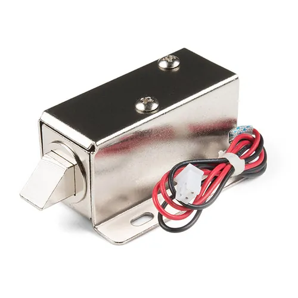
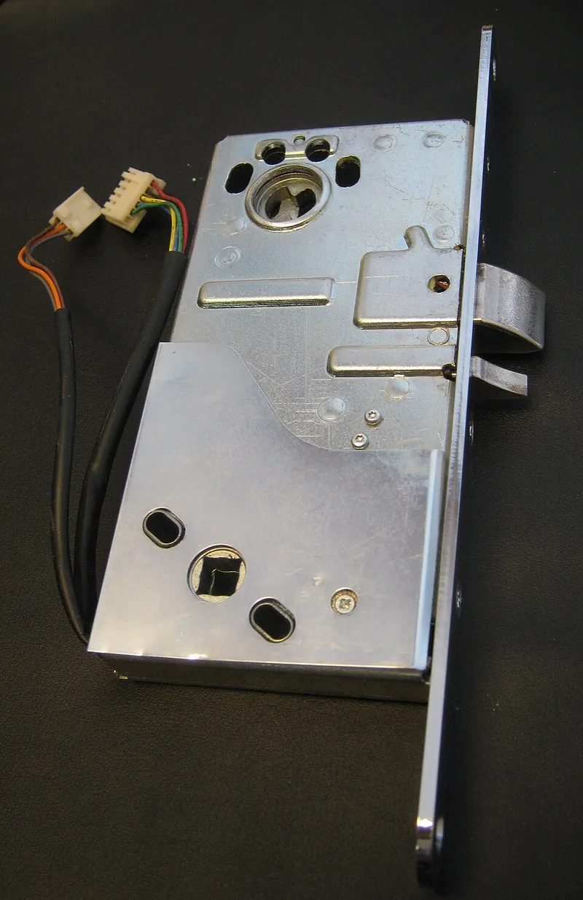

<figure class="eoc-pic eoc-pic-main"><picture><source media="(prefers-reduced-motion: reduce)" srcset="../media/drawn/solenoid-latch.svg"></picture><figcaption><strong>Animation.</strong> Diagram drawn for the encyclopaedia from the research notes. ⚑ Needs confirming: a drawing can simplify or get details wrong; a real photo or a better diagram is welcome.</figcaption></figure>
<figure class="eoc-pic"><figcaption><strong>Photo.</strong> <a href="https://www.flickr.com/photos/41898857@N04/48021046541">Solenoid - 12V (Latch / Lock)</a> by SparkFunElectronics, <a href="https://creativecommons.org/licenses/by/2.0/">CC BY 2.0</a>, from Flickr via Openverse.</figcaption></figure>
<figure class="eoc-pic"><figcaption><strong>Photo.</strong> <a href="https://commons.wikimedia.org/wiki/File:SolenoidLock.jpg">SolenoidLock</a> by Cavernia, <a href="https://creativecommons.org/licenses/by-sa/3.0">CC BY-SA 3.0</a>, from Wikimedia Commons.</figcaption></figure>

A spring-loaded bolt or catch that an electromagnet coil ([solenoid](../glossary.md#solenoid)) pulls back when it is powered, so a door, box, drawer or release mechanism opens on an electric signal and locks itself again when closed.

**In plain words:** An electric catch: a spring pushes a bolt out to keep a door, lid or drawer shut, and when power goes to the coil it pulls the bolt back so it can open. **Proper term:** Solenoid latch (solenoid lock); on building doors: electric strike.

**Also called:** solenoid lock / lock-style solenoid; electric cabinet lock / solenoid cabinet lock / 12 V solenoid door lock; electronic latch / electric latch release; electric strike / door strike / door release / buzzer door release (German 'Türöffner', Polish 'elektrozaczep'); electric bolt lock / electromagnetic bolt; push-pull solenoid or pull-type solenoid used as a latch (e.g. the JF-0530B hobby solenoid); cabinet spring lock / locker lock (parcel-locker style); latching ([bistable](../glossary.md#bistable)) solenoid; cash drawer solenoid; fail-secure lock / [fail-safe](../glossary.md#fail-safe--fail-secure) lock (names for its power-loss behaviour).

## How it works

A spring pushes the steel bolt (plunger) out so it sticks into a catch and holds the door, lid or drawer shut. When current flows through the coil, it becomes an electromagnet and pulls the plunger into the coil, drawing the bolt back so the door can open; when the current stops, the spring pushes the bolt out again. Many bolts have a slanted face, so closing the door pushes the bolt back by itself and it snaps into the catch (it locks itself). An electric strike works the other way round: the door keeps its ordinary latch, and the solenoid in the frame frees or blocks a hinged jaw (keeper), so when unlocked the latch can push the jaw aside and the door opens.

## Parts

A few parts: a copper coil around a steel plunger (the sliding bolt or 'slug', often with a slanted end), a return spring, a steel frame or case with a mounting bracket, and a catch or strike on the other part. An electric strike is a small assembly that acts as one unit: a box set into the door frame with a hinged jaw (keeper), a spring, and a solenoid that locks or frees the keeper. Plus the electrics: a DC supply and a switch, relay or transistor with a diode across the coil.

## Everyday examples

- the buzzing door release on an apartment building's entrance, opened from the intercom (an AC-powered electric strike)
- office doors that unlock with a card reader or keypad and relock when they close
- parcel lockers whose doors pop open when you type in a code
- a shop cash drawer that springs open when a receipt prints

## When to use it

When something must stay locked without using power and open only on an electric signal: keypad, RFID or app-controlled boxes, cabinets, lockers and escape-room props; adding remote entry to a door that keeps its normal handle and key (electric strike); triggering a release mechanism such as a drop, a spring-loaded lid or a trap door. Good when the bolt must resist a strong pull (a steel bolt is not weakened by paint or small gaps as a magnet is) and when a power cut must not open it (fail-secure).

## When not to use it

Not where the bolt is pressed hard sideways when it needs to release (a stuffed box lid, a swollen door): use a preload-rated strike, a servo or motorised latch, or a lever that takes the load off the bolt. Not for staying unlocked for long periods, because the coil overheats: use a latching solenoid, a servo latch or a hold-open strike. Not as a fail-secure lock on an escape route or on anything a person or child could be shut inside: use a fail-safe lock or a maglock with code-compliant release. Not where it must be silent (it clacks, and AC strikes buzz): a servo latch or a shape-memory-wire latch is quieter. For small battery projects, its 0.3-1 A pull-in current is heavy: consider a latching solenoid, servo or shape-memory wire.

## Details

- **What it does (jobs):**
  - hold or release using power: most versions stay locked with no power and unlock while powered (fail-secure); others lock only while powered (fail-safe)
  - join and hold: the bolt keeps a door, lid, drawer or mechanism shut
- **Movement:** slide: the bolt or plunger moves in and out, about 10 mm in hobby lock-style and push-pull solenoids; in an electric strike the keeper (jaw) also swings aside
- **Directions it can move (degrees of freedom):** 0 between door and frame while locked (the bolt blocks the door); the plunger itself has 1 (it slides in the coil); once unlocked the door has its own 1 (hinge or slide).
- **Special behaviour:**
  - quick-release: opens instantly on an electric signal from a keypad, card reader, intercom button, cash register or microcontroller; some strikes and locker locks stay unlocked after a short pulse until the door is actually opened (hold-open), then relock
  - one-way (moves freely one way, locks the other): a slanted bolt or a strike's ramped keeper lets a closing door push past and latch itself, but blocks it from opening
  - fail-safe or breakaway: sold as fail-secure (stays locked if the power fails) or fail-safe (unlocks if the power fails); many electric strikes can be switched between the two in the field
- **How it holds:** shape (the bolt blocks the door or lid; [form-fit](../glossary.md#form-fit--force-fit--material-bond)), pushed into place by spring force (the return spring); in fail-safe versions a powered hold (the coil holds the bolt out only while powered); latching (bistable) solenoids hold their position with a small permanent magnet
- **Input and output:** not applicable
- **Power:** powered: fail-secure types (most hobby lock-style solenoids, cabinet and locker locks, cash drawers and many electric strikes) stay locked when power is lost and need power only to open, e.g. about 0.65 A at 12 V for 1-10 s (Adafruit 1512) or a 100-300 ms pulse (parcel-locker spring lock); fail-safe types lock only while powered and unlock if the power fails; latching (bistable) solenoids keep their last position with no power and switch back with a reverse pulse.
- **Load:** light to heavy: small cabinet solenoids have bolts about 10 mm square meant for light duty with little side force; door electric strikes are heavy duty, with static strengths of about 1,500-3,250 lb and dynamic strengths around 70 ft-lb. The steel bolt is strong in [shear](../glossary.md#peel-vs-shear) when blocking the door, but the solenoid itself only pulls a few newtons (e.g. 5 N at the end of its 10 mm [stroke](../glossary.md#stroke) for a JF-0530B), so it cannot pull the bolt back if the door is pressing on it ([preload](../glossary.md#preload)).
- **Play and precision:** Needs a small gap and good alignment between bolt and catch: too tight and door pressure pinches the bolt so it cannot retract (preload), too loose and the door rattles or the bolt misses. Basic electric strikes release under only about 3-5 lb of preload, premium ones up to 25 lb. It does not locate parts precisely.
- **Taking it apart:** tool-free quick release: opens on an electric signal; the lock body itself is screwed in place
- **How often it can be reused:** many times: it relocks every time the door closes, but it is a moving mechanism with a spring, so the bolt, spring and catch slowly wear ⚑ [uncertain: no cycle-life figure opened for hobby solenoid locks]
- **Sealing:** none
- **Adjustable:** A little: lock-style solenoids let you rotate the slanted slug to face any of four directions to suit the door (Adafruit 1512, ProtoSupplies); electric strikes have horizontal adjustment or swappable jaw inserts to match the latch position and relieve preload; controller software sets how long it stays unlocked. The force cannot be adjusted.
- **Access needed:** one side only (blind): fitted inside the box, cabinet or door (the secure side); a door electric strike goes into the door frame where the ordinary strike plate was
- **Materials:** Copper coil, soft-steel plunger and frame (the magnetic path), steel return spring; lock bodies in stainless or plated steel; electric strike faceplates in stainless steel or brass. Fits wood, metal or plastic doors and boxes; printed catches and brackets in PETG, ASA or nylon rather than PLA if they sit near the coil or in the sun ⚑ [uncertain: exact plunger and case steel grades not verified].
- **Heat, cold, water and wear:** Coil heat is the main limit: power it only briefly (see rules of thumb), a hot coil pulls less, and high ambient temperature lowers the allowed duty cycle (Binder: a 25% rating becomes about 16.75% at 60 °C). Printed PLA brackets near the coil soften above about 60 °C (Prusa). On building doors, heat (exterior doors can reach 190 °F), humidity, HVAC stack pressure and thick weatherstripping cause preload that stops the strike releasing (Locksmith Ledger). Dirt, rust or ice on the plunger can make it stick, and the return spring can weaken over years of use ⚑ [uncertain: general experience, not from an opened source]. Most hobby solenoid locks are light duty and not rated for outdoor use ⚑ [uncertain].

## Making it

- **Ways to make or get it:**
  - off-the-shelf part: lock-style solenoids, cabinet and locker locks, push-pull solenoids, electric strikes, electric bolt locks
  - 3D print (FDM): mounting brackets, catches, keepers, strike plates and enclosures
  - woodwork: fitting into cabinets, boxes, drawers, doors and escape-room props
  - sheet metal: steel catches, strike plates and brackets
- **Printing it in one piece (print in place):** no: the solenoid is a bought part; printed brackets, catches and housings are separate parts
- **Tools:** To fit: drill and screwdriver (a chisel or router to recess a door electric strike into the frame); wire strippers or soldering iron; a DC power supply that can deliver the inrush current; a relay, solid-state relay or logic-level MOSFET with a diode for microcontroller control. To open: only the electric signal (plus a key or manual override if one was designed in).
- **Difficulty:** easy: buy a 12 V lock-style solenoid or a small push-pull solenoid, mount it with a printed or bent-metal bracket, and drive it with a relay or MOSFET plus a diode; the fiddly part is lining up the bolt and the catch

### 3D printing tips

Print the bracket and the catch, not the solenoid. Mount the solenoid with its own screw holes (e.g. two M3 holes on a JF-0530B) into [heat-set inserts](../glossary.md#heat-set-insert) or through-bolts; DigiKey's printed briefcase mount was simply epoxied in place, though screws also work (Printables 1081150). Match the catch to the bolt: with a slanted slug, make the catch ramp face the same way so the closing lid pushes the slug in, and make the hole in the catch shallower than the solenoid's stroke (about 10 mm on common 12 V lock and push-pull solenoids) so the bolt fully clears it when pulled in. Leave [clearance](../glossary.md#clearance) round the bolt so it is never pinched: if a spring, seal or tightly packed lid presses on the bolt, the few newtons of pull from a small solenoid cannot drag it free (the same 'preload' problem that electric strikes are rated for, Locksmith Ledger); test release with the lid under its real pressure. The pull is strongest near the end of the stroke and weakest at the start (Tinytronics JF-0530B; Binder), so avoid designs where the bolt must start moving against a load. Make the catch strong where the bolt bears on it: use plenty of [perimeters](../glossary.md#perimeters) and print it so the bolt's force presses across the layers rather than trying to split them, or press a steel pin or plate into the catch for boxes that will be yanked ⚑ [uncertain: general FDM practice, no guide opened for this]. Heat: the coil gets hot if left on (the Adafruit 1512 is meant for 1-10 s activations), so keep PLA away from the coil body or print the bracket in PETG or ASA (Prusa: PLA softens above about 60 °C, PETG suits below about 80 °C, ASA up to about 93 °C). For a fail-secure box, design in a hidden manual release (a pull cord, a pin hole or an external power jack) so a flat battery doesn't lock the contents in for good (DigiKey safe build). A Thingiverse design flips the idea for fail-safe use: a spring pushes the rod to open the lock when power is lost (Thingiverse 6071727).

### Buying one (off-the-shelf parts)

Lock-style solenoid 12 VDC with slanted slug and bracket (e.g. Adafruit 1512; small version Adafruit 5065); solenoid electric door/cabinet lock 12 V (about 0.9 A, 10 mm stroke); open-frame push-pull solenoid JF-0530B (12 V, 5 N, 10 mm) and JF-0630B; cabinet spring lock / locker lock (pulsed release, stays open until the door is reclosed); electric strike (fail-safe/fail-secure, 12/24 VDC or 12-24 VAC, cylindrical, mortise, deadbolt and rim-panic types, preload-rated and hold-open versions); electric bolt lock; latching (bistable) solenoid; rotary solenoid; cash drawer solenoid (12 or 24 V drawer-kick); tubular push/pull solenoids (e.g. Ledex); relay module, solid-state relay (e.g. Panasonic AQY212GH) or logic-level MOSFET; flyback diode (e.g. 1N4007); door position sensor (reed or Hall effect).

## Rules of thumb

- Duty cycle = on time / (on time + off time), e.g. 2 minutes on in a 5-minute cycle is 40%; ratings assume a set ambient temperature (Binder uses +35 °C), and at 60 °C ambient a 25% rating drops to about 16.75% (multiply by 0.67) (Binder, https://www.binder-magnetic.com/en/content/31-technical-explanations-for-solenoids).
- Hobby lock solenoids are for short bursts only: Adafruit's 12 V lock-style solenoid is designed for 1-10 second activations (https://www.adafruit.com/product/1512); a 12 V 0.9 A solenoid door lock allows about 20 s maximum unlatched (https://protosupplies.com/product/solenoid-electric-door-lock-12v-0-9a/); a parcel-locker spring lock wants about a 100 ms pulse and at most 300 ms and will overheat and fail if powered continuously (https://learn.escaperoomtechs.com/cabinet-mag-lock/); cash drawers open on pulses under about 100 ms at about 1 A (https://www.posatmparts.com/guides/cash-drawer-wiring-connection-guide).
- Pull force is highest at the end of the stroke (plunger nearly in) and lowest at the start: a JF-0530B gives its 5 N maximum in the end position over a 10 mm stroke (https://www.tinytronics.nl/en/mechanics-and-actuators/solenoids/solenoids/solenoid-push-pull-12v-300ma-jf-0530b); rising (ascending) force-stroke curves suit working against a spring (Binder, https://www.binder-magnetic.com/en/content/31-technical-explanations-for-solenoids).
- Size the supply for the inrush current: about 500-650 mA flows into a 12 V lock-style solenoid, so a 9 V battery won't work (Adafruit, https://www.adafruit.com/product/1512).
- Fit a diode across the coil to absorb the voltage spike when the field collapses (ProtoSupplies, https://protosupplies.com/product/solenoid-electric-door-lock-12v-0-9a/; Adafruit recommends power transistors and protective diodes, https://www.adafruit.com/product/1512).
- Door preload: standard electric strikes release under about 3-5 lb of door pressure, preload-rated ones up to 25 lb, and real doors typically see up to 15-20 lb from HVAC stack pressure, weatherstripping, swelling or [misalignment](../glossary.md#misalignment) (Locksmith Ledger, https://www.locksmithledger.com/electronics-access-control/strikes-electro-magnetic/article/21288458/preload-electric-strikes-under-pressure).
- Copper coil resistance rises about 0.4% per °C, so a hot coil draws less current and pulls less; coil insulation classes set the maximum coil temperature, e.g. class B 130 °C, F 155 °C, H 180 °C (Binder, https://www.binder-magnetic.com/en/content/31-technical-explanations-for-solenoids).

## Common failures

(1) Burned-out or overheated coil from leaving the power on: limit the on-time in code or hardware to the maker's rating (e.g. 1-10 s for Adafruit's lock-style solenoid) and use a latching solenoid if it must stay open. (2) Won't unlock: bolt pinched by door or lid pressure (preload), misaligned catch, or a weak supply that can't provide the inrush current (e.g. a 9 V battery). (3) Doesn't latch when closed: the slanted face points the wrong way (rotate the slug) or the catch is misaligned or too deep for the stroke. (4) Microcontroller, transistor or relay damaged: no diode across the coil. (5) Locked out after a power failure or flat battery: fail-secure by design; add an override. (6) Door strike buzzes or releases unreliably: AC supply (AC strikes buzz by design), low voltage, or preload. (7) Printed catch wears or cracks where the bolt bears on it: thicker walls, a tougher filament or a steel insert ⚑ [uncertain].

## Safety

A fail-secure lock stays locked in a power cut: a DigiKey electronic-safe build notes that if power dies 'the case will stay locked indefinitely', so design in a key, a hidden manual release or an external power connection, and never put a fail-secure lock on anything a person, child or pet could be shut inside. Door locks on exit routes must still let people out: fire and life-safety codes apply to electric strikes, especially with panic hardware and on fire-rated or stairwell doors, so consult the fire marshal before fitting one (Wikipedia; Locksmith Ledger). The coil gets hot if left powered. Switching off the coil makes a voltage spike, so always fit a diode. Mains-powered door hardware should be installed by a qualified person ⚑ [uncertain: general electrical-safety advice].

## Related

- Holding electromagnet (maglock): no moving bolt; holds by magnetic pull, is silent and self-aligning, but releases whenever the power fails and needs a flat steel plate
- Servo or motorised latch: holds any position with no power and can drive either way; slower and quieter, and copes better with preload
- Shape-memory-alloy wire latch (nitinol): silent, tiny and light, but low force and slow
- Electro-permanent magnet: switched by pulses and holds with no power, no moving parts, but needs a steel target
- Burn-wire and fusible-link release: a one-shot electric release for things that only need to let go once
- Push-push latch and spring latches: the same spring bolt and catch, released by hand
- Sear and trigger (trip release): a solenoid is often used to trip a sear that releases a much bigger stored force than the solenoid could hold
- Electromagnetic brake (power-off, spring-applied): the same coil-against-spring idea applied to a turning shaft

## Make it yourself

- [Solenoid mount for locking briefcase by DigiKey (Printables 1081150; URL from Printables API, page not opened; details read via the Printables public API)](https://www.printables.com/model/1081150-solenoid-mount-for-locking-briefcase): Printed mount that holds a lock-style solenoid inside a briefcase for DigiKey's 'Pi Safe' electronic safe project *(licence: CC BY)*
- [DIY Electronic Safe Using Raspberry Pi 3 A+ (DigiKey Maker.io)](https://www.digikey.com/en/maker/projects/diy-electronic-safe-using-raspberry-pi-3-a/0f113b4cfa784b678dafcb766be01032): Build guide for a case locked by a 12 V lock-style solenoid switched by a solid-state relay from a Raspberry Pi, opened with a hidden Hall-effect sensor *(licence: link only)*
- [Arduino Solenoid Door Lock using RFID (Hackaday.io)](https://hackaday.io/project/172207-arduino-solenoid-door-lock-using-rfid): Project using a 12 V solenoid lock, relay module, RFID reader and Hall-effect door sensor with an Arduino Uno *(licence: not stated on the page)*
- [Solenoid locking mechanism by bhck (Thingiverse; details from search result snippet, page is JavaScript-rendered)](https://www.thingiverse.com/thing:6071727): Printable locking mechanism using a 12 V JF-0630B push-pull solenoid, designed fail-safe so a spring pushes the rod to open the lock when power is lost *(licence: ⚑ [uncertain: not visible])*

## Pictures, videos and models

- [SolenoidLock.jpg (Wikimedia Commons, Cavernia, 2011)](https://commons.wikimedia.org/wiki/File:SolenoidLock.jpg): Photo of a solenoid door lock case (Abloy EL 582 type) *(licence: CC BY-SA 3.0 (also GFDL 1.2+))*
- [Electric strike.jpg (Wikimedia Commons, Andriusval, 2008)](https://commons.wikimedia.org/wiki/File:Electric_strike.jpg): Photo of an electric strike, the frame-side part with the hinged keeper that the door latch passes when unlocked *(licence: Public domain)*
- [Tueröffner.jpg (Wikimedia Commons, Reinraum, 2011)](https://commons.wikimedia.org/wiki/File:Tuer%C3%B6ffner.jpg): Close-up of a German door opener (electric strike) showing the latch-operated locking pin that keeps it unlocked after the buzzer until the door is opened (hold-open) *(licence: CC0)*
- [HES 4500 Electric Strike | Fail Secure to Fail Safe Operation (HES Innovations, YouTube; title confirmed via YouTube oEmbed)](https://www.youtube.com/watch?v=FmyVdOUEVxQ): Manufacturer video on switching an electric strike between fail-secure and fail-safe operation *(licence: link only)*
- [Lock-style Solenoid - 12VDC (Adafruit product 1512)](https://www.adafruit.com/product/1512): Photos of a hobby lock-style solenoid with its slanted slug and mounting bracket, with specifications *(licence: link only)*

## Needs confirming

⚑ marks something nobody has confirmed yet: a fact the research could not confirm from a source, a finder value that is a best guess, or an open point from the research notes. Corrections are welcome (see `research/needs-confirming.md`).

- ⚑ 8 sentences on this page marked [uncertain].
- ⚑ Finder value `power_loss` = stays locked (best guess): versions differ: stays locked, lets go, keeps its last state
- ⚑ Finder value `clicks` = clicks (best guess): one-way or indexing, but neither clicking nor silent named; defaulted to clicks
- ⚑ Finder value `powered_does` = lock or hold (best guess): set by Claude from the entry's name and power text (R33), for "What should it do?" under "Hold or let go using power"

## Sources

- <https://en.wikipedia.org/wiki/Electric_strike>
- <https://en.wikipedia.org/wiki/Solenoid_(engineering)>
- <https://www.adafruit.com/product/1512>
- <https://protosupplies.com/product/solenoid-electric-door-lock-12v-0-9a/>
- <https://learn.escaperoomtechs.com/cabinet-mag-lock/>
- <https://www.tinytronics.nl/en/mechanics-and-actuators/solenoids/solenoids/solenoid-push-pull-12v-300ma-jf-0530b>
- <https://www.binder-magnetic.com/en/content/31-technical-explanations-for-solenoids>
- <https://www.locksmithledger.com/electronics-access-control/strikes-electro-magnetic/article/21288458/preload-electric-strikes-under-pressure>
- <https://www.locksmithledger.com/electronics-access-control/strikes-electro-magnetic/article/21164931/the-buzz-about-electric-strikes>
- <https://www.posatmparts.com/guides/cash-drawer-wiring-connection-guide>
- <https://www.digikey.com/en/maker/projects/diy-electronic-safe-using-raspberry-pi-3-a/0f113b4cfa784b678dafcb766be01032>
- <https://hackaday.io/project/172207-arduino-solenoid-door-lock-using-rfid>
- <https://help.prusa3d.com/article/pla_2062>
- <https://help.prusa3d.com/article/petg_2059>
- <https://help.prusa3d.com/article/asa_1809>
- <https://commons.wikimedia.org/wiki/File:SolenoidLock.jpg>
- <https://commons.wikimedia.org/wiki/File:Electric_strike.jpg>
- <https://commons.wikimedia.org/wiki/File:Tuer%C3%B6ffner.jpg>
- <https://commons.wikimedia.org/wiki/File:Elektrozaczep.jpg>
- <https://commons.wikimedia.org/wiki/Category:Electric_locks>
- <https://www.youtube.com/watch?v=FmyVdOUEVxQ (verified via YouTube oEmbed)>
- <https://www.printables.com/model/1081150-solenoid-mount-for-locking-briefcase (read via https://api.printables.com/graphql/)>
- <https://www.thingiverse.com/thing:6071727 (search result snippet only)>
- <https://api.printables.com/graphql/>
