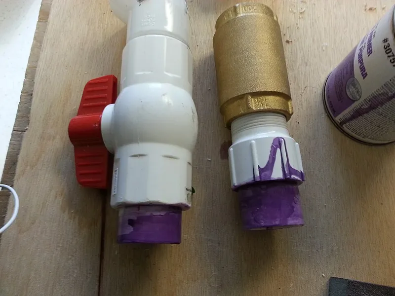

<figure class="eoc-pic eoc-pic-main"><figcaption><strong>How it works.</strong> <a href="https://commons.wikimedia.org/wiki/File:Water_Ram_Repair_PVC_Cement.jpg">Water Ram Repair PVC Cement</a> by Jshin722, <a href="https://creativecommons.org/licenses/by-sa/3.0">CC BY-SA 3.0</a>, from Wikimedia Commons.</figcaption></figure>

A solvent is brushed onto, or run into, the joint between two parts made of a plastic it can dissolve; the surfaces soften and mingle, and as the solvent evaporates they harden into one continuous piece of plastic with no separate layer of glue.

**In plain words:** A liquid that melts the surface of two plastic parts for a moment, so they flow into each other and harden into one piece as it dries, like brushing acetone onto a broken LEGO brick or 'gluing' plastic plumbing pipes together. **Proper term:** Solvent welding (solvent cementing, solvent bonding).

**Also called:** solvent cement (the name used in plumbing and acrylic fabrication; Oatey, Associated Plastics); solvent bonding (Wikipedia 'Plastic welding'); chemical welding (Prusa: solvent glues work by partially melting the material and 'chemically welding it together'); PVC cement, CPVC cement, ABS cement, 'PVC glue' (Oatey points out that the cement is not really a glue, because it fuses the plastic instead of sticking to it); [primer](../glossary.md#primer) and cement (two-step) and one-step or single-step cement (PVC plumbing; Oatey); acrylic cement, 'plexiglass glue', water-thin or capillary cement, thickened or viscous cement (acrylic sheet; U.S. Plastic Corp., Associated Plastics); plastic cement, poly cement, model cement, extra-thin cement (plastic model kits; Prusa, Wikipedia 'Plastic model'); ABS juice, ABS glue and ABS slurry, or 'sprue goo' (home-made thick cement made by dissolving scraps of the same plastic in a solvent; MatterHackers, Prusa, Wikimedia Commons); capillary cementing, soak (dip) cementing, viscous cementing (the three ways of applying acrylic cement; U.S. Plastic Corp.); brand names a beginner may search for: Weld-On (brand), Oatey (brand), SCIGRIP (brand), Tamiya Extra Thin Cement (brand), Humbrol Poly Cement (brand), Revell Contacta (brand).

## How it works

The solvent temporarily dissolves the surface of each part at room temperature, so the long plastic molecules (polymer chains) become free to move and tangle with the softened molecules of the other part (Wikipedia 'Plastic welding'). Over time the solvent soaks through the plastic and escapes into the air, the molecules lose their mobility, and what is left is one solid mass of intertwined plastic: a solvent weld rather than a layer of glue (Wikipedia; Oatey). A water-thin solvent can be run along the outside of an already-closed, tight joint and is pulled in by capillary action (capillary cementing), while thickened cements carry extra dissolved plastic that can fill small gaps (U.S. Plastic Corp.; Associated Plastics; Prusa). It only works on plastics the solvent can dissolve (thermoplastics such as ABS, acrylic, PVC and polystyrene); it does nothing on polyethylene, polypropylene, thermosets or cured resin prints (Associated Plastics; Henkel LOCTITE guide).

## Parts

A few parts: (1) the two plastic parts, which must be made of a plastic the solvent can dissolve; (2) the solvent or solvent cement, either plain solvent (for example acetone, or a water-thin acrylic cement) or a thicker cement with some of the same plastic already dissolved in it; (3) for PVC and CPVC pipe, a primer that cleans and pre-softens the surfaces; and (4) an applicator (needle-tip bottle, brush or dauber) plus something to hold the parts still while it sets, such as tape, a light clamp or a jig (Oatey; Associated Plastics; U.S. Plastic Corp.; Prusa).

## Everyday examples

- Plastic plumbing: PVC, CPVC and ABS drain and water pipes joined with primer and solvent cement (Oatey; Wikipedia 'Plastic welding')
- Plastic model kits of aircraft, ships and cars, whose polystyrene parts are joined with solvent-based plastic cement (Wikipedia 'Plastic model')
- Clear acrylic display cases, brochure holders and dust covers in shops (Wikipedia 'Plastic welding')
- A broken LEGO or Duplo brick, which is ABS, mended by brushing acetone on both broken faces and pressing them together (CNC Kitchen)

## When to use it

Use it to join parts made of the same plastic (or closely related plastics) when you want a strong, permanent, often invisible joint with no extra glue layer: acrylic boxes, cases and displays; ABS, ASA, HIPS or PVB prints split into pieces; repairs to ABS objects; plastic model kits; and PVC pipe frames, plumbing and anything that has to hold water, where the fused joint also seals (Oatey; Associated Plastics; Prusa). It is cheap, gives time to adjust the parts before it sets, and a thick cement made from the same filament gives a colour-matched, sandable joint and filler (Prusa; MatterHackers).

## When not to use it

Don't use it on plastics your solvent can't dissolve: PETG (use superglue or epoxy), polyethylene, HDPE and polypropylene (use hot-gas plastic welding or a structural acrylic adhesive made for low-surface-energy plastics), or resin prints (use the same resin cured with UV light, superglue or epoxy) (Prusa; Associated Plastics; Raise3D). It can't join plastic to metal, glass or wood (use epoxy or superglue; Henkel p. 13), and it can't fill real gaps (use a thickened cement, slurry or epoxy; Associated Plastics; Henkel). Avoid it where you can't ventilate the fumes, for PLA if the only solvent that works is dichloromethane, and for parts that need to come apart again (use screws, [heat-set inserts](../glossary.md#heat-set-insert) or snap fits). PE and PP-R pipe can't be solvent-welded either: it is joined by heat fusion, melting pipe and fitting on a hot tool or with a heating wire built into the fitting (see Heat-fused plastic pipe; Wikipedia 'Electrofusion'; NIBCO PP-R socket fusion instructions).

## Details

- **What it does (jobs):**
  - glue or bond: fuses two parts of the same (or a closely related) plastic into one piece
  - join and hold: a permanent joint with no screws or separate fasteners
  - seal it, or pass cables or fluid through: solvent-welded PVC, CPVC and ABS pipe joints are leak-free, and cemented acrylic boxes can hold water (Oatey; Associated Plastics)
- **Movement:** none: the joint is rigid once the solvent has evaporated
- **Directions it can move (degrees of freedom):** 0: the two parts become one piece of plastic, so nothing can move
- **Special behaviour:**
  - none: it is a plain permanent bond. Two useful quirks rather than behaviours: you get time to slide and adjust the parts before it sets (Prusa), and a thin solvent will wick into a closed, tight seam by itself (capillary action; U.S. Plastic Corp.)
- **How it holds:**
  - [material bond](../glossary.md#form-fit--force-fit--material-bond) (glue, solvent or melting): the plastic of both parts is dissolved and fused together, like a weld made without heat (Wikipedia 'Plastic welding'; Oatey)
- **Input and output:** not applicable
- **Power:** passive (no power needed): the finished joint needs no power, and making it only needs air for the solvent to evaporate into
- **Load:** Medium to heavy for the plastic being joined, because a good joint can be nearly as strong as the plastic itself. CNC Kitchen's acetone-bonded ABS samples averaged 17 MPa against 19 MPa for normal layer adhesion, and two of three broke next to the joint rather than in it; Associated Plastics says a well-made capillary acrylic joint approaches the strength of the sheet. It is strong in pull and [shear](../glossary.md#peel-vs-shear) across the whole fused area, but a poorly fitting, gappy or starved joint is weak whatever cement is used (Associated Plastics). Results vary a lot with the solvent and plastic: in Prusa's quick single-sample tensile test, model cements reached only about 2-7 MPa on PLA, PETG and ASA, while the best superglues reached about 9-13 MPa.
- **Play and precision:** not applicable: a solvent weld doesn't locate the parts by itself. The finished joint has no play; [accuracy](../glossary.md#repeatability--accuracy) depends on how well the parts fit and how they are held while it sets. The joint shrinks (sinks) slightly as the solvent evaporates (Prusa), and hard clamping squeezes the softened plastic out of the joint (Associated Plastics), so hold the parts in a jig that keeps them in light contact but lets them move slightly as the joint dries (U.S. Plastic Corp.).
- **Taking it apart:** permanent: the parts become one piece. Prusa calls solvent gluing an irreversible process, so spilling solvent or joining the wrong parts damages the print; the joint can only be cut or broken apart.
- **How often it can be reused:** once
- **Sealing:** airtight or pressure: done properly, the pipe and fitting fuse into one continuous piece 'forming an airtight seal' (Oatey), and Oatey's [cure](../glossary.md#cure) chart gives joint cure times for systems running up to and above 180 psi, so cured PVC, CPVC and ABS pipe joints hold water pressure. Cemented acrylic tanks can hold water if the joints are left at least 48 hours before filling (Associated Plastics). Oatey warns never to test solvent-welded joints with compressed air or gas.
- **Adjustable:** no: parts can be slid and adjusted while the solvent is still wet (Prusa says solvent glues give 'ample time to adjust and fine-tune the joint'), but once it has evaporated the joint is fixed
- **Access needed:** one side only (blind): nothing has to reach behind the parts. Either brush solvent onto the faces and press them together, or close the joint first and run a thin solvent along the outside of the seam so capillary action pulls it in (U.S. Plastic Corp.; Prusa).
- **Materials:** It only works when the solvent can dissolve both parts, so the solvent has to be matched to the plastic (Prusa; Oatey). Works well: ABS and ASA with acetone (Prusa; Wikipedia 'Plastic welding'); acrylic (PMMA, Plexiglas) with acrylic cement (U.S. Plastic Corp.; Associated Plastics); PVC, CPVC and ABS pipe, each with a cement made for that plastic (Oatey); polystyrene model kits with plastic cement (Wikipedia 'Plastic model'); HIPS with limonene and PVB filament with isopropyl alcohol (Prusa; CNC Kitchen). Acrylic cement also bonds acrylic to PVC, foamed PVC, high-impact polystyrene and ABS, though less strongly than acrylic to itself (Associated Plastics). Polycarbonate can be solvent-welded with dichloromethane (Wikipedia 'Plastic welding'), but Associated Plastics finds acrylic cement softens it without fusing it properly. PLA can be welded with dichloromethane, while acetone only makes PLA's surface sticky (Wikipedia 'Polylactic acid'); Prusa found acetone glued PLA 'just fine', but a reader reports it did not bond PLA+, so test first ⚑ [uncertain]. PETG is 'inert to all chemicals normally available to a hobbyist' (Prusa); one Prusa reader reports PVC cement containing tetrahydrofuran (THF) bonds PETG ⚑ [uncertain]. Does not work: polyethylene, HDPE, polypropylene and other polyolefins (Associated Plastics); thermosets, including cured resin prints (Henkel LOCTITE guide p. 13; Raise3D); and metals, glass, wood or other dissimilar materials (Henkel p. 13).
- **Heat, cold, water and wear:** The fused joint is the same plastic as the parts, so it softens at the same temperature (for printed parts, CNC Kitchen found PLA gives at about 60 °C, PETG at about 80 °C and ASA at about 110 °C). Until all the solvent has escaped, which can take days or weeks, the joint is weaker (Prusa; Henkel p. 13), and Henkel notes solvent-cemented joints have poor resistance to heat and to solvents; the same solvent that made the joint will soften it again. Cold and damp slow curing: don't cement acrylic below 15 °C (U.S. Plastic Corp.), and allow 50% more time for pipe joints in humid weather (Oatey cure chart). Humidity can also leave a white haze (blushing) on acrylic joints, and stressed or flame-polished edges craze into fine cracks when they meet solvent (Associated Plastics; Henkel).

## Making it

- **Ways to make or get it:**
  - 3D print (FDM): ABS and ASA prints weld with acetone, HIPS with limonene and PVB with isopropyl alcohol; PLA only with stronger solvents, and PETG hardly at all (Prusa; CNC Kitchen; Wikipedia 'Polylactic acid')
  - laser cut: laser-cut or sawn acrylic boxes, cases and displays are the classic solvent-welded project, joined with water-thin capillary cement (U.S. Plastic Corp.; Associated Plastics; Wikipedia 'Plastic welding')
  - CNC: routed acrylic, PVC and polystyrene sheet parts; a router gives the flat, square edges that capillary cement needs (U.S. Plastic Corp.)
  - off-the-shelf part: PVC, CPVC and ABS pipe and fittings (Oatey) and injection-moulded plastic model kits (Wikipedia 'Plastic model')
  - 3D print (resin): not suitable, because cured resin is a thermoset that solvents can't fuse; use the same resin cured with UV light, superglue or epoxy instead (Henkel LOCTITE guide p. 13; Raise3D)
- **Printing it in one piece (print in place):** no: the parts are printed separately and welded together afterwards. Solvent welding is a way to join split or repaired prints, not a printed mechanism.
- **Tools:** The right solvent or cement for the plastic; an applicator (needle-tip squeeze bottle or syringe for capillary joints, a brush for acetone or model cement, the dauber in the can lid for pipe cement); tape, clothes pegs, rubber bands, light clamps or a square jig to hold the parts while they set; for pipe, a pipe cutter, deburring tool, cleaner and primer; for acrylic sheet, a saw or router that leaves straight, square edges (Associated Plastics; U.S. Plastic Corp.; Oatey; Prusa). Nitrile gloves, safety glasses and good ventilation (Oatey; Associated Plastics). Keep solvents and home-made cements in glass or metal containers, because they can dissolve a plastic one (MatterHackers; U.S. Plastic Corp.).
- **Difficulty:** easy: for ABS, ASA, acrylic, PVC and polystyrene it needs only a bottle of the right solvent and a way to hold the parts still, although neat, invisible acrylic seams need square, well-fitting edges and practice on scrap (U.S. Plastic Corp.). It is harder for PLA and PETG, which need more hazardous solvents, so another glue is usually the better choice there.

### 3D printing tips

1) Match the solvent to the filament: ABS and ASA with acetone, HIPS with limonene, PVB with isopropyl alcohol; PETG is inert to the solvents hobbyists can normally get (Prusa). PLA can be welded with dichloromethane, but that solvent is highly hazardous and its consumer use is now banned in the USA (Wikipedia 'Polylactic acid'; US EPA); acetone only makes PLA's surface tacky (Wikipedia), and results differ between brands (Prusa's test versus a reader's failed PLA+ attempt), so try it on offcuts first. Resin prints can't be solvent-welded at all. 2) Make flat, clean mating faces: sand them level and remove dust, grease and old glue (Prusa). Because the wet joint is slippery and takes a while to set, design split parts with large flat gluing faces and add alignment pins or keys so the parts can't slide [design suggestion, not from a tested source]. 3) Two ways to apply it: (a) wet both faces with solvent, wait a few seconds for them to soften, then press firmly together (CNC Kitchen soaked broken ABS faces in acetone and pushed them together after a couple of seconds); or (b) press the parts together first and brush an extra-thin solvent along the seam so capillary action draws it in. The second is the cleanest method but needs smooth, level faces, and the solvent will also wick along [layer lines](../glossary.md#layer-lines) and fingerprint grooves and mark the surface (Prusa). 4) For gaps, use a thicker cement made from the same filament: MatterHackers dissolves 4 g of ABS in 50 mL of acetone for thin 'ABS juice', 8 g for 'ABS glue' and 20 g for putty-like 'ABS slurry' that fills gaps, leaving it overnight in a glass, metal, polypropylene or HDPE container; using the same colour of filament gives a colour-matched joint. You can also glue in bits of filament to fill larger gaps (Prusa). 5) Clamp the parts with clothes pegs, rubber bands or clamps; pressing them together greatly improves strength (Prusa). 6) Let it dry properly: parts hold within seconds or minutes, but large joints, or joints with too much solvent, can take many days to lose all the solvent (Prusa). CNC Kitchen dried acetone-welded ABS for 24 hours at 60 °C in a food dehydrator; only do this with heat-resistant filaments, because PLA starts to soften at about 60 °C (CNC Kitchen oven test). The joint sinks a little as the solvent leaves, so leave some material to sand flush (Prusa). 7) Don't brush acetone onto each layer during printing to 'weld' the layers: CNC Kitchen found it gave only 6 MPa, about 15% of the strength of normal parts, and it puts a flammable solvent next to the hot nozzle. 8) You can design printed ABS accessories to be acetone-welded to ABS boxes instead of screwed on (Printables 'ABS Hinges & Latches (Weld to ABS with Acetone)'). 9) Filaments with a lot of additives may react differently: on the Bambu Lab forum one user reports their ABS solvent-welds well, while others found it would not vapour-smooth (forum reports) ⚑ [uncertain], so test a sample joint first.

### Buying one (off-the-shelf parts)

Search for: 'acetone' (hardware or pharmacy grade; nail polish remover is diluted acetone, as noted on the Printables ABS hinge model); 'acrylic cement' in water-thin capillary and thickened (gap-filling) grades, for example Weld-On 3 and Weld-On 16 (brand), and a 'needle applicator bottle' (Associated Plastics); 'PVC primer' and 'PVC cement', 'CPVC cement', 'ABS cement', 'transition cement' for ABS-to-PVC joints, and 'one-step PVC cement' for small non-pressure DIY projects (Oatey); 'plastic model cement' or 'extra thin cement', such as Tamiya Extra Thin Cement, Humbrol Poly Cement or Revell Contacta Professional (brands; Prusa); 'limonene' for HIPS (Prusa); and 'PVB filament' for prints to be smoothed or joined with isopropyl alcohol (CNC Kitchen).

## Rules of thumb

- Acrylic sheet: don't cement below 15 °C (60 °F); 21-24 °C (70-75 °F) is ideal. Keep a capillary joint horizontal, tilt the upright piece about 1° outward if the cement doesn't flow all the way in, let the joint dry (usually 10-30 minutes) before moving it, and expect full strength only after 24-48 hours. Don't polish edges you are going to cement (U.S. Plastic Corp. 'Joining Acrylic Sheet').
- Acrylic soak (dip) method: dip only the very edge for 30 seconds to 2 minutes until it swells into a soft 'cushion', hold the parts together for about 30 seconds without pressure, keep them in a jig for 10-30 minutes, then wait another 8-24 hours before working on the joint (U.S. Plastic Corp.).
- Fit matters more than the cement: an acrylic joint that is 0.3 mm out will be weak whatever product you use; use only enough clamping pressure to keep the faces touching; allow 24-48 hours before real load and at least 48 hours for anything holding water; never cement a flame-polished edge, because it crazes (Associated Plastics, a fabricator's guide).
- PVC and CPVC pipe: [chamfer](../glossary.md#chamfer--fillet) the pipe end by about 10-15%; a dry fit should be an [interference fit](../glossary.md#interference-fit) that doesn't bottom out; apply cement while the primer is still wet and assemble within five minutes; push the pipe in with a quarter turn and hold it for at least 30 seconds (Oatey 'Complete Guide to Solvent Welding').
- PVC and CPVC handling time at 60-100 °F (16-38 °C): about 2 minutes for 1/2-1 1/4 in pipe, 5 minutes for 1 1/2-3 in, 15 minutes for 4-5 in and 30 minutes for 6-8 in; at 40-60 °F allow 5, 10, 30 and 90 minutes; allow 50% more in damp or humid weather (Oatey cure chart LCS358G).
- Primer is for PVC and CPVC only, never ABS; maximum primer application temperature is 110 °F (43 °C) (Oatey 'What Is Solvent Cement and Primer?').
- Home-made ABS cement: 50 mL of acetone with 4 g of ABS for thin 'juice', 8 g for 'glue' or 20 g for putty-like 'slurry', left overnight to dissolve (MatterHackers).
- Acetone-welded ABS reached 17 MPa on average after 24 hours at 60 °C, compared with 19 MPa layer adhesion and 41 MPa along the print lines for unbroken ABS (CNC Kitchen).
- Solvent bonds can take weeks to reach full strength, can't bridge significant gaps, and the time between applying the solvent and joining is critical: too much solvent left in the joint, or too much already evaporated, both give a weak joint (Henkel 'LOCTITE Design Guide for Bonding Plastics', vol. 6, p. 13).

## Common failures

Nothing happens, or the joint pops apart: the solvent doesn't dissolve that plastic (PETG, polyethylene, polypropylene, resin prints); check the solvent and plastic pair first (Prusa; Associated Plastics). Weak joint from a poor fit: capillary cement can't bridge gaps, so make square, flat edges or switch to a thickened cement or slurry (Associated Plastics; U.S. Plastic Corp.). Starved joint from clamping too hard, which squeezes the softened plastic out (Associated Plastics). Crazing (a web of fine cracks) around the joint on flame-polished or stressed edges (Associated Plastics; Henkel). White blush in humid weather (Associated Plastics). Soft or porous joint from trapped solvent, or loading it too early; wait days, not minutes (Prusa; Henkel). Surface damage where thin solvent wicked along layer lines or fingerprints (Prusa). On long acrylic seams the start of the joint sets before you finish the end, so work in shorter sections (Associated Plastics). Pipe joints leak when primer is skipped on PVC or CPVC, the wrong cement is used, cement is puddled, the pipe isn't fully pushed in with a quarter turn, or old, thickened cement is used (Oatey).

## Safety

Solvent glues usually have the strongest smell of all glues and can contain flammable, harmful or even narcotic ingredients such as toluene, so ventilate well (Prusa). Wear gloves and safety glasses and keep solvents away from flames and heat (Oatey); CNC Kitchen warns that putting flammable acetone next to a hot printer is a serious fire risk. Dichloromethane (methylene chloride), used in some acrylic and model cements and able to weld PLA, can kill through acute exposure and causes cancer; the US EPA banned all consumer uses in a 2024 rule, phased out within a year (US EPA). Associated Plastics reports that Weld-On acrylic cements were reformulated in 2025 without dichloromethane and trichloroethylene, but says they are 'safer, not safe'. Never pressure-test solvent-welded pipes with compressed air or gas (Oatey).

## Related

- Cyanoacrylate (superglue): sticks the surfaces together instead of dissolving them; works on most plastics including PLA and PETG and sets in seconds, but is [brittle](../glossary.md#brittle--ductile) in peel (Prusa)
- Two-part epoxy: fills gaps and bonds metal, wood and dissimilar materials that solvents can't; slower to cure (Prusa; Henkel)
- Elastomeric solvent glue and contact adhesive: also solvent-based, but they leave a rubbery glue layer behind as the solvent dries instead of fusing the parts into one piece
- UV-curing adhesive (including resin used as glue): the way to 'weld' resin prints, which solvents can't touch
- Melted plastic weld: fuses plastics with heat instead of solvent, melting in extra plastic from a rod or filament with a hot-air gun or soldering iron; for polyethylene and polypropylene parts, which solvents can't touch, Associated Plastics says they have to be welded with a hot gas gun and a filler rod of the same polymer (Associated Plastics; Wikipedia 'Plastic welding')
- Friction-welded plastic: fuses plastic with heat made by rubbing, e.g. a length of filament spun in a rotary tool and run along a seam, instead of solvent
- Ultrasonic weld: fuses plastic parts with heat made by high-frequency vibration, a factory process, instead of solvent
- Heat staking: melts a post on one part into a rivet head, a mechanical joint rather than fused faces
- Structural acrylic and low-surface-energy plastic adhesives: the glue route for polyethylene and polypropylene, which solvents can't weld
- Glued joint design (butt, lap and [scarf joints](../glossary.md#scarf-joint)): a bigger overlapping area makes a solvent weld stronger, just as with glues
- Heat-fused plastic pipe: how polyethylene and polypropylene (PP-R) pipe, which solvent cement can't weld, is joined instead: pipe and fitting are melted on a hot tool (socket or butt fusion) or by a heating wire built into the fitting (electrofusion) (Wikipedia 'Electrofusion'; Wikipedia 'Piping and plumbing fitting'; NIBCO PP-R socket fusion instructions)
- Liquid-clay bond: joins polymer clay to itself with a liquid of the same plastic cured by baking, rather than by dissolving the surfaces

## Make it yourself

- [ABS Hinges & Latches (Weld to ABS with Acetone) (lucan07, Printables)](https://www.printables.com/model/848184-abs-hinges-latches-weld-to-abs-with-acetone): Simple printable ABS hinges and latches designed without screw holes, to be welded onto ABS boxes with acetone. Details read through the Printables public API; the URL appeared in search results. *(licence: CC BY-NC (Creative Commons Attribution-NonCommercial))*
- [Glue strength test pieces (MethodicalMaker, Printables)](https://www.printables.com/model/236948-glue-strength-test-pieces): Printable shear, tension and torque test pieces for comparing adhesives, including solvent welds, with a hanging scale. Details read through the Printables public API; the URL appeared in search results. *(licence: CC BY (Creative Commons Attribution))*
- [Glue tensile strength test object (Patrol_maverick, Printables)](https://www.printables.com/model/1352973-glue-tensile-strength-test-object): Two printed rings with a 6 x 6 mm glue face that are bonded together and loaded with a bucket of water until the joint fails; a simple home comparison test. Details read through the Printables public API; the URL appeared in search results. *(licence: CC BY-SA (Creative Commons Attribution-ShareAlike))*
- [How To Make ABS Juice, Glue, and Slurry (MatterHackers)](https://www.matterhackers.com/news/how-to-make-abs-juice-glue-and-slurry): Step-by-step recipe for making your own acetone-and-ABS solvent cement and gap filler from filament scraps *(licence: link only)*

## Pictures, videos and models

- [Water Ram Repair PVC Cement (Wikimedia Commons, by Jshin722)](https://commons.wikimedia.org/wiki/File:Water_Ram_Repair_PVC_Cement.jpg): Photo of clear PVC cement brushed over dried primer on a pipe and fitting just before they are pushed together *(licence: CC BY-SA 3.0)*
- [Sprue goo bottle (Wikimedia Commons, by Ralsei Worshipper)](https://commons.wikimedia.org/wiki/File:Sprue_goo_bottle.jpg): A plastic model cement bottle refilled with 'sprue goo', home-made thick cement made by dissolving leftover kit plastic in solvent *(licence: CC0 (public domain dedication))*
- [How to glue Acrylic (TAP Plastics, YouTube)](https://www.youtube.com/watch?v=hT6Ow_cBTps): Video of acrylic sheet being joined with solvent cement (title and channel checked via YouTube oEmbed) *(licence: link only (standard YouTube licence))*
- [MatterHackers How-To: ABS Juice, Glue, and Slurry (MatterHackers, YouTube)](https://www.youtube.com/watch?v=8bYLRFMKDSY): Video of making acetone-and-ABS cements of different thicknesses for welding and filling ABS prints (title checked via YouTube oEmbed) *(licence: link only (standard YouTube licence))*
- [Can Acetone Glue Layers of 3D Prints together? (CNC Kitchen, 2022)](https://www.cnckitchen.com/blog/can-acetone-glue-layers-of-3d-prints-together): Photos of a broken Duplo brick repaired with acetone, acetone-bonded ABS test samples breaking beside the joint, and a strength chart *(licence: link only)*

## Needs confirming

⚑ marks something nobody has confirmed yet: a fact the research could not confirm from a source, a finder value that is a best guess, or an open point from the research notes. Corrections are welcome (see `research/needs-confirming.md`).

- ⚑ 3 sentences on this page marked [uncertain].
- ⚑ Finder value `bonds_well` = PLA, PETG, ABS or ASA, acrylic or polycarbonate, PVC, foam (source uncertain): `materials` is marked ⚑ [uncertain] here: "…'just fine', but a reader reports it did not bond PLA+, so test first ⚑ [uncertain]. PETG is 'inert to all chemi…"
- ⚑ Finder value `bonds_poorly` = resin prints, slippery plastics (PE or PP), wood, metal, glass or ceramic (source uncertain): `materials` is marked ⚑ [uncertain] here: "…'just fine', but a reader reports it did not bond PLA+, so test first ⚑ [uncertain]. PETG is 'inert to all chemi…"

## Sources

- <https://en.wikipedia.org/wiki/Solvent_welding>
- <https://en.wikipedia.org/wiki/Plastic_welding>
- <https://en.wikipedia.org/wiki/Polylactic_acid>
- <https://en.wikipedia.org/wiki/Acrylonitrile_butadiene_styrene>
- <https://en.wikipedia.org/wiki/Plastic_model>
- <https://en.wikipedia.org/wiki/List_of_glues>
- <https://en.wikipedia.org/wiki/Weld-On>
- <https://blog.prusa3d.com/the-great-guide-to-gluing-and-assembling-3d-prints_44908/>
- <https://www.cnckitchen.com/blog/can-acetone-glue-layers-of-3d-prints-together>
- <https://www.cnckitchen.com/blog/comparing-pla-petg-amp-asa-feat-prusament>
- <https://associatedplastics.com.au/blog/weld-on-acrylic-cement-guide>
- <https://www.usplastic.com/knowledgebase/article.aspx?contentkey=584>
- <https://www.oatey.com/faqs-blog-videos-case-studies/blog/how-complete-perfect-solvent-cement-joint>
- <https://www.oatey.com/faqs-blog-videos-case-studies/blog/oatey-101-solvent-cements-and-primers>
- <https://www.oatey.com/sites/default/files/2020-11/01_SolventWeldCureTimes_CureChart_LCS358G.pdf>
- <https://www.epa.gov/newsreleases/biden-harris-administration-finalizes-ban-most-uses-methylene-chloride-protecting>
- <https://www.matterhackers.com/news/how-to-make-abs-juice-glue-and-slurry>
- <https://www.ellsworth.com/globalassets/literature-library/manufacturer/henkel-loctite/henkel-loctite-design-guide-plastic-bonding.pdf>
- <https://www.raise3d.com/blog/best-resin-prints-glue/>
- <https://forum.bambulab.com/t/solved-will-bbl-abs-support-a-proper-solvent-weld/62258>
- <https://commons.wikimedia.org/wiki/File:Water_Ram_Repair_PVC_Cement.jpg>
- <https://commons.wikimedia.org/wiki/File:Sprue_goo_bottle.jpg>
- <https://www.youtube.com/watch?v=hT6Ow_cBTps>
- <https://www.youtube.com/watch?v=8bYLRFMKDSY>
- <https://api.printables.com/graphql/>
- <https://en.wikipedia.org/wiki/Electrofusion>
- <https://en.wikipedia.org/wiki/Piping_and_plumbing_fitting>
- <https://res.cloudinary.com/dzhpkjoqj/Nibco/PP-R-Pro-IOM-Manual.pdf>
