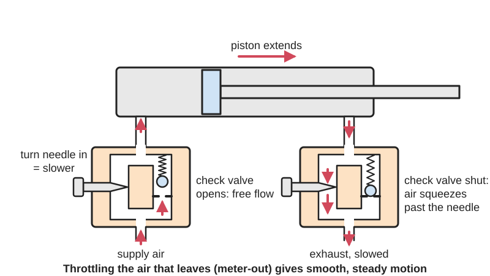
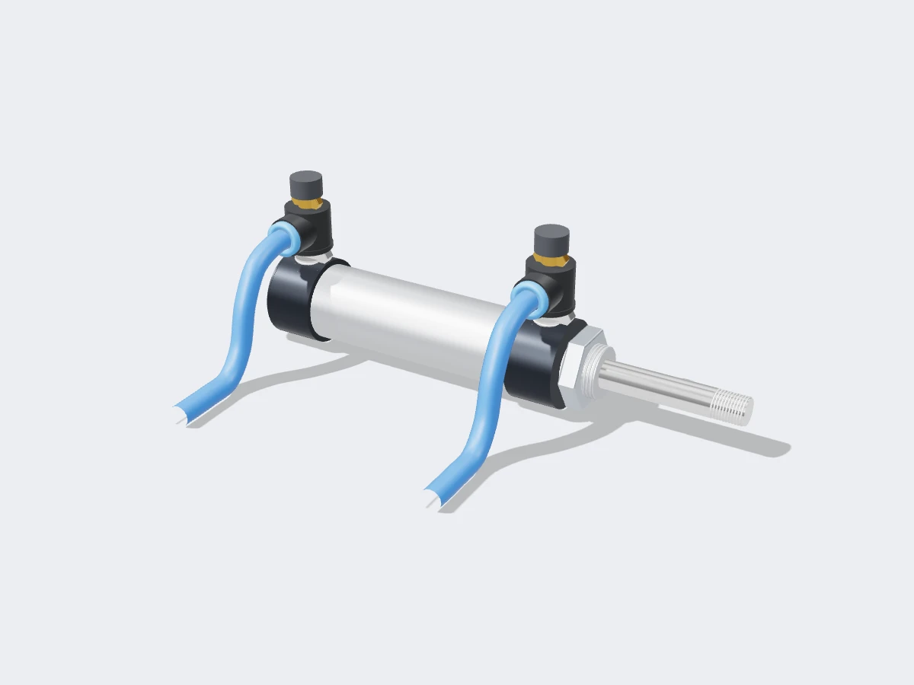

<figure class="eoc-pic eoc-pic-main"><picture><source media="(prefers-reduced-motion: reduce)" srcset="../media/drawn/speed-control-valve.svg"></picture><figcaption><strong>Animation.</strong> Diagram drawn for the encyclopaedia from the research notes. ⚑ Needs confirming: a drawing can simplify or get details wrong; a real photo or a better diagram is welcome.</figcaption></figure>
<figure class="eoc-pic"><figcaption><strong>Render.</strong> A 3D model made for the encyclopaedia, not a photo: a stand-in until a good real photo is found. ⚑ Needs confirming: a model can simplify or get details wrong; a real photo is welcome.</figcaption></figure>

A needle valve and a one-way [check valve](../glossary.md#check-valve) in one small body: air or oil going one way must squeeze through a narrow gap that you set with a screw, which slows the cylinder, while flow the other way bypasses the gap, so each [stroke](../glossary.md#stroke)'s speed can be set separately without reducing the cylinder's force.

**In plain words:** A small screw-adjusted valve, usually screwed straight into an air cylinder's port, that makes the air squeeze through a tiny adjustable gap one way but lets it rush back freely the other way, so you can make the cylinder move slowly and smoothly in one direction and fast in the other. **Proper term:** Speed-control valve (one-way flow control valve: a needle valve with a bypass check valve).

**Also called:** flow control valve, one-way flow control valve, one-way flow [regulator](../glossary.md#regulator) (FIRST pneumatics manual; LibreTexts); speed controller, cylinder speed control; elbow, universal and in-line speed controllers with push-in (one-touch) fittings (SMC; Tameson); meter-out and meter-in flow control valve (FIRST pneumatics manual; LibreTexts; Tameson); throttle check valve (German Drosselrückschlagventil; the Wikimedia Commons symbol file calls it a 'retract resistor check valve'); needle valve: the adjustable part on its own, which restricts flow both ways (Wikipedia; LibreTexts); bi-directional flow control valve (FIRST pneumatics manual); metering valve with silencer, exhaust flow control (SMC; LibreTexts 15.4); 'sandwich' flow control, fitted between the switching valve and the cylinder (LibreTexts 14.2); pressure-compensated flow control valve (hydraulics; LibreTexts); orifice, fixed orifice or restrictor (LibreTexts 14.2); quick exhaust valve (QEV), quick-exhaust valve; exhaust controller combining a quick exhaust valve with a flow control (Festo datasheet; SMC; The Instrument Guru); roller clamp, tube clamp or aquarium air valve: simple flow restrictors that squeeze a soft tube (Printables).

## How it works

Turning the needle in narrows the gap (orifice) between its tapered tip and the seat, so less air or oil passes each second; a cylinder can only move as fast as air or oil can get in or out of it, so it slows down (LibreTexts). In the restricted direction the check valve is held shut and all the flow must go through the needle; in the other direction it is pushed open and the flow bypasses the needle almost freely (LibreTexts 14.2; FIRST pneumatics manual). Usually the valve restricts the air leaving the cylinder (meter-out): the trapped air is compressed and acts like a spring against the piston, giving smooth motion whether the load helps or resists; restricting the air going in (meter-in) suits single-acting spring-return cylinders but tends to be jerky on double-acting ones (FIRST pneumatics manual; LibreTexts 15.2-15.3). A quick exhaust valve does the opposite job: when the supply pressure falls it dumps the cylinder's air straight out at the port instead of sending it back through the tubing and the main valve, so the stroke is faster (Festo datasheet; The Instrument Guru).

## Parts

A few parts: a body with two ports (often a threaded port and a push-in tube fitting), a tapered needle on a fine screw with a knob or slotted head and a locknut, and a check valve (a poppet with a small spring) in parallel with the needle (LibreTexts 14.2; Tameson product page). A quick exhaust valve is a separate small body with supply, cylinder and exhaust ports and a flexible wing-shaped seal inside (Festo datasheet; The Instrument Guru).

## Everyday examples

- The little screw valve on an aquarium air line that turns the bubbles up or down (Printables 'Aquarium fish tank Air Valve')
- The roller clamp on a hospital drip (IV) line that sets the drip rate (Printables 'Flow control/valve (IV style)')
- The idle-fuel needle in a carburettor, which meters a small steady flow (Wikipedia 'Needle valve')
- The small bleed valve on a heating radiator, which is often a simple needle valve (Wikipedia 'Needle valve')

## When to use it

Whenever an air or oil cylinder moves too fast or slams at the end of its stroke and could damage the mechanism, the cylinder or other parts: robot arms, grippers, lids and doors, pick-and-place and lifting mechanisms (FIRST pneumatics manual). Fit one per direction you want to control, at the cylinder ports: meter-out for most double-acting cylinders and for loads that pull the cylinder along, meter-in for single-acting spring-return cylinders and resisting loads (FIRST; LibreTexts). Use independent speed control when a machine should work slowly and return quickly, as in a press, or to make extend and retract speeds equal despite the rod taking up space on one side (LibreTexts 15.4). Use a needle valve on its own to meter a small, steady flow of gas or liquid (Wikipedia; Tameson). Use a quick exhaust valve when a cylinder must return faster than the main valve and tubing allow (Festo datasheet). For soft [actuators](../glossary.md#actuator) and syringe hydraulics, a tube clamp or printed restrictor gives slow, gentle filling.

## When not to use it

Not for shutting a line off: a needle valve takes many turns, is easily damaged by over-tightening and doesn't show whether it is open (Wikipedia 'Needle valve'; Tameson); use a shut-off (ball) valve. Not for limiting force: a throttled cylinder still pushes with full force once it gets there; use a pressure regulator (FIRST pneumatics manual). Not for exact speed under a changing load: speed varies with load, so use a pressure-compensated valve in hydraulics (LibreTexts 15.3) or a motor and screw with feedback. Not for stopping and holding a cylinder mid-stroke: use a closed-centre switching valve or a speed controller with a pilot check valve (SMC). Not for cushioning only the last part of the stroke: use a cushioned cylinder, a deceleration controller or a damper (HSE HSG39 para 118; SMC). Meter-in is a poor choice where the load could run away (LibreTexts 15.2).

## Details

- **What it does (jobs):**
  - slow it, stop it or keep its speed steady: sets how fast an air or hydraulic cylinder, air motor or soft actuator moves, separately for each direction (FIRST pneumatics manual; LibreTexts)
  - seal it, or pass cables or fluid through: passes air or oil freely one way and through an adjustable gap the other (LibreTexts 14.2)
- **Movement:** multiple: the needle screws in and out (turning and sliding together) to set the gap; inside, the check-valve poppet slides open and shut by itself as the flow reverses (LibreTexts)
- **Directions it can move (degrees of freedom):** 1 for the adjusting needle, whose turning and sliding are linked by its thread, plus 1 for the self-acting check valve, which only moves open or shut
- **Special behaviour:**
  - one-way (moves freely one way, locks the other): here it flows freely one way and is throttled, not locked, the other way, because the built-in check valve lets flow bypass the needle in one direction only (LibreTexts 14.2; FIRST pneumatics manual)
- **How it holds:**
  - not a holding joint (it moves or passes on motion): it controls flow, not parts
- **Input and output:** Not a motion converter. As a fluid device: the flow rate in the restricted direction is set by the needle, and the actuator's speed = flow rate / piston area (a cylinder needing 2 gallons at 1 gallon per minute takes 2 minutes; LibreTexts 6.2); flow the other way is nearly free. Unlike lowering the pressure, it keeps the cylinder's full force (FIRST pneumatics manual). A quick exhaust valve: supply port 1 -> cylinder port 2 while supply pressure is applied; when the pressure at 1 falls, the cylinder exhausts from 2 straight out of 3 (Festo datasheet).
- **Power:** passive (no power needed): set by hand and worked by the flow itself
- **Load:** Pressure rather than structural load: standard push-in speed controllers about 1-9 bar, low-cracking-pressure versions 0.5-5 bar (Tameson); quick exhaust valves 0.5-10 bar (Festo datasheet); brass needle valves up to about 207 bar and stainless up to about 690 bar (Tameson 'Needle valve'). Not structural
- **Play and precision:** not applicable for position. Speed [repeatability](../glossary.md#repeatability--accuracy): the speed changes when the load changes, because the pressure drop across the gap changes, so pressure-compensated flow control valves are used in hydraulics where speed must stay steady (LibreTexts 15.1, 15.3). Meter-in can be jerky, meter-out is smoother (FIRST pneumatics manual). Air cylinders can 'jump' (move quickly part of the way) if the switching valve reverses before the stroke ends (LibreTexts 14.2)
- **Taking it apart:** removable: screwed into the cylinder or valve port, or in line, with push-in fittings that take the tube without tools (Tameson product page; SMC); clamp-type tube restrictors fit around the tube (Printables)
- **How often it can be reused:** many times
- **Sealing:** airtight or pressure: seals at its threads and push-in fittings. The needle can shut off flow (Wikipedia 'Needle valve'), but it is a metering valve, not a shut-off: forcing it closed deforms the seat (Tameson product page; Wikipedia)
- **Adjustable:** yes: turn the needle clockwise to slow (smaller gap) and anticlockwise to speed up; start from fully closed and open gradually so the actuator doesn't jump, then lock it with the locknut (Tameson product page). Many turns from shut to fully open give fine control (Wikipedia 'Needle valve'); low-speed versions have 10 turns, or 20 in the M5 size (SMC)
- **Access needed:** end of a tube or shaft: screwed directly into the cylinder port or fitted into the tube; tube-squeezing roller clamps can be fitted around an already-installed tube without reaching its end (Printables 'Roller Clamp')
- **Materials:** Bodies: nickel-plated brass, resin (plastic) or stainless steel (Tameson; SMC); quick exhaust valve housings of die-cast zinc or aluminium with nitrile (NBR) seals (Festo datasheet). Seals: NBR, about 0-60 °C in push-in speed controllers (Tameson), PTFE in needle valves for higher temperatures (Tameson 'Needle valve'). Needles and bodies of brass or 316 stainless steel (Tameson 'Needle valve'). Some speed controllers have a resin valve seat, which deforms if the needle is forced (Tameson product page). Printed tube-squeezing valves in PLA or PETG work on silicone or rubber tubing (Printables)
- **Heat, cold, water and wear:** Push-in speed controllers with NBR seals: about 0-60 °C, no freezing (Tameson product page); quick exhaust valves: about -20 to +75 °C (Festo datasheet). Needle-valve seals: NBR about -40 to 120 °C, PTFE about -20 to just over 200 °C (Tameson 'Needle valve'). Dirt: suspended solids can damage the needle and seat (Tameson 'Needle valve'), so filter the air. Water and chemicals: brass is unsuitable for saltwater, distilled water, acids and chlorides (Tameson 'Needle valve'). Load and pressure changes alter the speed you set (LibreTexts 15.1). Temperature changes a liquid's viscosity (Tameson 'Safety Valve and Relief Valve Selection'), so a hydraulic speed setting may drift as the oil warms ⚑ [uncertain: drift inferred, not stated by the source].

## Making it

- **Ways to make or get it:**
  - off-the-shelf part: push-in speed controllers, in-line flow controls, needle valves, exhaust flow controls with silencers and quick exhaust valves (Tameson; SMC; Festo datasheet)
  - 3D print (FDM): roller clamps, aquarium air valves and screw-type drip-irrigation flow valves for low-pressure air and water (Printables models)
- **Printing it in one piece (print in place):** no: printed flow restrictors are a few parts (body, wheel and pin, or body and screw) assembled around or onto a tube (Printables 'Roller Clamp'; 'Flow control/valve (IV style)'), and a real speed controller also needs a check valve and seals
- **Tools:** A spanner for the threaded port; none to push tubes into push-in fittings; fingers or a small screwdriver to set the needle, and a spanner or fingers for its locknut (Tameson product page); tamper-proof versions need a screwdriver (SMC)
- **Difficulty:** easy to buy and fit: screw a push-in speed controller into each cylinder port (FIRST pneumatics manual). Easy to print a tube-squeezing flow restrictor for aquarium air, syringe hydraulics or water (Printables). Hard to print a true needle valve that seals and adjusts finely at workshop air pressure, so buy that

### 3D printing tips

1) The simplest printable 'needle valve' squeezes a soft tube. A roller clamp for silicone or rubber tubing (suggested in PETG, though other materials work) must suit the tube wall: one design's 12 mm model is for 1.5 mm walls and its 16 mm model for 2.0 mm walls; it can be assembled around an installed tube, the crossbraces and axle may need gluing depending on printer [tolerances](../glossary.md#tolerance), and a little petroleum jelly on the axle pegs makes it smoother (Printables 'Roller Clamp'). 2) An IV-style clamp printed in PLA (0.3 mm layers, 30% [infill](../glossary.md#infill)) on 5-6 mm silicone tube adjusts from free flow 'to a veery slow dribble' to a complete stop; print the body upright with the stop-bar up, and fit it with the closed position facing down so gravity can't open it (Printables 'Flow control/valve (IV style)'). 3) An aquarium air valve that tightens onto the hose prints at 0.2 mm layers in the given orientation and comes with a 'wide tolerance' version for tight threads (Printables 'Aquarium fish tank Air Valve'). 4) A screw-type valve for 4 mm drip-irrigation hose prints without supports at 0.16-0.2 mm layers with 3 walls; PLA indoors, PETG outdoors (Printables 'Flow Control Screw Valve'). 5) To make a printed restrictor one-way like a real speed controller, put a check valve (for example a printed TPU duckbill) in parallel with it (LibreTexts 14.2 describes the needle-plus-check arrangement; see Check valve). 6) Keep printed restrictors to low pressures (aquarium pumps, syringes, small soft actuators, drip lines); on workshop air use a bought speed controller, and never put stored pressure into a printed part (CVRA).

### Buying one (off-the-shelf parts)

Speed controllers (one-way flow control valves) with a threaded port and a push-in fitting, in elbow, universal and in-line styles, meter-out or meter-in (Tameson; SMC); low-cracking-pressure versions for 0.5-5 bar (Tameson); low-speed versions with a smaller orifice for very slow motion (SMC); dual meter-in and meter-out controllers (SMC); in-line bi-directional flow controls (FIRST pneumatics manual); needle valves in brass or stainless steel (Tameson 'Needle valve'); exhaust flow controls (metering valves with silencers) screwed into a switching valve's exhaust ports (SMC; LibreTexts 15.4); 'sandwich' flow control plates between valve and cylinder (LibreTexts 14.2); quick exhaust valves with or without a built-in silencer (Festo datasheet; SMC); exhaust controllers combining a quick exhaust valve and a flow control (SMC); speed controllers with a pilot check valve for mid-stroke stops, with a residual-pressure release button, or with a soft-start (safety) function (SMC); pressure-compensated hydraulic flow control valves (LibreTexts 15.3); IV roller clamps and aquarium air-line valves (Printables).

## Rules of thumb

- To slow a cylinder but keep its full force, use flow control valves rather than lowering the pressure; a regulator reduces force and air use as well as speed (FIRST pneumatics manual)
- Place flow controls downstream of the switching ([solenoid](../glossary.md#solenoid)) valve; an arrow on the body often marks the restricted direction (FIRST pneumatics manual)
- Double-acting cylinders: meter-out (restricting the air leaving) is generally recommended, because meter-in may give jerky movement (FIRST pneumatics manual)
- Single-acting spring-return cylinders: meter-in against the spring, or a bi-directional valve to slow both ways (FIRST pneumatics manual); or a flow control on the exhaust to slow the retraction (LibreTexts 14.2)
- Meter-in only works where the load resists the movement; where the load pulls the actuator along (lowering a weight), use meter-out, which holds it back with back pressure (LibreTexts 15.2, 15.3)
- Start adjusting from fully closed and open gradually to avoid a sudden actuator move; don't force the needle (Tameson product page)
- Standard push-in speed controllers are rated from about 1 bar with a 0.5 bar check-valve cracking pressure; for low-pressure systems use the low-cracking type (0.5-5 bar, 0.2 bar cracking) (Tameson product page)
- Hydraulic cylinder speed = flow / piston area: a cylinder needing 2 gallons at 1 gallon per minute takes 2 minutes to extend (LibreTexts 6.2)
- With a fixed-displacement pump, a needle valve can only slow an actuator by sending the extra oil over the relief valve, so the relief valve must be set high enough to open first (LibreTexts 6.2)
- For steady speed under a changing load in hydraulics, use a pressure-compensated flow control valve (LibreTexts 15.3)
- A quick exhaust valve only gives its full benefit when connected directly to the cylinder port; models with a silencer reduce the exhaust noise (Festo datasheet)
- Where an emptied cylinder could shoot out when air returns (after an emergency stop), add a soft-start arrangement that restricts the flow until the pressure has built up (HSE HSG39 para 120)

## Common failures

1) Fitted the wrong way round, so it slows the wrong stroke: check the arrow on the body (FIRST pneumatics manual). 2) Jerky, [stick-slip](../glossary.md#stick-slip) motion from meter-in on a double-acting cylinder; change to meter-out (FIRST pneumatics manual). 3) Speed changes as the load changes (LibreTexts 15.1, 15.3). 4) Needle forced shut, deforming a resin seat or damaging a brass spindle, so the setting no longer behaves (Tameson product page; Wikipedia 'Needle valve'). 5) Needle and seat damaged by dirt or suspended solids in the fluid (Tameson 'Needle valve'). 6) 'Jumping' or rapid partial strokes when the valve is switched before the cylinder finishes its stroke (LibreTexts 14.2). 7) No effect at low pressure because the supply is below the valve's minimum pressure or the check valve's cracking pressure (Tameson product page). 8) A quick exhaust valve mounted away from the cylinder gives little speed gain (Festo datasheet). 9) In hydraulics, the needle valve appears to do nothing until pressure reaches the relief valve setting (LibreTexts 6.2). 10) Printed tube clamps drip or bind if the tube wall thickness doesn't match the design (Printables 'Roller Clamp').

## Safety

1) A slowed cylinder still has its full force: a slow-closing gripper or clamp can still crush fingers (FIRST pneumatics manual notes flow control keeps maximum force). 2) Start adjusting from fully closed and open gradually, or the actuator can jump (Tameson product page). 3) An emptied (pre-exhausted) cylinder can shoot out when air returns, for example after an emergency stop; meter-in or soft-start valves prevent this sudden extension (HSE HSG39 para 120; SMC). 4) Meter-in control can't hold back a load that pulls the actuator along, so it may run away (LibreTexts 15.2). 5) Quick exhaust valves dump air fast and loud: fit a silencer and keep the exhaust away from faces (The Instrument Guru; Festo datasheet; HSE HSG39 para 116); faster strokes hit the end caps harder, so use cushioned cylinders (HSE HSG39 para 118). 6) Closing a flow control does not empty the line: let trapped pressure out before undoing fittings; some speed controllers have a residual-pressure release button (SMC). 7) Never point compressed air at anyone; even 15 psig can cause serious injury (FRC Zero).

## Related

- Check valve: the one-way part inside a speed controller; on its own it gives no adjustment
- Pressure regulator: lowers the pressure, so it reduces force as well as speed; use it to limit force (FIRST pneumatics manual)
- Switching valve (directional control valve): starts, stops and reverses the cylinder; flow controls can be fitted in its exhaust ports (LibreTexts 15.4)
- Shut-off valve (ball valve): fully open or shut; ball and globe valves can also be used as rough adjustable orifices (LibreTexts 14.2)
- Dampers (rotary and linear soft-close dampers): sealed units that slow a movement by forcing fluid through a small gap, the same idea built into the moving part
- Speed governor: holds a turning speed steady automatically, while a flow control sets speed with a fixed restriction
- Air or hydraulic cylinder: what it controls; cushioned cylinders slow only the end of the stroke (HSE HSG39 para 118)
- Tesla valve: restricts flow one way with no moving parts, but can't be adjusted
- Iris valve and pinch valve: squeeze a soft tube or opening to throttle flow, like a roller clamp
- Syringe pump: sets an exact flow by pushing a plunger with a screw instead of throttling
- Quick exhaust valve (covered here): speeds a stroke up instead of slowing it

## Make it yourself

- [Roller Clamp - One-handed operation and flow control (Dario A. R., Printables) (URL from Printables API, page not opened)](https://www.printables.com/model/898729-roller-clamp-one-handed-operation-and-flow-control): Printed roller clamp that throttles flow in silicone or rubber tubing up to 16 mm, assembled around an installed tube *(licence: CC BY-NC-SA)*
- [Flow control/valve (fluid and air) (IV style) (chrbau, Printables) (URL from Printables API, page not opened)](https://www.printables.com/model/871674-flow-controlvalve-fluid-and-air-iv-style): IV-style roller flow controller for about 5 mm silicone tube, for air or water, adjustable from free flow to a stop; prints in about an hour *(licence: CC BY-NC)*
- [Aquarium fish tank Air Valve (firstgizmo, Printables) (URL from Printables API, page not opened)](https://www.printables.com/model/1014285-aquarium-fish-tank-air-valve): Screw-down printed valve that squeezes an aquarium air hose to regulate the air flow *(licence: CC BY-NC)*
- [Flow Control Screw Valve (Klickeazy, Printables) (URL from Printables API, page not opened)](https://www.printables.com/model/1307026-flow-control-screw-valve): Screw-type flow control valve for 4 mm ID drip-irrigation hose, with an Onshape model *(licence: GNU GPL v3.0)*

## Pictures, videos and models

- [14.2: Flow Control Valves (Jessy Haid, Northeast Wisconsin Technical College; LibreTexts)](https://eng.libretexts.org/Courses/Northeast_Wisconsin_Technical_College/Fluids_1:_Fluid_Power_and_Pneumatics_(NWTC)/14:_Flow_Control_Valves/14.02:_Flow_Control_Valves): ISO 1219 schematics of flow control valves (needle valve with bypass check valve) in cylinder circuits, with a plain explanation of orifices and meter-out control *(licence: CC BY 4.0)*
- [QEV.gif (Masterjoa3000; Wikimedia Commons)](https://commons.wikimedia.org/wiki/File:QEV.gif): Animation of how a quick exhaust valve works (file description, in French: 'Fonctionnement d'une Quick Exhaust Valve') *(licence: CC BY-SA 3.0)*
- [Symbol Retract resistor check valve.svg (MovGP0; Wikimedia Commons)](https://commons.wikimedia.org/wiki/File:Symbol_Retract_resistor_check_valve.svg): Circuit symbol for a throttle check valve (one-way flow control: an adjustable restriction with a check valve in parallel) *(licence: Public domain)*
- [Needle valve.jpg (wbaiv; Wikimedia Commons)](https://commons.wikimedia.org/wiki/File:Needle_valve.jpg): Photo of a needle valve *(licence: CC BY-SA 2.0)*
- [FIRST Robotics Competition Pneumatics Manual (FIRST, rev. Jan 2023), pp. 16-17 'Tuning actuator speed/force'](https://www.firstinspires.org/hubfs/web/program/frc/resources/pneumatics-manual.pdf?hsLang=en): Plain guide to slowing robot air cylinders with regulators and one-way or bi-directional flow controls, with meter-in and meter-out set-ups for single- and double-acting cylinders *(licence: link only)*

## Needs confirming

⚑ marks something nobody has confirmed yet: a fact the research could not confirm from a source, a finder value that is a best guess, or an open point from the research notes. Corrections are welcome (see `research/needs-confirming.md`).

- ⚑ 1 sentence on this page marked [uncertain].
- ⚑ Finder value `load_max` = medium (best guess): no light/medium/heavy band in `load`; defaulted to medium
- ⚑ Finder value `made_of` = 3D prints, plastic sheet, tube or moulded parts, metal (best guess): proposed from the words in the research text (R37); not yet checked

## Sources

- <https://en.wikipedia.org/wiki/Needle_valve>
- <https://eng.libretexts.org/Courses/Northeast_Wisconsin_Technical_College/Fluids_1:_Fluid_Power_and_Pneumatics_(NWTC)/14:_Flow_Control_Valves/14.02:_Flow_Control_Valves>
- <https://eng.libretexts.org/Courses/Northeast_Wisconsin_Technical_College/Fluids_1%3A_Fluid_Power_and_Pneumatics_(NWTC)/15%3A_Speed_Control/15.01%3A_Adjusting_Flow_and_Speed>
- <https://eng.libretexts.org/Courses/Northeast_Wisconsin_Technical_College/Fluids_1%3A_Fluid_Power_and_Pneumatics_(NWTC)/15%3A_Speed_Control/15.02%3A_Meter-In_Flow_Control_Circuits>
- <https://eng.libretexts.org/Courses/Northeast_Wisconsin_Technical_College/Fluids_1%3A_Fluid_Power_and_Pneumatics_(NWTC)/15%3A_Speed_Control/15.03%3A_Meter-OutFlow_Control_Circuits>
- <https://eng.libretexts.org/Courses/Northeast_Wisconsin_Technical_College/Fluids_1%3A_Fluid_Power_and_Pneumatics_(NWTC)/15%3A_Speed_Control/15.04%3A_Specialized_Flow_Control_Circuits>
- <https://eng.libretexts.org/Courses/Northeast_Wisconsin_Technical_College/Fluids_2%3A_Basic_Hydraulics_(NWTC)/06%3A_Needle_Valves/6.02%3A_Needle_Valve_Operation>
- <https://eng.libretexts.org/Courses/Northeast_Wisconsin_Technical_College/Fluids_2%3A_Basic_Hydraulics_(NWTC)/15%3A_Flow_Control_Valves/15.02%3A_Operation_of_a_Flow_Control_Valve_and_its_Scematic_Symbol>
- <https://eng.libretexts.org/Courses/Northeast_Wisconsin_Technical_College/Fluids_2%3A_Basic_Hydraulics_(NWTC)/15%3A_Flow_Control_Valves/15.03%3A_The_Effect_of_Actuator_Load_Changes_on_Flow_Control_Valve_Operation>
- <https://www.firstinspires.org/hubfs/web/program/frc/resources/pneumatics-manual.pdf?hsLang=en>
- <https://www.frczero.org/pneumatics/pneumatic-safety/>
- <https://tameson.com/pages/needle-valve>
- <https://tameson.com/products/r1-4-6mm-meter-out-rotatable-flow-control-valve>
- <https://tameson.com/pages/safety-valve-relief-valve-selection>
- <https://www.smcusa.com/products/connectors/speed-controllers~22159>
- <https://ftp.festo.com/public/pneumatic/SOFTWARE_SERVICE/Documentation/2022/US/SEU_VB_ENUS.PDF>
- <https://ftp.festo.com/Public/PNEUMATIC/SOFTWARE_SERVICE/Documentation/2025/EN_US/VBQF_ENUS.PDF>
- <https://theinstrumentguru.com/quick-exhaust-valve/>
- <https://www.hse.gov.uk/pubns/priced/hsg39.pdf>
- <https://cvra.ch/blog/2016/airtank>
- <https://api.printables.com/graphql/>
- <https://www.printables.com/model/898729-roller-clamp-one-handed-operation-and-flow-control>
- <https://www.printables.com/model/871674-flow-controlvalve-fluid-and-air-iv-style>
- <https://www.printables.com/model/1014285-aquarium-fish-tank-air-valve>
- <https://www.printables.com/model/1307026-flow-control-screw-valve>
- <https://commons.wikimedia.org/wiki/File:QEV.gif>
- <https://commons.wikimedia.org/wiki/File:Symbol_Retract_resistor_check_valve.svg>
- <https://commons.wikimedia.org/wiki/File:Needle_valve.jpg>
