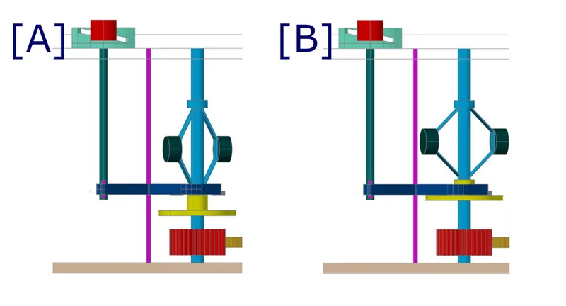

*Picture: [L-Uhr9.png](https://commons.wikimedia.org/wiki/File:L-Uhr9.png) by Otto Lueger, Public domain, from Wikimedia Commons.*

A speed governor is a small fan or a set of spinning weights at the fast end of a spring- or weight-driven gear train that brakes harder the faster it turns, so the whole mechanism settles at a steady running speed instead of running away.

**In plain words:** A little fan or a set of swinging weights, geared up to spin very fast, that stops a wound-up spring or a falling weight from letting a mechanism race away, so a music box plays in time and a clock chimes at a steady pace. **Proper term:** Speed governor: fan fly (air-brake governor, 'fly') and centrifugal friction governor (flyweight or flyball brake governor).

**Also called:** fly, fan fly, fly fan, fly governor (striking and chiming clocks); air brake, air governor, fan governor, vane governor (music boxes); music-box governor, music-movement governor (the ready-made unit in cuckoo clocks and music boxes); [regulator](../glossary.md#regulator) (of a striking train); centrifugal governor, centrifugal regulator, flyball or fly-ball governor, flyweight governor; centrifugal brake, or 'moderator' (Maxwell's 1868 name for a governor that brakes the motion instead of throttling the power supply); gramophone governor, phonograph governor, rotary-dial governor; Pickering governor (weights mounted on flat springs); Windfang, Windflügel or Windflügelregler (German).

## How it works

The spring or weight tries to spin the gear train, and the governor sits on the fastest, lowest-force shaft. A fan fly beats the air: air drag grows with the square of speed, so the fan barely resists at first but brakes strongly once it is spinning fast, and the train settles where the drag balances the driving force (Wikipedia 'Striking clock'; engineerguy). In a centrifugal friction governor the weights fly outwards as speed rises and press a pad or disc against a friction surface, so the faster it turns the harder the brake is applied (Wikipedia 'Rotary dial'; Hackaday on Wintergatan's governor). Unlike an escapement it does not tick or keep time; it only limits speed, which still drifts a little as the spring runs down.

## Parts

A small assembly that acts as one unit. Fan fly: thin fan blades (vanes) on a light spindle (arbor), driven by a gear or by a steep worm; in clocks the fan is held on its arbor by a small friction spring. Centrifugal friction governor: two or three weights on flat springs or hinged arms on a fast spindle, plus a friction pad, cup or brake disc that they rub against, and often an adjusting lever or stop. Both need a step-up gear train (many gears, or a worm) between the slow drum or barrel and the governor.

## Everyday examples

- A wind-up music box, whose little whirring fan on a worm sets the tempo of the tune (engineerguy; Wikipedia 'Governor (device)')
- A striking or chiming clock, including cuckoo clocks, whose whirring 'fly' spins while the hours are struck (Wikipedia 'Striking clock')
- An old rotary-dial telephone: the dial returns at a steady speed because of a small centrifugal governor inside (Wikipedia 'Rotary dial')
- A wind-up gramophone, whose three weights on springs rub a friction pad to hold the turntable speed (Wikimedia Commons 'Grammoantrieb.jpg'; CLPGS)

## When to use it

Use it when a spring, a falling weight or a hand [crank](../glossary.md#crank) drives something that should run at a roughly steady speed with no electricity: a music box, a chime or strike train, an automaton, a marble machine, a wind-up toy, a slowly lowering display, or a returning dial. It is smooth and nearly silent (air fans), needs no timing [accuracy](../glossary.md#repeatability--accuracy), and is self-regulating: it brakes lightly at low speed and hard at high speed, so the mechanism starts easily but cannot run away. A centrifugal friction governor suits jobs that need a firmer, adjustable speed, such as a turntable or a hand-cranked machine (Wintergatan uses a gramophone-style flyball governor with a disc brake to keep a hand-cranked music machine in time; Hackaday).

## When not to use it

Don't use it for timekeeping: speed drifts as the spring runs down; use an escapement with a pendulum or balance wheel instead. Don't use it to hold something still: it only resists motion, so a load will still [creep](../glossary.md#creep) down; use a [ratchet](../glossary.md#ratchet), a worm drive or a brake. For a single slow, smooth close (a lid or drawer), a rotary or linear damper is simpler. For a motor-driven project, control the motor electronically. If a whirring noise matters, a non-contact eddy-current brake (a magnet near an aluminium disc) can replace a fly, as one clockmaker did (Model Engineer forum).

## Details

- **What it does (jobs):**
  - slow it, stop it or keep its speed steady: lets a wound spring or a falling weight run down at an even, sensible speed (music box tempo, clock strike rhythm, rotary-dial pulse rate, gramophone turntable speed)
- **Movement:** rotate: continuous fast rotation of the fan or weight spindle (a toy music box's fan turns at about 3,600 rpm; engineerguy); in the centrifugal type the weights also swing or bow outwards by a few millimetres as speed rises
- **Directions it can move (degrees of freedom):** 1: the fan or weight spindle turns with the gear train it is geared to; the outward swing of centrifugal weights is set by the speed, not a separate input. A friction-fit clock fly can also slip round its arbor briefly when the train stops.
- **Special behaviour:**
  - none of the listed behaviours exactly: its trick is speed-dependent braking (negative feedback), weak at low speed and strong at high speed, so the mechanism finds a steady speed on its own
  - torque-limiting (slips or clicks at a set force/[torque](../glossary.md#torque)): in clocks the fan is a spring friction fit on its arbor, so it does not slip while running but can slip a little when the striking train is stopped suddenly, easing the shock on the teeth and stop pin (NAWCC forum; de.wikipedia 'Windfang (Uhr)')
- **How it holds:**
  - not a holding joint (it moves or passes on motion): it soaks up energy as air drag or friction heat
  - friction or clamping ([force-fit](../glossary.md#form-fit--force-fit--material-bond)): centrifugal types brake by rubbing pads on a drum or disc; clock flies are held on their arbor by a friction spring
- **Input and output:** Input: torque from a wound spring or falling weight, passed through a large step-up gear train (a toy music box multiplies 2,400 times, so one turn of the first gear spins the fan 2,400 times; engineerguy). Output: no useful work: all the power reaching it is turned into air drag or friction heat, which fixes the running speed of everything upstream. Speed accuracy: rough; for a plain fan, drag grows with the square of speed (Wikipedia 'Drag (physics)'), so running speed rises only with about the square root of the driving torque (halving the spring's torque drops the speed to about 71%, a calculation from that rule) ⚑ [uncertain]; the centrifugal friction type gives a larger braking force and holds speed more tightly (US patent 4,458,573 background). Shafts: parallel when the governor is driven by spur gears (Western Electric dial) or crossed at right angles when driven through a worm (music boxes, Automatic Electric dial); unusually, here the wheel drives the worm, which needs a very steep worm thread of about 45 degrees (Wikipedia 'Rotary dial'). Back-drivable: not relevant; the governor is the last shaft and only absorbs energy.
- **Power:** passive (no power needed): runs from the same spring or weight that drives the mechanism; nothing happens when it stops except that the train stops
- **Load:** Light: it only ever handles the small torque at the fast end of the gear train (the fly is 'high speed but low torque, easier to stop'; NAWCC forum), and an air fan's braking force is small (US patent 4,458,573). It carries no structural load. The worm and the plastic drive gear in cheap music-box governors are the weak parts.
- **Play and precision:** It does not locate anything; what matters is how steady the speed is. A plain fan's speed swings about an average and drifts as the spring runs down, so it is not used for telling the time (de.wikipedia 'Windfang (Uhr)'; NAWCC: 'few governed so well that speed doesn't change thru the power range'). A rotary-dial governor was good enough to give about 10 pulses per second, and exchanges accepted about 9 to 13 (Wikipedia 'Rotary dial'). Gear-mesh depth at the worm matters: worn pivot holes or a cracked drive gear make it click or jam (NAWCC forum).
- **Taking it apart:** removable: a music-box or cuckoo-clock governor is a separate unit screwed to the frame and can be swapped for a replacement with the same pinion tooth count; a clock fly slides off its arbor for cleaning (NAWCC forum)
- **How often it can be reused:** many times: governors are routinely removed, cleaned, bushed and refitted during clock and music-box servicing
- **Sealing:** none: an open mechanism; a centrifugal type often has a cup or cover around the weights, but it seals nothing
- **Adjustable:** Yes. Fan fly: a bigger or more steeply angled fan runs slower (one restorer slowed a clock's strike by about a third with a larger fan; NAWCC forum), and the fan's grip on its arbor must be tight enough not to slip while running. Some tower-clock flies have vanes that open outwards against return springs as speed rises, and the spring tension sets the behaviour (de.wikipedia 'Windfang (Uhr)'). Centrifugal friction type: a lever or stop that limits how far the weights can move, or that moves the friction pad, sets the speed; this is the speed control on a wind-up gramophone (Wikimedia Commons descriptions of 'Grammoantrieb.jpg' and 'Regulador mecánico.png').
- **Access needed:** not applicable: it sits inside the mechanism's frame and is reached by opening the case
- **Materials:** Traditionally thin brass or steel sheet vanes on a steel arbor, with a polished steel worm (music boxes; James Riser made his worm arbor from stainless steel); cheap modern cuckoo-clock governors use a plastic gear that drives a metal worm (NAWCC forum). Centrifugal types: steel or brass weights on flat spring-steel strips, rubbing on friction pads or shoes (Wikipedia 'Rotary dial'; Commons 'Regulador mecánico.png'). Printed versions use PLA or PETG for fans, gears and weights, with steel pins or small ball bearings.
- **Heat, cold, water and wear:** Air fans depend on air density, so they run slightly differently at altitude or temperature extremes; small-engine air-vane governors are affected by air density (Wikipedia 'Governor (device)'). Old oil and dirt add friction and slow the train, while worn pivots change the worm mesh (NAWCC forum). Centrifugal friction governors change speed as their pads wear or as the oil on the pad changes ⚑ [uncertain]. Printed PLA parts soften in a hot car or sunny window and PLA springs creep under constant load, so use PETG or metal springs for anything left loaded ⚑ [uncertain].

## Making it

- **Ways to make or get it:**
  - 3D print (FDM): fans, step-up gear trains, weights and frames; printed rotary dials and hand-cranked record players with printed governors exist (Moeya 3D Designs; akajes on Thingiverse)
  - sheet metal: thin brass or aluminium shim for fan vanes, cut with snips
  - CNC: a lathe for a smooth, polished worm arbor and pivots (James Riser)
  - woodwork: wooden-gear clocks and automata can use a card, wood or thin-plastic fan
  - off-the-shelf part: complete music movements, music-box and cuckoo-clock governors, and gramophone spring motors with governors
- **Printing it in one piece (print in place):** no: a governor is printed as separate parts (fan or weights, arbor, worm, gears, frame) and assembled on pins or bearings; the centrifugal type usually also needs metal springs or a friction pad
- **Tools:** Small screwdrivers; pliers or tweezers to adjust the fly's friction spring or bend the governor frame to set the gear mesh; clock oil; for printed versions usually only printed pins or small screws and bearings
- **Difficulty:** moderate: a printed fan is trivial, but a governor only works on a very low-friction, high step-up gear train (thousands to one in a music box), and the worm must be smooth and run with little friction; the centrifugal friction type also needs springs and a friction surface that can be tuned

### 3D printing tips

1) Put the governor on the fastest shaft and gear it up a lot: fan drag grows with the square of speed (Wikipedia 'Drag (physics)'), so a slowly turning fan does almost nothing; a toy music box runs its fan at about 3,600 rpm through a 2,400:1 train (engineerguy). 2) Keep the fan light: thin vanes and a low moment of inertia let it reach its working speed quickly (de.wikipedia 'Windfang (Uhr)'). Print vanes flat on the bed, thin but at least two [perimeters](../glossary.md#perimeters) thick, and balance them so the fast shaft does not shake. 3) If the fan is driven through a worm, the wheel must drive the worm: use a steep, multi-start worm (about 45 degrees, as in music boxes and rotary dials; Wikipedia 'Rotary dial') and make the thread as smooth as possible; James Riser notes a music-box air brake 'will not work if the threads are left rough and unpolished'. Printing the worm upright gives smoother flanks; sanding or vapour-smoothing helps ⚑ [uncertain]. 4) Spread the load: Riser cut his wheel so three teeth engage the worm at once to cut friction. 5) Use steel pins or small ball bearings for the fast shafts rather than printed axles, and check the whole train spins freely by hand before fitting the spring. 6) Tune by changing fan size or vane angle rather than by adding friction; a bigger fan slows the train (NAWCC forum). 7) For a centrifugal friction governor, make the weights' outward travel adjustable (a stop screw or movable friction pad), as on gramophone governors (Commons 'Grammoantrieb.jpg', 'Regulador mecánico.png'); PLA flat springs creep under constant load, so use spring steel or PETG for the springs ⚑ [uncertain]. 8) Let the fan slip a little on its shaft (a light friction fit, or an [O-ring](../glossary.md#o-ring) or spring clip) if the train stops suddenly against a stop, so the fan's momentum does not break teeth (NAWCC forum; de.wikipedia). 9) Stop and start the train at the fan end where possible: the fan is fast but weak, so a small wire or lever can hold it (NAWCC music-box governor thread).

### Buying one (off-the-shelf parts)

Wind-up music movement (e.g. 22/28/36-note 'music box movement', which includes its own air-brake governor); replacement music-box governor or 'music movement governor' (specified by the pinion tooth count that meshes with the pin drum; NAWCC forum); cuckoo-clock music-box governor; clock 'fly' or 'fan fly' for striking trains; wind-up gramophone or phonograph spring motor with centrifugal governor (CLPGS); miniature ball bearings; worm and worm-wheel sets (use a steep multi-start worm); flat spring-steel strip; felt or leather friction pad; small neodymium magnets and an aluminium or copper disc if you prefer a non-contact eddy-current brake instead.

## Rules of thumb

- Air drag on a fan grows with the square of speed at normal speeds, and the power it absorbs with the cube, so a fan governor only works when geared up to high speed (Wikipedia 'Drag (physics)'; engineerguy 'How a Wind Up Music Box Works': air resistance 'swiftly increases' above 3,000 rpm).
- Gearing: a toy music box steps up 2.75 x 5.75 x 6.3 x 24 (about 2,400:1) from the spring's first gear to the fan, which spins at about 3,600 rpm (engineerguy).
- Salisbury Cathedral's medieval clock: 64:1 from great wheel to fly, so the fly turns 8 times per strike (Wikipedia 'Salisbury Cathedral clock'); the fly always goes on the fastest-turning shaft of the striking train (Wikipedia 'Striking clock').
- Fan vanes should be as thin and light as possible so the fan reaches speed quickly; a plain fan's speed still swings about an average, so it is never used as a timekeeper (de.wikipedia 'Windfang (Uhr)').
- A worm driven by its wheel needs a very steep thread, about 45 degrees to the axis, and a highly polished surface (Wikipedia 'Rotary dial'; James Riser, 'A1 - the Air Brake or Governor').
- Clock fly friction: tight enough that it does not slip while the train is running, loose enough to slip slightly at the stop; a quick test is that you can turn the fly while holding the pinion, but only with obvious effort (NAWCC 'Fly adjustment' thread).
- Rotary-dial governors were set for about 10 pulses per second, with 9 to 13 accepted by exchanges (Wikipedia 'Rotary dial').

## Common failures

1) Fly loose on its arbor, so the strike or chime runs much too fast; about 90% of fast strikes, according to one experienced restorer (NAWCC forum). Tighten the friction spring rather than soldering or gluing the fly, because a fixed fly can [shear](../glossary.md#peel-vs-shear) the stop pin or strip teeth when the train stops (NAWCC). 2) Cracked plastic drive gear in cuckoo-clock music-box governors, heard as a repeated click and causing jams; replace the gear or the governor (NAWCC music-box governor thread). 3) Worn pivot holes that let the worm mesh too shallow or too deep; bush the holes or replace the unit (NAWCC). 4) Rough or unpolished worm thread, so the wheel hangs up (James Riser). 5) Train overpowered by too strong a mainspring, so even a good fan cannot hold the speed down (NAWCC). 6) Speed drifting as the spring runs down: expected with a plain fan; use a centrifugal friction type or a gentler spring. 7) Noise: the fly's pinion and warning wheel whirr; a little grease on the fast pinion quietens gramophone motors (CLPGS).

## Safety

The main hazard is the spring or weight that drives it: if a governor fails or is removed, the train runs away at high speed, which can break teeth and damage parts (a music-box pin drum spinning without its governor can break the tuned comb teeth; NAWCC forum). Wound mainsprings store a lot of energy; let them down before dismantling ⚑ [uncertain: general clockmaking caution]. Keep fingers and hair clear of fast-spinning fans and weights.

## Related

- Escapement (anchor or verge escapement): lets a spring or weight run down in exact, countable steps for timekeeping; a governor gives smooth but inexact speed
- Eddy-current brake (magnetic brake): a non-contact drag that also grows with speed; can replace a fly, and is used in some clocks and meters
- Dampers (rotary and linear soft-close dampers): oil- or air-filled parts that slow a single movement, such as a lid closing, rather than a continuously running train
- Centrifugal clutch: the same flying-weights idea, but used to connect a drive above a set speed instead of braking it
- Friction brake (band, drum or disc brake): a centrifugal friction governor is an automatic friction brake applied by the flyweights
- Inertia-locking reel (seatbelt lock, centrifugal catch): uses flying weights to lock at a set speed instead of braking smoothly
- Worm drive: the governor is usually driven through a worm run backwards (wheel driving worm) with a steep thread

## Make it yourself

- [KIT Record Player/Centrifuge/Governor (akajes, Thingiverse)](https://www.thingiverse.com/thing:2006756): Fully printed kit that can be built as a hand-cranked vinyl player 'with a governor speed limiter and stabilizer', or as a centrifuge; includes a stand-alone governor build *(licence: CC BY-NC-SA 4.0)*
- [Mechanical Rotary Dial - Hackaday Featured Model (Moeya 3D Designs, MakerWorld) (page returned 403; URL from search results)](https://makerworld.com/en/models/2749885-mechanical-rotary-dial-hackaday-featured-model): Fully 3D-printed rotary telephone dial whose spring return is slowed by a printed centrifugal speed governor; its video shows what happens when the governor is removed (Hackaday, 11 March 2026) *(licence: not seen ⚑ [uncertain])*
- [Hartnell Governor - Work in Progress (3DMason, Printables) (URL from Printables API, page not opened)](https://www.printables.com/model/1291229-hartnell-governor-work-in-progress): Printable model of a Hartnell spring-loaded centrifugal governor (an engine-type governor) to see flyweights move outwards against a spring; marked as a work in progress *(licence: CC BY-NC-SA)*
- [507 Mechanical Movements no. 287: Pickering's governor](https://507movements.com/mm_287.html): Animated historic drawing of a governor whose balls are carried on flat springs, the same layout used in gramophone and telephone-dial governors *(licence: book public domain; website animation link only)*

## Pictures, videos and models

- [L-Uhr9.png (Wikimedia Commons, from Otto Lueger's Lexikon der gesamten Technik)](https://commons.wikimedia.org/wiki/File:L-Uhr9.png): Labelled drawing of a rack-striking clock mechanism with the fan fly (K) on the fastest shaft of the striking train; used in Wikipedia's 'Striking clock' article *(licence: Public domain)*
- [How a Wind Up Music Box Works (engineerguy, Bill Hammack), video on Wikimedia Commons](https://commons.wikimedia.org/wiki/File:How_a_Wind_Up_Music_Box_Works_engineerguy.webm): Video showing the spring, the 2,400:1 step-up gear train, the worm and the air-brake governor of a toy music box, including a slow-motion view of the spinning fan *(licence: CC BY 3.0)*
- [Regulador mecánico.png (Wikimedia Commons, by Wiki LIC)](https://commons.wikimedia.org/wiki/File:Regulador_mec%C3%A1nico.png): Diagram of a phonograph spring motor's centrifugal governor at rest and running: the weights lift a disc against friction shoes, and moving the shoe arm sets the speed *(licence: CC BY-SA 4.0)*
- [Grammoantrieb.jpg (Wikimedia Commons, by Ulfbastel)](https://commons.wikimedia.org/wiki/File:Grammoantrieb.jpg): Photo of a gramophone drive: spring barrel behind, and a centrifugal governor with three weights in front, with the lever that limits the governor's travel to set the maximum speed *(licence: CC BY-SA 4.0)*
- [How Gramophones play Tight Music - The Flyball Governor (Wintergatan, YouTube; embedded in Hackaday's 25 Feb 2025 article)](https://www.youtube.com/watch?v=jJkoZgKVEx8): Video of a flyball governor pushing a disc brake harder as a hand-cranked music machine speeds up, with a prototype demonstration *(licence: link only (standard YouTube licence))*

## Needs confirming

⚑ marks something nobody has confirmed yet: a fact the research could not confirm from a source, a finder value that is a best guess, or an open point from the research notes. Corrections are welcome (see `research/needs-confirming.md`).

- ⚑ 7 sentences on this page marked [uncertain].
- ⚑ Finder value `motion_in` = steady turning (best guess): read from the "Input: ... Output: ..." wording of `input_output`, not the usual "in -> out" form
- ⚑ Finder value `motion_out` = pressure, heat (best guess): read from the "Input: ... Output: ..." wording of `input_output`, not the usual "in -> out" form
- ⚑ Finder value `shaft_layout` = not applicable (best guess): read from the "Input: ... Output: ..." wording of `input_output`, not the usual "in -> out" form

## Sources

- <https://en.wikipedia.org/wiki/Centrifugal_governor>
- <https://en.wikipedia.org/wiki/Governor_(device)>
- <https://en.wikipedia.org/wiki/Striking_clock>
- <https://en.wikipedia.org/wiki/Rotary_dial>
- <https://en.wikipedia.org/wiki/Salisbury_Cathedral_clock>
- <https://en.wikipedia.org/wiki/Drag_(physics)>
- <https://de.wikipedia.org/wiki/Windfang_(Uhr)>
- <https://commons.wikimedia.org/w/index.php?title=TimedText:How_a_Wind_Up_Music_Box_Works_engineerguy.webm.en.srt&action=raw>
- <https://commons.wikimedia.org/wiki/File:How_a_Wind_Up_Music_Box_Works_engineerguy.webm>
- <https://commons.wikimedia.org/wiki/File:L-Uhr9.png>
- <https://commons.wikimedia.org/wiki/File:Regulador_mec%C3%A1nico.png>
- <https://commons.wikimedia.org/wiki/File:Grammoantrieb.jpg>
- <https://commons.wikimedia.org/wiki/File:Centrifugal_governor.png>
- <https://patents.google.com/patent/US4458573A/en>
- <https://jamesriser.com/Magic/A1/A1Page5.html>
- <https://mb.nawcc.org/threads/purpose-of-the-fly-in-a-striking-clock.105829/>
- <https://mb.nawcc.org/threads/how-can-i-slow-down-a-clock-chime.5863/>
- <https://mb.nawcc.org/threads/fly-adjustment.148022/>
- <https://mb.nawcc.org/threads/music-box-governor-problems.156063/>
- <https://www.model-engineer.co.uk/forums/topic/striking-clock-fly-adjustment/>
- <https://www.model-engineer.co.uk/forums/topic/alternative-to-a-fly-for-braking-a-clock-striking-train/>
- <https://www.clpgs.org.uk/the-spring-motor.html>
- <https://507movements.com/mm_147.html>
- <https://507movements.com/mm_161.html>
- <https://507movements.com/mm_287.html>
- <https://hackaday.com/2025/02/25/taking-cues-from-a-gramophone-to-make-a-better-marble-music-machine/>
- <https://hackaday.com/2026/03/11/a-rotary-dial-the-3d-printed-way/>
- <https://www.youtube.com/oembed?url=https://www.youtube.com/watch?v=jJkoZgKVEx8&format=json>
- <https://www.youtube.com/oembed?url=https://www.youtube.com/watch?v=uo3RUD5v5Es&format=json>
- <https://www.thingiverse.com/thing:2006756>
- <https://api.printables.com/graphql/>
