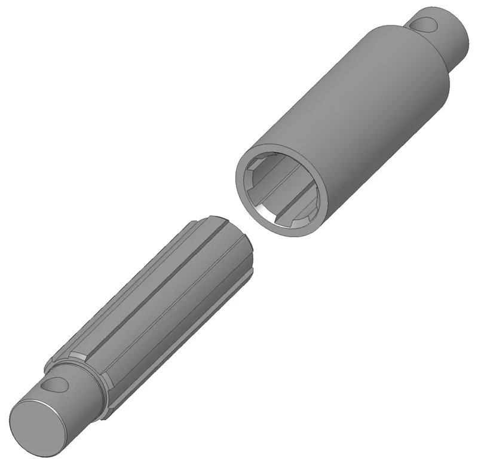

*Picture: [Cardan-joint spline-shaft 3D animated.gif](https://commons.wikimedia.org/wiki/File:Cardan-joint_spline-shaft_3D_animated.gif) by Silberwolf (talk), [CC BY-SA 2.5](https://creativecommons.org/licenses/by-sa/2.5), from Wikimedia Commons.*

A shaft with lengthwise ridges or flat sides that fits a hub with a matching hole, so turning force passes between them while the hub stays free to slide along the shaft.

**In plain words:** A shaft with ridges running along its length (or simply a six-sided or cross-shaped shaft) that fits into a hole of the same shape, so a gear, wheel or sleeve on it must turn with the shaft but can still slide along it. **Proper term:** [Spline](../glossary.md#spline) shaft (splined shaft and hub; sliding spline or slip spline when the hub is meant to slide).

**Also called:** splined shaft / spline shaft; splined hub or spline bushing (the matching part with the grooves inside); sliding spline, slip spline, slip joint, slip yoke (the sliding spline in a vehicle drive shaft); spline coupling / splined coupling; involute spline (curved gear-like teeth, standards ISO 4156, ANSI B92.1, DIN 5480); straight-sided spline / parallel-key spline / parallel spline (standard ISO 14); serrations / serrated shaft (small fine V-shaped teeth, e.g. knob shafts and servo outputs); helical spline (grooves that spiral round the shaft); ball spline / rotary ball spline (balls roll in the grooves for low-friction sliding under [torque](../glossary.md#torque)); hex shaft / hexagonal shaft (a six-sided shaft in a hex bore, the simplest spline for robots); rounded hex shaft ('ThunderHex' (brand) in FRC robotics), MAXSpline (brand, REV Robotics); cross axle / Technic axle (LEGO Technic (brand) cross-shaped axle and 'axle hole'); master spline / blind spline (one wider tooth so the part fits only one way round); Keilwelle, Zahnwelle (German); 花键轴 (Chinese).

## How it works

The ridges (teeth) on the shaft sit in matching grooves in the hub, so when the shaft turns, the sides of the teeth push on each other and the hub must turn too; this is a shape lock (form fit), not friction. Because the teeth run along the shaft, nothing stops the hub sliding lengthwise, so a spline can pass turning force while a drive shaft changes length or a gear or clutch ring slides into a new position (Wikipedia 'Spline (mechanical)'). Many teeth share the load, so a spline carries much more turning force for its size than a single key in a keyway. A hex shaft in a hex hole or a LEGO cross axle in a cross hole works the same way with fewer, flatter 'teeth'.

## Parts

A few parts: the splined, hex or cross-shaped shaft (external spline); the hub, gear, sleeve or yoke with the matching hole (internal spline); and usually something to hold the hub in place along the shaft when it should not slide (shaft collar, retaining ring ([circlip](../glossary.md#circlip)) or [set screw](../glossary.md#set-screw)). The rolling version (ball spline) adds a nut full of recirculating balls.

## Everyday examples

- The drive shaft under a rear-wheel-drive car or truck, whose splined slip yoke slides in and out of the gearbox as the suspension moves (Tom Wood's Custom Drive Shafts; Wikipedia)
- A tractor's telescoping power take-off (PTO) shaft, where one part of the shaft slides inside another (eXtension ag-safety PTO guidance)
- A bicycle cassette sliding onto the splined freehub, with one wider groove so it fits only one way (Wikipedia)
- LEGO Technic cross axles, which spin freely in round holes but grip gears and wheels with cross-shaped holes (LEGO TECHNIC 101)
- The Bendix drive on older car starter motors, a helical spline at work: when the motor starts, 'the inertia of the drive pinion' makes it slide along the helically splined shaft into mesh with the engine's ring gear, and when the engine starts and overruns it, the pinion is forced back along the spline and out of mesh (Wikipedia 'Bendix drive')

## When to use it

Use it when a gear, pulley, wheel, lever or coupling must be locked firmly to a shaft for turning force, especially if it also has to slide: a drive shaft whose length changes as a suspension or [linkage](../glossary.md#linkage) moves, a telescoping drive, a gear or dog-clutch ring that slides into mesh, a clutch disc that must move to engage, or a sliding carriage driven from a turning shaft. It is also the neatest way to make parts that can be slid off and refitted at a set angle, like servo horns and knobs. For robots and maker projects, hex shaft with hex-bore gears, pulleys and bearings is the easy version: no keys, no set screws that loosen (Slocum). LEGO-style cross axles are ideal for quick, rebuildable mechanisms.

## When not to use it

Avoid a plain sliding spline when it must slide easily while carrying heavy torque (friction between loaded teeth makes it stick and judder); use a ball spline or a plunging CV joint instead (NTN; Linear Motion Tips). Don't rely on it to hold anything along the shaft: add a collar, retaining ring or clamp. For precise, backlash-free positioning use a clamping hub, a keyless locking bush, an [interference fit](../glossary.md#interference-fit) or a Hirth joint (Slocum lists interference fits and circumferential clamps as alternatives). For low-cost light-duty drives a D-shaft with a set screw or a clamping collar is simpler, and a key and keyway is the usual industrial alternative when splines are too expensive (Slocum). For shafts that are not in line, add a universal joint or CV joint, or a flexible coupling.

## Details

- **What it does (jobs):**
  - join and hold: locks a gear, wheel, pulley, lever or coupling to a shaft so they turn together (Wikipedia; Slocum)
  - let it move (turn, slide or bend): lets a part slide along a turning shaft, e.g. a drive shaft that changes length as suspension moves, a sliding gear or dog-clutch ring, or a clutch disc that must move to engage (Wikipedia; Tom Wood's Custom Drive Shafts; Thang 'Friction clutch 3')
  - line parts up exactly: keeps two parts at a fixed angle to each other (angular correspondence); a master spline or a keyed shape lets the part go on only one way round (Wikipedia)
- **Movement:** rotate+slide: the hub and shaft always turn together, but the hub (or the inner half of a telescoping shaft) can slide along the shaft, as far as the splined length allows
- **Directions it can move (degrees of freedom):** 1 when free to slide: the hub can only move along the shaft; turning relative to the shaft is blocked apart from a little play ([backlash](../glossary.md#backlash)). 0 when the hub is clamped or held by a collar or retaining ring.
- **Special behaviour:**
  - self-aligning or self-centring: on involute side-fit splines the sloping tooth faces push the hub to the centre of the shaft when torque is applied (Gear Solutions, 'A Brief Overview of Splines')
  - none of the other listed behaviours: it doesn't slip, click or lock one way; its trick is carrying turning force while still letting the hub slide
- **How it holds:**
  - shape (the parts interlock; [form-fit](../glossary.md#form-fit--force-fit--material-bond)): the teeth or flats of the shaft sit in the matching grooves of the hub, so turning force passes by the tooth sides pushing on each other
  - not a holding joint (it moves or passes on motion): along the shaft it holds nothing on its own; a collar, retaining ring, set screw or clamp is needed if the hub must not slide
- **Input and output:** Rotation in -> the same rotation out (1:1) in line on one axis, while also allowing a sliding (plunging) movement along the axis. Almost no power is lost while it is not sliding ⚑ [uncertain: no efficiency figure found]; sliding under load takes force because of friction between the loaded teeth, much more than in a ball spline or a plunging CV joint (NTN CVJ catalogue, 'Sliding Type'; Linear Motion Tips). Back-drivable: yes, it drives both ways and in both directions of turning.
- **Power:** passive (no power needed)
- **Load:** Heavy for its size in twist: many teeth share the load, so it carries significantly more torque for its size than a keyed joint and has a longer [fatigue](../glossary.md#fatigue) life (Wikipedia); RoyMech's worked example needs a key 70 mm long but a spline only 10 to 25 mm long for the same job. No hold at all along the shaft (it slides), and bending and sideways loads must be carried by the shaft and its bearings, not the spline. Plastic bores are weak: printed hex bores wear round under high or reversing torque (FRCDesign; Chief Delphi).
- **Play and precision:** Small play: sliding (side-fit) splines need a little [clearance](../glossary.md#clearance) between the teeth, which shows up as backlash in both turning directions; Slocum warns that a clutch plate sliding on a spline brings backlash, so it is not suited to precision drives. Major-diameter-fit splines centre the hub more accurately on its outside diameter, while side-fit splines centre themselves under load (Gear Solutions). [Repeatability](../glossary.md#repeatability--accuracy) of angle: exact to one tooth [pitch](../glossary.md#pitch). [Misalignment](../glossary.md#misalignment): very little in plain splines; crowned splines are shaped to tolerate some angle (Wikipedia). Hex and cross shafts in printed or moulded holes have noticeable play unless tightly fitted.
- **Taking it apart:** removable: the hub slides off the end of the shaft once any collar, retaining ring or set screw is removed; tight or corroded vehicle splines may need a puller
- **How often it can be reused:** many times: it can be slid on and off repeatedly; plastic bores (printed or LEGO) loosen with repeated fitting (Pololu warns that repeated removal of its tight-fitting hex adapter may loosen the connection)
- **Sealing:** none: the spline itself does not seal; sliding splines in vehicles and machines are kept greased or run in oil, and enclosed drive shaft slip joints rely on separate seals or boots ⚑ [uncertain]
- **Adjustable:** yes: the hub can be fixed anywhere along the splined length (with a collar or clamp), and its angle can be changed in steps of one tooth by sliding it off and back on; not adjustable when a master spline allows only one angle
- **Access needed:** end of a tube or shaft: the hub has to be slid on from the end of the shaft
- **Materials:** Steel (often hardened) for vehicle, machine and aerospace splines; steel or aluminium hex shaft (FRC and FTC robotics, 1/2 in, 3/8 in and 5 mm across the flats); stainless and PTFE-coated sleeve splines for wet or dirty places (McMaster-Carr); moulded plastic for LEGO Technic cross axles; 3D-printed PLA, PETG, nylon or Onyx for maker hubs and splines, often with a metal hex insert or pressed-in hex tube to stop wear (FRCDesign; Chief Delphi).
- **Heat, cold, water and wear:** Metal splines need grease or oil; without it sliding splines wear and suffer [fretting](../glossary.md#galling--fretting) corrosion (Gear Solutions), and rusted splines can seize so they no longer slide. Dirt caught in the teeth speeds wear. Plastic parts: PLA softens above about 60 °C and PETG is rated to about 80 °C (Prusa), and printed hex or spline bores slowly [creep](../glossary.md#creep) and wear round under constant or reversing torque (Chief Delphi; FRCDesign). Vibration and reversing loads hammer loose-fitting splines and make play grow ⚑ [uncertain].

## Making it

- **Ways to make or get it:**
  - 3D print (FDM): hex bores, cross (LEGO) holes and splines in gears, pulleys and adapters; printed hex shafts and splined shafts for light loads
  - 3D print (resin): fine splines and serrations such as servo or knob splines ⚑ [uncertain: resin can be [brittle](../glossary.md#brittle--ductile) under shock]
  - CNC: broached hex holes, milled or hobbed splines, turned round sections on hex shaft for bearings (Slocum; Wikipedia)
  - laser cut: hex or cross holes cut in plates that are stacked or pressed into printed parts (Chief Delphi team using laser-cut aluminium plates as hex inserts)
  - off-the-shelf part: spline shafts and splined hubs, ball splines, hex shaft and hex-bore gears, bearings and collars, LEGO Technic axles and gears
- **Printing it in one piece (print in place):** no: the shaft and the hub are separate parts printed apart and slid together (a printed spline shaft can be printed in one piece, but it is not an assembly)
- **Tools:** None to slide it on and off; hex keys or circlip pliers for the collar or retaining ring that holds the hub along the shaft. Making true splines needs a hob, gear shaper, broach or milling machine (Wikipedia; RoyMech), which is why makers usually buy splined or hex shaft and hubs, broach or print hex holes, or 3D print the spline.
- **Difficulty:** easy for hex shafts and LEGO-style cross axles: buy hex shaft or LEGO axles and print or broach the matching hole; moderate for true involute or straight-sided splines: they print well but need tuning of clearance and print orientation, and machining them needs special tools, so buy a splined shaft and hub for heavy loads

### 3D printing tips

1) Clearance: start with about 0.5 mm total clearance for FDM parts that fit into each other and about 0.2 mm for resin (Hubs); FRCDesign suggests 0.1 to 0.5 mm depending on the fit wanted, and warns that holes print smaller than drawn. For a sliding fit aim for the loose end; for a fixed fit go tighter: the Dominator-Parts printed spline joint had play at 0.15 mm clearance and was reduced to 0.05 mm (Dominator-Parts README). Print a short test piece first (e.g. the SplineXS [tolerance](../glossary.md#tolerance) test on Printables). 2) Print orientation of shafts: a printed shaft stood upright tends to snap between layers where it steps down in size, because the layers lie across the shaft; print shafts lying down so the layers run along them. The Dominator-Parts shafts are printed as two flat halves glued together, and the Tarmo 4 RC drive shaft was changed to a hex shape printed lying flat, which its designer found carried clearly more torque even in PLA. A hex shape prints lying on a flat face with no supports, which is one reason printed shafts are often hexagonal (Tarmo 4 model notes). 3) Print hubs and gears with the hole vertical, so the hex or spline profile is traced accurately in each layer ⚑ [uncertain: common practice, not a tested rule]; clean the seam and any excess plastic out of the hole with a drill bit or file (LDraw forum on Technic holes). 4) Stop printed bores wearing round: use extra walls (5 to 6 [perimeters](../glossary.md#perimeters)) or solid material around the bore, dry filament and a slightly tight fit, or better, press in a metal hex insert or a piece of hex tube; high torque from a hex shaft, especially rounded hex, turns a printed hex hole round (FRCDesign; Chief Delphi thread 'Onyx 3D printed gears - hex wear'). 5) Material: PETG or nylon over PLA for parts that take shock or get warm; PLA softens above about 60 °C and breaks into shards on impact (Prusa). 6) LEGO-compatible holes: LEGO gives Technic holes as 4.9 mm while LDraw models use 4.8 mm, so printed parts from LDraw files are very tight; scale slightly to get the grip you want, and avoid thin fragile features in the axle hole (LDraw forum). 7) For sliding under load, keep the teeth long, lubricate them, and if friction is still too high use a ball spline or a plunging CV joint instead (NTN).

### Buying one (off-the-shelf parts)

Search for: 'spline shaft' / 'splined shaft' and 'splined hub' or 'spline bushing' (McMaster-Carr lists fully parallel splined, partially parallel splined and fully involute splined rotary shafts); 'ball spline' or 'rotary ball spline' (low-friction sliding, e.g. THK (brand)); 'sleeve spline' (PTFE-coated, for wet or dirty places); 'involute spline shaft' with the standard (ISO 4156, ANSI B92.1, DIN 5480); 'hex shaft' (1/2 in or 3/8 in for FRC, 5 mm for FTC, 3 mm on Tamiya (brand) hobby gearboxes), 'rounded hex shaft', 'hex bore bearing', 'hex bore gear', 'hex shaft collar'; 'D-shaft' with set screw hubs as the cheaper alternative; LEGO Technic (brand) 'axle' in lengths 2M, 3M, 4M and so on; adapters such as Pololu's '3mm hexagonal shaft adapter for LEGO wheels' and Adafruit's 'TT motor to LEGO cross axle adapter'; drive shaft 'slip yoke'; 'retaining ring' (circlip) and 'shaft collar' to hold hubs in place.

## Rules of thumb

- A spline carries significantly more torque for its size than a key and keyway and has a longer fatigue life (Wikipedia 'Spline (mechanical)'). In RoyMech's worked example for a 25 mm shaft carrying about 64 N·m (10 kW at 1500 rpm), a key needed to be 70 mm long, a six-tooth straight-sided spline 25 mm long and a module-1, 24-tooth involute spline only 10 mm long, each with a safety factor of roughly 2.3 to 3.5 (RoyMech 'Key/Spline Strength Calculations').
- Quick first sizing of an ISO involute spline: pitch diameter = outside diameter minus one module, and number of teeth = pitch diameter / module; e.g. a 50 mm spline with module 2 has a 48 mm pitch diameter and 24 teeth (RoyMech 'ISO Involute Spline').
- Involute splines come in 30°, 37.5° and 45° pressure angles; 30° is by far the most common (Gear Solutions; RoyMech).
- Side-fit splines have clearance at the top and bottom of the teeth and centre themselves under load through the sloping tooth faces; major-diameter-fit splines are centred by their outside diameters but may carry torque on only some teeth (Gear Solutions, 'A Brief Overview of Splines').
- Sliding splines need [lubrication](../glossary.md#lubrication): poor lubrication leads to wear and fretting corrosion, and ideally oil should flow through the splines to carry the wear particles away (Gear Solutions). RoyMech's calculations derate sliding splines with a wear factor (0.7 in its example).
- Keep enough spline in engagement at full stretch: for vehicle drive shafts, at least 2 in (about 50 mm) of the slip yoke should stay engaged at all times, so usable travel = spline length minus 2 in (Tom Wood's Custom Drive Shafts).
- For a robot or maker project, the simplest spline is a hex shaft through a broached hex hole, with parts of the shaft turned round to run in bearings (Slocum, FUNdaMENTALs of Design, Topic 5, PDF pp. 34 and 54); FRC robots use 1/2 in and 3/8 in hex measured across the flats, and rounded hex can run in round bearings (FRCDesign; gm0 Kit Glossary).
- Printed hex bores wear round under high torque, especially on rounded hex; metal hex inserts or pressed-in hex tube fix it (FRCDesign 'Design for 3D Printing'; Chief Delphi).
- 3D-print fit: about 0.5 mm clearance for FDM and 0.2 mm for resin interlocking parts (Hubs); 0.1 to 0.5 mm as a starting tolerance depending on the fit (FRCDesign).
- A LEGO cross axle turns freely in a round hole but locks in a cross (axle) hole; axles are coloured by length, even lengths black and odd lengths grey (LEGO TECHNIC 101).
- A master spline (one wider tooth or groove) makes the part fit only one way round, as on bicycle cassettes and some aircraft propellers (Wikipedia).
- The ends of the splines should be chamfered or run out gradually rather than stop abruptly, to avoid [stress concentrations](../glossary.md#stress-concentration) that cause failures (Wikipedia) ⚑ [uncertain: marked 'citation needed' there]
- Conflicting advice on tooth shape: RoyMech says involute splines are stronger than straight-sided ones, while McMaster-Carr says straight-sided (parallel) teeth transmit more torque and involute teeth handle misalignment and reduce vibration and wear; for a maker either works, and the difference matters only in heavily loaded designs.

## Common failures

1) Wear and fretting of sliding splines, which grows play and roughness; lubricate and keep dirt out (Gear Solutions). 2) Sticking or juddering when sliding under load; lubricate, add engagement length, or use a ball spline or plunging CV joint (NTN). 3) Pulling apart when a telescoping shaft extends too far; keep the minimum engagement (about 2 in for vehicle drive shafts, Tom Wood's). 4) Cracks starting at the ends of the teeth or at sharp steps (Wikipedia); [chamfer](../glossary.md#chamfer--fillet) or run out the splines gradually. 5) Printed or aluminium hex bores 'wallowing out' into a round hole; use steel shafts, tight fits, thicker walls and metal inserts (Chief Delphi; FRCDesign). 6) Printed shafts snapping along [layer lines](../glossary.md#layer-lines) when printed upright; print them lying down (Dominator-Parts README; Tarmo 4 model notes). 7) LEGO-style parts too tight to assemble or too loose to grip because of print size errors; scale and test (LDraw forum).

## Safety

Rotating shafts can catch clothing, hair and loose cords and wrap a person round them; guard long exposed shafts (ag-safety PTO guidance). A telescoping shaft that pulls apart while turning can swing wildly and strike anyone nearby, so keep enough spline engaged and hold the ends in place (ag-safety; Tom Wood's). Pinch points where a hub slides along a moving shaft ⚑ [uncertain].

## Related

- Key and keyway (keyed shaft): a single square key carries the torque; cheaper and common in industry, but weaker for its size and gives no sliding under load (Wikipedia; Slocum)
- D-shaft with set screw or clamping hub: cheap and common on hobby motors, but set screws loosen and mark the shaft (gm0; Slocum)
- Servo horn and spline hub: a fine serrated spline on a hobby servo output, clamped by a screw so it doesn't slide
- Hirth joint (face spline): teeth on the flat end faces instead of along the shaft, clamped together for a precise, play-free fixed joint
- Ball spline: balls roll in the grooves so the hub slides easily even under high torque; used in SCARA robots (Linear Motion Tips)
- Constant-velocity joint, plunging type (tripod or double-offset joint): allows angle and length change in one part with much less sliding friction than a slide spline (NTN)
- Universal joint: joins shafts at an angle; drive shafts usually combine two universal joints with a sliding spline (Wikipedia)
- Dog clutch (claw clutch): its sliding ring runs on a spline or hex section
- Keyless locking bush (taper-lock bush): clamps a hub to a plain round shaft with no teeth, play-free, but does not slide
- Lobed (polygon) shaft and hub, or an interference fit: other ways to lock a hub without keys (Slocum)
- Telescoping tube with a slot and pin or a square tube: simpler non-round sliding joints for slow, light drives
- LEGO Technic (brand) driving ring on a ridged axle joiner: a toy-scale sliding spline that slides along to engage or disengage functions (Technicopedia)

## Make it yourself

- [HUANGYAN920 Mechanical: 'SPLINE-COUPLING' (渐开线花键联轴, no. 167) and 'BALL-SPLINE' (滚珠花键, no. 187)](https://huangyan920.github.io/Mechanical/): Interactive, adjustable browser animations of an involute spline coupling that passes torque while sliding, and of a ball spline *(licence: MIT)*
- [Tarmo 4 Drive shaft upgrade (Pilote NEXUS, Printables)](https://www.printables.com/model/994638-tarmo-4-drive-shaft-upgrade): A hexagonal RC-car drive shaft redesigned to print lying flat with 10 perimeters and no supports; the designer reports much higher torque than the original even in PLA (details read via the Printables API) *(licence: CC BY)*
- [FRC 20DP Gears - 1/2" HEX Bore (ultimate_hecker, Printables)](https://www.printables.com/model/964317-frc-20dp-gears-12-hex-bore): Printable robot gears with 1/2 in hex bores and extra tolerance for common printers, for light and medium loads (details read via the Printables API) *(licence: CC BY-NC)*
- [SplineXS (WCP-1021) Tolerance Test MM (Denbot, Printables) (URL from Printables API, page not opened)](https://www.printables.com/model/1126509-splinexs-wcp-1021-tolerance-test-mm): A tolerance test print for fitting printed parts onto a small robot-motor spline *(licence: CC BY-NC)*
- [PTO shaft (Radek Š., Printables) (URL from Printables API, page not opened)](https://www.printables.com/model/355826-pto-shaft): Printable PLA teaching model of a propeller (PTO) shaft *(licence: CC BY)*
- [Driveshaft #4 Unimog RC edition (Prism08, Printables) (URL from Printables API, page not opened)](https://www.printables.com/model/678504-driveshaft-4-unimog-rc-edition): Printed RC drive shaft with two universal joints and a sliding yoke that lets it change length between 57 and 59 mm as the suspension moves, with about 25° of angle *(licence: CC BY-NC)*
- [Lego Compatible (3706.dat) Technic Axle 6L (thall72, Printables) (URL from Printables API, page not opened)](https://www.printables.com/model/365395-lego-compatible-3706dat-technic-axle-6l): Printable LEGO-compatible cross axle, part of a series of printable Technic axles in many lengths *(licence: CC Public Domain)*
- [Dominator-Parts (sweetlilmre, GitHub): parametric OpenSCAD parts with a printed spline joint and printed involute drive shafts](https://raw.githubusercontent.com/sweetlilmre/Dominator-Parts/main/README.md): OpenSCAD project whose README records a spline joint's clearance being tuned (0.15 to 0.05 mm) and why printed shafts are made as flat, glued halves instead of upright prints *(licence: ⚑ [uncertain] no licence file found in the repository)*

## Pictures, videos and models

- [Cardan-joint spline-shaft 3D animated.gif (Wikimedia Commons, by Silberwolf)](https://commons.wikimedia.org/wiki/File:Cardan-joint_spline-shaft_3D_animated.gif): Animated 3D view of a drive (cardan) shaft with a universal joint at each end and an exposed splined section in the middle where the shaft can change length *(licence: CC BY-SA 2.5)*
- [Zahnwelle.jpg (Wikimedia Commons, by S. Wetzel)](https://commons.wikimedia.org/wiki/File:Zahnwelle.jpg): Cross-section drawings of spline shaft and hub with the three main tooth shapes: involute, straight-sided (parallel) and serrated (pointed) *(licence: CC BY-SA 4.0)*
- [Spline-shaft.png (Wikimedia Commons, by Silberwolf)](https://commons.wikimedia.org/wiki/File:Spline-shaft.png): 3D view of a splined shaft and its matching hub, used in Wikipedia's 'Spline (mechanical)' article *(licence: CC BY-SA 2.5)*
- [Cassetteandfreehub.jpg (Wikimedia Commons, by Rado bladteth Rzeznicki)](https://commons.wikimedia.org/wiki/File:Cassetteandfreehub.jpg): Photo of a bicycle cassette and the splined freehub it slides onto, with the wider master spline visible *(licence: Public domain)*
- [Spline Shafts 101 — All You Need to Know (Grob, Inc., YouTube)](https://www.youtube.com/watch?v=AOAUTCEj6r0): Explainer video from a spline-making company on what spline shafts are and where they are used *(licence: link only (standard YouTube licence))*

## Needs confirming

⚑ marks something nobody has confirmed yet: a fact the research could not confirm from a source, a finder value that is a best guess, or an open point from the research notes. Corrections are welcome (see `research/needs-confirming.md`).

- ⚑ 8 sentences on this page marked [uncertain].

## Sources

- <https://en.wikipedia.org/wiki/Spline_(mechanical)>
- <https://commons.wikimedia.org/wiki/Category:Spline_shafts>
- <https://commons.wikimedia.org/wiki/File:Cardan-joint_spline-shaft_3D_animated.gif>
- <https://commons.wikimedia.org/wiki/File:Zahnwelle.jpg>
- <https://commons.wikimedia.org/wiki/File:Spline-shaft.png>
- <https://commons.wikimedia.org/wiki/File:Cassetteandfreehub.jpg>
- <https://www.youtube.com/watch?v=AOAUTCEj6r0>
- <https://roymech.org/Useful_Tables/Keyways/Splines_Inv.html>
- <https://roymech.org/Useful_Tables/Keyways/key_strength.html>
- <https://gearsolutions.com/departments/tooth-tips-a-brief-overview-of-splines/>
- <https://pergatory.mit.edu/resources/FUNdaMENTALs%20Book%20pdf/FUNdaMENTALs%20Topic%205.PDF>
- <https://www.mcmaster.com/products/spline-shafts/>
- <https://www.linearmotiontips.com/what-are-ball-splines/>
- <https://www.ntnglobal.com/en/products/catalog/pdf/5603E.pdf>
- <https://4xshaft.com/blogs/faq/how-much-of-my-spline-should-be-showing>
- <https://ag-safety.extension.org/power-take-off-safety/>
- <https://gm0.org/en/latest/docs/hardware-components/kit-and-hardware-guide/kit-glossary.html>
- <https://gm0.org/en/latest/docs/common-mechanisms/power-transmission/shaft-retention.html>
- <https://frcdesign.org/learning-course/stage1/1b/shafts-bearings/>
- <https://frcdesign.org/design-handbook/structure/design-for-3d-printing/>
- <https://www.chiefdelphi.com/t/onyx-3d-printed-gears-hex-wear/395167>
- <https://www.hubs.com/knowledge-base/how-design-interlocking-joints-fastening-3d-printed-parts/>
- <https://help.prusa3d.com/article/pla_2062>
- <https://help.prusa3d.com/article/petg_2059>
- <https://medesign.seas.upenn.edu/uploads/Courses/TECHNIC_101.pdf>
- <https://www.technicopedia.com/fundamentals.html>
- <https://forums.ldraw.org/thread-28663.html>
- <https://www.pololu.com/product/1011>
- <https://www.adafruit.com/product/3810>
- <https://huangyan920.github.io/Mechanical/>
- <https://raw.githubusercontent.com/HUANGYAN920/Mechanical/master/README.md>
- <https://raw.githubusercontent.com/sweetlilmre/Dominator-Parts/main/README.md>
- <https://www.printables.com/model/994638-tarmo-4-drive-shaft-upgrade>
- <https://www.printables.com/model/964317-frc-20dp-gears-12-hex-bore>
- <https://api.printables.com/graphql/>
- <https://cs448m.github.io/lectures/machines/doc/1.pdf>
- <https://en.wikipedia.org/wiki/Bendix_drive>
