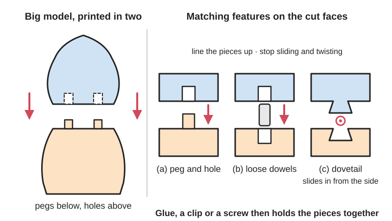
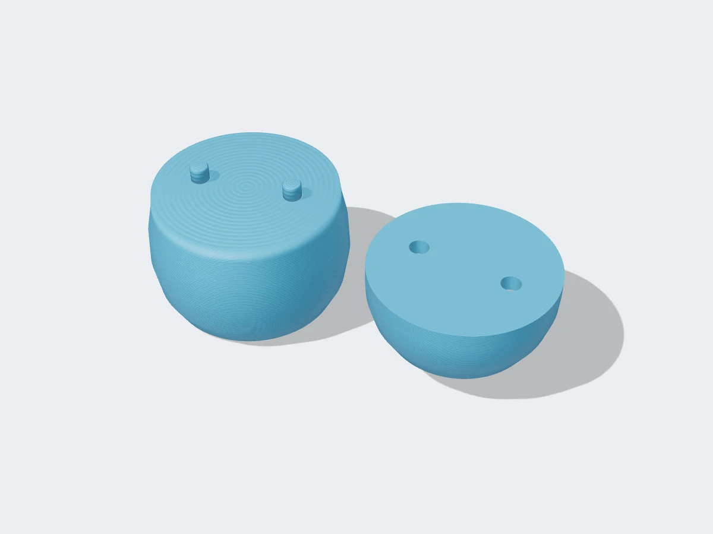

<figure class="eoc-pic eoc-pic-main"><figcaption>Diagram drawn for the encyclopaedia from the research notes. ⚑ Needs confirming: a drawing can simplify or get details wrong; a real photo or a better diagram is welcome.</figcaption></figure>
<figure class="eoc-pic"><figcaption><strong>Render.</strong> A 3D model made for the encyclopaedia, not a photo: a stand-in until a good real photo is found. ⚑ Needs confirming: a model can simplify or get details wrong; a real photo is welcome.</figcaption></figure>

A big model is cut into printable pieces and the cut faces are given matching pegs, holes, dovetails or puzzle shapes, so the pieces go back together in exactly the right place and are then glued, clipped or simply slid together.

**In plain words:** Ways to cut a model that's too big for your printer into smaller pieces, with pegs and holes, sliding wedge-shaped tabs or jigsaw-puzzle edges on the cut faces, so the pieces line up exactly and lock or glue back together. **Proper term:** Split-part joints for large prints (model segmentation with connectors: alignment pins or dowels, dovetails and puzzle joints).

**Also called:** cut connectors: plug, dowel and snap connectors (names used by the PrusaSlicer and Bambu Studio Cut tools); alignment pins, locating pins, pegs and sockets, peg-and-socket joints (Bambu Studio wiki; Prusa knowledge base); dowel pins, dowels (Bambu Studio and PrusaSlicer 'Dowel' connector; Wikipedia 'Dowel'); alignment keys, registration keys (e.g. the video 'Autodesk Fusion: Split a Model to Fit Your 3D Printer (Add Alignment Keys)'); 'keys and keyways' ⚑ [uncertain]; dovetail joint, dovetail cut, sliding dovetail, tapered dovetail (PrusaSlicer and Bambu Studio 'Dovetail' mode; BOSL2 dovetail(); Wikipedia 'Dovetail joint'); puzzle joint, jigsaw joint, tongue joint (T, I and finned tongues) (Formlabs; BOSL2 'jigsaw' cut path); hammerhead, finger (comb) and sawtooth joints (other interlocking cut-path shapes in BOSL2 partitions.scad); model splitting, model segmentation or partitioning (Chopper, SIGGRAPH Asia 2012; IEOM 2024 study); interlocking joints for 3D printed parts (Hubs; Formlabs).

## How it works

The model is cut along a flat plane in CAD or in the slicer's Cut tool, and matching features are added to both cut faces (Prusa knowledge base 'Cut tool'; Bambu Lab wiki). Pegs and holes, or loose dowels in holes on both faces, stop the pieces sliding or twisting against each other and put them back in the same place every time; a dovetail's wedge-shaped tail slides into a matching groove and resists being pulled apart in every direction except the one it slides in; a puzzle or jigsaw edge works the same way within a flat plane (Bambu Lab wiki; BOSL2 joiners.scad and partitions.scad). The features mainly line the pieces up and take sideways ([shear](../glossary.md#peel-vs-shear)) loads; glue, a tight friction fit, a snap catch or screws then hold the pieces together (Maker.io; Hubs).

## Parts

A few parts: the printed pieces themselves, with matching features on each cut face (a peg on one face and a hole in the other; holes in both faces plus a separate loose pin; a dovetail tail and groove; or a wavy puzzle edge), plus, if used, separate pins (printed dowels, pieces of 1.75 mm filament, wooden dowels or steel pins) and glue, screws or magnets (PrusaSlicer and Bambu Studio cut tools; Prusa forum; Maker.io).

## Everyday examples

- Wooden dowels that line up and join the panels of flat-pack furniture and cabinets (Wikipedia 'Dowel')
- Dovetailed corners of wooden drawers (Wikipedia 'Dovetail joint')
- Jigsaw-puzzle pieces, the shape behind 'puzzle' or 'jigsaw' joints (BOSL2 'jigsaw' cut path)
- Large printed statues, helmets and props printed in several pieces and glued, such as the Venus de Milo example in Bambu Lab's guide

## When to use it

Use split-part joints when a model is bigger than your printer in any direction, when a tall or slender model would be risky to print in one go, or when splitting lets each piece print flat, in a better orientation, with fewer supports or in different colours and materials (Bambu Lab wiki; Prusa knowledge base; Hubs). Choose pegs or dowels for simple alignment before gluing, dovetails or puzzle edges when you want the pieces to lock without glue or to come apart again, snap connectors for quick tool-free assembly in a springy material, and bolts or magnets when the parts must be taken apart often (Maker.io).

## When not to use it

Avoid splitting a part that carries a heavy or bending load across the seam: print it in one piece on a larger printer, turn it so the load runs along the layers, or join the pieces with bolts or a metal reinforcing bar instead. Don't rely on thin printed pins (under about 5 mm) for strength; use metal pins (Hubs). Don't cut through fine details or thin walls (Gambody). For watertight or pressure parts, a glued seam is unreliable; use a one-piece print or a gasketed, bolted joint. If the pieces must come apart repeatedly, avoid glue and use screws with [heat-set inserts](../glossary.md#heat-set-insert), a dry dovetail, snaps or magnets.

## Details

- **What it does (jobs):**
  - join and hold: rebuilds one large object from several printed pieces
  - line parts up exactly: pegs, dowels and dovetails set the position of each piece so seams match
- **Movement:** none: the finished joint is rigid (a dovetail slides in one direction only while being assembled)
- **Directions it can move (degrees of freedom):** 0 once assembled and glued. Before gluing, pegs and dowels leave only the pull-apart direction free, and a dovetail leaves only its sliding direction free (BOSL2 joiners.scad).
- **Special behaviour:**
  - self-aligning or self-centring: pegs, dowels, tapered dovetails and chamfered edges guide the pieces into the right position as they are pushed together; a tapered dovetail slides freely until fully closed and then wedges tight (BOSL2 dovetail())
  - none of the other behaviours: it is a static joint
- **How it holds:**
  - shape (the parts interlock; [form-fit](../glossary.md#form-fit--force-fit--material-bond)): dovetails and puzzle edges lock against pulling apart in the plane; pegs and dowels stop sliding
  - material bond (glue, solvent or melting): most split prints are finally glued, e.g. superglue for PLA and two-part epoxy for PETG or ABS (Bambu Lab wiki)
  - friction or clamping (force-fit): tight pins or dovetails, or screws and bolts through the pieces (Maker.io)
  - spring force (a spring or springy part presses it in place): snap connectors from the slicer's Cut tool, or a dovetail with a snap catch (PrusaSlicer 'Snap' connector; Printables 'Dovetail Joint with Snap Fit Connector')
- **Input and output:** not applicable
- **Power:** passive (no power needed)
- **Load:** Light to medium: the seam is usually the weakest place in the finished model (Maker.io says flat glued joints have lower structural integrity than the original part). Pegs, dowels and dovetails are good in shear (sideways sliding); dovetails and puzzle edges also resist pulling apart within the cut plane, while glue, screws or snaps carry the pull straight across the seam. Bending across the seam is the weak case: in a study of PLA segments, adding superglue made round screw joints much stronger in bending but made flat dovetail joints weaker (Melhem, Jaradat and Abdelall, IEOM 2024). Small printed pins under about 5 mm diameter are weak (Hubs).
- **Play and precision:** none to small: well-fitted pins and dovetails give very repeatable alignment, with a little play set by the [clearance](../glossary.md#clearance) (e.g. 0.15 mm on the 'Python' dovetails, Printables); a tapered dovetail wedges tight with no play (BOSL2). Printed parts are only accurate to about 0.2 mm (Prusa knowledge base), so seams may still need filling and sanding. Tolerates little [misalignment](../glossary.md#misalignment): warped pieces or ones printed in different orientations or layer heights leave visible ridges (Bambu Lab wiki).
- **Taking it apart:** permanent when glued, which is the usual finish for statues and props (Bambu Lab wiki; Prusa knowledge base). Removable or tool-free when the joint is left dry: dovetails and puzzle joints often need no glue and can be taken apart, and bolted or magnetic joints are easy to undo (Maker.io).
- **How often it can be reused:** once when glued; a few to many times when a dry dovetail, snap connector, bolt or magnet joint is used, though printed plastic fits slowly wear and loosen ⚑ [uncertain]
- **Sealing:** none: the pegs and dovetails don't seal; a glued, filled seam may be watertight by chance but is not designed to be ⚑ [uncertain]
- **Adjustable:** no: the connectors fix the pieces' positions; fit can only be eased by sanding before gluing
- **Access needed:** not applicable: the pieces are pushed or slid together by hand. A sliding dovetail needs free space at one end of its groove for the tail to slide in (BOSL2 dovetail() 'entry_slot_length').
- **Materials:** Any printing material: PLA, PETG, ABS and ASA on FDM printers (Hubs prefers ABS to PLA for FDM interlocking joints), resin (Formlabs: dovetails suit SLA's sharp edges, but standard resin parts can be [brittle](../glossary.md#brittle--ductile) unless a tough resin is used; Hubs), and nylon by SLS or material jetting, which Hubs rates best for interlocking joints. Snap-type connectors need a springy plastic such as PETG; in PLA the snap arms may break (Printables 'Dovetail Joint with Snap Fit Connector'). Loose pins can be printed, cut from 1.75 mm filament, or be wooden dowels or 2 mm steel roll pins (Prusa forum; Wikipedia 'Dowel'). Glue: superglue (cyanoacrylate) for PLA, two-part epoxy for PETG or ABS (Bambu Lab wiki).
- **Heat, cold, water and wear:** The joint is only as heat-resistant as the plastic and glue: in CNC Kitchen's oven test PLA started to give at about 60 °C, PETG at about 80 °C and ASA at about 110 °C, so a glued PLA model left in a hot car may sag at the seams. Dry friction fits in PLA can loosen over time as the plastic [creeps](../glossary.md#creep) ⚑ [uncertain]. Superglue joints can weaken with moisture and heat ⚑ [uncertain].

## Making it

- **Ways to make or get it:**
  - 3D print (FDM): the main use; cut in the slicer or CAD and print each piece in its best orientation (Prusa knowledge base; Bambu Lab wiki)
  - 3D print (resin): SLA suits dovetails with sharp edges; allow about 0.4 mm assembly clearance (Formlabs)
  - 3D print (SLS, material jetting): the most accurate printed interlocking joints (Hubs)
  - woodwork, CNC and laser cut: the same ideas (dowels, dovetails, jigsaw edges) are traditional joinery for panels too big to cut in one piece (Wikipedia 'Dovetail joint', 'Dowel') ⚑ [uncertain for laser cut]
  - off-the-shelf part: wooden dowels, steel dowel or roll pins, screws and magnets as the connectors (Prusa forum; Maker.io)
- **Printing it in one piece (print in place):** no: the pieces are printed separately (often on separate plates) and assembled afterwards; with 'dowel' connectors the slicer even prints the pins as extra separate objects (PrusaSlicer Cut tool).
- **Tools:** A CAD program or a slicer with a Cut tool that adds connectors (PrusaSlicer, Bambu Studio); glue (superglue for PLA, two-part epoxy for PETG or ABS), clamps, sandpaper or a file (start at 220 grit) to ease tight pegs and holes, and filler putty and [primer](../glossary.md#primer) to hide seams (Bambu Lab wiki). Optional: a drill to size pin holes exactly, since printed holes come out small (Prusa forum; Hubs), and screws, nuts or magnets for removable joints (Maker.io).
- **Difficulty:** easy: PrusaSlicer and Bambu Studio can cut a model and add pegs, dowels, snaps or dovetails automatically; getting a good fit needs a calibrated printer (correct flow) and usually a small test print

### 3D printing tips

1) Plan the cuts: cut where there is plenty of flat area to glue and room for pegs, not through fine details or at the thinnest points (Gambody); splitting also lets each piece be printed in its best orientation with fewer supports, which can improve both looks and strength (Prusa knowledge base; Bambu Lab wiki). Number or letter the pieces (Gambody; Bambu Lab wiki). 2) Use the slicer: in PrusaSlicer or Bambu Studio open the Cut tool (C key in Bambu Studio), choose Planar or Dovetail mode, and add connectors: Plug (a peg on one side and a hole on the other), Dowel (holes on both sides plus separate printed pins) or Snap (a snap-fit catch); set shape, depth, size and [tolerance](../glossary.md#tolerance), then choose 'place on cut' so each cut face lies flat on the bed (Prusa knowledge base; Bambu Lab wiki). Dovetail settings are depth, width, flap angle and groove angle (Bambu Lab wiki). 3) Clearance: allow for your process: Hubs gives 0.5 mm for FDM, 0.2 mm for SLA and SLS and 0.1 mm for material jetting; Formlabs recommends at least 0.4 mm for SLA assemblies and 0.2 mm (small) to 0.4 mm (large) for SLS; a proven FDM dovetail design uses 0.15 mm and should slide together 'with little effort', not with a mallet (Printables 'Python - Dovetail Test Pieces'). Print a small test joint first (Printables dovetail test pieces). 4) Calibrate flow: over-extrusion is the usual reason dovetails won't go together (Printables 'Python - Dovetail Test Pieces'). 5) Pins: FDM pins thinner than about 5 mm are weak, so use off-the-shelf pins in printed holes instead (Hubs); a neat trick is to model 1.75 mm holes in both faces and use short pieces of filament as pins, or 2 mm steel roll pins in 2.1 mm holes, drilling the holes to size because printed holes come out small (Prusa forum; Hubs). 6) [Chamfer](../glossary.md#chamfer--fillet) or round the edges of pegs and holes so they slide together easily, and avoid sharp corners that concentrate stress (Prusa knowledge base; Hubs). 7) Keep supports off the cut faces and connectors, and use the same orientation, layer height and settings for all pieces so the seams match (Bambu Lab wiki). Use a brim if pieces warp, as [warping](../glossary.md#warping--shrinkage) causes misalignment (Bambu Lab wiki). 8) Assemble: dry-fit first; sand tight pegs or holes (start at 220 grit) rather than forcing them, which can crack the part; glue with superglue for PLA or two-part epoxy for PETG and ABS, hold or clamp for 30-60 seconds, then fill seams with putty or superglue, sand and prime (Bambu Lab wiki). Make sure glued surfaces are smooth and free of grease and dirt (Prusa knowledge base). 9) For long sliding joints use a slightly tapered dovetail, which slides freely until the last moment and then wedges tight (BOSL2 dovetail()). 10) For joints that must come apart, use a dry dovetail, snap connectors, bolts with nuts, or magnets instead of glue (Maker.io).

### Buying one (off-the-shelf parts)

Search for: 'dowel pins' (steel, hardened and ground, for precise alignment) and 'wooden dowels' (Wikipedia 'Dowel'); 'spring pins' or 'roll pins' (a 2 mm roll pin in a printed hole was suggested on the Prusa forum); 'neodymium disc magnets' for removable joints (Maker.io); machine screws with nuts or heat-set inserts for bolted joints (Maker.io); 'cyanoacrylate glue' (superglue) and 'two-part epoxy' (Bambu Lab wiki); 'filler putty' and 'filler primer' for hiding seams (Bambu Lab wiki).

## Rules of thumb

- Clearance for interlocking joints: FDM 0.5 mm, SLA 0.2 mm, SLS 0.2 mm, material jetting 0.1 mm (Hubs 'How to design interlocking joints for fastening 3D printed parts').
- Resin (SLA) assemblies: at least 0.4 mm clearance; SLS: 0.2 mm for small features (under 20 mm²) and 0.4 mm for larger ones (Formlabs 'How to 3D print interlocking joints').
- Typical FDM [accuracy](../glossary.md#repeatability--accuracy) is about 0.2 mm; start movable fits at 0.3 mm or more; add pegs to help alignment and strength when splitting a model (Prusa knowledge base 'Modeling with 3D printing in mind').
- FDM pins need a diameter of at least 5 mm to print reliably; for smaller pins, insert off-the-shelf pins into printed holes; vertical holes print undersized, so drill critical holes to size (Hubs 'How to design parts for FDM 3D printing').
- Oversize holes by about 0.15 mm for pins; 2 mm steel roll pins go in 2.1 mm printed holes that are then drilled (Prusa forum 'Adding alignment pins in Slicr?', February 2020).
- A 0.15 mm dovetail clearance lets well-calibrated printed parts slide together with little effort (humebeam, Printables 'Python - Dovetail Test Pieces').
- BOSL2's dovetail() defaults to a 1:6 slope (standard woodworking slopes are 1:4, 1:6 and 1:8) and its $slop setting adds the clearance gap on each of the three contact faces (BOSL2 joiners.scad).
- Superglue made PLA round screw joints stronger in bending but made flat dovetail joints weaker, so test before relying on glue plus dovetail (Melhem, Jaradat and Abdelall, 'A Study of the Flexural Behavior of 3D-Printed PLA Dovetail and Screw Joints Considering Chemical Adhesive Usage', IEOM 2024).

## Common failures

Parts won't go together: over-extrusion, [elephant's foot](../glossary.md#elephants-foot) or printer inaccuracy makes pegs too fat or holes too small; calibrate flow, chamfer the edges, sand or drill to fit, and test-print a sample joint first (Printables 'Python - Dovetail Test Pieces'; Hubs; Prusa forum). Supports printed onto the cut faces or connectors spoil the fit (Bambu Lab wiki). Misaligned seams from warped pieces or from cutting without connectors; add connectors and use a brim (Bambu Lab wiki). Visible ridges at the seam from pieces printed in different orientations or layer heights; keep settings identical and fill and sand (Bambu Lab wiki). Thin printed pins snap (Hubs), and snap connectors printed in PLA may break (Printables 'Dovetail Joint with Snap Fit Connector'). A seam that looks fine but breaks in bending, because the joint is weaker than solid plastic (IEOM 2024; Maker.io).

## Safety

Superglue bonds skin in seconds and its fumes irritate eyes; epoxy can cause skin allergies; work in a ventilated area, wear gloves and follow the glue's label ⚑ [uncertain]. Forcing tight parts together can crack them suddenly (Bambu Lab wiki); sand them instead. Wear a dust mask when sanding and filling seams ⚑ [uncertain].

## Related

- Dovetail joint (through and half-blind) and sliding dovetail: the woodworking originals of the dovetail connector
- Dowel and biscuit joints: the woodworking version of alignment pins
- Locating pins and hole-and-slot: precise engineering alignment with hardened pins, where one pin locates and a slot takes up the error
- Butterfly key (bow-tie key): a separate wedge-shaped key set across the seam instead of shapes cut on the faces
- Heat staking: printed pins melted over to join split pieces permanently without glue
- [Captive nut](../glossary.md#captive-nut) pocket and heat-set threaded insert: for bolting split pieces together so they can come apart
- [Cantilever](../glossary.md#cantilever) snap fit: the catch used by slicer 'snap' connectors
- Solvent welding and cyanoacrylate (superglue): the glues usually used to finish split joints
- Tab-and-slot joint and Japanese interlocking joints: other ways of locking pieces by shape

## Make it yourself

- [PrusaSlicer Cut tool (free slicer)](https://help.prusa3d.com/article/cut-tool_1779): Cuts any model with a plane or a dovetail and adds plug, dowel or snap connectors with adjustable shape, size, depth and tolerance *(licence: PrusaSlicer is AGPL-3.0 open-source software)*
- [A Guide to Splitting and Printing Large Files in Bambu Studio (Bambu Lab Wiki)](https://wiki.bambulab.com/en/bambu-studio/manual/3d-print-large-files): Step-by-step guide to cutting an oversized statue into pieces with connectors in Bambu Studio's Cut tool, printing and gluing it *(licence: link only (guide); Bambu Studio is a free slicer ⚑ [uncertain licence])*
- [BOSL2 partitions.scad: partition(), partition_mask() and partition_cut_mask() (OpenSCAD library)](https://raw.githubusercontent.com/BelfrySCAD/BOSL2/master/partitions.scad): Parametric modules that cut an object in two with matched interlocking edges: flat, sawtooth, sinewave, comb, finger, dovetail, hammerhead or jigsaw cut paths *(licence: BSD 2-Clause)*
- [BOSL2 joiners.scad: dovetail(), joiner() and snap_pin() (OpenSCAD library)](https://raw.githubusercontent.com/BelfrySCAD/BOSL2/master/joiners.scad): Parametric dovetails (straight or tapered, chamfered or rounded like a puzzle piece), screw-together joiners and snap pins for joining separately printed parts, with a $slop setting for fit *(licence: BSD 2-Clause)*
- [Python - Dovetail Test Pieces (humebeam, Printables) (URL from Printables API, page not opened)](https://www.printables.com/model/1134808-python-dovetail-test-pieces): About 6 g of test pieces with 0.15 mm dovetail clearance, to check your flow and fit before printing a large dovetailed assembly. Read through the Printables public API. *(licence: CC BY-NC (Creative Commons Attribution-NonCommercial))*
- [Dovetail Joint with Snap Fit Connector (thczv, Printables) (URL from Printables API, page not opened)](https://www.printables.com/model/1224537-dovetail-joint-with-snap-fit-connector): A dovetail joint whose male part ends in a snap catch, for joining pieces such as a game board; recommended in PETG. Read through the Printables public API. *(licence: CC BY-NC-SA (Creative Commons Attribution-NonCommercial-ShareAlike))*
- [Print Bed Scraper - Split Model with Alignment Holes (MakerIke, Printables)](https://www.printables.com/model/596251-print-bed-scraper-split-model-with-alignment-holes): A small tool split into two halves with pegs and holes for alignment when gluing, as a simple example of the technique. URL found in search results; details read through the Printables public API. *(licence: CC BY-NC-SA (Creative Commons Attribution-NonCommercial-ShareAlike))*

## Pictures, videos and models

- [Cut tool (Prusa Knowledge Base)](https://help.prusa3d.com/article/cut-tool_1779): Screenshots of PrusaSlicer's Cut tool: planar and dovetail cuts, and plug, dowel and snap connectors with their settings *(licence: link only)*
- [Cut Tool (Bambu Lab Wiki)](https://wiki.bambulab.com/en/software/bambu-studio/cut-tool): Screenshots and an animated GIF of dovetail depth, width, flap angle and groove angle, and the plug, dowel and snap connectors *(licence: link only)*
- [Joinery-slidingdovetail.gif (Wikimedia Commons, by SilentC)](https://commons.wikimedia.org/wiki/File:Joinery-slidingdovetail.gif): Animated diagram of a sliding dovetail joint sliding together *(licence: CC BY-SA 3.0 or GFDL 1.2+ (dual licensed))*
- [Chopper: Partitioning Models into 3D-Printable Parts (Luo, Baran, Rusinkiewicz and Matusik, SIGGRAPH Asia 2012)](https://gfx.cs.princeton.edu/pubs/Luo_2012_CPM/index.php): Project page with an image of a chair model cut into printable parts with connectors, printed and assembled, plus a 4-minute video and the paper *(licence: link only)*
- [Autodesk Fusion: Split a Model to Fit Your 3D Printer (Add Alignment Keys) (YouTube, What Make Art)](https://www.youtube.com/watch?v=-PtARBZEu5g): Video tutorial on splitting an oversized model in CAD and adding alignment keys (title checked via YouTube oEmbed) *(licence: link only (standard YouTube licence))*

## Needs confirming

⚑ marks something nobody has confirmed yet: a fact the research could not confirm from a source, a finder value that is a best guess, or an open point from the research notes. Corrections are welcome (see `research/needs-confirming.md`).

- ⚑ 9 sentences on this page marked [uncertain].

## Sources

- <https://help.prusa3d.com/article/cut-tool_1779>
- <https://help.prusa3d.com/article/modeling-with-3d-printing-in-mind_164135>
- <https://forum.prusa3d.com/forum/original-prusa-i3-mk3s-mk3-hardware-firmware-and-software-help/adding-alignment-pins-in-slicr/>
- <https://wiki.bambulab.com/en/software/bambu-studio/cut-tool>
- <https://wiki.bambulab.com/en/bambu-studio/manual/3d-print-large-files>
- <https://www.hubs.com/knowledge-base/how-design-interlocking-joints-fastening-3d-printed-parts/>
- <https://www.hubs.com/knowledge-base/how-design-parts-fdm-3d-printing/>
- <https://formlabs.com/blog/how-to-3d-print-interlocking-joints/>
- <https://www.digikey.com/en/maker/blogs/2024/how-to-split-and-join-large-3d-prints>
- <https://www.gambody.com/blog/how-to-split-a-model-in-half-secrets-of-large-scale-3d-printing/>
- <https://gfx.cs.princeton.edu/pubs/Luo_2012_CPM/index.php>
- <https://ieomsociety.org/proceedings/2024tokyo/224.pdf>
- <https://raw.githubusercontent.com/BelfrySCAD/BOSL2/master/partitions.scad>
- <https://raw.githubusercontent.com/BelfrySCAD/BOSL2/master/joiners.scad>
- <https://raw.githubusercontent.com/BelfrySCAD/BOSL2/master/LICENSE>
- <https://raw.githubusercontent.com/prusa3d/PrusaSlicer/master/LICENSE>
- <https://en.wikipedia.org/wiki/Dovetail_joint>
- <https://en.wikipedia.org/wiki/Dowel>
- <https://commons.wikimedia.org/wiki/File:Joinery-slidingdovetail.gif>
- <https://www.cnckitchen.com/blog/comparing-pla-petg-amp-asa-feat-prusament>
- <https://api.printables.com/graphql/>
- <https://www.youtube.com/watch?v=-PtARBZEu5g>
