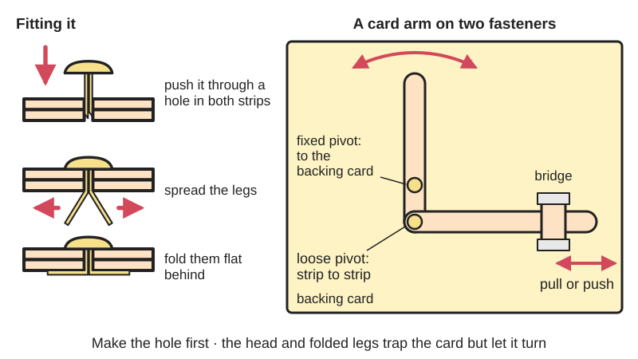
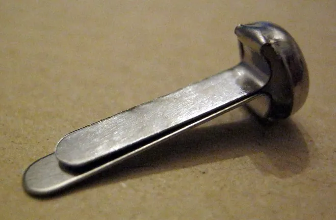
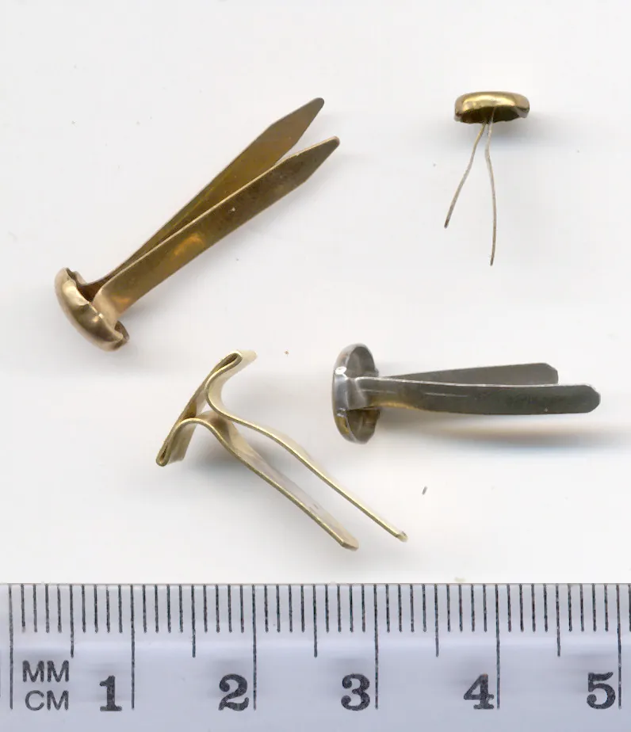

<figure class="eoc-pic eoc-pic-main"><picture><source media="(prefers-reduced-motion: reduce)" srcset="../media/drawn/split-pin-paper-fastener.svg"></picture><figcaption><strong>Animation.</strong> Diagram drawn for the encyclopaedia from the research notes. ⚑ Needs confirming: a drawing can simplify or get details wrong; a real photo or a better diagram is welcome.</figcaption></figure>
<figure class="eoc-pic"><figcaption><strong>Photo.</strong> <a href="https://commons.wikimedia.org/wiki/File:Attache_parisienne.JPG">Attache parisienne</a> by Zyzomis, <a href="https://creativecommons.org/licenses/by-sa/3.0">CC BY-SA 3.0</a>, from Wikimedia Commons.</figcaption></figure>
<figure class="eoc-pic"><figcaption><strong>Photo.</strong> <a href="https://commons.wikimedia.org/wiki/File:Musterklammer_2005-05-06.JPG">Musterklammer 2005-05-06</a> by No machine-readable author provided. Mws.richter assumed (based on copyright claims)., Public domain, from Wikimedia Commons.</figcaption></figure>

A soft brass or brass-plated pin with a round head and two flat legs that is pushed through a hole in stacked paper or card and has its legs spread and folded flat behind, holding the layers together while still letting them turn, which makes it the standard beginner pivot for moving pictures, card puppets, toy clocks and card [linkages](../glossary.md#linkage).

**In plain words:** A little brass pin with a round head and two flat legs that you push through holes in paper or card and then fold the legs flat behind, so the pieces stay together but can still turn, like the arms on a moving-picture card or the hands on a paper clock. **Proper term:** Split-pin paper fastener (brass paper fastener, round-head paper fastener).

**Also called:** brass fastener; butterfly clip; brad; paper fastener; split pin (Wikipedia 'Brass fastener'); round-head fastener; brass-plated fastener; self-piercing fastener (ACCO and Officemate catalogue listings); paper brad, script brad, screenplay brad: the US film-industry name for the long solid-brass fasteners used to bind scripts (Writing-World; Between Borders); craft brad, scrapbook brad, mini brad: small decorative fasteners, often coloured or with flower-shaped heads, for scrapbooking and card making (Wikipedia 'Brass fastener'; Wikimedia Commons 'Flower crafting brads in pastel colors'); paper split pin, pivot pin: the names used in UK primary-school Design and Technology for moving-picture and lever-and-linkage projects (Charles Darwin Primary; Denmead Junior; Lyppard Grange); Musterklammer, Musterbeutelklammer (German) (Wikimedia Commons 'Brass fasteners' category); not the small nail also called a brad (see Nails, brads and tacks), and not the steel split pin or cotter pin that locks a nut (see Thread-locking hardware).

## How it works

You make a hole through all the layers, push the legs through from the front, then separate the two legs and bend them flat against the back, so the head on the front and the folded legs on the back trap the layers between them (Wikipedia 'Brass fastener'). Nothing glues or squeezes the layers hard, so a part held this way can still swing around the pin: it becomes a simple pin-in-hole pivot (Wikipedia: 'more commonly used in situations where rotation around the joint is desirable'). In card linkages a fastener that joins two moving card strips is called a loose pivot, and one that joins a strip to the backing card is a fixed pivot (Charles Darwin Primary; Arnold View; Lyppard Grange). The large round head stops the fastener pulling back through the hole (ACCO listing).

## Parts

Single piece: one pressed-metal fastener with a round head and a split shank (two legs, usually of slightly different lengths). Often used with a small washer or card disc behind the legs, and a card spacer where a lever must sit level (Wikipedia 'Brass fastener'; Between Borders; Rob Ives). The design dates from the 1860s: George McGill's US patent of 1866 describes fasteners that 'have a round or flat head and two legs that are inserted through papers', and several rival paper fasteners were patented from 1859 on (Office Museum; Wikipedia 'Brass fastener').

## Everyday examples

- School moving-picture cards and lever-and-linkage cards, where a pulled strip makes an arm wave or a head nod (Denmead Junior; Lyppard Grange)
- Halloween card skeletons and shadow puppets with jointed arms and legs, and a paper clock with turning hands (Printables 'Parametric OpenSCAD paper fasteners')
- A paper model of the Sun, Earth and Moon that revolve (Printables 'Fastener for paper / card stock')
- A film script bound with two brass brads (Wikipedia 'Brass fastener'; Between Borders)

## When to use it

When you need paper or card parts to turn around a point and want it done in seconds without tools or glue: moving pictures, card puppets, toy clocks, volvelles and teaching models of levers and linkages (Wikipedia 'Brass fastener'; Rob Ives; school DT plans). When you want a joint you can undo, for example to try a linkage out before deciding where the pivots go. For quick connections in cardboard prototypes (Adafruit: 'Instant connection!'). For binding a stack of punched sheets so pages can be swapped (screenplays) (Between Borders).

## When not to use it

When the joint carries real load or gets heavy use, since the card tears at the hole and the legs work loose: use a plastic cardboard rivet or a Makedo-type screw for cardboard builds (Adafruit says rivets 'have a smooth shaft' and 'can be used for rotating pivot points and joints'), an eyelet or a Chicago screw for a neater, longer-lasting pivot, or a proper pin, shoulder bolt or bearing in wood, metal or plastic (see Plain pivot). When the back can't be reached to fold the legs, use a one-side cardboard screw. Where young children could get hold of loose fasteners. When a pivot must be precise or play-free.

## Details

- **What it does (jobs):**
  - let it move (turn, slide or bend): its main use, as a pivot so card parts can swing or spin, e.g. levers, linkages, clock hands and puppet limbs (Wikipedia 'Brass fastener'; Rob Ives; Charles Darwin Primary)
  - join and hold: holds a stack of sheets together, for example binding a screenplay with two fasteners in the top and bottom holes (Wikipedia 'Brass fastener'; Between Borders)
- **Movement:** rotate: the parts turn freely around the pin, a full 360 degrees if nothing else gets in the way (Wikipedia 'Brass fastener'; Printables 'Parametric OpenSCAD paper fasteners' lists toy clocks and pinwheels)
- **Directions it can move (degrees of freedom):** 1: the layers can turn about the pin. The loose hole also lets the parts rock and wobble a little, so in practice there is some extra play ⚑ [uncertain: from general experience, not a source]
- **Special behaviour:**
  - none: it is a plain pivot with no clever behaviour of its own. Used in card levers and linkages it helps change one kind of motion into another (a push or pull on a card strip turns into a swing of the picture), but that comes from the linkage, not the fastener (Lyppard Grange: 'the input movement is where the user pushes or pulls a card strip. The output movement is where one or more parts of the picture move')
- **How it holds:**
  - shape (the parts interlock; [form-fit](../glossary.md#form-fit--force-fit--material-bond)): the head on one side and the folded legs on the other trap the layers mechanically (Wikipedia 'Brass fastener')
- **Input and output:** not applicable: the fastener only makes a pivot. In a card lever or linkage the input is a push or pull on a card strip and the output is a moving part of the picture (Lyppard Grange)
- **Power:** passive (no power needed)
- **Load:** light. It holds paper and card and lets light card parts turn. The weak points are the paper or card itself, which can tear out at the hole, and the legs, which can unfold if pulled hard; it is not meant to carry weight ⚑ [uncertain: no load tests found]. Brass-plated steel script brads are said to let a long script 'fall apart by page 60', so solid brass and longer fasteners are used for thick stacks (Writing-World)
- **Play and precision:** noticeable play: the pin is thinner than the hole and the card is soft, so the parts wobble and the pivot point wanders a little. Fine for moving pictures and teaching linkages, not for anything that must line up exactly ⚑ [uncertain: general experience]. It tolerates some [misalignment](../glossary.md#misalignment) of the holes, since the flat legs can be pushed through slightly offset holes
- **Taking it apart:** removable: straighten the legs and pull the fastener out; the printed click-together versions can be unfastened and reused (Printables 'Fastener for paper / card stock'). Bending the legs back and forth many times weakens them ⚑ [uncertain]
- **How often it can be reused:** a few times: the soft metal legs can be straightened and re-bent a few times, but they tire and the card hole wears larger ⚑ [uncertain: from general experience, no test found]
- **Sealing:** none
- **Adjustable:** partly: how tightly the legs are pressed down sets how freely the joint turns, and the legs can be lifted and re-pressed to loosen or tighten it ⚑ [uncertain: maker practice, not from a source]
- **Access needed:** both sides: you push the pin in from the front and must reach the back to spread and fold the legs
- **Materials:** Usually made of soft brass, or of steel with a brass plating (Wikipedia 'Brass fastener'; ACCO listing 'Brass Plated'; Writing-World and Between Borders contrast solid brass with brass-plated steel or tin). Suits paper, card, thin cardboard and corrugated cardboard (Wikipedia: 'mobile paper and cardboard models'; Adafruit: 'Punch a couple of holes in your cardboard, push a paper fastener through, and fold out the legs'), and also fabric, felt or craft foam sheets in crafts ⚑ [uncertain]. Not for wood, metal or rigid plastic parts, except to hold paper or card to them through ready-made holes ⚑ [uncertain].
- **Heat, cold, water and wear:** Indoor use only in practice: the paper or card is the weak part, and damp makes card soft so the hole stretches and the joint loosens (Wikipedia 'Corrugated fiberboard': moisture above about 9.5% 'will reduce the compression strength') ⚑ [uncertain: applied from corrugated board in general]. Brass-plated steel fasteners can rust in the damp where the plating is scratched ⚑ [uncertain]. Heat, sun and vibration are not an issue for the fastener itself.

## Making it

- **Ways to make or get it:**
  - off-the-shelf part: the usual choice; sold in many lengths in stationery and craft shops (ACCO listing)
  - 3D print (FDM): click-together printed versions exist as a substitute (Printables 'Parametric OpenSCAD paper fasteners'; 'Fastener for paper / card stock'; 'Simple paper fastener')
  - laser cut: card and paper parts for moving pictures and automata are often laser or plotter cut and then joined with paper fasteners ⚑ [uncertain: common practice, no page opened]
- **Printing it in one piece (print in place):** no: the printed versions are two separate parts (a pin and a cap or socket) that are printed apart and then pressed or clicked together through the paper (Printables 'Parametric OpenSCAD paper fasteners': 'They need a little bit of force to click together'; 'Fastener for paper / card stock': 'you need to print two to connect them together').
- **Tools:** none for fitting it, apart from something to make the hole first: a pencil point pressed through onto a lump of Plasticine or Blu Tack, an awl, a bamboo skewer or a single hole punch (Lyppard Grange; Rob Ives; Adafruit 'Cardboard fundamentals'). A standard hole punch for stacks of paper (Wikipedia 'Brass fastener')
- **Difficulty:** easy: no tools, sold everywhere, and used by 7- to 8-year-olds in UK Year 3 Design and Technology (Denmead Junior; Lyppard Grange). The only skill is making a clean hole in the right place first.

### 3D printing tips

Printed paper fasteners are two-part pegs that snap together through the hole. A parametric OpenSCAD model lets you set the gap between head and cap to match the thickness of the paper or card stack; if the parts are too tight, tap them together lightly with a hammer, squeeze them in a vice or clamp, or increase the [clearance](../glossary.md#clearance) in the file (Printables 'Parametric OpenSCAD paper fasteners', CC BY-SA). One maker printed a shortened 'locking rivet' remix at a 0.1 mm layer height, with 'Complete individual objects' (sequential printing) turned on in PrusaSlicer, and found it 'can be unfastened, and is reusable' (Printables 'Fastener for paper / card stock', CC BY). A simple printed binding version 'fits standard hole punch size', prints at 15% [infill](../glossary.md#infill) with no supports and holds 25-30 sheets (Printables 'Simple paper fastener', CC BY-NC-SA). Small pins are easiest to print standing upright, but then the pin breaks easily along the [layer lines](../glossary.md#layer-lines) if bent sideways ⚑ [uncertain: general FDM advice, not from these pages]. PLA is enough for paper crafts ⚑ [uncertain]. A printed version is thicker and blunter than a brass one, so it needs a bigger hole, but it has no sharp leg tips.

### Buying one (off-the-shelf parts)

Brass paper fasteners (round-head paper fasteners, 'brads'), sold in lengths from short craft sizes to long binding sizes; solid-brass ones are stronger than brass-plated steel ones (Writing-World; Between Borders). Some have 'self-piercing points' and a 'larger round head' that 'prevents pulling through punched holes' (ACCO listing at Monk Office: https://commercial.monk.ca/office-products/clips-pins-rubber-bands/other-clips-fasteners/acc71710-brass-plated-fastener-1-100pk). Matching solid-brass script washers fit behind the legs (Between Borders: 'Acco #2 Solid Brass Washers'; Writing-World). Decorative scrapbook brads come in colours and shapes (Wikimedia Commons). Alternatives for a stronger or longer-lasting card pivot: eyelets, Chicago screws, plastic cardboard rivets, or a paper rivet made of split card tabs (see related).

## Rules of thumb

- Make the hole first. For thin card, press a pencil through the card onto a piece of Plasticine or Blu Tack (Lyppard Grange Year 3 DT plan); Rob Ives's lever templates say 'Make holes in the centres with the point of a pencil. Take care!' (Rob Ives 'Simple Levers'). For cardboard use an awl, bamboo skewer or single hole punch (Adafruit 'Cardboard fundamentals'). Only for 'a few sheets of paper' can the fastener's own sharp end make the hole (Wikipedia 'Brass fastener').
- Separate the legs at their tips: they are 'typically of two slightly different lengths to allow easy separation' (Wikipedia 'Brass fastener').
- Loose pivot versus fixed pivot: a fastener that joins card strips together is a loose pivot (both parts move); one that joins a card strip to the backing card is a fixed pivot (the strip swings about a point that stays put) (Charles Darwin Primary DT progression; Arnold View; Ashleigh Primary; Lyppard Grange).
- Use a guide or bridge (a short card strip taped over the lever) to keep levers and linkages in place and control their movement (Arnold View; Lyppard Grange: 'Guides/bridges can be made using strips of card fixed with masking tape').
- Glue a small card spacer where a [lever arm](../glossary.md#lever-arm) must sit level with the other layers or clear a fastener head (Rob Ives 'Simple Levers': 'Glue on the spacer at the top of the lever arm') ⚑ [uncertain: the purpose is our reading of the instruction].
- For binding thick stacks, use solid brass rather than brass-plated fasteners, and add a washer behind the legs: US scripts use two #5 or #6 solid brass brads in the top and bottom holes of three-hole-punched paper, with brass washers (Writing-World; Between Borders). The two guides disagree on #5 versus #6.
- Choose a fastener long enough that each leg can fold flat across the back with some overlap, but not so long that the legs stick out past the edge of a small part ⚑ [uncertain: maker practice].

## Common failures

The card tears out at the hole or the hole wears oval with use: use thicker card, reinforce the hole with a card disc, washer or eyelet, or put the fastener further from the edge ⚑ [uncertain: maker practice]. The joint is too stiff to turn because the legs are pressed down too hard, or too floppy because they are loose: re-press the legs to suit ⚑ [uncertain]. Legs snap or open up on thick stacks with thin brass-plated fasteners: use solid brass and a washer (Writing-World; Between Borders). The fastener head pulls through a large punched hole: choose one with a bigger head (ACCO listing). The legs catch on other moving parts behind the card: trim or tape them, or add a spacer ⚑ [uncertain]. A linkage jams because a fixed pivot was used where a loose pivot was needed, or the other way round (school DT plans ask pupils to tell them apart).

## Safety

Sharp leg tips: some fasteners are sold with 'self-piercing points' (ACCO listing), so fold the legs flat and press the tips down so they can't scratch, especially on puppets and toys that are handled. Make the hole first with a pencil or awl instead of forcing the pin through, which can bend the legs or stab the hand holding the card: work onto Plasticine, Blu Tack or a cutting mat, not onto your hand (Lyppard Grange; Rob Ives 'Take care!'). Small parts: loose fasteners are a choking, inhalation and swallowing hazard for children under 3, the age group the US small-parts rule protects (CPSC 'Small Parts for Toys and Children's Products'); keep boxes of them away from toddlers and supervise younger children (Ashleigh Primary: 'Pay close attention when using sharp tools').

## Related

- Volvelle (paper wheel): stacked turning paper discs, often held on a split-pin paper fastener; the volvelle entry covers string pivots, paper rivets and the wheel design
- Pull-tab and slider mechanism: paper levers and pull-strips, whose pivots are often paper fasteners
- Plain pivot and rolling bearing (pin in hole, shoulder bolt, ball bearing): the general pin-in-hole pivot for wood, metal and plastic parts
- Four-bar linkage and Bell [crank](../glossary.md#crank): the card linkages that paper fasteners are used to build in school projects
- Cardboard screws and rivets: plastic screws and click-together rivets for corrugated cardboard, sturdier and reusable, with smooth-shank rivets for pivots
- Eyelets and grommets: a metal ring set into card or fabric; a neater, longer-lasting hole or pivot that needs a setting tool
- Chicago screw (binding screw): a two-part screw post for binding and pivots; reusable and stronger, but needs a screwdriver
- Leather and textile rivets: includes the split rivet, whose two legs are hammered flat over a washer in leather; permanent and not meant to pivot
- Thread-locking hardware (split pin): the steel split pin or cotter pin that locks a nut or clevis pin, a much stiffer relative
- Nails, brads and tacks: the small nail also called a brad, a different thing
- Snap pin and Push-in plastic rivet: plastic pins that click into holes without bending legs
- Staples for wood and fabric: staples are the permanent, non-turning way to join paper

## Make it yourself

- [Parametric OpenSCAD paper fasteners (Printables) (URL from Printables API, page not opened)](https://www.printables.com/model/207538-parametric-openscad-paper-fasteners): A 3D-printed click-together alternative to brass paper fasteners; the OpenSCAD file sets the gap for the craft, e.g. a toy clock, skeleton, phonics fans, pinwheels and shadow puppets. Read through the Printables public API. *(licence: CC BY-SA (Creative Commons Attribution-ShareAlike))*
- [Fastener for paper / card stock (Printables) (URL from Printables API, page not opened)](https://www.printables.com/model/127476-fastener-for-paper-card-stock): A shortened locking-rivet remix printed in two parts to make a revolving Sun, Earth and Moon model; unfastens and is reusable. Read through the Printables public API. *(licence: CC BY (Creative Commons Attribution))*
- [Simple paper fastener (Printables) (URL from Printables API, page not opened)](https://www.printables.com/model/729803-simple-paper-fastener): A printed binding fastener that fits standard hole-punch holes and holds 25-30 sheets; 15% infill, no supports. Read through the Printables public API. *(licence: CC BY-NC-SA (Creative Commons Attribution-NonCommercial-ShareAlike))*
- [Simple Levers templates (Rob Ives)](https://www.robives.com/product/lever/): Free printable templates for a simple lever and a lever-and-linkage in corrugated and thin card, joined with split pins *(licence: free download; link only)*

## Pictures, videos and models

- [Musterklammer 2005-05-06.JPG (Wikimedia Commons, by Mws.richter / Stefan Richter)](https://commons.wikimedia.org/wiki/File:Musterklammer_2005-05-06.JPG): A scan of several brass fasteners, showing the round head and the two legs of different lengths (used on Wikipedia 'Brass fastener') *(licence: Public domain)*
- [Split Pins.jpg (Wikimedia Commons, by Richard Wheeler (Zephyris))](https://commons.wikimedia.org/wiki/File:Split_Pins.jpg): Photograph of brass split-pin paper fasteners *(licence: CC BY-SA 3.0 (also GFDL 1.2 or later))*
- [Flower crafting brads in pastel colors.jpg (Wikimedia Commons, by m01229 on Flickr)](https://commons.wikimedia.org/wiki/File:Flower_crafting_brads_in_pastel_colors.jpg): Decorative scrapbook brads with flower-shaped heads in pastel colours *(licence: CC BY 2.0)*
- [Simple Levers (Rob Ives)](https://www.robives.com/product/lever/): Step-by-step photos of a corrugated-card lever and a lever-and-linkage made with split pins and a glued spacer, with free templates *(licence: link only (templates free to download from the shop page))*
- [Category:Brass fasteners (Wikimedia Commons)](https://commons.wikimedia.org/wiki/Category:Brass_fasteners): Ten files of brass paper fasteners, including a German pronunciation recording, craft brads and old fasteners *(licence: per file (Commons licences))*

## Needs confirming

⚑ marks something nobody has confirmed yet: a fact the research could not confirm from a source, a finder value that is a best guess, or an open point from the research notes. Corrections are welcome (see `research/needs-confirming.md`).

- ⚑ 18 sentences on this page marked [uncertain].
- ⚑ Finder value `adjustable` = partly (source uncertain): `adjustable` is marked ⚑ [uncertain] here: "…ns, and the legs can be lifted and re-pressed to loosen or tighten it ⚑ [uncertain: maker practice, not from a s…"
- ⚑ Research note: *Split-pin paper fastener* (413): screenplay brad size, #5 (Writing-World) versus #6 (Between Borders).

## Sources

- <https://en.wikipedia.org/wiki/Brass_fastener>
- <https://www.officemuseum.com/stapler_gallery_miscellaneous.htm>
- <https://learn.adafruit.com/cardboard-fundamentals?view=all>
- <https://www.robives.com/product/lever/>
- <https://charlesdarwin.cheshire.sch.uk/serve_file/34912440>
- <https://denmead-jun.hants.sch.uk/_site/data/files/users/curric%20docs/knowledge-organisers/year-3/2AC9232B81A47A1BF604155FA4ED219E.pdf>
- <https://www.lyppardgrange.worcs.sch.uk/attachments/documents.asp?id=434>
- <https://www.arnoldview.notts.sch.uk/attachments/documents.asp?id=386>
- <https://ashleighprimary.com/wp-content/uploads/Yr-3-Autumn-2-Design-Technology-KO.pdf>
- <https://commercial.monk.ca/office-products/clips-pins-rubber-bands/other-clips-fasteners/acc71710-brass-plated-fastener-1-100pk>
- <https://writing-world.com/screen/film2.shtml>
- <https://betweenborders.com/wordsmithing/us-screenplay-presentation/>
- <https://www.cpsc.gov/Business--Manufacturing/Business-Education/Business-Guidance/Small-Parts-for-Toys-and-Childrens-Products>
- <https://en.wikipedia.org/wiki/Corrugated_fiberboard>
- <https://commons.wikimedia.org/wiki/File:Musterklammer_2005-05-06.JPG>
- <https://commons.wikimedia.org/wiki/File:Split_Pins.jpg>
- <https://commons.wikimedia.org/wiki/File:Flower_crafting_brads_in_pastel_colors.jpg>
- <https://commons.wikimedia.org/wiki/Category:Brass_fasteners>
- <https://api.printables.com/graphql/>
