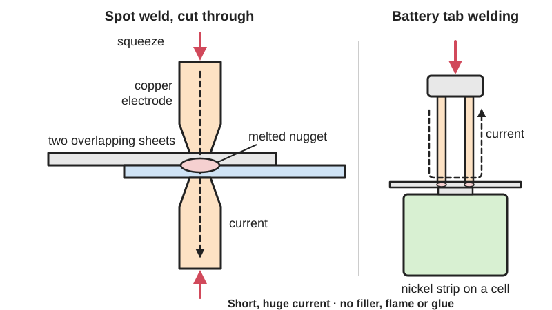

<figure class="eoc-pic eoc-pic-main"><figcaption>Diagram drawn for the encyclopaedia from the research notes. ⚑ Needs confirming: a drawing can simplify or get details wrong; a real photo or a better diagram is welcome.</figcaption></figure>

A spot weld joins overlapping metal sheets or strips at small points: copper electrodes squeeze the parts together and a very short, very high current melts a nugget of metal between them, with no filler, flame or glue, as used on car bodies, sheet-steel boxes and nickel strips on battery packs.

**In plain words:** Joining two overlapping metal sheets or strips by squeezing them between two copper tips and firing a split-second burst of huge electric current through them, which melts a small button of metal where they touch so they set as one. **Proper term:** Spot weld (resistance spot welding, RSW).

**Also called:** resistance spot welding (RSW), spot welding (Wikipedia 'Spot welding'); weld nugget (the small melted button that forms the joint); resistance welding, electric resistance welding (ERW): the family of processes (Wikipedia 'Electric resistance welding'); portable spot welder, tong spot welder, spot welding tongs, spot welding gun (Miller OM-716; Wikipedia); battery spot welder, battery tab welder, tab welder, nickel strip welding (Hackaday); micro spot welder (Wikipedia: 1.5 kVA or less, for precision work); capacitor-discharge (stored-energy) spot welder; MOT spot welder (home-made from a microwave-oven transformer) (OSHA 1910.255; Hackaday); seam welding, resistance seam welding, roller or wheel welding (Wikipedia 'Electric resistance welding'); projection welding; weld nut, weld stud (Wikipedia 'Spot welding'); shot welding (a special process for spot welding stainless steel) (Wikipedia 'Electric resistance welding'); kWeld (brand): a hobby battery welder named in maker models (Printables).

## How it works

The two sheets are clamped between two shaped copper-alloy electrodes, which press them together and carry the current (Wikipedia 'Spot welding'). Copper conducts very well, so little heat is made in the tips; most is made where the current crosses the resistance of the steel and the contact between the two sheets (the faying surfaces), and in about 10-100 milliseconds a button of metal in the middle of the spot melts, while the cooler edges and the copper tips keep it contained (Wikipedia). The current then stops but the electrodes keep squeezing until the nugget has set (hold time); too little energy gives a weak or no weld, and too much melts right through, throws out molten metal (expulsion) and leaves a hole (Wikipedia 'Spot welding', 'Electric resistance welding'). Seam welding does the same with rotating disc-shaped electrodes that roll along the joint to make long continuous welds, and projection welding uses small raised bumps pressed into one part to place the heat, e.g. to weld nuts onto sheet (Wikipedia). Battery tab welders use the same idea with short pulses from a capacitor or battery to weld thin nickel strip onto cell ends (Wikipedia; Hackaday 2021).

## Parts

Single piece once made: the two sheets become joined at each spot. Making it needs a small assembly of equipment: a power source (a mains welding transformer, or a capacitor bank or battery for battery welders), a timer or control box that sets the pulse length, two copper-alloy electrodes on tongs, arms or hand-held pens, a way of applying force (hand lever, foot pedal or spring), and often a jig to hold the parts (Wikipedia 'Spot welding'; Miller OM-716).

## Everyday examples

- car bodies: 'cars can have several thousand spot welds' (Wikipedia 'Electric resistance welding')
- metal buckets and other sheet-metal goods, where the row of small round dimples is easy to see (Wikipedia 'Spot welding')
- battery packs in laptops, power tools and e-bikes, where thin nickel strips are spot welded across 18650 cells (Wikipedia; Hackaday 2021)
- welded wire mesh and steel cabinets, shelving and computer cases ⚑ [uncertain: cabinets and cases not named on an opened page]

## When to use it

For fast, neat, permanent joints between overlapping thin sheets of steel or stainless steel (about 0.5-3 mm), such as boxes, enclosures, brackets, chassis panels and repairs to tin toys or sheet-metal goods: there is no filler, no flame and little distortion of the rest of the sheet, because the heat is delivered in a fraction of a second (Wikipedia 'Spot welding'). For joining battery cells into packs with nickel strip: welding heats the cell so briefly that it 'can keep the battery from getting too hot, as might happen if conventional soldering were done' (Wikipedia). For fixing nuts or studs to sheet (projection welding) and for crossed wires and mesh (Wikipedia). CHOOSING A HOBBY SPOT WELDER: for sheet steel, buy a portable tong welder rated by the combined thickness it can join (e.g. 1/8 in / 3.2 mm on a 110-120 V unit, 3/16 in / 4.7 mm on a 220-230 V unit), check its duty cycle, get a model with a weld timer for consistent nuggets, and pick tong length for reach, remembering that longer tongs weld less (Miller OM-716). For nickel strip on cells, buy a purpose-made battery spot welder with adjustable pulse energy, a foot switch or auto-trigger, and short, heavy leads; reviews suggest a 'traditional' battery welder rather than the cheapest MOSFET boards, one of which failed during testing (Hackaday 2021), though some cheap units do work once inspected and fixed (Hackaday 2022, 2024). Home-made microwave-oven-transformer welders work but bring mains-voltage hazards (Hackaday 2017).

## When not to use it

When you can only reach one side of a sheet-metal joint (use a blind rivet or a self-clinching or rivet nut). When parts must come apart again (use screws or bolts). For butt joints or edges that don't overlap, thick plate, or long load-carrying seams (use fusion welding: Welded metal joint). For aluminium or copper with a hobby welder (use blind rivets, clinching or bolts; Miller OM-716). For painted, oily or rusty metal unless cleaned (Wikipedia). For joints that must be watertight (spot welds leave gaps; use seam welding, brazing, soldering or a sealant). For joints loaded in [peel](../glossary.md#peel-vs-shear) or heavy vibration (Wikipedia). For high-energy lithium packs such as e-bike batteries, don't build or rebuild them unless you really know what you are doing: the UK [regulator](../glossary.md#regulator) OPSS says never to modify or tamper with e-bike or e-scooter batteries (OPSS).

## Details

- **What it does (jobs):**
  - join and hold: permanently joins overlapping sheet metal, wire mesh, weld nuts and battery strips
  - seal it, or pass cables or fluid through: only continuous resistance seam welding, which makes long continuous welds and is used to make steel tubing (and was once used for beverage cans) (Wikipedia 'Electric resistance welding'); ordinary spot welds do not seal
- **Movement:** none
- **Directions it can move (degrees of freedom):** 0: the sheets are fixed together at each spot.
- **Special behaviour:**
  - none: a plain permanent joint
- **How it holds:** [material bond](../glossary.md#form-fit--force-fit--material-bond) (glue, solvent or melting): the metal of both sheets melts and sets as one nugget (a fusion bond); resistance welding can also make solid-state bonds and resistance-heated braze bonds between unlike metals (Wikipedia 'Electric resistance welding')
- **Input and output:** not applicable
- **Power:** passive (no power needed) once made; making it needs a powered spot welder (mains transformer, or a capacitor or battery pulse unit)
- **Load:** Electrical: up to about 30 A per nickel strip ⚑ [uncertain: depends on strip width and thickness; no rating table opened], extra-low voltage only (battery packs). Mechanical: medium per spot. Each spot is strong in shear (sideways sliding of the sheets): spot welding is used 'in preference to more costly mechanical fastening, such as riveting' when high shear strength is needed (Wikipedia 'Electric resistance welding'). Weak in peel (prying the sheets apart from an edge), and the separate spots make overall strength 'often significantly lower than with other welding methods' (Wikipedia). Spot welding can harden and crack the metal around the nugget and reduces [fatigue](../glossary.md#fatigue) strength, so vibration is a weak point (Wikipedia 'Spot welding'). Cars hold together with several thousand spot welds (Wikipedia).
- **Play and precision:** No play once welded. [Accuracy](../glossary.md#repeatability--accuracy) depends on clamping and fit-up: 'poor part fit-up and close sheet edge distances can lead to poor or variable quality' (TWI), and spot welding 'tends to harden the material, causing it to warp' (Wikipedia 'Spot welding'). Distortion is greatest on the thinner sheet; keep the thickness ratio at 3:1 or less (Machine Design).
- **Taking it apart:** permanent: undo it by drilling or cutting each spot out; auto-body spot weld cutters remove spot welds 'without pre-drilling or punching' and separate body panels (ICS Cutting Tools). Nickel strip welded to cells is peeled or cut off, which spoils the strip.
- **How often it can be reused:** once
- **Sealing:** none for ordinary spot welds: the spots are separate and 'do not form a continuous seam' (Wikipedia 'Electric resistance welding'), so add a seam sealer or use another joint for tightness ⚑ [uncertain: sealer not on an opened page]. Airtight or pressure only with continuous resistance seam welding, as used to make steel tube (Wikipedia).
- **Adjustable:** no: position is fixed once welded; a misplaced spot must be drilled out and re-welded
- **Access needed:** both sides for ordinary sheet spot welding: one electrode presses on each side, and the welder's throat depth (often 13-130 cm, Wikipedia) limits how far from an edge you can reach; 'good design practice must always allow for adequate accessibility' (Wikipedia 'Spot welding'). One side only for battery tab welding, where both probes press on top of the strip side by side ⚑ [uncertain: described by a Hackaday reader, not by a manufacturer].
- **Materials:** Can join: low-carbon (mild) steel, galvanised (zinc-coated) steel and stainless steel sheet (George Fox University Maker Hub; Miller OM-716), usually about 0.5-3 mm thick (Wikipedia 'Spot welding'); welded wire mesh and crossed wires (Wikipedia); thin nickel straps to the terminals of nickel-cadmium, nickel-metal hydride and lithium-ion cells (Wikipedia). Aluminium can be spot welded, but its higher conductivity needs much higher currents and bigger, costlier machines (Wikipedia); hobby tong welders are 'not recommended for aluminum or copper alloys' (Miller OM-716). Thick plate is hard because heat flows away into the metal (Wikipedia). Both parts must conduct electricity (Wikipedia), so it can't join plastics, wood or painted surfaces; clean off paint, oil and scale first (Wikipedia; Miller). For battery packs, a Hackaday reader advises 'pure' nickel strip rather than nickel-plated steel, which 'can corrode rapidly in the presence of moisture' ⚑ [uncertain: reader advice only].
- **Heat, cold, water and wear:** A finished steel spot weld takes the same heat and cold as the sheet, but: the welding changes the metal's 'corrosive properties' and bare steel rusts, so paint or protect it (Wikipedia 'Spot welding'); spot welds lose fatigue strength and can crack around the nugget under vibration (Wikipedia). In battery packs, cells and printed holders must tolerate pack heat: one designer warns PLA holders may warp (Printables 1618674), and a Hackaday reader warns that nickel-plated steel strip corrodes in damp conditions ⚑ [uncertain]. While welding: water and wet clothing raise the shock risk, so 'don't weld in wet gear or standing water' (George Fox University Maker Hub).

## Making it

- **Ways to make or get it:**
  - sheet metal: the main use (boxes, brackets, enclosures, car-body panels, wire mesh)
  - off-the-shelf part (battery packs built from cells and nickel strip; weld nuts and studs; parts spot welded by a fabrication shop)
  - 3D print (FDM): only for jigs, cell holders and electrode holders, never the joint itself
- **Printing it in one piece (print in place):** no: spot welding joins metal; printed parts are only jigs and holders
- **Tools:** A spot welder: a portable tong spot welder for sheet steel, or a battery spot welder with a pen or fixed arms for nickel strip (Miller OM-716; Hackaday). Also: a foot switch or hand lever, clamps or a jig, a file or tip dresser to keep the copper tips in shape, a wire brush or abrasive to clean off paint, rust and oil, safety glasses with side shields, leather gloves, a fire extinguisher, and pliers to handle hot parts (Miller OM-716; George Fox University Maker Hub). For removal: a spot weld cutter or spot weld drill (ICS Cutting Tools).
- **Difficulty:** moderate: the welding itself is quick and easy to learn, but it needs a dedicated spot welder, and cheap battery welders vary widely in quality and safety (Hackaday 2021, 2022, 2024); battery packs add a lithium fire risk

### 3D printing tips

Not applicable to the joint itself, but printed jigs make battery packs much easier. Cell-squeezing jigs hold 18650 cells tightly together while you weld the strip (Printables 218283); slotted panels line cells up and leave room for 8 mm or 10 mm nickel strip, print without supports in PLA or PETG, and are removable after welding (Printables 1322762); an OpenSCAD generator makes a two-part holder with built-in magnets for 18650, 21700 and 26500 cells (Printables 1292481). For cell holders that stay in the pack, one designer recommends PETG, ABS or ASA because 'PLA may warp under load or during the spot-welding process' and packs get warm (Printables 1618674). Electrode (pen) holders that clamp the probes leave a hand free (Printables 387940). Keep printed parts and other flammables away from the spark spray (Miller OM-716), and design jigs so that no metal screws or magnets can bridge a cell's terminals.

### Buying one (off-the-shelf parts)

Search terms: 'portable spot welder' or 'tong spot welder' (120 V or 230 V, with tongs of different lengths) and 'spot welder timer' (Miller OM-716); 'spot welding tips' or 'electrode tips' and 'tip dresser'; 'battery spot welder', 'battery tab welder', 'spot welding pen' and 'foot pedal switch' (Hackaday); 'pure nickel strip' (sold in widths for 1, 2 or more cells side by side, often called 2P or 3P strip) and 'nickel-plated steel strip' (cheaper) ⚑ [uncertain: strip naming from shop listings in search results, not opened]; 'nickel strip tabs'; '18650 cell holder' or 'battery spacer'; 'weld nut' and 'weld stud' (projection welding, Wikipedia); 'spot weld cutter' and 'spot weld drill' (ICS Cutting Tools).

## Rules of thumb

- Typical sheets are 0.5-3 mm thick, and the current flows for only about 10-100 ms; weld times range from 0.01 s to 0.63 s depending on thickness, electrode force and tip diameter (Wikipedia, https://en.wikipedia.org/wiki/Spot_welding).
- Hobby tong welders are rated by combined thickness: the 110 V Miller MSW-41T welds up to 1/8 in (3.2 mm) total of uncoated mild steel and the 220 V LMSW-52T up to 3/16 in (4.7 mm), at a 50% duty cycle (5 s welding in every 10 s); neither is recommended for aluminium or copper alloys (Miller OM-716 manual, https://makerhub.georgefox.edu/w/images/e/e5/Spot_Welder_Manual.pdf). A university makerspace limits its LMSW-52 to two sheets of 16 gauge and clamps for about 2 seconds (https://makerhub.georgefox.edu/wiki/Spot_Welder).
- Space spots at least 10 times the sheet thickness apart (about 20 times reduces shunting, where current leaks through the last spot instead of making the new one); keep the spot centre at least two spot diameters from an edge or hole; keep the thickness ratio of the sheets at 3:1 or less; allow at least 3 mm [clearance](../glossary.md#clearance) for the weld gun (Machine Design, https://www.machinedesign.com/mechanical-motion-systems/article/21836735/dfm-for-welding).
- Keep tips dressed to their original face diameter (less than 1/8 in / 3.2 mm on 1.5 kVA models, 5/32 in / 4 mm on 2.5 kVA models); a hole in the middle of the weld means the tip contact area is too large (Miller OM-716, https://makerhub.georgefox.edu/w/images/e/e5/Spot_Welder_Manual.pdf).
- Surfaces must be 'free of contaminants such as scale, oil, and dirt' (Wikipedia, https://en.wikipedia.org/wiki/Spot_welding); 'remove oxides and chemical compounds including galvanized coating' if welds fail (Miller OM-716).
- Too much tong pressure dimples the nugget and splashes metal; too little causes arcing and no weld (Miller OM-716, https://makerhub.georgefox.edu/w/images/e/e5/Spot_Welder_Manual.pdf).
- Welders often use a double pulse: the first pulse softens the metal so the electrodes seat, the second makes the weld (Wikipedia, https://en.wikipedia.org/wiki/Spot_welding).
- Check settings with test pieces: the usual quality check is a peel test, pulling a welded test strip apart to see the nugget (Wikipedia, https://en.wikipedia.org/wiki/Electric_resistance_welding); keep records and check electrode force and current regularly (TWI, https://www.twi-global.com/technical-knowledge/faqs/faq-what-must-be-done-to-ensure-the-quality-and-consistency-of-resistance-spot-welds).
- The voltage across the work is tiny: about 1.5 V falling to 1 V when welding 1.0 + 1.0 mm steel, from a transformer giving 5-22 V open circuit (Wikipedia, https://en.wikipedia.org/wiki/Spot_welding); the shock risk is on the mains side, not at the tips.
- A cheap lithium-battery spot welder measured about 960 A at the start of a 50 ms pulse (Hackaday, https://hackaday.com/2022/03/16/cheap-spot-welder-teardown/).

## Common failures

(1) Weak weld that peels apart: too little energy, dirty or coated surfaces, worn tips or too little pressure; increase the setting step by step on scrap and peel-test (Wikipedia; Miller OM-716; Hackaday 2021, where low settings made strips that 'I could easily pull ... apart'). (2) Burn-through, holes and expulsion (molten metal spitting out): too much energy, too long a weld time or too much tong pressure, which leaves a thinner, weaker weld (Wikipedia 'Electric resistance welding'; Miller OM-716). (3) Tips arcing, sticking or overheating: not enough pressure, misaligned or dirty tips, or metal picked up on the tips; dress and realign them (Miller OM-716). (4) Inconsistent nuggets: no timer or varying pressure; use a timer and keep settings recorded (Miller OM-716; TWI). (5) Shunting: spots too close together let current bypass the new spot (Machine Design). (6) Cracks, [warping](../glossary.md#warping--shrinkage) and fatigue failure around the nugget (Wikipedia 'Spot welding'). (7) Spots too near an edge, poor fit-up or a gap between sheets (TWI; Machine Design): clamp the parts so they touch at the spot, because the tongs must not be used as a clamp (Miller OM-716). (8) Battery packs: overheating cells by holding the pulse too long or soldering instead; shorting cells with tools; cheap welders that can't deliver enough current or fail (Hackaday 2021, 2022).

## Safety

SPARKS AND FIRE: 'it is common for a spray of molten metal droplets (sparks) to be ejected' (Wikipedia 'Spot welding'); sparks and hot parts can start fires, so don't weld where sparks can reach flammable material, keep an extinguisher nearby and check the area afterwards (Miller OM-716). OSHA requires shields of safety glass or fire-resistant plastic at the point of operation and curtains to protect passers-by (OSHA 1910.255). EYES: wear safety glasses with side shields; spot welding makes no bright arc, so no filter lens is needed, but OSHA requires clear face shields or goggles against splatter (Miller OM-716; Wikipedia). BURNS AND PINCHING: tips, tongs and work get hot, so use gloves and pliers, and never put hands between the tips (Miller OM-716; George Fox University Maker Hub); OSHA requires press welders to be guarded where fingers could be under the electrodes (OSHA 1910.255). ELECTRIC SHOCK: the welder runs on mains power; home-made microwave-oven-transformer welders often put 'mains voltage dangerously close to your finger' (Hackaday 2017), and capacitor-discharge welders above 550 V must be fully enclosed with interlocks that discharge the capacitors (OSHA 1910.255). Remove rings and metal jewellery near high-current leads (Hackaday 2017). FUMES: zinc coatings, oil, lubricants and adhesives give off fume; TWI says general ventilation is usually enough but local extraction is usual for hand work (TWI), while Miller's manual says not to weld galvanised, lead- or cadmium-plated steel unless the coating is removed, the area is well ventilated and you wear an air-supplied respirator (Miller OM-716). PACEMAKERS: the strong magnetic fields can affect implanted medical devices, so wearers should keep away and ask their doctor (Miller OM-716). LITHIUM CELLS: lithium-ion batteries 'can present a risk of serious fire or explosion', and OPSS says never to modify or tamper with e-bike or e-scooter batteries (OPSS). Shorted or overheated cells can catch fire and are hard to put out; build packs in a dedicated area away from loose metal tools, on a non-conductive surface (Hackaday 2021 reader). Cheap battery welders may have 'obvious safety problems', so inspect one before first use (Hackaday 2022), and a cheap MOSFET welder failed short-circuit with smoke during a review (Hackaday 2021).

## Related

- Welded metal joint (fusion welding: stick, MIG, TIG and gas welding): melts a continuous bead along any joint shape, for thicker parts and butt joints; slower and distorts more
- Clinching (press joining without rivets): cold-presses overlapping sheets into a locked button; no heat or fumes, joins coated and different metals, but needs a press and tooling
- Blind rivet (pop rivet): fitted from one side through a drilled hole; removable by drilling and suits aluminium and mixed materials
- Self-clinching fastener (press-in nut or stud): pressed into sheet instead of projection-welding a weld nut
- Soldered metal joint and Soldered wire joint: lower temperature but slower heating; soldering directly to lithium cells risks overheating them (Wikipedia 'Spot welding')
- Brazed joint (brazing, silver soldering): fills a close gap with brass or silver alloy; seals and joins different metals
- Battery holder and battery contacts (spring battery contact, coin-cell holder): the removable, solder-free way to connect a few cells
- Ultrasonic weld (ultrasonic plastic welding): its metal cousin is used in industry; TWI's 2021 review found laser and ultrasonic welding are the leading ways of joining electric-vehicle battery cells, with resistance welding showing promise
- Bent or twisted tab through a slot (lanced tab): a no-heat, mechanical way to fix sheet parts together

## Make it yourself

- [3x 18650 cells spot welding tool (Printables 218283; URL from Printables API, page not opened)](https://www.printables.com/model/218283-3x-18650-cells-spot-welding-tool): A simple printed jig that squeezes three 18650 cells together so the nickel strip is easy to spot weld *(licence: Public domain (Creative Commons Public Domain))*
- [18650 Battery Welding Jig (Printables 1322762)](https://www.printables.com/model/1322762-18650-battery-welding-jig): A five-slot alignment panel for 18650 cells with clearance for 8 mm or 10 mm nickel strip; prints without supports in PLA or PETG *(licence: CC BY-NC (Creative Commons Attribution-NonCommercial))*
- [Spot weld helper (Printables 1292481; URL from Printables API, page not opened)](https://www.printables.com/model/1292481-spot-weld-helper): OpenSCAD generator for a two-part cell holder with built-in magnets, for 18650, 21700 and 26500 cells *(licence: BSD License)*
- [Li-ion 18650 Battery Spacers | Spot Weld Optimized (Printables 1618674; URL from Printables API, page not opened)](https://www.printables.com/model/1618674-li-ion-18650-battery-spacers-spot-weld-optimized): Single-row cell spacers with nickel-strip guides and wire channels; the designer recommends PETG, ABS or ASA over PLA *(licence: CC BY-NC (Creative Commons Attribution-NonCommercial))*
- [Mini Spot Welder Electrode Holder (Printables 387940; URL from Printables API, page not opened)](https://www.printables.com/model/387940-mini-spot-welder-electrode-holder): A printed holder for battery-welder probes so one hand is free to hold the strip and cell *(licence: CC BY (Creative Commons Attribution))*

## Pictures, videos and models

- [Spot welding 1anim.gif (Wikimedia Commons, by Tserc)](https://commons.wikimedia.org/wiki/File:Spot_welding_1anim.gif): Animated diagram of resistance spot welding: electrodes close on two sheets, current flows and a nugget forms *(licence: Public domain)*
- [Structural schematic section of Spot Weld.png (Wikimedia Commons, from GOST 15878-79)](https://commons.wikimedia.org/wiki/File:Structural_schematic_section_of_Spot_Weld.png): Cross-section drawings of spot welds: the nugget between two sheets, including unequal thicknesses and different metals *(licence: Public domain)*
- [Rollennahtschweißen.gif (Wikimedia Commons, by Mühlenberg)](https://commons.wikimedia.org/wiki/File:Rollennahtschwei%C3%9Fen.gif): Animation of a resistance seam welding machine: two rotating wheel electrodes roll along overlapping sheets to make a continuous weld *(licence: CC BY-SA 3.0 (reuse with credit))*
- [Blast from the Past: Intro to Resistance Welding (American Welding Society, YouTube; title confirmed via YouTube oEmbed)](https://www.youtube.com/watch?v=BIYlhr2mEKY): Archive training film showing spot, projection and wire resistance welding (linked from Wikipedia 'Spot welding') *(licence: link only)*
- [TSP #218 - Teardown & Analysis of a Somewhat Dangerous LiPo-Based Mini Spot Welder (The Signal Path, YouTube; title confirmed via YouTube oEmbed)](https://www.youtube.com/watch?v=mt0229lU9sU): A cheap battery spot welder welding nickel strip to a cell, its current pulse measured, and its safety problems *(licence: link only)*

## Needs confirming

⚑ marks something nobody has confirmed yet: a fact the research could not confirm from a source, a finder value that is a best guess, or an open point from the research notes. Corrections are welcome (see `research/needs-confirming.md`).

- ⚑ 7 sentences on this page marked [uncertain].
- ⚑ Finder value `electrical_band` = up to about 30 A (source uncertain): `load` is marked ⚑ [uncertain] here: "Electrical: up to about 30 A per nickel strip ⚑ [uncertain: depends on strip width and t…"
- ⚑ Research note: *Spot weld*: galvanised steel advice differs (Miller: don't weld it unless the coating is removed and you wear an air-supplied respirator; TWI: general ventilation is usually enough), both recorded; the 'up to about 30 A per strip' rating and 'use pure nickel, not nickel-plated steel' (one Hackaday reader) are [uncertain]; 7 fields are marked.

## Sources

- <https://en.wikipedia.org/wiki/Spot_welding>
- <https://en.wikipedia.org/wiki/Electric_resistance_welding>
- <https://www.osha.gov/laws-regs/regulations/standardnumber/1910/1910.255>
- <https://www.twi-global.com/technical-knowledge/faqs/faq-what-must-be-done-to-ensure-the-quality-and-consistency-of-resistance-spot-welds>
- <https://www.twi-global.com/technical-knowledge/faqs/faq-is-there-a-problem-of-fume-in-resistance-spot-welding>
- <https://www.twi-global.com/what-we-do/research-and-technology/research-reports/technical-literature-reviews/33559-2021-review-of-electric-vehicle-battery-joining-methods-and-testing>
- <https://www.machinedesign.com/mechanical-motion-systems/article/21836735/dfm-for-welding>
- <https://makerhub.georgefox.edu/wiki/Spot_Welder>
- <https://makerhub.georgefox.edu/w/images/e/e5/Spot_Welder_Manual.pdf>
- <https://hackaday.com/2021/06/16/review-battery-spot-welders-why-you-should-buy-a-proper-spot-welder/>
- <https://hackaday.com/2022/03/16/cheap-spot-welder-teardown/>
- <https://hackaday.com/2024/01/08/half-power-bank-half-spot-welder/>
- <https://hackaday.com/2017/06/27/dual-purpose-diy-spot-welder-built-with-safety-in-mind/>
- <https://hackaday.com/2017/07/18/beautiful-diy-spot-welder-reminds-us-we-love-3d-printing/>
- <https://www.gov.uk/guidance/government-safety-message-on-e-bikes-and-e-scooters>
- <https://icscuttingtools.com/SpotWeld.htm>
- <https://commons.wikimedia.org/wiki/File:Spot_welding_1anim.gif>
- <https://commons.wikimedia.org/wiki/File:Structural_schematic_section_of_Spot_Weld.png>
- <https://commons.wikimedia.org/wiki/File:Rollennahtschwei%C3%9Fen.gif>
- <https://www.youtube.com/watch?v=BIYlhr2mEKY>
- <https://www.youtube.com/watch?v=mt0229lU9sU>
- <https://www.printables.com/model/1322762-18650-battery-welding-jig>
- <https://api.printables.com/graphql/>
