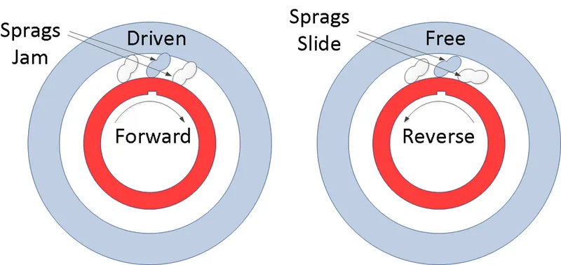
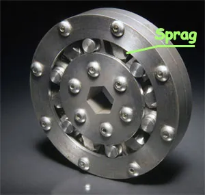

<figure class="eoc-pic eoc-pic-main"><picture><source media="(prefers-reduced-motion: reduce)" srcset="../media/drawn/sprag-clutch.svg"></picture><figcaption><strong>Animation.</strong> Diagram drawn for the encyclopaedia from the research notes. ⚑ Needs confirming: a drawing can simplify or get details wrong; a real photo or a better diagram is welcome.</figcaption></figure>
<figure class="eoc-pic"><figcaption><strong>Diagram.</strong> <a href="https://commons.wikimedia.org/wiki/File:Sprag_clutch.png">Sprag clutch</a> by Mikepj1967, <a href="https://creativecommons.org/licenses/by-sa/4.0">CC BY-SA 4.0</a>, from Wikimedia Commons.</figcaption></figure>
<figure class="eoc-pic"><figcaption><strong>How it works.</strong> <a href="https://commons.wikimedia.org/wiki/File:Sprag_one-way_bearing_labeled.png">Sprag one-way bearing labeled</a> by Staff, Goddard Space Center, Public domain, from Wikimedia Commons.</figcaption></figure>

A ring of tilted steel wedge-blocks ([sprags](../glossary.md#sprag)) between two smooth rings that lets one ring spin freely past the other in one direction but wedges them together instantly and silently in the other, with no teeth and no clicking.

**In plain words:** A silent one-way ring: a row of small tilted blocks packed between an inner ring and an outer ring, which let the rings slide past each other one way and jam them together instantly the other way. **Proper term:** Sprag clutch (sprag-type one-way clutch; a kind of [freewheel](../glossary.md#freewheel) or overrunning clutch).

**Also called:** sprag freewheel; sprag one-way clutch; cam clutch (the name Tsubaki uses for its sprag clutches, whose wedge blocks it calls cams); one-way clutch; overrunning clutch; freewheel clutch; backstop or holdback (when one ring is bolted to the frame so a shaft can't run backwards); indexing clutch (when it is rocked back and forth to step a shaft forward); one-way-locking ball bearing (catalogue name for a ball bearing with sprags inside); one-way bearing (loose everyday name, also used for roller clutches); mechanical diode (informal).

## How it works

Each sprag is a small steel block shaped like a lopsided figure-eight, so it is longer measured corner to corner in one direction than in the other (Renold: dimension AA is greater than BB). A light spring tips every sprag so it always touches both rings. When the rings turn one way relative to each other, friction tips the sprags flatter and they slide (overrun or freewheel). When the rings try to turn the other way, friction stands the sprags up, and because they are too long to stand upright in the gap they wedge (jam) the rings together within a fraction of a turn. Because the grip is pure friction on smooth rings, it can lock at any angle (infinite engagement points) instead of waiting for the next tooth as a [ratchet](../glossary.md#ratchet) does.

## Parts

A small assembly that acts as one unit. Parts: inner ring (inner race), outer ring (outer race), a full ring of shaped steel wedge-blocks (sprags), a spring that keeps every sprag lightly touching both rings (energising spring, e.g. a coil or ribbon spring), and a cage that keeps the sprags evenly spaced (retainer). Packaged units also have support bearings, seals and a keyway or flange.

## Everyday examples

- Helicopters: the rotor can keep spinning faster than a failed engine so the pilot can glide down (autorotation) (Wikipedia)
- Motorcycle electric starters and many automatic car gearboxes (Wikipedia)
- Silent mountain-bike rear hubs that engage instantly with no clicking (e.g. Onyx hubs) (Bikepacking.com review)
- Gearless 'silent ratchet' wrenches, and backstops on inclined conveyors and bucket elevators (Wikipedia, Renold)

## When to use it

Use a sprag clutch when you need a one-way drive or anti-reverse lock that grips instantly at any angle, makes no noise, and carries a lot of [torque](../glossary.md#torque) in a small space: backstops on hoists, conveyors and pumps; letting a second motor or a hand [crank](../glossary.md#crank) drive a machine without being dragged round by the main motor (overrunning); starter drives; and fine, stepless indexing from a rocking crank. It is also the best choice when a ratchet's steps would be too coarse or its clicking too loud. For hobby projects, buy a ready-made unit (such as a one-way-locking ball bearing) when a printed roller clutch is too weak.

## When not to use it

Don't use it where the torque swings back and forth around zero many times a second (engine vibration without a flexible coupling), where the shafts are out of line (it must not act as a flexible coupling), or where it is the only thing keeping people safe (add a positive lock or brake). Don't try to make the sprags yourself: for printed one-way drives use a roller clutch, a ratchet and [pawl](../glossary.md#pawl), or a compliant ([flexure](../glossary.md#flexure)) ratchet instead. If you need to be able to switch the drive on and off, use a dog clutch or a wrap-spring clutch; if you want it to slip at a set overload, use a slip clutch or torque limiter. For very cheap, light-duty jobs a drawn-cup roller clutch (one-way needle bearing) is smaller and cheaper.

## Details

- **What it does (jobs):**
  - stop it moving back (one-way): used as a backstop so a conveyor, lift or pump shaft can't run backwards
  - let it move (turn, slide or bend): the driven part can coast or run faster than the drive (overrunning), e.g. a helicopter rotor after engine failure
  - change the kind of motion: rocked back and forth by a crank, it steps a shaft forward in one direction (indexing)
- **Movement:** rotate: continuous rotation; the two rings turn freely relative to each other in one direction and lock in the other
- **Directions it can move (degrees of freedom):** 1: the rings can only turn relative to each other about their shared axis, and only in the free direction; in the locking direction they act as one piece (0 relative freedom)
- **Special behaviour:**
  - one-way (moves freely one way, locks the other): the core behaviour; locks at any angle with no clicking
  - [self-locking](../glossary.md#self-locking) (holds under load, won't back-drive): with the outer ring fixed to the frame it holds a load against running backwards (backstop or holdback), e.g. inclined conveyors and bucket elevators
  - motion conversion (e.g. rotary to linear): driven back and forth by a crank or lever, it turns the rocking into step-by-step one-way rotation (indexing), with steps of any size because there are no teeth
- **How it holds:**
  - friction or clamping ([force-fit](../glossary.md#form-fit--force-fit--material-bond)): the sprags wedge between smooth rings and hold by friction, not by teeth
  - not a holding joint (it moves or passes on motion): it passes on or blocks turning force between a shaft and a hub
- **Input and output:** Rotation -> rotation at 1:1 in the drive direction; in the other direction the output simply freewheels (overruns). Efficiency: no slip and no lost motion when locked (Renold), with a small drag from the springs while overrunning. Shaft arrangement: in line (the inner and outer rings share one axis). Back-drivable: in the free direction the output can always run ahead of the input; if the output tries to turn backwards relative to the input the clutch locks, so it drives the input backwards too, or, when the outer ring is fixed to the frame, it is not back-drivable at all (backstop). When rocked by a crank it converts oscillation -> intermittent one-way rotation (indexing).
- **Power:** passive (no power needed): the springs and friction do all the work
- **Load:** heavy for its size: sprag clutches carry more torque for their size than other freewheel types because the ring is packed full of sprags (Renold, Tsubaki). Strong in twist (torque) in the locking direction only; carries no torque in the free direction. Weak against [misalignment](../glossary.md#misalignment) and [radial](../glossary.md#axial--radial) load unless it has its own bearings; it must not be used as a flexible coupling (Renold)
- **Play and precision:** Play: none. Renold says there is no mechanical lost motion or [backlash](../glossary.md#backlash), but the parts flex slightly under load (torque wind-up) by about 2 to 6 degrees at full rated torque, less at lower torque. A bicycle-hub review estimates under one degree before the sprags are fully loaded. [Repeatability](../glossary.md#repeatability--accuracy): indexing can be done in steps of any size, limited only by the rest of the mechanism (Renold). Misalignment: very little tolerated; the two rings must stay concentric (e.g. within 0.05 mm total indicator reading for Renold's direct-mount type), and separately supported shafts need a flexible coupling as well
- **Taking it apart:** removable: a packaged unit is held on the shaft by a key, [set screws](../glossary.md#set-screw) or a clamp and can be pulled off; Renold says the clutch itself must not be taken apart or repaired in the field
- **How often it can be reused:** many times: the whole unit can be fitted and removed from a shaft many times, but it should not be opened up
- **Sealing:** none: the clutch doesn't seal anything; packaged units have oil seals or labyrinth plates only to keep their own oil or grease in and dirt out (Renold)
- **Adjustable:** no: nothing to adjust. The locking direction is fixed; some symmetrical units can be turned round to reverse it, while non-symmetrical ones must be ordered as left-hand or right-hand (Renold)
- **Access needed:** end of a tube or shaft: the clutch slides onto the end of a shaft and into or onto a housing, gear or pulley
- **Materials:** Hardened alloy-steel sprags and hardened, precision-ground steel rings (Tsubaki, Renold); plastic cages; bronze sleeves or rolling bearings in packaged units. A direct-mount type that uses your shaft as the inner ring needs a case-hardened, ground steel shaft (Renold). It suits steel shafts and steel or cast-iron housings; plastic, aluminium or printed parts can only be used around a complete bought unit, not as the running surfaces
- **Heat, cold, water and wear:** Heat and cold: limited mainly by the lubricant; Renold lists oils and greases for about -7 to 65 C or -40 to 65 C, and GMN lists greases rated from -30 to 130 C and -40 to 180 C. Lubricant: EP additives cause slipping; too thick or too much lubricant can stop the sprags engaging, too little causes wear (GMN). Dirt and water: need a clean, sealed environment because the sprags depend on a thin oil film (GMN). Vibration: normal machine vibration is fine, but strong torsional vibration, typically from a petrol or diesel engine without a torsionally flexible coupling, can make it malfunction (Renold); strong vibration can overcome the springs and break sprag tips (GMN). Over time the sliding surfaces wear while overrunning, which is why some designs lift the sprags clear at high speed ('lift-off' or non-contact designs, Tsubaki).

## Making it

- **Ways to make or get it:**
  - off-the-shelf part (the normal choice: packaged sprag clutches, sprag inserts and one-way-locking ball bearings)
  - 3D print (FDM): housings, gears and pulleys that hold a bought unit, or demonstration models
  - CNC: turned shafts, housings and keyways that locate a bought unit
- **Printing it in one piece (print in place):** no: the only printable 'sprag clutch' model found (Prism08 on Printables) is printed as five separate parts and assembled with tweezers, and it locks against teeth rather than by friction alone; real sprag clutches need hardened steel parts
- **Tools:** Hex keys or spanners for set screws, clamp collars or flange bolts; a parallel key for keyed bores; a press or bearing puller for tight fits; a torque arm and stop for backstops
- **Difficulty:** hard to make, easy to buy: the sprags and rings need hardened steel ground to fine [tolerances](../glossary.md#tolerance), so buy a complete unit (for example a one-way-locking ball bearing with internal sprags) and design your printed or machined parts around it

### 3D printing tips

A true friction sprag clutch can't really be printed: manufacturers use hardened, precision-ground steel rings and sprags (Tsubaki, Renold), and plastic would dent and slip. What makers do instead: (1) Buy a complete sprag unit such as a one-way-locking ball bearing (McMaster sells these with internal sprags) and print the housing, gear or pulley around it. Don't press anything hard onto the outer ring: Renold designs its clutches so that parts locating on the outer ring have a [clearance](../glossary.md#clearance) fit (at least 0.025 mm), with torque carried by keys, bolts or a flange rather than a tight fit. Make the housing stiff and keep the shaft and housing concentric, because the sprags only share the load evenly when the rings are concentric (Tsubaki). If the housing is on a separate shaft, add a flexible coupling rather than letting the clutch take misalignment (Renold). (2) For a printed demonstration, Prism08's 'Sprag clutch for RC models' uses three tilting 'sprag poles' between a pentagonal centre and a toothed outer ring; flip the centre and poles over to reverse the direction. Because it catches on teeth, grease can be added without stopping it locking. Its parts are tiny, so print slowly with fine layers and assemble with tweezers. For friction-only printed one-way clutches, see the roller clutch entry, which is much easier to print.

### Buying one (off-the-shelf parts)

Search catalogue names: 'sprag clutch', 'sprag freewheel', 'cam clutch', 'one-way clutch, sprag engagement' (keyed hub or flush hub for press-fitting; McMaster), 'one-way-locking ball bearing' (a ball bearing with internal sprags; McMaster), 'sprag clutch insert' or 'direct-mount sprag clutch' (uses your hardened shaft as the inner ring; Renold DM series), 'backstop' or 'holdback' with torque arm (Renold, Tsubaki), 'overrunning clutch coupling' and 'one-way-locking sprocket'. Packaged units come oil-filled, grease-filled or sealed and greased for life.

## Rules of thumb

- There is no mechanical backlash, but expect 2 to 6 degrees of elastic wind-up between the rings at full rated torque, less at lower torque (Renold sprag clutch catalogue, 'Backlash' note)
- Never use a sprag clutch as a flexible coupling; between separately supported shafts, add a flexible coupling as well (Renold catalogue, Selection of Sprag Clutches; Tsubaki Cam Clutch catalogue gives the same warning)
- Never use lubricants with EP (extreme-pressure) additives: they keep an oil film under pressure that stops the sprags gripping, so the clutch slips (Renold Installation and [Lubrication](../glossary.md#lubrication); GMN lubrication guide; Tsubaki catalogue)
- Oil-lubricated clutches: fill completely for indexing, half-fill for overrunning or backstopping (Renold). GMN suggests an oil bath covering one third of the sprag height, or filling 30 to 60 percent of the free space with grease (GMN lubrication guide)
- Overrunning speed is the difference between the ring speeds if both turn the same way, and the sum if they turn opposite ways; check it against the catalogue limit (Renold catalogue)
- Size by torque: selection torque = actual torque x service factor from the maker's table (higher for shock loads and engine drives) (Renold selection procedure)
- Direct-mount type (your shaft is the inner ring): case-hardened to HV 650-750 at the surface, hardened depth 1.27-1.52 mm after grinding, ground to 13-20 microinch CLA, shaft and housing concentric within 0.05 mm total indicator reading (Renold DM series)
- Use parallel keys with clearance at the top, never [taper](../glossary.md#taper) keys; Renold recommends a hardened key of HRC 25-40 and shaft tolerance h6 for most clutches (Renold Installation and Lubrication)
- Keep the rings concentric so every sprag takes an equal share of the load at the moment of engagement (Tsubaki Cam Clutch catalogue, Cam Clutch Basics)

## Common failures

Wear and flat spots on the sprags from too little or too thin lubricant, which lets metal touch metal while overrunning (fix: correct oil or grease, clean environment) (GMN). Overload 'rollover': too much torque flips sprags past their working angle and destroys the clutch, often with twisted cages; prevent by sizing with a service factor, or choose non-rollover sprags (GMN, Tsubaki, Renold's anti-rollover sprags). 'Popping': sprags that engage late then spring forward, often caused by lubricants with EP additives or wrong race hardness (GMN). Slipping from EP-additive oil (Renold, GMN). Broken sprag tips from heavy vibration (GMN). Uneven loading and early failure when shaft and housing are not concentric (Tsubaki, Renold). A damaged cage is usually a sign of one of these problems, not the cause (GMN).

## Safety

A backstop that slips or rolls over lets a loaded conveyor, hoist or lift run backwards; Renold warns that a clutch used as the sole failsafe device can fail through misuse or lack of lubrication, so add a separate brake or positive lock where people could be hurt. Large units hold a lot of stored energy on inclined conveyors; the torque arm must be free to move slightly between its stops (Renold). Rotating shafts and exposed outer rings are pinch and entanglement points. Don't open or repair a sprag clutch in the field (Renold).

## Related

- Roller clutch (one-way bearing): rollers on ramps do the wedging instead of sprags; cheaper, easier to 3D print and very common as small drawn-cup needle clutches, but carries less torque for its size (Renold, Tsubaki)
- Ratchet and pawl: locks on teeth, so it clicks and can only lock at the next tooth, but it is positive (can't slip) and easy to print
- Face ratchet (star ratchet): sloped teeth on two facing discs; clicks, used in bicycle hubs that sprag hubs compete with
- Wrap-spring clutch: a coil spring grips a hub instead; can also be switched on and off and used for single-revolution indexing
- Compliant ratchet and overrunning clutch (flexure pawl): printable one-piece alternative with springy pawls
- Bidirectional anti-back-drive clutch: lets the motor drive either way but stops the load driving the motor, which a single sprag clutch can't do
- Friction slip clutch and torque limiters: slip at a set torque in both directions rather than locking in one

## Make it yourself

- [Sprag clutch for RC models (Prism08, Printables)](https://www.printables.com/model/626159-sprag-clutch-for-rc-models): Small printable 'sprag-style' one-way clutch for an RC car gearbox: sprag centre, three sprag poles, toothed ring and snap-on cover, driven by a pentagonal shaft; flip parts to reverse direction. Locks against teeth, so it tolerates grease. Details read through the Printables public API because the web page blocks automated access *(licence: CC BY-NC (Creative Commons Attribution-NonCommercial))*

## Pictures, videos and models

- [Sprag clutch.png (Wikimedia Commons)](https://commons.wikimedia.org/wiki/File:Sprag_clutch.png): Diagram of a sprag clutch in drive and in freewheel, showing the sprags jammed and free; used on the English Wikipedia article *(licence: CC BY-SA 4.0 (Mikepj1967))*
- [Sprag one-way bearing labeled.png (Wikimedia Commons)](https://commons.wikimedia.org/wiki/File:Sprag_one-way_bearing_labeled.png): Labelled picture of a one-way bearing with sprags and bearing rollers sharing one race *(licence: Public domain (NASA Goddard Space Flight Center))*
- [Sprag overrunning clutch 1 (Nguyen Duc Thang, YouTube channel thang010146)](https://www.youtube.com/watch?v=0gwzmLh03Bw): CAD animation of a sprag overrunning clutch driving and overrunning (title and channel confirmed via YouTube oEmbed) *(licence: link only)*
- [Sprag clutch Operation (DrivelineMaster, YouTube)](https://www.youtube.com/watch?v=CFKsOhuGhno): Educational video on how an overrunning sprag one-way clutch operates *(licence: link only)*
- [Sprag clutch (Wikipedia)](https://en.wikipedia.org/wiki/Sprag_clutch): Short article with the jam/slide diagram and a list of uses (helicopters, starters, gearboxes, conveyors, bicycle hubs, wrenches) *(licence: CC BY-SA 4.0 (text))*

## Needs confirming

⚑ marks something nobody has confirmed yet: a fact the research could not confirm from a source, a finder value that is a best guess, or an open point from the research notes. Corrections are welcome (see `research/needs-confirming.md`).

- ⚑ Finder value `clicks` = silent (best guess): the text uses both clicking and silent words

## Sources

- <https://en.wikipedia.org/wiki/Sprag_clutch>
- <https://en.wikipedia.org/wiki/Freewheel>
- <https://roymech.org/Useful_Tables/Drive/Clutches.html>
- <https://commons.wikimedia.org/wiki/Category:Clutches>
- <https://commons.wikimedia.org/wiki/File:Sprag_clutch.png>
- <https://commons.wikimedia.org/wiki/File:Sprag_one-way_bearing_labeled.png>
- <https://www.renold.com/upload/renoldswitzerland/sprag_clutch_m.pdf>
- <https://www.renold.com/company/latest-news/couplings/sprag-clutch-animation-news>
- <https://www.gmnbt.com/resources/guides/sprag-clutch/how-sprag-clutches-work/>
- <https://www.gmnbt.com/resources/guides/sprag-clutch/failure-mechanisms-guide/>
- <https://www.gmnbt.com/resources/guides/sprag-clutch/lubricating-sprag-clutch-best-practices/>
- <https://www.ustsubaki.com/resources/knowledge-center/guide-to-indexing-overrunning-and-backstop-clutches/>
- <https://www.ustsubaki.com/wp-content/uploads/L14016-Tsubaki-Cam-Clutch-Catalog-2019.pdf>
- <https://tsubaki.eu/products/mechanical-components/cam-clutches-freewheels/>
- <https://www.mcmaster.com/products/one-way-clutches/>
- <https://bikepacking.com/gear/onyx-hubs-review/>
- <https://hackaday.com/2018/03/13/3d-printed-transmission-invented-again-this-time-continuously-variable/>
- <https://hackaday.com/2024/12/14/behold-a-geared-continuously-variable-transmission/>
- <https://hackaday.com/2010/02/03/the-mechanical-diode/>
- <https://www.printables.com/model/626159-sprag-clutch-for-rc-models>
- <https://api.printables.com/graphql/>
- <https://www.youtube.com/watch?v=0gwzmLh03Bw>
- <https://www.youtube.com/watch?v=CFKsOhuGhno>
