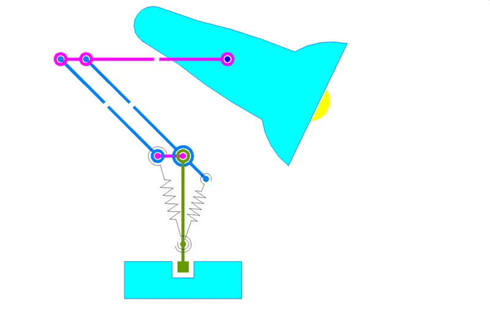
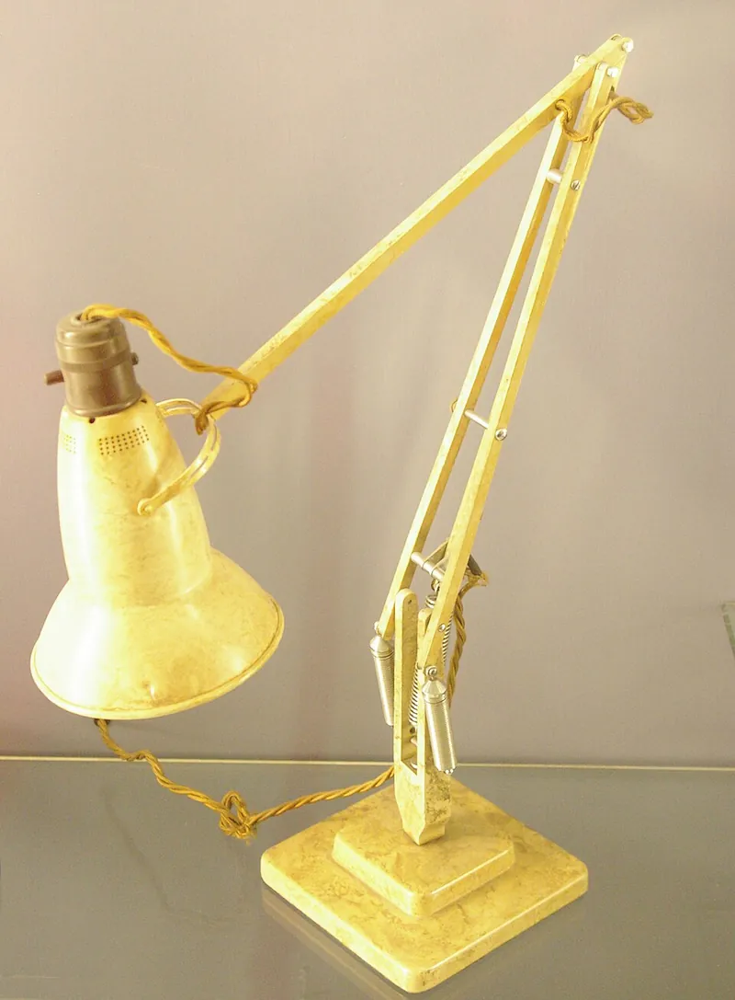

<figure class="eoc-pic eoc-pic-main"><picture><source media="(prefers-reduced-motion: reduce)" srcset="../media/drawn/spring-balancer.svg"></picture><figcaption><strong>Animation.</strong> Diagram drawn for the encyclopaedia from the research notes. ⚑ Needs confirming: a drawing can simplify or get details wrong; a real photo or a better diagram is welcome.</figcaption></figure>
<figure class="eoc-pic"><figcaption><strong>Diagram.</strong> <a href="https://commons.wikimedia.org/wiki/File:Angle_Poise_Lamp_Diagram_2.png">Angle Poise Lamp Diagram 2</a> by Who created this image? Stef Breukel.Who owns the copyright to this image? Stef Breukel did.., Public domain, from Wikimedia Commons.</figcaption></figure>
<figure class="eoc-pic"><figcaption><strong>Photo.</strong> <a href="https://commons.wikimedia.org/wiki/File:Anglepoise_1227.jpg">Anglepoise 1227</a> by Flickr user &quot;renaissance chambara&quot;, cropped by uploader, <a href="https://creativecommons.org/licenses/by/2.0">CC BY 2.0</a>, from Wikimedia Commons.</figcaption></figure>

An arrangement of springs, or a counterweight, that cancels the weight of a pivoting arm or door at every angle, so it can be moved with almost no effort and stays put wherever it is released.

**In plain words:** Springs (or a counterweight) set up so a hinged arm feels weightless: you can move it with a fingertip and it stays wherever you leave it, like a desk lamp that holds any pose. **Proper term:** Spring balancer (spring gravity equilibrator, static balancing or gravity compensation); the simplest alternative is a counterweight (counterbalance).

**Also called:** gravity equilibrator, spring equilibrator (French and Widden 2000; Takahashi et al. 2019); spring-and-lever balancing mechanism (French and Widden 2000); static balancing, statically balanced mechanism, energy-free system (Herder, TU Delft thesis 2001); gravity compensation or passive gravity compensation (robotics); counterbalance, counterbalance spring, counterbalancing mechanism (garage doors, arms); balanced-arm lamp or floating arm lamp (Wikipedia 'Balanced-arm lamp'); Anglepoise mechanism (Anglepoise (brand); Luxo L-1 (brand) and IKEA Tertial (brand) are similar lamps); elastic equipoising mechanism (George Carwardine's 1932 patent title); zero-free-length or zero-length spring balancer (the ideal spring for exact balance); counterweight or counterpoise (the weight-based version); tool balancer or spring balancer (industrial ceiling-hung spring reel that 'makes tools weightless'; a different device with the same job).

## How it works

The weight of the load makes a turning effect (moment) about the pivot that grows and shrinks with the arm's angle. A spring stretched from a point on the arm to a fixed point directly above the pivot makes a turning effect that changes with angle in exactly the same way, provided the spring's pull is proportional to its whole length (a zero-free-length spring); with the right [stiffness](../glossary.md#stiffness) the two cancel at every angle, so the arm is in balance everywhere (French and Widden 2000). A counterweight does the same job more simply: weight times distance on one side equals load times distance on the other (Wikipedia 'Balanced-arm lamp': m1 x d1 = m2 x d2). In two-arm lamps such as the Anglepoise, a parallelogram [linkage](../glossary.md#linkage) carries a vertical reference out to the elbow so each arm is balanced separately by its own spring, and all the springs can sit near the base (French and Widden 2000; Wikipedia 'Anglepoise lamp'). Ordinary springs are not zero-length, so designers use springs wound with built-in tension, or run a cable from the arm over a pulley at the anchor point to the spring (Wikipedia 'Spring (device)'; Takahashi et al. 2019); a little joint friction hides the small errors that remain (French and Widden 2000).

## Parts

A small assembly that acts as one unit. Spring version: the arm, its pivot, one extension spring per balanced joint, a fixed anchor point directly above (or below) the pivot, and often a cable and pulley or a parallelogram linkage to carry the 'vertical' reference to the next joint (French and Widden 2000; Wikipedia 'Balanced-arm lamp'). Counterweight version: the arm extended past the pivot and a weight on the far end, sometimes with a chain or parallelogram to keep it parallel (Wikipedia 'Balanced-arm lamp').

## Everyday examples

- An Anglepoise-style desk lamp (balanced-arm lamp), which stays in any pose without clamping (Wikipedia 'Anglepoise lamp')
- A garage door that feels light to lift because [torsion](../glossary.md#torsion) or extension springs balance its weight (Wikipedia 'Garage door')
- Sash windows and lifts (elevators), balanced by counterweights (Wikipedia 'Balanced-arm lamp'; Wikipedia 'Counterweight')
- Monitor arms, microphone booms and copy holders that use the same balanced-arm principle (Wikipedia 'Balanced-arm lamp'), and ceiling tool balancers that make power tools feel weightless on assembly lines (Hubbell Gleason spec sheet)

## When to use it

Use it when something heavy on a pivot or slide must be positioned often by hand and stay where it is put: lamp and camera arms, monitor and microphone booms, lids, hatches and doors, tool arms, and robot arms where you want smaller, cheaper motors (Takahashi et al. 2019). A spring balancer is best when the load is fixed and the arm must stay light and quick to move; a counterweight is best when it must be simple, cheap and exactly right, and extra mass and a heavy base are acceptable (Wikipedia 'Balanced-arm lamp').

## When not to use it

Avoid it when the load changes a lot (a balancer is tuned to one weight; use an adjustable balancer, a friction or clamping joint, or motors), when the arm must move fast or resist bumps and you were going to use a counterweight (it adds inertia; use springs), when a simple hold-in-place joint would do (use a friction hinge or a lockable joint), and when you would have to make the springs from printed plastic (they [creep](../glossary.md#creep); buy steel springs). For straight lifting of a hanging tool, a bought tool balancer or a constant-force spring is simpler than a linkage.

## Details

- **What it does (jobs):**
  - store energy: the spring stores the energy you would otherwise spend lifting the load and gives it back when you lower it, so the total stays constant
  - let it move (turn, slide or bend): the arm swings freely and stays in any position without clamping
- **Movement:** rotate: each balanced joint swings in a vertical plane through a wide range (a lamp arm from near vertical to near horizontal) ⚑ [uncertain: no range figure found]; a two-arm lamp is 'multiple' (two balanced swings plus base rotation and head tilt); tool balancers and garage doors balance a straight up-and-down slide
- **Directions it can move (degrees of freedom):** 1 per balanced joint: a single arm needs one spring; an Anglepoise-type lamp balances 2 arm joints with 2 springs (plus unbalanced base turning and shade tilting) (French and Widden 2000). A counterweight-only arm is also 1 per joint.
- **Special behaviour:**
  - none of the listed behaviours exactly: its trick is neutral balance (zero stiffness), meaning the load has no preferred position and stays wherever it is left; it does not lock, and a push moves it
  - quick-release is not a feature; it is not a latch. Holding in position relies on balance plus a little joint friction (French and Widden 2000)
- **How it holds:**
  - spring force (a spring or springy part presses it in place): the springs cancel the weight
  - friction or clamping ([force-fit](../glossary.md#form-fit--force-fit--material-bond)): joint friction holds the arm against small balance errors and leftover spring non-linearity (French and Widden 2000, on Carwardine's patent 433 617)
  - not a holding joint (it moves or passes on motion) for the counterweight version, which is held by gravity on a second weight rather than any of the listed principles
- **Input and output:** not applicable (not a transmission). It passes no motion on; it only removes the weight you feel. The arm is fully back-drivable: you move it by hand with little force.
- **Power:** passive (no power needed). Robots can instead compensate gravity actively with motor [torque](../glossary.md#torque); passive springs reduce the motor torque needed (Takahashi et al. 2019).
- **Load:** light to heavy: from a desk-lamp head to a garage door of 400 lb (180 kg) or more balanced by torsion or extension springs (Wikipedia 'Garage door'); small tool balancers carry tools up to 5 lb (2.3 kg) (Hubbell Gleason BD series spec sheet). The balance only works for the design load in a vertical plane; springs that leave the vertical plane add side loads (French and Widden 2000).
- **Play and precision:** not applicable to locating, but balance [accuracy](../glossary.md#repeatability--accuracy) matters: exact balance needs a spring of zero free length, the load's centre of mass on the line through the pivot and the spring's arm attachment, and a load whose centre of mass does not move; cheap lamp copies lose balance when the shade is turned, while the original Anglepoise mounts the shade in trunnions at its centre of gravity (French and Widden 2000). Pivot play is ordinary hinge play ⚑ [uncertain].
- **Taking it apart:** removable: springs hook onto posts or eyes and counterweights bolt on, so the balancer can be taken apart and adjusted
- **How often it can be reused:** many times for taking apart. Spring life is set by [fatigue](../glossary.md#fatigue): garage-door torsion springs are typically rated 10,000-15,000 opening cycles, with 30,000-cycle springs available (Wikipedia 'Garage door')
- **Sealing:** none
- **Adjustable:** yes: move the fixed spring anchor, change the spring pretension or add or remove counterweight to suit a new load (a change in load needs re-tuning). Tool balancers have a tension knob and push-button release (Hubbell Gleason spec sheet). Adjusting without adding or removing energy ('spring-to-spring balancing') is a research topic ⚑ [uncertain: paper not opened].
- **Access needed:** not applicable
- **Materials:** Springs: steel extension (tension) or compression coil springs, torsion springs for doors; close-coiled springs wound with built-in tension approximate zero free length (French and Widden 2000; Wikipedia 'Spring (device)'). Arms: steel or aluminium rods and sheet, wood, or 3D-printed PLA or PETG links with ball bearings and steel shafts (Takahashi et al. 2019 printed PLA links; a printable Anglepoise 1209 remake uses PETG parts with 10 mm aluminium rods, Printables). Counterweights: steel, lead or concrete (Wikipedia 'Counterweight'). Printed plastic springs are unsuitable because a balancer loads its spring all the time (DuPont design guide p. 36).
- **Heat, cold, water and wear:** Steel springs fatigue after a rated number of cycles and corrode faster in humid or coastal air (Wikipedia 'Garage door': 10,000-15,000 cycle springs, shorter life near the coast). Printed plastic parts that carry spring tension creep and soften with heat: PLA from about 60 °C, PETG about 80 °C, ASA about 110 °C (CNC Kitchen), which matters next to a hot lamp. Springs can resonate and hum (Wikipedia 'Balanced-arm lamp'). Adding weight to a spring-balanced door (glass, insulation, paint) shortens spring life (Wikipedia 'Garage door'). Counterweights are unaffected by heat and fatigue but need a heavy base (Wikipedia 'Balanced-arm lamp').

## Making it

- **Ways to make or get it:**
  - 3D print (FDM): arms, brackets, spring anchors and pulleys (Takahashi et al. 2019; Printables Anglepoise 1209 remake)
  - woodwork: arms and bases for lamps or tool arms ⚑ [uncertain]
  - CNC and laser cut: flat arm links and brackets ⚑ [uncertain]
  - sheet metal: brackets and parallelogram links ⚑ [uncertain]
  - off-the-shelf part: extension springs, torsion springs, constant-force springs, gas springs, tool balancers, counterweights, pulleys and cable
- **Printing it in one piece (print in place):** no: it needs metal springs, pins or shafts and usually bearings, and is assembled from printed parts
- **Tools:** screwdriver or hex keys for pivots and anchor points; pliers or a spring hook to fit stretched extension springs ⚑ [uncertain]; garage-door torsion springs need special winding tools and training (Wikipedia 'Garage door')
- **Difficulty:** moderate: the arm and brackets are easy to print or cut, and a counterweight is easy, but a spring balancer needs a little geometry to pick the spring stiffness and anchor points, bought steel springs, low-friction pivots and some tuning

### 3D printing tips

1) Print the arms and brackets, but buy the springs: a balancer keeps its spring loaded all the time, and plastic springs under constant load creep and relax (DuPont p. 36); in a test of printed coil springs held stretched for 8 hours, every filament took a set, PETG the least at about 5-10% (Razzer09, Printables 'Spring Material Test'). 2) Put a real pin or steel shaft with ball bearings in each pivot; Takahashi et al. printed PLA links but used industrial ball bearings and steel shafts to cut friction. 3) Get an effectively zero-free-length spring by running a cord from the arm over a small pulley at the fixed anchor point (directly above the pivot) down to an ordinary extension spring (Takahashi et al. 2019 used pulleys and cables this way), or join a pre-tensioned spring to an inelastic cord of the right length (Wikipedia 'Spring (device)'). 4) Make the anchor point adjustable (a slot or a row of holes) so you can tune the balance after assembly. 5) Line up the pivot, the spring's attachment on the arm and the centre of mass of arm plus load in one straight line (French and Widden 2000). 6) Beef up spring anchors and sockets with extra [perimeters](../glossary.md#perimeters) and solid [infill](../glossary.md#infill); a printed lamp stand used 4 perimeters so the bolt threads could bite (3DP Ant, Printables). A printable Anglepoise remake used 0.2 mm layers, 25% infill, PETG, 10 mm aluminium rods and 12 mm x 1 mm springs about 85 mm long (Lowres, Printables). 7) PLA softens at about 60 °C (CNC Kitchen), so don't use PLA spring anchors near a hot lamp; PETG (about 80 °C) or ASA (about 110 °C) are safer.

### Buying one (off-the-shelf parts)

Search for: 'extension spring' or 'tension spring' (look for springs with initial tension, i.e. close-wound coils), 'zero-length spring' (specialist; used in LaCoste gravimeters and seismometers, Wikipedia 'Spring (device)'), 'constant force spring' ('negator' spring, French and Widden 2000), 'torsion spring', 'gas spring' for monitor and lid arms ⚑ [uncertain], 'tool balancer' or 'spring balancer' (ceiling reels, e.g. Hubbell Gleason Series BD for tools up to 5 lb), 'safety cable' for extension springs, 'pulley', 'wire rope', 'ball bearing', lamp spare springs (e.g. the IKEA Tertial (brand) lamp springs reused in the Tertiarm robot arm), and 'counterweight'.

## Rules of thumb

- Exact spring balance of a single arm: use a spring of zero free length with stiffness k = m g r / (b c), where m g is the load's weight, r the pivot-to-load distance, b the pivot-to-spring-attachment distance on the arm and c the distance from the pivot straight up to the fixed spring anchor; the spring tension must be proportional to its whole length (French and Widden, Proc. IMechE Part C 214, 2000, eqs 1 and 7).
- The same condition written for the 'basic gravity equilibrator': m g r2 = r1 k1 a1, and numerically the only possible initial spring length is zero (Takahashi et al., 'Computational Design of Statically Balanced Planar Spring Mechanisms', IEEE RA-L 2019, eq. 1).
- Two-arm lamps: carry the vertical reference to the elbow with a parallelogram; then each spring is chosen separately, k1 = m g r1 / (b1 c1) and k2 = m g r2 / (b2 c2) (French and Widden 2000, eq. 14).
- Include the arms' own weight by using the combined centre of mass G in place of the load point, keeping the spring attachment, pivot and G in a straight line; if a centre of mass is off that line, balance is exact at only one position (French and Widden 2000, section 4).
- Counterweight balance: m1 x d1 = m2 x d2 (lamp-head weight times its distance from the pivot equals counterweight times its distance) (Wikipedia 'Balanced-arm lamp'). A lift counterweight is typically the car's weight plus 40-50% of its rated load (Wikipedia 'Counterweight').
- Counterweights are simpler but add inertia, which makes the arm sluggish and less able to resist outside forces; springs are light and low-inertia (Takahashi et al. 2019; French and Widden 2000).
- Get an effectively zero free length with cables and pulleys (Takahashi et al. 2019) or with a pre-tensioned (negative-length) spring plus an inelastic link of the right length (Wikipedia 'Spring (device)').
- Friction cannot be eliminated, and it lets the arm stay put despite small errors such as spring non-linearity (Carwardine's patent, summarised by French and Widden 2000); Takahashi et al. (2019) suggest that allowing some friction could widen the range of positions where the arm stays balanced.

## Common failures

The arm droops or springs up in part of its range because the spring isn't effectively zero-length or the anchor isn't exactly above the pivot; fix the geometry or use the pulley trick (French and Widden 2000; Takahashi et al. 2019). Balance lost after changing the load, e.g. a heavier lamp head or camera (re-tune the spring or counterweight). The shade or tool drifts when turned because its centre of mass moves (French and Widden 2000). Springs lose tension, fatigue or snap with age and corrosion (Wikipedia 'Garage door'). Too much joint friction makes it stiff to move (Takahashi et al. 2019 used ball bearings to keep friction low), while almost no friction lets small balance errors show as drift (French and Widden 2000). Printed anchors creep or crack under constant spring pull ⚑ [uncertain]. Counterweighted stands tip over (Wikipedia 'Balanced-arm lamp').

## Safety

Stored spring energy: balance springs are always under tension, and large ones (garage-door torsion springs) have injured and killed people during adjustment; they need training and proper tools (Wikipedia 'Garage door'). Run a safety cable through extension springs so a broken spring can't fly (Wikipedia 'Garage door'). If you remove the load (e.g. the lamp head) the springs can fling the arm up; lock or unload the springs first ⚑ [uncertain]. Hang tool balancers with a secondary safety cable or chain (Hubbell Gleason spec sheet). Counterweights can fall, pinch fingers, or tip over a stand that is too light (Wikipedia 'Balanced-arm lamp'). A garage door with a broken spring can fall with great force (Wikipedia 'Garage door').

## Related

- Counterweight (counterbalance): the simplest balancer, exact and cheap, but heavy and high in inertia (covered in this entry)
- Constant-force spring: a curled steel strip that pulls with nearly constant force; balances a straight up-and-down load such as a sash or tool reel without any linkage (French and Widden 2000 call these 'negator' springs)
- Gas spring: a pressurised cylinder that pushes with a steady force, used in monitor arms and hatch struts; compact but not exact over the whole range ⚑ [uncertain]
- Friction hinge (torque hinge): holds an arm in place by friction instead of cancelling its weight; simpler, but you feel the full weight when moving it
- Four-bar and parallelogram linkages: carry the vertical reference in two-arm balancers
- Tool balancer (spring reel): a bought ceiling-hung reel that balances a hanging tool
- Motorised gravity compensation: motors add the balancing torque in software; handles any load but needs power

## Make it yourself

- [Anglepoise 1209 Balanced Lamp (Lowres, Printables) (URL from Printables API, page not opened)](https://www.printables.com/model/78909-anglepoise-1209-balanced-lamp): Printable remake of a 1940s spring-balanced lamp: PETG parts, 10 mm aluminium rods (originals about 460 mm), 3 mm threaded rod and nuts, and 12 mm x 1 mm springs about 85 mm long; printed without supports at 0.2 mm layers and 25% infill *(licence: CC BY-NC-SA)*
- [Tertiarm - 3D printed robot arm (Hackaday.io)](https://hackaday.io/project/19235-tertiarm-3d-printed-robot-arm): A 5-axis servo robot arm built on the kinematics of an IKEA Tertial (brand) lamp, using the lamp's springs to unload the servos; a lifting test held 0.5 kg at 500 mm with four standard IKEA springs; STL files on Thingiverse, instructions on Instructables *(licence: ⚑ [uncertain: licence not stated on the project page])*

## Pictures, videos and models

- [Angle Poise Lamp Diagram 2 (Wikimedia Commons)](https://commons.wikimedia.org/wiki/File:Angle_Poise_Lamp_Diagram_2.png): Diagram of an Anglepoise-style lamp with one parallelogram and two extension springs near the base (used in Wikipedia 'Balanced-arm lamp') *(licence: Public domain)*
- [Pantographic parallel arms balance a light-weight lamp and counter-weight (Wikimedia Commons animation)](https://commons.wikimedia.org/wiki/File:Pantographic_parallel_arms_balance_a_light-weight-lamp_and_counter-weight.gif): Animated counterweight-balanced parallelogram lamp arm moving through its range *(licence: Public domain)*
- [Anglepoise 1227 (Wikimedia Commons photo)](https://commons.wikimedia.org/wiki/File:Anglepoise_1227.jpg): Photo of the 1935 Anglepoise model 1227 lamp with its springs at the base *(licence: CC BY 2.0)*
- [Static balancing mechanism using gears and spring (YouTube, Nguyen Duc Thang, thang010146)](https://www.youtube.com/watch?v=WnDc7tv79HM): CAD animation of an arm kept in balance by a spring through a gear arrangement *(licence: link only (standard YouTube licence))*
- [Computational Design of Statically Balanced Planar Spring Mechanisms (YouTube, Takuto Takahashi)](https://www.youtube.com/watch?v=oBnVt-Si2o0): Video for the 2019 IEEE RA-L paper: statically balanced spring linkages and 3D-printed prototypes that stay put in any pose *(licence: link only (standard YouTube licence))*

## Needs confirming

⚑ marks something nobody has confirmed yet: a fact the research could not confirm from a source, a finder value that is a best guess, or an open point from the research notes. Corrections are welcome (see `research/needs-confirming.md`).

- ⚑ 12 sentences on this page marked [uncertain].
- ⚑ Finder value `tools` = hand tools (source uncertain): `tools_needed` is marked ⚑ [uncertain] here: "…or points; pliers or a spring hook to fit stretched extension springs ⚑ [uncertain]; garage-door torsion springs…"
- ⚑ Finder value `made_of` = 3D prints, plastic sheet, tube or moulded parts, wood, metal (best guess): proposed from the words in the research text (R37); not yet checked

## Sources

- <https://en.wikipedia.org/wiki/Balanced-arm_lamp>
- <https://en.wikipedia.org/wiki/Anglepoise_lamp>
- <https://en.wikipedia.org/wiki/Counterweight>
- <https://en.wikipedia.org/wiki/Spring_(device)>
- <https://en.wikipedia.org/wiki/Garage_door>
- <https://eprints.lancs.ac.uk/id/eprint/20295/1/20295.pdf>
- <https://crl.ethz.ch/papers/zeroStiffness.pdf>
- <https://repository.tudelft.nl/record/uuid:8c4240fb-0315-462a-8b3b-efbd0f0e68b6>
- <https://www.ergonomicpartners.com/pdf/hubbell-gleason-spring-balancer-specs.pdf>
- <https://hackaday.io/project/19235-tertiarm-3d-printed-robot-arm>
- <https://api.printables.com/graphql/>
- <https://www.printables.com/model/534644-spring-material-test>
- <https://www.distrupol.com/General_Design_Principles_for_Engineering_Polymers.pdf>
- <https://www.cnckitchen.com/blog/comparing-pla-petg-amp-asa-feat-prusament>
- <https://commons.wikimedia.org/wiki/File:Angle_Poise_Lamp_Diagram_2.png>
- <https://commons.wikimedia.org/wiki/File:Pantographic_parallel_arms_balance_a_light-weight-lamp_and_counter-weight.gif>
- <https://commons.wikimedia.org/wiki/File:Anglepoise_1227.jpg>
- <https://www.youtube.com/watch?v=WnDc7tv79HM>
- <https://www.youtube.com/watch?v=oBnVt-Si2o0>
