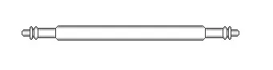
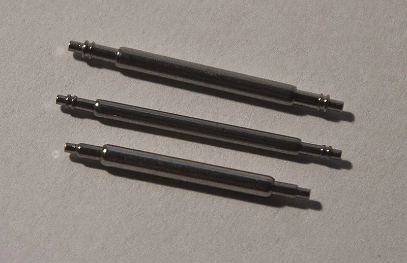

<figure class="eoc-pic eoc-pic-main"><figcaption><strong>Diagram.</strong> <a href="https://commons.wikimedia.org/wiki/File:Federsteg.jpg">Federsteg</a> by Wela49, Public domain, from Wikimedia Commons.</figcaption></figure>
<figure class="eoc-pic"><figcaption><strong>Photo.</strong> <a href="https://commons.wikimedia.org/wiki/File:Federstege.jpg">Federstege</a> by DerHans04, <a href="https://creativecommons.org/licenses/by-sa/3.0">CC BY-SA 3.0</a>, from Wikimedia Commons.</figcaption></figure>

A small spring-loaded rod whose two ends push outwards into holes in a pair of lugs, so a strap's loop hangs on it and can be taken off again by pushing one end in, with a small forked tool or, on quick-release versions, a built-in lever.

**In plain words:** A tiny metal rod with springy ends: you squeeze it a little shorter, slip it between the two prongs on a watch case, and its ends pop into small holes to hold the strap on. **Proper term:** Spring bar (spring-loaded telescoping pin, watch strap pin).

**Also called:** springbar / spring-bar; watch pin, strap pin or watch band pin (shop wording); telescopic spring bar / double telescopic spring bar (catalogue wording); double-flange spring bar (two small collars near each tip for the tool's fork to push on); double-shoulder spring bar (smooth tips, for lugs drilled right through); single-shoulder spring bar (sold on forums as 'shoulderless'; Ofrei says the correct name is single shoulder); curved spring bar (bent for extra [clearance](../glossary.md#clearance) from the case); fat spring bar / 'Seiko fat bar' (thicker body and tips); quick-release spring bar (QRSB), quick-change strap pin, quick-release pin (watch-strap sense); Federsteg (German); barrette à ressort (French, used in the patent classification); lug bar (loosely; a fixed lug bar welded into the case is a different, non-removable part).

## How it works

A coil spring inside the tube pushes a pin out of each end, so the bar is slightly longer than the gap between the lugs (a 1941 patent describes spring bars as 'a tube or the like containing an ordinary coil spring bearing at each end against a plug projecting from the tube'). To fit it you push one tip in, either with the fork of a spring-bar tool on the flange or with a fingernail on the quick-release lever, line the bar up with the holes and let go, so both tips snap into small holes in the lugs. The strap's loop hangs on the bar and can swing round it, and the pull of the strap is carried by the tips as a sideways ([shear](../glossary.md#peel-vs-shear)) load. Only the spring keeps the tips in their holes, so a weak spring, a bar that is too short, or a hard knock along the bar can let it out (CNS; Smartlet).

## Parts

A few parts that act as one unit: a thin tube (body), a coil spring inside it, and two sliding end pins (plungers or pivots), usually with one or two small collars (flanges or shoulders) near each tip. A quick-release version adds a small lever (knob) fixed to one pin. It needs two small holes in the inner faces of the lugs and a loop or tunnel in the strap.

## Everyday examples

- Almost any wristwatch with a replaceable strap: two spring bars hold the strap between the lugs (Wikipedia 'Watch strap'; CNS)
- Silicone bands on many smartwatches and fitness watches that swap with a small lever on the pin (quick-release spring bars)
- The clasp or folding buckle of a metal watch bracelet, which uses short, thin spring bars (Ofrei)
- 3D-printed strap adapters that let a watch take a wider or narrower strap (Printables)

## When to use it

Use a spring bar when a strap, band or small hinged part must hang from two lugs, pivot freely, and be swapped now and then: watch and smartwatch straps, wearable electronics in printed cases, small instrument or tracker cases worn on a band, and strap adapters. Because watch straps are standardised around spring bars, designing lugs for them lets you use any shop-bought strap (Siraya Tech). Choose quick-release bars when straps will be changed often and nobody wants to carry a tool (Helvetus).

## When not to use it

Don't use a spring bar where the joint must never let go under a hard knock or heavy pull, or where the load is more than a wrist strap: use a screw bar, a fixed (welded or moulded-in) bar, a shoulder screw, or a ball-lock quick-release pin instead (Smartlet; CNS). Avoid it where the lugs can flex apart (thin printed lugs, soft plastics), because the bar only holds while both tips stay in their holes. For a strap that must stay on if a bar fails, add a pass-through strap that runs behind the case and through both bars (Wikipedia 'Diving watch'; CNS). For larger pins through lined-up holes, use a clevis pin with a clip, a snap pin or a ball-lock pin.

## Details

- **What it does (jobs):**
  - join and hold: holds a strap, band or bracelet between two lugs
  - let it move (turn, slide or bend): the strap pivots around the bar so it can curve round a wrist
  - lock, and release by hand: quick-release versions come out with a fingernail on a small lever, with no tool
- **Movement:** rotate: the strap's loop swings freely around the bar, limited only by the case and strap. When fitting, the tips also slide in and out by about a millimetre (the bar telescopes).
- **Directions it can move (degrees of freedom):** 1: the strap can only turn around the bar's axis. The bar can also spin in its holes; aBlogtoWatch notes that quick-release bars turn when the lever is used, which can wear the lug holes.
- **Special behaviour:**
  - quick-release: quick-release versions have a small lever on one pin, so one tip can be pulled in by hand and the strap comes off in seconds without a tool (Helvetus; CNS; JS Watch). Standard bars need a small spring-bar tool. It is not [self-locking](../glossary.md#self-locking): only spring force holds the tips in, so a bar whose tips are too thin for the holes can be knocked free (CNS).
- **How it holds:**
  - shape ([form-fit](../glossary.md#form-fit--force-fit--material-bond)): the tips sit in holes in the lugs, so the strap's pull is carried by the tips across their width (shear)
  - spring force: only the internal coil spring keeps the tips pushed into the holes; if the spring tires or the bar is the wrong size, the tips can come out (Smartlet; Oak & Oscar)
- **Input and output:** not applicable
- **Power:** passive (no power needed)
- **Load:** Light to medium, and sized for a strap on a wrist. ISO 6425 (divers' watches) requires each spring bar or attachment point to take 200 N (about 45 lbf) in opposite directions without damage to the watch or attachment point (Wikipedia 'Diving watch'; Mecmesin). aBlogtoWatch says a good Swiss bar that fits correctly 'will easily handle over 50 pounds of pressure'. Strong against a pull across the bar (tips loaded in shear); weak against a sideways knock along the bar that pushes a tip in, and against lugs being bent apart.
- **Play and precision:** Small but deliberate play: Oak & Oscar says tips 'should fit easily into the lug holes with a small, but perceptible amount of play'. Tips that are too thin let the strap move or click and wear the holes oval; tips that are too thick won't seat, or wedge in as a friction fit that is hard to remove (Oak & Oscar; aBlogtoWatch). It tolerates little error in lug width: bars are sold by lug width but are longer when fully extended (Ofrei: a 22 mm bar measures 27 mm end to end). It is not used to locate parts precisely.
- **Taking it apart:** removable: standard bars come out with a small forked spring-bar tool (or a pin pushed through drilled lugs); quick-release bars with a lever are a tool-free quick release
- **How often it can be reused:** many times, but the spring and tips wear out: CNS suggests replacing bars every 12-18 months on a strap worn daily, aBlogtoWatch says some suggest every 6-12 months, and careful watchmakers fit new bars after any case service (Smartlet)
- **Sealing:** none: it is an open pin joint
- **Adjustable:** no: the length is fixed to the gap between the lugs (lug width), e.g. 20 mm lugs take 20 mm bars, and bars come in 1 mm steps (Helvetus; CNS). Strap length is adjusted elsewhere, e.g. at the buckle.
- **Access needed:** one side only (blind): the bar is fitted from between the lugs, so the lug holes can be blind (not drilled through). Drilled (through) lugs also let you push a tip in from the outside with the pin end of a tool (Oak & Oscar; Smartlet).
- **Materials:** Tube and pins usually 316L or 304L stainless steel, with a stainless or carbon spring-steel coil spring; also titanium, nickel silver (maillechort) and coated bars (aBlogtoWatch; Smartlet; Ofrei). Body (tube) diameters are mostly 1.5 mm or 1.8 mm, with 1.0-1.4, 1.6 and 2.0 mm also sold; tips are about 0.75-1.0 mm (Ofrei; watch-tools.de). It attaches leather, rubber, nylon and TPU straps and metal bracelets to lugs of steel, titanium or plastic, including resin or FDM-printed watch cases in PETG or ABS and printed TPU bands (Siraya Tech).
- **Heat, cold, water and wear:** Sweat is mildly acidic and contains chlorides, which corrode bars and lug holes over years (Smartlet); bars whose internal spring is not stainless can rust inside (aBlogtoWatch). The spring tires with use: 'Metal [fatigue](../glossary.md#fatigue) in the internal spring is the usual culprit' (Smartlet). Printed lugs soften with heat: PLA deforms above about 60 °C (Prusa), and PETG suits use below about 80 °C (Prusa). Vibration and knocks can work a loose-fitting bar free if its tips are too thin for the holes (CNS).

## Making it

- **Ways to make or get it:**
  - off-the-shelf part: the bar itself is always bought (it is a spring inside a precision tube)
  - 3D print (FDM): watch cases, strap adapters and TPU bands with lugs or strap loops for standard bars (several on Printables)
  - 3D print (resin): smooth, detailed watch cases and lugs (Siraya Tech recommends resin for cases)
  - CNC or small-scale metalwork: drilling the lug holes (about 0.8-1.1 mm) in metal cases, brackets or adapters
- **Printing it in one piece (print in place):** no: the bar is a bought metal part; you print the lugs or strap with holes and fit a bar afterwards
- **Tools:** Standard bar: a spring-bar tool with a forked tip (pushes on the flange from between the strap and case) and a pin tip (pushes the tip in from outside on drilled lugs); one sold by watch-tools.de has a 4 mm fork, a 0.80 mm pin and a 1.20 mm fork. Quick-release bar: none, a fingernail works the lever. Making your own lugs: a pin vice or small drill with a drill of about 0.8-1.1 mm for the lug holes.
- **Difficulty:** easy: buy standard bars and design the lugs and strap loop around them; the only fiddly step is drilling the tiny (about 1 mm) lug holes accurately and square

### 3D printing tips

1) Design around bars you can buy: make the gap between the lugs a standard strap width such as 18, 20 or 22 mm so standard spring bars and shop-bought straps fit (Siraya Tech). 2) Size the lug holes for the bar's tips: about 0.75 mm tips on 1.5 mm bars, 0.90 mm on 1.8 mm bars and 1.00 mm on 2.0 mm bars (Ofrei), with a little clearance so the tip seats with 'a small, but perceptible amount of play' (Oak & Oscar). Holes this small don't print accurately on FDM machines: Hubs says vertical holes print undersized and recommends printing critical holes undersized and drilling them to size, and the maker of a printed Casio 18-to-20 mm strap adapter recommends 'drilling out the holes for the spring bars' and supplies versions for 1.8 and 2.0 mm bars. A pin vice with a small metric or numbered drill works. 3) Make each hole at least as deep as the tip is long; Ofrei lists tips about 1.0 mm long (2.0 mm on one 1.8 mm bar) ⚑ [uncertain: no design guide found that gives a hole depth]. 4) Keep the lugs strong: Siraya Tech recommends case walls of at least 1.5-2 mm, warning that thinner walls can crack when spring bars are inserted, and suggests PETG or ABS at 0.1 mm layer height, 4+ walls and 30-40% [infill](../glossary.md#infill), printed face down, for FDM cases. Printing the case flat also keeps each lug's layers in line with the strap's pull, so the load does not try to split layers apart ⚑ [uncertain: reasoning from general FDM strength, not from a tested source]. 5) For a printed strap, leave a round tunnel slightly bigger than the bar's body (1.5 or 1.8 mm) where the bar passes through; aBlogtoWatch advises choosing the thickest bar that will still slide through the strap's hole. A printed 20 mm band for a Samsung Galaxy Watch 4 (NinjaFlex TPU 85A) added a hole so the original quick-release pins could be reused, and notes they are 'a little hard to get in'. For quick-release bars, leave a notch on the underside of the strap so a fingernail can reach the lever (Helvetus). 6) Materials: TPU (85A-95A) for bands and PETG, ABS or resin for cases (Siraya Tech). PLA softens and deforms above about 60 °C (Prusa), so PLA lugs may loosen in a hot car. 7) After fitting, tug the strap firmly in both directions; any movement or clicking means the tips are not seated or are too thin (aBlogtoWatch; Smartlet).

### Buying one (off-the-shelf parts)

Spring bars sold by lug width (about 6-40 mm) and body diameter (1.0, 1.3, 1.4, 1.5, 1.6, 1.8, 2.0 mm): double-flange, double-shoulder, single-shoulder (for clasps and bracelet links), curved, extra-long telescopic, 'fat' and quick-release (lever) types, in 316L stainless steel or titanium (search terms: 'spring bar', 'double flange spring bar', 'quick release spring bar', 'Federsteg'; suppliers include Ofrei, Esslinger, Jules Borel, watch-tools.de; Bergeon and Horotec (brands) make tools and bars). Assortment boxes of mixed sizes. Spring-bar tools (fork and pin tips, e.g. Bergeon 6767 series (brand)) and spring-bar bending pliers for curved bars. Straps and bands made for spring bars, and quick-release straps with the bars already fitted.

## Rules of thumb

- Length = lug width (the inner gap between the lugs): 20 mm lugs take 20 mm bars; most watch bars run from about 16 to 24 mm in 1 mm steps (Helvetus; CNS). The bar is longer than its listed size when extended so it stays under spring tension (Oak & Oscar; watch-tools.de).
- Body (tube) diameter: 1.8 mm is the most common thickness, 1.5 mm is used where 1.8 mm won't pass through a bracelet's tube, and 2.0 mm bars are too thick for most bracelets and straps (Ofrei).
- Tip (pivot) diameter follows body size: 0.75 mm tips on 1.5 mm bars, 0.90 mm on 1.8 mm, 1.00 mm on 2.0 mm, tips about 1.0 mm long (Ofrei Swiss-made listings); Beco Technic bars: 1.4 mm body with 0.75 mm tip, 1.8 mm body with 0.9 mm tip (watch-tools.de). Seiko 'fat bar' tips are about 1.1 mm, too thick for holes made for 0.90 mm tips (Oak & Oscar).
- Tips should enter the lug holes 'with a small, but perceptible amount of play'; tips too thin wear the holes oval and can pull out, tips slightly too thick can wedge in as a friction fit (Oak & Oscar).
- Choose the thickest body that still slides through the strap's or bracelet's hole, or that leaves room for a pass-through strap (aBlogtoWatch).
- ISO 6425 divers' watches: each spring bar or attachment point must withstand 200 N applied in opposite directions without damage (Wikipedia 'Diving watch'; Mecmesin).
- Printed watch cases: walls at least 1.5-2 mm; thinner walls can crack when spring bars are inserted (Siraya Tech).
- FDM vertical holes print undersized; for critical small holes, print undersized and drill to size (Hubs FDM design guide).
- Replace bars regularly: every 12-18 months on a strap worn daily (CNS); some suggest every 6-12 months (aBlogtoWatch).

## Common failures

1) Spring fatigue: the spring loses force after thousands of cycles and the tips stop seating firmly (Smartlet); replace bars regularly. 2) Worn flanges or tips from repeated fitting reduce the part that sits in the hole (CNS). 3) Wrong size: too short or tips too thin, so the bar can be knocked out; too thick, so it wedges or won't seat (Oak & Oscar; CNS); measure the lug width and tip diameter. 4) Not fully seated: a bar forced in at an angle may look fitted but never lock, and can release weeks later (Smartlet); tug-test it. 5) Oval lug holes from thin tips or a turning quick-release bar (Oak & Oscar; aBlogtoWatch); use the correct tip size and fat bars where holes have worn. 6) Quick-release lever knobs that are only pressed on can fall off (Helvetus); the bar still works but needs a tool. 7) Corrosion from sweat (Smartlet); use 316L stainless bars. 8) Printed lugs cracking or spreading when the bar is inserted (Siraya Tech); make walls at least 1.5-2 mm.

## Safety

The small spring can fire the bar across the room if the tool slips while it is compressed, and the tool can scratch the lugs (Helvetus). When a bar fails, whatever hangs from it falls: check that both tips are fully seated and tug the strap before trusting it (CNS; Smartlet). Don't use spring bars to hang anything heavy or safety-critical. ⚑ [uncertain] Spring bars are tiny loose parts that small children could swallow; keep spares in a closed box.

## Related

- Fixed lug bar and screw bar: a bar welded into the case, or a bar that screws into the lugs; more secure, but the strap is hard or slow to change (Smartlet; CNS)
- Quick-release pin (ball-lock pin): a much stronger pin pushed through lined-up holes and locked by balls until a button is pressed
- Spring button lock (snap button): a spring-loaded button that pops through holes in telescoping tubes
- Snap pin (split-leg push-in pin): a printable pin held in by springy legs
- Ball [detent](../glossary.md#detent) (spring plunger): a spring-loaded ball that gives a click or light hold rather than carrying a strap
- Indexing plunger (pull-knob index pin): a spring-loaded pin that drops into set holes and stays attached to one part
- Clevis joint (fork-and-pin joint): the same two-lugs-and-a-pin layout at larger sizes, usually with a clevis pin and clip
- Slide-in band connectors (e.g. Apple Watch and Cartier QuickSwitch (brands)): case-side quick-change systems that replace spring bars but only accept matching straps (Helvetus)
- Pass-through strap (NATO-style, brand-neutral 'one-piece strap'): threads behind the case through both bars as a backup if a bar fails (Wikipedia 'Diving watch'; CNS)
- Spring pin (roll pin): a split tube pressed into a hole as a permanent pin; it does not telescope and is not meant to be removed by hand

## Make it yourself

- [Casio AE1200WH 18mm to 20mm Strap Adapter (DingusDoingus, Printables) (URL from Printables API, page not opened)](https://www.printables.com/model/1298153-casio-ae1200wh-18mm-to-20mm-strap-adapter): Printed adapters held on by the watch's spring bars, with files for 1.8 and 2.0 mm bars; the author recommends solid infill, 0.16 mm layers and drilling out the spring-bar holes *(licence: CC BY-NC)*
- [20mm to 22mm watch strap adapter (Guilherme Bissoli, Printables) (URL from Printables API, page not opened)](https://www.printables.com/model/1728721-20mm-to-22mm-watch-strap-adapter): Adapter so a 20 mm-lug watch can take 22 mm straps; printed in ABS at 0.12 mm layers and 100% infill *(licence: Creative Commons Public Domain (as listed on Printables))*
- [Samsung Galaxy Watch 4 watch band (20mm) (Da9L, Printables) (URL from Printables API, page not opened)](https://www.printables.com/model/512272-samsung-galaxy-watch-4-watch-band-20mm): A printed TPU (NinjaFlex 85A) band with a hole for the watch's original quick-release spring bars; a worked example of a strap loop sized for spring bars *(licence: Creative Commons Public Domain (as listed on Printables))*
- [Watchband Spring Bar Remover (alex7786, Printables) (URL from Printables API, page not opened)](https://www.printables.com/model/401431-watchband-spring-bar-remover): A printed strap-changing tool that uses cut-down metal spring-bar tool tips, M5/M6 screws and a spring *(licence: CC BY)*
- [Bergeon Watch Band Spring Bar Tool Handle (leomyeggo, Printables) (URL from Printables API, page not opened)](https://www.printables.com/model/285139-bergeon-watch-band-spring-bar-tool-handle): A printed handle for Bergeon 6767 spring-bar tool tips (3 mm base) with a captive M3 square nut *(licence: CC BY-NC-SA)*

## Pictures, videos and models

- [Federsteg.jpg (Wikimedia Commons, by Wela49)](https://commons.wikimedia.org/wiki/File:Federsteg.jpg): A simple drawing of a spring bar 'for fastening a strap to a wristwatch', showing the tube and its two tips *(licence: Public domain)*
- [Federstege.jpg (Wikimedia Commons, by DerHans04)](https://commons.wikimedia.org/wiki/File:Federstege.jpg): Photo of three different spring bars side by side *(licence: CC BY-SA 3.0 and GFDL 1.2+)*
- [US 2,308,505 'Spring bar for wrist watches' (A. J. Geoffrion, filed 1941, Google Patents)](https://patents.google.com/patent/US2308505A/en): Patent drawings of a spring bar in a watch, in cross-section and as an exploded view, with the text explaining the tube, spring and plugs *(licence: US patent (public domain text and drawings))*
- [How to Change a Strap with Traditional Spring Bars (The Watch Collectors' Club, YouTube)](https://www.youtube.com/watch?v=geJNpse5Qmg): Close-up of removing and fitting a strap with a spring-bar tool (title and channel verified via YouTube oEmbed) *(licence: link only (standard YouTube licence))*
- [All About: Spring Bar Tools - The #1 First Tool for Watch Collectors (Watch off the Cuff, YouTube)](https://www.youtube.com/watch?v=SUjvCixHpyg): The fork and pin ends of spring-bar tools and how they are used on spring bars (title and channel verified via YouTube oEmbed) *(licence: link only (standard YouTube licence))*

## Needs confirming

⚑ marks something nobody has confirmed yet: a fact the research could not confirm from a source, a finder value that is a best guess, or an open point from the research notes. Corrections are welcome (see `research/needs-confirming.md`).

- ⚑ 3 sentences on this page marked [uncertain].

## Sources

- <https://en.wikipedia.org/wiki/Watch_strap>
- <https://en.wikipedia.org/wiki/Diving_watch>
- <https://www.mecmesin.com/publications/force-testing-watch-components-and-attachments>
- <https://patents.google.com/patent/US2308505A/en>
- <https://www.ablogtowatch.com/how-to-make-sure-you-choose-the-right-spring-bars/>
- <https://cnswatchbands.com/blog/spring-bars-the-complete-guide-to-sizes-types-and-fitting/>
- <https://smartlet.io/blogs/magazine/spring-bars-history-mechanics-failure-modes-watch-anatomy-2026>
- <https://oakandoscar.com/blogs/the-dial/from-the-bench-springbar-specifications>
- <https://www.ofrei.com/page1229.html>
- <https://www.ofrei.com/page475.html>
- <https://www.watch-tools.de/metal-straps/springbars.php>
- <https://helvetus.com/blogs/watch-straps/quick-release-spring-bars-explained>
- <https://www.jswatch.com/spring-bar>
- <https://siraya.tech/blogs/news/3d-printed-watch>
- <https://www.hubs.com/knowledge-base/how-design-parts-fdm-3d-printing/>
- <https://help.prusa3d.com/article/pla_2062>
- <https://help.prusa3d.com/article/petg_2059>
- <https://commons.wikimedia.org/wiki/File:Federsteg.jpg>
- <https://commons.wikimedia.org/wiki/File:Federstege.jpg>
- <https://api.printables.com/graphql/>
- <https://www.youtube.com/oembed?url=https://www.youtube.com/watch?v=geJNpse5Qmg&format=json>
- <https://www.youtube.com/watch?v=geJNpse5Qmg>
- <https://www.youtube.com/watch?v=SUjvCixHpyg>
