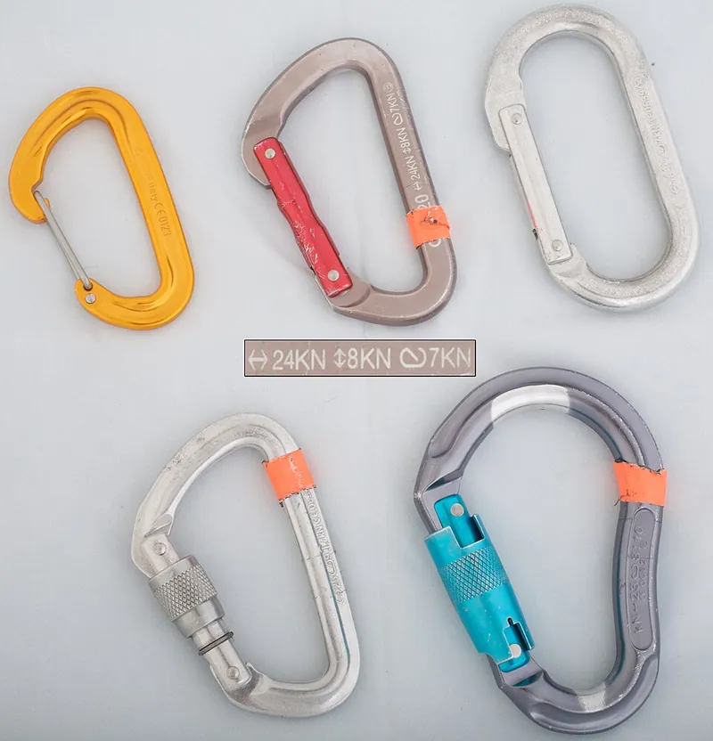
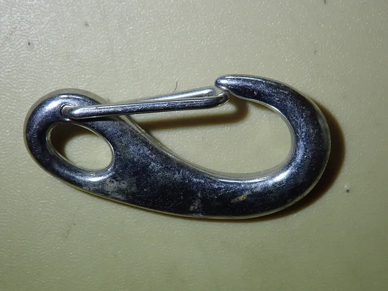
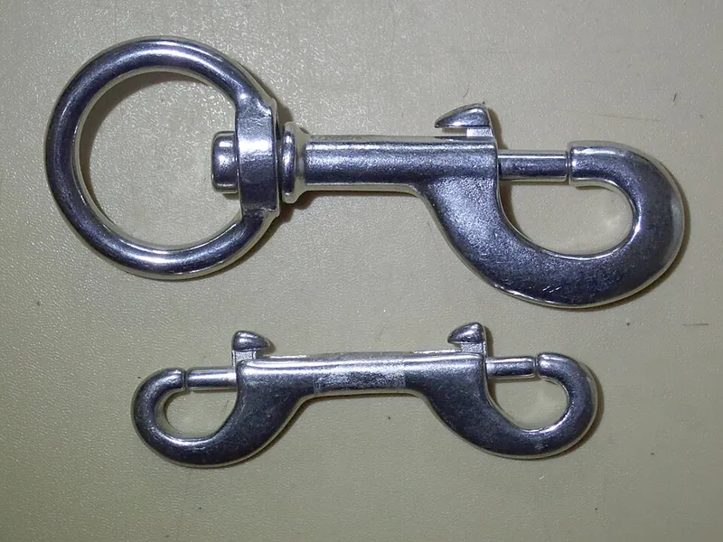

<figure class="eoc-pic eoc-pic-main"><figcaption><strong>Photo.</strong> <a href="https://commons.wikimedia.org/wiki/File:Assorted_Biners.jpg">Assorted Biners</a> by Zakabog, <a href="https://creativecommons.org/licenses/by-sa/3.0">CC BY-SA 3.0</a>, from Wikimedia Commons.</figcaption></figure>
<figure class="eoc-pic"><figcaption><strong>Photo.</strong> <a href="https://commons.wikimedia.org/wiki/File:Spring_gate_snap_hook_PA210114.jpg">Spring gate snap hook PA210114</a> by Peter Southwood, <a href="https://creativecommons.org/licenses/by-sa/4.0">CC BY-SA 4.0</a>, from Wikimedia Commons.</figcaption></figure>
<figure class="eoc-pic"><figcaption><strong>Photo.</strong> <a href="https://commons.wikimedia.org/wiki/File:Single_end_and_double_end_bolt_snaps_PA210120.jpg">Single end and double end bolt snaps PA210120</a> by Peter Southwood, <a href="https://creativecommons.org/licenses/by-sa/4.0">CC BY-SA 4.0</a>, from Wikimedia Commons.</figcaption></figure>

A closed loop or hook with a spring-loaded gate that swings or slides open to let a rope, ring or strap in and then springs shut to trap it, joining the two in a second without tools; a screw or twist collar can lock the gate.

**In plain words:** A metal (or plastic) hook or loop with a little springy door: push the door in to slip a ring, rope or strap inside, let go and it snaps shut so the thing can't fall out; some have a collar you screw or twist to lock the door. **Proper term:** Spring-gate hook (carabiner, snap hook).

**Also called:** carabiner / karabiner (from German Karabinerhaken, 'carbine hook'); biner, krab, crab; climbing clip; snap-link; snap hook / spring snap / spring hook; locking snaphook (fall protection); locking carabiner: screwgate (screw-lock), twist-lock, push-lock, auto-locking, magnetic lever lock ('Magnetron', a brand name), double gate; wire gate / wiregate, solid gate, straight gate, bent gate, keylock (keylock nose); D, offset-D, oval and pear / HMS carabiners (shapes); mini-carabiner / carabiner keyring / 'not for climbing' clip; bolt snap / trigger snap / swivel snap / double-ended bolt snap (sliding-bolt gate, e.g. dog leads); lobster clasp / lobster hook / lobster claw / trigger clasp / bocklebee clasp (jewellery); piston hank (sail hank with a sliding piston gate).

## How it works

A spring holds the gate against the nose of the hook, closing the loop. Pushing the gate from outside swings it inward (or, on a bolt snap, slides the bolt back against its spring) so a ring or rope can pass in; letting go lets the spring snap it shut, and a pull from inside only presses the gate harder against the nose, so the load cannot open it ⚑ [uncertain: stated from the geometry; the sources describe the spring-closed gate but not this point]. The load is meant to run along the solid spine: an asymmetric D shape 'transfers the majority of the load on to the spine' (Wikipedia). With the gate closed and seated in the nose, the gate helps carry load, so climbing carabiners must hold at least 20 kN closed but only 7 kN with the gate open (EN 12275, via Wikipedia). Locking types add a sleeve that must be screwed, twisted or pushed before the gate can move, so a rope or snag cannot open it (Wikipedia; OSHA 1926.502).

## Parts

A few parts: a one-piece body (spine, basket and nose); a gate (a solid bar with a coil spring and pin inside it, or a single bent spring-steel wire that is both gate and spring); a hinge rivet; and, on locking types, a screw or spring-loaded twist sleeve. A bolt snap has a hook body, a sliding bolt, a compression spring and usually a swivel ring (Wikipedia 'Bolt snap'). A lobster clasp has a curved body, a small lever and a tiny spring (Wikipedia 'Lobster clasp').

## Everyday examples

- A carabiner keyring clipped to a belt loop or bag
- A dog lead's clip (usually a swivel bolt snap) on the collar ring (Wikipedia 'Bolt snap')
- The clasp on a necklace or bracelet (lobster clasp) (Wikipedia)
- Climbing quickdraws, and the snap hooks on bag straps and luggage (Wikipedia)

## When to use it

When you need to clip and unclip something often, quickly and one-handed, and the item only needs to be held captive rather than clamped: keys, bags, dog leads, gear on a harness or backpack, jewellery, tarp and hammock suspension, rope rigging and climbing (with certified hardware). Choose a locking type when an accidental opening would matter, a wire gate for light weight and less icing, and a bolt snap for small, one-handed marine or diving clips.

## When not to use it

Avoid it when you must release the load while it is still pulling (use a snap shackle, pelican hook or other quick-release hook). Avoid non-locking gates wherever a rope, strap or edge could push the gate open or where the hook could be loaded across the gate or over an edge: use a locking carabiner, a screw-closed quick link (maillon) or a shackle. Never use a keyring, bolt snap or 3D-printed carabiner for climbing, lifting people or anything overhead. For a permanent or rigid joint, use a bolt, pin or shackle instead.

## Details

- **What it does (jobs):**
  - join and hold: clips a rope, sling, ring, strap or chain link to something else
  - lock, and release by hand: opens with one finger (or a twist of the locking sleeve) and cannot be opened by the load
- **Movement:** rotate: the gate swings inward on its hinge rivet (bolt snaps: slide, as the bolt slides back along the shank); the clipped ring or rope stays free to slide and turn inside the loop ⚑ [uncertain: gate opening angles are not published]
- **Directions it can move (degrees of freedom):** The gate has 1 (it swings or slides). The clipped part is loosely captured: it can slide round the loop and turn freely, but cannot leave while the gate is shut; D shapes steer the load toward the spine (Wikipedia).
- **Special behaviour:**
  - quick-release: clips on and off in a second, one-handed, with no tools
  - hand-release only (locks under load, releases when a person operates it): a loaded hook can't be unclipped (a bolt snap 'cannot be removed under normal tensile load conditions even with the gate open', Wikipedia); locking types also need the sleeve undone first
  - none of the other special behaviours: it does not slip, click, tension or release on its own
- **How it holds:**
  - shape (the parts interlock; [form-fit](../glossary.md#form-fit--force-fit--material-bond)): the closed loop surrounds the ring or rope
  - spring force (a spring or springy part presses it in place): a coil spring, the bent wire gate itself, or a compression spring behind a bolt keeps the gate shut
- **Input and output:** not applicable: it holds rather than passing motion on
- **Power:** passive (no power needed)
- **Load:** From very light to heavy, depending on type. Jewellery lobster clasps and keyring clips are light-duty; bolt snaps 'are not generally load rated' and suit loads 'the user can lift' (Wikipedia). Certified climbing carabiners hold at least 20 kN along the spine with the gate closed, 7 kN gate open and 7 kN across the gate (minor axis) (EN 12275 and ASTM F1774, via Wikipedia); fall-protection snaphooks must hold 5,000 lb (22.2 kN) and be proof-tested to 3,600 lb (16 kN) (OSHA 1926.502). Strong only as a straight pull along the spine; weak when cross-loaded, pulled off-axis (about half strength in a Black Diamond test) or nose-hooked (can fail at 'less than 2 kN', Black Diamond).
- **Play and precision:** not applicable: it is a loose, free-moving link; the clipped item can shift round the loop, which is why D shapes are used to keep the load near the spine (Wikipedia)
- **Taking it apart:** tool-free quick release: push the gate (after unscrewing or twisting the lock, if fitted) and lift it off, once the load is off
- **How often it can be reused:** effectively unlimited: until the gate spring weakens, the locking sleeve jams, or rope wear cuts grooves and sharp edges into the body (DMM; Wikipedia on spring [fatigue](../glossary.md#fatigue) in auto-locking sleeves)
- **Sealing:** none: nothing makes it seal
- **Adjustable:** no: it only joins or unjoins; screw or twist locks set whether the gate can open, not position or tension
- **Access needed:** one side only (blind): you only need to reach the hook and its gate; the thing it clips to needs no access from behind
- **Materials:** Climbing and rescue: aluminium alloy (lighter, most sport carabiners) or steel (heavier, industrial and rescue) (Wikipedia). Marine and diving bolt snaps: stainless steel or brass with a stainless spring; light-duty keyring and bag snaps: chrome-plated zinc or plastic (Wikipedia 'Bolt snap'). Jewellery lobster clasps: precious or plated base metal ⚑ [uncertain]. 3D-printed light-duty clips: PETG preferred for a springy gate, PLA works, nylon-carbon fibre is strongest (n.leinad's break tests). It clips to rope, webbing slings, rings, chain links, bolt hangers and D-rings.
- **Heat, cold, water and wear:** Dirt, sand, ice and salt make gates and locking sleeves stick; twist-locks are 'prone to both spring fatigue' and to becoming 'balky from dirt, ice, or other contamination', and twist-lock sleeves 'sometimes jam, getting stuck after being tightened under load' (Wikipedia). Wire gates are 'less prone to icing up' (Wikipedia). Clean in water at most 30 °C and dry gate-up so the spring chamber drains (DMM). Rope running over aluminium wears grooves that can become sharp edges (DMM checks for 'abrasion, excessive wear, sharp edges'). Printed clips: PLA softens above about 60 °C and degrades in sunlight; PETG suits outdoor use below about 80 °C; ASA resists UV up to 93 °C (Prusa); plastic springs may [creep](../glossary.md#creep) and lose snap over time ⚑ [uncertain].

## Making it

- **Ways to make or get it:**
  - off-the-shelf part: by far the normal route; forged aluminium or steel carabiners, stamped or cast snap hooks and clasps
  - 3D print (FDM): popular one-piece [print-in-place](../glossary.md#print-in-place) clips with a flexing plastic gate, and multi-part screwgate designs
  - 3D print (resin): possible, but weakest in n.leinad's break test (85 ± 20 kg)
  - CNC: aluminium bodies with a bought wire gate ⚑ [uncertain: no maker example found]
  - sheet metal / bent wire: simple spring-steel wire snap hooks ⚑ [uncertain: no maker example found]
- **Printing it in one piece (print in place):** yes: many printable carabiners print fully assembled with a springy plastic gate and nothing to add (e.g. Boo_Ray's and Bench's one-piece designs; Hugo's print-in-place screwgate); partly for designs that need a metal spring or a glued-on part
- **Tools:** none
- **Difficulty:** easy for light-duty clips (many one-piece print-in-place designs exist); impossible to make safely at home for anything that holds a person, so buy certified hardware for that

### 3D printing tips

Use a slightly flexible material for the gate: n.leinad's 'Suicide Carabiner' uses PETG as 'a good compromise between flexibility and strength'; PLA works but is not recommended. Don't print hotter than needed for good layer adhesion: n.leinad warns that higher temperatures reduce the plastic's elasticity and make the part [brittle](../glossary.md#brittle--ductile), which matters most at the gate's bending section. For strength use many [perimeters](../glossary.md#perimeters), since stress is highest at the outer shells: n.leinad used a 0.6 mm nozzle, 0.3 mm layers, 10 perimeters, 4 top/bottom layers and 50% [infill](../glossary.md#infill); Luvem Studio's screw-lock carabiner recommends five or more walls. Print the body lying flat so the loop is drawn round in each layer and the pull runs along the extrusions, not across [layer lines](../glossary.md#layer-lines) (FFF prints are 'stronger in one direction than another', Prusa; a pin printed upright 'can break apart along the layer lines', Doormat_1). [Tolerances](../glossary.md#tolerance) don't scale: if you scale a design, the gate may need lengthening by about 2% with a one-axis scale to close properly (n.leinad); print-in-place screwgates need an accurate printer and good first-layer adhesion, perhaps a raft (Hugo). A little silicone grease helps the hinge (n.leinad). Break loads after six months' ageing for the same design: PLA 162 ± 2 kg, PETG 165 ± 4 kg, BASF PAHT-CF15 nylon-carbon 350 ± 5 kg, resin 85 ± 20 kg (n.leinad). Every such design is 'NOT FOR CLIMBING'. PLA also softens above about 60 °C (Prusa) and a gate left open may take a set ⚑ [uncertain].

### Buying one (off-the-shelf parts)

Search for: 'carabiner' (non-locking, screwgate, twist-lock / auto-lock, wire gate, keylock, HMS / pear, offset D; check for EN 12275 or UIAA marking); 'locking snap hook' or 'double-action snap hook' (fall protection, ANSI Z359 / EN 362); 'snap hook' / 'spring snap'; 'bolt snap' (single or double-ended, swivel eye, stainless or brass); 'lobster clasp' plus 'jump rings' (jewellery); 'mini carabiner keyring' (light use only). Related: 'quick link' / maillon (screw-closed link), 'swivel eye snap shackle', 'piston hank'.

## Rules of thumb

- Certified climbing carabiners: at least 20 kN along the spine with the gate closed and 7 kN with the gate open (EN 12275:1998), and 20 kN long axis / 7 kN short axis (ASTM F1774) (Wikipedia, 'Carabiner'). So open-gate and cross-loaded strength is only about a third of the rated closed strength.
- A nose-hooked carabiner 'can fail at less than 10% of its rated closed gate strength - that's less than 2 kN' (Black Diamond QC Lab); always check the gate is closed and the carabiner is seated.
- Off-axis loading roughly halves strength: a Black Diamond VaporLock broke at 21.8 kN loaded normally but at 10.63 kN when the sling was forced to the edge of the basket (Black Diamond QC Lab, off-axis loading).
- For work at height, 'only locking type snaphooks shall be used'; snaphooks must have 5,000 lb (22.2 kN) tensile strength and be proof-tested to 3,600 lb (16 kN), and must not be clipped to objects that could 'depress the snaphook keeper and release itself' (OSHA 29 CFR 1926.502(d)).
- Bolt snaps and keyring clips are for light loads: bolt snaps 'are not generally load rated' and suit loads 'the user can lift' (Wikipedia, 'Bolt snap'); mini-carabiners are usually stamped 'not for climbing' (Wikipedia, 'Carabiner').
- Lighter gates flutter less: wire gates, with less gate mass, are 'less prone to gate flutter' and icing (Wikipedia; WeighMyRack), and a locking carabiner removes the risk (WeighMyRack).
- Inspect and clean: the gate should spring back 'to a fully closed position with good nose/gate alignment' with 'no excessive side-to-side play'; wash in water at most 30 °C with mild detergent, hang 'with the gate opening uppermost' to drain, oil the hinge, and 'Do not use graphite powder' (DMM).

## Common failures

Gate sticks or doesn't close fully: dirt, grit or a tired spring; clean, oil the hinge and check it snaps shut (DMM). Twist-lock sleeve jammed after being tightened under load (Wikipedia). Accidental opening: a rope or edge pushes the gate (roll-out; OSHA), gate flutter or shutter (WeighMyRack), or a sleeve left unlocked; use lockers or orient the gate away from rock and edges. Breaks below its rating: cross-loaded, off-axis or nose-hooked (Black Diamond QC Lab). Worn grooves and sharp edges that damage rope (DMM). Cheap zinc or plastic snaps bend or break under loads they were never rated for (Wikipedia 'Bolt snap'). Printed clips: gate cracks at its flex point if printed too hot or in brittle material, or the body splits along layers if printed standing up (n.leinad; Doormat_1).

## Safety

Life-safety use needs certified hardware: mini-carabiners 'are not load-tested' and are usually stamped 'not for climbing' (Wikipedia), and printed ones are explicitly 'NOT FOR CLIMBING' (n.leinad). A hook can 'roll out' when the connected object presses the gate open (OSHA 1926.502 bans clipping to incompatible objects for this reason). Cross-loading, nose-hooking and off-axis pulls can break a carabiner at a small fraction of its rating (Black Diamond QC Lab). Gate flutter or 'shutter' can briefly open a non-locking gate during a fall (WeighMyRack). Retire any carabiner that is cracked, bent, badly worn or has a sticky gate: 'If you are in any doubt it should be taken out of service' (DMM). Small clasps and keyring parts are swallowing hazards for young children ⚑ [uncertain].

## Related

- Quick-release hooks (pelican hook, snap shackle, three-ring release): can be opened while the load is still pulling, which a spring-gate hook cannot
- Shackle and quick link: the quick link (maillon), 'a metal link, similar to a carabiner' closed by a threaded sleeve instead of a hinged gate (Wikipedia 'Maillon'), is stronger across its gate but slower to open (also listed under 'See also' in Wikipedia's 'Carabiner'); D-shackles and pin shackles are bolt-closed and stronger, needing a pin to be unscrewed
- S-hook and open hook: no gate at all, so things can fall off
- [Cantilever](../glossary.md#cantilever) snap fit: the same springy-latch idea moulded into plastic parts
- Side-release buckle: a springy plastic latch for joining two straps, released by squeezing
- Magnetic clasp: magnets instead of a spring gate, for light jewellery and bags
- Piston hank: a snap hook with a sliding piston gate for attaching sails to a stay (Wikipedia 'Bolt snap')

## Make it yourself

- [The Suicide Carabiner by n.leinad, Printables](https://www.printables.com/model/267210-the-suicide-carabiner): A climbing-inspired D carabiner designed for FDM printing, with a sliding, self-closing plastic gate; includes print settings and aged break-test results (PLA 162 kg, PETG 165 kg, PAHT-CF15 350 kg, resin 85 kg); explicitly not for climbing. Details read through the Printables public API; the URL appeared in search results. *(licence: CC BY-NC-SA (Creative Commons Attribution-NonCommercial-ShareAlike))*
- [Parametric One-piece Print-in-place Carabiner by Bench, Printables (URL from Printables API, page not opened)](https://www.printables.com/model/1807048-parametric-one-piece-print-in-place-carabiner): An OpenSCAD Customizer model of a one-piece, support-free, print-in-place carabiner with a pre-tensioned printed spring gate, based on Boo_Ray's design *(licence: CC BY-SA (Creative Commons Attribution-ShareAlike))*
- [Single & Dual Locking Carabiner (Parametric) by squinn, Printables (URL from Printables API, page not opened)](https://www.printables.com/model/570851-single-dual-locking-carabiner-parametric): Parametric Fusion 360 model of standard and dual screwgate carabiners with a print-in-place pivot, in several sizes *(licence: CC BY (Creative Commons Attribution))*
- [Screw Lock Carabiner by Luvem Studio, Printables](https://www.printables.com/model/95972-screw-lock-carabiner): A very popular printable locking carabiner; the maker recommends five or more walls and supports in marked areas, and warns 'Do not use for climbing!'. Details read through the Printables public API; the URL appeared in search results. *(licence: CC BY-NC (Creative Commons Attribution-NonCommercial))*
- [Screwgate Carabiner (Print-in-place) by Hugo, Printables (URL from Printables API, page not opened)](https://www.printables.com/model/565999-screwgate-carabiner-print-in-place): A print-in-place screwgate carabiner with spring-back gate action; needs an accurate printer and good bed adhesion *(licence: CC BY-NC (Creative Commons Attribution-NonCommercial))*

## Pictures, videos and models

- [Assorted Biners.jpg, Wikimedia Commons (by Zakabog)](https://commons.wikimedia.org/wiki/File:Assorted_Biners.jpg): Five carabiners: D-shape wire gate, straight gate, oval straight gate, auto-lock and twist-lock, with a standard strength rating marking in the centre *(licence: CC BY-SA 3.0)*
- [Lobsterclasp.jpg, Wikimedia Commons (by Modulatum)](https://commons.wikimedia.org/wiki/File:Lobsterclasp.jpg): Close-up of a silver lobster clasp showing its lever *(licence: Public domain)*
- [Single end and double end bolt snaps, Wikimedia Commons (by Peter Southwood)](https://commons.wikimedia.org/wiki/File:Single_end_and_double_end_bolt_snaps_PA210120.jpg): A large swivel-ring single-ended bolt snap and a short double-ended bolt snap, showing the sliding bolt gates *(licence: CC BY-SA 4.0)*
- [QC Lab: Weakness of Nose-Hooked Carabiners (Black Diamond)](https://blackdiamondequipment.com/blogs/stories/qc-lab-weakness-of-nose-hooked-carabiners): Photos of carabiners broken in closed-gate, open-gate, minor-axis and nose-hooked tests, showing where each one fails *(licence: © Black Diamond; link only)*
- [I 3D Printed Carabiners (HowNOT2, YouTube)](https://www.youtube.com/watch?v=_6EhzJGCA_s): Break-testing 3D-printed carabiners in different filaments, infills and wall counts ⚑ [uncertain: title and channel confirmed through YouTube's oEmbed data; content taken from a search-result summary; the video itself was not watched] *(licence: YouTube standard licence; link only)*

## Needs confirming

⚑ marks something nobody has confirmed yet: a fact the research could not confirm from a source, a finder value that is a best guess, or an open point from the research notes. Corrections are welcome (see `research/needs-confirming.md`).

- ⚑ 9 sentences on this page marked [uncertain].
- ⚑ Finder value `usual_process` = off-the-shelf part (best guess): first-listed process is off-the-shelf, but `print_in_place` is yes

## Sources

- <https://en.wikipedia.org/wiki/Carabiner>
- <https://en.wikipedia.org/wiki/Bolt_snap>
- <https://en.wikipedia.org/wiki/Lobster_clasp>
- <https://blackdiamondequipment.com/blogs/stories/qc-lab-weakness-of-nose-hooked-carabiners>
- <https://blackdiamondequipment.com/blogs/stories/qc-lab-off-axis-and-tri-quad-axial-loading>
- <https://blog.weighmyrack.com/gate-flutter-and-gate-shutter-explained/>
- <https://us.dmmwales.com/blogs/knowledge/carabiner-inspection-and-maintenance>
- <https://www.osha.gov/laws-regs/regulations/standardnumber/1926/1926.502>
- <https://commons.wikimedia.org/wiki/File:Assorted_Biners.jpg>
- <https://commons.wikimedia.org/wiki/File:Lobsterclasp.jpg>
- <https://commons.wikimedia.org/wiki/File:Single_end_and_double_end_bolt_snaps_PA210120.jpg>
- <https://www.youtube.com/watch?v=_6EhzJGCA_s>
- <https://api.printables.com/graphql/>
- <https://www.printables.com/model/267210-the-suicide-carabiner>
- <https://www.printables.com/model/95972-screw-lock-carabiner>
- <https://help.prusa3d.com/article/modeling-with-3d-printing-in-mind_164135>
- <https://help.prusa3d.com/article/pla_2062>
- <https://help.prusa3d.com/article/petg_2059>
- <https://help.prusa3d.com/article/asa_1809>
- <https://en.wikipedia.org/wiki/Maillon>
