<figure class="eoc-pic eoc-pic-main"><picture><source media="(prefers-reduced-motion: reduce)" srcset="../media/drawn/spring-powered-paper-pop-up.svg"></picture><figcaption><strong>Animation.</strong> Diagram drawn for the encyclopaedia from the research notes. ⚑ Needs confirming: a drawing can simplify or get details wrong; a real photo or a better diagram is welcome.</figcaption></figure>
<figure class="eoc-pic"><figcaption><strong>Render.</strong> A 3D model made for the encyclopaedia, not a photo: a stand-in until a good real photo is found. ⚑ Needs confirming: a model can simplify or get details wrong; a real photo is welcome.</figcaption></figure>

A paper or card shape that is pressed flat against a stretched rubber band or a springy folded paper strip, so that when it is released, dropped or slid out of a card it springs up by itself into a cube, a box or a bouncing figure.

**In plain words:** A folded card box or a springy folded paper strip that is squashed flat, stores a little energy, and jumps into shape on its own when you let go of it or slide it out of a card, envelope or box. **Proper term:** Spring-powered paper pop-up (rubber-band snap-up cube; folded paper spring).

**Also called:** pop-up cube, DIY pop-up cube (Alliance Rubber); snap up cube, locking snap up cube (Rob Ives); self pop-up cubic card (Instructables); pop up box (Instructables), pop-up cubes in a box (Graphic 45); pop-open box (Sabuda's summary of Eric Kenneway, 'Making Pop-up Greeting Cards', 1972); rubber band mechanisms (Sabuda's summary of Joan Irvine, 'How to Make Super-pops'); paper spring (Twin Cities Frugal Mom; Adventure in a Box), folded paper spring, two-strip spring; accordion articulation (Adventure in a Box), also known to crafters as a 'witch's ladder', 'Jacob's ladder' or 'frog's legs' fold ⚑ [uncertain: these names were not seen on an opened page]; springs and coils (Sabuda's summary of Joan Irvine, 'Easy-to-make Pop-ups'); note that the paper engineer's 'coil' or 'spiral' is a cut spiral pulled up by the page, not a spring (Superplexus 'Coils'); jack-in-the-box card, paper jack-in-the-box (Adventure in a Box); jumping card, exploding box ⚑ [uncertain: craft names seen only in search results].

## How it works

Pressing the card shape flat stretches the rubber band inside it (or squashes the folded paper spring), storing energy; letting go releases that energy and the folds swing back to their built shape. In the snap-up cube the band is hooked between two tabs or through holes on opposite sides of the box, so flattening the box pulls those points apart and stretches the band; when the box is released, slid out of a card, or (locking version) dropped so the lock tab knocks free of its notch, the band shortens and pulls the faces back into a cube (Rob Ives: 'Once set, drop the cube, tab side down, onto a flat surface and the cube will spring up!'; Instructables: the cube 'pops when is pulled out from a book or any other flat hard envelopes') ⚑ [uncertain for the exact band path, which differs between designs]. In the paper spring, the two strips folded over each other at right angles form a stack of small paper hinges that act together like a coil spring: pressed down under a lid it compresses, and when the box is opened it pushes the figure up and bounces (Twin Cities Frugal Mom: 'Open the box and a cute creature pops out').

## Parts

A few parts. Snap-up cube: a card net of four or six square faces with glue tabs, one rubber band hooked over two tabs or threaded through punched holes or slits inside the box, and (in the locking version) a lock tab and notch that hold it flat until it is dropped (Rob Ives; Instructables 'Pop Up Box'; Instructables 'Self Pop-up Cubic Card'). Paper spring: two long paper strips glued at a right angle and folded over each other in turn, glued at the end, with a figure glued on top and the bottom glued into a box (Twin Cities Frugal Mom; Adventure in a Box).

## Everyday examples

- Pop-up cube cards and gifts: flattened cubes slipped into a greetings card, letter or gift box that jump out when it is opened (Alliance Rubber; Graphic 45)
- A paper jack-in-the-box or surprise box where a figure on a paper spring bounces out when the lid is opened (Adventure in a Box; Twin Cities Frugal Mom)
- The folded two-strip paper spring used for wobbly arms, legs and puppet bodies in children's crafts (Adventure in a Box: 'We have also used it for making simple articulated puppets')
- Pop-up advertising cubes and photo cubes ⚑ [uncertain: Rob Ives suggests 'a pop up advertising platform']

## When to use it

Use a rubber-band snap-up cube when you want a 3D shape that travels flat (in a card, letter or box) and springs up by itself the moment it is released, with no page or hinge needed to open it: surprise cards, gift inserts, photo or message cubes, and party favours (Alliance Rubber; Graphic 45). Use the locking version when you want it to stay flat until a trigger (dropping it) sets it off (Rob Ives). Use a paper spring when you want a figure to bounce or wobble out of a box or card, or as a cheap springy joint for paper toys and puppets (Twin Cities Frugal Mom; Adventure in a Box). Both are easy enough for classrooms and children's crafts.

## When not to use it

Avoid the rubber-band cube for anything meant to last for years or be stored flat for a long time, since rubber bands perish (see environment limits); use a parallel-fold box pop-up, which is opened by the page itself and needs no band. Avoid it for very young children (small parts and a band that can be pulled off and mouthed) [needs confirming]. Avoid strong bands in thin card, which crumple or tear. For a pop-up that must rise smoothly as a book page opens, use parallel-fold or V-fold pop-ups. For a lasting spring in a model or toy, use a metal coil spring or a 3D-printed [flexure](../glossary.md#flexure).

## Details

- **What it does (jobs):**
  - store energy: the stretched band or squashed paper spring holds the energy that makes it pop up
  - let it move (turn, slide or bend): the card faces swing about their creases as the shape opens; the paper spring bends at every fold
  - lock, and release by hand: the locking snap-up cube is held flat by a tab in a notch until it is dropped (Rob Ives)
- **Movement:** multiple: the faces of the cube rotate about their creases (each crease turns through up to about 90° as the cube opens from flat) and the paper spring stretches straight up from a short stack to a tall one (flex) ⚑ [uncertain for exact angles and spring travel].
- **Directions it can move (degrees of freedom):** 1 intended: a pop-up cube is a [linkage](../glossary.md#linkage) of creased faces that opens along one path, from flat to cube. The paper spring is meant to stretch and squash along its length (1), but it also wobbles and leans sideways, which is part of its charm.
- **Special behaviour:**
  - [over-centre](../glossary.md#over-centre) (snaps past a point and stays): not truly; the band keeps pulling the cube toward its open shape, which acts as its end stop ⚑ [uncertain]
  - quick-release: the locking version is held flat by a tab in a notch and lets go when dropped tab side down (Rob Ives)
  - none otherwise: its 'clever' behaviour is simply springing open by itself
- **How it holds:**
  - spring force (a spring or springy part presses it in place): the rubber band pulls the cube into shape and holds it there; the paper spring pushes the figure up
  - shape (the parts interlock; [form-fit](../glossary.md#form-fit--force-fit--material-bond)): the lock tab sits in a notch to hold the cube flat (Rob Ives), or a card, envelope or box holds it flat until it is pulled out or opened
  - material bond (glue, solvent or melting): the cube's faces and the spring's strips are glued or taped together (Rob Ives; Twin Cities Frugal Mom; Instructables)
- **Input and output:** Stored stretch in a rubber band (or bending in the paper spring) -> fast unfolding of the box or upward bounce of a figure, in one shot. The energy is put back in by hand each time the shape is squashed flat. Not back-drivable in any useful sense; it is an energy store, not a drive.
- **Power:** passive (no power needed): powered only by the energy the user stores by squashing it flat
- **Load:** light: only lifts its own weight and a light card figure; the band pull is small. A strong band can crush thin card or rip its anchor holes ⚑ [uncertain].
- **Play and precision:** not applicable: it is a novelty pop-up; the faces need only end up roughly square, and a paper spring is deliberately wobbly
- **Taking it apart:** permanent: the faces are glued; the rubber band can be unhooked and replaced if it is hooked over tabs (Rob Ives) ⚑ [uncertain for tied or threaded bands]
- **How often it can be reused:** Folding flat and popping up: many times, until the creases soften or the band perishes or breaks ⚑ [uncertain: no cycle counts found]. Rubber bands kept stretched crack and perish over time (Wikipedia 'Ozone cracking': cracks form 'in products under tension, but the critical strain is very small'), so a cube stored flat for a long time may lose its snap ⚑ [uncertain for timescale]. Taking apart: once, as the card is glued.
- **Sealing:** none: open card
- **Adjustable:** yes, a little: a stronger, shorter or doubled band gives a faster, more forceful pop and a weaker band a gentler one, and you can tie two bands together if one isn't long enough (Alliance Rubber); a longer or shorter paper spring changes how the figure pops out (Twin Cities Frugal Mom). Once built, only the band can be changed easily.
- **Access needed:** not applicable: it is a free-standing card shape; the band is fitted before the last faces are glued (Rob Ives)
- **Materials:** Card and cardstock for the box (Rob Ives used 280 micron card; Graphic 45 used patterned cardstock; Instructables used card board and cardstock), with a natural-rubber band; heavier card, or a doubled base, resists the band's pull better (Rob Ives). The paper spring uses ordinary cardstock or printer paper strips (Twin Cities Frugal Mom; Adventure in a Box). Glue, double-sided tape or clear tape for the joins (Alliance Rubber; Instructables). Thin, floppy paper does not suit the cube because the band crumples it ⚑ [uncertain]. Thin plastic sheet (polypropylene) could be used for long-lasting cubes ⚑ [uncertain].
- **Heat, cold, water and wear:** Rubber bands perish: tiny traces of ozone attack natural rubber, and cracks form in parts held under tension even at very small stretch, at right angles to the stretch (Wikipedia 'Ozone cracking'); a cube stored flat keeps its band stretched, so check or replace the band before giving an old one. Warmth, sunlight and age harden or soften rubber bands ⚑ [uncertain: no source opened for this item]. Paper and card soften in damp air, so creases lose their spring and the cube may not fully open ⚑ [uncertain].

## Making it

- **Ways to make or get it:**
  - hand cut card from a printed template (Alliance Rubber; Rob Ives; Instructables)
  - cutting machine or laser cut card nets ⚑ [uncertain: no opened source used one for this mechanism]
  - off-the-shelf part: rubber bands (and printed templates)
  - 3D print (FDM): not usual for this paper mechanism; see making_tips_3d_printing
- **Printing it in one piece (print in place):** no: it is a paper mechanism built from a card net and a rubber band. A printed box with thin-layer folding hinges and a band could work like a snap-up cube, but no printed version was found ⚑ [uncertain].
- **Tools:** To make: scissors or a craft knife and cutting mat, a ruler and a scoring tool (a staple remover with a ruler works, Instructables 'Pop Up Box'), a 1/8 in hole punch or other hole maker for the band (Instructables), glue or double-sided tape, and a printer for templates. To use: none.
- **Difficulty:** easy: printable templates, scissors, glue and a rubber band; the paper spring is a children's craft. The fiddly step is gluing the last faces of the cube while holding it flat without gluing it shut (Rob Ives: 'Tricky, but you can do it!').

### 3D printing tips

not applicable: this is a card-and-rubber-band mechanism. For a printed equivalent, see the spring and living-hinge entries: a box printed flat with thin hinges at the creases could be sprung open with a rubber band or a printed flexure spring, but no tested design was found ⚑ [uncertain].

### Buying one (off-the-shelf parts)

Rubber bands sold by size number: Alliance Rubber's tutorial uses #16 bands, whose size chart gives a flat length of 2 1/2 in and a width of 1/16 in (Alliance Rubber size chart); small bands such as those on bunches of green onions (Instructables 'Pop Up Box'); heavy card or cardstock (280 micron used by Rob Ives); glue, double-sided tape or clear tape; foam double-sided tape to fix a removable figure on a paper spring (Adventure in a Box); a 1/8 in hole punch (Instructables).

## Rules of thumb

- Band size for a rubber-band cube: 'The flat length of the rubber band you choose will need to be slightly bigger than the measurement of one side of your cube'; their example is a cube 'approximately 1.75" on each side' with #16 bands, and 'You can always tie two rubber bands together if you don't have one big enough' (Alliance Rubber, 'DIY Pop-Up Cube Using Rubber Bands').
- What 'flat length' means: the unstretched length measured with the band pressed flat, 'usually about half the total circumference of the rubber band in a relaxed position'; size #16 is 2 1/2 in long and 1/16 in wide (Alliance Rubber size chart; also Wikipedia 'Rubber band'). So the tutorial's #16 band is about 1.4 times the 1.75 in cube side (worked out from the two pages).
- Figures that differ: Graphic 45's pop-up cubes are 7 cm on a side, built from two pieces of cardstock 21 cm by 18.5 cm, with 'a rubber band of 16 cm' between them; the page does not say whether 16 cm is the flat length or the circumference (Graphic 45, 'Pop-up Cubes in Boxes Tutorial'). Instructables 'Self Pop-up Cubic Card' uses 8 cm squares with no band size given. Treat the band size as something to test.
- Locking version (Rob Ives): print onto heavy card ('I used 280 micron and it worked well!'); double the base and the lock tab for strength; hook the band over two tabs instead of cutting, threading and tying it; push the cube flat and lift the tab into the notch; drop it tab side down to make it spring up. When gluing the last tabs, 'hold the cube flat until the glue is completely dry whilst at the same time making sure that the cube hasn't accidentally been glued flat'.
- Score every fold before folding (Instructables 'Pop Up Box': 'Score all dotted lines'; Instructables 'Self Pop-up Cubic Card': 'stress the lines in order to have a better flexion'); collapse the box by squeezing opposite edges together (Instructables 'Pop Up Box').
- Paper spring (Twin Cities Frugal Mom): 'Glue 2 strips together, overlapping the ends to form a right angle'; 'Fold the bottom strip over the top, keeping the pieces tight and the angle squared evenly'; continue folding the lower strip over the top one, glue on more strips to lengthen it, and glue the last ends together; glue the bottom of the spring to the centre of the inside bottom of the box. Adventure in a Box joins strips into two long strips first, glues them at 90°, then folds them one on top of the other at 90°.
- Spring length: 'Try making a longer or shorter spring to see the differences' (Twin Cities Frugal Mom).

## Common failures

1) The cube doesn't pop up fully: the band is too weak or too long, or the card is too stiff at the creases; use a slightly stronger or shorter band and score the folds well (Alliance Rubber; Instructables). 2) The band crumples, bends or tears the card at its anchor points: use heavier card, double the base and tabs (Rob Ives), or reinforce the holes. 3) The cube is accidentally glued flat while the last tabs dry (Rob Ives warns about this). 4) The band perishes and snaps or goes slack after months, especially if stored stretched (Wikipedia 'Ozone cracking'); replace it. 5) The locking cube goes off too early, or won't release, if the tab and notch are too loose or too tight ⚑ [uncertain]. 6) A paper spring that is folded loosely or unevenly leans and collapses; keep the strips tight and the angle square (Twin Cities Frugal Mom). 7) Glue on the spring folds stops them flexing ⚑ [uncertain].

## Safety

A strong rubber band can flick the cube, or the band itself, toward faces if it breaks or slips off while the cube is being flattened [needs confirming]. Snapped elastic cords are a known cause of serious eye injuries (Wikipedia 'Bungee cord': they 'can cause serious eye or facial injuries if they snap back'), so use light bands for children's cubes and keep faces away when setting a strong one. Rubber bands and small card parts are a swallowing and choking risk for young children; in the United States toys intended for children under 3 years must not present a choking hazard from small parts (16 CFR part 1501, eCFR) [needs confirming that a card with a band counts]. Some people are allergic to natural rubber latex ⚑ [uncertain: not checked on an opened page]; latex-free bands made from a synthetic elastomer are sold (Wikipedia 'Rubber band'). Craft knives: 'careful with craft knife, it's sharp' (Instructables 'Pop Up Box').

## Related

- Elastic band and elastic cord springs: the general entry for rubber bands as springs; this entry is their best-known paper use
- Parallel-fold pop-up (box fold): makes a box rise as a page opens, powered by the page instead of a band
- V-fold pop-up: another page-powered pop-up
- Pull-tab and slider mechanism: moves parts when the reader pulls a tab, not by stored energy
- Score-and-fold hinge: the creased card hinges that the cube's faces turn on
- Glued tab joint: how the cube's faces are joined
- Coil spring (compression, extension, [torsion](../glossary.md#torsion)): the metal version of the paper spring, for lasting force
- Origami mechanisms: folded patterns (such as the Yoshimura or waterbomb patterns) that can also store spring energy in their creases

## Make it yourself

- [Locking Snap Up Cube (Rob Ives)](https://www.robives.com/blog/locking-snap-up-cube-to-download-and-make/): A free printable template for a snap-up cube with a lock tab; print on heavy card *(licence: free download; licence not stated ⚑ [uncertain])*
- [DIY Pop-Up Cube Using Rubber Bands (Alliance Rubber)](https://www.rubberband.com/blog/diy-pop-up-cube-using-rubber-bands/): A pop-up cube template and tutorial with band-sizing advice *(licence: free download; licence not stated ⚑ [uncertain])*
- [Valentine Bunny Pop-Up Box (Twin Cities Frugal Mom)](https://twincitiesfrugalmom.com/2021/01/valentine-bunny-pop-up-box-paper-craft/): Free printable templates for a box, paper-spring strips and a figure, with 19 numbered steps *(licence: free printable; licence not stated ⚑ [uncertain])*

## Pictures, videos and models

- [Locking Snap Up Cube to download and make (Rob Ives)](https://www.robives.com/blog/locking-snap-up-cube-to-download-and-make/): Step-by-step photos of a card snap-up cube with an elastic band hooked over two tabs and a lock tab in a notch, from flat to sprung open *(licence: link only (free download for personal use) ⚑ [uncertain])*
- [Pop Up Box (Instructables, BobbiLP, 2018)](https://www.instructables.com/Pop-Up-Box/): Photos of a rubber band threaded through slits in a card box, the box collapsed flat, and the envelope it pops out of *(licence: link only)*
- [Self Pop-up Cubic Card (Instructables, 2010)](https://www.instructables.com/Self-Pop-up-Cubic-Card/): Photos of an 8 cm cube net with holes for the elastic, and the cube popping up when pulled out of a book *(licence: link only)*
- [Valentine Bunny Pop-Up Box Paper Craft (Twin Cities Frugal Mom, 2021)](https://twincitiesfrugalmom.com/2021/01/valentine-bunny-pop-up-box-paper-craft/): Photos of the folded two-strip paper spring being made and a creature popping out of a box on it *(licence: link only)*
- [Jack in the Box Valentine Paper Craft (Adventure in a Box)](https://www.adventure-in-a-box.com/jack-in-the-box-valentine-paper-craft/): Photos and a real-time video of folding two paper strips at 90° into a spring, and a paper jack-in-the-box *(licence: link only)*

## Needs confirming

⚑ marks something nobody has confirmed yet: a fact the research could not confirm from a source, a finder value that is a best guess, or an open point from the research notes. Corrections are welcome (see `research/needs-confirming.md`).

- ⚑ 24 sentences on this page marked [uncertain].
- ⚑ Finder value `processes` = off-the-shelf part, 3D print (FDM), laser cut (source uncertain): `processes` is marked ⚑ [uncertain] here: "…ard from a printed template | cutting machine or laser cut card nets ⚑ [uncertain | off-the-shelf part | 3D pri…"
- ⚑ Finder value `motion_in` = bending (best guess): could not read both sides of `input_output`: "Stored stretch in a rubber band (or bending in the paper spring) -> fast unfolding of the ..."; pop-up: opening the page read as a part turn, not steady turning
- ⚑ Finder value `motion_out` = not applicable (best guess): could not read both sides of `input_output`: "Stored stretch in a rubber band (or bending in the paper spring) -> fast unfolding of the ..."; pop-up: opening the page read as a part turn, not steady turning
- ⚑ Finder value `shaft_layout` = not applicable (best guess): could not read both sides of `input_output`: "Stored stretch in a rubber band (or bending in the paper spring) -> fast unfolding of the ..."; pop-up: opening the page read as a part turn, not steady turning
- ⚑ Research note: *Spring-powered paper pop-up* (423): band size: flat length "slightly bigger" than a side, a 1.75 in cube on #16 bands of 2 1/2 in flat length, about 1.4 x the side (Alliance Rubber; the ratio worked out by the agent), versus a 7 cm cube with "a rubber band of 16 cm", flat length or round not said (Graphic 45). Flicking at faces ⚑ (only a general Wikipedia point on elastic cord).

## Sources

- <https://www.rubberband.com/blog/diy-pop-up-cube-using-rubber-bands/ (Alliance Rubber: band flat length slightly bigger than one cube side; 1.75 in cube with #16 bands)>
- <https://www.rubberband.com/about-us/rubber-band-size-chart/ (Alliance Rubber size chart: flat length definition; #16 = 2 1/2 x 1/16 in)>
- <https://www.robives.com/blog/locking-snap-up-cube-to-download-and-make/>
- <https://www.instructables.com/Self-Pop-up-Cubic-Card/ (step text read from the page's JSON)>
- <https://www.instructables.com/Pop-Up-Box/ (step text read from the page's JSON)>
- <https://g45papers.com/pop-up-cubes-in-boxes-tutorial/ (Graphic 45: 7 cm cubes, 16 cm rubber band)>
- <https://www.twincitiesfrugalmom.com/2021/01/valentine-bunny-pop-up-box-paper-craft/ (paper spring steps)>
- <https://www.adventure-in-a-box.com/jack-in-the-box-valentine-paper-craft/ (paper spring at 90°; accordion articulation)>
- <https://www.robertsabuda.com/how-to-books.html (Irvine: coils, springs, rubber band mechanisms; Kenneway: pop-open box)>
- <https://new.superplexus.com/3d-design/possible-projects/pop-up-book/mechanisms-2/coils (coil/spiral mechanism examples)>
- <https://en.wikipedia.org/w/index.php?title=Rubber_band&action=raw (flat length, latex-free bands)>
- <https://en.wikipedia.org/w/index.php?title=Ozone_cracking&action=raw (cracks in rubber under tension)>
- <https://en.wikipedia.org/w/index.php?title=Bungee_cord&action=raw (snap-back eye injuries)>
- <https://www.ecfr.gov/api/renderer/v1/content/enhanced/current/title-16?part=1501 (16 CFR part 1501, small parts for children under 3)>
