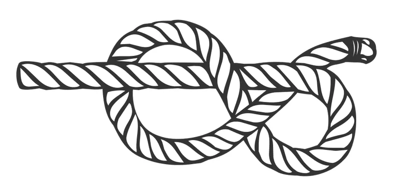
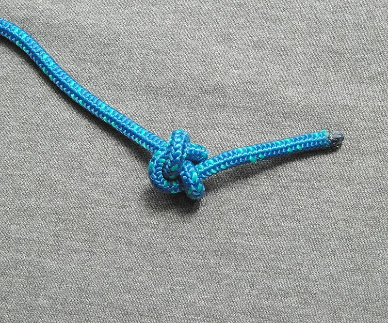
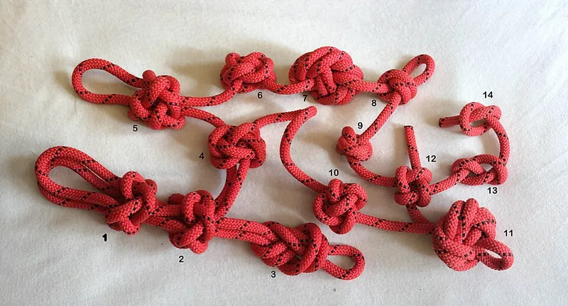

<figure class="eoc-pic eoc-pic-main"><figcaption><strong>Diagram.</strong> <a href="https://commons.wikimedia.org/wiki/File:Figure-eight_knot.svg">Figure-eight knot</a> by Lucasbosch, <a href="https://creativecommons.org/licenses/by-sa/3.0">CC BY-SA 3.0</a>, from Wikimedia Commons.</figcaption></figure>
<figure class="eoc-pic"><figcaption><strong>Photo.</strong> <a href="https://commons.wikimedia.org/wiki/File:Ashley-stopper-lead-ABOK-526.jpg">Ashley-stopper-lead-ABOK-526</a> by David J. Fred, <a href="https://creativecommons.org/licenses/by-sa/2.5">CC BY-SA 2.5</a>, from Wikimedia Commons.</figcaption></figure>
<figure class="eoc-pic"><figcaption><strong>Photo.</strong> <a href="https://commons.wikimedia.org/wiki/File:Decorative_Stopper_Knots.JPG">Decorative Stopper Knots</a> by Cobanyastigi, <a href="http://creativecommons.org/publicdomain/zero/1.0/deed.en">CC0</a>, from Wikimedia Commons.</figcaption></figure>

A knot, bead or crimped sleeve that is too big to fit through a hole, or a clamp or a few turns round a post that grips the cord, holds the end of a cord, string, elastic or thin cable in a part so it can be pulled without coming out.

**In plain words:** A fat knot, a squashed metal sleeve, a screw that pinches the string, or a few turns round a peg, used to stop the end of a cord, string, elastic or thin wire from pulling back out through a hole in a part. **Proper term:** Stopper knot and cord-end anchor (cord termination).

**Also called:** stopper, end knot or knob knot (a knot that makes a lump in the cord); overhand knot (ABOK #46; Wikipedia also lists #4, #514, #515, #519); figure-eight knot, figure-of-eight or Flemish knot (ABOK #570; Wikipedia also lists #420, #520); double overhand knot or barrel knot (ABOK #516); stevedore knot (ABOK #456, #522); Ashley stopper knot or oysterman's stopper (ABOK #526); EStar stopper (for very slippery rope such as Dyneema); knot pocket, counterbored knot recess or cord end cap (a printed recess or cap that hides the knot); crimp bead, crimp tube, stop sleeve or ferrule (a metal sleeve squashed onto the cord); string clamp under a bolt or washer (gm0: 'clamping a string with a bolt'); tie-off post or anchor peg (turns round a post, then tied off); underwriter's knot or electrician's knot (the stopper used inside lamp plugs; ABOK #237, #775).

## How it works

A stopper knot makes 'a fixed thicker point on an otherwise-uniform thickness rope' so that it cannot slip 'through a narrow passage, such as a hole' (Wikipedia 'Stopper knot'): pull on the cord and the knot jams against the back of the hole, and the plastic round the hole takes the load (shape, or [form-fit](../glossary.md#form-fit--force-fit--material-bond)). Bigger stoppers cover more of the hole's edge and hold in bigger holes; Ashley's stopper gives 'greater resistance to pulling through an opening than other common stoppers' (Wikipedia). A washer or bead behind the knot spreads the load over more plastic (gm0). A crimped sleeve does the same job for wire, fishing line or beading wire: the sleeve is squashed flat onto the cord so it grips by friction and makes a lump. A screw clamp presses the cord against the part, so it holds by friction and can be loosened to re-tension (gm0). Turns round a post use friction that grows exponentially with the angle of wrap (Wikipedia 'Capstan equation'), so the knot that finishes them off only carries a small part of the pull.

## Parts

Single piece or a few parts. Always: the cord and a hole, slot or post in the part. Optional: a washer or bead behind the knot to spread the load (gm0), a printed pocket or end cap to hide the knot (Printables 'Cord End Caps'), a metal crimp sleeve squashed with a crimping tool (Beadaholique; Nicopress), or a screw, washer and nut or a printed clamp plate that pinches the cord (gm0; Printables 'Paracord thimble and rope clamp').

## Everyday examples

- A drawstring or hoodie cord with a knot or a cord-end cap so it can't disappear into its channel (Printables 'Cord End Caps')
- Tent-pole shock cord tied off at the pole tip (NEMO: 'tie the cord back onto itself ... Pull the knot super tight to minimize slipping')
- A beaded necklace finished with a crimp bead squashed onto the wire (Beadaholique)
- A rope through a pulley block or a sailing line with a figure-eight in the end so it can't run out (Animated Knots; Wikipedia)

## When to use it

Whenever a cord, string, elastic or thin cable has to end at a part: drawstrings and toggles, guy lines finished behind a runner, elastic springs and shock cord in printed toys and tools, pull cords, robot tendons and string-driven slides, and bead or jewellery strings. A knot behind a hole is the simplest and cheapest option, needs no tools and can be retied; robot builders anchor tendons this way at the fingertip (Yale OpenHand T42: tendons run through routing ports, 'anchoring at the back of the fingertip'). Use a screw clamp where the tension needs setting and resetting (gm0), a crimp where the cord is wire or too slippery or thin to knot well (Nicopress; Beadaholique), and turns round a post where the load is high for the cord and you want the knot to carry little of it (Wikipedia 'Capstan equation').

## When not to use it

Never for anything that holds a person (climbing, rescue, swings, lifting): use rated hardware and trained methods. Not for steel wire rope carrying real load: use proper wire-rope terminations (clips, thimbles and swaged sleeves; see that entry). Not where the cord must be released quickly under load: use a cam cleat, clam cleat or cord lock. Not for slippery Dyneema-type cord with ordinary stoppers, which can slip (Animated Knots); use the EStar, a crimp or a clamp. Not for electrical cable strain relief in mains equipment unless the method is part of an approved design; that is the job of a cable [gland](../glossary.md#gland) or the product's own strain relief, and mains work must follow local law (see 'Cable gland and strain relief').

## Details

- **What it does (jobs):**
  - join and hold: anchors the end of a cord, string, elastic or thin cable to a part
  - tighten and hold tension: the clamp-under-a-bolt and turns-round-a-post versions let you pull the cord tight and lock it there; clamping 'makes it much easier to quickly change the tension of a string' (gm0)
- **Movement:** none: the cord end is fixed, though the cord can still swing or twist where it leaves the hole
- **Directions it can move (degrees of freedom):** 0 along the pull (the knot or clamp stops the cord moving out); a knotted cord can still turn about its own axis and swing at the hole, which is harmless for most uses.
- **Special behaviour:**
  - none: a stopper simply cannot fit through the hole; the clamp version can be loosened to re-tension the cord, which is an adjustment rather than a built-in behaviour
- **How it holds:**
  - shape (the parts interlock; form-fit): a knot, bead, washer or crimped sleeve that is bigger than the hole jams against it
  - friction or clamping (force-fit): a screw or clamp plate pinches the cord, a crimp sleeve grips by being squashed onto it, and turns round a post hold by rope friction (capstan effect)
- **Input and output:** not applicable: it anchors a cord end rather than passing motion on
- **Power:** passive (no power needed)
- **Load:** Light to medium, limited by the cord, which is weakest at the knot, and by the plastic round the hole. Strength figures differ, so here they are side by side: Animated Knots says 'assume that even brand new rope will perform at no more than 50% of its rated breaking strength' because of knots, kinks and imperfections; Yachting Monthly's tests at Marlow Ropes (2015) found a simple overhand knot cut the break load of 10 mm Dyneema and 12 mm polyester braid to '35 per cent of their ISO specification'. Wikipedia calls the figure-eight 'larger, stronger, and equally secure' compared with the overhand. Strong only in a straight pull along the cord; a cord cannot push, and a sideways pull drags it over the hole edge. A small printed hole can deform or crack before a strong cord breaks, especially with thin, hard cord such as Kevlar, which is why gm0 ties it round a washer ⚑ [uncertain: no source measured the pull-out force of a knot in a printed hole]. Never use a home-made knot or anchor to hold a person.
- **Play and precision:** Not a locating joint. Some length change: knots settle and tighten under the first heavy load, and stretchy cord or elastic lengthens under load, so allow slack and re-check tension after first use (Yale OpenHand T42 leaves 'enough tendon to leave slack after tying both ends' and then tensions with the servo pulley) ⚑ [uncertain: no source measures how much a knot settles].
- **Taking it apart:** removable for knots and screw clamps, permanent for crimps. The figure-eight 'doesn't bind; it can be undone easily' even after jamming against a block, and the stevedore 'is easier to untie than a Figure 8 Knot even after heavy loading', while the overhand 'can bind so tightly that it can be really difficult to undo' and the EStar 'cannot be untied after heavy loading' (Animated Knots). The overhand is 'very secure, to the point of jamming badly' and suits permanent ends (Wikipedia). Crimped sleeves have to be cut off.
- **How often it can be reused:** many times for knots and screw clamps (the cord wears and kinks at the hole first); once for crimped sleeves
- **Sealing:** none: nothing makes it seal
- **Adjustable:** Knots: no, retie to change the length. Screw clamp: yes, loosen, pull and retighten; 'clamping a string with a bolt instead of tying it around something makes it much easier to quickly change the tension' (gm0). Turns round a post: yes, unwrap and rewrap. Crimps: no.
- **Access needed:** both sides: usually you pass the cord through the hole and tie or crimp the stopper on the far side. A knot pocket or end cap on the near face, a clamp, or a post on the accessible face lets you work from one side only.
- **Materials:** Cords: natural fibre (cotton, jute), synthetic braided cord and paracord (nylon, polyester), very slippery high-modulus cord such as Dyneema (UHMWPE), which needs the EStar stopper or another non-slip knot (Animated Knots), elastic shock cord (NEMO tent-pole guide), fishing line, abrasive Kevlar string (gm0), beading wire (Beadaholique) and thin steel wire rope (Nicopress stop sleeves). Parts: printed PLA, PETG or TPU, wood, metal; PETG for outdoor use, PLA indoors (Printables 'Parametric Multi-Cord Anchor'; Prusa). Crimp sleeves are usually copper or aluminium ⚑ [uncertain: material named only in search-result summaries, not on an opened page].
- **Heat, cold, water and wear:** Water: natural fibre swells when wet and jams knots (Ashley's 'oysterman's stopper' turned out to be 'a badly water-swollen figure eight stopper knot', Wikipedia), and a loaded double overhand 'can be difficult to untie, especially when wet' (Wikipedia). Slippery modern fibres: Dyneema-type cord lets most stoppers slip; the EStar was the one Starzinger found held (Animated Knots). Repeated loading and vibration: 'Many knots can loosen with prolonged intermittent strain' (Animated Knots 'Safety'); the figure-eight 'can fall undone', while the Ashley stopper 'is far less prone to shake loose' (Animated Knots). Heat: a PLA part softens above about 60 °C (Prusa), so the hole can stretch and let the knot through in a hot car or in sunlight; PETG is better below about 80 °C (Prusa). Sunlight: PLA 'degrades under UV light' (Prusa); cord also weakens in the sun ⚑ [uncertain: no cord-maker page opened].

## Making it

- **Ways to make or get it:**
  - 3D print (FDM): holes, knot pockets, end caps, posts and screw-clamp plates print with the part (Printables models below)
  - 3D print (resin): the same features; resin parts are more [brittle](../glossary.md#brittle--ductile), so spread the load with a washer ⚑ [uncertain: no resin-specific source opened]
  - CNC or drilling: drill holes and round their edges; Yale OpenHand T42 drills its 1.5 mm tendon holes after printing
  - laser cut: holes and tie-off slots in sheet ⚑ [uncertain: no laser-cutting source opened]
  - off-the-shelf part: crimp beads and tubes, wire-rope stop sleeves, cord end caps, washers, beads
- **Printing it in one piece (print in place):** no: the hole, pocket, post or clamp prints with the part, but the cord is threaded, knotted, crimped or clamped afterwards
- **Tools:** None for knots. Scissors or a knife and, for synthetic cord, a flame to seal the cut end ('consider burning the edges', Printables 'Parametric Multi-Cord Anchor'); a thin wire hook to pull thin cord through holes (same model); a drill to open up small printed holes (Yale OpenHand T42 drills its tendon holes). Crimps: crimping pliers or flat-nose pliers for crimp beads (Beadaholique), or the matching Nicopress tool and its gauge for wire-rope stop sleeves (Nicopress). Clamps: a screwdriver or hex key for the screw (e.g. an M3 x 8 mm screw and nut in Printables 'Paracord thimble and rope clamp').
- **Difficulty:** easy: a hole and a knot; the only design choices are hole size, edge smoothing and how big a stopper the hole needs

### 3D printing tips

1) Hole size: make pass-through holes a little bigger than the cord so it threads easily but the knot can't follow; one parametric anchor uses 0.5 mm [clearance](../glossary.md#clearance) (a 3.5 mm hole for 3 mm cord) and 2 mm walls (Printables 'Parametric Multi-Cord Anchor'). Small holes print undersized, so drill them out if needed: the Yale OpenHand T42 drills its tendon holes to 1.5 +/- 0.5 mm after printing. 2) Smooth edges: a cord pulling round a sharp printed edge frays; T42 says 'minimize contact between tendon and ABS but ensure that tendon runs freely' and has you 'file down and deburr' bearing surfaces; [chamfer](../glossary.md#chamfer--fillet) or round the hole mouth on the side the knot sits. 3) Spread the load: for abrasive string such as Kevlar, 'tie the string around a washer to distribute the loads across the hole' instead of tying it straight into a hole in a plastic part (gm0); a bead behind the knot does the same for small cords ⚑ [uncertain: bead not tested by a source]. 4) Knot pockets and end caps: a recess or cap round the knot hides it and stops it snagging; one printed cord-end cap uses a 6 mm hole for paracord and drawstrings, with 'a small knot on the end' inside the main piece and a decorative cap threaded over it (Printables 'Cord End Caps'). Print pockets with the open end facing up, because printers 'can't print in mid-air' and only short bridges print without support (Prusa) ⚑ [uncertain: orientation is inferred from Prusa's general advice]. 5) Layer direction: the knot pushes on the plastic round the hole, so print with the hole axis vertical (the part lying flat) where you can, since FFF prints are 'stronger in one direction than another' (Prusa) ⚑ [uncertain: no test of knot pull-out versus orientation found]. 6) Screw clamps: a printed clamp plate with an M3 x 8 mm screw and a nut in a pocket pinches 4 mm paracord against a printed eyelet; tighten 1-2 turns, adjust the cord, then tighten fully, taking care 'not to squash the outer wrap of the cord between the closing edges' (Printables 'Paracord thimble and rope clamp'); a printed cable stop clamps a 3 mm cable with two M3 screws and nuts (Printables 'Cable Stop Clamp'). 7) Material: PETG for outdoor use, PLA indoors (Printables 'Parametric Multi-Cord Anchor'); PLA softens above about 60 °C and PETG is good below about 80 °C (Prusa), so a hot PLA part can let a knot pull through a softened hole. 8) Typical failures: hole too big (knot pulls through), hole too small or rough (cord won't thread or frays), a thin bridge behind the hole splitting along a layer line, and the knot shaking loose under vibration (pick a more secure stopper, below).

### Buying one (off-the-shelf parts)

Search for 'crimp beads' and 'crimp tubes' with 'crimping pliers' (jewellery and beading wire; Beadaholique), 'Nicopress stop sleeve' or 'wire rope stop sleeve' with its matching hand tool and gauge (Nicopress), 'fishing crimp sleeves' for monofilament ⚑ [uncertain: no fishing tackle page opened], 'cord end' or 'cord end cap' and 'cord lock' (drawstrings), 'fender washer' or 'penny washer' (large-diameter washers to spread the load) ⚑ [uncertain: washer types not named on an opened page], 'shock cord' and 'tent pole tips' (NEMO), and for Bowden-type cables 'barrel nipple' or 'cable end stop' (see the Bowden cable entry).

## Rules of thumb

- Use the bulkiest stopper the hole needs: the overhand (ABOK #46) is the smallest; the figure-eight (ABOK #570) is 'much better' than the overhand, but the double overhand (ABOK #516), stevedore (ABOK #456) and Ashley stopper (ABOK #526) 'all make better Stopper knots because they are larger and more stable' (Animated Knots, 'Figure 8 Knot').
- Four recommended stoppers and when to choose each (tying steps: Animated Knots and Wikipedia pages listed in sources): figure-eight (ABOK #570) when you want to undo it again easily, though it can 'fall undone'; stevedore (ABOK #456) when it must stay easy to untie after heavy loads; double overhand (ABOK #516) for a reliable lump you won't undo ('the preferred Stopper knot' for climbing); Ashley stopper (ABOK #526) for the biggest lump, when the hole is 'too large for the figure-eight' (Ashley, quoted by Wikipedia) or vibration might shake a figure-eight loose. Special cases: the plain overhand (ABOK #46) is the smallest and 'one of the few stopper knots that can be tied tightly up against an object', and the EStar is for very slippery rope, being the only stopper Evans Starzinger found 'did not slip in Dyneema' (Animated Knots).
- Strength, side by side: assume new rope gives 'no more than 50% of its rated breaking strength' because of knots and kinks (Animated Knots, 'Safety'); an overhand knot cut 10 mm Dyneema and 12 mm polyester braid to 35% of rated break load in Yachting Monthly's 2015 tests at Marlow Ropes.
- Leave a tail: when tightening a double overhand, 'be sure to leave some tail sticking out from the end of the knot' (Wikipedia 'Double overhand knot'); for the Ashley stopper the half knot 'MUST be pulled snug first' (Animated Knots).
- Tie abrasive string round a washer rather than straight into a hole in a plastic part (gm0 'Rigging').
- Clamp instead of tying when you will need to re-tension: 'Clamping a string with a bolt instead of tying it ... makes it much easier to quickly change the tension of a string' (gm0 'Rigging').
- Holes about 0.5 mm bigger than the cord, with 2 mm walls (Printables 'Parametric Multi-Cord Anchor').
- Wire-rope stop sleeves: 'Thread cable through sleeve so that it extends 1/8"', swage with 'the correct number of presses' and check each finished sleeve in the gauge supplied with the tool (Nicopress instructions).
- Turns round a post: the grip grows exponentially with the total angle of wrap and the friction coefficient, independent of the post's radius (Wikipedia 'Capstan equation'), so a few turns before the knot take most of the load off it.

## Common failures

Knot pulls through: the hole is too big or the plastic has softened or cracked; use a bulkier stopper (Ashley or double overhand), a washer or bead behind it (gm0), or a smaller hole. Cord breaks at the knot, its weakest point (Yachting Monthly; Animated Knots): use stronger cord or turns round a post to take load off the knot. Cord frays or is cut at the hole edge: chamfer, deburr and keep contact gentle (Yale OpenHand T42). Knot shakes loose: the figure-eight 'can fall undone' (Animated Knots); use a stevedore, Ashley or double overhand stopper. Knot jams and can't be undone: the overhand binds badly (Animated Knots; Wikipedia); use a figure-eight or stevedore if you'll want it off again. Slippery cord slides out: use the EStar stopper, a crimp or a clamp. Crimp slips: not pressed fully or wrong size; use the right tool and the gauge (Nicopress) and pull the loop to length before crimping, because afterwards 'the loop will be permanently fixed' (Beadaholique). Clamp crushes or cuts the cord, or the cord slides out from under it: don't let the cord get squashed between the closing edges (Printables 'Paracord thimble and rope clamp').

## Safety

Never trust a home-made knot, crimp or printed anchor to hold a person. 'Handle rope with care, inspect and test any knot you tie, and respect any rope subject to a heavy load' (Animated Knots 'Safety'). A tensioned elastic cord or string that slips its anchor whips back and can hit eyes or hands, so keep faces clear when testing ⚑ [uncertain: no source opened states this]. Cut ends of wire and crimped wire are sharp. When sealing synthetic cord ends with a flame, the melted plastic is hot and sticky and can burn ⚑ [uncertain]. The underwriter's knot is a stopper used inside mains plugs and lamp holders; this entry gives no mains wiring steps, and mains work must follow local law.

## Related

- Rope-end finishing (whipping, heat-sealing, back splice, aglet): stops the end fraying; a stopper knot stops it pulling through a hole
- Basic knots (overhand knot, half hitch, reef knot): the overhand is the simplest stopper
- Hitches to a post, rail, ring or eye: tie the cord round something instead of stopping it behind a hole
- Wire-rope terminations (wire-rope clip, thimble, crimped sleeve): the rated way to end steel wire rope
- Cord lock (spring toggle) and guy-line slider: grip a cord anywhere along its length instead of at the end; a guy-line slider still needs a stopper knot in the tail
- Bowden cable (push-pull cable): the inner wire ends in a metal nipple that sits in a slot in the lever (or in a clamp), the factory version of a stopper in a pocket
- Capstan cable drive and tendon-driven joint: cable anchors on drums and fingertips are stopper knots, crimps or clamps
- Cable gland and strain relief: the electrical version of anchoring a cable where it enters a part
- Elastic band and elastic cord springs, and shock-corded sectional poles: elastic cord anchored by knots behind holes
- Eyelets and grommets: reinforce a hole in fabric or sheet so a knot or cord doesn't tear through

## Make it yourself

- [Cord End Caps (Printables) (URL from Printables API, page not opened)](https://www.printables.com/model/1255334-cord-end-caps): Parametric Fusion 360 cord-end cap: the cord passes through a 6 mm hole with a small knot inside, then a decorative cap threads over it *(licence: CC BY)*
- [Paracord thimble and rope clamp (Printables) (URL from Printables API, page not opened)](https://www.printables.com/model/147775-paracord-thimble-and-rope-clamp): Printed eyelet and clamp plate that pinches 4 mm paracord with an M3 x 8 mm screw and nut; the maker says it is not for safety-relevant uses *(licence: CC BY-NC)*
- [Cable Stop Clamp (Printables) (URL from Printables API, page not opened)](https://www.printables.com/model/762828-cable-stop-clamp): A clamp-on stop for a 3 mm cable using two M3 screws and nuts, so the cable can't slide back through a clip *(licence: CC BY-SA)*
- [Parametric Multi-Cord Anchor (Hanging Hub) (Printables) (URL from Printables API, page not opened)](https://www.printables.com/model/1710271-parametric-multi-cord-anchor-hanging-hub): Parametric hub for 3-7 cords of 3-8 mm with 0.5 mm hole clearance and 2 mm walls; odd numbers of cords are secured with knots *(licence: CC BY-NC)*
- [Yale OpenHand Model T42 fabrication guide (PDF)](https://www.eng.yale.edu/grablab/openhand/model%20t42/Fabrication%20-%20Model%20T42%200.3.pdf): Open-source printed robot gripper; shows drilled tendon holes, tendon routing and tendons tied off at the back of the fingertips *(licence: Yale GRAB Lab open-source project; licence not stated in the PDF ⚑ [uncertain])*

## Pictures, videos and models

- [Stopper Knots (Animated Knots by Grog)](https://www.animatedknots.com/stopper-knots): Index of step-by-step animated stopper knots: overhand, figure-eight, double overhand, stevedore, Ashley, EStar and others, each with an ABOK reference and notes on uses *(licence: Animated Knots content; link only)*
- [Figure-eight knot (Wikimedia Commons)](https://commons.wikimedia.org/wiki/File:Figure-eight_knot.svg): Clear drawing of a figure-eight stopper knot *(licence: CC BY-SA 3.0 (Lucasbosch))*
- [Ashley stopper knot, ABOK #526 (Wikimedia Commons)](https://commons.wikimedia.org/wiki/File:Ashley-stopper-lead-ABOK-526.jpg): Photo of a finished Ashley stopper in the end of a line, showing its bulky three-lobed shape *(licence: CC BY-SA 2.5 (David J. Fred))*
- [Decorative stopper knots (Wikimedia Commons)](https://commons.wikimedia.org/wiki/File:Decorative_Stopper_Knots.JPG): Several stopper knots side by side, useful for comparing their size *(licence: CC0)*
- [Rigging (Game Manual 0, FTC robotics)](https://gm0.org/en/latest/docs/common-mechanisms/linear-motion-guide/rigging.html): Photos and diagrams of string-rigged robot slides, with tips on clamping string under a bolt and tying round a washer *(licence: CC BY-NC 2.0)*

## Needs confirming

⚑ marks something nobody has confirmed yet: a fact the research could not confirm from a source, a finder value that is a best guess, or an open point from the research notes. Corrections are welcome (see `research/needs-confirming.md`).

- ⚑ 14 sentences on this page marked [uncertain].
- ⚑ Finder value `usual_process` = by hand (tied or wrapped) (best guess): first-listed process was "3d print (fdm): holes, knot pockets, end"; knots family, so set to by hand (tied or wrapped)
- ⚑ Research note: *Stopper knots and cord-end anchors*: knot strength recorded side by side (Animated Knots 'at most 50%'; Yachting Monthly 2015 tests at Marlow Ropes, an overhand knot cut Dyneema and polyester braid to 35%). The figure-eight has three ABOK numbers in Wikipedia (#570, #420, #520).

## Sources

- <https://www.animatedknots.com/stopper-knots>
- <https://www.animatedknots.com/figure-8-knot>
- <https://www.animatedknots.com/overhand-knot>
- <https://www.animatedknots.com/stevedore>
- <https://www.animatedknots.com/ashley-stopper-knot>
- <https://www.animatedknots.com/double-overhand-stopper-knot>
- <https://www.animatedknots.com/estar-stopper-knot>
- <https://www.animatedknots.com/safety>
- <https://en.wikipedia.org/wiki/Stopper_knot>
- <https://en.wikipedia.org/wiki/Figure-eight_knot>
- <https://en.wikipedia.org/wiki/Overhand_knot>
- <https://en.wikipedia.org/wiki/Ashley%27s_stopper_knot>
- <https://en.wikipedia.org/wiki/Stevedore_knot>
- <https://en.wikipedia.org/wiki/Double_overhand_knot>
- <https://en.wikipedia.org/wiki/Underwriter%27s_knot>
- <https://en.wikipedia.org/wiki/Capstan_equation>
- <https://gm0.org/en/latest/docs/common-mechanisms/linear-motion-guide/rigging.html>
- <https://gm0.org/en/latest/docs/appendix/license.html>
- <https://www.yachtingmonthly.com/sailing-skills/strongest-sailing-knot-30247 (Chris Beeson, 'What is the strongest sailing knot?', Yachting Monthly, 2015)>
- <https://www.eng.yale.edu/grablab/openhand/model%20t42/Fabrication%20-%20Model%20T42%200.3.pdf>
- <https://www.nicopress.com/media/documents/Nicopress_Instruction_32_Metric_05-12.pdf>
- <https://beadaholique.com/blogs/techniques-guides/how-to-use-crimp-beads>
- <https://www.nemoequipment.com/blogs/journal/easy-fix-tent-pole-shock-cord-needs-replacing>
- <https://help.prusa3d.com/article/modeling-with-3d-printing-in-mind_164135>
- <https://help.prusa3d.com/article/pla_2062>
- <https://help.prusa3d.com/article/petg_2059>
- <https://commons.wikimedia.org/wiki/File:Figure-eight_knot.svg>
- <https://commons.wikimedia.org/wiki/File:Ashley-stopper-lead-ABOK-526.jpg>
- <https://commons.wikimedia.org/wiki/File:Decorative_Stopper_Knots.JPG>
- <https://api.printables.com/graphql/ (Printables models 1255334 'Cord End Caps', 147775 'Paracord thimble and rope clamp', 147380 'quick Paracord rope clamp 4mm & thimble', 762828 'Cable Stop Clamp', 1710271 'Parametric Multi-Cord Anchor (Hanging Hub)', 603958 'Cord end'; pages not opened)>
