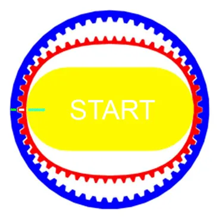
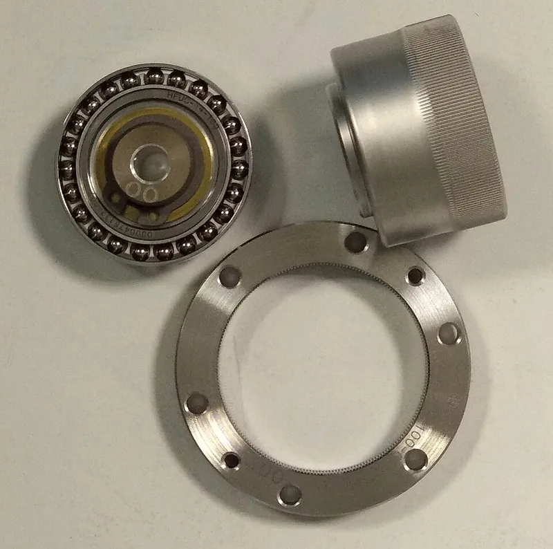
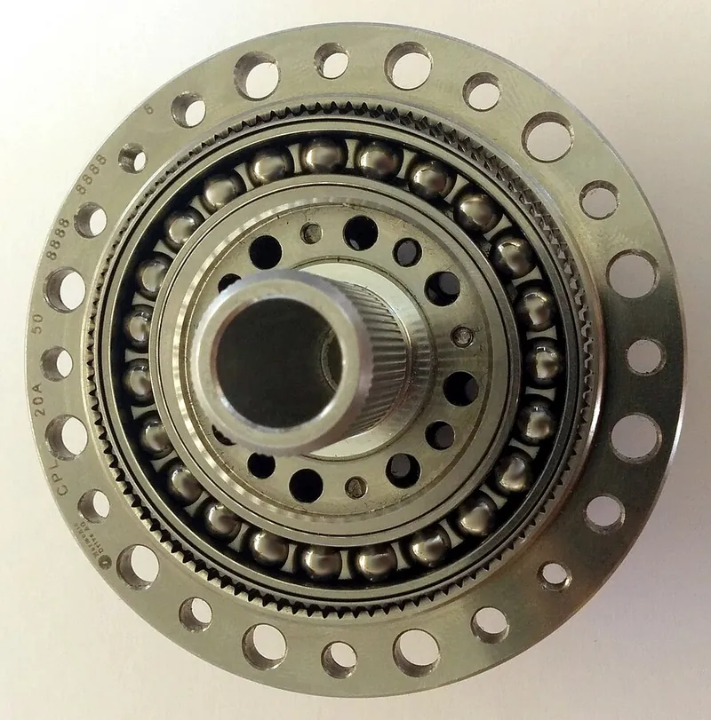

<figure class="eoc-pic eoc-pic-main"><picture><source media="(prefers-reduced-motion: reduce)" srcset="../media/strain-wave-gear.still.webp"></picture><figcaption><strong>Animation.</strong> <a href="https://commons.wikimedia.org/wiki/File:Harmonic-drive-explanation.gif">Harmonic-drive-explanation</a> by LaurensvanLieshout, <a href="https://creativecommons.org/licenses/by-sa/3.0">CC BY-SA 3.0</a>, from Wikimedia Commons.</figcaption></figure>
<figure class="eoc-pic"><figcaption><strong>How it works.</strong> <a href="https://commons.wikimedia.org/wiki/File:Harmonic_Drive_AG_strain_wave_gear_set.jpg">Harmonic Drive AG strain wave gear set</a> by Pieceofmetalwork, <a href="https://creativecommons.org/licenses/by-sa/4.0">CC BY-SA 4.0</a>, from Wikimedia Commons.</figcaption></figure>
<figure class="eoc-pic"><figcaption><strong>Photo.</strong> <a href="https://commons.wikimedia.org/wiki/File:Harmonic_Drive.jpg">Harmonic Drive</a> by wdwd, <a href="https://creativecommons.org/licenses/by-sa/4.0">CC BY-SA 4.0</a>, from Wikimedia Commons.</figcaption></figure>

An oval cam with a thin bearing (wave generator) bends a thin-walled toothed sleeve (flexspline) into an oval so its teeth mesh with a rigid internal-toothed ring (circular [spline](../glossary.md#spline)) at two points; because the sleeve has two fewer teeth, each turn of the cam shifts it by two teeth, giving a 30:1 to over 300:1 backlash-free reduction in one flat stage.

**In plain words:** A flat gearbox where a spinning oval part squashes a thin, bendy toothed ring so its teeth catch inside a slightly bigger toothed ring at two points; as the oval spins, the bendy ring [creeps](../glossary.md#creep) round a couple of teeth per turn, giving a huge slow-down with no wobble or play. **Proper term:** Strain-wave gear (strain wave gearing; harmonic drive).

**Also called:** harmonic drive (Harmonic Drive is a brand of Harmonic Drive LLC / Harmonic Drive SE, but the name is widely used for the type); harmonic gear / harmonic gearing; harmonic reducer / harmonic gearbox; strain wave gear / strain wave gearbox; wave gear; flexspline gear (after its flexible part); cup type, silk hat (hat) type and pancake type harmonic gears (variants named after the flexspline's shape); chain harmonic drive (a roller chain used in place of the flexible gear, shown by Nguyen Duc Thang); Wellengetriebe (German).

## How it works

The flexspline is round when relaxed and has slightly fewer teeth (usually two fewer) than the rigid ring around it. The oval wave generator inside it stretches it into an oval, so its teeth mesh fully with the ring only at the two ends of the long axis. As the motor turns the oval, the two meshing zones travel round like a wave, and after one full turn the flexspline has shifted by only the two-tooth difference relative to the ring. With the ring fixed, the flexspline (the output) therefore turns once for every (flexspline teeth / 2) turns of the motor, in the opposite direction.

## Parts

A small assembly that acts as one unit, with three main parts: the wave generator (an oval hub with a thin-raced ball bearing, or bearings or balls round an oval plug, on the motor shaft), the flexspline (a thin, flexible cup, hat or sleeve with teeth on the outside) and the circular spline (a rigid ring with internal teeth). Pancake types add a second ring (dynamic spline). Plus output bearings, a housing, often an Oldham coupling on the motor shaft, and grease.

## Everyday examples

- Robot arm joints in factories and research labs (Wikipedia; RoyMech)
- The wheels of NASA's Apollo 15 Lunar Roving Vehicle, each driven through an 80:1 harmonic drive (Wikipedia)
- Medical equipment such as patient beds and MRI gantries, and aerospace parts such as antennas and the Hubble Space Telescope (RoyMech)
- DIY 3D-printed telescope mounts, e.g. the Keen-One harmonic drive equatorial mount shared on Printables

## When to use it

Use it when you need a big slow-down with no play in a thin, light package, with the output in line with the motor, for example a robot arm joint, a camera or telescope mount, a pointing antenna or a precise rotary table. It gives very fine, repeatable positioning from a small motor, and can have a hollow centre for cables.

## When not to use it

Avoid it for low ratios (below about 30:1) or where you need the joint to be easy to push backwards (compliant or quasi-direct-drive robot legs): use a planetary or low-ratio cycloidal drive instead (Roozing and Roozing 2022). Avoid it for high power (over about 6 kW, RoyMech), for efficiency-critical continuous drives, or where shocks and overloads are frequent; a cycloidal drive handles shock better. Don't rely on it to hold a load; add a brake. If you want an easy first printed high-ratio gearbox, a split-ring planetary or cycloidal drive is more forgiving to print.

## Details

- **What it does (jobs):**
  - change speed or turning force: a very large slow-down and [torque](../glossary.md#torque) increase (typically 30:1 to 320:1) in one flat, in-line stage, with almost no play
- **Movement:** rotate: continuous rotation in at the wave generator, much slower continuous rotation out at the flexspline (or circular spline), on the same axis; unlimited range, either direction
- **Directions it can move (degrees of freedom):** 1: with one spline held by the housing, turning the wave generator is the only independent motion; the output is tied to it by the tooth counts (all three parts free would make it a differential with 2 inputs)
- **Special behaviour:**
  - none of the listed behaviours: its special property is near-zero [backlash](../glossary.md#backlash) (play) with a very high ratio. It is not reliably [self-locking](../glossary.md#self-locking): industrial units can be turned from the output once a 'backdriving torque' is exceeded, and the maker says a [fail-safe](../glossary.md#fail-safe--fail-secure) brake must be used to hold a load (Harmonic Drive CSF/CSG catalogue); some printed ones are reported as not back-drivable (cTallakson on Printables)
- **How it holds:**
  - not a holding joint (it moves or passes on motion): it transmits rotation
  - shape (the parts interlock; [form-fit](../glossary.md#form-fit--force-fit--material-bond)): the turning force passes through meshing teeth, held in mesh by the wave generator bending the flexspline
- **Input and output:** Continuous rotation -> much slower continuous rotation, shafts in line ([coaxial](../glossary.md#coaxial)); a hollow centre is possible. Ratio: with the circular spline fixed and the flexspline as output, reduction = flexspline teeth / (circular spline teeth - flexspline teeth), output turning the opposite way (Wikipedia: 200 and 202 teeth give 100:1); with the flexspline fixed and the circular spline as output, reduction = circular spline teeth / tooth difference, same direction (Wikipedia's second formula; Nguyen Duc Thang's chain versions show both cases). Single-stage range 30:1 to 320:1 (Wikipedia) or 30:1 to 350:1 (RoyMech); low ratios are limited by flexspline [fatigue](../glossary.md#fatigue) (RoyMech). Efficiency: about 70% for large-duty units (RoyMech); it depends on ratio, input speed, load, temperature and lubricant, and drops at loads below rated torque (Harmonic Drive catalogue); Roozing and Roozing (2022) note harmonic drives are 'very inefficient at low speeds and torques'. Back-drivable: yes once the backdriving torque is exceeded, but it is not dependable either way, so never rely on it to hold a load (Harmonic Drive catalogue).
- **Power:** passive (no power needed). When it is driven by a motor and power is lost, a load may turn it backwards once the backdriving torque is exceeded, so the maker says to add a fail-safe brake where the load must be held
- **Load:** medium to heavy for its size: industrial units carry high torque for their weight (RoyMech: under 50% of the weight of a conventional gearbox) but are 'not suitable for high power levels above 6 kW' (RoyMech), and their rated torque is set by flexspline fatigue (Harmonic Drive catalogue). Printed examples: about 4 Nm (Brian Brocken, TPU flexspline), 10 Nm repeatedly (3DprintedLife, PLA) and about 35 Nm theoretical (HasslerEngineering, PETG). Weak against overloads while turning (the teeth skip, called ratcheting) and against side loads on the output unless it has its own bearings (Luke's compact 44:1 design needs an extra output bearing).
- **Play and precision:** None to very small backlash: the maker says the gear mesh has zero backlash, though the usual Oldham coupling on the motor shaft adds a small amount (Harmonic Drive catalogue). It is springy in twist at low torque (torsional 'wind-up', Wikipedia) and shows a little [hysteresis](../glossary.md#hysteresis). Very good [repeatability](../glossary.md#repeatability--accuracy) and resolution (Harmonic Drive; RoyMech). Printed versions have some play, e.g. from triangular teeth (HasslerEngineering). It tolerates little [misalignment](../glossary.md#misalignment): the three parts must stay concentric and square to each other, and an off-centre assembly ('dedoidal') causes noise, vibration and early failure (Harmonic Drive installation guide and catalogue); the Oldham coupling absorbs small motor-shaft misalignment.
- **Taking it apart:** removable: the component set (wave generator, flexspline, circular spline) bolts into a housing and can be taken apart; printed versions are screwed together. [Print-in-place](../glossary.md#print-in-place) demos are the exception
- **How often it can be reused:** many times: it can be dismantled and reassembled; the real limit is flexspline fatigue, and reassembly must be concentric (off-centre assembly causes early failure)
- **Sealing:** none: the gear itself seals nothing; industrial housed units use seals, gaskets or sealant to keep grease and separated oil in (Harmonic Drive installation guide)
- **Adjustable:** No: the ratio is fixed by the tooth counts and there is nothing to adjust in use; the fit is set at design time (printed designs are tuned by changing the flexspline's size and the wave generator's shape)
- **Access needed:** not applicable: it is a self-contained gearbox mounted on the motor; you reach it wherever its housing opens
- **Materials:** Industrial: an alloy steel flexspline cup, steel circular spline and a special thin-raced ball bearing on an oval steel hub (Harmonic Drive), run in grease or oil. Printed: the flexspline is the hard part and makers disagree: TPU worked for Brian Brocken (after his PLA flexspline exploded) and for Roland Daum (TPU flexspline, PLA+ for the other parts), PETG worked for HasslerEngineering (0.75 mm wall), eveve05 and Luke, nylon for Unnecessary Automation (who found PLA 'too stiff and will break' and 95A TPU 'too flexible'); OddHatter used PLA+ at 100% [infill](../glossary.md#infill) but expected PETG to be better. Rigid parts (circular spline, housing) in PLA, PLA+ or ABS, with ball bearings, bearing balls and steel screws.
- **Heat, cold, water and wear:** Heat: keep lubricating oil under 90 °C, and efficiency falls in the cold as the grease thickens (Harmonic Drive catalogue). Printed parts: PLA softens above about 60 °C and PETG is rated for use below about 80 °C (Prusa). Fatigue: the flexspline bends twice every input turn, so it eventually cracks or, when printed, delaminates (Harmonic Drive catalogue; HasslerEngineering). ⚑ [uncertain] Soft TPU flexsplines may slip or lose grip more as they warm up and age.

## Making it

- **Ways to make or get it:**
  - off-the-shelf part: industrial component sets and housed units (the usual choice for precise robot joints)
  - 3D print (FDM): popular DIY builds for NEMA 17 steppers, telescope mounts and robot joints; flexspline in TPU, PETG or nylon
  - 3D print (resin): ⚑ [uncertain] no tested resin build was found
  - CNC: industrial parts are precision machined steel
- **Printing it in one piece (print in place):** yes, for demos: eveve05's 'Harmonic drive (print in place)' is a 19:1 set (38-tooth ring, 36-tooth flexible gear) printed already assembled in PETG. Working gearboxes are printed as separate parts and assembled with bearings, balls and screws.
- **Tools:** Hex keys or a screwdriver for mounting and housing screws; grease; for printed versions often a soldering iron for [heat-set inserts](../glossary.md#heat-set-insert) and a vice or press for bearings. Print-in-place demos need none beyond perhaps a 6 mm hex key to turn the input (eveve05).
- **Difficulty:** hard: industrial units are expensive precision parts, and printed ones need a well-calibrated printer, fine nozzles or layers, and several tries to get the flexspline's material, wall thickness and fit right; buy one for serious loads

### 3D printing tips

1) Choose the flexspline material carefully, and expect to experiment: Brian Brocken's PLA flexspline 'made a few weird noises and pretty much exploded', while TPU worked once the fit was tightened; HasslerEngineering prints the whole gearbox in PETG with a 0.75 mm flexspline wall; Unnecessary Automation prints the flex gear in nylon and found PLA too stiff and 95A TPU too flexible. 2) Make a TPU flexspline tall (long) enough: Jared Fenster found an 8 mm tall TPU flexspline could not drag the rest of itself round and planned 20 mm. 3) Give the wave generator enough contact: Brocken went from 4 to 6 bearings to stop a TPU flexspline slipping; other designs roll a ring of bearing balls round an oval plug (ZeroBacklash; Unnecessary Automation uses 20 x 4 mm balls). Luke found the flexspline deforms into gaps between supports at high load, so support it along the whole oval. 4) Use the usual two-tooth difference (e.g. 50/48, 38/36, 62/60) and keep the teeth small: Luke prints the flexspline and splines with a 0.25 mm nozzle at 0.12 mm layers, Roland Daum at 0.1 mm layers. 5) Calibrate first: Luke stresses tuning flow, pressure or linear advance and the filament's shrink factor, because 'that makes the difference between success and failure'; Roland Daum's model is drawn with about +/-0.25 mm [tolerances](../glossary.md#tolerance) for an Ender 3 V3 SE. 6) Print the flexspline and wave generator solid (OddHatter used 100% infill); the housing can be 20% infill. 7) Hold the output in ball bearings so the circular spline stays round and can't be pulled out (Luke). 8) Grease the teeth and the wave generator. 9) For TPU, print slowly (Prusa suggests about 20 mm/s, 30-40 mm/s at most) with little or no retraction. 10) Expect fatigue: bending the flexspline twice per input turn wears it out, and HasslerEngineering reports layer separation (delamination), so print spares and test under the real load.

### Buying one (off-the-shelf parts)

Harmonic drive component sets (cup type, silk hat type, pancake type with dynamic spline) and housed gear units, specified by size and ratio (e.g. Harmonic Drive CSF/CSG series (brand)); Oldham couplings; thin-section and deep-groove ball bearings (e.g. 6810-2RS, 606ZZ, 623ZZ, 6805, 6000 series, 7 x 14 x 5 mm); loose bearing balls (e.g. 4 mm, or 6 mm Airsoft BBs in one printed design); NEMA 17 or NEMA 23 steppers or small 28BYJ-48 steppers; heat-set inserts and M3 screws; gear grease.

## Rules of thumb

- The flexspline normally has two fewer teeth than the circular spline, so each turn of the wave generator moves it by two teeth (Harmonic Drive LLC technology page; RoyMech).
- Ratio (circular spline fixed, flexspline output) = flexspline teeth / tooth difference, output reversed; e.g. 200 and 202 teeth give 100:1 (Wikipedia, 'Strain wave gearing'). RoyMech gives the similar example 80/(80-78) = 40:1.
- Single-stage ratios are about 30:1 to 320:1 (Wikipedia) or 30:1 to 350:1 (RoyMech); ratios below about 30:1 are limited by flexspline fatigue (RoyMech), and low-ratio harmonic drives are hard to make and inefficient at low speeds and torques (Roozing and Roozing 2022).
- Efficiency is about 70% for large-duty units (RoyMech) and depends on ratio, input speed, load torque, temperature and lubricant, falling when the load is below rated torque (Harmonic Drive CSF/CSG catalogue).
- Not suitable above about 6 kW (RoyMech).
- Rated and repeated-peak torques are based on infinite flexspline fatigue life; excessive torque while running makes the teeth skip (ratcheting), which can leave the flexspline off-centre ('dedoidal') and lead to fatigue failure (Harmonic Drive CSF/CSG catalogue).
- The S tooth profile puts up to 30% of the teeth in contact, against 15% for the traditional profile, roughly doubling [stiffness](../glossary.md#stiffness) at low and mid torque (Harmonic Drive CSF/CSG catalogue).
- Backdriving torque should not be relied on to hold the output; use a fail-safe brake (Harmonic Drive CSF/CSG catalogue).
- Keep oil temperature below 90 °C, above which it quickly loses its lubricating ability (Harmonic Drive CSF/CSG catalogue).

## Common failures

1) A PLA or too-stiff flexspline cracks or bursts: use TPU, PETG or nylon with a suitable wall thickness (Brocken; Unnecessary Automation; HasslerEngineering). 2) A soft flexspline slips or skips teeth (ratcheting) under load: tighten the fit, add wave-generator contact points, make the flexspline taller or choose a stiffer material (Brocken; Fenster; Unnecessary Automation). 3) Industrial units overloaded while running [ratchet](../glossary.md#ratchet), end up off-centre (dedoidal), vibrate and fail early: keep torque below the ratcheting and peak ratings (Harmonic Drive catalogue). 4) Flexspline fatigue or layer separation after many cycles (HasslerEngineering). 5) Worn wave-generator sliding surfaces: use proper ball bearings rather than sliding contact (HasslerEngineering's earlier versions). 6) Noise and early wear from poor concentricity, burrs or dirt during assembly (Harmonic Drive installation guide).

## Safety

It is not a brake: the maker says a fail-safe brake must hold the load. The big torque multiplication means a small motor can crush fingers or break parts. A [brittle](../glossary.md#brittle--ductile) printed flexspline can shatter under load (Brian Brocken's PLA one 'pretty much exploded'), so wear eye protection when testing ⚑ [uncertain].

## Related

- Split-ring (Wolfrom) compound planetary gearbox: gets a similar huge ratio from two rings with slightly different tooth counts, using rigid gears only; easier to print, but less efficient and with more play
- Cycloidal drive: a lobed disc wobbling in a ring of pins; lower ratio per stage; Roozing and Roozing (2022) describe cycloidal drives as shock-robust, stiff, strong and efficient, and harmonic drives as very inefficient at low speeds and torques; printed cycloidal drives can be easy to back-drive
- Planetary gearbox: efficient and back-drivable at low ratios but needs several stages and has more play for big ratios
- Worm drive: also a big ratio in one step, but at right angles, less efficient and often self-locking
- Chain harmonic drive: the same wave idea with a roller chain and [linkage](../glossary.md#linkage) instead of a flexible gear (Nguyen Duc Thang)
- Nested or multi-stage strain-wave gearboxes: stages stacked for extreme ratios (e.g. 'Nested Strain Wave Gearbox' on Printables)

## Make it yourself

- [Harmonic drive (print in place) (eveve05, Printables) (URL from Printables API, page not opened)](https://www.printables.com/model/273061-harmonic-drive-print-in-place): 19:1 demo printed already assembled: 38-tooth outer ring, 36-tooth flexible gear and oval wave generator; tested in PETG, turned with a 6 mm hex key *(licence: CC BY)*
- [Strain Wave Gearbox (Unnecessary Automation, Printables) (URL from Printables API, page not opened)](https://www.printables.com/model/1098371-strain-wave-gearbox): 20:1 printable gearbox for a NEMA 17 stepper with a nylon flex gear and a ball-type wave generator (20 x 4 mm balls) *(licence: CC BY-NC-SA)*
- [NEMA 17 Harmonic Drive; Strain Wave Gear; Ratio ~49:1 (Roland Daum, Printables) (URL from Printables API, page not opened)](https://www.printables.com/model/1355057-nema-17-harmonic-drive-strain-wave-gear-wellengetr): Printable 49:1 gearbox with a TPU flexspline and PLA+ parts, six 7 x 14 x 5 bearings, 0.1 mm layers *(licence: Creative Commons Public Domain (as listed by Printables))*
- [Compact 44:1 Harmonic Drive (Luke, Printables) (URL from Printables API, page not opened)](https://www.printables.com/model/467181-compact-441-harmonic-drive): Very compact NEMA 17 harmonic drive with a PETG flexspline printed with a 0.25 mm nozzle; detailed calibration advice and an improved wave generator *(licence: CC BY-NC-SA)*
- [3D-printable strain wave gearbox - harmonic drive (Brian Brocken, Hackaday.io)](https://hackaday.io/project/187309-3d-printable-strain-wave-gearbox-harmonic-drive/details): Build log of a 50/48-tooth printed strain wave gearbox with belt drive (about 54:1 total, about 4 Nm), including the PLA-to-TPU flexspline change *(licence: not stated)*
- [HUANGYAN920 Mechanical: interactive mechanism animations (harmonic reducer entry in the gear mechanisms section)](https://huangyan920.github.io/Mechanical/): Browser-based parametric animation of a harmonic reducer among 257 mechanisms; check any numbers against a design guide *(licence: MIT)*

## Pictures, videos and models

- [Harmonic-drive-explanation.gif (Wikimedia Commons, by LaurensvanLieshout)](https://commons.wikimedia.org/wiki/File:Harmonic-drive-explanation.gif): Animation of a harmonic drive with marks added to explain how the flexspline creeps round relative to the ring *(licence: GFDL 1.2 or later / CC BY-SA 3.0, 2.5, 2.0, 1.0 (choose one))*
- [Harmonic drive animation.gif (Wikimedia Commons, by LaurensvanLieshout)](https://commons.wikimedia.org/wiki/File:Harmonic_drive_animation.gif): Simple animation of the oval wave generator, flexspline and circular spline turning *(licence: GFDL 1.2 or later / CC BY-SA 3.0, 2.5, 2.0, 1.0 (choose one))*
- [Strain Wave Gear Technology (Harmonic Drive LLC)](https://www.harmonicdrive.net/technology/harmonicdrive): Manufacturer's illustrated explanation of the wave generator, flexspline and circular spline and the two-tooth creep *(licence: link only)*
- [My 3D Printed Harmonic Drive is Surprisingly Powerful! (3DprintedLife, YouTube; linked from Hackaday, title checked via YouTube oEmbed)](https://www.youtube.com/watch?v=Emvo3bLT-Z4): Building, test-rig tuning and torque testing of a printed harmonic drive (about 10 Nm) on a NEMA 23 stepper *(licence: link only (standard YouTube licence))*
- [Chain harmonic drive 1 (Nguyen Duc Thang, YouTube thang010146; title checked via YouTube oEmbed)](https://www.youtube.com/watch?v=VsDJqDnqbw8): CAD animation of an oval wave generator driving a closed roller chain round a 30-tooth gear; Thang notes that merging the chain into one flexible part gives the familiar harmonic drive *(licence: link only (standard YouTube licence))*

## Needs confirming

⚑ marks something nobody has confirmed yet: a fact the research could not confirm from a source, a finder value that is a best guess, or an open point from the research notes. Corrections are welcome (see `research/needs-confirming.md`).

- ⚑ 3 sentences on this page marked [uncertain].

## Sources

- <https://en.wikipedia.org/wiki/Strain_wave_gearing>
- <https://commons.wikimedia.org/wiki/Category:Harmonic_drives>
- <https://commons.wikimedia.org/wiki/File:Harmonic-drive-explanation.gif>
- <https://commons.wikimedia.org/wiki/File:Harmonic_drive_animation.gif>
- <https://www.harmonicdrive.net/technology/harmonicdrive>
- <https://www.harmonicdrive.net/technology/installation-considerations>
- <https://www.harmonicdrive.net/_hd/content/documents/csf-csg.pdf>
- <https://roymech.org/Useful_Tables/Drive/Harmonic_Gears.html>
- <https://ris.utwente.nl/ws/portalfiles/portal/295490006/3D_printable_low_reduction_cycloidal_gearing_for_robotics.pdf>
- <https://hackaday.io/project/187309-3d-printable-strain-wave-gearbox-harmonic-drive/details>
- <https://hackaday.com/2021/05/24/a-high-torque-3d-printed-harmonic-drive/>
- <https://hackaday.com/2022/10/31/3d-printed-strain-wave-gearbox/>
- <https://hackaday.io/project/196387-strain-wave-gear-robotic-joint/log/231133-flexspline-solved>
- <https://hackaday.io/project/120377-3d-printed-strain-wave-gear>
- <https://www.youtube.com/watch?v=Emvo3bLT-Z4>
- <https://www.youtube.com/watch?v=VsDJqDnqbw8>
- <https://cs448m.github.io/lectures/machines/doc/1.pdf>
- <https://huangyan920.github.io/Mechanical/>
- <https://raw.githubusercontent.com/HUANGYAN920/Mechanical/main/README.md>
- <https://raw.githubusercontent.com/HUANGYAN920/Mechanical/main/LICENSE>
- <https://api.printables.com/graphql/>
- <https://help.prusa3d.com/article/pla_2062>
- <https://help.prusa3d.com/article/petg_2059>
- <https://help.prusa3d.com/article/flexible-materials_2057>
