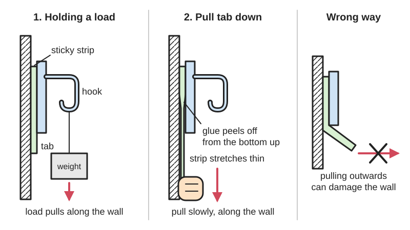
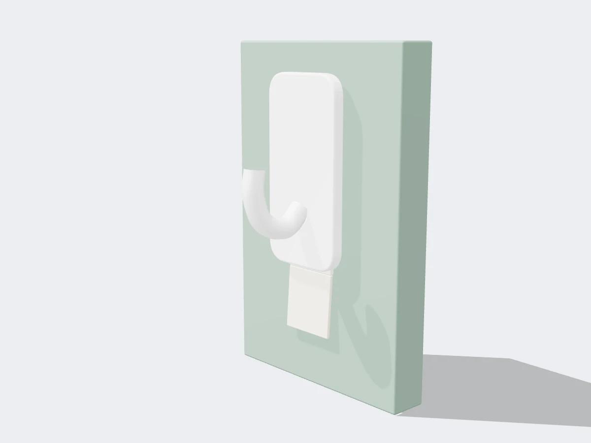
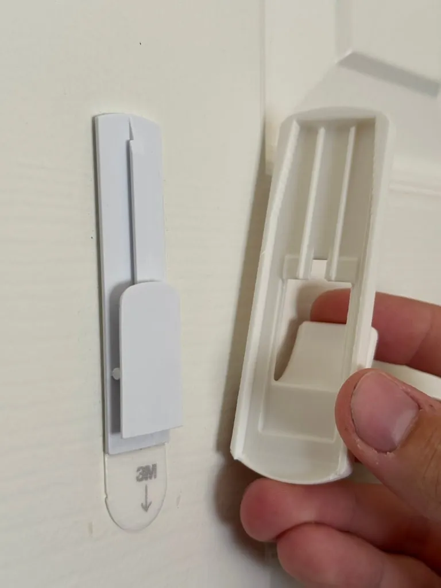
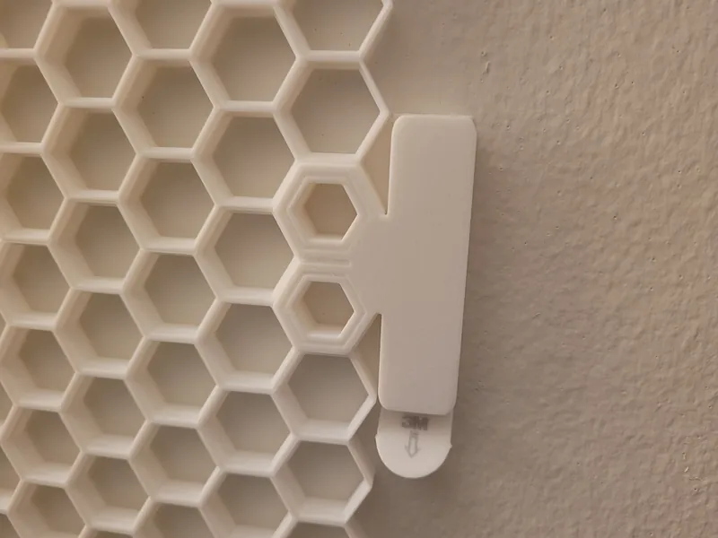

<figure class="eoc-pic eoc-pic-main"><figcaption>Diagram drawn for the encyclopaedia from the research notes. ⚑ Needs confirming: a drawing can simplify or get details wrong; a real photo or a better diagram is welcome.</figcaption></figure>
<figure class="eoc-pic"><figcaption><strong>Render.</strong> A 3D model made for the encyclopaedia, not a photo: a real photo is also shown. ⚑ Needs confirming: a model can simplify or get details wrong.</figcaption></figure>
<figure class="eoc-pic"><figcaption><strong>How it works.</strong> <a href="https://www.printables.com/model/1006631-replacement-command-hook-large-5lb">Replacement Command Hook (Large, 5lb)</a> by James Lovett, <a href="https://creativecommons.org/licenses/by-sa/4.0/">CC BY-SA 4.0</a>, from Printables.</figcaption></figure>
<figure class="eoc-pic"><figcaption><strong>Photo.</strong> <a href="https://www.printables.com/model/266346-honeycomb-3m-command-strip-mount-wall-double-hollo">Honeycomb 3M Command Strip Mount + Wall Double Hollow Insert</a> by Spatula, <a href="https://creativecommons.org/licenses/by/4.0/">CC BY 4.0</a>, from Printables.</figcaption></figure>

A stretch-release strip is a double-sided pressure-sensitive adhesive on a very stretchy backing that holds strongly while the load pulls along the wall, but lets go cleanly and without residue when its tab is pulled slowly and parallel to the surface.

**In plain words:** A double-sided sticky strip with a non-sticky pull tab: it holds a hook or picture firmly on the wall, and when you want it off you pull the tab slowly straight down along the wall so the strip stretches like chewing gum and lets go, leaving no marks. **Proper term:** Stretch-release adhesive strip (stretch-releasing pressure-sensitive adhesive tape).

**Also called:** stretch release adhesive, stretch release tape, stretch-releasing adhesive tape (iFixit; 3M and tesa product sheets; patents); redetachable adhesive strips, 'redetachable without residue or destruction by extensive stretching in the bond plane' (tesa patent US 6,905,100); removable adhesive strips, damage-free hanging strips, adhesive refill strips (3M and tesa product pages); pull-tab adhesive, battery pull tabs (phones and laptops; iFixit); debonding on demand (tesa's industrial term) (tesa stretch release tapes page); Command strips, Command hooks, Command Picture Hanging Strips (brand, 3M) (3M product information sheet; arXiv paper); tesa Powerstrips, Powerstrips CLICK, tesa adhesive nails (brand, tesa); Bond & Detach (tesa industrial brand) (tesa pages).

## How it works

The strip is a soft, sticky rubber (a pressure-sensitive adhesive, typically a styrene block-copolymer or synthetic rubber; silicone in the water-resistant 3M version) that wets both surfaces when pressed, on a highly stretchable backing such as polyethylene foam (tesa patent US 6,905,100; 3M Command product information sheets; tesa Powerstrips FAQ). A hanging weight loads the whole bonded area in shear, so a thin strip can carry a lot. When you pull the tab straight along the wall, the strip stretches enormously and gets thinner, and the stretching [peels](../glossary.md#peel-vs-shear) the glue away from the wall and the back plate a little at a time, like two cracks running along the strip; because the glue holds together better than it holds onto the wall, it comes away in one piece without leaving residue (arXiv 2607.11650; 3M scientist Margaret Sheridan quoted by iFixit). A fracture-mechanics analysis found that the ratio of the maximum load to the removal force grows with the ratio of bonded length to adhesive thickness, which is very large, so the strip can hold a heavy load yet still be removed with a gentle pull (arXiv 2607.11650).

## Parts

A few parts: the stretchy adhesive strip with a non-sticky pull tab, two release liners that you peel off, and usually a plastic hook, clip, back plate or picture-hanging pair that the strip sticks to (3M Command product information sheet; tesa Powerstrips pages). Command Picture Hanging Strips work in pairs that interlock with mushroom-shaped plastic fibrils, so the picture can be lifted off and put back (arXiv 2607.11650).

## Everyday examples

- Command hooks and picture-hanging strips on rented or painted walls (3M Command sheet; arXiv 2607.11650)
- tesa Powerstrips holding posters, bathroom shelves and kitchen pull-outs (tesa pages)
- The pull-tab strips under smartphone batteries, e.g. in iPhones and Google Pixel phones (iFixit)
- Printed hooks and mounts on Command refill strips, e.g. for a Honeycomb Storage Wall (Printables)

## When to use it

Use it when you want to hang or mount something light without drilling and remove it later without damage: rented homes, tiles, glass, painted walls and furniture (3M Command sheet; tesa pages). It suits 3D-printed hooks, cable clips and organisers, temporary or re-arrangeable setups, and parts that must come out cleanly for repair or recycling, such as batteries in electronics (iFixit; tesa stretch release tapes page).

## When not to use it

Don't use it for heavy, valuable or irreplaceable items, or over beds (3M Command sheet): use screws and wall plugs or a picture rail. Avoid wallpaper, loose plaster, bare or porous wood, dirty, dusty or oily surfaces, vinyl, PE and PP (3M Command sheet; tesa installation guide). Avoid hot places (above about 35-40 °C), direct sunlight, outdoors and wet areas unless you choose a waterproof version (3M Command sheet; tesa Powerstrips FAQ). If the part must be moved often, use a slide-on hook and back plate, hook-and-loop strips or magnets rather than re-sticking. For a permanent, strong bond use double-sided acrylic foam tape (VHB) or glue instead.

## Details

- **What it does (jobs):**
  - join and hold: mounts hooks, clips, pictures, posters, bathroom accessories, cable clips and phone batteries without drilling (3M Command sheet; tesa pages; iFixit)
  - glue or bond: a pressure-sensitive adhesive bond that needs no drying or curing, only pressure (3M Command sheet)
  - lock, and release by hand: holds until you deliberately pull the tab, then releases cleanly with no tools (tesa stretch release tapes page)
- **Movement:** none: a fixed mount. The soft foam and adhesive allow a little give, and the strip must not be peeled away from the wall
- **Directions it can move (degrees of freedom):** 0: the mounted part is held still
- **Special behaviour:**
  - quick-release: releases on demand without tools, heat or solvents by stretching the tab (tesa stretch release tapes page). It is a one-time release: the strip is used up, although hooks and plates can be reused with refill strips (3M Command sheet; tesa Powerstrips refill pages)
  - hand-release only (locks under load, releases when a person operates it): it holds the hanging load, and lets go only when someone pulls the tab parallel to the surface (arXiv 2607.11650; tesa Powerstrips FAQ)
- **How it holds:**
  - [material bond](../glossary.md#form-fit--force-fit--material-bond) (glue, solvent or melting): a pressure-sensitive adhesive that grips both surfaces by molecular attraction without hardening (Wikipedia 'Adhesive'; 3M Command sheet)
  - shape (the parts interlock; form-fit): in two-part systems the hook slides onto a back plate, or picture strips interlock with mushroom-shaped fibrils (3M Command sheet; arXiv 2607.11650)
- **Input and output:** not applicable
- **Power:** passive (no power needed)
- **Load:** light: household strips are rated from about 0.2 to 3.4 kg (0.5-7.5 lb) per hook, pictures up to about 2.3 kg (5 lb) per hanger (3M Command sheet), tesa Powerstrips CLICK 1.8, 5.4 or 7.2 kg by size, and tesa Waterproof XL up to 3 kg per strip; more strips help, 'but not linearly' (tesa pages). Strong in shear (load along the wall): a Command strip's lab values are 58 N/100 mm peel adhesion, 1,000 g static shear and 45 kg (100 lb) dynamic shear (3M Command sheet). Weak against peeling, levering or pulling straight off the wall, and deliberately weak when stretched along the wall (arXiv 2607.11650) ⚑ [uncertain: the peel weakness is inferred from how the strips are designed and removed].
- **Play and precision:** not applicable: it does not locate the part; position it by eye, with a level or a paper template (iFixit uses a film template for phone batteries). No play once stuck, but the soft foam lets the part give slightly
- **Taking it apart:** removable: pulling the tab slowly and parallel to the surface removes it 'without a trace' and without tools, heat or solvents; the strip itself is destroyed (tesa Powerstrips FAQ; tesa stretch release tapes page; 3M Command sheet). Pulling it towards you instead can damage the surface ('NEVER pull the strip towards you'; 3M Command sheet).
- **How often it can be reused:** once for each strip: every removal uses up the strip. The hook, plate or printed mount can be reused many times with refill strips (3M Command sheet; tesa Powerstrips refill pages), and interlocking picture strips let you take the picture off and put it back: tesa says the 'hook and loop elements' of Powerstrips CLICK 'offer repetitive use' (tesa adhesive strips page).
- **Sealing:** none: it is a mounting strip, not a seal
- **Adjustable:** no: once pressed down it can't be repositioned; remove it by stretching and use a new strip (iFixit: 'once you put it down, you can't reposition it'). Hooks that slide onto a back plate, and interlocking picture strips, can be lifted off and refitted (3M Command sheet; tesa adhesive strips page).
- **Access needed:** one side only (blind): you stick it from the front. The pull tab must stay reachable and have a clear path, since it is pulled downwards along the wall for at least 12 in (30 cm) on Command strips (3M Command sheet); in phones, designers cut windows or move parts so the tab can be pulled at a low angle without snagging (iFixit).
- **Materials:** Strip: a rubber-based or synthetic-rubber pressure-sensitive adhesive on polyethylene foam (3M Command sheet; tesa Powerstrips FAQ), typically styrene block copolymers (tesa patent US 6,905,100); water-resistant Command strips use a silicone adhesive (3M water-resistant sheet). Surfaces: painted walls and painted wood, tiles, glass, metal, stone, wood, ABS, polystyrene and acrylic; smooth, flat, solid, clean surfaces work best, and the foam copes with 'smooth and semi-rough' surfaces (3M Command sheet; tesa installation guide). Poor: polyethylene (PE), polypropylene (PP) and PTFE ('won't hold'), vinyl, bare or porous unpainted wood, wallpaper, loose plaster or cement and weak varnish (the strip is 'stronger than the surface and might tear it off'), and paint less than 7 days old (3M Command sheet; tesa installation guide). 3D-printed PLA, PETG and ABS mounts are widely used with Command and tesa refill strips (Printables models), but no manufacturer data for printed surfaces was found ⚑ [uncertain].
- **Heat, cold, water and wear:** Heat: Command strips are rated -10 to 50 °C, but the adhesive may soften and lose grip above 40 °C (3M Command sheet); tesa Powerstrips are rated for 35 °C continuously and 40 °C briefly (tesa Powerstrips FAQ). Cold: apply above 10-15 °C; cold after fitting is not a problem for holding, but removal below 15 °C is much harder (3M Command sheet; tesa Powerstrips FAQ). Water and humidity: standard strips are not for wet places; water-resistant versions use silicone adhesive (3M) or a [primer](../glossary.md#primer) tissue (tesa) (3M water-resistant sheet; tesa Powerstrips FAQ). Sunlight: not recommended in direct UV; very high UV might make transparent tesa strips harder to remove (3M Command sheet; tesa Powerstrips FAQ). Chemicals: no apparent degradation from splashes of most hydrocarbon solvents (3M Command sheet). [Creep](../glossary.md#creep): loads applied within the first hour reduce holding capacity (3M Command sheet); long-term creep of the soft adhesive under a steady load is likely ⚑ [uncertain].

## Making it

- **Ways to make or get it:**
  - off-the-shelf part: strips in mini, small, medium and large sizes, refill packs, hooks, clips, poster and picture-hanging strips, and waterproof versions (3M Command sheet; tesa pages)
  - 3D print (FDM): printed hooks, holders and wall mounts sized to take refill strips, e.g. replacement Command hooks and Honeycomb Storage Wall mounts (Printables)
  - laser cut: acrylic and painted or sealed wood parts can be mounted, since tesa lists acrylic and wood as suitable (tesa installation guide)
  - electronics: battery mounting in phones, tablets, laptops and wearables, and removable mounting of displays and modules (iFixit; tesa stretch release tapes page)
- **Printing it in one piece (print in place):** no: the strip is bought and stuck on after printing; you print the hook or mount with a flat pad sized for the strip
- **Tools:** none to fit: isopropyl alcohol (rubbing alcohol) or methylated spirit and a cloth to clean the surface; do not use household or bathroom cleaners (3M Command sheet; tesa Powerstrips FAQ). The waterproof tesa strips come with a primer tissue (tesa Powerstrips FAQ). None to remove; if the tab tears off, iFixit suggests heat, isopropyl alcohol, string and patience (iFixit).
- **Difficulty:** easy: clean, peel, press and wait an hour. The skills are cleaning with alcohol, pressing firmly, leaving the tab free, and removing it slowly along the wall

### 3D printing tips

1) Size the flat pad to the strip: on Command strips the adhesive area is about 1.27 x 1.55 cm (mini), 1.58 x 2.69 cm (small), 1.58 x 5.08 cm (medium) and 1.90 x 7.36 cm (large) on the wall side, with a 1.4-1.9 cm tab (3M Command sheet). 2) Leave the tab free: put it at the bottom edge, and keep the path below it clear so it can be pulled straight down along the wall for at least 30 cm without catching on the print (3M Command sheet; iFixit on designing for tab access). 3) Make the pad flat, solid and smooth, and clean it with isopropyl alcohol before sticking (3M Command sheet; tesa installation guide); a smooth face, e.g. the side printed on a smooth bed, probably gives more contact than a textured or ridged face ⚑ [uncertain]. 4) Don't stick strips to PE or PP prints; they 'won't hold' (tesa installation guide). 5) Press each side firmly (3M: 10 s for the hook, 30 s for a back plate; tesa: 5 s) and wait an hour before loading (3M Command sheet; tesa Powerstrips FAQ). 6) Keep the load pulling down the wall, not out from it: put the hook close to the wall and avoid long [lever arms](../glossary.md#lever-arm), which peel the top edge ⚑ [uncertain]. 7) Make hooks tough: a maker recommends PETG for toughness on a simple Command hook, and replacement hooks that slide onto the original Command back plate are printed on their side with supports (Printables 105625 and 1006631). 8) For removable decor, a slide-on design (hook on back plate) lets you take the item off without removing the strip (3M Command sheet; Printables 556091).

### Buying one (off-the-shelf parts)

Search for 'stretch release adhesive strips', 'removable adhesive strips', 'damage-free hanging strips', 'refill strips', 'poster strips', 'picture hanging strips' and 'water-resistant (bathroom) strips'. Brands: 3M Command strips, hooks and Picture Hanging Strips; tesa Powerstrips (Small, Large, Poster, Transparent, Waterproof, CLICK) and tesa adhesive nails. Industrial: tesa Bond & Detach stretch release tapes (e.g. tesa 76565, 770xx series) and phone 'battery adhesive pull tabs' (3M sheet; tesa pages; iFixit).

## Rules of thumb

- Clean with isopropyl alcohol, not household cleaners; press firmly; wait one hour before hanging anything (3M Command sheet).
- Remove by pulling the tab slowly, straight down and parallel to the wall, for at least 12 in (30 cm); never towards you (3M Command sheet). Industrial tesa tapes can be released at angles up to 90° (tesa stretch release tapes page); in phones, pull at as low an angle as possible, under 60° (iFixit).
- Apply above 10 °C (3M) or ideally at 20-25 °C, minimum 15 °C (tesa); removal is 'considerably' harder below 15 °C (tesa Powerstrips FAQ).
- Heat: Command adhesive 'could soften and lose adhesion above 105 °F (40 °C)'; tesa Powerstrips are rated for 35 °C continuously and 40 °C briefly; both are for indoor use and out of direct sunlight (3M Command sheet; tesa Powerstrips FAQ).
- Wait at least 7 days before sticking to fresh paint (3M Command sheet).
- Load capacity rises with more strips, but not in proportion (tesa Powerstrips FAQ); use one hook per item (3M Command sheet).
- The load-to-release-force ratio scales with bonded length divided by adhesive thickness, so long, thin bonded areas give strong holding with easy removal (arXiv 2607.11650).

## Common failures

The tab snaps or the strip tears when pulled too fast, at a steep angle or when it catches; pull slowly and keep constant tension, re-grip closer to the part, and if the tab is lost use heat, isopropyl alcohol and string (iFixit; tesa Powerstrips FAQ). Paint or wallpaper torn off because the strip was pulled towards you, or because the surface layer was weaker than the adhesive (3M Command sheet; tesa installation guide). The hook falls off: dirty or greasy surface, household-cleaner residue, fresh paint, bare wood or porous unpainted surface, loaded within the first hour, too heavy, or too warm (3M Command sheet). Strips that won't release in a cold room (tesa Powerstrips FAQ). Wrinkled or twisted strips; iFixit advises keeping them flat and even when fitting and removing (iFixit). Strips on PE or PP that never hold (tesa installation guide).

## Safety

The main hazard is the object falling: 3M warns not to hang items over beds, not to use it for valuable or irreplaceable items, and that failure to follow the instructions may cause damage; secure the object while removing the strip so it doesn't drop (3M Command sheet; tesa Powerstrips FAQ). Pulling the strip out from the wall can tear off paint, wallpaper or plaster (3M Command sheet; tesa installation guide). tesa states its Powerstrips adhesive 'contains no toxic materials' and is made of synthetic rubber (tesa Powerstrips FAQ). In electronics, stretch-release strips are safer than glue because you don't have to pry at a soft lithium-ion battery (iFixit).

## Related

- Double-sided foam tape (acrylic foam pressure-sensitive adhesive, e.g. VHB): much stronger and permanent, but hard to remove cleanly
- Hook-and-loop fastener and interlocking mushroom fasteners: let you take the item off and put it back many times; Command picture strips combine both ideas (arXiv 2607.11650)
- Suction cups: also tool-free and removable, but only on smooth, non-porous surfaces such as glass and tiles
- Magnets: removable mounting on steel surfaces
- Screws and wall plugs (anchors): for heavy or permanent loads
- Contact adhesive and other glues: permanent bonds
- Gel 'nano tape': reusable, washable acrylic gel tape for very light items ⚑ [uncertain]
- Adhesive tape joint and tape hinge (pressure-sensitive tape): ordinary tapes grip under finger pressure the same way, but are not made to stretch off cleanly; a strip across a gap also makes a light hinge

## Make it yourself

- [Parametric Adhesive hook (tesa nail / command strips) (KlipGans, Printables) (URL from Printables API, page not opened)](https://www.printables.com/model/569668-parametric-adhesive-hook-tesa-nail-command-strips): OpenSCAD parametric hooks modelled on 0.5, 1 and 2 kg tesa adhesive nails, for use with refill strips. Read through the Printables public API. *(licence: CC BY-SA (Creative Commons Attribution-ShareAlike))*
- [Simple 3M Command Hook (Alex, Printables) (URL from Printables API, page not opened)](https://www.printables.com/model/105625-simple-3m-command-hook): Small and medium hooks sized for Command strips; no supports, PETG recommended for toughness. Read through the Printables public API. *(licence: CC BY (Creative Commons Attribution))*
- [Replacement Command Hook (Large, 5lb) (James Lovett, Printables) (URL from Printables API, page not opened)](https://www.printables.com/model/1006631-replacement-command-hook-large-5lb): Printed hook that clips onto an existing Command wall plate; print on its side with tree supports. Read through the Printables public API. *(licence: CC BY-SA (Creative Commons Attribution-ShareAlike))*
- [Medium Utility Command Hook (3M 17001) (jhfield, Printables) (URL from Printables API, page not opened)](https://www.printables.com/model/556091-medium-utility-command-hook-3m-17001): Replacement slide-on hook with a STEP file of the mount so you can design your own Command-mounted parts. Read through the Printables public API. *(licence: Public domain (Creative Commons Public Domain))*
- [Honeycomb 3M Command Strip Mount + Wall Double Hollow Insert (Spatula, Printables) (URL from Printables API, page not opened)](https://www.printables.com/model/266346-honeycomb-3m-command-strip-mount-wall-double-hollo): Mount that hangs a printed Honeycomb Storage Wall on large Command strips without drilling. Read through the Printables public API. *(licence: CC BY (Creative Commons Attribution))*

## Pictures, videos and models

- [How do 3M Command strips work? A fracture mechanics approach (Luo, Bouklas and Hui, arXiv 2607.11650, 2026)](https://arxiv.org/html/2607.11650): Figure 1 schematic of a Command Picture Hanging strip pair (backing, adhesive, wall, pull tab, interlocking fibrils) under hanging and release loads, and simulation plots of the strip peeling away as it is stretched *(licence: CC BY 4.0 (paper licence shown on arXiv))*
- [Ask iFixit: What Is Stretch Release Adhesive (and Why Do We Love It)? (iFixit)](https://www.ifixit.com/News/45779/ask-ifixit-what-is-stretch-release-adhesive-and-why-do-we-love-it): Plain explanation with photos of battery pull tabs in phones and a drawing from Korpman's 1976 stretch-release patent *(licence: link only)*
- [How to Remove Command Brand Hooks (YouTube, Command)](https://www.youtube.com/watch?v=luSNQjWUEx0): Official video of removing a Command hook by stretching the tab down along the wall (title and channel checked via YouTube oEmbed; not watched) *(licence: link only (standard YouTube licence))*
- [How to Remove Stretch Release Tape | tesa 76565 Bond & Detach (YouTube, tesa APAC)](https://www.youtube.com/watch?v=QttXI2UnXwI): Industrial stretch-release tape being removed by pulling its tab (title and channel checked via YouTube oEmbed; not watched) *(licence: link only (standard YouTube licence))*

## Needs confirming

⚑ marks something nobody has confirmed yet: a fact the research could not confirm from a source, a finder value that is a best guess, or an open point from the research notes. Corrections are welcome (see `research/needs-confirming.md`).

- ⚑ 6 sentences on this page marked [uncertain].
- ⚑ Finder value `bonds_well` = ABS or ASA, slippery plastics (PE or PP), silicone, acrylic or polycarbonate, wood, metal, glass or ceramic, rubber, foam, stone or concrete (source uncertain): `materials` is marked ⚑ [uncertain] here: "…bles models), but no manufacturer data for printed surfaces was found ⚑ [uncertain].…"
- ⚑ Finder value `bonds_poorly` = PLA, PETG, paper or card (source uncertain): `materials` is marked ⚑ [uncertain] here: "…bles models), but no manufacturer data for printed surfaces was found ⚑ [uncertain].…"

## Sources

- <https://docs.rs-online.com/8d0d/0900766b813690ff.pdf>
- <https://multimedia.3m.com/mws/media/1160623O/command-water-resistant-strips-product-information-sheet.pdf>
- <https://www.ifixit.com/News/45779/ask-ifixit-what-is-stretch-release-adhesive-and-why-do-we-love-it>
- <https://arxiv.org/abs/2607.11650>
- <https://arxiv.org/html/2607.11650>
- <https://www.tesa.com/en/consumer/bathroom-accessories/technology-power-kit/installation-guide-powerstrip-technology>
- <https://www.tesa.com/en/consumer/kitchen-organization/technology/installation-guide-powerstrips-technology>
- <https://www.tesa.com/en/consumer/mounting-hanging-sms/adhesive-strip-powerstrips>
- <https://www.tesa.com/en/industry/products/stretch-release-tapes>
- <https://patents.google.com/patent/US6905100B2/en>
- <https://en.wikipedia.org/wiki/Adhesive>
- <https://api.printables.com/graphql/>
- <https://www.youtube.com/watch?v=luSNQjWUEx0>
- <https://www.youtube.com/watch?v=QttXI2UnXwI>
