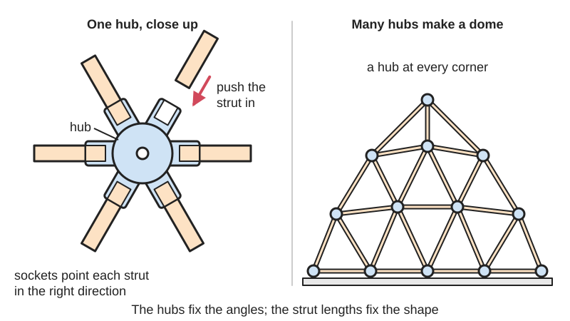
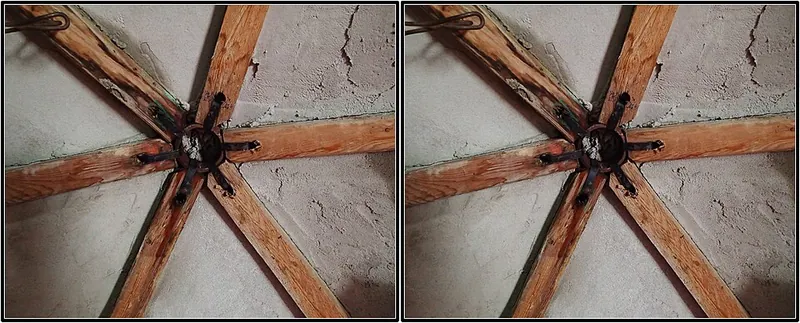
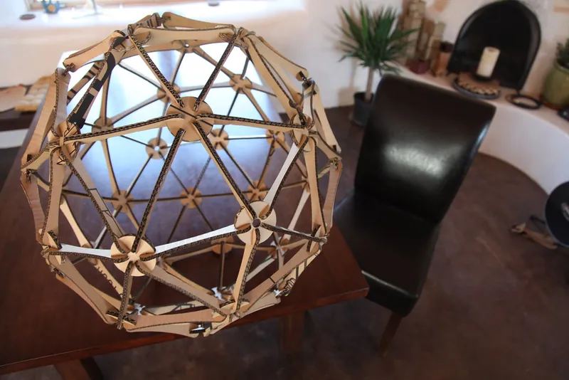

<figure class="eoc-pic eoc-pic-main"><figcaption>Diagram drawn for the encyclopaedia from the research notes. ⚑ Needs confirming: a drawing can simplify or get details wrong; a real photo or a better diagram is welcome.</figcaption></figure>
<figure class="eoc-pic"><figcaption><strong>How it works.</strong> <a href="https://commons.wikimedia.org/wiki/File:Gordons_Dome_strut_hub_(50173588816).jpg">Gordons Dome strut hub (50173588816)</a> by Robbie Sproule from Montreal, Canada, <a href="https://creativecommons.org/licenses/by/2.0">CC BY 2.0</a>, from Wikimedia Commons.</figcaption></figure>
<figure class="eoc-pic"><figcaption><strong>Photo.</strong> <a href="https://www.flickr.com/photos/35468148654@N01/4678731463">laser cut geodesic</a> by jared, <a href="https://creativecommons.org/licenses/by/2.0/">CC BY 2.0</a>, from Flickr via Openverse.</figcaption></figure>

A single connector that holds the ends of three to six (or more) straight struts at fixed angles where they meet, so a pile of sticks, tubes or planks can be built into a rigid dome, frame or truss.

**In plain words:** A star-shaped or ball-shaped connector with several sockets or arms pointing out at set angles, so you can plug or bolt sticks, dowels, tubes or planks into it and build a dome or frame out of nothing but straight pieces. **Proper term:** Strut hub (node connector): the geodesic dome hub and the space-frame node.

**Also called:** geodesic dome hub; dome hub; geodesic connector; dome connector; vertex hub (Domerama 'Geodesic Hub Connectors'; Printables model titles); 4-way, 5-way and 6-way connector or hub (by the number of struts it joins) (Desert Domes 'Dome Formulas'); hub-and-strut dome (a dome whose struts are tied together by steel hubs) (Wikipedia 'Geodesic dome'); flattened-conduit dome; conduit dome; EMT dome (strut ends flattened, drilled and bolted at each vertex) (Wikipedia 'Geodesic dome'; Mike Tyka 'Playa dome'); star hub; pipe hub; pipe-section hub with steel strap; T-blocking hub; disc hub (Domerama); space-frame node; ball joint system; ball node; MERO node (MERO (brand), Mengeringhausen Rohrbauweise) (Wikipedia 'Space frame'; Virginia Tech SAFAS 'Mero System'); plate joint, slot joint, shell joint and socket joint systems (other space-frame node types, e.g. Unistrut (brand), Triodetic (brand), Nodus (brand)) (Virginia Tech SAFAS 'Nodular or Piece-Small Systems'); printed stick hub; skewer connector; popsicle-stick hub; straw connector (Printables model titles); connector node (construction toys): Zometool (brand) ball node; Tinkertoy (brand) spool (Wikipedia 'Zometool'; Wikipedia 'Tinkertoy'); hubs (brand) ball-connector dome hubs (Printables 998685).

## How it works

The hub's sockets, arms or threaded holes point in exactly the directions the struts must take, so it fixes the angles between them, and the strut lengths then fix the shape (Desert Domes 'Dome Formulas'). Each strut is held by being pushed into a snug socket, bolted or pinned through, screwed, or clamped (Printables 370482; Wikipedia 'Geodesic dome'; Domerama). Because the struts form triangles, loads travel along the struts as push and pull rather than bending, which is what makes a space frame or geodesic dome strong and light (Wikipedia 'Space frame'). Until the last triangle is closed the frame is floppy; once complete it becomes 'one whole stiff thing' (Printables 175330).

## Parts

A few parts at each node. Printed stick hub: one printed part with sockets, plus the sticks (Printables 370482). Flattened conduit: no separate hub at all; the flattened, drilled strut ends are stacked on one bolt with a nut (Wikipedia 'Geodesic dome'). Timber hubs: a steel pipe section or plate, bolts or a steel strap, or ball connectors held by a screw, wing nut and washer (Domerama; Printables 998685). Space-frame ball node: a forged steel ball with threaded holes, and tubes with welded cone-shaped end fittings, each held by a bolt through a sleeve (Virginia Tech SAFAS 'Mero System').

## Everyday examples

- Tinkertoy, whose wooden spools have holes every 45° around the edge for sticks (Wikipedia 'Tinkertoy')
- Zometool and similar ball-and-strut kits for maths and molecule models (Wikipedia 'Zometool')
- A dome climber on a playground, often built from bolted tubes (Wikipedia 'Geodesic dome'; Wikimedia Commons 'Climberdome.JPG')
- Space-frame roofs over airports and stations, and the portable lighting trusses over concert stages (Wikipedia 'Space frame')

## When to use it

Use a strut hub when you want to build a large, light, rigid shape from short straight pieces: model and toy domes from sticks, skewers or straws; garden greenhouse or shade domes and festival shelters from conduit or timber; frames, trusses and sculptures where many members meet at odd angles (Printables 370482, 601680; Mike Tyka 'Playa dome'; Wikipedia 'Space frame'). Printed hubs are good for models, decorations such as an LED light ball, and small light structures (Printables 120101).

## When not to use it

Don't use printed hubs for anything people climb on, hang from or shelter under in wind or snow: hubs are the weakest part of most wooden domes (Wikipedia 'Geodesic dome') and printed connectors on a 3.8 m dome failed within a season (Printables 175330); use metal hubs, bolted conduit or a professionally designed structure instead. For right-angle tube frames, use clamp-on tube fittings or aluminium-extrusion connectors; for flat sheet parts, use a cross-halving slot joint; for a stick structure with no connectors at all, see Reciprocal frame. Paneled timber domes can avoid hubs altogether by bolting triangles together (Wikipedia 'Geodesic dome').

## Details

- **What it does (jobs):**
  - join and hold: joins the ends of several struts at one point (Wikipedia 'Geodesic dome'; Virginia Tech SAFAS)
  - line parts up exactly: the hub sets the angle of each strut so the frame takes the intended shape; some printed hubs and toy nodes are keyed so each strut can only go in its correct socket (Printables 370482; Wikipedia 'Zometool')
- **Movement:** none: a finished frame is rigid. During assembly a single-bolt conduit vertex lets struts swing until the triangles are closed (Printables 175330 describes the frame as 'quite flimsy until the last piece is fitted'); some hubs flex slightly so one design fits several dome sizes (Domerama 'vertex hub'; Printables 186195)
- **Directions it can move (degrees of freedom):** 0 when the frame is complete: each strut is fixed by its hub at both ends, and the triangles stop the joints turning (Wikipedia 'Space frame'). A single-bolt vertex on its own behaves like a hinge (each strut can pivot about the bolt) and only becomes rigid as part of the triangulated frame ⚑ [uncertain: reasoning from Wikipedia 'Space frame' pin-jointed truss description].
- **Special behaviour:**
  - none of the listed behaviours: it simply joins and sets angles
  - keyed sockets (a related feature): Zometool's node holes are rectangular, triangular or pentagonal to match the strut cross-section, so a strut only fits in the right direction (Wikipedia 'Zometool'); printed hubs mark sockets A, A' and B so the right hubs are joined (Printables 370482)
- **How it holds:**
  - shape (the parts interlock; [form-fit](../glossary.md#form-fit--force-fit--material-bond)): struts sit in shaped sockets, or a bolt, pin or screw passes through the strut and hub (Wikipedia 'Geodesic dome'; Domerama: Lotus Domes poles fixed with stainless steel pins; Printables 998685 deck screws)
  - friction or clamping (force-fit): snug push-fit sockets (Printables 370482; Domerama: the Vertex hub 'uses a friction fit to secure its pipes'), a bolt clamping the stack of flattened ends (Wikipedia 'Geodesic dome'), or a screw and wing nut clamping ball connectors into the hub (Printables 998685)
  - material bond (glue, solvent or melting): only in welded steel or aluminium frames and glued model kits (Wikipedia 'Geodesic dome': aluminium frames 'bolted or welded together')
- **Input and output:** not applicable
- **Power:** passive (no power needed)
- **Load:** Ranges from toy-light to building-heavy. Space-frame tubes with ball nodes carry 4.5 to 450 kips (about 20 to 2000 kN) (Virginia Tech SAFAS 'Mero System'). DIY domes: struts carry push and pull, and the hub is the weak point: 'the seams and especially the hubs in most wooden-framed domes are the weakest point in the structure' (Wikipedia 'Geodesic dome'). Printed hubs are light duty: printed connectors on a 3.8 m 3V dome broke in the lower sections within a season and 'were definitely too weak for a 3/4 sphere of this size' (Printables 175330). A commercial plastic ball-connector hub system limits domes to under 6 m across and struts to 500 g each (30 kg total) (Printables 998685, quoting hubsTM).
- **Play and precision:** Small play once tightened, but [accuracy](../glossary.md#repeatability--accuracy) matters: strut lengths must match the calculated 'strut factors' (Desert Domes), and for hubless timber domes the compound angle cuts should be accurate 'to a tenth of a degree' (Domerama). Flexible conduit and slightly flexing hubs take up small errors (Domerama). Push-fit printed sockets must be snug but not so tight that sticks break (Printables 370482).
- **Taking it apart:** removable: bolted, pinned and push-fit hubs can be taken apart, and portable domes are designed for it, e.g. 'if the dome is portable, have a castellated nut with a cotter pin' (Wikipedia 'Geodesic dome'); the simple connection design of space-frame nodes 'facilitates the erection and dismantling of the structure' (Virginia Tech SAFAS). Semi-permanent or permanent when nailed, glued or welded.
- **How often it can be reused:** many times for bolted or pinned metal hubs (e.g. a 10 m Lotus Domes dome put up by one person in about 3 hours, Domerama); ⚑ [uncertain] a few times for printed plastic hubs, which wear and can crack (Printables 175330)
- **Sealing:** none: it is a frame joint; a dome is made weathertight by its cover or panels, not by the hubs
- **Adjustable:** Mostly no: the angles are fixed by the hub and the shape by the strut lengths. Some hubs flex to suit several dome sizes (Domerama 'vertex hub'; Printables 186195), ball-connector hubs let struts settle before the wing nut is tightened (Printables 998685), and printed hubs can be regenerated for any frequency and strut size in OpenSCAD (Printables 601680).
- **Access needed:** end of a tube or shaft: struts are joined at their ends, by pushing into sockets or bolting through end holes; bolted hubs need a hand on both sides of the node for the bolt and nut (Printables 998685: wing nut on the inside)
- **Materials:** Struts: 3/4 in EMT electrical conduit (Wikipedia 'Geodesic dome'; Mike Tyka), PVC pipe, timber (50 x 25 mm, 2x4, 1.5 x 1.5 in), bamboo, wooden dowels, popsicle sticks, bamboo skewers and drinking straws (Printables 601680, 998685, 370482, 120101, 480245; Domerama). Hubs: steel pipe sections with stainless straps, laser-cut steel star hubs, machined plastic, PVC (Domerama); forged galvanised steel balls (Virginia Tech SAFAS 'Mero System'); printed PLA, PETG or ASA, or PLA with a TPU base (Printables 601680, 998686, 175330).
- **Heat, cold, water and wear:** Outdoors, PLA hubs degrade in UV and soften above about 60 °C; ASA is UV-resistant to about 93 °C (Prusa PLA and ASA guides). Wind and snow add large loads: a hub maker advises extra secure caps where domes may see high winds or more than 20 cm of snow (Printables 998686). Damp and condensation inside domes 'tend to quickly degrade wooden framing' (Wikipedia 'Geodesic dome'). Printed plastic [creeps](../glossary.md#creep) under constant load (Filament Specs 'Creep Resistance') ⚑ [uncertain: not measured on hubs]. Bolts loosen with movement unless locked (Wikipedia 'Geodesic dome').

## Making it

- **Ways to make or get it:**
  - 3D print (FDM): hubs for popsicle sticks, skewers, straws, dowels and timber struts, including OpenSCAD hub generators (Printables 370482, 120101, 480245, 601680)
  - woodwork: timber struts with compound-angle ends or straight-cut ends in hubs; pipe-section and T-blocking hubs (Domerama; Printables 175330)
  - sheet metal: laser-cut steel star hubs and brackets, bent flat-bar hubs, steel strap hubs (Domerama)
  - off-the-shelf part: EMT conduit and bolts, commercial dome hub kits, space-frame node systems, construction toys (Wikipedia 'Geodesic dome'; Domerama; Virginia Tech SAFAS)
- **Printing it in one piece (print in place):** no: hubs are printed as separate connectors and assembled with bought or cut struts; one design prints a flexible TPU base and a PLA top in one job with a pause, but still needs separate struts (Printables 175330)
- **Tools:** Push-fit stick, skewer and straw hubs: none (Printables 370482, 480245). Flattened conduit: pipe cutter or saw, a vise and heavy hammer or an arbor press to flatten the ends, a drill press, spanners (Stanford 'Geodesic Dome Assembly'; Mike Tyka 'Playa dome'). Timber hubs: saw, drill, spanners or a screwdriver, an Allen key for the wing-nut screw of ball-connector hubs (Printables 998685), a strap-tensioning tool for strap hubs (Domerama).
- **Difficulty:** easy for printed hubs with sticks, skewers or straws (print, then push in sticks); moderate for a conduit dome (cutting, flattening and drilling dozens of struts accurately, Stanford 'Geodesic Dome Assembly'); hard for a large timber dome that must withstand wind and snow, which needs proper hubs and structural design (Printables 998686, 175330; Wikipedia 'Geodesic dome')

### 3D printing tips

1) Print one hub first and test the fit of your sticks; adjust the slicer's XY size compensation until the stick is snug 'but not too difficult to fully insert', because over-tight sockets can break sticks and hurt you (Printables 370482). 2) Measure your actual sticks: standard popsicle sticks measured 113 x 9.5 x 2 mm (Printables 370482); skewers come in 3 mm and 5 mm (Printables 120101, 8278). 3) For timber struts use PETG-like filament for durability, and a 0.8 mm nozzle to print faster (Printables 601680). 4) For outdoor domes use ASA (UV-resistant, up to 93 °C, Prusa ASA guide), 0.15 mm layers and 50% [infill](../glossary.md#infill), printed in an enclosure (Printables 998686). PLA degrades in UV and softens above about 60 °C (Prusa PLA guide). 5) Orient hubs so the arms lie along the layers: 'Like wood, FFF prints are stronger in one direction than another' (Prusa 'Modeling with 3D printing in mind'); layer adhesion in PLA is weaker than in other materials (Prusa PLA guide). ⚑ [uncertain: no hub-specific orientation test found] 6) Use the OpenSCAD generator for other frequencies and strut sizes, and a dome calculator for strut lengths (Printables 601680; Desert Domes). 7) Mark or colour-code hubs and struts: printed letters on the hubs (Printables 370482) and spray-painted strut ends (Mike Tyka) make assembly much easier. 8) Don't scale printed hubs up to building size: one maker's printed connectors on a 3.8 m dome broke within a season and were replaced with cheaper, stronger metal straps (Printables 175330).

### Buying one (off-the-shelf parts)

Search for: '3/4 inch EMT conduit' and '5/16 hex bolts' with nuts for a conduit dome (Mike Tyka); 'castellated nut' and 'cotter pin' or removable [threadlocker](../glossary.md#threadlocker) for the vertex bolts (Wikipedia 'Geodesic dome'); 'geodesic dome hub kit', 'dome connector kit', 'star hub' (laser-cut steel), 'pipe hub' with 'stainless steel banding strap' (Domerama); hubs (brand) ball-connector hubs with an M6 countersunk screw, M6 wing nut, 30 mm washer and #8 x 2-1/2 in deck screws (Printables 998685); 'space frame node', 'ball joint space frame' (MERO (brand) and similar, Virginia Tech SAFAS); Zometool (brand) and Tinkertoy (brand) construction sets for models (Wikipedia).

## Rules of thumb

- Strut length = dome radius x strut factor. For a 2V (two-frequency) dome: struts A = 0.61803 (35 in a half dome) and B = 0.54653 (30 in a half dome), with ten 4-way, six 5-way and ten 6-way hubs (Desert Domes 'Dome Formulas').
- A 2V half dome has 26 vertices, so 26 bolts for a conduit build; one example used 3/4 in EMT with 5/16 in bolts, 1-1/2 in long for 4-way and 2 in long for 5- and 6-way vertices (Mike Tyka 'Playa dome').
- For flattened-and-drilled struts, add about 2 x 3/4 in = 1.5 in (about 4 cm) to each calculated strut length so the holes can be drilled 3/4 in from each end (Domerama); another builder drilled about 1-1/4 in from the end (Mike Tyka) - the calculated length is always hole centre to hole centre.
- Lock the vertex nuts with removable threadlocker, or with a castellated nut and cotter pin for a portable dome (Wikipedia 'Geodesic dome').
- Hubless timber domes need compound angle cuts accurate to about a tenth of a degree (Domerama).
- Keep plastic-hub domes small and light: under 6 m across, struts under 500 g each and 30 kg in total, and not used as climbing frames (Printables 998685, quoting hubsTM).
- MERO-type space-frame nodes have 18 faces at 45°, 60° and 90° and their multiples, with member lengths in ratios of 1.414 or 1.732 (Virginia Tech SAFAS 'Mero System').
- Assemble domes from the top down: build the central pentagon first and 'walk the structure up' (Mike Tyka 'Playa dome'; Stanford 'Geodesic Dome Assembly').

## Common failures

Printed hubs cracking at the arms, especially low in the dome where loads are highest (Printables 175330). Ball connectors popping out of their sockets in wind or snow unless secure caps and washers are fitted (Printables 998686). Struts too tight in sockets (breaking sticks) or too loose (frame falls apart): tune XY compensation (Printables 370482). Dome not closing because strut lengths or hole positions are wrong: calculate from hole centre to hole centre and add the end allowance (Domerama; Desert Domes). Mixing up strut lengths during assembly: colour-code them (Mike Tyka; Printables 175330). Nuts working loose: use threadlocker or castellated nuts and cotter pins (Wikipedia 'Geodesic dome'). Wooden struts and hubs rotting from condensation (Wikipedia 'Geodesic dome').

## Safety

Don't climb on, hang things from or load printed or plastic hubs: one hub maker states its domes 'are not climbing frames and are not intended for suspending heavy weights' and should not be installed in public spaces (Printables 998685, quoting hubsTM). Test one hub first. A dome is floppy and can fold up until the last strut is fitted (Printables 175330), so keep people out from under it during assembly. Over-tight stick sockets can break sticks and injure you (Printables 370482). Flattened conduit ends have sharp edges (Mike Tyka padded them to protect the cover); wear gloves when cutting and flattening tube (Stanford 'Geodesic Dome Assembly'). Bamboo skewer points are sharp ⚑ [uncertain: no source opened]. Any dome people go inside or climb on is a structure: follow local building and playground rules and use rated parts ⚑ [uncertain: no [regulator](../glossary.md#regulator) page opened].

## Related

- Clamp-on tube fittings (slip-on structural fittings): join round tubes, mostly at right angles, with [set screws](../glossary.md#set-screw); a strut hub joins many members at compound angles
- Reciprocal frame (self-supporting stick bridge): sticks rest on and lock each other with no connector
- Tensegrity (floating struts held by cords): struts don't touch; cords hold them in place
- Aluminium-extrusion connectors (T-slot nuts and brackets): build square frames from slotted bars
- Cross-halving slot joint (egg-crate joint): slots flat sheets into each other
- Metal brackets and plates (angle bracket, mending plate, joist hanger): join timber at a single joint, usually two members
- Ball-and-socket joint (lockable ball head): the ball connectors in some dome hubs work like a ball joint locked by a screw
- Split-part joints for large prints: other ways to build something bigger than the print bed
- Mortise and tenon / Dowel and biscuit joints: traditional two-member timber joints with no separate hub

## Make it yourself

- [1V 2V 3V 4V 5V 6V Connector for Geodesic Dome with customizer (Florian, Printables) (URL from Printables API, page not opened)](https://www.printables.com/model/601680-1v-2v-3v-4v-5v-6v-connector-for-geodesic-dome-with): OpenSCAD hub generator for 1V to 6V domes with rectangular or round struts; ready-made STLs for 50 x 25 mm timber; lists the hubs needed for each dome *(licence: CC BY-SA (Creative Commons Attribution-ShareAlike))*
- [Geodesic Dome hubs for popsicle sticks (flipmarley, Printables) (URL from Printables API, page not opened)](https://www.printables.com/model/370482-geodesic-dome-hubs-for-popsicle-sticks): Lettered 5-way and 6-way hubs and base hubs for a popsicle-stick sphere or half dome with no stick cutting; includes fit-tuning advice *(licence: CC BY-SA (Creative Commons Attribution-ShareAlike))*
- [Geodesic Dome Hubs (3mm Dia. Bamboo Skewer Style) (zuberio, Printables) (URL from Printables API, page not opened)](https://www.printables.com/model/120101-geodesic-dome-hubs-3mm-dia-bamboo-skewer-style): 2V sphere hubs for 3 mm bamboo skewers (60 sticks of 208 mm and 55 of 180 mm), used as an LED light-ball frame *(licence: CC BY (Creative Commons Attribution))*
- [Straw building connectors (olsenge, Printables) (URL from Printables API, page not opened)](https://www.printables.com/model/480245-straw-building-connectors): Cone-ended printed connectors for 7 mm drinking straws, for building frames and structures *(licence: CC BY (Creative Commons Attribution))*
- [Dome Formulas (Desert Domes)](https://www.desertdomes.com/formula.html): Strut factors and hub counts for 1V to higher-frequency domes, to work out strut lengths for any dome radius *(licence: link only)*

## Pictures, videos and models

- [Mero Knoten Grafik.jpg (Martin Maloblocki / Klaus Knebel, Wikimedia Commons)](https://commons.wikimedia.org/wiki/File:Mero_Knoten_Grafik.jpg): Computer rendering of a MERO space-frame ball node with tubes bolted into it *(licence: Copyrighted free use)*
- [Zome vertices.jpg (Zometool, Wikimedia Commons)](https://commons.wikimedia.org/wiki/File:Zome_vertices.jpg): Zometool ball nodes with shaped holes and struts *(licence: CC SA 1.0)*
- [Climberdome.JPG (GreenGlass1972, Wikimedia Commons)](https://commons.wikimedia.org/wiki/File:Climberdome.JPG): A playground dome climber built from tubes joined at hubs *(licence: Public domain)*
- [Geodesic Hub Connectors (Domerama)](https://www.domerama.com/dome-basics/geodesic-dome-hub-connectors/): Photos of many hub types: flattened conduit, star hubs, pipe-section hubs with straps, T-blocking, bamboo star hubs, plastic and 3D-printed connectors *(licence: link only)*
- [Dome build methods - flattened conduit (Paul Robinson, YouTube)](https://www.youtube.com/watch?v=RasWKQfpFzY): The flattened-and-bolted conduit dome method (title and channel verified via YouTube oEmbed; video content not viewed) *(licence: link only (standard YouTube licence))*

## Needs confirming

⚑ marks something nobody has confirmed yet: a fact the research could not confirm from a source, a finder value that is a best guess, or an open point from the research notes. Corrections are welcome (see `research/needs-confirming.md`).

- ⚑ 6 sentences on this page marked [uncertain].
- ⚑ Finder value `made_of` = 3D prints, plastic sheet, tube or moulded parts, wood, metal (best guess): proposed from the words in the research text (R37); not yet checked
- ⚑ Research note: *Strut hub*: where to drill flattened conduit struts differs (Domerama 3/4 in from the end, Mike Tyka about 1-1/4 in); both recorded. Building or playground rules for climbable domes are unsourced ([uncertain]).

## Sources

- <https://en.wikipedia.org/wiki/Geodesic_dome>
- <https://en.wikipedia.org/wiki/Space_frame>
- <https://en.wikipedia.org/wiki/Mero-Schmidlin>
- <https://en.wikipedia.org/wiki/Tinkertoy>
- <https://en.wikipedia.org/wiki/Zometool>
- <https://www.setareh.arch.vt.edu/safas/010_system_04_mero.html>
- <https://setareh.arch.vt.edu/safas/010_system_01_nodular.html>
- <https://www.domerama.com/dome-basics/geodesic-dome-hub-connectors/>
- <https://www.desertdomes.com/formula.html>
- <https://science.miketyka.com/make/2010/02/04/playa-dome.html>
- <https://graphics.stanford.edu/~munzner/dome/struts/>
- <https://help.prusa3d.com/article/modeling-with-3d-printing-in-mind_164135>
- <https://help.prusa3d.com/article/pla_2062>
- <https://help.prusa3d.com/article/asa_1809>
- <https://filamentspecs.com/creep-resistance-3d-printed-parts/>
- <https://commons.wikimedia.org/wiki/File:Mero_Knoten_Grafik.jpg>
- <https://commons.wikimedia.org/wiki/File:Zome_vertices.jpg>
- <https://commons.wikimedia.org/wiki/File:Climberdome.JPG>
- <https://www.youtube.com/watch?v=RasWKQfpFzY>
- <https://api.printables.com/graphql/>
