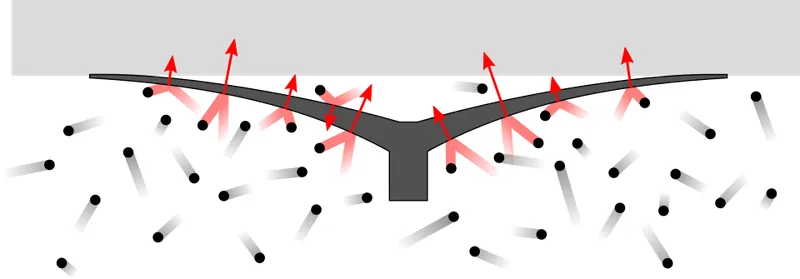
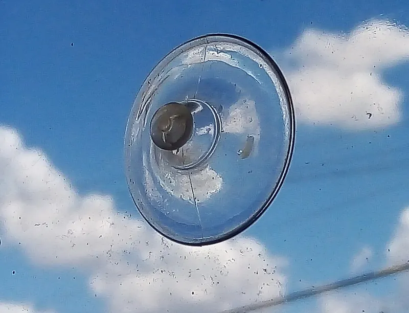
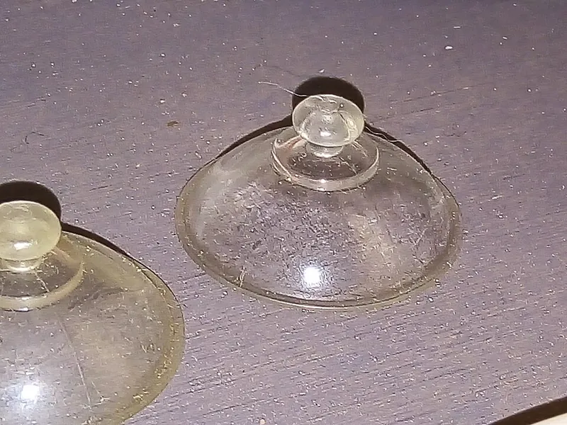

<figure class="eoc-pic eoc-pic-main"><figcaption><strong>Diagram.</strong> <a href="https://commons.wikimedia.org/wiki/File:Suction_cup_pressure_from_collisions.svg">Suction cup pressure from collisions</a> by Becarlson, <a href="https://creativecommons.org/licenses/by-sa/3.0">CC BY-SA 3.0</a>, from Wikimedia Commons.</figcaption></figure>
<figure class="eoc-pic"><figcaption><strong>How it works.</strong> <a href="https://commons.wikimedia.org/wiki/File:Suction_cup_2.jpg">Suction cup 2</a> by Couch-scratching-cats, Public domain, from Wikimedia Commons.</figcaption></figure>
<figure class="eoc-pic"><figcaption><strong>Photo.</strong> <a href="https://commons.wikimedia.org/wiki/File:Suction_cup_1.jpg">Suction cup 1</a> by Couch-scratching-cats, Public domain, from Wikimedia Commons.</figcaption></figure>

A soft cup that you press flat against a smooth, airtight surface; as it springs back it leaves a pocket of low pressure under it, and the outside air pressure then holds it on until you let air back in.

**In plain words:** A soft rubber cup you press flat onto glass or tile so it sticks there with no glue or screws, and pops off when you lift its tab; some have a flip lever that makes it grip much harder. **Proper term:** Suction cup (vacuum cup).

**Also called:** sucker; vacuum cup, vacuum pad (industrial and glass-handling term); suction pad; lever suction cup, locking suction cup, flip-lever suction cup (a cam lever pulls the cup's centre up; used on phone, sat-nav and camera mounts and tile lifters); suction cup lifter, glass lifter, tile lifter, flip cup (hand tools with one or two lever cups); pump vacuum cup, hand-held vacuum cup, red-line vacuum cup (a hand plunger pump keeps the vacuum up; Wood's Powr-Grip); mushroom-head (button-head) suction cup, suction cup with threaded stud (e.g. M4), suction cup hook (ways the cup attaches to what it holds); self-sealing suction cup (research robot-gripper cup that only sucks when touching an object); vacuum gripper, bellows suction cup (powered versions, covered in the 'Vacuum gripper' entry).

## How it works

Pressing the cup flat pushes most of the air out past its rim. The springy cup then tries to return to its dome shape, which enlarges the space under it while its soft rim stops air getting back in, so the pressure inside drops below the outside air pressure (a partial vacuum) (Wikipedia 'Suction cup'). The outside air, pressing at about 100 kPa (roughly 1 kg on every square centimetre at sea level), pushes the cup onto the surface; the ideal pull-off force is the covered area times the pressure difference (F = A x P), and sideways loads are carried by friction, which that pushing force creates (Wikipedia; Schmalz). A lever cup uses a cam to pull the centre of the cup further away from the surface, enlarging the trapped space: if the space doubles, the pressure inside halves (Boyle's law) (Energy Vanguard). Air slowly leaks back in through tiny gaps between the rim and the surface, so the grip fades over minutes to days depending on how smooth and clean the surface is (Wikipedia; Tiwari and Persson 2019).

## Parts

Single piece for a plain cup (a moulded soft cup with a knob, hook, loop or threaded stud); a small assembly for lever cups (cup, cam lever and rigid housing or handle) and pump cups (cup, rigid handle, hand plunger pump with a red-line low-vacuum indicator, and a release tab or lever) (Wood's Powr-Grip 'How They Work').

## Everyday examples

- Sat-nav, phone and dash-camera mounts on a car windscreen, often with a locking lever (Wikipedia 'Suction cup')
- Hooks, soap dishes and shelves stuck to bathroom tiles, a fridge door or a shower screen (Wikipedia 'Suction cup': attaching objects to a refrigerator door or a tile on a wall)
- A toilet plunger and toy darts with rubber suction-cup tips (Wikipedia 'Suction cup')
- Glass and tile lifters with one or two flip-lever cups (Wikimedia Commons 'One cup suction tile lifter')

## When to use it

Use a suction cup when you need to fix something light to glass, glazed tile, a mirror, polished stone or smooth metal without drilling or leaving glue behind, for example in a rented home, on a car window or inside a fish tank; when you want to move it often; or when you need a handle to lift or position a smooth flat panel such as glass, a floor tile or a sheet of acrylic. Lever and pump cups suit short jobs that need a much stronger grip, such as carrying glass or holding a camera to a car for a video.

## When not to use it

Avoid suction cups on porous or textured surfaces (wood, concrete, cardboard, textured car dashboards, most painted walls): air leaks in and they fall off; use screws, a magnet on steel, or double-sided foam tape instead. Do not rely on a plain suction cup for anything that would hurt someone or break if it fell, for overhead loads, or to support a person (Wood's Powr-Grip safety advice); screw a bracket to the wall. Avoid them for heavy sideways loads, long stems or leverage that [peels](../glossary.md#peel-vs-shear) the rim, and for anything that must stay precisely in position. For a strong, lasting hold on steel use a magnet; for a powered pick-and-place machine use a vacuum gripper with a pump.

## Details

- **What it does (jobs):**
  - join and hold: sticks a hook, holder, sign, camera or phone mount to glass, tile or smooth metal without drilling, or lets you pick up and carry a smooth panel such as glass or floor tiles
  - lock, and release by hand: lever and pump cups stay stuck until you flip the lever or pull the release tab
- **Movement:** none: a fixed attachment (it can rock slightly on its soft rubber)
- **Directions it can move (degrees of freedom):** 0 while it holds: it cannot move, although the soft cup lets the held object wobble a little, and it will slide if pushed sideways harder than friction can resist
- **Special behaviour:**
  - quick-release: lifting the release tab, flipping the lever or pressing the release valve lets air in and the cup comes straight off (Adams Manufacturing; Wood's Powr-Grip)
  - none of the other clever behaviours; research 'self-sealing' cups (Kessens and Desai) only suck when they touch an object, but everyday cups do not
- **How it holds:**
  - suction or air pressure: the outside air pushes the cup onto the surface because the pressure under it is lower
  - friction or clamping ([force-fit](../glossary.md#form-fit--force-fit--material-bond)): sideways loads, such as a hook on a wall, are held by friction, which the air pressure creates by pushing the rim onto the surface (Schmalz friction coefficients; Energy Vanguard)
- **Input and output:** not applicable
- **Power:** passive (no power needed): plain and lever cups work on air pressure alone; pump cups are pumped up by hand. Powered vacuum cups with a pump or ejector are a separate entry ('Vacuum gripper').
- **Load:** Light to medium. Strongest when pulled straight off: the ideal force is area x pressure difference (about 130 N for a cup 4 cm across; Wikipedia), but a real 4 cm PVC cup held at most about 9 kg on a smooth surface in lab tests (Tiwari and Persson). Sideways loads (a hook on a wall) rely on friction, roughly half as much when dry and less when wet or oily (Schmalz; Pneumatic Tips). Very weak in peel: a heavy object on a long stem tilts the cup and lifts its edge (US patent 6,648,285). Hand-pumped lifting cups are rated about 7-79 kg per cup (Wood's Powr-Grip).
- **Play and precision:** noticeable: the soft cup lets the held object sag, tilt or wobble a little, and it may [creep](../glossary.md#creep) or slide slowly, so it is poor at locating anything precisely. Tolerates a slightly curved surface if the cup is soft enough, but not texture or gaps.
- **Taking it apart:** tool-free quick release: lift the edge or release tab, flip the lever, or press the release lever on a pump cup (Adams Manufacturing; Wood's Powr-Grip).
- **How often it can be reused:** many times: it can be stuck and unstuck over and over until the rubber ages, hardens or gets nicked on the rim ⚑ [uncertain]
- **Sealing:** airtight or pressure, but only at its own rim: the soft lip must seal against the surface to keep the low pressure inside the cup, and it leaks slowly over time; it is not used to seal an opening. A dab of oil or water improves the seal (Wikipedia; Adams Manufacturing).
- **Adjustable:** no: to move it you release it and stick it on again. Lever and pump cups can be re-tightened, and a plain cup can be 'burped' by pressing it down again to push out air that has leaked in (Adams Manufacturing).
- **Access needed:** one side only (blind): it sticks to the face of a window, tile, mirror or panel without reaching behind it
- **Materials:** Cups: soft PVC (vinyl), neoprene, natural rubber, nitrile rubber (NBR), silicone, polyurethane and other elastomers (Adams Manufacturing; Schmalz material guide); 3D-printed cups use soft TPU (85A-98A) (Fredslund on Printables). Surfaces it suits: smooth, non-porous ones such as glass, mirrors, glazed tiles, polished stone, smooth metal and gloss plastic (Wikipedia; Wood's Powr-Grip). Poor on porous or textured surfaces such as wood, concrete, cardboard, textured dashboards and most painted walls, which let air leak in (Wood's Powr-Grip: porous materials need powered high-flow systems).
- **Heat, cold, water and wear:** Temperature and humidity swings can make a cup lose its grip: household cups are best stuck on above about 5 C and then work from about -30 C to 49 C (Adams Manufacturing). Industrial cup materials have long-term limits of about -15 to 50 C for PVC, -10 to 70 C for nitrile rubber (NBR) and -30 to 180 C for silicone (Schmalz). Natural rubber resists sunlight, abrasion and temperature extremes less well than PVC or neoprene (Adams Manufacturing), and nitrile and natural rubber have poor ozone resistance (Schmalz). Water, oil or dirt on the surface lowers friction, so cups slide sooner sideways (Pneumatic Tips; Wood's Powr-Grip), although a thin film of water or oil on the rim helps it seal (Wikipedia). All cups slowly lose their grip as air leaks in, faster on rougher surfaces (Tiwari and Persson), and hold a little less at high altitude (Pneumatic Tips). Clear cups in strong sun can focus light like a magnifying glass and scorch or fade what is behind them (Adams Manufacturing).

## Making it

- **Ways to make or get it:**
  - off-the-shelf part: moulded suction cups with mushroom (button) heads, hooks, threaded studs or lever housings are cheap and seal far better than home-made ones
  - 3D print (FDM): holders, clips, keyhole mounts, lever housings and hooks in PLA or PETG around a bought cup; complete cups printed in soft TPU with a PETG lever and housing (Fredslund on Printables; fitz08uk on Thingiverse)
  - CNC or laser cut: flat backing plates, brackets and shelves that the cups' knobs slot into ⚑ [uncertain]
  - moulding: cups are normally moulded in soft plastics and rubbers (Adams Manufacturing; Schmalz); home casting of silicone cups in printed moulds is possible but was not checked ⚑ [uncertain]
- **Printing it in one piece (print in place):** no: a printed cup is made in soft TPU and the lever, housing and handle in a rigid plastic, then assembled (Fredslund's 'Suction Cup 2.0' needs no screws)
- **Tools:** none: clean the surface and the cup (warm soapy water, lint-free cloth) and optionally put a little water, oil or petroleum jelly on the rim (Adams Manufacturing; Wikipedia)
- **Difficulty:** easy: buy a cup and design or print a holder that clips onto its knob; making a cup that seals well yourself (for example printing one in TPU) is moderate, and printed cups leak faster than moulded ones (Fredslund)

### 3D printing tips

1) Easiest and most reliable: buy the suction cups and print only the part they hold. Design a keyhole slot or snap-in pocket for the cup's mushroom (button) head; one Printables design hides 1 1/8 in (29 mm) mushroom-head cups inside printed 'floating' shelves (The Odd Artisan), and another prints a hook with a built-in M4 thread for suction cups that have an M4 threaded stud, printed at 0.1 mm layers (wuguigui). 2) Printing the cup itself: use the softest TPU you can get (85A is recommended; 98A also works for some designs) and print it on a smooth build plate so the sealing face comes out glossy and airtight; printing TPU a little hot helps it flow, and a slightly higher first layer avoids back-pressure jams (Fredslund, 'Suction Cup' and 'Suction Cup 2.0'). 3) Expect a printed cup to be strong only for a short time: its designer notes it 'does not hold air forever, as the filament is not soft enough to close completely' (Fredslund). 4) Rigid parts (lever, clip, housing, handle) in PETG with about 5 [perimeters](../glossary.md#perimeters) and 30% [infill](../glossary.md#infill), layers no thicker than 0.2 mm for the lever and clip so they assemble and move smoothly; all print without supports (Fredslund). 5) A lever that pulls the cup's centre away from the surface (a cam or [over-centre](../glossary.md#over-centre) lever) greatly increases the hold compared with a plain cup (Energy Vanguard; Fredslund's design). 6) Keep the load close to the surface and near the cup's centre: a long arm or a heavy item on the stem tilts the cup and peels its rim (US patent 6,648,285). 7) Size the cup from the load: [holding force](../glossary.md#holding-force) = area x pressure difference, divided by a safety factor of at least 2, and divided again by the friction coefficient (about 0.5) if the load pulls sideways along the surface (Schmalz; Pneumatic Tips). 8) Printed TPU adapter cups also work for pressing onto smooth plastic parts, e.g. a TPU cup that fits a vacuum pump to storage bags (mosselini1 on Printables).

### Buying one (off-the-shelf parts)

Suction cups (vacuum cups) with mushroom or button head, with hook, with threaded stud (e.g. M4) or with keyhole mount; lever suction cup mounts (locking suction cups) for phones, sat-navs and cameras; suction cup lifters (glass or tile lifters, flip-lever cups); hand-held pump vacuum cups with red-line indicator (Wood's Powr-Grip); industrial vacuum suction cups and bellows suction cups in NBR, silicone, natural rubber, polyurethane or PVC (Schmalz), which need a vacuum pump or ejector.

## Rules of thumb

- Ideal pull-off force F = A x P: a cup of 2.0 cm radius (area 0.0013 m2) at 100,000 Pa could hold about 130 N (about 13 kg), assuming a perfect vacuum, no leaks and a straight pull (Wikipedia 'Suction cup').
- Real cups hold less: a soft PVC cup about 4 cm across (theoretical 113 N, about 11 kg) held at most about 9 kg on a smooth surface because not all the air could be pushed out (Tiwari and Persson, 'Physics of suction cups in air and in water', arXiv:1905.09042).
- Safety factor: at least 1.5 for smooth, dense surfaces; 2 or more for rough, porous, oily or uneven ones; 2.5 or more when the load is swung or tilted (Schmalz 'Design of the suction cup' and 'Theoretical holding force of a suction cup'; Pneumatic Tips).
- Cup diameter for industrial vacuum pads: d (cm) = 1.12 x sqrt(m x S / (P x n)) for a horizontal lift, and divide inside the root by the friction coefficient for a vertical (sideways) load; m in kg, P = vacuum in bar, n = number of cups, S = safety factor. Example: 50 kg, 4 cups, 0.4 bar vacuum, S = 2 gives 8.85 cm (horizontal) or 12.5 cm (vertical) (Schmalz 'Design of the suction cup').
- When the load pulls along the surface (a cup on a wall or a window), the needed holding force is the weight divided by the friction coefficient: about 0.5 for dry glass, stone, metal and plastic, 0.2-0.4 for wet and about 0.1 for oily surfaces (Pneumatic Tips 'How do you size a vacuum cup?'; Schmalz).
- Air pressure drops about 12.5 mbar per 100 m of height, so a suction cup holds a little less in the mountains (Pneumatic Tips).
- The smoother the surface, the longer the hold: leak-out time fell steeply as surface roughness rose; on surfaces smoother than about 1 micrometre (rms) soft PVC cups held much longer than predicted because plasticiser from the PVC blocked the leak paths (Tiwari and Persson 2019).
- Household cups work best if stuck on above about 5 C (40 F), and then hold reliably from about -30 C to 49 C (-22 F to 120 F) (Adams Manufacturing 'Suction Cups 101').
- Long-term temperature ranges of industrial cup materials: NBR -10 to 70 C, silicone -30 to 180 C, natural rubber -25 to 80 C, PVC -15 to 50 C (Schmalz 'Selection by material of the suction cup', 2025).

## Common failures

Falls off hours or days later because air leaks back in: the cause is usually dust, grease or scratches on the rim or surface, or a textured or porous surface; clean both with warm soapy water, add a trace of water, oil or petroleum jelly to the rim, and press it down again ('burp' it) now and then (Adams Manufacturing; Wikipedia; Tiwari and Persson). Peels off because the load hangs on a long stem or [lever arm](../glossary.md#lever-arm) that tilts the cup and lifts its edge (US patent 6,648,285); keep the load close to the surface or use a lever or pump cup. Slides down a wall under a sideways load, especially when wet (Pneumatic Tips friction values). Stops working after months or years because the rubber has aged, hardened or cracked ⚑ [uncertain]; replace the cup. Leaves a sticky or dark ring on some surfaces because plasticiser migrates out of soft PVC (Tiwari and Persson). Printed TPU cups leak faster than moulded ones because the filament is too stiff to seal completely (Fredslund).

## Safety

A suction cup can let go suddenly with no warning: simple flip-lever lifting cups 'can pop off and drop a load without any warning' (Wood's Powr-Grip), so never carry glass or stone over your feet or other people with them. Do not use suction cups to support a person (e.g. as a grab handle) unless they are specifically designed for it (Wood's Powr-Grip safety advice). On pump cups, stop lifting if the red line on the plunger shows, because it means air has leaked in (Wood's Powr-Grip). Clear cups on a sunny window can focus sunlight and scorch what is behind them (Adams Manufacturing).

## Related

- Vacuum gripper (suction-cup end effector): the same cups kept at low pressure by a pump or ejector, used on robots; holds reliably but needs power and air
- Magnet joint (embedded magnets, magnetic catch): also sticks without drilling, but only to steel or to another magnet, and does not leak away with time
- Double-sided foam tape (acrylic foam pressure-sensitive adhesive): sticks to rougher surfaces and holds long-term, but is hard to remove and cannot be moved
- Switchable permanent magnet (rotary magnetic base): a strong, lever-switched hold on steel with no power, the steel-surface equivalent of a lever suction cup
- Hang-on mounts (keyhole slot, French cleat): the usual way to hang things from screws in a wall when drilling is allowed
- Self-sealing suction cup (research gripper): a cup with a built-in valve that only sucks when it touches an object (Wikipedia 'Self-sealing suction cup')
- Quick-release plate (camera plate, dovetail clamp): can be added to a suction-cup mount so the camera or phone comes off without unsticking the cup

## Make it yourself

- [Suction Cup 2.0 - 100% Printed (Fredslund, Printables)](https://www.printables.com/model/73849-suction-cup-20-100-printed): A fully printed lever suction cup: TPU 85A or 98A cup with PETG lever, clips and housing, no screws; notes that it is very strong for a short time but slowly leaks. URL seen in search results; details read through the Printables public API. *(licence: CC BY-SA (Creative Commons Attribution-ShareAlike))*
- [Suction Cup (Fredslund, Printables)](https://www.printables.com/model/70715-suction-cup): The earlier printed lever suction cup for lifting tiles and smooth objects: soft TPU cup, PETG lever, coupling and handle, one M3 and four M5 bolts. URL seen in search results; details read through the Printables public API. *(licence: CC BY-SA (Creative Commons Attribution-ShareAlike))*
- [printable tpu suction cup and hook (fitz08uk, Thingiverse)](https://www.thingiverse.com/thing:3195496): A TPU suction cup with a PLA hook, both printed at 100% infill *(licence: CC BY-NC-SA 4.0)*
- [Suction Cup "Floating" Shelves for Bathroom, Kitchen, and more (The Odd Artisan, Printables) (URL from Printables API, page not opened)](https://www.printables.com/model/721209-suction-cup-floating-shelves-for-bathroom-kitchen-): Printed shelves that hide bought 1 1/8 in mushroom-head suction cups inside them; includes a 'Suction Cup Attachment Point' STEP and Fusion 360 file to build your own mounts *(licence: Creative Commons Public Domain)*
- [Suction Cup Hook (wuguigui, Printables) (URL from Printables API, page not opened)](https://www.printables.com/model/365697-suction-cup-hook): A swivelling hook with a printed M4 thread that screws onto a bought suction cup with an M4 stud; print at 0.1 mm layers *(licence: CC BY-NC-SA (Creative Commons Attribution-NonCommercial-ShareAlike))*

## Pictures, videos and models

- [Suction cup pressure from collisions.svg (Wikimedia Commons, by Becarlson)](https://commons.wikimedia.org/wiki/File:Suction_cup_pressure_from_collisions.svg): Diagram of a suction cup on a surface with the air molecules outside pushing it on, and few inside, showing why the pressure difference holds it *(licence: CC BY-SA 3.0)*
- [Suction-lifter-one-cup.jpg: one cup suction tile lifter (Wikimedia Commons, by Adamantios)](https://commons.wikimedia.org/wiki/File:Suction-lifter-one-cup.jpg): Photo of a hand tile lifter with a single lever-operated suction cup *(licence: GFDL 1.2 or later and CC BY-SA 3.0 / 2.5 / 2.0 / 1.0 (multi-licensed))*
- [How suction cups work (YouTube, Energy Vanguard / Allison Bailes)](https://www.youtube.com/watch?v=CEUs2aU0IqY): Video demonstration of two lever-handled suction cups stuck together; closing the handles enlarges the trapped space and lowers the pressure (explained in the accompanying article) *(licence: link only (standard YouTube licence))*
- [How Do Suction Cups Work? (Energy Vanguard blog, Allison Bailes, 2023)](https://www.energyvanguard.com/blog/how-do-suction-cups-work/): Plain explanation of suction cups with Boyle's law and pressure difference, with the embedded video and a photo of the Magdeburg hemispheres *(licence: link only)*
- [How They Work (Wood's Powr-Grip)](https://www.wpg.com/service/work): How a hand-pumped vacuum cup is attached, how the red-line low-vacuum indicator on the plunger works, and how it is released *(licence: link only)*

## Needs confirming

⚑ marks something nobody has confirmed yet: a fact the research could not confirm from a source, a finder value that is a best guess, or an open point from the research notes. Corrections are welcome (see `research/needs-confirming.md`).

- ⚑ 4 sentences on this page marked [uncertain].

## Sources

- <https://en.wikipedia.org/wiki/Suction_cup>
- <https://en.wikipedia.org/wiki/Self-sealing_suction_cup>
- <https://commons.wikimedia.org/wiki/File:Suction_cup_pressure_from_collisions.svg>
- <https://commons.wikimedia.org/wiki/File:Suction-lifter-one-cup.jpg>
- <https://www.schmalz.com/en-us/support/know-how/vacuum-knowledge/the-vacuum-system-and-its-components/vacuum-suction-cups/design-of-the-suction-cup>
- <https://www.schmalz.com/en/support/know-how/vacuum-knowledge/the-vacuum-system-and-its-components/system-design-calculation-example/theoretical-holding-force-of-a-suction-cup>
- <https://media.schmalz.com/MAM_Library/Dokumente/Auswahlhilfen/VA/272fbdc64cc1_Document_Selection_Guidelines_Material_Suction_Cup_EN_2025.pdf>
- <https://www.pneumatictips.com/size-vacuum-cup/>
- <https://www.wpg.com/suction-cup-lifters-how-they-work-and-how-to-choose-the-right-one>
- <https://www.wpg.com/service/work>
- <https://www.wpg.com/vacuum-lifter-safety-you-can-live-by>
- <https://www.wpg.com/quality-suction-cups>
- <https://suctioncups.com/pages/suction-cups-101>
- <https://www.energyvanguard.com/blog/how-do-suction-cups-work/>
- <https://www.youtube.com/watch?v=CEUs2aU0IqY>
- <https://arxiv.org/abs/1905.09042>
- <https://arxiv.org/pdf/1905.09042>
- <https://patents.google.com/patent/US6648285B1/en>
- <https://api.printables.com/graphql/>
- <https://www.printables.com/model/73849-suction-cup-20-100-printed>
- <https://www.printables.com/model/70715-suction-cup>
- <https://www.thingiverse.com/thing:3195496>
