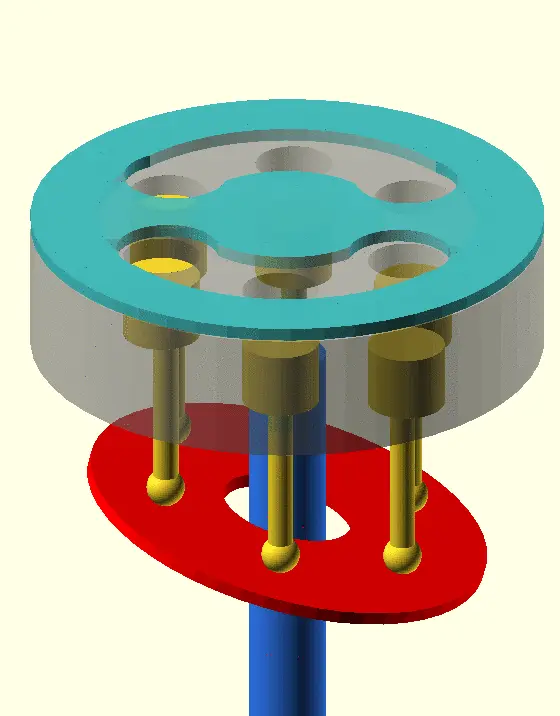
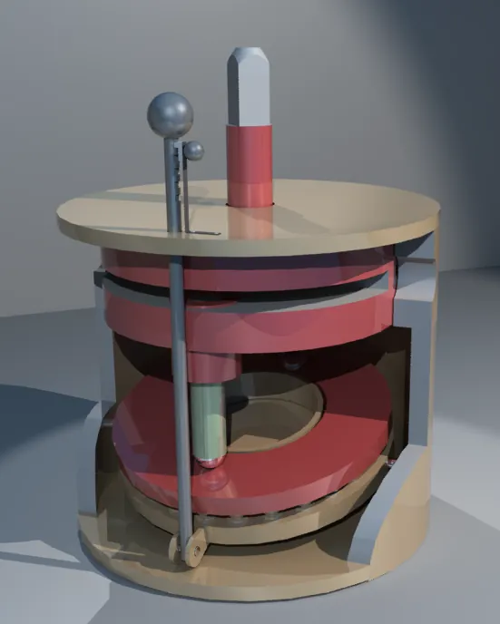
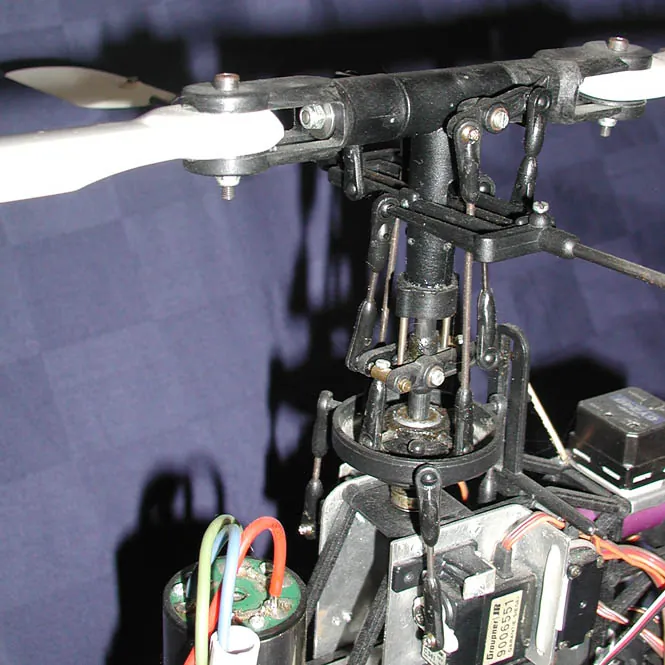

<figure class="eoc-pic eoc-pic-main"><picture><source media="(prefers-reduced-motion: reduce)" srcset="../media/swashplate-and-wobble-plate-740654.still.webp"></picture><figcaption><strong>Animation.</strong> <a href="https://commons.wikimedia.org/wiki/File:Axialkolbenpumpe_-_einfache_Animation.gif">Axialkolbenpumpe - einfache Animation</a> by MichaelFrey, <a href="https://creativecommons.org/licenses/by-sa/4.0">CC BY-SA 4.0</a>, from Wikimedia Commons.</figcaption></figure>
<figure class="eoc-pic"><figcaption><strong>Cross-section.</strong> <a href="https://commons.wikimedia.org/wiki/File:Swashplate-plungers.png">Swashplate-plungers</a> by KoenB, Public domain, from Wikimedia Commons.</figcaption></figure>
<figure class="eoc-pic"><figcaption><strong>Photo.</strong> <a href="https://commons.wikimedia.org/wiki/File:Swashplate-Radio-controlled_helicopter-taumelscheibe.jpg">Swashplate-Radio-controlled helicopter-taumelscheibe</a> by No machine-readable author provided. Flo422 assumed (based on copyright claims)., Public domain, from Wikimedia Commons.</figcaption></figure>

A swashplate is a disc fixed at a slant to a shaft, so turning the shaft makes rods or pistons arranged in a ring round it move back and forth parallel to the shaft (or the pistons turn the shaft); a wobble plate does the same without spinning, and a helicopter swashplate uses a tilting, sliding pair of plates to change the [pitch](../glossary.md#pitch) of spinning rotor blades.

**In plain words:** A tilted disc on a spinning shaft: as the shaft turns, the edge of the disc rises and falls, pushing a ring of rods in and out one after another (or the rods push the disc round); on a helicopter the same idea tilts and lifts the spinning blades. **Proper term:** Swashplate (swash plate) and wobble plate (nutating plate).

**Also called:** swash plate / swashplate (Wikipedia); slant disk / slant disc (Wikipedia); wobble plate / wobbler / wobble-spider (non-rotating version; Douglas Self); nutator, nutating plate, Z-crank drive (the wobble-plate engine family; Wikipedia 'Cam engine'); oblique disc or inclined disc; cam plate / sine-wave swashplate (when the face is wavy rather than flat, giving several [strokes](../glossary.md#stroke) per turn; Douglas Self, Wikipedia '[Axial](../glossary.md#axial--radial) engine'); yoke or hanger (the movable swash plate in variable-displacement hydraulic pumps; Wikipedia 'Axial piston pump'); helicopter swashplate: stationary (outer) and rotating (inner) swashplate, 'Taumelscheibe' in German (Wikipedia 'Swashplate (aeronautics)'); CCPM swashplate (cyclic/collective pitch mixing, e.g. H3-120, H3-140, H4-90 types on RC helicopters; RCHelicopterFun, ArduPilot); axial piston pump or motor, swash-plate compressor, wobble-plate compressor, barrel engine, axial engine (machines built round it).

## How it works

Picture a disc mounted at a slant on a shaft. Seen from the side, a point on its rim moves back and forth along the shaft as the shaft turns, so a rod or piston that rests against the disc near its rim (but does not turn with it) is pushed in and out once per turn; the bigger the slant, the longer the stroke (Wikipedia 'Swashplate'). The piston's movement is a smooth sine wave, and with several pistons in a ring each one reaches its peak in turn (Wikipedia 'Axial piston pump'). In a swashplate the disc turns with the shaft, so the pistons touch it through slipper pads or rollers that slide over its face; in a wobble plate the plate sits on a bearing on a bent (Z-shaped) shaft and only wobbles (nutates) without turning, so the connecting rods can be joined to it with ball joints, but it needs a guide to stop it creeping round (Douglas Self; Wikipedia 'Cam engine'). Run backwards, pistons pushing on the plate turn the shaft, as in swashplate engines and hydraulic motors. A helicopter swashplate is a stationary ring that the pilot's controls tilt and raise, with a spinning ring on a bearing above it: tilting it makes each blade's pitch rise and fall once per turn (cyclic), raising it changes all blades at once (collective) (Wikipedia 'Swashplate (aeronautics)').

## Parts

A small assembly that acts as one unit. Pump or engine: shaft, slanted disc (swashplate) or a non-rotating wobble plate on a bearing on a Z-shaped shaft, a ring of pistons or rods, and the followers between them (slipper pads or shoes, rollers or ball-ended connecting rods), plus an anti-rotation guide for a wobble plate. Helicopter: a stationary (outer) ring moved by three or four servo pushrods, a rotating (inner) ring on a bearing, a centre ball or spherical bearing that lets it tilt and slide on the mast, an anti-rotation link for each ring, and pitch links with ball joints to each blade (Wikipedia 'Swashplate (aeronautics)'). A printable RC swashplate uses a GE5C spherical bearing, a 15x32x9 mm (6002) ball bearing and seven 3 mm ball studs (Printables 274330).

## Everyday examples

- The air-conditioning compressor in most cars, which uses a swash plate or wobble plate to drive its pistons (Wikipedia; MACS)
- The rotor head of a helicopter or RC model helicopter, where the ring below the blades tilts to steer (Wikipedia)
- A campervan or boat fresh-water pump, where an off-centre part on the motor shaft presses three diaphragms in turn (RV Lifestyle); industrial Hydra-Cell pumps use a true wobble plate for up to five diaphragms (Michael Smith Engineers)
- Some pressure washers (e.g. several Kärcher (brand) models) and the hydraulic drive motors of small earth-moving machines such as skid loaders, which use axial piston pumps and motors (Wikipedia)

## When to use it

Use it when you need several pistons or rods driven from one shaft in a compact, round package with everything parallel to the shaft: pumps, compressors, hydraulic motors and barrel-shaped engines (axial engines were chosen for small frontal area and good balance; Douglas Self). It is the natural choice when output must be varied smoothly while running, since changing the plate angle changes the stroke from zero to maximum (Wikipedia). On helicopters and some thrust-vectoring models it is the classic way to pass tilt and lift commands to spinning blades. As a demonstration model it shows rotary-to-reciprocating conversion very clearly.

## When not to use it

For one or two pistons a [crank](../glossary.md#crank) and connecting rod (slider-crank), an eccentric or a Scotch yoke is simpler. For several strokes per turn or a custom motion profile use a cam (plate, barrel or face cam). For engines, the crankshaft has won: swashplate and wobble-plate engines have repeatedly failed commercially, partly because of wear and reliability problems in the plate mechanism and poor maintenance access (Douglas Self). For flying machines, multirotors avoid the swashplate by varying motor speeds, and a 'virtual swashplate' can replace it with hinged blades and a motor whose speed varies within each turn (Hackaday). If a printed model needs precise low-slop control, buy commercial ball links rather than printing them (Hackaday.io NAVI).

## Details

- **What it does (jobs):**
  - change the kind of motion: continuous rotation of a shaft into back-and-forth motion of several rods parallel to it, or the reverse (pistons turning a shaft)
  - change speed or turning force: in variable-displacement pumps and compressors, changing the plate angle changes how much each turn pumps, like a stepless gearbox (e.g. hydrostatic transmissions)
  - let it move (turn, slide or bend): a helicopter swashplate passes tilt and up-down control from the still airframe to the spinning rotor
- **Movement:** multiple: the shaft (and a swashplate) rotates continuously while the rods or pistons slide back and forth parallel to the shaft; a wobble plate only rocks (nutates). A helicopter swashplate tilts in any direction and slides up and down the mast while its inner ring spins with the rotor (Wikipedia 'Swashplate (aeronautics)')
- **Directions it can move (degrees of freedom):** Pump or engine with a fixed angle: 1 (shaft rotation); every piston's position follows from the shaft angle. Variable-displacement units add 1 (the plate angle). Helicopter swashplate: 3 controlled freedoms for the stationary ring (tilt fore-and-aft, tilt side-to-side, slide up and down), plus the inner ring's spin with the mast, which is why three servos (or four) drive it (Wikipedia; ArduPilot)
- **Special behaviour:**
  - motion conversion (e.g. rotary to linear): rotation to [reciprocating](../glossary.md#reciprocating) motion of several pistons at once, or the reverse (Wikipedia 'Swashplate')
  - none of the holding behaviours: it does not lock, click or slip; it simply transmits motion, and in pumps and compressors a pressure-controlled plate angle is what regulates output (Wikipedia 'Axial piston pump'; Rick's Free Auto Repair Advice)
- **How it holds:**
  - not a holding joint (it moves or passes on motion): it converts and transmits motion
  - shape (the parts interlock; [form-fit](../glossary.md#form-fit--force-fit--material-bond)): ball joints, slipper shoes and bearings keep the rods on the plate; small pumps use springs or inlet pressure to keep pistons against the plate (Wikipedia 'Axial piston pump')
- **Input and output:** Continuous rotation -> back-and-forth (reciprocating) motion of several rods or pistons parallel to the shaft, once per turn, following a sine wave; or the reverse in engines and hydraulic motors. Stroke = 2 x r x tan(plate angle), where r is the radius of the ring of pistons (L = 2 r tan alpha; Nature Scientific Reports 2025, swash-plate compressor model). Plate angle: up to about 18 degrees in conventional swash-plate machines, limited by room for the shaft and by sideways forces that tilt the pistons in their guides (US patent 6,206,650). Efficiency: losses are mainly sliding friction between slippers and plate, which rises with plate angle, so small angles are more efficient but give shorter strokes (Nature Scientific Reports 2025); no general efficiency figure was found ⚑ [uncertain]. Shaft arrangement: in line; the pistons lie parallel to the shaft in a ring round it. Back-drivable: yes; pistons pushing on the plate turn the shaft (swashplate engines, hydraulic motors); a helicopter swashplate feeds blade loads back to the servos, which must hold it.
- **Power:** passive (no power needed) as a mechanism; it needs its shaft turned by a motor or engine, or its pistons pushed by fluid or gas. In variable-displacement car air-conditioning compressors a control valve (often electronically controlled) sets the plate angle through crankcase pressure, so the compressor can run all the time and 'de-stroke' to near-zero output when little cooling is needed (Rick's Free Auto Repair Advice)
- **Load:** Light to very heavy: RC helicopter swashplates carry blade-pitch loads of a few newtons ⚑ [uncertain]; axial piston pumps power jet-aircraft hydraulics (the F-14's 9-piston pump gave 3000 psi and up to 84 US gal/min) and a 500 hp swashplate engine drives the Mark 48 torpedo (Wikipedia 'Axial piston pump', 'Axial engine'). Strong along the shaft, the direction in which the pistons push on the plate. The weak points are the sliding contact between slippers and plate, which needs a film of oil, and the sideways forces on the pistons, which grow with the plate angle (US 6,206,650).
- **Play and precision:** Precise when new, but play accumulates: every ball link and bearing in a helicopter control system adds a little slop, which is why electronic mixing (CCPM) with fewer [linkages](../glossary.md#linkage) gives more precise control (RCHelicopterFun). A four-servo swashplate can bind because four points over-constrain a plane (ArduPilot). Pumps need very fine [clearances](../glossary.md#clearance) between pistons and cylinders and a near-perfect seal between the turning cylinder block and valve plate (Wikipedia 'Axial piston pump'). A wobble plate's friction on its shaft tends to turn it, which spoils its alignment with the pistons unless it is guided (Douglas Self).
- **Taking it apart:** removable: it is assembled from bearings, pins, [circlips](../glossary.md#circlip) and ball links and can be taken apart for service; RC swashplates come off the mast once the ball links are unclipped
- **How often it can be reused:** many times: bearings, ball links and slipper pads wear and are replaced, but the parts can be taken apart and refitted repeatedly
- **Sealing:** none: the swashplate itself does not seal; in pumps and compressors the pistons run in sealed cylinders, the whole assembly runs in oil, and a valve plate or [check valves](../glossary.md#check-valve) direct the flow (Wikipedia 'Axial piston pump'; Michael Smith Engineers on Hydra-Cell)
- **Adjustable:** yes: in variable-displacement pumps and compressors the plate angle is changed while running, from zero (no stroke, no flow) to maximum, by a lever, a servo control or a pressure-compensating valve (Wikipedia 'Axial piston pump'); car air-conditioning compressors change their stroke through a control valve (Rick's Free Auto Repair Advice). On helicopters the pilot or servos tilt and raise it continuously; on RC models the pitch-link and servo-link lengths are adjusted so the plate sits level (ArduPilot; RCHelicopterFun).
- **Access needed:** end of a tube or shaft: it is threaded onto the shaft or mast and fitted from one end; the ball links round it are reached from the side
- **Materials:** Steel pistons, shafts and plates with bronze or coated slipper pads in hydraulic pumps and compressors ⚑ [uncertain]; metal rings with ball bearings in full-size and RC helicopters; RC helicopter swashplates often combine aluminium or plastic rings with ball bearings and steel ball studs ⚑ [uncertain]; printed demonstration swashplates and engines in PLA or PETG (Printables 274330, 934945, 1470117); a spherical plain bearing (GE5C) and a 6002 ball bearing in a printed RC swashplate (Printables 274330).
- **Heat, cold, water and wear:** Pumps and hydraulic motors are limited by their fluid, typically to about 120 C, and rely on the fluid to lubricate the sliding faces (Wikipedia 'Axial piston pump'). Printed demonstration parts soften at about 60 C in PLA and 80 C in PETG (CNC Kitchen). Dust and grit wear the ball links and sliding faces. Blowing compressed air through an RV water system to winterize it can damage a wobble-plate pump's diaphragms (RV Lifestyle). Vibration loosens ball links and servo-arm screws on model helicopters ⚑ [uncertain].

## Making it

- **Ways to make or get it:**
  - 3D print (FDM): demonstration engines and rotor heads, printed swashplate rings built round standard bearings (Printables 274330, 934945, 1470117)
  - 3D print (resin): small precise parts such as ball-link cups ⚑ [uncertain]
  - CNC: metal rings, plates and hubs for RC and full-size helicopters and pumps
  - off-the-shelf part: RC helicopter swashplates and ball links, axial piston pumps and motors, car air-conditioning compressors, wobble-plate diaphragm pumps
- **Printing it in one piece (print in place):** no: it is printed as separate parts and assembled round bearings and ball joints; fully printed demonstration engines exist, but as separate parts that snap or bolt together (Printables 934945, 'no additional hardware')
- **Tools:** Hex keys and screwdrivers for RC swashplates, ball-link pliers for the pitch links, and a swashplate levelling tool or a magnet-and-nail gauge to set it level (ArduPilot); bearing pullers or a press for bearings; for printed parts a tap for ball-stud holes (Printables 274330) and a needle file for sliding slots (Printables 1470117)
- **Difficulty:** moderate for a demonstration model (printable engines and rotor heads exist, some needing no extra hardware); hard for a working flying swashplate or pump: it needs bearings, low-slop ball links, careful levelling and, for pumps, very fine piston clearances, so buy the swashplate or pump and build round it

### 3D printing tips

1) Put a real ball bearing between the spinning ring and the still ring, and a spherical bearing or ball in the centre so it can tilt; one printable RC swashplate uses a GE5C spherical bearing, a 15x32x9 mm (6002) ball bearing and seven 3 mm ball studs screwed into tapped holes (Printables 274330). Its designer found a zero-tolerance version too tight and added a small bearing clearance in a later version (0.01, units not stated). 2) Printed ball joints and swashplate links tend to be sloppy or stick at some angles: the NAVI [coaxial](../glossary.md#coaxial) drone builder gave up on printed swashplate linkages and used commercial ones, and a commenter reported the same problem (Hackaday.io NAVI). If you print them, sand away support marks so the balls are round (Printables 1470117). 3) Stop the still ring turning and make the spinning ring turn with the shaft (anti-rotation links; Wikipedia); a wobble plate needs a guide such as an arm in a slot (Douglas Self). 4) Keep the plate angle modest: stroke is 2 r tan(angle) (Nature Scientific Reports 2025), and conventional swash-plate machines stay below about 18 degrees because sideways forces on the pistons grow with the angle (US 6,206,650). 5) Pistons must be pulled back as well as pushed: use two rollers or shoes, one each side of the plate (Douglas Self), a spring behind each piston, or ball-ended rods on a wobble plate (Wikipedia 'Axial piston pump'). 6) Grease the sliding face and pick slippery, heat-tolerant plastics (PETG, nylon or POM) for sliding parts; PLA gives at about 60 C (CNC Kitchen). 7) Print rings flat for roundness; support-heavy parts such as rotor-head frames print with tree supports and may need the slots filing (Printables 1470117). 8) Level the finished swashplate; printable levelling tools for many RC helicopters are shared on Printables.

### Buying one (off-the-shelf parts)

RC helicopter swashplate assemblies (sold to fit each helicopter size, from about '400-size' electrics upwards; RCHelicopterFun), ball links and ball studs, pitch links, swashplate levelling tools (Printables has many printable ones, e.g. 'OMP M4 Swashplate Leveler'), anti-rotation guides; spherical plain bearings (e.g. GE5C) and deep-groove ball bearings (e.g. 6002-2RS) for printed builds (Printables 274330); flybarless controllers with CCPM mixing (RCHelicopterFun); axial piston pumps and motors (swash-plate type, fixed or variable displacement); swash-plate and wobble-plate car air-conditioning compressors (MACS); wobble-plate diaphragm pumps, e.g. Hydra-Cell (brand; Michael Smith Engineers) and 12 V RV fresh-water pumps (RV Lifestyle).

## Rules of thumb

- Stroke of each piston = 2 x r x tan(alpha), where r is the radius of the ring of pistons and alpha the plate angle; piston position follows X = r tan(alpha) sin(theta) as the shaft turns (Nature Scientific Reports, 'Modeling, analysis, and experimental validation of a swash plate compressor for automotive air conditioning', 2025).
- A smaller plate angle cuts slipper-friction losses and shaft power but also cuts stroke and output, so the angle is a trade-off between efficiency and capacity (Nature Scientific Reports 2025).
- Conventional swash-plate machines limit the plate angle to about 18 degrees, because of room for the shaft and sideways forces on the pistons (US patent 6,206,650 B1, TCG Unitech).
- At zero plate angle there is no stroke and no flow; variable-displacement pumps move the plate between zero and maximum to control flow or hold a set pressure (Wikipedia 'Axial piston pump').
- Axial piston pumps usually have an odd number of pistons; typical pistons are under about 13 mm (half an inch) in diameter with a similar stroke, turning at around 3000 rpm (Wikipedia 'Axial piston pump').
- Car air-conditioning compressors: opposed swash-plate types usually have six or ten pistons, single-row wobble-plate types five, six or seven (MACS).
- A swashplate needs two rollers or shoes per piston, one each side, if it must both push and pull the piston (Douglas Self, 'Axial Internal-Combustion Engines').
- RC helicopter swashplates: the most common electronic mixing uses three servos 120 degrees apart; 140-degree and 135-degree layouts even out the geometry, and four-servo 90-degree layouts are used on big models (RCHelicopterFun); four-servo plates can bind and need extra care (ArduPilot).
- Set each servo arm perpendicular to its link at mid-travel and level the swashplate before setting pitch ranges (ArduPilot traditional helicopter setup).

## Common failures

1) Wear or scuffing of the sliding face between slippers and plate when [lubrication](../glossary.md#lubrication) is poor; lubricating this face is one of the main design problems (Wikipedia 'Axial piston pump'). 2) A wobble plate creeping round with the shaft because of friction, which spoils its alignment with the pistons; guide it (Douglas Self). 3) Slop from worn ball links and bearings, giving vague control or vibration in helicopters (RCHelicopterFun). 4) Binding in four-servo swashplates or badly adjusted links (ArduPilot). 5) An unlevel swashplate giving unequal blade pitch; level it with a tool or magnet-and-nail gauge (ArduPilot). 6) In variable car air-conditioning compressors, most faults are in the control valve that sets the plate angle rather than in the compressor itself (Rick's Free Auto Repair Advice). 7) Printed ball joints and linkages that stick at some angles (Hackaday.io NAVI).

## Safety

Spinning rotor blades on a helicopter or RC model can cause serious injury: disconnect power before adjusting the swashplate or linkages ⚑ [uncertain]. Hydraulic pumps and motors run at high pressure (e.g. 3000 psi in jet-aircraft systems; Wikipedia), and a pinhole leak can inject fluid into skin; car air-conditioning systems hold refrigerant under pressure and should be serviced by trained people (MACS offers Section 609 certification). Exposed pistons and plates on demonstration engines are pinch points.

## Related

- [Cam and follower](../glossary.md#cam-and-follower) (face and barrel cams): a swashplate is a flat face cam; a wavy 'cam plate' gives several strokes per turn (Douglas Self)
- Slider-crank and crankshaft: the usual way to turn rotation into piston motion, one crank throw per cylinder
- Scotch yoke: another crankless way to get sine-wave straight-line motion, but for one axis
- Nutating disc engine or meter: a disc that wobbles without being turned into reciprocating motion (Wikipedia 'Swashplate')
- Bent-axis piston pump: tilts the whole cylinder block instead of using a slanted plate
- Universal joint: the joint used in some swashplate mechanisms instead of a centre ball (Wikipedia 'Swashplate (aeronautics)')
- Stewart platform (hexapod): an alternative way to tilt and raise a stationary swashplate (Wikipedia 'Swashplate (aeronautics)')
- Rod end and ball link: the joints that connect servo pushrods and pitch links to a helicopter swashplate
- Wobble-plate diaphragm pump: uses the same wobble to flex diaphragms instead of sliding pistons (Michael Smith Engineers; RV Lifestyle)

## Make it yourself

- [Helicopter Swashplate (SemperDiscere, Printables) (URL from Printables API, page not opened)](https://www.printables.com/model/274330-helicopter-swashplate): Printable swashplate 'for a 4 rotor helicopter' built round a GE5C spherical bearing, a 15x32x9 mm ball bearing and seven 3 mm ball studs *(licence: CC BY)*
- [Helicopter main rotor with swash plate (gbombadon, Printables) (URL from Printables API, page not opened)](https://www.printables.com/model/1470117-helicopter-main-rotor-with-swash-plate): Demonstration helicopter rotor head with turning blades, a swash plate, adjustable pitch links and collective; printed with tree supports and snapped together *(licence: CC BY-NC-SA)*
- [Swash Plate Engine (No Extra Hardware Needed) (KillerBees, Printables; appeared in search results)](https://www.printables.com/model/934945-swash-plate-engine-no-extra-hardware-needed): Fully printed, turnable cut-away model of a swash-plate engine based on the INNengine e-REX, showing the pistons moving; fits a 220 x 220 x 250 mm build volume *(licence: Standard Digital File License (Printables))*
- [HUANGYAN920 Mechanical: interactive mechanism animations (choose PLUNGER-PUMP, no. 142, the axial piston pump)](https://huangyan920.github.io/Mechanical/): Browser-based parametric animation of an axial piston pump in which a slanted swash plate drives rotating pistons (Chinese interface with English names) *(licence: MIT (code on GitHub))*
- [Mars Ingenuity Helicopter (Nick Rehm, Hackaday.io)](https://hackaday.io/project/178091-mars-ingenuity-helicopter): Build log of a 1:1-scale flying copy of NASA's Ingenuity Mars helicopter, 3D-printing as many parts as possible, including the swashplate and transmission assemblies *(licence: ⚑ [uncertain] not stated on the page)*

## Pictures, videos and models

- [Swashplate (Wikipedia)](https://en.wikipedia.org/wiki/Swashplate): Definition and uses in engines, axial piston pumps, car air-conditioning compressors and helicopters, with an animation of a rotating swashplate driving six rods *(licence: Text CC BY-SA 4.0; images per file on Commons)*
- [Swashplate anim metal.gif (Wikimedia Commons; Van helsing)](https://commons.wikimedia.org/wiki/File:Swashplate_anim_metal.gif): Animation: a slanted plate turning with its shaft pushes six rods in and out one after another *(licence: CC BY 2.5)*
- [HelicopterSwashPlate Tilted.gif (Wikimedia Commons; Richard Wheeler, Zephyris)](https://commons.wikimedia.org/wiki/File:HelicopterSwashPlate_Tilted.gif): Animation of a tilted helicopter swashplate changing each blade's pitch as it goes round (cyclic control); companion files show the flat and raised positions *(licence: CC BY-SA 3.0)*
- [Axialkolbenpumpe - einfache Animation.gif (Wikimedia Commons; MichaelFrey)](https://commons.wikimedia.org/wiki/File:Axialkolbenpumpe_-_einfache_Animation.gif): Simple animation of an axial piston pump: pistons in a turning cylinder block running against a slanted swash plate *(licence: CC BY-SA 4.0)*
- [Axial Internal-Combustion Engines (Douglas Self, The Museum of RetroTechnology)](http://www.douglas-self.com/MUSEUM/POWER/unusualICeng/axial-ICeng/axial-IC.htm): Side-by-side animations (by Bill Todd) of a wobble-plate motor and a swash-plate motor, explaining why one rotates and the other does not, plus a gallery of historic barrel engines *(licence: link only)*

## Needs confirming

⚑ marks something nobody has confirmed yet: a fact the research could not confirm from a source, a finder value that is a best guess, or an open point from the research notes. Corrections are welcome (see `research/needs-confirming.md`).

- ⚑ 8 sentences on this page marked [uncertain].

## Sources

- <https://en.wikipedia.org/wiki/Swashplate>
- <https://en.wikipedia.org/wiki/Swashplate_(aeronautics)>
- <https://en.wikipedia.org/wiki/Cam_engine>
- <https://en.wikipedia.org/wiki/Axial_piston_pump>
- <https://en.wikipedia.org/wiki/Axial_engine>
- <https://en.wikipedia.org/wiki/Cyclic/collective_pitch_mixing>
- <https://commons.wikimedia.org/wiki/File:Swashplate_anim_metal.gif>
- <https://commons.wikimedia.org/wiki/File:HelicopterSwashPlate_Tilted.gif>
- <https://commons.wikimedia.org/wiki/File:HelicopterSwashPlate_Raised.gif>
- <https://commons.wikimedia.org/wiki/File:Axialkolbenpumpe_-_einfache_Animation.gif>
- <https://commons.wikimedia.org/wiki/File:Axial_piston_pump_labeled.svg>
- <https://commons.wikimedia.org/wiki/File:Taumel_142_b.png>
- <https://commons.wikimedia.org/wiki/File:Taumelscheibe_08.gif>
- <http://www.douglas-self.com/MUSEUM/POWER/unusualICeng/axial-ICeng/axial-IC.htm>
- <https://www.nature.com/articles/s41598-025-27318-w>
- <https://patents.google.com/patent/US6206650B1/en>
- <https://macsmobileairclimate.org/2010/10/20/compressor-week-continues-swash-and-wobble-plate-compressors/>
- <https://ricksfreeautorepairadvice.com/how-a-variable-displacement-ac-compressor-works/>
- <https://www.michael-smith-engineers.co.uk/resources/useful-info/hydra-cell-wobble-plate-design>
- <https://rvlifestyle.com/mysteries-rv-water-pump/>
- <https://www.rchelicopterfun.com/ccpm.html>
- <https://www.rchelicopterfun.com/swashplate-setup.html>
- <https://ardupilot.org/copter/docs/traditional-helicopter-swashplate-setup.html>
- <https://hackaday.com/2020/06/25/building-and-flying-a-helicopter-with-a-virtual-swashplate/>
- <https://hackaday.com/tag/swashplate/>
- <https://hackaday.io/project/20793-navi-hey-listen>
- <https://hackaday.io/project/178091-mars-ingenuity-helicopter>
- <https://www.cnckitchen.com/blog/comparing-pla-petg-amp-asa-feat-prusament>
- <https://huangyan920.github.io/Mechanical/>
- <https://api.printables.com/graphql/>
- <https://www.printables.com/model/934945-swash-plate-engine-no-extra-hardware-needed>
