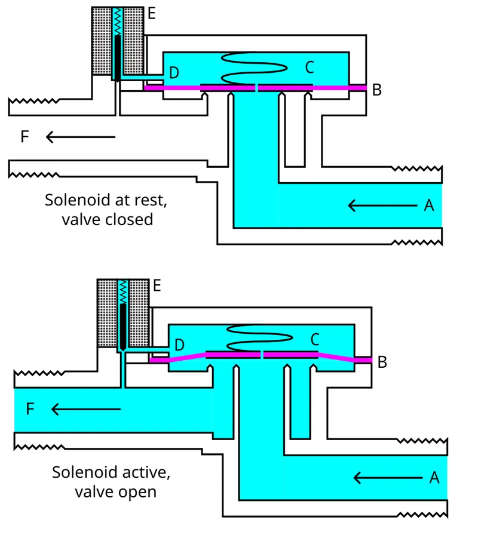
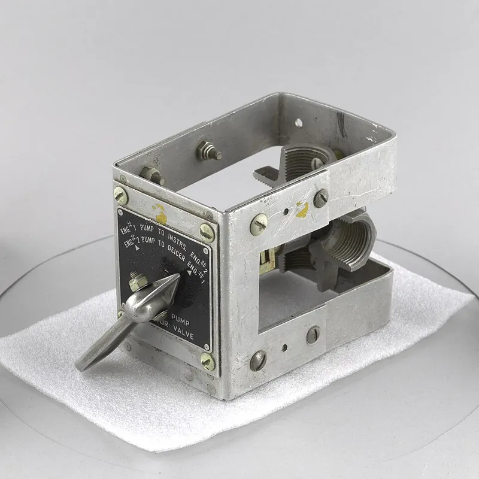

<figure class="eoc-pic eoc-pic-main"><picture><source media="(prefers-reduced-motion: reduce)" srcset="../media/drawn/switching-valve.svg"></picture><figcaption><strong>Animation.</strong> Diagram drawn for the encyclopaedia from the research notes. ⚑ Needs confirming: a drawing can simplify or get details wrong; a real photo or a better diagram is welcome.</figcaption></figure>
<figure class="eoc-pic"><figcaption><strong>Diagram.</strong> <a href="https://commons.wikimedia.org/wiki/File:Solenoid_Valve.svg">Solenoid Valve</a> by &quot;SimonOrJ&quot; (U/T/C), Public domain, from Wikimedia Commons.</figcaption></figure>
<figure class="eoc-pic"><figcaption><strong>Cross-section.</strong> <a href="https://commons.wikimedia.org/wiki/File:Valve,_Vacuum_Selector,_Cutaway_-_DPLA_-_e5633c7d1f7feeaa6330597b6289934f_(page_1).jpg">Valve, Vacuum Selector, Cutaway - DPLA - e5633c7d1f7feeaa6330597b6289934f (page 1)</a> by File URL Catalog record, <a href="http://creativecommons.org/publicdomain/zero/1.0/deed.en">CC0</a>, from Wikimedia Commons.</figcaption></figure>

A valve with two or more ports and two or three set positions: shifting its inner spool, poppet or diaphragm by an electric coil, hand, foot or air signal connects the supply to a chosen outlet and vents or blocks the others, which is how every powered cylinder, soft [actuator](../glossary.md#actuator) and suction cup is switched on and off.

**In plain words:** A tap that switches by itself or with a flick: an electric coil (or a lever, button, foot pedal or puff of air) slides a part inside it that connects the air or water supply to one outlet and lets the other outlet breathe out, so a cylinder or soft gripper moves one way or the other, or water starts and stops. **Proper term:** Directional control valve (switching valve; [solenoid](../glossary.md#solenoid) valve when switched electrically).

**Also called:** directional control valve (DCV), directional valve, way valve; 'Wegeventil' (German) (LibreTexts; Wikimedia Commons); named by ports and positions: 2/2, 3/2, 4/2, 5/2, 4/3 and 5/3 valves, or '3-way, 2-position' etc. (Tameson; LibreTexts); solenoid valve, often just called a 'solenoid' (Wikipedia 'Solenoid valve'; FRC Zero); air valve, pneumatic valve, pneumatic solenoid valve; hydraulic solenoid valve (Tameson); spool valve; poppet valve; diaphragm valve (Wikipedia 'Solenoid valve'); direct-acting valve; pilot-operated, servo-operated or indirect-acting valve; semi-direct or assisted-lift valve (Wikipedia; Tameson); normally closed (NC) and normally open (NO) valve (Wikipedia; Tameson); single solenoid (mono-stable, spring return) and double solenoid (bi-stable) valve; latching or pulse valve (Tameson; FIRST pneumatics manual); hand-lever, push-button, foot-pedal (treadle), roller or plunger valve; air-piloted valve (Tameson symbols; LibreTexts); four-way valve or four-way cock (rotary plug type) (Wikipedia 'Four-way valve'); valve manifold, valve island, sub-base (Wikipedia; FIRST pneumatics manual); proportional valve (varies the flow with the current) (Wikipedia 'Solenoid valve'); irrigation (sprinkler) valve, water inlet valve (Wikipedia).

## How it works

Inside, a sliding spool with seals (or a poppet that lifts off a seat) connects some ports and blocks others; moving it to its other position changes which ports are joined (Tameson; LibreTexts). In a solenoid valve, current in the coil makes a magnetic field that pulls the iron plunger against a spring, and the spring pushes it back when the current stops; if the valve is shut with no power it is 'normally closed', if open, 'normally open' (Wikipedia; Tameson). A small coil can only shift a small opening directly, so bigger water and air valves are pilot-operated: the coil only opens a tiny passage, and the line pressure itself pushes the main diaphragm or spool, which is why these valves 'will not work without a sufficient pressure differential between input and output' (Wikipedia 'Solenoid valve'). For a cylinder, a 3/2 valve feeds or vents a single-acting cylinder, a 5/2 valve feeds one end of a double-acting cylinder while venting the other, and a 5/3 valve adds a middle position that can stop the cylinder part-way (Tameson).

## Parts

A small assembly: a body with ports, a moving spool, poppet or diaphragm with seals, a return spring, and an operator. In a solenoid valve the operator is a coil of copper wire round a non-magnetic tube in which an iron plunger (core or armature) slides, held on by a clip; pilot-operated valves add a diaphragm with a pinhole and a small pilot passage (Wikipedia 'Solenoid valve'). Many valves have a manual-override button (Tameson). Other operators are a lever, button, pedal, roller or an air-pressure piston (LibreTexts; Tameson symbols).

## Everyday examples

- The valve that lets water into a washing machine or dishwasher (Wikipedia 'Solenoid valve')
- Garden and lawn sprinkler valves switched by a timer (Wikipedia 'Solenoid valve')
- The reversing valve in a heat pump, which swaps the flow so it heats or cools (Wikipedia 'Four-way valve')
- The trigger valve of a paintball gun, and the valves that fire the cylinders on school competition robots (Wikipedia; FIRST pneumatics manual)

## When to use it

Use one whenever something should start, stop or reverse a flow of air or liquid on command: a microcontroller switching a cylinder, soft gripper or suction cup; a timer watering plants; a button or pedal working a clamp (Wikipedia; Tameson). Pick a 3/2 valve for a single-acting cylinder or to inflate and vent a soft actuator, a 5/2 for a double-acting cylinder, and a 5/3 when it must stop mid-stroke or hold against a load (Tameson). Choose hand, pedal or roller-operated valves when no electronics are wanted, and air-piloted valves to build controls that run on air alone (Tameson; Wikipedia 'Pneumatics' on pneumatic logic).

## When not to use it

For automatic one-way flow, use a [check valve](../glossary.md#check-valve), which needs no signal. For a simple hand-operated on/off in a pipe, a shut-off (ball) valve is cheaper and shows its state at a glance. To set a cylinder's speed use a speed-control (flow-control) valve, to set pressure a pressure [regulator](../glossary.md#regulator), and for overpressure protection a pressure relief valve. For gravity-fed water or vacuum avoid pilot-operated solenoid valves, which won't open without a pressure difference: use a direct-acting valve or a motorised ball valve (Tameson; Adafruit). For dirty, sticky or food liquids, a pinch valve (see Iris valve) keeps the liquid inside a tube; pilot valves clog with solid impurities (Wikipedia). Where the valve must stay switched for hours on batteries, use a latching valve or a servo-driven valve, which need power only to switch (Tameson; Printables 1083966).

## Details

- **What it does (jobs):**
  - hold or release using power: lets an electric signal, a hand, a foot or an air signal start, stop or reverse a cylinder, soft actuator or suction cup, and hold it where it is (Wikipedia; Tameson)
  - seal it, or pass cables or fluid through: passes air or liquid along the chosen path and blocks the others; a 2/2 valve simply turns a flow on or off (Wikipedia; LibreTexts)
- **Movement:** slide (inside): a spool or plunger slides a few millimetres between two or three positions; in rotary and four-way-cock valves a plug turns instead (Wikipedia 'Four-way valve'). From outside you see a click, not a movement; the valve's job is to switch flow
- **Directions it can move (degrees of freedom):** 1: the spool, poppet or plunger moves along one line (or a plug turns about one axis) between its 2 or 3 set positions
- **Special behaviour:**
  - [fail-safe](../glossary.md#fail-safe--fail-secure): a single-solenoid (mono-stable) valve has a spring that returns it to its rest position when power is lost (Tameson); HSE says actuators that must reach a safe position on failure should be controlled by a valve 'spring biased (mono-stable) to the safe position' (HSE HSG39 para 114). Choose normally closed where flow must stop without power (e.g. gas appliances) and normally open where it must keep flowing, e.g. to prevent overpressure (Tameson)
  - indexing: hand-lever valves can have [detents](../glossary.md#detent) that hold each position (LibreTexts shows a 'lever operated, detented' 4/3 valve; Tameson lists 'detent' valves), and double-solenoid (bi-stable) and latching valves stay in whichever position they were last switched to (Tameson; FIRST pneumatics manual)
  - one-way: pilot-operated (indirect) valves only let fluid flow in one direction, marked by an arrow on the body (Tameson; Adafruit: 'liquid can only flow one direction')
- **How it holds:**
  - spring force: a spring holds the spool or plunger in its rest position until the coil, lever or pilot pressure moves it (Wikipedia; Tameson)
  - magnetic: the energised coil holds a mono-stable valve in its switched position, and latching valves use a permanent magnet to stay put without power (Tameson)
  - suction or air pressure: in a pilot-operated valve, line pressure acting on the larger area of the diaphragm holds it shut (Wikipedia 'Solenoid valve')
- **Input and output:** not applicable (it routes fluid, not motion). For reference: input = an electric, hand, foot or air signal; output = which ports are joined. A direct-acting solenoid valve typically switches in 5-10 ms, and a pilot-operated one in 15-150 ms depending on size (Wikipedia 'Solenoid valve'); a hobby plastic water valve opens in at most 0.15 s and closes in at most 0.3 s (Adafruit). Proportional valves give a flow that varies with the current (Wikipedia)
- **Power:** powered for solenoid valves (electricity) and air-piloted valves (air pressure); passive for hand-lever, push-button, foot-pedal and roller valves. When power is lost: a single-solenoid valve springs back to its rest position (a normally closed valve shuts, a normally open one opens); a double-solenoid or latching valve keeps its last state (Tameson; FIRST pneumatics manual: single solenoid valves 'return to a specific state when power is removed', double solenoid valves 'require an active signal to change state'). Pilot-operated valves also need enough line pressure: with too little they don't open fully or chatter (Tameson)
- **Load:** Not a structural part; its rating is pressure: pneumatic 5/2 and 4/2 valves handle 7-12 bar maximum (Tameson), a hobby plastic water valve 0.02-0.8 MPa (0.2-8 bar; Adafruit), and high-pressure solenoid valves up to 250 bar (Tameson). Don't hang weight or pipework strain on it
- **Play and precision:** not applicable (it doesn't locate parts or pass on motion); its timing is repeatable to within milliseconds (Wikipedia 'Solenoid valve' response times)
- **Taking it apart:** removable: screwed in with threaded or push-in fittings, or bolted onto a manifold or sub-base; the coil comes off its tube after removing a retaining clip, and the cable connects through a removable DIN plug (Wikipedia 'Solenoid valve'; Tameson)
- **How often it can be reused:** effectively unlimited switching (a hobby plastic water valve is rated for at least 50 million cycles; Adafruit); the valve can be removed and refitted many times
- **Sealing:** airtight or pressure: seals on the spool or poppet and its seat keep each blocked port shut; worn or dirty seals leak (Tameson troubleshooting). Printed valves only seal at low pressure, and only with very flat, sanded faces and soft seals (Printables 245125, 1405826)
- **Adjustable:** mostly no: its switching pattern is fixed when you buy it. Some valves have screws to slow the opening and closing (to prevent [water hammer](../glossary.md#water-hammer)) and a manual override for testing (Tameson); proportional valves vary the flow with the current (Wikipedia)
- **Access needed:** end of a tube or shaft: fitted in line where tubes or pipes end, or on a manifold; the exhaust ports need room for silencers (Tameson)
- **Materials:** Bodies: brass, stainless steel, aluminium, PVC or polyamide, cast iron (Tameson; Wikipedia). Seals: NBR (oil and fuel), EPDM (weather, hot water, steam), FKM/Viton (chemicals, heat), PTFE (aggressive media), plus HNBR and TPU in air valves (Tameson). Inside the coil: a non-magnetic stainless core tube and a magnetic stainless plunger, e.g. 305 and 430F (Wikipedia). Hobby plastic water valves are for water only and are not food-safe (Adafruit). Printed: PLA at 100% [infill](../glossary.md#infill) with 1 mm silicone-rubber sheet seals (Printables 245125); PLA or PETG with a TPU gasket (Printables 1405826)
- **Heat, cold, water and wear:** Pneumatic 5/2 and 4/2 valves typically work from about -25 C up to 40-70 C, with IP40, IP65 or IP67 protection (Tameson); a hobby plastic water valve is rated 1-75 C (Adafruit). Coils run warm and can burn out with the wrong voltage, a sticking plunger, a hot fluid or a hot room; moisture dripping into the connector can short the coil (Tameson). Hard water leaves limescale on the warm plunger, which can make it stick (Tameson). Dirt and solids clog pilot-operated valves (Wikipedia; Tameson). Body and seal materials must suit the fluid (Tameson); hobby plastic valves are for water only (Adafruit). AC coils hum unless fitted with a shading ring or rectifier (Tameson).

## Making it

- **Ways to make or get it:**
  - off-the-shelf part: 2/2, 3/2, 4/2, 5/2 and 5/3 solenoid, hand, pedal and air-piloted valves, micro 12 V valves for soft robotics, plastic and brass water solenoid valves (Tameson; Adafruit; Programmable-Air)
  - 3D print (FDM): low-pressure spool and rotary-plate valves for air (Printables 245125, 1405826, 289258), servo housings that turn a valve or pinch a tube (Printables 154217, 207051, 1083966), brackets and covers for bought valves
- **Printing it in one piece (print in place):** no: printed valves are assembled from several parts with screws, seals, grease and bought push-in fittings (Printables 245125, 1405826, 289258), and servo conversions add a bought servo and valve (Printables 1083966, 154217)
- **Tools:** spanner and thread sealant for threaded ports; a tube cutter for push-in tubing; a screwdriver to wire the DIN connector (Tameson). To switch it from a microcontroller you need a driver transistor or MOSFET and a 'kickback' diode across the coil (Adafruit)
- **Difficulty:** easy to buy and wire: a 12 V valve needs a transistor or MOSFET and a diode to run from a microcontroller (Adafruit). Moderate to print a valve that seals: the printed 4/2 valve needs sanding or ironing, tapping, cut silicone seals and grease (Printables 245125), and another designer calls theirs 'mainly for demonstration purposes' (Printables 1405826). A hobby servo that turns a ball valve or pinches a soft tube is an easy low-pressure alternative (Printables 310335 servo ball-valve blast gate; Printables 207051 and 247744 servo pinch valves)

### 3D printing tips

1) Flatness is everything: for a printed sliding-plate valve, sand the top face smooth (or use ironing), print at 100% infill in PLA and make sure nothing warps (Printables 245125, Groenhuis); print contact faces down on a glass plate at a low layer height (0.12 mm), with perfect bed levelling, no stringing and minimal over-extrusion (Printables 1405826). 2) Seals: cut 1 mm silicone-rubber sheet seals and add a little petroleum jelly (Printables 245125), or print a TPU gasket face up and keep its contact area small to cut friction (Printables 1405826). 3) Ports: tap the printed holes with an M5 tap (or a home-made tap from an M5 bolt) and screw in M5 push-in fittings for 4 mm tube (Printables 245125). 4) Rotary valves: sand the mating faces to about 800 grit and reduce the extrusion flow to 0.9 so threads and faces come out true (Printables 289258). 5) Set the friction: a screw that clamps the moving disc should leave it 'easily movable without too much force' (Printables 245125). 6) Servo-driven alternatives: a hobby servo can work an air blow gun as a remote valve (Printables 154217), turn a ball valve to switch a dust-collection airflow (Printables 310335), or pinch a silicone or PTFE tube shut (Printables 207051, 247744); the pinch versions are for low pressure only, e.g. gravity-fed water, and may let a drop through after closing (Printables 207051, 247744). Replacing a water solenoid's coil with a servo means power is only needed while switching (Printables 1083966). 7) Printed valves are for low pressures; test them gently, wear safety glasses, and never use them on stored pressure such as a tank (CVRA tank burst at 5.5 bar).

### Buying one (off-the-shelf parts)

2/2-way solenoid valves (NC or NO) for on/off; 3/2-way valves for single-acting cylinders and vacuum cups; 4/2 and 5/2-way valves (single-solenoid mono-stable or double-solenoid bi-stable) for double-acting cylinders; 5/3-way valves with closed, exhaust (vented) or pressure (open) centre (Tameson); hand-lever, push-button, foot-pedal, roller and air-piloted valves (Tameson symbols); valve manifolds and sub-bases; DIN coil connectors, some with LEDs or surge suppression (Tameson); pneumatic silencers (mufflers) for the exhaust ports (Tameson). Hobby parts: 12 V plastic water solenoid valves (pilot-assisted, minimum 0.02 MPa) and brass ones with no minimum pressure (Adafruit); micro 12 V 2-way and 3-way air valves for 3/16 in tubing, drawing about 0.11 A (Programmable-Air); robot-competition pneumatic control modules (e.g. CTRE PCM, REV Pneumatic Hub (brands); FIRST). Drivers: N-channel MOSFET or TIP120 transistor plus a 1N4001 flyback diode (Adafruit)

## Rules of thumb

- Read the name as ports/positions: a 5/2 valve has 5 ports and 2 positions (Tameson; LibreTexts). Use a 3/2 for a single-acting cylinder, a 5/2 (or 4/2) for a double-acting cylinder, and a 5/3 if it must stop part-way or be held in place (Tameson)
- Port numbers (ISO 11727): 1 = supply, 2 and 4 = outlets to the cylinder, 3 and 5 = exhausts; the letter system uses P, A, B and R or EA/EB (Tameson); hydraulic valves return oil to the tank through port T (LibreTexts)
- In a valve symbol each box is one position, the arrows show the flow paths in that position, a spring drawn at one end marks the rest position, and the operator symbol (coil, lever, pedal) shows what shifts it (LibreTexts; Tameson symbols)
- Pilot-operated (indirect) valves need a minimum pressure difference, about 0.5 bar (Tameson); a popular 12 V plastic water valve needs 0.02 MPa (3 psi) (Adafruit), and robot-competition air valves need 15-30 psi (FIRST pneumatics manual). For gravity-fed water or vacuum, use a direct-acting or semi-direct (assisted-lift) valve, or a motorised ball valve (Tameson)
- A direct-acting valve's coil must beat pressure x orifice area; a typical small solenoid gives about 15 N, enough only for small openings or low pressures (Wikipedia 'Solenoid valve')
- Mono-stable valves need power all the time they are switched; bi-stable and latching valves need only a pulse (Tameson). Pick normally closed or normally open by what must happen if the power fails, and by which state lasts longest, since that saves energy (Tameson; HSE HSG39 para 114)
- Drive a DC coil from a microcontroller through a transistor or MOSFET with a flyback diode; a 12 V water valve draws about 320 mA at 12 V and still worked at 6 V (Adafruit)
- Mount valves close to the cylinders for fast response and less wasted air (Tameson), with the main spool horizontal so shocks and gravity can't shift it (HSE HSG39 para 114)
- Two-port valves have a flow arrow on the body: fit them the right way round (Tameson)
- Prevent water hammer: keep water speed low (some pipe-sizing charts recommend at or below 1.5 m/s), close valves slowly, or fit a water hammer arrestor (Wikipedia 'Hydraulic shock'; Tameson)

## Common failures

1) Won't open: no power, wrong voltage, burnt coil, too much or too little pressure difference (pilot-operated valves), dirt on the diaphragm or seat, corrosion (Tameson). 2) Opens only partly or chatters: pressure below the valve's minimum, or undervoltage making it buzz between states (Tameson). 3) Humming: normal for AC coils up to a point; worse with loose parts or high pressure (Tameson). 4) Burnt coil: wrong voltage, moisture short, sticking plunger, hot fluid or surroundings (Tameson). 5) Rapid clicking every second or so: usually a faulty controller or wiring (Tameson). 6) Fitted backwards so a one-way pilot valve never shuts or opens (Tameson; Adafruit). 7) Banging pipes from water hammer (Tameson; Wikipedia). 8) Printed valves leak past warped or rough faces, or stick from too much friction (Printables 245125, 1405826).

## Safety

1) Water hammer: a valve snapping shut on flowing water makes a pressure surge that bangs the pipes and can break them; 'Water hammers have caused accidents and fatalities' (Wikipedia 'Hydraulic shock'). Fast solenoid valves are a common cause; use slower-closing valves, bigger pipes or an arrestor (Tameson). 2) Trapped pressure: a closed valve keeps air locked in a cylinder, which can move it suddenly if a pipe is undone (HSE HSG39 para 139); vent the system before working on it. 3) Manual-override buttons fire the cylinder next to your hand: use them with 'EXTREME CAUTION' (FRC Zero). 4) Choose the valve's unpowered state so that a power cut leaves the machine safe (HSE HSG39 para 114), and give machines a red mushroom-head emergency stop (HSE HSG39 para 115). 5) Exhaust blasts and noise: keep exhaust ports away from people and fit silencers or ear protection (HSE HSG39 para 116; FRC Zero). 6) Electricity and water: mains-voltage coils (110-230 V AC) need proper insulated wiring and drip protection (Tameson); a flyback diode protects the driver electronics from voltage spikes when a DC coil switches off (Adafruit). 7) Never point compressed air at anyone, even at 15 psig (FRC Zero), and don't put printed valves on stored pressure.

## Related

- Check valve: opened by the flow itself and only lets fluid one way; no signal needed
- Shut-off valve (ball valve, tap): a hand-operated on/off valve
- Speed-control valve (flow control, needle valve): sets how fast a cylinder moves rather than which way
- Pressure regulator and Pressure relief valve: set or limit pressure instead of switching paths
- Iris valve (and pinch valve): squeezes a soft tube shut; often servo-driven in maker projects
- Air-logic valve (pneumatic logic, soft [bistable](../glossary.md#bistable) valve): valves switched by air pressure and joined into logic with no electronics
- Air or hydraulic cylinder, Soft pneumatic bending actuator and Vacuum (suction) gripper: the actuators these valves switch
- Solenoid latch: the same coil-and-plunger idea used to move a bolt instead of a valve
- Servo or motorised latch: the motor-driven alternative, like a motorised ball valve
- Quick couplers and Hose barb: the fittings that join valves to tubes

## Make it yourself

- [Pneumatic-mechanical 4/2-way valve (Vincent Groenhuis, Printables) (URL from Printables API, page not opened)](https://www.printables.com/model/245125-pneumatic-mechanical-42-way-valve): Printed 4/2 valve switched by air or by hand, with six M5 ports and silicone seals; used in the designer's pneumatic Turing machine *(licence: CC BY-NC-SA)*
- [4/2-way pneumatic valve for fischertechnik (juh, Printables) (URL from Printables API, page not opened)](https://www.printables.com/model/1405826-42-way-pneumatic-valve-for-fischertechnik): Printed 4/2 hand valve in PLA/PETG-only and TPU-gasket versions, with tips on printing airtight faces *(licence: CC BY-NC-SA)*
- [Valve for Lego Pneumatic Engines (Ja Hey 64, Printables) (URL from Printables API, page not opened)](https://www.printables.com/model/289258-valve-for-lego-pneumatic-engines): Printed rotary distributor valve that switches air between LEGO pneumatic cylinders to make an engine turn, run from a bicycle pump *(licence: CC BY-NC-SA)*
- [Solenoid valve SG90 servo conversion (Someguy, Printables) (URL from Printables API, page not opened)](https://www.printables.com/model/1083966-solenoid-valve-sg90-servo-conversion): Housing that replaces a cheap water solenoid's coil with an SG90 servo, so a plant waterer needs power only while switching *(licence: CC BY-SA)*
- [RC servo solenoid valve (Bakermonitor1932, Printables) (URL from Printables API, page not opened)](https://www.printables.com/model/154217-rc-servo-solenoid-valve): Bracket that lets a radio-control servo squeeze an air blow gun, making a remote-controlled air valve *(licence: CC BY)*
- [Programmable-Air (tinkrmind; GitHub README)](https://raw.githubusercontent.com/tinkrmind/programmable-air/master/README.md): Open-source Arduino-based pump-and-valve board for soft robotics, with a parts list of cheap 12 V micro solenoid valves and notes on driving them *(licence: MIT)*

## Pictures, videos and models

- [Solenoid Valve.svg (SimonOrJ; Wikimedia Commons)](https://commons.wikimedia.org/wiki/File:Solenoid_Valve.svg): Cross-section of a pilot-operated solenoid valve shut and open: inlet, diaphragm with pinhole, pressure chamber, pilot passage, solenoid and outlet *(licence: Public domain)*
- [5 2 solenoid valve example.svg (Qscgy256; Wikimedia Commons)](https://commons.wikimedia.org/wiki/File:5_2_solenoid_valve_example.svg): Standard symbol of a 5/2 valve: two boxes (positions) with flow arrows and ports numbered 1-5 *(licence: CC BY-SA 4.0)*
- [Distributeurs connexions.svg (Ruizo; Wikimedia Commons)](https://commons.wikimedia.org/wiki/File:Distributeurs_connexions.svg): Symbols of common valves with their pipe connections: a 3/2 valve drawn in each of its two positions and a 4/3 valve with a closed centre *(licence: CC BY-SA 3.0)*
- [Directional control valves for pneumatic cylinders (Tameson)](https://tameson.com/pages/directional-control-valve-pneumatic-cylinder): Diagrams and photos showing how 3/2, 5/2 and 5/3 valves connect to single- and double-acting cylinders, with step-by-step plumbing *(licence: link only)*
- [Essential Symbols for Pneumatic Systems (Tameson)](https://tameson.com/pages/pneumatic-component-symbols): Table of valve symbols (2/2 to 5/3, normal positions and centre types) and operator symbols (button, lever, pedal, roller, spring, pressure) *(licence: link only)*

## Needs confirming

⚑ marks something nobody has confirmed yet: a fact the research could not confirm from a source, a finder value that is a best guess, or an open point from the research notes. Corrections are welcome (see `research/needs-confirming.md`).

- ⚑ Finder value `power_loss` = lets go (best guess): versions differ: lets go, keeps its last state
- ⚑ Finder value `load_max` = medium (best guess): no light/medium/heavy band in `load`; defaulted to medium

## Sources

- <https://en.wikipedia.org/wiki/Solenoid_valve>
- <https://en.wikipedia.org/wiki/Four-way_valve>
- <https://en.wikipedia.org/wiki/Hydraulic_shock>
- <https://en.wikipedia.org/wiki/Pneumatics>
- <https://tameson.com/pages/directional-control-valve-pneumatic-cylinder>
- <https://tameson.com/pages/52-way-and-42-way-pneumatic-valve>
- <https://tameson.com/pages/solenoid-valve-types>
- <https://tameson.com/pages/solenoid-valve-troubleshooting-the-most-common-failure-modes>
- <https://tameson.com/pages/solenoid-valve-noises>
- <https://tameson.com/pages/pneumatic-component-symbols>
- <https://eng.libretexts.org/Courses/Northeast_Wisconsin_Technical_College/Fluids_1:_Fluid_Power_and_Pneumatics_(NWTC)/04:_Basic_Circuits_using_Cylinders/4.02:_Directional_Control_Valves>
- <https://eng.libretexts.org/Courses/Northeast_Wisconsin_Technical_College/Fluids_2:_Basic_Hydraulics_(NWTC)/04:_Basic_Cylinder_Circuits/4.04:_Operation_and_Schematic_Symbol_of_a_4_3_DCV>
- <https://www.firstinspires.org/hubfs/web/program/frc/resources/pneumatics-manual.pdf?hsLang=en>
- <https://www.frczero.org/pneumatics/pneumatic-control/>
- <https://www.frczero.org/pneumatics/pneumatic-safety/>
- <https://www.adafruit.com/product/997>
- <https://raw.githubusercontent.com/tinkrmind/programmable-air/master/README.md>
- <https://raw.githubusercontent.com/tinkrmind/programmable-air/master/LICENSE>
- <https://www.hse.gov.uk/pubns/priced/hsg39.pdf>
- <https://cvra.ch/blog/2016/airtank>
- <https://api.printables.com/graphql/>
- <https://www.printables.com/model/245125-pneumatic-mechanical-42-way-valve>
- <https://www.printables.com/model/1405826-42-way-pneumatic-valve-for-fischertechnik>
- <https://www.printables.com/model/289258-valve-for-lego-pneumatic-engines>
- <https://www.printables.com/model/1083966-solenoid-valve-sg90-servo-conversion>
- <https://www.printables.com/model/154217-rc-servo-solenoid-valve>
- <https://www.printables.com/model/207051-servo-valve>
- <https://www.printables.com/model/310335-servo-mounted-ball-valve-blast-gate>
- <https://www.printables.com/model/247744-pinch-valve-powered-by-servo>
- <https://commons.wikimedia.org/wiki/File:Solenoid_Valve.svg>
- <https://commons.wikimedia.org/wiki/File:5_2_solenoid_valve_example.svg>
- <https://commons.wikimedia.org/wiki/File:Distributeurs_connexions.svg>
