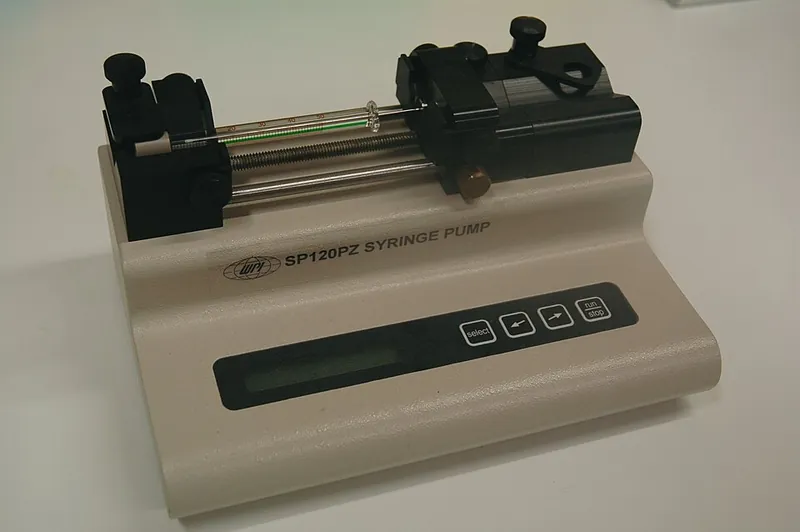
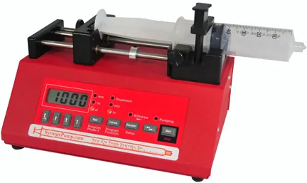

<figure class="eoc-pic eoc-pic-main"><picture><source media="(prefers-reduced-motion: reduce)" srcset="../media/drawn/syringe-pump.svg"></picture><figcaption><strong>Animation.</strong> Diagram drawn for the encyclopaedia from the research notes. ⚑ Needs confirming: a drawing can simplify or get details wrong; a real photo or a better diagram is welcome.</figcaption></figure>
<figure class="eoc-pic"><figcaption><strong>Photo.</strong> <a href="https://commons.wikimedia.org/wiki/File:Syringe_pump.jpg">Syringe pump</a> by Nuno Nogueira (Nmnogueira), <a href="https://creativecommons.org/licenses/by-sa/2.5">CC BY-SA 2.5</a>, from Wikimedia Commons.</figcaption></figure>
<figure class="eoc-pic"><figcaption><strong>How it works.</strong> <a href="https://commons.wikimedia.org/wiki/File:NE-1000_Single_Syringe_Pump.jpg">NE-1000 Single Syringe Pump</a> by Cpersinger, <a href="https://creativecommons.org/licenses/by-sa/3.0">CC BY-SA 3.0</a>, from Wikimedia Commons.</figcaption></figure>

A stepper motor turns a screw, the screw drives a sliding block, and the block pushes or pulls a syringe plunger a precise distance per step, so a set volume of liquid is delivered or drawn at a set rate (for example millilitres per hour).

**In plain words:** A motor-driven pusher that presses (or pulls) the plunger of an ordinary syringe at a slow, exact, steady speed, so it squirts out or sucks in small, measured amounts of liquid without anyone touching it. **Proper term:** Syringe pump (syringe driver).

**Also called:** syringe driver (the usual medical name; Wikipedia gives both names); syringe infusion pump; ambulatory syringe driver (portable medical version; DHSC review); laboratory syringe pump; microfluidic syringe pump; precision dispenser or micro-dispenser; infuse/withdraw syringe pump (pushes and pulls); dual or multi-syringe pump; push-pull continuous-flow syringe pump (PLOS ONE comparison table); high-pressure syringe pump (stainless-steel syringes; Chemyx); open-source syringe pump (e.g. the Open-Source Syringe Pump Library and the poseidon system, both open hardware projects); syringe extruder or paste extruder (a syringe pump used as a 3D-printer print head for pastes, foods, clay or bio-inks; Allstruder paper); linear [actuator](../glossary.md#actuator) (the PLOS ONE authors call their pump 'a relatively high precision linear actuator'); Perfusor, Injectomat, Graseby MS16A/MS26 (brands of medical syringe drivers).

## How it works

The controller sends a set number of step pulses to the stepper motor, which turns the lead screw by an exact angle; the nut on the screw drives the carriage along the guide rods, and the carriage pushes the plunger into the barrel (infuse) or, if the plunger is clamped to it, pulls it out (withdraw) (poseidon paper; Printables 50666). The liquid volume moved equals the distance travelled times the inside cross-section of the barrel, so the software needs the syringe's inner diameter to turn a requested flow rate into a step rate (Chemyx syringe library; poseidon paper). Because the screw turns slowly and finely, tiny volumes can be metered, but each motor step gives a tiny pulse in the flow (Li et al., Lab on a Chip 2014), and the soft rubber plunger tip and tubing must be squeezed tight before liquid starts to come out (Medfusion syringe pump performance tips).

## Parts

A small assembly that acts as one unit. Parts: a frame or base; a stepper motor; a shaft coupler; a lead screw or threaded rod with its nut (the screw drive); a sliding carriage (pusher block) running on two smooth rods with linear bearings; a cradle and clamp that hold the syringe barrel by its finger flange; a plunger holder on the carriage (needed if it must also pull); end-stop switches for homing; a stepper driver and a controller such as an Arduino or Raspberry Pi; and the syringe, tip fitting and tubing (PLOS ONE open-source pump; poseidon paper; Printables 167075 and 50666).

## Everyday examples

- The bedside syringe drivers in hospitals and hospices that slowly give painkillers or anti-sickness drugs over many hours (Wikipedia 'Syringe driver'; DHSC review)
- Lab syringe pumps that feed droplet-making microfluidic chips at about 1 mL/h (poseidon paper)
- Syringe 'paste extruders' that turn a 3D printer into a printer for food, ceramics or bio-inks (Allstruder, HardwareX 2026)
- A home-made doser that adds 0.4 mL of plant fertiliser to a small aquarium each day (Printables 50666)

## When to use it

Use a syringe pump when you need a small, exact volume of liquid or a slow, steady flow that you can set in software: feeding microfluidic chips, adding a reagent drop by drop over hours, dosing a fish tank or plant, dispensing glue, solder paste or food paste, or extruding paste from a 3D printer (Wikipedia 'Syringe driver'; poseidon paper; Allstruder). It can also suck liquid back up (withdraw) if the plunger is clamped to the carriage, works with almost any liquid that the syringe material resists, and the liquid touches only the syringe and tube (LabX; Printables 50666). It also doubles as a precise linear actuator, e.g. for a microscope stage (PLOS ONE).

## When not to use it

1) Never use a home-made syringe pump on a person or animal; medical syringe drivers are regulated infusion devices (FDA; DHSC review). 2) Large volumes or non-stop flow: a syringe empties and must be refilled, so use a peristaltic pump, which turns continuously, or a gear pump (Wikipedia 'Syringe driver' lists only small amounts; Peristaltic pump entry). 3) Gas: air compresses, so a syringe pump can't meter gas accurately; any trapped air bubble makes liquid flow springy and laggy (Medfusion tips on compliance and air). 4) When flow must be completely pulse-free, a pressure-driven flow controller gives much smaller fluctuations than a stepper-driven syringe (Li et al. 2014). 5) To move a part by hand-powered liquid, use syringe hydraulics instead. 6) For very high pressures with printed parts, buy a metal high-pressure pump (Chemyx).

## Details

- **What it does (jobs):**
  - change the kind of motion: turns the motor's rotation into a slow, exact straight push or pull on the plunger (PLOS ONE; poseidon paper)
  - seal it, or pass cables or fluid through: dispenses or draws up a measured amount of liquid through a sealed syringe and tube (Wikipedia 'Syringe driver')
  - slow it, stop it or keep its speed steady: keeps the liquid flowing at a constant, slow rate set in software, e.g. over hours (Wikipedia 'Syringe driver'; poseidon paper)
- **Movement:** slide: the carriage and plunger move in a straight line; the [stroke](../glossary.md#stroke) is limited by the syringe length (one full syringe of travel). The input motor rotates
- **Directions it can move (degrees of freedom):** 1: the carriage can only slide back and forth along the guide rods; the screw sets exactly where it is
- **Special behaviour:**
  - motion conversion (e.g. rotary to linear): a lead screw and nut turn motor rotation into straight-line plunger travel (PLOS ONE; poseidon paper)
  - [self-locking](../glossary.md#self-locking) (holds under load, won't back-drive): fine-pitch lead screws and threaded rods are usually self-locking, so back-pressure in the syringe can't push the carriage backwards (Wikipedia 'Leadscrew': 'Most are self-locking'; vibration can still let a screw [creep](../glossary.md#creep))
  - torque-limiting (slips or clicks at a set force/[torque](../glossary.md#torque)): the stepper's current limit sets the stall torque, so the motor stalls at a chosen pressure instead of breaking parts; poseidon set it to stall at about 4 MPa in a 1 mL syringe (poseidon paper and README)
- **How it holds:**
  - not a holding joint (it moves or passes on motion): it pushes liquid rather than holding parts together
  - shape ([form-fit](../glossary.md#form-fit--force-fit--material-bond)) and friction or clamping (force-fit): the syringe's finger flange sits in a slot and a clamp or press fit holds the barrel; the plunger end sits in a slot on the carriage (poseidon paper: print settings tuned 'to allow for a press fit of the syringe'; Printables 167075 and 50666)
- **Input and output:** Continuous rotation of the motor -> slow straight push or pull of the plunger -> liquid flow. Plunger travel per motor turn = the lead of the screw (e.g. 2 mm per turn for an 8 mm screw with 2 mm [pitch](../glossary.md#pitch), Printables 167075); volume per turn = lead x inside area of the barrel. Worked example (calculated): a BD 10 mL plastic syringe has a 14.5 mm inner diameter (Chemyx), about 165 mm2 of area, so a 2 mm lead moves about 0.33 mL per turn and, with a 200-step motor, about 1.65 µL per full step. Efficiency is that of a plain lead screw (roughly 20-80%, see the Lead screw entry); the PLOS ONE authors note lead screws are inefficient. Shaft arrangement: in line (motor, screw and plunger on parallel or the same axis). Back-drivable: no for fine-pitch screws (Wikipedia 'Leadscrew'), so the plunger stays put when the motor stops
- **Power:** powered: needs a stepper motor, a driver and a controller, usually 12 V (Hackaday syringe pump rack: 12 V, up to 2 A per motor). When power is lost the carriage simply stops where it is; a fine-pitch screw is not pushed backwards (Wikipedia 'Leadscrew'), but any pressure already built up in the syringe and tubing can still push a little liquid out ⚑ [uncertain: inferred from Medfusion's description of stored pressure after a blockage]
- **Load:** medium force on a small area. A printed NEMA 17 pump pushed 200 N and a NEMA 11 pump 93 N before stalling or breaking a printed part (PLOS ONE); commercial lab pumps quoted about 178-445 N (PLOS ONE comparison table). Because pressure = force / plunger area, small syringes reach high pressure: poseidon reached about 4 MPa with a 1 mL syringe (poseidon README); calculated, 200 N on a BD 1 mL syringe (4.78 mm bore) would be about 11 MPa but only about 0.36 MPa on a 60 mL syringe (26.72 mm bore). Strong in push along the screw axis; the frame and guide rods must resist bending (poseidon paper)
- **Play and precision:** Small but real. A plain nut gives noticeable [backlash](../glossary.md#backlash) when the direction changes from push to pull (Printables 50666), so push a little first after reversing, or use an anti-backlash nut. Rubber plunger compression and friction ('stiction') and springy tubing delay the start and make it jerky (Medfusion). Each motor step makes a small pulse in flow: about 1-2% in normal use, up to about 9% for a worn pump (Li et al. 2014). Tested [accuracy](../glossary.md#repeatability--accuracy) of printed pumps: +/-1% (NEMA 11) and +/-5% (NEMA 17) with a coefficient of variation of about 3% or less (PLOS ONE); a printed five-pump rack measured 0.5 µL accuracy in a 10 mL syringe (Hackaday). [Misalignment](../glossary.md#misalignment) [tolerance](../glossary.md#tolerance) is low: guide rods must be parallel or the stepper loses steps near the end of the stroke (Printables 50666), and a weak frame bends (poseidon paper)
- **Taking it apart:** removable: the syringe drops into its cradle and is clamped or press-fitted, so syringes of different sizes can be swapped (poseidon paper; Printables 80669 swaps a retainer to change between 1 mL and 3 mL syringes); the pump itself is screwed together
- **How often it can be reused:** many times: syringes are swapped and refilled routinely; disposable plastic syringes are single-use in medicine and their plungers wear or swell, while glass and stainless-steel syringes are reusable (LabX syringe guide; Chemyx)
- **Sealing:** watertight or airtight inside the syringe: the rubber or PTFE plunger seal and the tip fitting (often a Luer-lock connection) seal the liquid; seals can be silicone, PTFE or rubber, and a failed seal can leak or let the syringe eject from the back (LabX). The pump mechanism itself is not sealed
- **Adjustable:** yes: flow rate, volume and direction are set in software; the syringe inner diameter is entered or picked from a built-in syringe list (Chemyx; poseidon paper); calibration factors are set by measuring delivered volume (PLOS ONE); microstepping jumpers change the flow-rate range (poseidon paper); syringe holders can be resized in parametric CAD (Printables 167075)
- **Access needed:** not applicable: the syringe drops into an open cradle from above and the tubing connects at its tip
- **Materials:** Printed parts: PLA (PLOS ONE; poseidon) or PETG (Printables 80669, 167075). Metal parts: steel lead screw or threaded rod (M5 or 8 mm) with a brass or plastic nut, steel smooth rods, ball bearings (Printables 167075, 50666, 80669). Syringes: plastic (polypropylene) are cheap and disposable but flex and can swell with solvents; glass is chemically inert and the best choice for many uses; stainless steel suits high pressure; plungers of plastic, PTFE, ceramic or glass; seals of silicone, PTFE or rubber (LabX; Chemyx)
- **Heat, cold, water and wear:** Heat: printed PLA frames soften and deform above about 60 °C (Prusa PLA guide); PETG is good to about 80 °C (Prusa PETG guide). Chemicals: plastic syringe barrels can be attacked by organic solvents and acids, and polypropylene can absorb solvents and swell, upsetting accuracy; silicone oil lubricant can contaminate samples (LabX). Temperature and pressure limits of the seals matter (LabX). Mounting height: moving the pump up or down changes delivery (Medfusion). Vibration and stiction: the open-loop stepper can skip steps if friction is high (Printables 50666), and the screw's self-locking can be undone by vibration (Wikipedia 'Leadscrew').

## Making it

- **Ways to make or get it:**
  - 3D print (FDM): frame, motor mount, carriage, syringe cradle and clamps in PLA or PETG (PLOS ONE; poseidon; Printables 167075, 80669)
  - off-the-shelf part: stepper motor, lead screw or threaded rod, smooth rods, bearings, driver board, controller and syringes; also complete commercial lab syringe pumps and OEM pump modules (PLOS ONE; Chemyx)
  - CNC or laser cut: ⚑ [uncertain] plates for frames could be cut instead of printed; no opened source for a specific design
- **Printing it in one piece (print in place):** no: the printed parts (end blocks, carriage, clamps) are printed separately, usually all on one plate, and assembled with a motor, screw, rods, bearings and bolts (PLOS ONE; Printables 167075, 50666)
- **Tools:** screwdrivers and hex keys, pliers (a poseidon pump can be assembled in under 15 minutes with only pliers and screwdrivers, poseidon paper); a small screwdriver to set the stepper driver's current limit (poseidon README); a soldering iron or crimp tool for wiring; a scale or measuring cylinder for calibration (PLOS ONE)
- **Difficulty:** moderate: many open designs exist and 'even first year students' can assemble one (PLOS ONE), but it combines printed parts, a stepper motor, driver electronics, firmware and calibration

### 3D printing tips

1) Make it stiff: the poseidon team found that sliding resistance displaced the guide rods and bent the printed body, and fixed it with a reinforced, thicker base and [set screws](../glossary.md#set-screw) on the rods (poseidon paper). 2) Expect high forces: a NEMA 17 version pushed 200 N, enough to damage some printed parts (PLOS ONE); use thick walls and solid [infill](../glossary.md#infill) in the load path, and set the driver current so the motor stalls first (poseidon README; about 4 MPa in a 1 mL syringe). 3) Settings that worked: PLA, 0.5 mm nozzle, 0.25 mm layers, 60 mm/s, all parts on one plate (PLOS ONE); PETG at 0.15 mm layers with supports (Printables 80669); 25% gyroid infill in PLA or PETG (Printables 167075). 4) Align the guide rods: if they aren't parallel the stepper can lose steps when the syringe is nearly empty (Printables 50666). 5) Fit the syringe: tune the cradle for a press fit (poseidon paper), or use a parametric OpenSCAD design and enter the barrel diameter, flange size and thickness, plunger-end size and shaft diameter of your syringe (Printables 167075). 6) To pull as well as push, fix the plunger end to the carriage (Printables 50666), and expect some backlash when reversing. 7) Add end-stop switches to home the carriage and detect an empty syringe (Printables 167075, 162989). 8) Keep printed PLA away from heat: it 'gets soft and deforms at temperatures over 60 °C' (Prusa), which matters if you warm the syringe (a heat-pad holder exists for one open design, Printables 142918).

### Buying one (off-the-shelf parts)

Stepper motors: NEMA 17 or NEMA 11 (PLOS ONE), 28BYJ-48 geared stepper with driver board for slow flows (Printables 1738985), or salvaged optical-drive steppers with their lead screw (Printables 162989). Drivers and controllers: A4988 stepper driver (Pololu), Arduino with CNC shield (poseidon), Raspberry Pi (PLOS ONE). Screw drive: 8 mm lead screw (2 mm pitch, or T8 trapezoidal with a brass nut, 'T8-1-D1'), M5 threaded rod, shaft coupler (Printables 167075, 50666, 80669). Guides: 8 mm smooth rods with LM8UU linear bearings, 6 mm or 5 mm rods, 608ZZ bearing to carry the screw end (Printables 50666, 80669, 167075). Microswitch end stops. Syringes: disposable Luer-lock plastic syringes from 1 to 60 mL (Chemyx BD chart), glass gas-tight syringes, stainless-steel high-pressure syringes with swappable tips (Chemyx); blunt-tip Luer-lock dispensing needles and tubing (Printables 167075). Complete pumps: single, dual, infuse/withdraw, push-pull continuous-flow and high-pressure lab syringe pumps (PLOS ONE table; Chemyx)

## Rules of thumb

- Volume per step = inside area of the barrel x carriage travel per step. Calculated example: BD 10 mL syringe, 14.5 mm bore (Chemyx), with a 2 mm-lead screw and a 200-step motor gives about 1.65 µL per full step; a BD 1 mL syringe (4.78 mm bore) gives about 0.18 µL per step. Common BD plastic syringe bores: 1 mL 4.78 mm, 3 mL 8.66 mm, 5 mL 12.07 mm, 10 mL 14.5 mm, 20 mL 19.13 mm, 30 mL 21.69 mm, 60 mL 26.72 mm (Chemyx BD chart). Measure your own syringe if it isn't listed (Chemyx)
- Use the smallest syringe that holds the volume you need: big syringes at low flow rates make sticking and slack worse (Medfusion tips), and a bigger syringe moves more liquid but lowers precision (PLOS ONE)
- Don't dispense less than about 10% of a plastic syringe's volume, or less than 1% of a precision micro-syringe's, because plastic barrels flex and plungers are soft (LabX syringe guide)
- Smaller syringes make higher pressure from the same push (Medfusion tips); set the stepper driver's current so the motor stalls before parts break: poseidon stalls at about 4 MPa with a 1 mL syringe (poseidon paper and README)
- Flow pulses once per motor step at f = 4Q / (pi x D^2 x s), where Q is flow rate, D the barrel's inner diameter and s the carriage travel per step; typical fluctuation is about 1-2% of the flow (Li et al., Lab on a Chip 2014). Microstepping or a smaller syringe raises the pulse frequency so the flow is smoother
- Calibrate: push a small set volume twice and measure the second one (the first wets the tip), divide by the commanded volume, and repeat three times (PLOS ONE)
- Prime before timing: run the pump until liquid comes out of the tube end, so the plunger tip, tubing and fittings are already pressed tight (Medfusion tips)
- Keep the pump level with the outlet: raising or lowering it changes the pressure by about 25 mmHg per foot (about 3.3 kPa per 30 cm) and causes a surge or a pause, worst with large syringes below about 1 mL/h (Medfusion tips)
- After a blockage is cleared, pressure stored in the syringe squirts out an unintended extra dose, larger with bigger syringes; good pumps pull back slightly to prevent it (Medfusion tips)
- Set rates in millilitres per hour, not millimetres of travel: confusing 'mm per hour' and 'mm per 24 hours' medical drivers led to fatal over-infusions (DHSC review of syringe driver safety)
- Expected cost and performance of a printed pump: under 100 USD in parts versus 260 to over 5000 USD for commercial pumps; up to 2.1 mL/s and 200 N with NEMA 17, 1.4 mL/s and 93 N with NEMA 11 (PLOS ONE)

## Common failures

1) Wrong flow because the syringe inner diameter or the microstepping setting in software doesn't match the hardware (poseidon paper found this in use). 2) Slow or jerky start from plunger-tip compression, friction and slack in tubing; prime first (Medfusion). 3) Missed steps when guide rods aren't parallel or friction is high near the end of the stroke (Printables 50666). 4) Printed frame bending or parts breaking under load (poseidon paper; PLOS ONE); stiffen the body and limit motor current. 5) Backlash when switching from push to pull (Printables 50666). 6) Pulsing flow from the motor steps, worse in worn pumps (Li et al. 2014). 7) A surge after a blockage clears, or flow changes when the pump is moved up or down (Medfusion). 8) Air bubbles in the syringe making the flow springy (Medfusion: in-line air adds compliance). 9) Plastic syringes swelling or being attacked by solvents (LabX). 10) The rate entered in the wrong units (DHSC review).

## Safety

1) Never use a home-made syringe pump on people or animals. Even certified devices go wrong: in England between 2005 and 2010 there were 175 reported incidents with ambulatory syringe drivers and eight deaths from over-infusion, many caused by rate settings in millimetres of travel (mm per hour versus mm per 24 hours) (DHSC review), and the US FDA received about 56,000 adverse-event reports about infusion pumps from 2005 to 2009, including injuries and deaths (FDA). 2) Blocked lines build pressure: poseidon lists clogged lines creating pressurised liquid, electrical shock and material compatibility as hazards, and limits the motor so it stalls at about 4 MPa (poseidon paper); a failed plunger seal can let liquid squirt or the syringe eject from the back (LabX). Wear eye protection with hazardous liquids. 3) Small syringes reach high pressure from a small push (Medfusion), so use tubing and fittings rated for it. 4) Check that the syringe and printed parts resist the liquid you are pumping (LabX; poseidon paper). 5) Use blunt dispensing tips rather than sharp needles where possible (Printables 167075 uses a blunt-tip Luer-lock needle). 6) Keep fingers clear of the moving carriage ⚑ [uncertain: general pinch-point advice, no specific source].

## Related

- Syringe hydraulics: two syringes joined by a tube and pushed by hand to move parts; no motor and no metering
- Lead screw and nut: the screw drive inside a syringe pump; see it for [back-driving](../glossary.md#back-driving) and backlash details
- Peristaltic pump: rollers squeeze a tube, so it can run continuously and self-prime, but the flow pulses with each roller and the tube wears
- Diaphragm pump and squeeze bulb: cheap, pulsing pumps for air and water, not for exact doses
- Gear pump: continuous flow of oil or water; not suited to tiny measured doses
- Air or hydraulic cylinder: also a piston in a tube, but driven by fluid pressure to move a load rather than driven by a screw to move fluid
- Ball screw: a smoother, more efficient screw drive that can be back-driven, used in some high-end pumps and stages
- Pressure-driven flow controller (not an entry): pushes liquid from a pressurised reservoir and gives smoother flow than a stepper-driven syringe (Li et al. 2014)

## Make it yourself

- [Open-Source Syringe Pumps (LIBRE hub, Printables) (URL from Printables API, page not opened)](https://www.printables.com/model/688085-open-source-syringe-pumps): Printable lab syringe pumps for microfluidics, mass spectrometry and microscopy, redesigned from Andrey Samokhin's Open-Source Syringe Pump, with documentation and an online CAD model *(licence: CC BY)*
- [Syringe Pump (slimpickens, Printables) (URL from Printables API, page not opened)](https://www.printables.com/model/167075-syringe-pump): Parametric OpenSCAD syringe pump: enter your syringe's barrel and plunger dimensions; NEMA 17, 8 mm x 2 mm-pitch lead screw, 5 mm rods, 608ZZ bearing and end stops *(licence: CC BY)*
- [Mini syringe pump from optical drive parts (Nemo404, Printables) (URL from Printables API, page not opened)](https://www.printables.com/model/162989-mini-syringe-pump-from-optical-drive-parts): Three-part printed frame for a 5 mL syringe driven by a salvaged optical-drive stepper and lead screw; the designer notes it is not medical equipment *(licence: CC BY-NC)*
- [Syringe Pump (28BYJ-48) (Martin Castro, Printables) (URL from Printables API, page not opened)](https://www.printables.com/model/1738985-syringe-pump-28byj-48): Low-flow pump (up to about 2 mL per minute) for a 10 mL craft syringe using a cheap 28BYJ-48 geared stepper and an M4 bolt as the screw *(licence: CC BY-SA)*
- [Syringe pump (TeeVau, Printables) (URL from Printables API, page not opened)](https://www.printables.com/model/50666-syringe-pump): Push-and-pull syringe pump with a T8 lead screw and LM8UU bearings, built to dose aquarium fertiliser; the notes describe backlash and rod alignment *(licence: CC BY-NC-SA)*
- [poseidon open-source syringe pump and microscope system (Pachter Lab)](https://pachterlab.github.io/poseidon/): Documentation, CAD (STL, STEP, Fusion 360), Arduino firmware and Python GUI for up to three or four printed syringe pumps; code repository at github.com/pachterlab/poseidon *(licence: BSD 2-Clause (repository LICENSE))*

## Pictures, videos and models

- [Syringe pump.jpg (Nuno Nogueira; Wikimedia Commons)](https://commons.wikimedia.org/wiki/File:Syringe_pump.jpg): A laboratory syringe pump (World Precision Instruments SP120PZ) with a syringe clamped in place and its pusher block behind the plunger *(licence: CC BY-SA 2.5)*
- [Syringe drivers.JPG (Stefan Bellini; Wikimedia Commons)](https://commons.wikimedia.org/wiki/File:Syringe_drivers.JPG): Several medical syringe drivers in use in a coronary care unit *(licence: CC0)*
- [Open-Source Syringe Pump Library (Wijnen, Hunt, Anzalone and Pearce, PLOS ONE 2014)](https://journals.plos.org/plosone/article?id=10.1371/journal.pone.0107216): Exploded view of a 3D-printed syringe pump (Figure 3), photos of NEMA 11, NEMA 17 and dual versions, the wiring diagram, and a comparison table with commercial pumps *(licence: CC BY (open-access article))*
- [Poseidon Build Videos: Syringe Pump (Sina Booeshaghi, YouTube)](https://www.youtube.com/watch?v=7YSiO6usR1M): Step-by-step assembly of the poseidon 3D-printed syringe pump (stepper, lead screw, rods and syringe holder) *(licence: Standard YouTube licence (link only))*
- [3d printed mini syringe pump with parts from optical drive (Nemo404, YouTube)](https://www.youtube.com/watch?v=YdeZJIZdA_A): A tiny printed syringe pump driven by a salvaged optical-drive stepper and lead screw, pushing a 5 mL syringe *(licence: Standard YouTube licence (link only))*

## Needs confirming

⚑ marks something nobody has confirmed yet: a fact the research could not confirm from a source, a finder value that is a best guess, or an open point from the research notes. Corrections are welcome (see `research/needs-confirming.md`).

- ⚑ 3 sentences on this page marked [uncertain].
- ⚑ Finder value `power_source` = electricity, liquid (source uncertain): `power` is marked ⚑ [uncertain] here: "…built up in the syringe and tubing can still push a little liquid out ⚑ [uncertain: inferred from Medfusion's de…"
- ⚑ Finder value `power_loss` = keeps its last state (source uncertain): `power` is marked ⚑ [uncertain] here: "…built up in the syringe and tubing can still push a little liquid out ⚑ [uncertain: inferred from Medfusion's de…"
- ⚑ Finder value `overload_response` = not applicable (best guess): listed as torque-limiting or breakaway, but no overload behaviour matched
- ⚑ Research note: Numbers the agents worked out themselves are labelled "calculated" in *Syringe pump* and *Air tank and hydraulic accumulator* (µL per motor step, syringe pressures, a Boyle's-law example).

## Sources

- <https://en.wikipedia.org/wiki/Syringe_driver>
- <https://en.wikipedia.org/wiki/Leadscrew>
- <https://journals.plos.org/plosone/article?id=10.1371/journal.pone.0107216>
- <https://journals.plos.org/plosone/article/file?id=10.1371/journal.pone.0107216&type=manuscript>
- <https://www.nature.com/articles/s41598-019-48815-9>
- <https://www.ebi.ac.uk/europepmc/webservices/rest/PMC6711986/fullTextXML>
- <https://raw.githubusercontent.com/pachterlab/poseidon/release/README.MD>
- <https://raw.githubusercontent.com/pachterlab/poseidon/release/LICENSE>
- <https://pachterlab.github.io/poseidon/>
- <https://sauretlab.me.ucsb.edu/sites/default/files/papers/2014_Li_LabChip.pdf>
- <https://chemyx.com/resources/pump-resources/min-and-max-flow-rates/bd-plastic-syringe-minimum-maximum-flow-rates/>
- <https://chemyx.com/resources/knowledge-base/general-syringe-pump-info/which-syringe-pump-and-syringe-is-right-for-my-lab/>
- <https://www.agilitihealth.com/wp-content/uploads/2023/08/medfusion-3500-syringe-infusion-pump.pdf>
- <https://www.labx.com/resources/choosing-the-right-syringe-for-your-pumping-application/4518>
- <https://assets.publishing.service.gov.uk/government/uploads/system/uploads/attachment_data/file/757999/dhsc-review-of-syringe-driver-safety-actions.pdf>
- <https://www.fda.gov/medical-devices/general-hospital-devices-and-supplies/infusion-pumps>
- <https://hackaday.com/2015/05/29/pump-up-the-volume-with-the-3d-printed-syringe-pump-rack/>
- <https://www.ebi.ac.uk/europepmc/webservices/rest/search?query=PMCID:PMC13594859&format=json&resultType=core>
- <https://help.prusa3d.com/article/pla_2062>
- <https://help.prusa3d.com/article/petg_2059>
- <https://api.printables.com/graphql/>
- <https://www.printables.com/model/688085-open-source-syringe-pumps>
- <https://www.printables.com/model/167075-syringe-pump>
- <https://www.printables.com/model/162989-mini-syringe-pump-from-optical-drive-parts>
- <https://www.printables.com/model/1738985-syringe-pump-28byj-48>
- <https://www.printables.com/model/50666-syringe-pump>
- <https://www.printables.com/model/80669-open-source-syringe-pump-remix>
- <https://www.printables.com/model/142918-heatpad-holder-for-open-source-syringe-pump>
- <https://commons.wikimedia.org/wiki/Category:Syringe_drivers>
- <https://commons.wikimedia.org/wiki/File:Syringe_pump.jpg>
- <https://commons.wikimedia.org/wiki/File:Syringe_drivers.JPG>
- <https://www.youtube.com/watch?v=7YSiO6usR1M>
- <https://www.youtube.com/watch?v=YdeZJIZdA_A>
