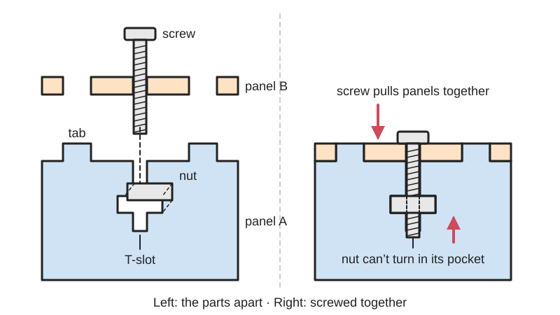
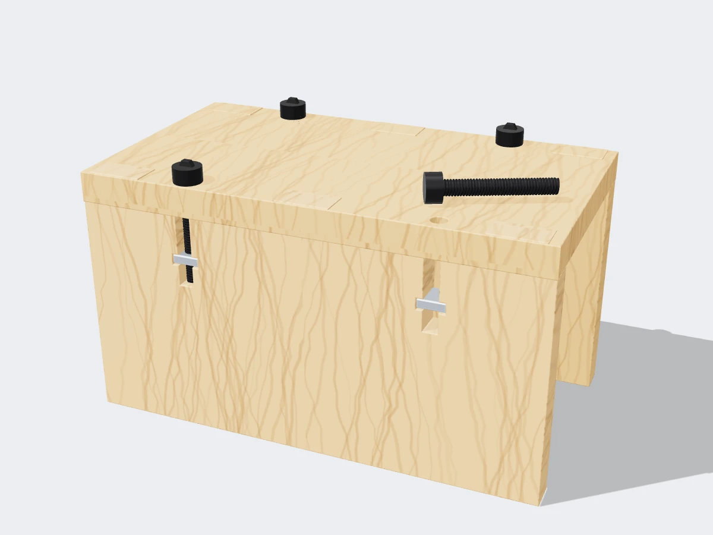

<figure class="eoc-pic eoc-pic-main"><figcaption>Diagram drawn for the encyclopaedia from the research notes. ⚑ Needs confirming: a drawing can simplify or get details wrong; a real photo or a better diagram is welcome.</figcaption></figure>
<figure class="eoc-pic"><figcaption><strong>Render.</strong> A 3D model made for the encyclopaedia, not a photo: a stand-in until a good real photo is found. ⚑ Needs confirming: a model can simplify or get details wrong; a real photo is welcome.</figcaption></figure>

A T-shaped slot cut into the edge of a sheet traps a nut so that a screw through the neighbouring sheet can clamp the two sheets together at a corner, giving a strong joint that can be taken apart and reassembled many times.

**In plain words:** A T-shaped cut-out in the edge of one flat panel that holds an ordinary nut, so a screw pushed through a hole in the other panel runs along the stem of the T into the nut and pulls the two panels tight together at a right angle, like the joints on laser-cut plywood 3D printers and acrylic project boxes. **Proper term:** T-slot joint (captive-nut edge joint, bolted tab-and-slot joint).

**Also called:** T-slot or T-slot joint (Ponoko; Adafruit 'T-slots have become iconic of laser-cut design'; Onshape FeatureScript 'T-Slot Joints for Laser Cut Parts'); T-nut or t-nut joint (term popularised at MIT by Charles Guan; MIT Fab 'Captive T-nuts for rapid assembly'). Not the same as a pronged tee nut hammered into wood or a T-slot nut for machine tables and aluminium extrusion; crossed-T nut, slotted-insert nut, captive slot nut, slotted nut, jokingly 'Jesus nut' (names collected by Charles Guan, 'How to Build Your Everything Really Really Fast'); [captive nut](../glossary.md#captive-nut) joint or captive nuts (Fabworks; lasercut.scad 'captive_nuts'; What Make Art); captive-screw mortise and tenon, captive-screw connection (CMU 16-223 'Flat-Pack Joinery'); bolted mortice-and-tenon joint, captive T-slotted nut and bolt (DefProc); T-bolt joint, T-bolt box, interlocking T-bolt construction (Pololu forum; oomlout); tab and slot with T-nut (Simon Arthur, waterjet blog); bed bolt (the name Boxes.py uses for its screw-and-nut slots; the traditional furniture bed bolt joint, a long bolt through a bed post into a nut housed in the rail, is the woodworking ancestor); captive square nut CNC panel joint (Make: magazine).

## How it works

The crossbar of the T is a pocket cut right through panel A, just big enough for a nut standing on edge, so once the nut drops in it cannot turn or slide along the screw. The screw goes through a hole in panel B, runs along the stem of the T and threads into the nut; as it is tightened the nut is pulled against the far wall of its pocket and the two panels are clamped together, a bit like a tapped hole in the edge of the sheet (Charles Guan; MIT Fab). The tabs and slots next to it stop the panels sliding or twisting, while the screw stops them pulling apart, so the pair of features makes a rigid corner that still unscrews (CMU 16-223; Cal Miller). Because the screw does the clamping, the joint also pulls tight even if the sheet is a little thinner or thicker than expected (CMU 16-223; Ponoko).

## Parts

A few parts: panel A with a T-shaped cut-out in its edge (a narrow stem as wide as the screw, plus a crossbar pocket as wide as the nut), panel B with a round [clearance](../glossary.md#clearance) hole for the screw (and usually slots for the tabs of panel A), one machine screw, one square or hex nut, and optional washers. It is almost always combined with tabs and slots (finger or mortise-and-tenon joints) that locate the panels.

## Everyday examples

- Early hobby 3D printers with laser-cut plywood frames, such as the MakerBot Cupcake CNC and Thing-O-Matic (M3 screws and nuts in T-slots; MakerBot wiki, Ponoko comments) and the Ultimaker Original (37 M3 x 16 mm screws and nuts hold its plywood 'cube' frame; Ultimaker Original assembly manual)
- Laser-cut acrylic kit enclosures for electronics, e.g. Adafruit's Internet of Things Printer case ('T-slots on the back. Nuts on the bottom.') and its paper-lantern-style light cubes (Adafruit 'Laser-Cut Enclosure Design')
- Laser-cut plywood robot chassis and drivetrains, e.g. FIRST Robotics Competition robots (Cal Miller, 'How to Make Stuff with Laser-cut Plywood')
- Flat-pack plywood furniture and project boxes bolted together at the corners (XY Kao; CMU 16-223)

## When to use it

Use a T-slot when you want a strong right-angle joint between flat sheets that can be taken apart and put back together, for example an electronics enclosure you will need to open, a robot frame you will modify, or a kit that customers assemble without glue (Adafruit prefers 'nuts and screws, tabs and slots' to glue or friction fits for kits because sheet thickness varies). It suits laser-cut plywood, MDF and acrylic, waterjet-cut metal, and any sheet at least as thick as the nut. It is a good choice when the sheet thickness is uncertain, because the screw pulls the joint tight anyway (CMU 16-223; Ponoko).

## When not to use it

Avoid it in sheet thinner than the nut (about 3 mm for M3; Fabworks says at least 1/8 in for metal); use bent tabs, a snap-lock sheet joint or glue instead. Avoid it where looks matter and the nut pockets would be on show (Adafruit calls nuts and T-slots 'much more unsightly'; hide them at the back or bottom, or use a snap-lock sheet joint). For high-volume sheet-metal products, press-in (self-clinching) nuts or bent flanges are quicker to assemble (Fabworks). For thick solid wood or furniture panels use knock-down fittings such as a cross dowel (barrel nut) or cam lock. For a threaded hole in the face of a printed part use a nut trap or [heat-set insert](../glossary.md#heat-set-insert). If the joint must never be opened, glue or a tab-and-slot press fit is simpler.

## Details

- **What it does (jobs):**
  - join and hold: clamps two flat panels together, usually at a right angle, so boxes, frames and robot chassis can be bolted up and taken apart
  - line parts up exactly: the tabs and slots that usually surround it locate the panels, and the screw pulls them home (Adafruit; Cal Miller)
- **Movement:** none
- **Directions it can move (degrees of freedom):** 0: once the screw is tight and the tabs are in their slots the panels cannot move. The screw alone does not stop panel A turning about the screw's axis, which is why tabs or a second screw are added (CMU 16-223).
- **Special behaviour:**
  - none: it is a plain bolted joint. Its useful trick is that the nut is held in the sheet itself, so no spanner is needed and the screw can be driven from outside a box (What Make Art: the slot 'holds a hex nut so it cannot spin, acting like a wrench as the bolt is tightened')
- **How it holds:**
  - shape (the parts interlock; [form-fit](../glossary.md#form-fit--force-fit--material-bond)): the nut is trapped in its pocket so it cannot turn or pull out, and the tabs interlock with slots
  - friction or clamping (force-fit): the screw and nut clamp the two panels together
- **Input and output:** not applicable
- **Power:** passive (no power needed)
- **Load:** medium: strong enough for laser-cut plywood 3D-printer frames and plywood competition-robot drivetrains (Ultimaker Original manual; Cal Miller). Strong in pull along the screw when the nut sits between finger joints, because pulling pushes the fingers harder into their slots and the limit becomes the screw's pull-out strength (Charles Guan). Weak against twisting about the screw axis unless tabs are added (CMU 16-223). The two thin strips of sheet beside the nut can burst if the nut is used on its own without tabs around it (Charles Guan), and a nut can be pulled sideways out of an open slot unless there are nuts on both faces of a seam (Cal Miller).
- **Play and precision:** small: the position is set by the tabs and slots, not the screw; the screw's clearance hole and the nut pocket are deliberately a little loose. Because the screw clamps the joint, it tolerates quite large variation in sheet thickness (CMU 16-223: 'a wide [tolerance](../glossary.md#tolerance) for variations in material thickness'). Tolerates little [misalignment](../glossary.md#misalignment) between the hole and the slot; Ultimaker and MakerBot instructions tighten all screws loosely first and fully afterwards so parts can settle (Ultimaker Original manual; MakerBot wiki).
- **Taking it apart:** removable: unscrew the screw and the panels come apart; the nut can be tipped out of its pocket. CMU 16-223: it 'can also be easily disassembled and re-assembled, and the fasteners re-used many times'.
- **How often it can be reused:** many times: the screw runs in the steel nut's thread, not in the sheet material, so nothing wears much (CMU 16-223; Cal Miller: nuts and bolts 'allow disassembly of structures'). The pocket in soft wood or MDF can be crushed if the screw is overtightened, and a nut that spins will round out the pocket.
- **Sealing:** none
- **Adjustable:** no: it is a fixed joint. A long stem (screw clearance past the nut) lets you use screws of slightly different lengths (Charles Guan; Simon Arthur).
- **Access needed:** both sides: you need the screw head on the outside face of panel B and the nut pocket, which is cut right through panel A. On a box both are usually reachable from the outside, which is why the nut pockets show on the outer faces (Adafruit suggests putting them on the back or bottom).
- **Materials:** Plywood (3 to 12 mm), MDF, acrylic and other laser-cuttable plastics, and waterjet- or laser-cut aluminium and steel plate (MIT Fab: 1/4 in aluminium; Fabworks: sheet metal at least 1/8 in thick; Simon Arthur: waterjet). Hardware is standard steel machine screws with square or hex nuts; square nuts are easier to fit (Cal Miller). Not suitable for sheet thinner than the nut is thick.
- **Heat, cold, water and wear:** The steel hardware is unaffected by normal conditions, but the sheet around it is not: MDF can swell or break when wet and warp in humid air if unsealed (Wikipedia 'Medium-density fibreboard'), and wood can shrink so screws slacken over time ⚑ [uncertain]. Vibration loosens the screws: MakerBot advises checking them occasionally, Cal Miller recommends medium-strength thread-locker for nuts on vibrating assemblies, and Ponoko suggests rubber washers to keep tension. Take care with liquid thread-locker near acrylic: laser-cut acrylic edges can craze when exposed to solvents, even glass cleaner (Wikipedia 'Poly(methyl methacrylate)'); whether a given thread-locker does this is ⚑ [uncertain]. Acrylic softens around 85 to 165 C depending on grade (glass transition about 105 C; Wikipedia PMMA).

## Making it

- **Ways to make or get it:**
  - laser cut: the classic way, in plywood, MDF or acrylic (Adafruit; Ponoko; CMU 16-223)
  - CNC: router or mill; the square nut pocket can be replaced by a round-ended pocket that a 6.35 mm (1/4 in) or smaller end mill can cut, at the cost of more space (CMU 16-223)
  - sheet metal: waterjet- or laser-cut aluminium and steel plate at least 1/8 in thick (Fabworks; MIT Fab; Simon Arthur)
  - 3D print (FDM): possible for printed plates, but printed parts more often use a nut trap pocket instead (see 'Captive nut pocket (nut trap)')
  - off-the-shelf part: the machine screw, nut and washers
- **Printing it in one piece (print in place):** no: it is two separate panels plus a screw and nut that are assembled afterwards.
- **Tools:** screwdriver or hex key for the screw; no spanner on the nut. Helpful: a strip of tape across the outside of the panel to stop nuts falling out while you start the screw (MakerBot wiki; Pololu; Ultimaker Original assembly manual), pliers or a light hammer to push in tight nuts (Cal Miller), a file or sandpaper for slots that are slightly too tight (MakerBot wiki).
- **Difficulty:** easy: it is just a T-shaped cut-out and a hole drawn in the cutting file plus a screw and nut you already have; the only fiddly part is sizing the nut pocket for your cutter's [kerf](../glossary.md#kerf) and your nuts

### 3D printing tips

The T-slot is mainly a laser-cut and CNC joint; in 3D printing the same job is usually done with a hex pocket (nut trap) or a heat-set insert. If you do print flat panels with T-slots: 1) print the panel lying flat so the T is cut through the layers and its walls are made of solid [perimeters](../glossary.md#perimeters). 2) Size the nut pocket from your actual nuts (metric M3 hex nut 5.5 mm across the flats, 6.4 mm across the corners, 2.4 mm thick; M4 7 x 8.1 x 3.2 mm; Wikipedia 'Nut (hardware)'), starting with about 0.2 mm extra overall (0.1 mm each side) as Hubs suggests for embedded nuts, and print a test strip. 3) Keep the pocket narrower than the nut's corner-to-corner size so the nut cannot spin (Pololu). 4) Keep at least one screw diameter of solid material around the pocket and between its far wall and the panel edge (Hubs: wall around a thread at least equal to the fastener diameter; Charles Guan: at least one screw diameter from the slot bottom to the edge). 5) Extend the screw stem past the nut so a slightly long screw does not bottom out (Charles Guan). 6) Printed plastic [creeps](../glossary.md#creep) and can crack at sharp inside corners, so round the pocket corners and do not overtighten ⚑ [uncertain for printed T-slots specifically].

### Buying one (off-the-shelf parts)

Machine screws (socket-head cap, pan-head or flat-head/countersunk), square nuts or hex nuts, flat washers, rubber washers, nylon-insert lock nuts or medium-strength thread-locker for vibration. Common sizes used by makers: M3 x 16 mm screws with M3 hex nuts (MakerBot Thing-O-Matic, Ultimaker Original), #4-40 x 1/2 in screws with #4-40 nuts (Adafruit), 8-32 x 5/8 in pan-head screws with 8-32 square nuts for 1/4 in plywood (Cal Miller), M6 or 1/4-20 screws for 6 mm plywood (CMU 16-223). Search terms: 'square nut', 'machine screw nut', 'socket head cap screw'.

## Rules of thumb

- Nut pocket width (along the panel edge): wider than the nut across its flats but not wider than across its corners, so the nut cannot turn with the screw (Pololu forum, Arthur, 2014).
- Five critical dimensions: fastening length = nominal screw length measured from the outer face of the mating panel; nut slot thickness just over the nut's thickness (0.095 in for a 0.0938 in thick #4-40 nut); screw clearance width (0.120 in for #4); nut width across the flats (0.25 in for #4-40), or across the corners if the nut must sit flush with a thin sheet; screw clearance beyond the nut longer than your sloppiest screw, up to about 0.03 in extra (Charles Guan, 'How to Build Your Everything Really Really Fast', step 4).
- Keep the bottom of the slot at least one screw diameter from the panel edge when the panel is well braced by other panels; where the nut can bear on the slot walls, round the slot ends ('camel humps') leaving at least half a material thickness between the slot corner and the nearest edge (Charles Guan).
- Use nuts in more than one plane at each corner (screws starting from both panels) so the box cannot 'open like a book' (Charles Guan; MIT Fab 'Captive T-nuts').
- Pair each T-slot with tabs: CMU uses two press-fit tenons with a 2 degree [taper](../glossary.md#taper) beside each captive screw in 6 mm plywood, with slots drawn 6.2 mm wide (they cut about 6.4 mm with a 0.2 mm kerf) (CMU 16-223 'Flat-Pack Joinery', 2021).
- Screw lengths for M6 captive-screw joints with washers: 3 mm stock M6 x 20, 6 mm stock M6 x 25, 9 mm M6 x 25, 12 mm M6 x 30 (CMU 16-223).
- Hardware sizing examples: 8-32 square nuts with 8-32 x 5/8 in screws for 0.25 in plywood, smaller hardware for thinner wood (Cal Miller); #4-40 x 1/2 in screws as a single standard size for acrylic kits (Adafruit); M3 x 16 mm for plywood 3D-printer frames (MakerBot wiki; Ultimaker Original manual).
- In the lasercut.scad OpenSCAD library the screw diameter and the nut thickness must both be smaller than the sheet thickness, and the screw thread length less than five sheet thicknesses (bmsleight/lasercut, captiveNutBoltHole()).
- Sheet metal: use material at least 1/8 in thick, add about 0.01 in clearance for 1/4 in material and 0.005 in for 1/8 in material (the same article's summary says 0.0075 in, so test), and add box joints for strength (Fabworks, 2024).
- In acrylic, round the inside corners of the cut-outs so over-tightening does not crack the sheet; Ponoko suggests radii of 0.5 mm or more for slot ends in acrylic (Ponoko, Dan Emery, 2010).
- Laser kerf is about 0.006 to 0.007 in (0.15 to 0.18 mm) on typical machines; Pololu offsets lines by about 0.004 in, and Charles Guan recommends cutting a 'kerf gauge' of test slots for your machine and material (Pololu; Cal Miller; Charles Guan step 6).
- Boxes.py's default bed-bolt (T-slot) settings for M3: 3 mm screw, 5.5 mm nut width, 2 mm nut height, 20 mm slot length with the nut 15 mm in (florianfesti/boxes, boxes/__init__.py).

## Common failures

1) Nut falls out, or drops inside a box while you start the screw: put tape across the outside of the pocket (MakerBot wiki; Pololu; Ultimaker manual), make the pocket narrower than the nut's corner-to-corner size (Pololu), or add a dot of glue if the slot is too wide (MakerBot wiki). 2) Nut will not go in: M3 nuts vary; rotate the nut a sixth of a turn, insert it from the other face, or file the slot (MakerBot wiki); adjust the drawing for your kerf (Pololu; Charles Guan). 3) Nut spins: pocket too wide. 4) Screw bottoms out on a flat-bottomed slot, so the joint feels tight but is not clamped, or a short screw engages too few threads: use a fully crossed T with extra clearance beyond the nut (Charles Guan). 5) Material next to the nut cracks or bursts: sharp inside corners are stress raisers, the nut is too close to the edge, or the screw was overtightened; round the corners, keep at least one screw diameter to the edge and do not overtighten (Charles Guan; Ponoko; Cal Miller). 6) Panel rotates about the screw or the structure bows or 'opens like a book': add tabs and put nuts in more than one plane (CMU 16-223; Charles Guan). 7) Screws loosen with vibration: thread-locker, lock nuts or rubber washers (Cal Miller; Ponoko; SendCutSend). 8) Tabs will not go into a part already bolted on two sides: loosen the other screws first (MakerBot wiki).

## Safety

None known for the joint itself. Waterjet- and laser-cut metal edges can be sharp ⚑ [uncertain]; small loose nuts are a swallowing hazard for young children ⚑ [uncertain].

## Related

- Tab-and-slot joint (self-fixturing sheet joint): the tabs alone; locates the panels and is usually glued or press-fitted, while the T-slot adds a screw to clamp them
- Finger joint (box joint): interlocking edge fingers; often combined with T-slots, which stop the fingers sliding apart (Cal Miller)
- Captive nut pocket (nut trap): the 3D-printing cousin, a hex pocket in a printed part rather than a T in the edge of a sheet
- Snap-lock sheet joint (barbed or spring finger): holds sheets with springy barbed tabs instead of hardware; no screws to count, but weaker and less forgiving of material changes
- Knock-down cam-lock and cross-dowel connectors: the furniture version; a cross dowel (barrel nut) sits in a drilled hole in thick wood instead of a nut in a cut slot (Wikipedia 'Barrel nut')
- Aluminium-extrusion connectors (T-slot nuts and brackets): shares the 'T-slot' name but the nut slides in a T-shaped groove along a metal profile
- Mortise and tenon (incl. wedged, drawbored and tusk tenons): the traditional woodworking joint; the CMU and DefProc names ('captive-screw mortise and tenon', 'bolted mortice-and-tenon') describe a T-slot as a bolted version of it; the furniture bed bolt joint is its direct ancestor (Fine Woodworking 'The Bed Bolt Joint')
- Heat-set threaded insert and blind threaded fixings (rivet nut): give a threaded hole without needing a pocket that cuts through the panel
- Ordinary screw joint (bolt and nut, machine screw): the basic joint that a T-slot rearranges so the nut is held by the sheet

## Make it yourself

- [New FeatureScript: T-Slot Joints for Laser Cut Parts (Onshape forum, Arul Suresh, 2016)](https://forum.onshape.com/discussion/4343/new-featurescript-t-slot-joints-for-laser-cut-parts): Announcement and link to a free Onshape FeatureScript that adds T-slot joints to laser-cut panels: pick a panel edge and a screw type, set screw length and spacing; it assumes standard square nuts in sizes sold by McMaster-Carr *(licence: not stated on the forum page ⚑ [uncertain])*
- [lasercut.scad: captive_nuts and captive_nut_holes (OpenSCAD library by bmsleight)](https://raw.githubusercontent.com/bmsleight/lasercut/master/lasercut.scad): OpenSCAD module that builds laser-cut panels in 3D and exports flat cutting files; the captive_nuts option cuts the T-shaped screw-and-nut slot and matching tabs, captive_nut_holes cuts the holes in the mating panel (README example 'Captive Nuts - Great for holding laser-cut sheets together') *(licence: BSD 2-Clause)*
- [Boxes.py bedBoltHole() (Python box generator library by Florian Festi)](https://raw.githubusercontent.com/florianfesti/boxes/master/boxes/__init__.py): The Boxes.py library can put 'bed bolt' screw-and-nut T-slots into finger joints (default M3 settings in the source); the README notes this is not yet offered in the ready-made online generators, so it needs a little Python *(licence: GPL-3.0 or later)*
- [Fusion 360 Tutorial: Captive Nut Joint for Laser Cutting (YouTube, What Make Art)](https://www.youtube.com/watch?v=57OT_SIW96U): Video tutorial on modelling a captive-nut joint for laser cutting in Fusion 360; title and channel confirmed via YouTube oEmbed, video not watched *(licence: link only (standard YouTube licence))*

## Pictures, videos and models

- [Flat-Pack Joinery (CMU 16-223 Creative Kinetic Systems, Garth Zeglin, 2021)](https://courses.ideate.cmu.edu/16-223/f2021/text/reference/joinery.html): Drawings and section views of a laser-cut captive-screw joint with two tapered tenons in 6 mm plywood, a CNC-routed version with a round-ended nut pocket, dimensioned M6 and 1/4-20 slots, and screw-length tables *(licence: CC BY 4.0)*
- [What's this kind of joint called? (Make:, Sean Michael Ragan, 2011)](https://makezine.com/2011/10/06/clever-captive-square-nut-cnc-panel-joint/): Exploded and assembled drawings of two panels joined with tabs, a screw and a square nut captured in the arms of a T-shaped slot *(licence: link only)*
- [Captive T-nuts for rapid assembly (MIT Fab, Daniel Fourie, 2010)](https://fab.cba.mit.edu/content/tools/omax_waterjet/tnuts.html): Photo of a waterjet-cut aluminium corner held with a T-nut and a dimensioned drawing for a 4-40 screw and square nut in 1/4 in aluminium *(licence: link only)*
- [Construction technique: Tab and Slot with T-nut (Simon Arthur's blog, 2014)](https://planiverse.wordpress.com/2014/04/07/construction-technique-tab-and-slot-with-t-nut/): CAD drawing and photos of waterjet-cut parts and a clear acrylic box joined with tabs and T-nuts, including the stronger version with the slots surrounded by solid material *(licence: link only)*
- [The Factory | Captive Nuts In Laser Cut Designs (YouTube, Core Electronics)](https://www.youtube.com/watch?v=T51lx0ChgdU): Video on designing captive nut slots in laser-cut parts; title and channel confirmed via YouTube oEmbed, video not watched *(licence: link only (standard YouTube licence))*

## Needs confirming

⚑ marks something nobody has confirmed yet: a fact the research could not confirm from a source, a finder value that is a best guess, or an open point from the research notes. Corrections are welcome (see `research/needs-confirming.md`).

- ⚑ 6 sentences on this page marked [uncertain].
- ⚑ Finder value `made_of` = 3D prints, plastic sheet, tube or moulded parts, wood, metal (best guess): proposed from the words in the research text (R37); not yet checked

## Sources

- <https://courses.ideate.cmu.edu/16-223/f2021/text/reference/joinery.html>
- <https://makezine.com/2011/10/06/clever-captive-square-nut-cnc-panel-joint/>
- <https://fab.cba.mit.edu/content/tools/omax_waterjet/tnuts.html>
- <https://www.fabworks.com/blog/captive-nut-guide>
- <https://forum.onshape.com/discussion/4343/new-featurescript-t-slot-joints-for-laser-cut-parts>
- <https://www.cs.cmu.edu/afs/cs/academic/class/99353-f16/day3/kerf.pdf>
- <https://www.ponoko.com/blog/how-to-make/how-to-make-snug-joints-in-acrylic/>
- <https://www.ponoko.com/blog/how-to-make/how-to-make-laser-cut-interlocking-acrylic-designs/>
- <https://planiverse.wordpress.com/2014/04/07/construction-technique-tab-and-slot-with-t-nut/>
- <https://xy-kao.com/laser-cut-project-boxes/>
- <https://forum.pololu.com/t/t-bolt-boxes/7577>
- <https://sendcutsend.com/blog/methods-for-joining-laser-cut-parts/>
- <https://www.instructables.com/How-to-Build-your-Everything-Really-Really-Fast/>
- <https://www.instructables.com/json-api/showInstructableModel?urlString=How-to-Build-your-Everything-Really-Really-Fast>
- <https://www.etotheipiplusone.net/?p=2531>
- <https://raw.githubusercontent.com/bmsleight/lasercut/master/lasercut.scad>
- <https://raw.githubusercontent.com/bmsleight/lasercut/master/README.md>
- <https://raw.githubusercontent.com/bmsleight/lasercut/master/LICENSE>
- <https://raw.githubusercontent.com/florianfesti/boxes/master/README.rst>
- <https://raw.githubusercontent.com/florianfesti/boxes/master/boxes/__init__.py>
- <https://cdn-learn.adafruit.com/downloads/pdf/laser-cut-enclosure-design.pdf>
- <https://www.chiefdelphi.com/uploads/default/original/3X/2/f/2f98a7b7288e0c0859acb8aff886f55d432404b9.pdf>
- <http://makerbot.wikidot.com/about-nuts-and-bolts>
- <https://www.treatstock.com/static/uploads/printers/Ultimaker_Original_assembly_manual_v1.1.pdf>
- <https://www.finewoodworking.com/2010/07/26/the-bed-bolt-joint>
- <http://www.deferredprocrastination.co.uk/blog/2013/laser-cut-elastic-clipped-comb-joints/>
- <https://whatmakeart.com/digital-fabrication/laser-cutting/laser-cut-joints/>
- <https://en.wikipedia.org/wiki/Nut_(hardware)>
- <https://en.wikipedia.org/wiki/Barrel_nut>
- <https://en.wikipedia.org/wiki/Medium-density_fibreboard>
- <https://en.wikipedia.org/wiki/Poly(methyl_methacrylate)>
- <https://www.hubs.com/knowledge-base/how-assemble-3d-printed-parts-threaded-fasteners/>
- <https://www.youtube.com/watch?v=T51lx0ChgdU>
- <https://www.youtube.com/watch?v=57OT_SIW96U>
