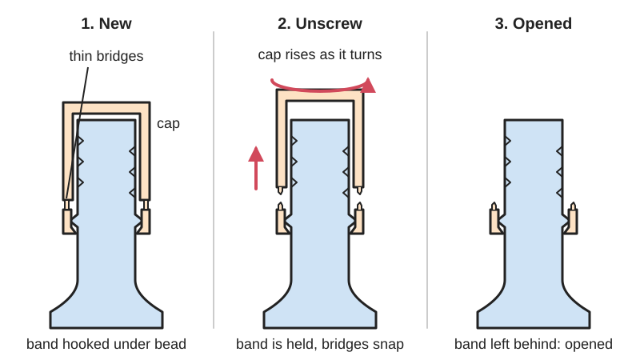
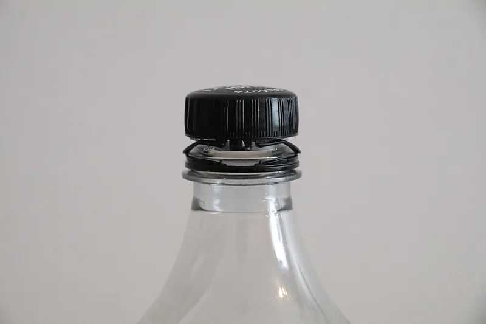
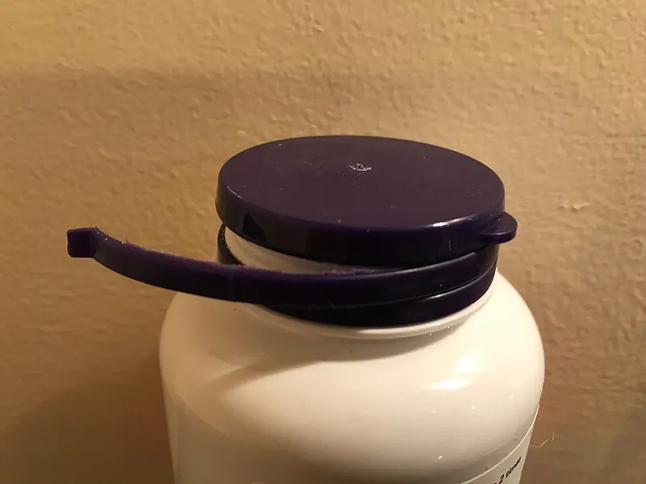

<figure class="eoc-pic eoc-pic-main"><figcaption>Diagram drawn for the encyclopaedia from the research notes. ⚑ Needs confirming: a drawing can simplify or get details wrong; a real photo or a better diagram is welcome.</figcaption></figure>
<figure class="eoc-pic"><figcaption><strong>Photo.</strong> <a href="https://commons.wikimedia.org/wiki/File:Pulloon_kiinnitetty_pullonkorkki_3.JPG">Pulloon kiinnitetty pullonkorkki 3</a> by MKFI, Public domain, from Wikimedia Commons.</figcaption></figure>
<figure class="eoc-pic"><figcaption><strong>How it works.</strong> <a href="https://commons.wikimedia.org/wiki/File:Tamper_evident_seal_on_OTC_pharmaceutical.jpg">Tamper evident seal on OTC pharmaceutical</a> by Rlsheehan, <a href="https://creativecommons.org/licenses/by-sa/4.0">CC BY-SA 4.0</a>, from Wikimedia Commons.</figcaption></figure>

A deliberately weak link of thin plastic bridges between a cap and a ring (or between any two parts) that survives making, filling and shipping but snaps the first time the item is opened, so anyone can see it has been opened.

**In plain words:** A plastic ring at the bottom of a bottle cap, joined to the cap by a row of tiny plastic threads that snap the first time you unscrew it, so the gap or loose ring shows that the bottle has been opened. **Proper term:** Tamper-evident breakaway bridge (frangible link; tamper-evident band with frangible bridges).

**Also called:** tamper-evident band; TE band; tamper band; tamper ring; tamper-indicating band; pilfer-proof band; pilfer band; pilfer-proof ring; frangible bridges; breakable bridges; breakable connectors; weakened tabs; frangible straps (US patents 5,450,972 and 4,904,435); security ring; guarantee band; drop band ⚑ [uncertain: trade names seen only in search results]; tethered cap (a cap whose band also has one or more thicker bridges that do not break, so the cap stays attached; US 11,685,575; EU Single-Use Plastics Directive); break-off seal; plastic padlock seal; pull-tight seal; meter seal (separate one-time security seals with a built-in break point; Wikipedia 'Security seal'); micro-joint; tab (laser and CNC cutting: thin uncut bridges that hold parts in the sheet until snapped out; OSH Cut); breakaway feature; sacrificial link; stress-concentration notch (engineering terms for a part designed to break at a set point).

## How it works

When the cap is first screwed on, the band's inward rib is forced over the bead on the bottle neck and snaps underneath it; the bridges are designed to bend or be shielded here rather than break (inclined bridges, US 6,705,479; bumpers between the band and cap, US 4,904,435). When the cap is unscrewed, it rises up the thread but the rib catches under the bead, so the bridges are pulled apart and break 'sequentially or one or more at a time', leaving the separated band on the container as evidence that the cap has been removed (US 5,450,972). Bridges are made either by moulding gaps into the band, or by moulding a thin continuous wall and then slitting it with a notched blade so the uncut bits become the bridges (US 4,904,435; ENGEL's 'slit concept' and 'bridge concept'). A tethered cap leaves one wider, thicker bridge unbroken, which then works as a hinge so the cap stays on the bottle (US 11,685,575).

## Parts

Single piece: the cap (a top and a threaded skirt), the band and the bridges are injection-moulded as one part, usually in polyethylene (PE) or polypropylene (PP) (US 6,705,479). The band has an inward rib or flaps that catch under a bead (retaining flange) on the bottle neck. Tethered caps add one or two thicker bridges that do not break (US 11,685,575).

## Everyday examples

- the ring left on the neck of a plastic drink bottle after the cap is first unscrewed
- EU drink bottles whose caps stay hinged to the neck after opening (tethered caps; Wikimedia Commons photos of a Coca-Cola Zero bottle)
- plastic padlock seals on airline duty-free trolleys, which snap off at a built-in break point (Wikipedia 'Security seal')
- sealed gas and electricity meters and fire-alarm break-glass points (Wikipedia 'Tamper-evident technology')

## When to use it

When you need to see whether something has been opened, rather than to stop it being opened: containers, lids and caps, emergency key boxes, first-aid kits, sealed electronics or warranty seals, and prints that should be opened only once. The same weak-link idea holds parts together until first use: printed parts on breakaway tabs, and laser-cut parts held in the sheet by micro-joints (OSH Cut).

## When not to use it

Not as a lock: it only shows that something was opened and is easy to break (use a real lock or a locking latch). Not for anything opened repeatedly (use a reusable closure, or a numbered reusable seal). Not where normal handling or vibration could break it by accident, which would give false alarms. Not as a structural joint (use a snap fit or screws). If the aim is to protect a machine from overload rather than show tampering, use a shear-pin coupling (breakaway link), which is designed for load, not evidence.

## Details

- **What it does (jobs):**
  - join and hold: holds the ring to the cap until first opening, and holds the ring on the bottle neck afterwards
  - slip or let go when overloaded: here it lets go once, by design: the bridges snap at the force of a normal first twist and cannot be rejoined, which is the evidence
- **Movement:** none: it is a fixed one-piece link. Opening the cap (turning it, which also lifts it along the thread) is what breaks it.
- **Directions it can move (degrees of freedom):** 0 while intact (band and cap are one piece). After it breaks, the cap is free (1 turn plus 1 lift along the thread, coupled by the thread) and the band is left loose on the neck; on a tethered cap the unbroken bridge then acts roughly as a 1-freedom hinge (US 11,685,575).
- **Special behaviour:**
  - [fail-safe](../glossary.md#fail-safe--fail-secure) or breakaway: the bridges snap at a designed force on first opening and cannot be put back, so the broken bridges or the separated ring show that the container has been opened (US 5,450,972)
  - one-way (in a limited sense): inclined bridges bend and survive while the cap is screwed on, then straighten and tear when it is unscrewed, 'which serves to concentrate the forces tending to rupture the bridges' at their ends (US 6,705,479)
- **How it holds:** shape (the band's inward rib catches under the bead on the bottle neck; [form-fit](../glossary.md#form-fit--force-fit--material-bond)); the bridges themselves are simply thin, unbroken plastic from the same moulding, designed to tear rather than to hold
- **Input and output:** not applicable
- **Power:** passive (no power needed)
- **Load:** light, by design. The link must survive capping, shipping and display ('shall remain intact when handled in a reasonable manner during manufacture, distribution, and retail display'; FDA 21 CFR 211.132) but snap under a normal hand twist. The band holds strongly against being pulled up over the neck bead, which is exactly what tears the bridges; the bridges are weakest when pulled apart (tension and tearing) and are meant to be. No bridge break-force figures for caps were found in the sources checked ⚑ [uncertain]. For comparison, a 3D-printed breakaway link in a robot feeding spoon was tuned to break at 65 N (arXiv 2502.17774).
- **Play and precision:** not applicable (it does not locate parts or pass on motion); the band's rib must fit under the neck bead, and breaks in the rib let the band stretch over the bead without breaking the bridges (US 6,705,479)
- **Taking it apart:** semi-permanent (can be undone but may damage parts): opening always breaks the bridges; after that the cap screws on and off normally but the band stays broken
- **How often it can be reused:** once
- **Sealing:** none: the bridges and band do not seal; sealing comes from a liner or a sealing lip or rib inside the cap top (Wikipedia 'Bottle cap'; US 6,705,479)
- **Adjustable:** no: it is a one-time link; its breaking force is set when it is designed (number, width and thickness of bridges, or for printed parts the notch depth and wall count)
- **Access needed:** not applicable
- **Materials:** Caps, bands and bridges: polyethylene (PE) or polypropylene (PP), injection-moulded in one piece (US 6,705,479; Wikipedia 'Bottle cap'); bottles in PET or glass. Plastic security seals: plastics such as polycarbonate for meter seals; high-security seals are metal (Wikipedia 'Security seal'). Printed breakaway links: PLA or PLA+ (arXiv 2502.17774), and printed one-time seals work in PETG and PLA (Printables 625502).
- **Heat, cold, water and wear:** PE and PP caps are used for drinks, so they tolerate water and normal storage (Wikipedia 'Bottle cap'). Heat can defeat some tamper-evident features: warming a 'VOID' label with a hair dryer lets it be peeled off and put back (Wikipedia 'Tamper-evident technology'). Meter seals are made to withstand sunlight and a wide temperature range (Wikipedia 'Security seal'). Printed PLA links soften in heat and can [creep](../glossary.md#creep) under load, and cold can make plastics more [brittle](../glossary.md#brittle--ductile) so bridges might break during handling ⚑ [uncertain: general material behaviour; no figures found].

## Making it

- **Ways to make or get it:**
  - 3D print (FDM): one-time seals, break-to-open boxes and breakaway links printed as part of the part (Printables 289978, 22100; arXiv 2502.17774)
  - laser cut: micro-joints (tabs) are thin uncut bridges that hold parts in the sheet until they are snapped out (OSH Cut)
  - CNC: holding tabs left when cutting parts out of a sheet ⚑ [uncertain: not covered by an opened source]
  - off-the-shelf part: plastic security seals, tamper-evident labels and tape, and tamper-evident caps for standard bottle necks (Wikipedia 'Security seal'; ENGEL)
- **Printing it in one piece (print in place):** yes: the weak link is printed as part of the same piece (the robot-spoon study 'integrated the failure point directly into the 3D-printed shaft'; arXiv 2502.17774), so it is complete straight off the printer; a printed one-time seal, once locked, has to be destroyed to open (Printables 289978)
- **Tools:** None to open (a hand twist). Industrially it is made by injection moulding, sometimes followed by a slitting machine that cuts the bridges (US 4,904,435). Printed versions need no tools, apart from a knife or spatula to clean up [support material](../glossary.md#support-material).
- **Difficulty:** moderate: it is easy to print a thin snap-off link as part of a part, but hard to make it break reliably at the right force, because printed strength depends heavily on print orientation, layer bonding and wall count; plan to test and adjust (arXiv 2502.17774)

### 3D printing tips

Orient the part so the [layer lines](../glossary.md#layer-lines) run parallel to the line where it should break: the break then happens cleanly between layers at the intended place. With layer lines across the break line the link is stronger but breaks raggedly and unpredictably (arXiv 2502.17774, PLA+ on a Bambu Lab X1C). Use a notch or slot to concentrate stress at exactly one point, and tune the breaking force with notch depth and the number of walls ([perimeters](../glossary.md#perimeters)): thicker walls make it stronger, thinner walls weaker; in that study a 1 mm slot with three wall loops broke at the target 65 N, using 15% grid [infill](../glossary.md#infill) (arXiv 2502.17774). Test several prints, because FEA can only guide printed parts (arXiv 2502.17774). Make several evenly spaced bridges rather than one, so the band tears progressively (US 5,450,972). Protect the bridges while the part is fitted: moulded caps use bumpers or angled bridges so pushing the band over the bead does not load them (US 4,904,435; US 6,705,479). Moulded bridges come from a wall only about 0.2-0.64 mm thick (US 4,904,435); a printed bridge can't be thinner than about one extrusion width, so printed bridges are usually thicker and fewer ⚑ [uncertain: design suggestion]. Printed one-time seals print fast (about 13 minutes on a Prusa MK3S) and work in PETG and PLA (Printables 625502). For a sealed container that must be broken to open, you can pause the print, drop in the item and print the lid over it (Printables 1595516: 4 perimeters, 5-6 top and bottom layers, PETG or ASA).

### Buying one (off-the-shelf parts)

Plastic security seals: adjustable-length pull-tight seals, fixed-length seals, padlock seals and meter seals, many numbered or bar-coded; metal cable, bolt and ball seals (ISO 17712 levels); tamper-evident labels and security tape that show 'VOID' or tear when removed (Wikipedia 'Security seal'; 'Tamper-evident technology'). Packaging: tamper-evident screw caps with TE bands, tethered caps for standard beverage necks (ENGEL expects many producers to move from 1810/1811 cap types to 26 mm caps as they change to tethered caps), induction seals, shrink bands and tear strips (Wikipedia 'Closure (container)'). Search terms: 'tamper evident cap', 'tamper band', 'pull tight security seal', 'plastic padlock seal', 'tamper evident label', 'tethered cap'.

## Rules of thumb

- In moulded caps whose bridges are cut by slitting, the wall that is slit is only about 0.008-0.025 inch (about 0.2-0.64 mm) thick, and the process can run at over 600 caps per minute without breaking bridges (US 4,904,435, The West Company, https://www.freepatentsonline.com/4904435.html).
- A tether bridge that must not break is made wider and thicker than the frangible ones: at least 1.5 mm wide and 0.5 mm thick in one example, and 2-10 mm wide (for example 6-7 mm) in the general description (US 11,685,575 B2, Obrist Closures, 2023, https://image-ppubs.uspto.gov/dirsearch-public/print/downloadPdf/11685575).
- Space frangible bridges 'circumferentially and equally' around the band (US 5,450,972, https://www.freepatentsonline.com/5450972.html); inclining them lets them bend safely while the cap is screwed on and concentrates the tearing force at their ends when it is unscrewed (US 6,705,479, https://image-ppubs.uspto.gov/dirsearch-public/print/downloadPdf/6705479).
- Split the band's retaining rib into segments (about 85% of the circumference in one example; at least 65% in the claims) so it can stretch over the bottle bead without straining the bridges (US 6,705,479).
- A tamper-evident feature must give visible evidence when breached yet stay intact through manufacture, distribution and retail display (FDA 21 CFR 211.132, https://www.law.cornell.edu/cfr/text/21/211.132).
- For printed breakaway links, align layer lines with the break line and tune the force with notch depth and wall count (arXiv 2502.17774, https://arxiv.org/abs/2502.17774).
- In the EU, plastic caps on single-use drink containers up to 3 litres must stay attached during use from 3 July 2024 (Directive (EU) 2019/904, Article 6, as summarised by Wikipedia), which is why caps now combine frangible bridges with a tether.

## Common failures

(1) Bridges break while the cap is being screwed on or during shipping, giving a false 'opened' signal: use inclined bridges, bumpers or lugs that take the load while capping and in transit (US 6,705,479; US 4,904,435; US 5,450,972). (2) The band can be prised up over the bead without breaking the bridges, defeating the seal: inward projections stop a knife blade being slid round under the band (US 6,705,479). (3) Bridges too strong, so the cap is hard to open or the band tears unevenly ⚑ [uncertain]. (4) Printed breakaway links break raggedly or at the wrong force: align layers with the break line and test (arXiv 2502.17774). (5) Moulding or slitting faults leave missing, uncut or damaged bridges ⚑ [uncertain]; cap makers use camera (vision) inspection, which for tethered caps also checks the new hinges and tabs (INTRAVIS). (6) Labels peeled off with heat and reapplied (Wikipedia 'Tamper-evident technology').

## Safety

Tamper evidence is not tamper proof: tests at Argonne National Laboratory showed some seals 'can be quickly defeated by a trained person using low-tech methods' (Wikipedia 'Tamper-evident technology'), so do not rely on one seal for medicines or security; use several layers. The FDA requires tamper-evident packaging for over-the-counter medicines sold to the public (21 CFR 211.132). A sealed container that has to be broken open (for example a print-sealed tracker case) is lost if the contents fail; one designer warns to change the battery before sealing (Printables 1595516). Snapped bridges can leave small sharp plastic points ⚑ [uncertain: general caution].

## Related

- Shear-pin coupling (breakaway link): also breaks at a designed load, but to protect a machine from overload rather than to show tampering
- Annular snap fit: the band's inward rib snapping under the bottle's neck bead is an annular snap fit
- [Living hinge](../glossary.md#living-hinge): tethered and flip-top caps use a thin hinge that must bend many times without breaking, the opposite of a frangible bridge
- Push-and-turn child-resistant cap: makes a cap hard for children to open, often used alongside a tamper-evident band
- Linear [ratchet](../glossary.md#ratchet) (cable-tie ratchet): pull-tight security seals use a one-way ratchet and must be cut or broken off
- Mid-print embedding ([captive nuts](../glossary.md#captive-nut), magnets and bearings): sealing an object inside a print so that it must be broken to open
- [Cantilever](../glossary.md#cantilever) snap fit: a clip that can be undone; a tamper-evident link is designed not to be undone

## Make it yourself

- [Tamper evident lock by Printer Go Brrr (Printables 289978; details read via the Printables public API) (URL from Printables API, page not opened)](https://www.printables.com/model/289978-tamper-evident-lock): A printed one-time lock or seal: once locked it has to be destroyed to open, which is plainly visible *(licence: Creative Commons Public Domain (as listed on Printables))*
- [FASTER PRINT tamper evident lock / seal by Tim Fechner (Printables 625502; details read via the Printables public API) (URL from Printables API, page not opened)](https://www.printables.com/model/625502-faster-print-tamper-evident-lock-seal): A slimmer, faster-printing version of the one-time seal (about 13 minutes on a Prusa MK3S); tested in PETG and PLA *(licence: Creative Commons Public Domain (as listed on Printables))*
- [Brake to open tamper proof launch code card holder by Koda Mason (Printables 22100; details read via the Printables public API) (URL from Printables API, page not opened)](https://www.printables.com/model/22100-brake-to-open-tamper-proof-launch-code-card-holder): A break-to-open case for business-card-sized notes, such as emergency passwords; case printed in ABS, tray in PETG *(licence: CC BY-NC)*
- [PermaTag - Tamper-Proof AirTag Case Sealed During Print by sthpi (Printables 1595516; details read via the Printables public API) (URL from Printables API, page not opened)](https://www.printables.com/model/1595516-permatag-tamper-proof-airtag-case-sealed-during-pr): A case sealed during printing by pausing the print and dropping the item in; it can only be opened by breaking it *(licence: CC BY-NC-SA)*

## Pictures, videos and models

- [Pulloon kiinnitetty pullonkorkki 3.JPG (Wikimedia Commons, MKFI, 2024)](https://commons.wikimedia.org/wiki/File:Pulloon_kiinnitetty_pullonkorkki_3.JPG): A tethered cap on a Coca-Cola Zero bottle unscrewed but not lifted: the tamper-evident band stays on the neck and the strap that keeps the cap attached is visible *(licence: Public domain)*
- [US 11,685,575 B2 'Closure' (Obrist Closures, 2023), patent PDF from the USPTO](https://image-ppubs.uspto.gov/dirsearch-public/print/downloadPdf/11685575): Drawings of a screw cap with its tamper-evident band, frangible bridges and a thicker non-frangible bridge that acts as a hinge when the cap is flipped open *(licence: Public domain ⚑ [uncertain: US patent documents are generally free of copyright])*
- [US 6,705,479 B2 'Tamper evident closure', patent PDF from the USPTO](https://image-ppubs.uspto.gov/dirsearch-public/print/downloadPdf/6705479): Drawings and description of a cap whose band is joined by inclined frangible bridges, with a segmented rib that locks under the bottle's neck flange *(licence: Public domain ⚑ [uncertain: US patent documents are generally free of copyright])*
- [Tamper evident seal on OTC pharmaceutical.jpg (Wikimedia Commons, Rlsheehan, 2018)](https://commons.wikimedia.org/wiki/File:Tamper_evident_seal_on_OTC_pharmaceutical.jpg): A tear-open seal on a bottle of capsules (another kind of tamper-evident feature, for comparison) *(licence: CC BY-SA 4.0)*
- [Design of a Breakaway Utensil Attachment for Enhanced Safety in Robot-Assisted Feeding (Chang, Yow, Lim and Ang, arXiv 2502.17774)](https://arxiv.org/abs/2502.17774): Photos of a 3D-printed breakaway part: print orientations with layer lines across and along the break line, and the clean versus ragged breaks they give *(licence: arXiv non-exclusive distribution licence (link only))*

## Needs confirming

⚑ marks something nobody has confirmed yet: a fact the research could not confirm from a source, a finder value that is a best guess, or an open point from the research notes. Corrections are welcome (see `research/needs-confirming.md`).

- ⚑ 10 sentences on this page marked [uncertain].
- ⚑ Finder value `clicks` = clicks (best guess): one-way or indexing, but neither clicking nor silent named; defaulted to clicks

## Sources

- <https://en.wikipedia.org/wiki/Tamper-evident_technology (read via the Wikipedia API)>
- <https://en.wikipedia.org/wiki/Bottle_cap (read via the Wikipedia API)>
- <https://en.wikipedia.org/wiki/Closure_(container) (read via the Wikipedia API)>
- <https://en.wikipedia.org/wiki/Security_seal (read via the Wikipedia API)>
- <https://en.wikipedia.org/wiki/Directive_(EU)_2019/904_(Single-Use_Plastics_Directive) (read via the Wikipedia API)>
- <https://www.freepatentsonline.com/5450972.html>
- <https://www.freepatentsonline.com/4904435.html>
- <https://image-ppubs.uspto.gov/dirsearch-public/print/downloadPdf/11685575>
- <https://image-ppubs.uspto.gov/dirsearch-public/print/downloadPdf/6705479>
- <https://www.law.cornell.edu/cfr/text/21/211.132>
- <https://www.engelglobal.com/en/us/blog/requirements-for-the-production-of-tethered-caps>
- <https://www.intravis.com/en/blog/eu-directive-tethered-caps>
- <https://arxiv.org/pdf/2502.17774>
- <https://arxiv.org/abs/2502.17774>
- <https://www.oshcut.com/design-guide/understanding-micro-joints>
- <https://commons.wikimedia.org/wiki/File:Pulloon_kiinnitetty_pullonkorkki_3.JPG>
- <https://commons.wikimedia.org/wiki/File:Pulloon_kiinnitetty_pullonkorkki_1.JPG>
- <https://commons.wikimedia.org/wiki/File:Tamper_evident_seal_on_OTC_pharmaceutical.jpg>
- <https://www.printables.com/model/289978-tamper-evident-lock (read via https://api.printables.com/graphql/)>
- <https://www.printables.com/model/625502-faster-print-tamper-evident-lock-seal (read via https://api.printables.com/graphql/)>
- <https://www.printables.com/model/22100-brake-to-open-tamper-proof-launch-code-card-holder (read via https://api.printables.com/graphql/)>
- <https://www.printables.com/model/1595516-permatag-tamper-proof-airtag-case-sealed-during-pr (read via https://api.printables.com/graphql/)>
- <https://api.printables.com/graphql/>
