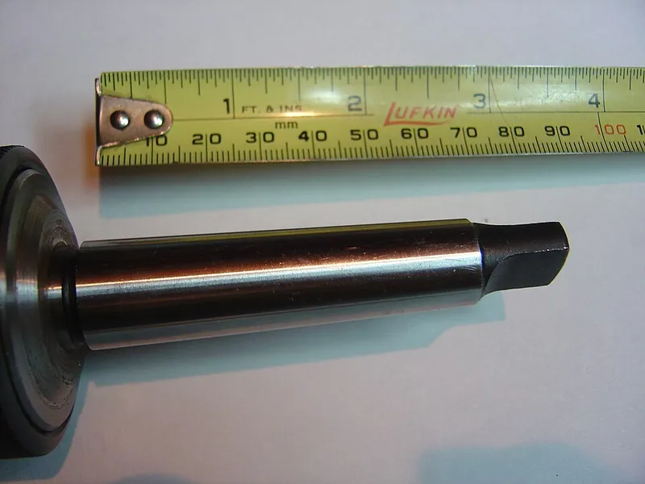
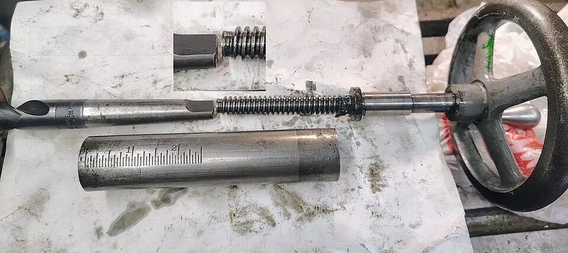

<figure class="eoc-pic eoc-pic-main"><figcaption><strong>Photo.</strong> <a href="https://commons.wikimedia.org/wiki/File:Morse_Taper_No_2.jpg">Morse Taper No 2</a> by DerrickOswald at English Wikipedia, Public domain, from Wikimedia Commons.</figcaption></figure>
<figure class="eoc-pic"><figcaption><strong>How it works.</strong> <a href="https://commons.wikimedia.org/wiki/File:Lathe_Tailstock_Taper_Ejection_System.jpg">Lathe Tailstock Taper Ejection System</a> by Progress and Poverty, <a href="https://creativecommons.org/licenses/by/4.0">CC BY 4.0</a>, from Wikimedia Commons.</figcaption></figure>

A shallow cone pressed into a matching cone-shaped socket, where the wedge action squeezes the surfaces so hard that friction holds it in, centres it exactly and (in syringe and lab-glass fittings) seals it, yet a knock with a wedge or a twist separates it again.

**In plain words:** A very slightly cone-shaped peg pushed or tapped into a matching cone-shaped hole, where it jams tight by friction, lines itself up exactly and stays put without screws, until you knock it out with a wedge or twist it off (drill chucks, lathe centres, syringe tips). **Proper term:** [Taper](../glossary.md#taper) fit (self-holding taper; Morse taper, Luer taper).

**Also called:** self-holding taper, [self-locking](../glossary.md#self-locking) taper (a shallow taper that stays in by friction; Wikipedia 'Machine taper'); machine taper, taper shank, taper socket; Morse taper (MT0-MT7 and MT4.5; German 'MK', Morsekegel), standardised as ISO 296 and DIN 228-1; Jacobs taper (JT, e.g. JT33: fits a drill chuck onto its arbor) and DIN 238 B-series tapers (B10, B12, B16, B18, B22, B24); Brown & Sharpe taper and Jarno taper (other self-holding machine tapers); self-releasing or steep taper (7:24 taper: NMTB, CAT, BT; also HSK): the opposite kind, held in by a drawbar (Wikipedia); Luer taper, 6% taper: Luer slip (slip tip) and Luer lock (threaded collar); 'Luer-Lok' and 'Luer-slip' are trademarks associated with Becton Dickinson (brand); small-bore connector standard ISO 80369-7 (formerly ISO 594); ground-glass joint, standard taper joint (ST 14/23, 19/26, 24/29, 24/40) for laboratory glassware; square taper (bicycle 'cotterless' crank-to-spindle joint); taper pin (1:50 metric, 1:48 inch); conical press fit, oil-injection taper fit (German 'Ölpressverband'; large industrial version released with pressurised oil).

## How it works

The cone and socket have the same very shallow angle (about 1.5 degrees per side for a Morse taper), so pushing the cone in acts like driving a long, thin wedge: a small push along the axis creates a very large squeezing force on the whole cone surface (Wikipedia 'Machine taper'). A wedge sticks when its angle is less than the angle whose tangent equals the friction coefficient (Wikipedia 'Wedge'), and these tapers are far shallower than that, so friction over the whole surface holds the part in and carries turning force without keys, while the matching cones centre it precisely both across and along the axis. The fit gets tighter the harder it is pushed, which is why a drill held this way needs end thrust to keep it seated, and why it is freed by a sharp knock with a wedge (drift) through a slot, by pushing from behind, or, for lab glass, by warming the outer part (Wikipedia 'Machine taper'; 'Ground glass joint'). In a Luer fitting the same close cone contact also seals liquid and gas, and the Luer-lock thread only stops the cones being pulled apart (Wikipedia 'Luer taper').

## Parts

A few parts: a male cone (taper shank, arbor, lathe centre, syringe tip, glass stopper) and a female cone-shaped socket (spindle, tailstock quill, adaptor sleeve, needle hub, glass neck). Often with extras: a flat tang on the end of a Morse shank for extra drive and for ejecting it, a wedge-shaped drift to knock it out, a drawbar screwed into the shank on milling machines, or a threaded collar on a Luer lock (Wikipedia 'Machine taper'; 'Luer taper').

## Everyday examples

- The chuck on a drill press, which sits on a Morse-taper arbor and is knocked off with a drift (Wikipedia 'Machine taper'; Newman Tools)
- A syringe and needle joined by a Luer slip or Luer lock fitting (Wikipedia 'Luer taper')
- A ground-glass stopper in a lab flask or bottle (Wikipedia 'Ground glass joint')
- Bicycle [cranks](../glossary.md#crank) pressed onto the square-taper ends of the bottom-bracket spindle (Wikipedia 'Bottom bracket')

## When to use it

Use a taper fit when a tool or part must be swapped often yet sit exactly on centre every time with no play: drill chucks, lathe centres and tool holders on metalworking machines. Use Luer fittings to join syringes, dispensing needles, small tubes, filters and stopcocks for glue, flux, lubricant, lab or hobby fluid work, and ground-glass joints for lab glassware. A taper is also good whenever the load pushes the parts together along the axis, because that only makes it grip harder.

## When not to use it

Avoid a plain self-holding taper where there are strong side loads or vibration (e.g. a milling cutter), where high [torque](../glossary.md#torque) comes with little end thrust, or where a pull could draw it out: add a drawbar, key or thread, or use a clamp hub, [collet](../glossary.md#collet) or keyless locking bush instead. Don't rely on a printed or soft-plastic taper to stay tight for long, because plastic [creeps](../glossary.md#creep); add a thread, clip or bayonet. For fittings that must never come apart under pressure, use a Luer lock rather than a Luer slip, or a threaded or push-to-connect fitting. For guiding parts together without locking them, use a steeper self-centring cone that releases easily.

## Details

- **What it does (jobs):**
  - join and hold: holds a drill, chuck, lathe centre, syringe needle or glass stopper firmly by friction
  - line parts up exactly: the cones centre the parts on one axis and set how far in they go, with very repeatable results (Wikipedia 'Machine taper')
  - seal it, or pass cables or fluid through: Luer fittings and greased ground-glass joints make leak-tight connections for liquids and gases (Wikipedia 'Luer taper'; 'Ground glass joint')
- **Movement:** none: a fixed joint once seated
- **Directions it can move (degrees of freedom):** 0 once seated: the cones stop sideways movement and tilting, the wedge fit stops it moving along the axis, and friction stops it turning (a Luer slip can still be twisted off by hand)
- **Special behaviour:**
  - self-locking (holds under load, won't back-drive): a self-holding taper stays in by friction alone and actually grips harder when pushed along its axis (Wikipedia 'Machine taper')
  - self-aligning or self-centring: the cones pull the parts onto the same centre line and to the same depth every time (Wikipedia 'Machine taper'; German Wikipedia 'Pressfügen' notes good self-centring for press fits)
  - quick-release: tools change in seconds with a drift or by retracting a lathe tailstock quill; Luer fittings pull or twist off by hand (Wikipedia)
- **How it holds:**
  - friction or clamping ([force-fit](../glossary.md#form-fit--force-fit--material-bond)): the wedge action of the shallow cones creates the clamping pressure
  - shape (the parts interlock; form-fit): only as a backup, e.g. the flat tang on a Morse shank, the key and drawbar on milling tapers, or the thread of a Luer lock
- **Input and output:** Mostly not applicable (it holds a tool or fitting). When a Morse-taper drill or chuck is driven through it, it acts as a rigid in-line coupling: rotation in -> the same rotation out, 1:1, with no [backlash](../glossary.md#backlash); torque is carried by friction and depends on end thrust, with the tang as a backup if it slips (Wikipedia 'Machine taper'; 'Drill bit shank').
- **Power:** passive (no power needed)
- **Load:** Medium to heavy in steel: taper-shank drills and lathe centres are driven by friction alone, but only while there is enough push along the axis; high torque with little thrust (e.g. a big drill opening an existing hole) can make it slip and spin (Wikipedia 'Machine taper'). Strong in [axial](../glossary.md#axial--radial) push (it only wedges tighter) and twist; weak against sideways loads, which can wobble it out, so milling cutters on tapers need a drawbar or thread (Wikipedia). Weak against a straight pull unless retained. Luer fittings: light loads, for syringes, needles and small tubes.
- **Play and precision:** none: no play, and it relocates very repeatably on the same centre line and at the same depth, which is why lathe centres and tool holders use it (Wikipedia 'Machine taper'). It tolerates no angular error between cone and socket (rigid glass joints can crack if forced out of line; Wikipedia 'Ground glass joint'), and dirt, chips or nicks stop it seating accurately.
- **Taking it apart:** removable: a Morse taper is knocked out with a drift through the slot in the socket, pushed out from behind, or ejected by retracting a lathe quill; a Luer fitting is pulled or twisted off by hand; a stuck glass joint can be freed with solvent, warmth on the outer part or special tools (Wikipedia 'Machine taper'; 'Ground glass joint').
- **How often it can be reused:** many times: machine tapers are changed thousands of times as long as the cones are kept clean and free of nicks ⚑ [uncertain]; plastic Luer fittings wear with the number of connection cycles (Wikipedia 'Luer taper')
- **Sealing:** Machine tapers: none (not used to seal). Luer and ground-glass joints: watertight to airtight or pressure, made by the close cone-on-cone contact; Luer fittings are tested for leakage under pressure, and ground-glass joints are sealed with a thin layer of grease or a PTFE sleeve (Wikipedia 'Luer taper'; 'Ground glass joint').
- **Adjustable:** no: the fit and position are fixed by the cone angle and size
- **Access needed:** end of a tube or shaft: the cone goes into the end of a spindle, quill, sleeve, needle hub or glass neck; removing a Morse taper needs access to the drift slot or the back of the socket
- **Materials:** Machine tapers: hardened steel shanks in steel or cast-iron spindles and sleeves. Bicycle square tapers: steel or alloy spindles in (often aluminium) crank arms (Wikipedia 'Bottom bracket'). Luer fittings: moulded plastics and metal hubs ⚑ [uncertain]; printed copies in PETG, PP or resin (Printables designers). Ground-glass joints: glass, usually greased or with a PTFE sleeve. Suits hard, stiff materials that keep their shape; soft plastics creep and let a taper loosen over time (DuPont on press fits in plastics).
- **Heat, cold, water and wear:** Chips, dust, burrs and small dents on either cone stop it seating, so it will not locate accurately or hold reliably (Wikipedia 'Machine taper'). Very heavy axial loads, or long periods seated, can jam a narrow taper so it is hard to release; vibration (chatter) helps free it (Wikipedia 'Machine taper'). Ground-glass joints seize if the grease is missing or dissolved by solvents, and can be freed by warming the outer joint or cooling the inner one; polyacetal (POM) joint clips soften around 140 C and can crumble within minutes in corrosive vapours (Wikipedia 'Ground glass joint'). Plastic tapers and Luer fittings creep and loosen under constant squeeze, faster when warm (DuPont design guide on plastic press fits) ⚑ [uncertain].

## Making it

- **Ways to make or get it:**
  - off-the-shelf part: Morse taper arbors, sleeves, drills and centres, Luer connectors and caps, ground-glass fittings and taper pins are cheap and precise
  - CNC or manual lathe: tapers are turned and bored with the compound slide or a taper attachment, and sockets can be cleaned up with Morse taper reamers (Wikipedia mentions Morse taper reamers for repair) ⚑ [uncertain]
  - 3D print (resin): the most practical way to print working Luer tips and adaptors; SLA or SLS parts should be airtight where FDM parts may leak (wavexx; permanentbrownmark on Printables)
  - 3D print (FDM): Luer caps and adaptors for non-medical use, Morse-taper size gauges, taper-fit lids and holders; not for real machine-tool tapers (kaje; stonie422 on Printables)
- **Printing it in one piece (print in place):** no: the cone and socket are separate parts that are pushed together
- **Tools:** none to fit (push it in or give it a light tap); a drift (drift key) and hammer, or a lathe's own quill, to remove a Morse taper; a taper cleaning tool to clean the socket; Luer fittings and glass joints by hand (Wikipedia 'Machine taper'; Newman Tools)
- **Difficulty:** moderate: using bought taper tools and Luer fittings is easy, but machining a true self-holding metal taper needs a lathe set to a precise angle (or a taper reamer), and printed Luer fittings often leak unless resin-printed or sealed (Printables and Thingiverse designers)

### 3D printing tips

1) Do not print a Morse taper to hold cutting tools in a machine: plastic is far too soft and creeps. Printed Morse tapers are useful as size gauges, holders and storage (kaje's 'MT (Morse Taper) Gauges' are 'not precision gauges' but identify the size; PETG, 0.2 mm layers, 3 [perimeters](../glossary.md#perimeters)) and one maker tested only an MT5-to-MT2 adapter sleeve, printed in ABS at 50% [infill](../glossary.md#infill) (Projunk). 2) Luer fittings: print in PETG or PP with a 0.4 mm nozzle and layers of 0.15 mm or less; print several copies at once so each small part has time to cool; expect FDM parts not to be airtight because liquid can seep between layers, and use SLA or SLS for airtight parts (wavexx, 'Luer Lock M/F Cap'). Another designer found resin 'probably the only acceptable option' for Luer dispensing tips (permanentbrownmark). 3) Model the Luer cone to the standard: 6% taper (3.44 degrees included, 1.72 degrees per side), male cone about 4.0 mm at the tip widening to about 4.45 mm over at most 7.5 mm; Luer-lock collar about 8 mm inside with a double-start thread of 2.5 mm [pitch](../glossary.md#pitch) (University of Bremen MARUM 'Luer slip and Luer lock connector dimensions'), then tweak for your printer (dexter747 adjusted dimensions to fit three different syringes). 4) Check the thread direction against a real syringe: one popular printed Luer adaptor had to be remixed because its thread was mirrored (Finn's 'Luer Adapter - Fixed Threads'). 5) Small bores close up when printed: drill them out or open them with a hot needle, and seal a leaky print with a coat of clear nail polish (mrAkuaku and dexter747 on Thingiverse). 6) Printed tapered holes grip very hard even at tiny angles: in kaje's PLA tests an 8 mm peg in a hole with 0.3 mm ribs was very tight at 0.5 degree draft (one peg broke on removal), a good firm fit at 1 degree, and loose at 2 degrees ('Test Print - Crush Ribs - Version02'); AON3D suggests about 2 degrees of taper plus 0.2 mm crush ribs for a printed fit that can be taken apart and refitted. 7) Print cones and conical holes with their axis vertical so the cross-section comes out round and the layer steps on the shallow slope are tiny ⚑ [uncertain]. 8) Add a pull tab or a lip so taper-fit lids and plugs can be separated by hand (kaje's taper-fit box has tabs for this). 9) Plastic creeps and relaxes under constant squeeze, so a printed taper fit loosens over time and faster when warm (DuPont design guide on press fits); add a thread, clip or bayonet if it must not come apart. 10) Printed Luer parts are for hobby and lab use only, never medical, sterile or food use (stonie422).

### Buying one (off-the-shelf parts)

Morse taper drill chuck arbors (e.g. MT2 to JT33 or MT2 to B16), Morse taper reducing sleeves (e.g. MT3 to MT2) and extension sockets, Morse taper shank drills and reamers, dead centres and live centres, drill drifts (drift keys) and automatic drifts, taper cleaning tools, Morse taper reamers (Wikipedia 'Machine taper'; 'Drill bit shank'; Newman Tools). Luer lock and Luer slip connectors (male, female, barb-to-Luer, gender changers), Luer caps, stopcocks, syringes and blunt dispensing needles. Ground-glass joint clips (Keck clips) and PTFE joint sleeves. Taper pins and taper-pin reamers (Wikipedia 'Taper pin'). Square-taper bottom brackets and a crank puller.

## Rules of thumb

- Morse taper: about 1:20 on diameter, roughly 52 mm per metre (5/8 in per foot), about 1.49 degrees per side (about 3 degrees included); sizes MT0 to MT7 plus MT4.5, and MT2 is the usual size in drill presses up to 13 mm capacity (Wikipedia 'Machine taper').
- Self-holding machine tapers have an included angle of only about 2-3 degrees (Newman Tools); Jacobs tapers for drill chucks vary from 1.41 to 2.33 degrees per side; the Jarno taper is exactly 1:20 on diameter and Brown & Sharpe about 0.5 in per foot (Wikipedia 'Machine taper'; Newman Tools).
- Steep 7:24 tapers (about 16.6 degrees included; NMTB, CAT, BT) do not hold by themselves and need a drawbar, but they release easily for quick tool changes (Wikipedia 'Machine taper').
- A wedge binds (self-locks) when its angle is less than the arctangent of the friction coefficient between the surfaces (Wikipedia 'Wedge'); shallow tapers are far below this, steep ones are above it.
- Self-holding tapers need mostly axial load to carry high torque; with side loads (milling) use a threaded end and drawbar (Wikipedia 'Machine taper').
- Luer taper: 6% (the diameter changes by 6% of the cone's length), which is 3.44 degrees included, not 6 degrees (Wikipedia 'Luer taper'; University of Bremen MARUM). Luer slip and Luer lock parts fit each other, and a Luer lock is secure after about one full turn (University of Bremen MARUM).
- Ground-glass joints use a 1:10 taper; common ISO sizes are 14/23, 19/26 and 24/29 (diameter/ground length in mm) and US sizes 14/20, 19/22 and 24/40 (Wikipedia 'Ground glass joint').
- Taper pins: 1:50 on diameter for metric pins, 1:48 for inch pins (Wikipedia 'Taper pin'); bicycle square-taper cranks use a 2-degree taper in two incompatible sizes, JIS and ISO (Wikipedia 'Bottom bracket').
- Tapered press fits need less force to assemble and separate more easily than straight ones, but are less reliable: once loosened they come free with very little axial movement (Wikipedia '[Interference fit](../glossary.md#interference-fit)', quoting Machinery's Handbook).

## Common failures

Won't hold or runs off-centre because of dirt, chips or dents on the cones: wipe the shank and clean the socket with a taper cleaning tool, and keep tools from knocking each other (Wikipedia 'Machine taper'). Slips and spins under high torque with little thrust, scoring both cones and snapping the tang; avoid those cuts, keep the fit clean, and repair minor damage with a Morse taper reamer (Wikipedia 'Machine taper'). Jams so tight it won't come out after heavy loading or a long time; use the drift, let vibration help, or warm the outer part (Wikipedia 'Machine taper'; 'Ground glass joint'). Frozen glass joints when the grease is missing (Wikipedia 'Ground glass joint'). Luer slip tips pop off under pressure; use a Luer lock (Wikipedia 'Luer taper'). Printed Luer fittings that leak, don't lock or spin freely because FDM [tolerances](../glossary.md#tolerance) are too loose or tight and layers aren't airtight (mrAkuaku; wavexx). Mixed standards that almost fit but don't seat: different Morse sizes, Jacobs vs B-series, or JIS vs ISO square tapers (Wikipedia 'Machine taper'; 'Bottom bracket').

## Safety

If a Morse taper slips under heavy torque, the tang can snap and the tool spins in the socket, damaging it (Wikipedia 'Machine taper'). A chuck or drill knocked out with a drift drops free suddenly; hold it or put something soft underneath ⚑ [uncertain]. Morse-taper milling cutters must be held by a C-collar or drawbar because side loads can pull them out (Wikipedia 'Machine taper'). Luer fittings from different medical systems can look alike and be misconnected, and printed Luer parts must never be used for medical, sterile or food purposes (Wikipedia 'Luer taper'; stonie422 on Printables); needles are sharp. Forcing a misaligned or seized glass joint can crack the glass (Wikipedia 'Ground glass joint').

## Related

- Self-centring cone and socket (taper locator): a steeper cone used only to guide and centre parts as they come together; it does not lock
- Collet (and keyless chuck): a slotted sleeve squeezed by a taper so it grips a round shaft; the taper does the clamping but the parts are released by unscrewing, not knocking
- Keyless locking bush (taper-lock bush, shaft locking device): tapered rings pulled together by screws to clamp a hub on a plain shaft; adjustable and easy to release
- Self-locking wedge (wedge clamp, taper key): the same friction-wedge idea in a flat wedge driven into a gap
- Press fit (interference fit): a straight (cylindrical) fit held by squeeze alone; stronger and more reliable once in, but harder to separate and needs tighter sizes
- Friction clutch (plate or cone clutch): cones pressed together so they can be engaged and slip on purpose
- Hose barb (barbed tube fitting): a ridged cone that a soft tube is stretched over; grips the tube instead of a matching cone
- Quick couplers for tubes and hoses (push-to-connect): latch tubes in place for fluid connections that must not pull apart
- Bayonet mount (push-and-twist lock) and ordinary screw joint: ways to add positive retention, like the Luer lock's thread
- [Kinematic coupling](../glossary.md#kinematic-coupling) (balls in V-grooves): exact repeatable location without friction locking

## Make it yourself

- [MT (Morse Taper) Gauges (kaje, Printables) (URL from Printables API, page not opened)](https://www.printables.com/model/285795-mt-morse-taper-gauges): Printable inner and outer gauges for identifying Morse taper sizes 0-7, made from Machinery's Handbook dimensions; PETG, with Onshape CAD *(licence: Creative Commons Public Domain)*
- [Luer Lock M/F Cap (wavexx, Printables)](https://www.printables.com/model/144785-luer-lock-mf-cap): Double-ended male/female Luer-lock cap printable in FDM without supports, with notes on material (PETG or PP), layer height and why FDM parts may not be airtight. URL seen in search results; details read through the Printables public API. *(licence: CC BY-NC-SA (Creative Commons Attribution-NonCommercial-ShareAlike))*
- [Luer lock connectors (straight, gender-switching, slip, and cap) (chesamo, Printables) (URL from Printables API, page not opened)](https://www.printables.com/model/1407443-luer-lock-connectors-straight-gender-switching-sli): Parametric OpenSCAD file for male/female Luer-lock connectors, gender changers, slip tips and caps, with adjustable body length and twist grips *(licence: CC BY-NC-SA (Creative Commons Attribution-NonCommercial-ShareAlike))*
- [Parametric Luer Lock Dispenser Tips for Syringe (SCAD) (permanentbrownmark, Printables) (URL from Printables API, page not opened)](https://www.printables.com/model/843170-parametric-luer-lock-dispenser-tips-for-syringe-sc): OpenSCAD generator for Luer-lock dispensing tips of any length, diameter and shape, with resin-printing versions *(licence: CC BY-SA (Creative Commons Attribution-ShareAlike))*
- [Luer Slip Tip Parametric (Fusion) (stonie422, Printables) (URL from Printables API, page not opened)](https://www.printables.com/model/1518411-luer-slip-tip-parametric-fusion): Parametric Fusion 360 Luer slip tip with 1-1.5 mm outlets; printed in PLA at 0.2 mm; for non-medical hobby use only *(licence: Creative Commons Public Domain)*
- [Luer slip and Luer lock connector dimensions (University of Bremen, MARUM Marine Geochemistry)](https://www.sedgeochem.uni-bremen.de/luer%20connector.html): Dimension notes and drawings for male Luer cones and Luer-lock collars and threads, useful for modelling your own fittings *(licence: link only)*

## Pictures, videos and models

- [Morse Taper No 2.jpg (Wikimedia Commons, by DerrickOswald)](https://commons.wikimedia.org/wiki/File:Morse_Taper_No_2.jpg): Photo of an MT2 Morse-taper shank with its flat tang *(licence: Public domain (released by the author for any purpose))*
- [Morse taper.svg (Wikimedia Commons, by DerrickOswald, redrawn by Wizard191)](https://commons.wikimedia.org/wiki/File:Morse_taper.svg): Dimensioned drawing of a Morse-taper shank with tang (the key to Wikipedia's Morse-taper size table) *(licence: Public domain (released by the author for any purpose))*
- [Lathe Tailstock Taper Ejection System.jpg (Wikimedia Commons, by Progress and Poverty)](https://commons.wikimedia.org/wiki/File:Lathe_Tailstock_Taper_Ejection_System.jpg): Photo of a lathe tailstock quill, a Morse-taper drill shank and the quill screw, showing how retracting the quill pushes the tang and ejects the drill *(licence: CC BY 4.0)*
- [Syringe and hypodermic.jpg (Wikimedia Commons, by William Rafti of the William Rafti Institute)](https://commons.wikimedia.org/wiki/File:Syringe_and_hypodermic.jpg): A syringe with a male Luer-lock fitting beside a needle with a female Luer-lock hub *(licence: Attribution only (free use, including commercial, with credit to the copyright holder))*
- [How To Use a Drift On a Drill Press (YouTube, Kep-Kraft Industries)](https://www.youtube.com/watch?v=K2yJgkuteQc): Video showing what a drift is and how it is used to remove a Morse-taper drill chuck from a drill press (per the video's description in search results) *(licence: link only (standard YouTube licence))*

## Needs confirming

⚑ marks something nobody has confirmed yet: a fact the research could not confirm from a source, a finder value that is a best guess, or an open point from the research notes. Corrections are welcome (see `research/needs-confirming.md`).

- ⚑ 6 sentences on this page marked [uncertain].

## Sources

- <https://en.wikipedia.org/wiki/Machine_taper>
- <https://en.wikipedia.org/wiki/Drill_bit_shank>
- <https://en.wikipedia.org/wiki/Luer_taper>
- <https://en.wikipedia.org/wiki/Ground_glass_joint>
- <https://en.wikipedia.org/wiki/Wedge>
- <https://en.wikipedia.org/wiki/Taper_pin>
- <https://en.wikipedia.org/wiki/Bottom_bracket>
- <https://en.wikipedia.org/wiki/Interference_fit>
- <https://de.wikipedia.org/wiki/Pressf%C3%BCgen>
- <https://www.newmantools.com/tech/taper.htm>
- <https://www.sedgeochem.uni-bremen.de/luer%20connector.html>
- <https://commons.wikimedia.org/wiki/File:Morse_Taper_No_2.jpg>
- <https://commons.wikimedia.org/wiki/File:Morse_taper.svg>
- <https://commons.wikimedia.org/wiki/File:Lathe_Tailstock_Taper_Ejection_System.jpg>
- <https://commons.wikimedia.org/wiki/File:Syringe_and_hypodermic.jpg>
- <https://www.youtube.com/watch?v=K2yJgkuteQc>
- <https://www.aon3d.com/applications/engineering-fits-how-to-design-for-3d-printed-assemblies/>
- <https://www.distrupol.com/General_Design_Principles_for_Engineering_Polymers.pdf>
- <https://api.printables.com/graphql/>
- <https://www.printables.com/model/144785-luer-lock-mf-cap>
- <https://www.thingiverse.com/thing:3712257>
- <https://www.thingiverse.com/thing:1161394>
