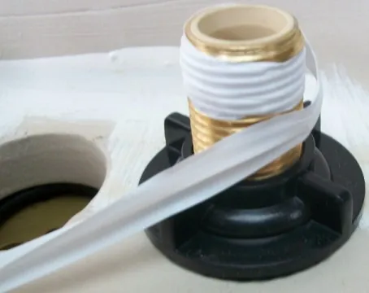
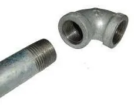

<figure class="eoc-pic eoc-pic-main"><figcaption><strong>How it works.</strong> <a href="https://commons.wikimedia.org/wiki/File:Teflon_tape_wound_around_threaded_pipe.jpg">Teflon tape wound around threaded pipe</a> by Tomwsulcer, <a href="http://creativecommons.org/publicdomain/zero/1.0/deed.en">CC0</a>, from Wikimedia Commons.</figcaption></figure>
<figure class="eoc-pic"><figcaption><strong>Photo.</strong> <a href="https://commons.wikimedia.org/wiki/File:Malefemalepipe.jpg">Malefemalepipe</a> by No machine-readable author provided. Scs assumed (based on copyright claims)., Public domain, from Wikimedia Commons.</figcaption></figure>

A tapered pipe thread is a screw thread whose diameter grows along its length, so tightening a male pipe end into a female fitting wedges the threads together, and a sealant such as PTFE tape, pipe dope or anaerobic sealant fills the small spiral gap that is left so the joint holds pressure.

**In plain words:** A pipe thread that gets slightly fatter along its length, so screwing the male end into the female wedges the threads tighter and tighter, while a wrap of white tape or a smear of paste fills the tiny gaps left between the threads so water, air or gas can't leak out along them. **Proper term:** Tapered pipe thread ([taper](../glossary.md#taper) pipe thread): NPT (US) and BSPT / ISO 7 'R' threads (British and international), sealed with PTFE thread-seal tape, pipe dope or anaerobic thread sealant.

**Also called:** NPT: National Pipe Taper, American National Standard Taper Pipe Thread (ASME B1.20.1); MIP/MPT/MNPT and FIP/FPT/FNPT for male and female iron pipe threads (Wikipedia 'National pipe thread'; Boshart); NPTF, Dryseal (ASME B1.20.3): a taper thread whose crests and roots are adjusted for an [interference fit](../glossary.md#interference-fit), meant to seal without tape (Wikipedia 'National pipe thread'); BSPT, British Standard Pipe Taper; ISO 7 / EN 10226 'R' (male taper), 'Rc' (female taper) and 'Rp' (female parallel thread used with a taper male); JIS R and Rc (Wikipedia 'British Standard Pipe'; Swagelok MS-13-77 p. 26); 'PT' (label used for the Japanese JIS taper thread on fittings, matching BSPT; e.g. Printables 1576310 title) ⚑ [uncertain]; jointing thread: a BSP thread where 'pressure-tightness is made through the mating of two threads together', always with a taper male (Wikipedia 'British Standard Pipe'); NPT with O-seal: an undersized NPT male with an [O-ring](../glossary.md#o-ring) on the hex shoulder, sealing on its face (Swagelok MS-13-77 p. 25); PTFE tape, thread seal tape, plumber's tape, 'Teflon tape' (Teflon is a Chemours brand and Chemours objects to the generic use), yellow 'gas tape', pink potable-water tape, PTFE string (Wikipedia 'Thread seal tape'); pipe dope, pipe joint compound, thread compound, pipe thread sealant, PTFE paste (Wikipedia 'Pipe dope'; Boshart); anaerobic pipe thread sealant, e.g. LOCTITE 567 (brand) (Henkel technical data sheet).

## How it works

Both threads taper by 1 unit of diameter in 16 units of length (a half-angle of 1°47′), so as the male end screws in, its larger diameter keeps pressing into the female's smaller one until the thread flanks are squeezed together and 'no [clearance](../glossary.md#clearance) remains' (Wikipedia 'National pipe thread', 'British Standard Pipe'). Machining [tolerances](../glossary.md#tolerance) still leave tiny gaps along the crests and roots, so 'tapered pipe threads always need a sealant' (Swagelok MS-13-77 p. 21): the tape or paste fills those voids and also lubricates the threads so they seat deeper without seizing ([galling](../glossary.md#galling--fretting)) (Wikipedia 'Pipe dope', 'Thread seal tape'). NPTF (Dryseal) threads are shaped to close that spiral leak path themselves (Wikipedia 'National pipe thread'). The seal is made on the threads; a parallel (straight) thread instead needs a gasket, O-ring or metal-to-metal seat, and 'a sealant is not required or recommended' on it (Swagelok MS-13-77 p. 27).

## Parts

A few parts: the male taper-threaded end (pipe, nipple, plug, valve or fitting), the female threaded port or fitting, and the sealant (PTFE tape, paste or anaerobic sealant). There is no washer or O-ring, except in the 'NPT with O-seal' variant (Swagelok MS-13-77 p. 25).

## Everyday examples

- The white tape wound round the threads of a pipe under a sink before a hose or tap connector is screwed on (Wikimedia Commons 'Teflon tape wound around threaded pipe')
- Threaded steel gas pipes and fittings sealed with yellow 'gas tape' (Wikipedia 'Thread seal tape')
- Fittings on air compressors, central-heating systems and pressurised water systems (Wikipedia 'Thread seal tape')
- Threaded PVC fittings on irrigation and pool pipework (Boshart)

## When to use it

Use it when joining threaded metal pipe and fittings that must hold pressure, and when connecting to pumps, valves, gauges, compressors, tanks and air fittings that come with NPT or BSPT/R ports, which is very common. It suits joints that are made once and rarely undone, where there is no room for a nut and washer, and pipe sizes up to a few inches; sizes larger than 6 in 'are often joined by other methods' (Wikipedia 'National pipe thread'). In Europe a taper male (R) is often screwed into a parallel female (Rp) and still seals on the threads (Wikipedia 'British Standard Pipe').

## When not to use it

Not on parallel (straight) threads such as BSPP/G, garden-hose or unified threads: they seal on a washer, O-ring or seat, and tape won't seal them (Swagelok MS-13-77 p. 27; Wikipedia 'Thread seal tape'); use Parallel pipe thread with a sealing washer instead. Never put tape on flared, coned or tube-fitting ends (Swagelok MS-14-01; see Flare fitting and Compression fitting). In hydraulic and other fluid-power systems tape is 'generally not considered appropriate' because shreds can jam valves (Wikipedia 'Thread seal tape'); straight threads sealed by an O-ring, such as the SAE straight-thread O-ring [boss](../glossary.md#boss) (Swagelok MS-13-77 p. 31), are the usual alternative ⚑ [uncertain]. Not where the joint must be set at an angle or undone often (add a union). Don't screw NPT into BSPT or the other way round; use an adapter. Don't use a printed taper thread to hold stored pressure, and don't work on gas fittings in a home unless you are legally allowed to (HSE).

## Details

- **What it does (jobs):**
  - seal it, or pass cables or fluid through: makes a leak-tight joint for water, air, gas, steam and hydraulic fluid in pipes, valves, pumps and fittings (Wikipedia 'National pipe thread')
  - join and hold: the same thread also holds the parts together, so pipes and fittings are joined and sealed in one step
- **Movement:** none: a fixed joint once tightened (it is screwed in, typically a few turns past hand-tight)
- **Directions it can move (degrees of freedom):** 0 once tightened. While it is being made up it turns and advances along its axis together (1, like any screw). It should not be turned back to line a fitting up: 'Once the connection is tight, do not loosen it. Doing so could mean leakage at the pipe thread' (Swagelok Northern California).
- **Special behaviour:**
  - none of the listed behaviours: its trick is the taper's wedge, which tightens and seals in the same movement
  - self-aligning or self-centring: the cone shape centres the male end in the female as it is screwed in ⚑ [uncertain]
- **How it holds:**
  - shape (the parts interlock; [form-fit](../glossary.md#form-fit--force-fit--material-bond)): the interlocking thread holds the parts together along the pipe
  - friction or clamping (force-fit): the taper wedges the thread flanks together, and friction keeps the joint from unscrewing
  - material bond (glue, solvent or melting): only with anaerobic sealant, which [cures](../glossary.md#cure) between close-fitting metal threads and adds a low locking strength (LOCTITE 567 technical data sheet)
- **Input and output:** not applicable: it is a fixed joint and passes on no motion
- **Power:** passive (no power needed)
- **Load:** Medium to heavy: strong in pull and against internal pressure, because every engaged thread shares the load; weaker against bending at the root of the last thread and against being turned back. Too much tape 'can prevent mating threads from fully engaging, reducing the [shear](../glossary.md#peel-vs-shear) point of the threads' (Wikipedia 'Thread seal tape'). Plastic female fittings split if overtightened, because the taper forces them open like a cone, and smaller sizes are more prone to stress cracking (Boshart).
- **Play and precision:** None once tightened: it is wedged tight. Engagement varies with thread tolerances by about plus or minus one turn (ANSI B1.20.1 tolerances, quoted by Boshart). It tolerates no mixing of thread forms: NPT has a 60° and BSPT a 55° thread angle, and in 1/2 and 3/4 in both have 14 threads per inch, so they 'can be difficult to identify because they are very close in design' (Swagelok MS-13-77 pp. 22-23); other sizes differ in [pitch](../glossary.md#pitch) too (1/8 in: 27 TPI NPT, 28 ISO 7; 1/4 and 3/8 in: 18 NPT, 19 ISO 7; Swagelok MS-13-77 p. 23).
- **Taking it apart:** semi-permanent (can be undone but may damage parts): it unscrews with spanners or pipe wrenches, but old sealant must be cleaned off and fresh sealant used (Swagelok MS-14-01); cured anaerobic sealant on threads over 1 in may need local heat of about 250 °C to undo (LOCTITE 567 technical data sheet); tape 'helps to limit corrosion on the threads, which otherwise can make future disassembly nearly impossible' (Wikipedia 'National pipe thread').
- **How often it can be reused:** a few times: each remake needs clean threads and fresh sealant (Swagelok MS-14-01), and each tightening wedges the taper a little further, so plastic female threads especially wear or split after repeated use ⚑ [uncertain]
- **Sealing:** airtight or pressure: the wedged threads plus sealant hold water, air, gas, steam and hydraulic fluid (Wikipedia 'National pipe thread'). The rating depends on the pipe, fitting and sealant; e.g. LOCTITE 567 is UL-classified for natural gas, petroleum oils, butane and propane at pressures up to 300 psig in pipe up to 2 in (LOCTITE 567 technical data sheet). Without sealant it leaks along the spiral gap at the crests and roots (Swagelok MS-13-77 p. 21).
- **Adjustable:** No: once tight it should not be backed off to line a fitting up (Swagelok Northern California), so its final angle is whatever the turns give. Where you need to set the angle or take the joint apart often, add a pipe union or use a parallel thread with a washer (see Parallel pipe thread with a sealing washer).
- **Access needed:** end of a tube or shaft: the male pipe end screws into the female port, one part turning about the pipe axis, with room needed to swing a spanner or pipe wrench
- **Materials:** Steel (black and galvanised iron), brass, bronze, stainless steel and cast iron, and plastics including PVC, CPVC, nylon and PTFE (Wikipedia 'National pipe thread'). Sealants: PTFE tape is intended for metal threads; Boshart warns against PTFE tape on female PVC fittings, because its bulk and [lubrication](../glossary.md#lubrication) make them crack, and recommends a plastic-compatible thread compound; petroleum-based pipe dope deteriorates PVC, CPVC and ABS, so US builders are expected to use a thread compound tested to ASTM F2331 or thread seal tape (Wikipedia 'Pipe dope'; note that Boshart and Wikipedia differ on tape for PVC); anaerobic sealants cure between metal threads and are 'not normally recommended for use on plastics' (LOCTITE 567 technical data sheet). Printed threads: PLA or PETG, for cold, unpressurised or very low-pressure use only (see making tips).
- **Heat, cold, water and wear:** Heat: Swagelok rates its PTFE tape for metal pipe threads 'in applications up to 450 degrees Fahrenheit, or 230 degrees Celsius' (Swagelok Northern California), and PTFE decomposes when overheated to 288 °C (550 °F) (Wikipedia 'Thread seal tape'); LOCTITE 567 is NSF-61 certified for potable water up to 82 °C and approved by the Australian Gas Association for -10 to 205 °C (LOCTITE 567 technical data sheet); printed PLA gives at about 60 °C and PETG at 80 °C (CNC Kitchen). Chemicals: petroleum-based dope attacks PVC, CPVC and ABS (Wikipedia 'Pipe dope'); anaerobic sealants are not for pure oxygen, chlorine or other strong oxidisers (LOCTITE 567 technical data sheet), and tape for oxygen must be grease-free (green tape; Wikipedia 'Thread seal tape'). Drinking water: use sealants approved for it, such as pink potable-water tape or NSF-61 sealants (Wikipedia 'Thread seal tape'; LOCTITE 567 technical data sheet). Corrosion: tape helps stop threads corroding together (Wikipedia 'National pipe thread'). Heat from soldering nearby can damage tape or dope (FineHomebuilding forum). Plastic threads under constant stress and heat can crack over time; smaller fittings are more prone to stress cracking (Boshart).

## Making it

- **Ways to make or get it:**
  - off-the-shelf part: pipe, nipples, plugs, bushes, tees, elbows, valves, pumps, gauges and air fittings with NPT or BSPT/R threads
  - 3D print (FDM): low-pressure plugs and adapters and thread gauges, e.g. a 3/4 in NPT plug for a PVC adapter (Printables 231377) and printable NPT thread gauges (Printables 1057747), modelled with BOSL2 npt_threaded_rod() or an OpenSCAD pipe-joint generator with NPT (BOSL2 threading.scad; Printables 1345884)
  - CNC: taper threads cut with a taper pipe tap or die, or single-pointed on a lathe ⚑ [uncertain]
- **Printing it in one piece (print in place):** no: the male and female parts are separate pieces, and one of them is usually a bought fitting
- **Tools:** An open-end spanner (wrench) or pipe wrench to turn the part, a vice or back-up spanner to hold the female fitting, and a dry, soft-bristled brush to clean old sealant out of both threads (Swagelok Northern California; Swagelok MS-14-01); plus PTFE tape, pipe dope or anaerobic sealant. To identify an unknown thread: a caliper and thread pitch gauges (Swagelok MS-13-77 pp. 7-9). Plastic fittings: hand-tight plus one or two turns only (Boshart).
- **Difficulty:** easy for bought metal fittings: tape the male thread, screw it in, tighten. Moderate when you must identify an unknown thread or seal plastic fittings without cracking them. Hard to print a taper thread that stays sealed under pressure, so use printed threads only for unpressurised jobs, plugs and gauges, and buy metal or moulded fittings otherwise.

### 3D printing tips

1) Low pressure only: print taper threads for plugs, garden, aquarium and drain adapters and thread gauges; never use a printed fitting on anything that holds stored pressure (air tanks, compressors, hydraulics, gas), where a burst can whip or inject fluid (HSE hydraulic injection injury bulletin). 2) Model the taper correctly: 1 in 16 on diameter (half-angle 1°47′), 60° thread angle for NPT and 55° for BSPT (Wikipedia 'National pipe thread'; Swagelok MS-13-77 p. 22). BOSL2's npt_threaded_rod() makes standard NPT threads from 1/16 to 2 in; internal=true gives a mask for female threads, and $slop adds 4 x $slop clearance to internal threads (BOSL2 threading.scad). One designer modelled 3/4 in NPT in Rhino from published measurements (Printables 231377); an AI-assisted remix of an OpenSCAD pipe-joint generator adds 1/8 to 2 in NPT and was tested at 1/2 and 3/8 in (Printables 1345884), so check the fit with a real fitting before trusting it. 3) Settings: NPT thread gauges print at 0.15 mm layers (0.1 mm for finer detail), 100% [infill](../glossary.md#infill), PLA or PETG; screw them on and off a few times to run the threads in (Printables 1057747). 4) Leak-tight walls: at least 3-4 [perimeters](../glossary.md#perimeters), nozzle 5-10 °C hotter, extrusion multiplier up 5-10%, and layer height no more than 60-65% of the nozzle width; watertight does not mean food safe (Prusa Knowledge Base, 'Watertight prints'). 5) Printed threads crack like PVC: the taper wedges the female part open, so go hand-tight plus one or two turns at most and prefer a plastic-compatible thread compound to a thick wrap of PTFE tape (Boshart's advice for PVC; applying it to prints is our assumption) ⚑ [uncertain]. 6) Heat: PLA gives at about 60 °C and PETG at about 80 °C (CNC Kitchen), so no hot water. 7) Often a better choice: print a parallel thread with a flat face for a washer or O-ring (see Parallel pipe thread with a sealing washer), or a hose barb, and screw the printed part onto a bought metal taper-thread adapter ⚑ [uncertain].

### Buying one (off-the-shelf parts)

Search terms (thread size tables are in Swagelok MS-13-77, pp. 13-14 and 23, rather than listed here): 'NPT nipple', 'hex nipple', 'close nipple', 'NPT plug', 'reducing bush' (bushing), 'tee', 'elbow', 'NPT to BSPT adapter' (the right way to join the two standards), 'NPT male hose barb'; pneumatic push-in fittings with 'R' or 'NPT' taper threads ⚑ [uncertain]; 'PTFE thread seal tape' (1/4 in wide for 1/8-3/8 in threads, 1/2 in wide for 1/2 in and larger; Swagelok MS-14-01), 'gas tape' (thicker yellow PTFE tape for gas; Wikipedia 'Thread seal tape'), 'pipe joint compound' or 'thread sealant' marked compatible with plastics (ASTM F2331; Wikipedia 'Pipe dope'), 'anaerobic pipe thread sealant'; 'thread pitch gauge' and 'thread and seat gauge set' for identification (Swagelok MS-13-77 pp. 9-10).

## Rules of thumb

- Taper: 1 in 16 on diameter (3/4 in per foot, 62.5 mm per metre), a half-angle of 1°47′, for NPT and BSPT alike (Wikipedia 'National pipe thread', 'British Standard Pipe'; Swagelok MS-13-77 p. 22).
- Telling them apart: NPT has a 60° thread angle with flat crests and roots; BSPT/ISO 7 has 55° with rounded ones; 1/2 and 3/4 in are both 14 threads per inch and may need an optical comparator to tell apart (Swagelok MS-13-77 pp. 22-23). Size and pitch tables: Swagelok MS-13-77 pp. 13-14 and 23.
- Is it tapered? Measure the crest-to-crest diameter on the first, fourth and last full threads: if it grows along a male thread (or shrinks along a female one) it is tapered; if all are equal it is parallel (Swagelok MS-13-77 p. 7).
- Wrapping PTFE tape (sources differ): wrap in the direction of the thread spiral, starting at the first thread and never overhanging it, two to three turns (Swagelok MS-14-01); 3-5 overlapping turns, at least 3 wraps of high-density tape or 4-5 wraps of standard 3.5 mil tape on 1/8-2 in NPT, with the first wrap covering the end of the thread but not the opening (Boshart); for anaerobic paste, 'a 360° bead... leaving the first thread free' (LOCTITE 567 technical data sheet).
- Tightening (sources differ): 'There is no standard for [torque](../glossary.md#torque) or number of turns' (Swagelok MS-13-77 p. 21). Boshart's guideline for metal fittings is 1-1/2 to 3 turns past hand-tight up to 1 in and 1 to 2-1/2 turns for 1-1/4 in and larger, with 3-1/2 to 6 threads engaged; for PVC, finger-tight plus one or two turns, no more.
- Once tight, do not back the joint off to line it up (Swagelok Northern California).
- PTFE tape: 1/4 in wide tape for 1/8, 1/4 and 3/8 in threads, 1/2 in wide for 1/2 in and larger; male tapered threads only (Swagelok MS-14-01); Swagelok rates its tape up to 230 °C (450 °F) on metal pipe threads (Swagelok Northern California).
- Anaerobic sealant: properly tightened fittings seal instantly to moderate pressures; allow at least 24 hours for full pressure and solvent resistance (LOCTITE 567 technical data sheet).
- PTFE overheated to 550 °F (288 °C) decomposes and can produce perfluoroisobutene, a toxic and potentially fatal gas (Wikipedia 'Thread seal tape'); polymer fume fever is caused by PTFE fumes from 300 to 450 °C (Wikipedia 'Polymer fume fever').

## Common failures

1) Mixed thread standards: NPT and BSPT look alike (same 14 TPI in 1/2 and 3/4 in) but have different thread angles, so they screw together and leak; identify with a caliper and pitch gauge (Swagelok MS-13-77 pp. 7-9, 22-23). 2) Tape used on a parallel thread or a flare or tube fitting, where it can't seal (Wikipedia 'Thread seal tape'; Swagelok MS-14-01). 3) Too much tape stops the threads engaging fully and weakens them; tape and pipe dope together can also overload the threads (Wikipedia 'Thread seal tape') - though Boshart recommends a coat of compound over tape, so sources differ. 4) Tape wrapped against the thread direction unravels as the joint is screwed together (Boshart). 5) Tape hanging over the first thread shreds into the system and can jam a valve seat (Wikipedia 'Thread seal tape'; Swagelok MS-14-01). 6) Backing a tight joint off to line up a fitting, which makes it leak (Swagelok Northern California). 7) Overtightening a plastic female fitting until it splits (Boshart). 8) Too few threads engaged (fewer than about 3-1/2) from undertightening (Boshart). 9) Galling of stainless or unlubricated threads (Swagelok MS-13-77 p. 21; LOCTITE 567 technical data sheet). 10) Petroleum dope on PVC, CPVC or ABS (Wikipedia 'Pipe dope'). 11) Old sealant left in the threads (Swagelok MS-14-01). 12) Heat from soldering after the threaded joint was made (FineHomebuilding forum).

## Safety

Pressure: always release the pressure before undoing a pipe joint; a jet of fluid can break the skin and inject it, reported at over 100 bar and possibly as low as 7 bar (HSE safety alert FOD 4-2014). Never use a printed fitting on a pressure vessel, compressor, hydraulic line or gas. Overheated PTFE gives off a toxic gas: above 288 °C (550 °F) it can produce perfluoroisobutene, 'a toxic and potentially fatal gas' (Wikipedia 'Thread seal tape'), and PTFE fumes from 300-450 °C cause polymer fume fever and are fatal to parrots and some other birds (Wikipedia 'Polymer fume fever'); so keep blowtorches away from taped joints, and solder or braze nearby joints first, let them cool, then make up the taped thread (FineHomebuilding forum advice). Gas: in the UK, work on gas fittings in homes and in workplaces such as shops, restaurants, schools and hospitals must be done by a Gas Safe registered engineer and 'it's illegal for anyone else to do it' (HSE); elsewhere follow local law. Oxygen: use only grease-free tape and sealants rated for oxygen (Wikipedia 'Thread seal tape'; LOCTITE 567 technical data sheet). Plastic fittings that are overtightened can split under pressure (Boshart).

## Related

- Parallel pipe thread with a sealing washer (BSPP, garden-hose thread, pipe union): the thread only holds and a washer or O-ring seals; no tape, and a union lets you undo the pipe without turning it
- Ordinary screw joint (bolt and nut, machine screw): a parallel thread that holds but doesn't seal
- Compression fitting (ferrule fitting): seals by crushing a ring onto plain tube; never tape it
- Flare fitting: a metal-to-metal cone seal on flared tube; never tape it
- Anaerobic adhesive ([threadlocker](../glossary.md#threadlocker), retaining compound): the same chemistry as anaerobic pipe sealant, used to lock threads
- O-ring seal: the ring used in 'NPT with O-seal' and straight-thread O-ring boss ports
- Hose barb: a ridged spigot for soft tubing, often on the other end of a taper-threaded adapter
- Quick couplers for tubes and hoses (push-to-connect): click-on connectors whose bodies often screw into a taper-threaded port
- Printed screw thread: how to model and print threads in general
- Soldered metal joint (sweat-soldered copper pipe): the permanent alternative for copper; heat from it can spoil a nearby taped joint
- Shutoff valve and Pressure relief valve: common parts that come with taper-threaded ends

## Make it yourself

- [Thread Gauge Tester: A Handy Tool for Measuring NPT Hydraulic Pipe Threads (3D KIMBA, Printables) (URL from Printables API, page not opened)](https://www.printables.com/model/1057747-thread-gauge-tester-a-handy-tool-for-measuring-npt): Printable male-and-female NPT thread gauges for 1/8 to 2 in, to identify unknown threads; a BSPP version is also offered *(licence: CC BY-NC-SA)*
- [3/4 Inch NPT Threads! (Mikel, Printables) (URL from Printables API, page not opened)](https://www.printables.com/model/231377-34-inch-npt-threads): A 3/4 in NPT male thread test model that can plug a 3/4 in PVC threaded female adapter *(licence: CC0 (Creative Commons Public Domain))*
- [REMIX Universal customizable OPENSCAD thread and pipe joint generator - added NPT (Cole von Werder, Printables) (URL from Printables API, page not opened)](https://www.printables.com/model/1345884-remix-universal-customizable-openscad-thread-and-p): OpenSCAD generator for threaded pipe joints with 1/8 to 2 in NPT added (AI-assisted; tested by its author at 1/2 and 3/8 in only) *(licence: BSD License)*
- [BOSL2 threading.scad (OpenSCAD library source)](https://raw.githubusercontent.com/BelfrySCAD/BOSL2/master/threading.scad): npt_threaded_rod(): standard NPT pipe threads from 1/16 to 2 in, male or as a mask for female threads, with $slop clearance *(licence: BSD 2-Clause)*

## Pictures, videos and models

- [File:Teflon tape wound around threaded pipe.jpg (Wikimedia Commons)](https://commons.wikimedia.org/wiki/File:Teflon_tape_wound_around_threaded_pipe.jpg): PTFE tape wound three times round a threaded pipe under a bathroom sink, ready for a hose connection *(licence: CC0 (Tomwsulcer))*
- [File:Colder BSPT Threads.png (Wikimedia Commons)](https://commons.wikimedia.org/wiki/File:Colder_BSPT_Threads.png): Drawing of BSPT taper pipe threads *(licence: Public domain (as stated on Commons; source colder.com))*
- [File:Malefemalepipe.jpg (Wikimedia Commons)](https://commons.wikimedia.org/wiki/File:Malefemalepipe.jpg): An ordinary threaded pipe and elbow fitting showing male and female pipe threads *(licence: Public domain)*
- [How to Apply PTFE Tape (Sealants) | Tech Tips | Swagelok [2020] (YouTube; title confirmed through YouTube oEmbed, video not watched)](https://www.youtube.com/watch?v=S6-akMHP5Rc): Three-minute demonstration of wrapping PTFE tape on a male tapered pipe thread (embedded in Swagelok's blog post on the skill) *(licence: link only (standard YouTube licence))*
- [Thread and End Connection Identification Guide, MS-13-77 Rev H (Swagelok, 2025)](https://www.swagelok.com.cn/downloads/webcatalogs/en/MS-13-77.pdf): Illustrated step-by-step thread identification, NPT and ISO 7 thread-form drawings and the taper-thread size tables (pp. 7-9, 13-14, 21-26) *(licence: link only (Swagelok copyright))*

## Needs confirming

⚑ marks something nobody has confirmed yet: a fact the research could not confirm from a source, a finder value that is a best guess, or an open point from the research notes. Corrections are welcome (see `research/needs-confirming.md`).

- ⚑ 8 sentences on this page marked [uncertain].
- ⚑ Research note: *Tapered pipe thread*: recorded side by side: where tape starts (Swagelok: at the first thread, never overhanging; Boshart: the first wrap covers the thread end; LOCTITE: leave the first thread free); wraps (Swagelok 2-3, Boshart 3-5); tightness (Swagelok: no standard torque or turns; Boshart: 1.5-3 turns past hand-tight for metal up to 1 in, hand-tight plus 1-2 for PVC); PTFE tape on PVC (Boshart: no; Wikipedia *Pipe dope*: tape or an ASTM F2331 compound); tape plus paste (Wikipedia: can overload threads; Boshart: recommends it); PTFE breakdown (288 °C in *Thread seal tape*, 300-450 °C in *Polymer fume fever*). 7 fields are marked [uncertain].

## Sources

- <https://en.wikipedia.org/wiki/National_pipe_thread>
- <https://en.wikipedia.org/wiki/British_Standard_Pipe>
- <https://en.wikipedia.org/wiki/Thread_seal_tape>
- <https://en.wikipedia.org/wiki/Pipe_dope>
- <https://en.wikipedia.org/wiki/Polymer_fume_fever>
- <https://www.swagelok.com.cn/downloads/webcatalogs/en/MS-13-77.pdf>
- <https://www.swagelok.com/downloads/webcatalogs/en/ms-14-01.pdf>
- <https://northerncal.swagelok.com/blog/bid/88017/skill-applying-ptfe-tape-to-tapered-pipe-threads>
- <https://support.boshart.com/making-npt-connections>
- <https://blog.boshart.com/3-dos-and-donts-when-assembling-pvc-fittings>
- <https://support.boshart.com/how-to-apply-ptfe-thread-seal-tape>
- <https://blog.boshart.com/5-steps-properly-wrap-ptfe-tape>
- <https://twlnz.co.nz/product_images/d365/56706/PDF.pdf>
- <https://www.hse.gov.uk/gas/employers.htm>
- <https://www.hse.gov.uk/safetybulletins/hydraulic-injection-injury.htm>
- <https://www.finehomebuilding.com/forum/plumbing-problem-8>
- <https://help.prusa3d.com/article/watertight-prints_112324>
- <https://www.cnckitchen.com/blog/comparing-pla-petg-amp-asa-feat-prusament>
- <https://raw.githubusercontent.com/BelfrySCAD/BOSL2/master/threading.scad>
- <https://commons.wikimedia.org/wiki/File:Teflon_tape_wound_around_threaded_pipe.jpg>
- <https://commons.wikimedia.org/wiki/File:Colder_BSPT_Threads.png>
- <https://commons.wikimedia.org/wiki/File:Malefemalepipe.jpg>
- <https://www.youtube.com/watch?v=S6-akMHP5Rc>
- <https://api.printables.com/graphql/>
