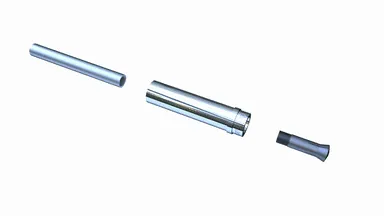

*Picture: [External thread pull collet action.gif](https://commons.wikimedia.org/wiki/File:External_thread_pull_collet_action.gif) by Slashme, [CC BY-SA 4.0](https://creativecommons.org/licenses/by-sa/4.0), from Wikimedia Commons.*

A lock for sliding tubes that holds them at any length by friction when you twist one section against the other (or turn a collar), and lets them slide again when you twist back.

**In plain words:** Two tubes that slide one inside the other and lock at any length when you twist them: the twist makes a plastic plug swell inside the tube, or makes a ring squeeze the inner tube, so friction holds them. **Proper term:** Telescoping tube twist lock (internal expander or eccentric-cam twist lock; external [collet](../glossary.md#collet) twist collar).

**Also called:** twist lock / twist-lock pole; internal lock, internal expander lock or expanding plug lock (trekking poles); twist collar lock or collet leg lock (camera tripods); cam twist lock or eccentric twist lock (tent poles, curtain rods); screw-to-lock telescoping tube; friction twist lock; Super Lock System (SLS) and Easy Lock System (ELS) (Leki (brand) names for its internal expander locks); twist lock plug (Valco (brand) TL series); twist-lock extension pole or whisker pole (painting, pool and boat poles).

## How it works

Internal expander: turning one tube against the other screws the threaded rod into a cone-shaped plastic plug, which swells outward and presses on the inside wall of the outer tube; friction then stops the tubes sliding (Leki; Ryder-Walker; Wright patent: rotation 'will cause [radial](../glossary.md#axial--radial) expansion of the collar' and 'frictional engagement' with the inner wall). Eccentric cam: an off-centre cam on the inner tube turns inside an off-centre ring; about a quarter turn (about 90 degrees) pushes the ring sideways against the outer tube wall and wedges it there (Levi and Quarberg patents; the printable tent-pole lock uses 'a circle offset by 1mm from center'). External collet: turning a threaded collar on the end of the outer tube squeezes a split plastic ring (a collet, 'C-ring') down onto the inner tube (Ulanzi; Wikipedia 'Collet'). Twisting back releases the squeeze so the tube slides.

## Parts

A small assembly that acts as one unit. Internal type: inner tube, a threaded rod or screw fixed in its end, a cone-shaped or split plastic expander (plug) that rides on the thread, and the outer tube (Leki: 'a hard plastic expander screws on to a threaded alloy spike'). Eccentric-cam type: an off-centre cam fixed to the inner tube and a loose off-centre ring or cam follower. External type: a threaded collar on the end of the outer tube, a split plastic ring (collet or 'C-ring') and the inner tube.

## Everyday examples

- Trekking and walking poles that you twist to lengthen (internal expander locks)
- Camera tripod legs with twist collars (Benro, Really Right Stuff and others)
- Telescopic painting, window-cleaning and pool poles, and boat whisker poles (Forespar 'internal twist lock device')
- Tent poles and extendable curtain rods with a small eccentric cam inside

## When to use it

Use a twist lock when you want tubes that set to any length (not just fixed holes), look clean with nothing sticking out, and don't snag: trekking poles, tent and awning poles, light stands, camera or phone tripods, extendable curtain rods, pinch rods, and printed or PVC 'extension' projects. It is cheap, light and slim, and can be hidden entirely inside the tube, so wires or cords can still run past some designs (the tubular cam patent routes wires through the middle).

## When not to use it

Avoid it when the length must be changed quickly with gloves or cold hands, or when you can't see whether it is locked (a lever lock (flip lock) shows its state and is easier to work: Ulanzi; Backpacker). Avoid it for heavy or safety-critical loads, for loads that twist the tube, or for vibration: use a spring button lock or a pin through holes for set positions, or a [set screw](../glossary.md#set-screw) or bolted clamp for a permanent setting. Avoid it in sandy, salty or muddy places unless you can clean it often (use a lever lock or a sealed design). A square or keyed tube can't use it, because the tubes must turn to lock.

## Details

- **What it does (jobs):**
  - let it move (turn, slide or bend): the sections slide to change length
  - lock, and release by hand: a twist locks the length anywhere along the slide, and a twist back frees it
- **Movement:** slide: in and out along the tube, over the length the overlap allows; when unlocked, round tubes can also turn (rotate+slide), and that turning is what works the lock
- **Directions it can move (degrees of freedom):** Unlocked: 2 (slide along the tube and turn around it); the turn is used to lock. Locked: 0, held only by friction, so a big enough push, pull or twist can still make it slip.
- **Special behaviour:**
  - [self-locking](../glossary.md#self-locking) (holds under load, won't back-drive): once tightened, pushing on the pole does not undo the thread or cam, so it stays locked by friction; a cam design gives 'a large multiple' of force for a modest twist (Levi and Quarberg, US5011319)
  - hand-release only (locks under load, releases when a person operates it): it only unlocks when someone twists the sections or the collar back
  - quick-release: no tools, but slower than a lever lock; a tripod twist collar needs about half a turn (Benro guide), an eccentric cam about a quarter turn (Levi and Quarberg, US5549407)
  - motion conversion (inside the lock only): the twist is turned into a sideways squeeze by a screw thread, cone or cam; no motion is passed on
- **How it holds:**
  - friction or clamping ([force-fit](../glossary.md#form-fit--force-fit--material-bond)): a swelling plug, off-centre cam or squeezed collet presses the tube walls together and friction holds the length
  - spring force (partly): the plastic expander or collet is squashed a little and pushes back like a spring, which keeps up the pressure
- **Input and output:** not applicable (the twist is turned into a sideways squeeze inside the lock, but no motion is passed on)
- **Power:** passive (no power needed)
- **Load:** Light to medium, depending on size. It is strongest against a push or pull along the tube (that is the job), but the length is held only by friction, so an overload makes it slip rather than break. It is weakest in twist: turning the sections the 'unlock' way loosens it. Brand holding-force claims for internal twist locks exist but could not be verified on an opened page ⚑ [uncertain]; one vendor explainer gives only 3-8 kg for a basic nylon-ring twist lock (poolpole.com, vendor page with no test method) ⚑ [uncertain]. The printable eccentric tent-pole lock 'easily holds body mass' in its largest size (Flex, Printables).
- **Play and precision:** No play when locked, because the plug or collet takes up the gap between the tubes; a long overlap is still needed to stop wobble (the printable PVC collet adds slide-on shims: 'Two appear sufficient to eliminate nearly all wobble with approximately 12" of extension', jslaker). The length is not repeatable unless you mark it (many poles have a printed scale). The tubes must be round and a close fit; it tolerates almost no sideways offset or angle.
- **Taking it apart:** tool-free quick release: twist to unlock and slide; the sections can usually be pulled fully apart past a 'stop' line for cleaning (Ryder-Walker)
- **How often it can be reused:** many times: it is adjusted every trip, but the plastic expanders wear or get polished and need replacing now and then (Leki FAQ: 'purchase new expanders as yours might be worn'; Backpacker: high-mileage hikers may need to service them yearly)
- **Sealing:** none as a rule: dirt, sand and water get onto the threads and friction surfaces and make it slip or seize (Backpacker; Wright patent: 'sand or grit entering the mechanical apparatus causing seizure'). Some tripod twist collars have a wiper that wipes the leg clean as it slides in (Ulanzi), which makes them dust-resistant at best ⚑ [uncertain].
- **Adjustable:** yes: the length can be set anywhere along the slide (stepless adjustment). How hard it grips depends on how far you twist it, and on worn or dirty expanders.
- **Access needed:** end of a tube or shaft: the expander or cam is fitted into the end of the inner tube, and a collar goes on the end of the outer tube; once built it is worked from the outside by twisting.
- **Materials:** Tubes: aluminium, carbon fibre, steel or PVC. Expanders and collets: hard or soft plastics, nylon or rubber (Leki; poolpole.com); threaded rod or screw: aluminium alloy or steel; collars: plastic or aluminium. Printed versions: PETG for the collet and forcing cone, PLA for handles and retainers (jslaker). Best with smooth, round, straight tubes; poor with rough or dented tubes, and with welded tube that has a seam inside (Speedy Metals).
- **Heat, cold, water and wear:** Water, salt and grit corrode the threads and polish or gum up the plug, so it slips (Backpacker); sand or grit can seize it (Wright patent). Twist-type locks can freeze in the cold or be overtightened until they jam (Tomm patent: 'known to become overtightened and freeze in position'; Johnson and O'Connor patent: twisting devices can 'strip, jam, or in cold weather, freeze'). Heat and sun: Benro advises not leaving a tripod in the sun or heat. Printed parts: PLA softens above about 60 °C and degrades in UV (Prusa); PETG suits below about 80 °C (Prusa); plastic expanders and printed collets relax ([creep](../glossary.md#creep)) under constant squeeze, so they need retightening (goodprints3d).

## Making it

- **Ways to make or get it:**
  - off-the-shelf part: replacement expanders, twist-lock plugs and complete twist-lock poles
  - 3D print (FDM): printed collets, forcing cones, eccentric cams and collars for bought aluminium, carbon or PVC tubes
  - 3D print (resin): possible for small cams ⚑ [uncertain]
  - CNC: turned metal collets and threaded collars (lathe work)
- **Printing it in one piece (print in place):** partly: a mostly [print-in-place](../glossary.md#print-in-place) telescoping webcam stand that 'screw-locks' to height exists, but its top and cam screw are printed separately (BRE3DLOVE, Printables). Most printed twist locks are separate parts fitted to bought tubes.
- **Tools:** None to use. To service: a cloth or old toothbrush and a light grease (Backpacker). To make your own: a saw and file for the tubes, and glue to fix the printed body into the inner tube so it can't turn (the printable tent-pole design uses Araldite).
- **Difficulty:** moderate: easy to buy (replacement expanders and twist-lock plugs are sold), but a printed collet or cam 'needs to be a relatively precise fit for the tubes, so it pretty much has to be generated for your material' (sdk, Printables).

### 3D printing tips

1) Measure your tubes first and print a test piece: the printed tent-pole cam is 'just a circle offset by 1mm from center', its outside diameter is made 'exactly the same size as ID of the larger tube so it needs a tiny squeeze to fit', and the gap between the cam's hole and the body is 'about 1mm but you may need to adjust'; 'the smaller the tube diameters, the harder to get the [tolerance](../glossary.md#tolerance) correct' (Flex, Printables 232086). 2) Fix the printed body to the inner tube with glue (Araldite) or it 'will rotate when trying to lock the cam' (Flex). 3) Print the parts that take the squeeze solid: 'Forcing cone and collet printed at 100% [infill](../glossary.md#infill) PETG'; handles can be about 35% infill (jslaker, Printables 145516). 4) Use a parametric model (e.g. the OpenSCAD collet by sdk) so you can regenerate it for your tube sizes; its thin clamping 'wings' are delicate until assembled. 5) Allow at least 0.3 mm [clearance](../glossary.md#clearance) for parts that must turn or slide (Prusa), and check vertical holes, which FDM prints undersize; drill them to size if they matter (Hubs). 6) Printed threads and cones are anisotropic: FDM parts are weaker across layers (Hubs), so print collets and cams with their axis vertical so the ring of [perimeters](../glossary.md#perimeters) carries the squeeze ⚑ [uncertain]. 7) Choose PETG over PLA for anything that stays tight: PLA 'gets soft and deforms at temperatures over 60 °C' and degrades in UV (Prusa PLA), while PETG suits use below 80 °C (Prusa PETG); even so, a PETG clamp can 'lose compression over hours or days' (goodprints3d). 8) Leave long overlap: the ultralight printed tripod warns to keep the inner tube inside the outer one by at least the length of the lock housing 'otherwise it won't be rigid enough' (danec, Printables 911528). 9) Put a stop on the inner tube so the lock cannot be pulled out or slammed against the end: impact against the stop 'can cause irreversible damage' (Wright patent).

### Buying one (off-the-shelf parts)

Trekking-pole expander plugs (twist-lock expanders) sold by tube diameter, e.g. 14-18 mm (Leki Easy Lock and Super Lock expanders (brand)); twist-lock plugs made to join two given tube IDs (Valco TL series (brand), e.g. TL-4362 'locks 11 I.D. tube into 16 I.D. tube'); replacement tripod twist-lock leg assemblies sold by leg diameter ⚑ [uncertain];complete twist-lock extension poles and whisker poles; round aluminium or carbon fibre telescoping tube sets. Search terms: 'twist lock expander', 'telescopic pole twist lock', 'twist lock plug', 'tripod leg twist lock', 'internal expander trekking pole'.

## Rules of thumb

- An eccentric-cam twist lock needs only about a quarter turn (about 90 degrees) to lock (Levi and Quarberg, US5549407); a tripod twist collar about half a turn (180 degrees) to release (Benro tripod guide).
- Printable eccentric cam: offset the cam circle about 1 mm from the tube centre, make the cam's outside diameter equal to the outer tube's inside diameter, and leave about 1 mm between cam bore and body, then tune (Flex, Adjustable twist lock tent pole, Printables 232086).
- Glue the fixed half of the lock into its tube, or it will spin instead of locking (Flex, Printables 232086).
- Overlap: FRC robotics teams reserve about one quarter to one fifth of each stage's length for overlap (the older rule was 30%), and wobble at the tip grows with extended length divided by overlap: 0.01 in of play with 20 in out and 4 in of overlap gives about 0.04 in at the tip (Chief Delphi thread 'Telescoping Tubes Overlap').
- Tube fit: allow at least 0.010 in between outer and inner diameters for steel DOM tube, and even then test, because many tubes have a weld seam inside (Speedy Metals); a supplier suggests 0.33-0.38 mm total clearance for 1 in aluminium tube in 7/8 in tube (Chalco, vendor guide).
- Never oil the friction parts: grease the threads very lightly with a non-running lubricant, 'DO NOT use WD40 or oil', and roughen polished plugs and tube walls with sandpaper to restore grip (Backpacker, 'How to Fix Trekking Poles').
- Older cam twist locks held only as hard as the user could twist; a cam with [mechanical advantage](../glossary.md#mechanical-advantage) turns a modest twist into a large locking force (Levi and Quarberg, US5011319).

## Common failures

1) Slipping under load because the plug is worn, polished, wet or greasy: clean, dry, lightly roughen the plug and tube wall, and keep oil off (Backpacker). 2) Jammed or seized from overtightening, corrosion or grit: twist firmly but not hard, clean after sandy or salty use, and grease the threads lightly (Backpacker; Wright patent; Benro). 3) Expander spins with the tube and won't tighten (worn threads or plug): replace the expander (Leki). 4) Pulled apart past the stop, or lost expander: many poles have a 'Stop Max' line; don't extend past it (Ryder-Walker); printed replacement expanders exist (Komperdell replacement on Printables). 5) Loosening because the sections got twisted the unlock way in use ⚑ [uncertain]. 6) Cracked collar or collet from overtightening (poolpole.com). 7) Printed versions: the body turns in the tube if not glued, and loose tolerances stop the cam gripping (Flex).

## Safety

It can slip suddenly if worn, wet or not tight enough, so don't trust your full weight or an expensive camera to it without testing (Benro: make sure leg locks are tightly engaged before mounting gear, and remove the camera before adjusting leg sections). Overtightening can crack the collar (poolpole.com) or jam the lock, and a jammed lock needs high twisting force that strains the wrists (Tomm patent). Pinch point where the tubes slide together. None of the stored-energy hazards of springs.

## Related

- Telescoping tube lever lock (flip lock): an outside clamp collar squeezed by a flip lever; faster, works with gloves and shows whether it is locked, but sticks out and can snag
- Spring button lock (snap button): a spring button pops through holes, so it locks positively (by shape) but only at set lengths
- Keyless locking bush (taper-lock bush): the same idea of a cone or [taper](../glossary.md#taper) wedging parts together, used to fix hubs to shafts
- Internal tube anchors (star nut, expansion plug): an expanding plug that is tightened once to fix a part in a tube end, not used as a sliding lock
- Eccentric cam lever (cam clamp): the off-centre cam principle, turned by a lever instead of by twisting the tube
- Self-locking wedge (wedge clamp): holds by a shallow wedge, as the cone inside a twist lock does
- Shaft-to-hub joints (clamp hub, set screw): a set screw through the outer tube is the simplest 'any length' lock but needs a tool and dents the tube
- Drawer slide (telescopic ball-bearing slide): a sliding telescope with no lock, for smooth motion

## Make it yourself

- [Twist Lock Pole Mechanism (Christopher Boyd, Printables)](https://www.printables.com/model/744570-twist-lock-pole-mechanism): A prototype pole 'that you can extend out and lock at any length just by twisting it', with the Blender file included for editing; details read through the Printables public API *(licence: CC0 (public domain))*
- [Adjustable twist lock tent pole (Flex, Printables) (URL from Printables API, page not opened)](https://www.printables.com/model/232086-adjustable-twist-lock-tent-pole): Four-section eccentric-cam twist lock for 12, 16 and 20 mm aluminium tube, with the design rule (1 mm offset circle) explained so you can make your own sizes *(licence: CC BY-SA)*
- [parametric lock collet for telescopic rod v2 (sdk, Printables) (URL from Printables API, page not opened)](https://www.printables.com/model/1459341-parametric-lock-collet-for-telescopic-rod-v2): OpenSCAD parametric collet with a compression crown and reduction sleeve to lock two snug-fitting aluminium or PVC tubes, e.g. for pinch rods or a bike-stand rod; STLs for 12+10 mm and 10+8 mm tubes in the first version *(licence: GNU LGPL)*
- [Telescoping PVC Collet - 1" to 1.5" (jslaker, Printables)](https://www.printables.com/model/145516-telescoping-pvc-collet-1-to-15): Collet, forcing cone, threaded cap and anti-wobble shims for telescoping 1 in PVC pipe inside 1.5 in pipe, with print settings; read through the Printables public API *(licence: CC BY)*
- [Collapsible Webcam Stand | Telescoping | Screw to Lock (BRE3DLOVE, Printables) (URL from Printables API, page not opened)](https://www.printables.com/model/858680-collapsible-webcam-stand-telescoping-screw-to-lock): Mostly print-in-place telescoping stand, 45 mm collapsed to 300 mm extended, that screw-locks at height; includes a tolerance test *(licence: CC BY)*
- [Telescopic Pole Twist-Lock Mechanism (Polyfoil, Thingiverse) (page opened but its content loads by script; description from search results)](https://www.thingiverse.com/thing:4926237): Printed expanders and wedges that turn cheap DIY-store steel tubing into a twist-lock pole, using one nut and bolt to move a wedge in an expanding collar; the author says it is not for critical uses *(licence: ⚑ [uncertain] not visible)*

## Pictures, videos and models

- [External thread pull collet action (Slashme, Wikimedia Commons)](https://commons.wikimedia.org/wiki/File:External_thread_pull_collet_action.gif): Animation of a split collet being pulled into its tapered seat so it clamps a shaft, then released: the same squeeze principle used in a tripod twist collar *(licence: CC BY-SA 4.0)*
- [Really Right Stuff Tripod Maintenance Part 3: Twist Locks (Really Right Stuff, YouTube)](https://www.youtube.com/watch?v=Eo1yQIZLVH4): Taking apart, cleaning and reassembling a tripod leg twist lock, showing the collar and parts inside (title and channel verified via YouTube oEmbed) *(licence: link only (standard YouTube licence))*
- [Twist Lock Pole - How to fix locking system (Supa Peg, YouTube)](https://www.youtube.com/watch?v=B0HB_SU4pyw): Repairing the internal locking system of a twist-lock pole (title and channel verified via YouTube oEmbed) *(licence: link only (standard YouTube licence))*
- [Do It Yourself: How To Service Leki Trekking Poles (Ryder-Walker)](https://ryderwalker.com/blog/do-it-yourself-how-to-service-leki_29/): Step-by-step photos of pulling a twist-lock pole apart, unscrewing the cone-shaped expander from its screw, cleaning and refitting it *(licence: link only)*
- [US5011319A, Locking mechanism for telescoping tubular poles (Levi and Quarberg, Google Patents)](https://patents.google.com/patent/US5011319A/en): Patent drawings of an S-shaped cam on the inner tube spreading two cam followers against the outer tube when turned *(licence: link only (US patent drawings))*

## Needs confirming

⚑ marks something nobody has confirmed yet: a fact the research could not confirm from a source, a finder value that is a best guess, or an open point from the research notes. Corrections are welcome (see `research/needs-confirming.md`).

- ⚑ 8 sentences on this page marked [uncertain].
- ⚑ Finder value `connects` = tube, rod or extrusion, something to grip (best guess): worked out from its name, but joining parts is not one of its two main jobs

## Sources

- <https://patents.google.com/patent/US4419026A/en>
- <https://patents.google.com/patent/US5011319A/en>
- <https://patents.google.com/patent/US5549407A/en>
- <https://patents.google.com/patent/US20100310306A1/en>
- <https://patents.google.com/patent/US6908249B2/en>
- <https://patents.google.com/patent/US5503357A/en>
- <https://www.backpacker.com/skills/how-to-fix-trekking-poles/>
- <https://ryderwalker.com/blog/do-it-yourself-how-to-service-leki_29/>
- <https://leki.gorgias.help/en-US/locking-system-parts---telescopic-371820>
- <https://www.leki.co.uk/blog/leki-speedlocks-explained>
- <https://lekiusa.com/pages/faq>
- <https://www.ulanzi.com/blogs/knowledges/twist-vs-lever-locks-travel-tripod-guide>
- <https://benrousa.com/content/pdf-manuals/benro_versatile_tripod_guide.pdf>
- <https://poolpole.com/telescoping-pole-locking-mechanisms/>
- <https://www.forespar.com/products/twist-lock-whisker-poles.shtml>
- <https://eshop.tim-service.de/upload/shoppictures_72/tinymce/TIM%20Aktionen/Snap_Buttons.pdf>
- <https://en.wikipedia.org/wiki/Collet>
- <https://commons.wikimedia.org/wiki/File:External_thread_pull_collet_action.gif>
- <https://www.chiefdelphi.com/t/telescoping-tubes-overlap/428351>
- <https://www.speedymetals.com/Information/Telescoping.html>
- <https://www.chalcoaluminum.com/knowledge/square-telescopic-tube-2505-zmy/>
- <https://help.prusa3d.com/article/pla_2062>
- <https://help.prusa3d.com/article/petg_2059>
- <https://help.prusa3d.com/article/modeling-with-3d-printing-in-mind_164135>
- <https://www.hubs.com/knowledge-base/how-design-parts-fdm-3d-printing/>
- <https://www.goodprints3d.com/blogs/3d/best-filament-for-3d-printed-hose-clamps-nylon-petg-or-pla-pro>
- <https://api.printables.com/graphql/>
- <https://www.printables.com/model/744570-twist-lock-pole-mechanism>
- <https://www.printables.com/model/145516-telescoping-pvc-collet-1-to-15>
- <https://www.thingiverse.com/thing:4926237>
- <https://www.youtube.com/oembed?url=https://www.youtube.com/watch?v=Eo1yQIZLVH4&format=json>
- <https://www.youtube.com/watch?v=Eo1yQIZLVH4>
- <https://www.youtube.com/watch?v=B0HB_SU4pyw>
