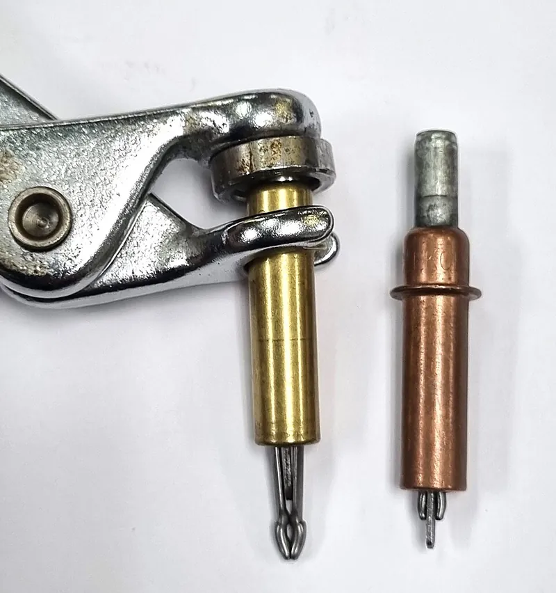
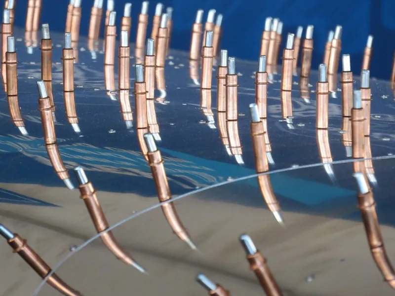
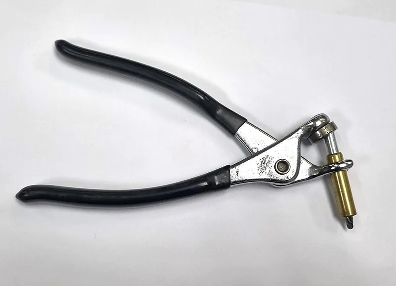

<figure class="eoc-pic eoc-pic-main"><figcaption><strong>How it works.</strong> <a href="https://commons.wikimedia.org/wiki/File:Cleco_fastener_extended.jpg">Cleco fastener extended</a> by Thermofan, <a href="http://creativecommons.org/publicdomain/zero/1.0/deed.en">CC0</a>, from Wikimedia Commons.</figcaption></figure>
<figure class="eoc-pic"><figcaption><strong>How it works.</strong> <a href="https://commons.wikimedia.org/wiki/File:Cleko.jpg">Cleko</a> by FlugKerl2, <a href="https://creativecommons.org/licenses/by-sa/4.0">CC BY-SA 4.0</a>, from Wikimedia Commons.</figcaption></figure>
<figure class="eoc-pic"><figcaption><strong>Photo.</strong> <a href="https://commons.wikimedia.org/wiki/File:Cleco_Tool_for_fitting_temporary_fasteners.jpg">Cleco Tool for fitting temporary fasteners</a> by Thermofan, <a href="http://creativecommons.org/publicdomain/zero/1.0/deed.en">CC0</a>, from Wikimedia Commons.</figcaption></figure>

A reusable spring-loaded pin, fitted from one side with special pliers, that grips behind two or more drilled sheets and clamps them together with their holes lined up while they are drilled, fitted or riveted, then comes straight out again.

**In plain words:** A spring-loaded pin you squeeze with special pliers, push through matching holes in two or more sheets and let go: its split tip spreads out behind the sheets and pulls them tight, keeping the holes lined up until you swap it for a rivet. **Proper term:** Cleco-type temporary fastener (spring-type sheet holder; Cleco (brand)).

**Also called:** Cleco / Cleko (brand name used for the whole type; from the Cleveland Pneumatic Tool Company); cleco pin, cleco rivet, temporary rivet (shop wording); sheet holder, sheet metal holder, reusable sheet metal fastener; spring-type temporary fastener, plier-operated temporary fastener; wing-nut Cleco and hex-nut Cleco (threaded versions that clamp harder); side-grip clamp / Cleco clamp (a small clamp for edges, fitted with the same pliers); Kwik-Lok (brand) temporary fastener.

## How it works

Squeezing the Cleco pliers pushes the plunger down, which pushes the two stepped jaws out of the body and off the spreader bar so they close together, thin enough to slip through the hole in the stacked sheets. When the pliers are released, the spring pulls the jaws back towards the body; the spreader bar forces them apart, so their steps catch behind the far sheet and the sheets are squeezed between the steps and the end of the body (Wikipedia 'Cleco (fastener)'; EAA). Because the jaws fill the hole snugly, the holes in every sheet stay lined up. Wing-nut and hex-nut versions pull the spreader up with a thread instead of a spring, so they can clamp much harder (Wikipedia; FAA-H-8083-31B).

## Parts

A small assembly that acts as one unit: a steel cylinder body, a plunger on top, a spring, a pair of step-cut locks (jaws) and a spreader bar between them (FAA-H-8083-31B). It is used with special Cleco pliers, and comes in colour-coded sizes. Threaded versions replace the spring with a wing nut or hex nut.

## Everyday examples

- Rows of copper and silver pins studding the aluminium skin of a kit aeroplane under construction (Wikipedia photo; EAA)
- A car restorer pinning a new steel body panel in place before welding it (V-Twins to V-8s)
- A repair patch (doubler) held on an aircraft skin with Clecos before it is riveted (FAA-H-8083-31B)
- A maker holding a glued seam together with 3D-printed Cleco plates (Printables)

## When to use it

Use Clecos whenever parts with matching holes must be held together, lined up exactly, and taken apart again before final assembly: riveted sheet-metal work (aircraft, enclosures, trailers, car panels), trial-fitting parts before deburring and riveting (EAA), holding panels flat and in line before welding (V-Twins to V-8s), and clamping glued seams on round or awkward shapes where clamps can't reach (Printables). They are especially useful when you can only reach one side of the work (Wikipedia).

## When not to use it

Don't use them as permanent or load-carrying fasteners: swap each for a rivet, bolt or screw (V-Twins to V-8s). Where there are no holes, or holes aren't allowed, use side-grip clamps or C-clamps (AFT; FAA-H-8083-31B). Where you need strong clamping (thick or stiff parts, sealant squeeze-out), use wing-nut or hex-nut temporary fasteners or temporary bolts (FAA-H-8083-31B). For a quick-release joint in a finished product, use a ball-lock quick-release pin, snap pin or quarter-turn fastener instead. For soft materials like foam or thin prints the small jaws may crush the material ⚑ [uncertain].

## Details

- **What it does (jobs):**
  - join and hold: holds sheets or parts together temporarily while they are drilled, fitted, glued, welded or riveted
  - line parts up exactly: keeps the holes in all the sheets lined up so the permanent rivets or bolts go in straight
- **Movement:** none: it holds the sheets still
- **Directions it can move (degrees of freedom):** 0 with two or more fitted; a single Cleco still lets the sheets swing round it, which is why several are used along a seam
- **Special behaviour:**
  - quick-release: goes in and comes out with one squeeze of the pliers, from one side, and can be reused thousands of times on a project (EAA; AFT). It needs its pliers, so it is not tool-free.
  - self-aligning or self-centring: the snug-fitting jaws pull matching holes into line and keep them there (Wikipedia; FAA-H-8083-31B)
- **How it holds:**
  - spring force: the internal spring pulls the jaws back and provides the clamping force, which is small (a standard plier-operated Kwik-Lok is rated for about 25 lb, AFT)
  - shape ([form-fit](../glossary.md#form-fit--force-fit--material-bond)): the stepped jaws hook behind the far sheet and fill the hole, so the sheets can't slide or pull apart
- **Input and output:** not applicable
- **Power:** passive (no power needed); hex-nut versions can be driven by a pneumatic nut runner (FAA-H-8083-31B), but they hold without power
- **Load:** Light: it is for holding parts in place, not carrying loads. A standard plier-operated type clamps with about 25 lb (AFT, Kwik-Lok); wing-nut and hex-nut temporary fasteners give up to 300 lb clamping force when more is needed (FAA-H-8083-31B). The pin resists the sheets sliding over each other ([shear](../glossary.md#peel-vs-shear)) enough to keep holes lined up during drilling, but 'Cleco pins are temporary fasteners, not structural hardware' (V-Twins to V-8s).
- **Play and precision:** Very little: 'Clecos should fit snugly in their holes to prevent shifting of the workpieces and maintain the alignment of fastener holes which do not have Clecos in them' (Wikipedia). It only works if the hole matches its size (an undamaged silver 3/32 in Cleco passes through a #41 hole, KITPLANES). It tolerates no more [misalignment](../glossary.md#misalignment) than the hole [clearance](../glossary.md#clearance).
- **Taking it apart:** removable: comes out in seconds with the same Cleco pliers, leaving the hole ready for a rivet (V-Twins to V-8s)
- **How often it can be reused:** many times: they are reusable, and one builder says the installs and removals on one aircraft 'must be well into the thousands' (EAA; FAA-H-8083-31B)
- **Sealing:** none
- **Adjustable:** No for spring types: each size grips a set range of thickness, typically 0-1/4 in (Aircraft Spruce), with long-grip types for thicker stacks (Jay-Cee: 0-1/2 in across its range; AFT: 1/4-1/2 in grip Kwik-Lok). Wing-nut types let you set the clamping force by hand from 0 to 300 lb (FAA-H-8083-31B).
- **Access needed:** one side only (blind): it is fitted and removed from one side, which was the point of the original 1936 patent ('applied to or removed from the work from only one side thereof') (Google Patents US 2,136,875; Wikipedia)
- **Materials:** Steel body and jaws with a spring; each size has a colour-coded finish: silver (zinc or cadmium) 3/32 in, copper 1/8 in, black 5/32 in, gold (brass) 3/16 in (Wikipedia; Aircraft Spruce). Mostly used on aluminium aircraft skins; also steel car-body panels before welding (V-Twins to V-8s), and to hold glued parts such as 3D prints with printed backing plates (Printables). AFT mentions larger-footprint types for composites.
- **Heat, cold, water and wear:** A workshop tool: no special limits found. The steel parts are plated, but ⚑ [uncertain] will rust if stored wet or left outdoors. The springs weaken with age and heavy use, so weak ones should be sorted out (a buyer review on Aircraft Spruce reports about 1 in 100 with a weak spring; low-quality source). Heat from welding next to a Cleco may soften its spring ⚑ [uncertain].

## Making it

- **Ways to make or get it:**
  - off-the-shelf part: Clecos and their pliers are bought
  - sheet metal: aluminium aircraft skins, car-body panels and enclosures, held while being drilled, riveted or welded
  - 3D print (FDM): printed plates, jigs and holders used with bought Clecos, e.g. plates that bridge a glued seam (Printables)
  - 3D print (resin): the same plates printed in tough or flexible resin (Printables)
- **Printing it in one piece (print in place):** no: it is a bought steel part with a spring and hardened jaws; printed models found are only accessories (plates, holders, Gridfinity bins) ⚑ [uncertain: no working printed Cleco found]
- **Tools:** Cleco pliers (one type of plier fits all six sizes, FAA-H-8083-31B); a drill with the matching bit (e.g. #30 for 1/8 in, Aircraft Spruce); a deburring tool for the holes. Wing-nut versions are turned by hand; hex-nut versions use a spanner or nut runner (FAA-H-8083-31B).
- **Difficulty:** easy: buy a kit of Clecos and a pair of Cleco pliers; the only skill is drilling round, correctly sized, matching holes

### 3D printing tips

1) Use bought Clecos and print accessories. The 'Cleco Plates for gluing seams' model (Printables) is a small plate with two holes: one Cleco goes through each hole into the part on either side of a seam, so the plate holds the two parts together while glue dries. Its author found he could fit more Clecos than clamps along a seam, that they work on round shapes and where clamps can't reach, that plates with 20 mm between hole centres still leave room for the pliers, and recommends cheap filament or a tough or flexible resin, with the Cleco size printed on each plate. 2) Holes: drill each hole to the Cleco's drill size after printing (e.g. #40 for 3/32 in, #30 for 1/8 in, #20 for 5/32 in, #10 for 3/16 in, Aircraft Spruce), because FDM holes print undersized and Hubs recommends printing critical holes undersized and drilling them. A loose hole defeats the point: Clecos must fit snugly (Wikipedia). 3) Keep the whole stack within the Cleco's grip range, typically 0-1/4 in (Aircraft Spruce), or buy long-grip types. 4) The spring force is small (about 25 lb for a standard type, AFT), so it clamps thin parts together but won't pull a warped print flat; for more force use wing-nut Clecos (FAA-H-8083-31B). 5) The steel jaws bear on a small area behind the far part, so soft prints or foam may dent; a printed washer plate on the far side spreads the load ⚑ [uncertain: suggestion, not from a tested source]. 6) Printed storage: Gridfinity bins and holders for Clecos, side-grip clamps and Cleco pliers are available (Printables).

### Buying one (off-the-shelf parts)

Spring-type Clecos in 3/32, 1/8, 5/32, 3/16, 1/4 and 3/8 in (FAA-H-8083-31B), also metric (e.g. 3.2 and 4.8 mm, Wikipedia), in standard, long, extra-long, mini and heavy-duty extended-grip series (US Industrial Tool); wing-nut and hex-nut temporary fasteners (FAA-H-8083-31B); side-grip clamps (Cleco clamps), e.g. 1/2 in and 1 in reach (Printables holder; Aircraft Spruce); Cleco pliers; pneumatic Cleco installers and nut runners (FAA-H-8083-31B); Kwik-Lok (brand) plier-operated, miniature and long-grip fasteners (AFT). Search terms: 'cleco fastener', 'sheet holder', 'temporary fastener', 'side grip clamp', 'cleco pliers'.

## Rules of thumb

- Six common sizes: 3/32, 1/8, 5/32, 3/16, 1/4 and 3/8 in, with the size stamped on the fastener and colour coding; one type of plier fits all six (FAA-H-8083-31B, p. 4-29).
- Drill sizes and colours: 3/32 in silver (cadmium) #40; 1/8 in copper #30; 5/32 in black #20; 3/16 in brass #10; 1/4 in copper, 1/4 in drill; standard material thickness 0-1/4 in (Aircraft Spruce K-series sheet holders).
- Clecos should fit snugly in their holes to prevent shifting and keep other holes aligned (Wikipedia).
- [Pilot holes](../glossary.md#pilot-hole): #40 for finished holes over 3/32 in, #41 for 3/32 in fasteners; an undamaged silver Cleco passes through a #41 hole (KITPLANES).
- While match drilling, keep a Cleco or clamp next to each hole being drilled and a Cleco in every other hole (KITPLANES).
- Spring Clecos clamp lightly (about 25 lb for a standard plier-operated Kwik-Lok, AFT); use wing-nut or hex-nut temporary fasteners, up to 300 lb, when more clamp-up is needed (FAA-H-8083-31B, p. 4-29).
- Stacks thicker than about 3/16 in don't reliably guide a drill through existing pilot holes; keep the drill square (KITPLANES).
- When drilling dissimilar metals, drill through the hardest material first so the softer holes don't wallow out (KITPLANES).
- For hand-drilling titanium, clamp parts tightly with temporary bolts, Cleco clamps or tooling clamps as close to the drilling as possible (FAA-H-8083-31B, p. 4-85).
- Printed Cleco plates with 20 mm between hole centres leave room for the pliers (Printables, 'Cleco Plates for gluing seams').

## Common failures

1) Wrong-size or oversize holes: the Cleco is loose, the sheets shift and the other holes go out of line (Wikipedia; KITPLANES); drill to the matching size and keep the drill square. 2) Too few Clecos while drilling, so parts [creep](../glossary.md#creep); put one in every other hole (KITPLANES). 3) Stack thicker than the grip range, so the jaws can't catch (Aircraft Spruce). 4) Burrs left by drilling: builders take the parts apart, deburr the holes and edges, then put them back together with Clecos before riveting (EAA). 5) Weak springs, which clamp poorly (Aircraft Spruce buyer review; V-Twins to V-8s advises avoiding ultra-cheap kits). 6) Too little clamping force for the job (FAA-H-8083-31B); use wing-nut Clecos. 7) Forcing a Cleco into a hole that is too small, or dropping it, can bend the jaws ⚑ [uncertain].

## Safety

Freshly drilled holes and cut sheet edges have sharp burrs; deburr them (EAA; KITPLANES). Never leave a Cleco in place as a permanent fastener (V-Twins to V-8s). ⚑ [uncertain] Keep fingers clear of the plier jaws, and wear eye protection when drilling, because chips fly.

## Related

- Blind rivet (pop rivet): the permanent one-sided fastener that usually replaces the Cleco
- Temporary bolt and nut: the older method; clamps harder but needs a person or tool on both sides (EAA; Google Patents US 2,136,875)
- Wing-nut and hex-nut temporary fasteners: Cleco-type pins pulled tight by a thread for up to 300 lb clamping force (FAA-H-8083-31B)
- Side-grip clamp (Cleco clamp): a small spring clamp for edges where there are no holes (AFT; Wikipedia)
- C-clamp (G-clamp): general clamping, but needs room on both sides and can mark soft metal (FAA-H-8083-31B)
- Quick-release pin (ball-lock pin): a permanent-use pin that locks with balls and releases with a button
- Snap pin (split-leg push-in pin): a printable pin held in by springy legs
- Locating pins (dowels): fixed pins that line parts up but don't clamp them together
- Spring bar: another small spring-loaded pin, but it telescopes between lugs rather than gripping behind sheets

## Make it yourself

- [Cleco Plates for gluing seams (Weird_Stealth, Printables) (URL from Printables API, page not opened)](https://www.printables.com/model/474194-cleco-plates-for-gluing-seams): Small printed plates with two Cleco holes that bridge a seam, so bought Clecos can hold two glued parts together; sized by hole-centre distance (20 mm recommended) and labelled with the Cleco size *(licence: Creative Commons Public Domain (as listed on Printables))*
- [Gridfinity Holders for Cleco Fasteners (Vase Mode) (Netpackrat, Printables) (URL from Printables API, page not opened)](https://www.printables.com/model/1049736-gridfinity-holders-for-cleco-fasteners-vase-mode): Gridfinity storage holders for spring Clecos, printed in vase mode, with 6x3 mm magnet pockets *(licence: CC BY-NC-SA)*
- [Cleco Holder (jeffrey892, Printables) (URL from Printables API, page not opened)](https://www.printables.com/model/1103509-cleco-holder): A lidded toolbox holder for 40 Clecos of various sizes *(licence: Creative Commons Public Domain (as listed on Printables))*
- [Cleco Side Grip Clamp holder (mfraz74, Printables) (URL from Printables API, page not opened)](https://www.printables.com/model/272245-cleco-side-grip-clamp-holder): Plates holding 1/2 in and 1 in side-grip clamps, with an editable FreeCAD file *(licence: CC BY)*

## Pictures, videos and models

- [Cleco fastener extended (Wikimedia Commons, by Thermofan)](https://commons.wikimedia.org/wiki/File:Cleco_fastener_extended.jpg): A Cleco with its jaws pushed out next to one with its jaws retracted, showing the stepped jaws and the colour coding *(licence: CC0 1.0 (public domain dedication))*
- [Cleco Tool for fitting temporary fasteners (Wikimedia Commons, by Thermofan)](https://commons.wikimedia.org/wiki/File:Cleco_Tool_for_fitting_temporary_fasteners.jpg): The special pliers used to fit and remove Clecos *(licence: CC0 1.0 (public domain dedication))*
- [Cleko Fasteners on RV-12 Wing (Wikimedia Commons, by FlugKerl2)](https://commons.wikimedia.org/wiki/File:Cleko.jpg): Rows of Clecos holding the skin of a kit-aircraft wing during assembly *(licence: CC BY-SA 4.0)*
- [Cleco fasteners how they work (Matthys Quality Equipment, YouTube)](https://www.youtube.com/watch?v=Z73rnbUEdN8): How a Cleco and its pliers work (title and channel verified via YouTube oEmbed; content not reviewed in detail) *(licence: link only (standard YouTube licence))*
- [What are Cleco Fasteners And How To Use Them (Omega Technologies, YouTube)](https://www.youtube.com/watch?v=thBy5z0Kanc): A tool supplier's explanation of Cleco types and how to fit them (title and channel verified via YouTube oEmbed; content not reviewed in detail) *(licence: link only (standard YouTube licence))*

## Needs confirming

⚑ marks something nobody has confirmed yet: a fact the research could not confirm from a source, a finder value that is a best guess, or an open point from the research notes. Corrections are welcome (see `research/needs-confirming.md`).

- ⚑ 7 sentences on this page marked [uncertain].

## Sources

- <https://en.wikipedia.org/wiki/Cleco_(fastener)>
- <https://www.faa.gov/regulations_policies/handbooks_manuals/aviation/FAA-H-8083-31B_Aviation_Maintenance_Technician_Handbook.pdf>
- <https://www.aircraftsystemstech.com/p/sheet-metal-holding-devices.html?m=1>
- <https://www.aircraftspruce.com/catalog/topages/sheetholder.php>
- <https://aft.systems/a-guide-to-using-temporary-fasteners/>
- <https://inspire.eaa.org/2018/12/12/i-really-like-clecos/>
- <https://patents.google.com/patent/US2136875A/en>
- <https://www.kitplanes.com/drilling-holes-for-fasteners/>
- <https://vtwinstov8s.com/blogs/tools-and-tips/what-cleco-pins-are-and-why-pros-use-them-for-sheet-metal-work>
- <https://www.rivetsonline.com/rivets/cleco-fasteners-temporary-rivetsside-grips>
- <https://www.ustool.com/sheet-metal-tools/cleco/fasteners.html>
- <https://www.hubs.com/knowledge-base/how-design-parts-fdm-3d-printing/>
- <https://commons.wikimedia.org/wiki/File:Cleco_fastener_extended.jpg>
- <https://commons.wikimedia.org/wiki/File:Cleco_Tool_for_fitting_temporary_fasteners.jpg>
- <https://commons.wikimedia.org/wiki/File:Cleko.jpg>
- <https://api.printables.com/graphql/>
- <https://www.youtube.com/oembed?url=https://www.youtube.com/watch?v=Z73rnbUEdN8&format=json>
- <https://www.youtube.com/watch?v=Z73rnbUEdN8>
- <https://www.youtube.com/watch?v=thBy5z0Kanc>
