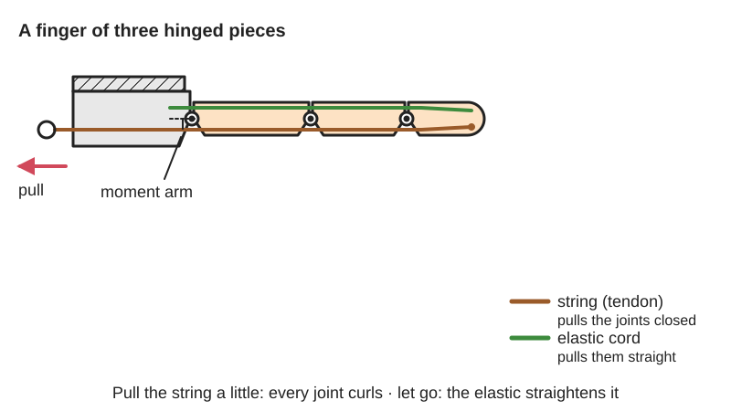
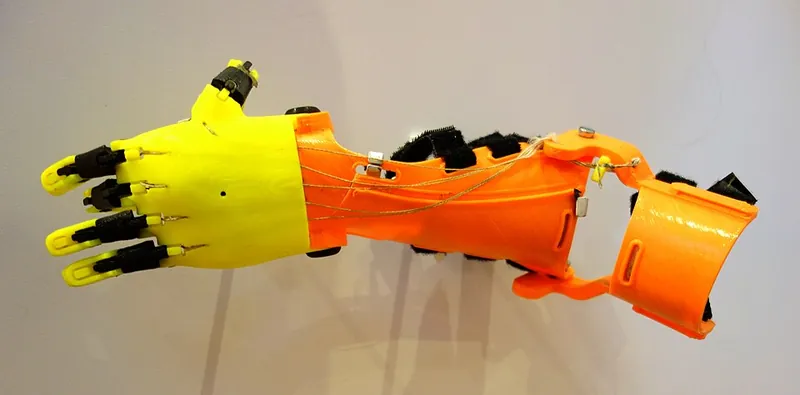

<figure class="eoc-pic eoc-pic-main"><picture><source media="(prefers-reduced-motion: reduce)" srcset="../media/drawn/tendon-driven-joint.svg"></picture><figcaption><strong>Animation.</strong> Diagram drawn for the encyclopaedia from the research notes. ⚑ Needs confirming: a drawing can simplify or get details wrong; a real photo or a better diagram is welcome.</figcaption></figure>
<figure class="eoc-pic"><figcaption><strong>Photo.</strong> <a href="https://commons.wikimedia.org/wiki/File:E-NABLE_Raptor_Reloaded_prosthetic_hand_and_arm,_designed_by_Ivan_Owen_et_al,_2013-2015_-_Design_Museum,_Kensington_-_London_-_DSC01581.jpg">E-NABLE Raptor Reloaded prosthetic hand and arm, designed by Ivan Owen et al, 2013-2015 - Design Museum, Kensington - London - DSC01581</a> by Daderot, <a href="http://creativecommons.org/publicdomain/zero/1.0/deed.en">CC0</a>, from Wikimedia Commons.</figcaption></figure>

A tendon-driven joint bends a chain of hinged or flexible segments by pulling a string anchored near the tip and threaded past each joint a little way off its pivot, so a straight pull from a distant motor, lever or wrist becomes a curling motion, while elastic cord, springy hinges or a second string pull it back.

**In plain words:** A finger or tentacle made of small hinged or bendy pieces with a string running through them: pull the string from a distance and the pieces curl up, let go and an elastic cord, a springy hinge or a second string straightens them again. **Proper term:** Tendon-driven joint (cable-driven finger or tendon-driven continuum segment).

**Also called:** cable-driven finger, tendon-actuated finger or string-pulled finger; tendon-driven robot (TDR) (Wikipedia); cable-driven tentacle, mechanical tentacle or animatronic tentacle; tendon-driven continuum robot or snake arm (a bendy backbone pulled by several tendons); underactuated finger (one tendon bending several joints, as in the Yale OpenHand); body-powered or wrist-driven 3D-printed prosthetic hand (e-NABLE designs such as Raptor Reloaded and Phoenix); flexor tendon (the pulling string) and extensor tendon or elastic return (the opening side); agonist-antagonist tendons (two strings pulling opposite ways); printed cable-driven mechanism, e.g. Xstrings (research project name).

## How it works

Each tendon runs along the segments a small distance from each joint's pivot (its moment arm), so pulling it produces a turning force at that joint equal to the tension times that distance (OpenHand measures the moment arm from the tendon hole to the [flexure](../glossary.md#flexure) centreline). Shortening the tendon path makes the joints bend; in a Raptor Reloaded finger, 15 mm of pull at 22.2 N curled both joints to 90 degrees (Frontiers 2021). One tendon passing several joints drives them all at once (underactuation), so the finger keeps closing round an object until every segment touches it; the order in which joints close is set by their relative [stiffness](../glossary.md#stiffness) (OpenHand). Because strings can only pull, something must pull the other way: elastic cords, rubber bands or springy flexures open the finger, or cables are used in pairs so the joint can be pulled both ways (Hackaday, Vasquez 2021); a tentacle or continuum robot has several tendons spaced round a bendy backbone and pulled from outside the body (Wikipedia 'Continuum robot'). A gripper worked by one cable also needs a choice that body-powered prosthetic hooks make: spring-closed (voluntary opening, 'pull to open'), where elastic bands or springs give the grip and pulling the cable opens it, so once closed it holds 'like a passive vice' with no pull needed; or cable-closed (voluntary closing, 'pull to close'), where the grip follows the pull and needs 'constant tension to grip', but can be much stronger and lets the operator feel how hard it is squeezing (Wikipedia 'Prosthesis').

## Parts

A small assembly that acts as one unit: (1) segments (finger bones or tentacle 'vertebrae'), printed or cut; (2) joints between them: pins, flexible flexure hinges, or a continuous bendy backbone; (3) one or more tendons, usually braided fishing line or thin wire rope, anchored at the tip; (4) routing holes, guide pins, small pulleys or a sleeve that keep each tendon a set distance from each joint; (5) a return: elastic cord or rubber bands, the springiness of the hinges, or a second (antagonist) tendon; (6) a tensioner (screw, pin or spring) to take up slack; (7) the puller: a servo or winch with a pulley, the user's wrist (e-NABLE hands) or a hand lever or joystick (Frontiers 2021; Yale OpenHand; InMoov; Thingiverse 'Animatronic Tentacle MK III').

## Everyday examples

- Your own fingers: muscles in the forearm pull long tendons that run through small pulleys to bend the finger joints (Printables 'finger model with both tendons and pulley systems' shows them)
- 3D-printed e-NABLE prosthetic hands, which close their fingers through fishing-line tendons when the wearer bends the wrist (e-NABLE)
- The popular printed 'robotic hand' fidget toy, whose fingers curl when you pull rings on their strings (Printables 1534503)
- Animatronic tentacles and creature effects in films and props, worked by cables from servos or a joystick (Thingiverse 'Animatronic Tentacle MK III')

## When to use it

Use it when you want the moving part light and slim and the motor somewhere else: robot and prosthetic hands, grippers that wrap round odd shapes, animatronic tentacles, tails and puppets, snake-like arms that reach into tight spaces, and wearable devices (Wikipedia 'Continuum robot'; Yale OpenHand; Frontiers 2021). One motor can close a whole hand through underactuation, it is cheap (fishing line and printed parts), naturally compliant and gentle when it bumps into things, and it can be powered by a person's own wrist with no electronics (e-NABLE).

## When not to use it

Avoid it when you need stiff, precise, repeatable positions, high forces in both directions, or very long service life: tendons stretch and [creep](../glossary.md#creep), friction and slack cause [hysteresis](../glossary.md#hysteresis), and moving one joint can disturb another (Wikipedia 'Tendon-driven robot'; InMoov; arXiv 2507.17163). For a precise joint use a servo or gearmotor at the joint, or a [linkage](../glossary.md#linkage); for a stiff bendable arm that holds a pose without power use a posable segmented arm; for gentle gripping without strings use a fin-ray finger or a soft pneumatic [actuator](../glossary.md#actuator); to carry a pull round many bends use a Bowden cable (sleeve) rather than bare holes.

## Details

- **What it does (jobs):**
  - change the kind of motion: turns a straight pull on a string into the bending of a finger or tentacle
  - let it move (turn, slide or bend): the segments hinge or flex while the tendon controls how far
  - hold or release using power: a servo or winch keeps the tendon tight to hold a grip and lets go to release it (InMoov; Yale OpenHand)
- **Movement:** multiple: each joint rotates (typically up to about 90 degrees per joint in printed fingers, Frontiers 2021) and a tentacle or flexure finger flexes continuously along its length
- **Directions it can move (degrees of freedom):** One per hinge, but fewer tendons than joints are often used: a printed finger has 2-3 joints driven by one tendon (underactuated), and a whole e-NABLE hand has at least 10 joints driven by one wrist movement (Frontiers 2021); a tentacle segment bends in 2 directions, commonly using three or four tendons spaced round it ⚑ [uncertain]. Fully controlling n joints with pull-only strings needs at least n+1 tendons (arXiv 2507.17163), or 2n with one opposing pair per joint.
- **Special behaviour:**
  - motion conversion (e.g. rotary to linear): a straight pull (often from a motor turning a pulley) becomes bending of a chain of joints
  - self-aligning or self-centring: an underactuated finger, or several fingers sharing one pull through a whippletree or floating pulley, wraps round and conforms to an odd-shaped object without sensors (Yale OpenHand; e-NABLE Phoenix)
- **How it holds:**
  - not a holding joint (it moves or passes on motion): it passes a pull on into bending
  - powered hold: the grip lasts only while the actuator or the user keeps the tendon tight
  - spring force (a spring or springy part presses it in place): elastic cords, rubber bands or flexures return the segments to their rest position (Frontiers 2021)
- **Input and output:** Straight pull (tendon travel and tension) -> bending of one or more joints. [Torque](../glossary.md#torque) at a joint = tendon tension x moment arm (OpenHand used 9 mm moment arms). A larger moment arm gives more torque per newton but needs more tendon travel for the same angle. Example: a Raptor Reloaded finger flexed 45 degrees with 5.7 mm of pull at 8.9 N and 90 degrees with 15 mm at 22.2 N (Frontiers 2021). Tendon force from a motor = motor torque / pulley radius: a 7.3 N m servo with a 10 mm pulley gives a theoretical 365 N per finger in the four-finger OpenHand. Efficiency falls with every bend the tendon rubs round: by the capstan equation the tension needed rises exponentially with the total bend angle, while free-turning pulleys add almost no friction (Hackaday, Vasquez 2021). Arrangement: the tendon runs alongside the segments and can be led round corners through sleeves or over pulleys. Back-drivable: yes if the puller is back-drivable (the finger springs back when released); with a non-back-drivable actuator the locked tendon lets the fingers resist much larger forces than they can actively exert (OpenHand).
- **Power:** passive or powered: body-powered versions are pulled by the user's wrist (e-NABLE hands) or by hand through a lever or joystick (Thingiverse 'Cable Mechanism Joystick'); robot versions use a servo, winch or other motor turning a pulley (InMoov; Yale OpenHand) or an artificial muscle. If power is lost, what happens depends on the actuator: a non-back-drivable gearmotor or locked tendon keeps the last position (OpenHand), whereas a back-drivable drive lets the elastic return open the finger ⚑ [uncertain].
- **Load:** Light to medium: printed prosthetic fingers are designed for about 22 N of grasping force (Frontiers 2021) and the Yale OpenHand measured 10 N grip with a servo able to put a theoretical 365 N into each tendon. Tendons themselves are strong (the braided line in Frontiers 2021 was rated 440 N, far above the 28 N tested), so the limits are the printed segments, pins and tendon holes. Strong only in the direction the tendon pulls; the opening side is only as strong as the elastic return; weak sideways and in twist, especially flexure fingers, which have the lowest twisting stiffness (OpenHand).
- **Play and precision:** Noticeable: tendons stretch, which costs strength and smoothness (Wikipedia 'Tendon-driven robot'), ordinary nylon line stretches too much (InMoov), slack and friction in the holes cause dead band and hysteresis, and moving other joints changes the tendon path length (turning the InMoov wrist tightens or slackens the finger tendons; in multi-segment tentacles the tendons of the far segments pass through the near ones, coupling their motion, arXiv 2507.17163). It is very tolerant of [misalignment](../glossary.md#misalignment) and knocks because it is compliant, but accurate positioning needs sensors or careful calibration.
- **Taking it apart:** removable: tendons are knotted (often with a drop of glue) or clamped and can be cut and re-tied, and segments are held by pins or screws (InMoov; e-NABLE)
- **How often it can be reused:** many times: tendons and elastic cords are cheap wear parts that can be re-tied or replaced; the printed segments themselves eventually [fatigue](../glossary.md#fatigue), e.g. a PLA finger loaded to 10 N was predicted to last about 300,000 cycles (about 16 years at 50 grips a day), an ABS one about 70,000 (Frontiers 2021)
- **Sealing:** none: open strings and holes; nothing seals
- **Adjustable:** yes: tendon tension and the finger's resting position are set by re-tying knots, turning tensioner screws or pins, or moving the servo pulley's zero position (InMoov; e-NABLE Phoenix); the closing sequence is set by the stiffness ratio of the joints (flexure thickness) and the moment arms (OpenHand); a sprung tensioner can absorb small changes in path length (InMoov)
- **Access needed:** not applicable: it is built into the mechanism; when assembling you need to thread each tendon through every segment from the tip to the puller
- **Materials:** Segments: PLA, ABS or PETG prints, with flexible joints in TPU or Filaflex, or flexures cast in urethane inside the print (Frontiers 2021 Table 2; Yale OpenHand). Tendons: braided UHMWPE fishing line such as Dyneema or Spectra (brands), typically 100-200 pound test (OpenHand; InMoov), not plain nylon monofilament, which stretches (InMoov); thin wire rope (1/16 inch) for bigger tentacles (Thingiverse MK III); nylon cables printed in place inside PLA parts (Hackaday, Xstrings). Returns: 3 mm elastic shock cord, orthodontic or other rubber bands, or flexible joints (Frontiers 2021). Guides: steel pins, small tubes, brake-cable housing, or a speedometer cable as a tentacle backbone (OpenHand; InMoov; Thingiverse MK III).
- **Heat, cold, water and wear:** Heat: rubber bands perish in hot climates, which is why e-NABLE replaced them with elastic cord for the tropics (Phoenix Reborn); UHMWPE line should not be used above about 90 C for long (Wikipedia); PLA segments soften above about 60 C (Prusa), e.g. in a hot car. Creep: UHMWPE tendons slowly stretch under constant load (Wikipedia 'UHMWPE') and printed parts creep, so re-tension from time to time. Dirt and grit in the tendon holes increase friction and wear ⚑ [uncertain]. Water and sunlight: printed PLA and elastic cords age outdoors ⚑ [uncertain].

## Making it

- **Ways to make or get it:**
  - 3D print (FDM): fingers, hands, tentacle vertebrae and pulley blocks (e-NABLE, InMoov, Yale OpenHand)
  - 3D print (resin): small, smooth finger parts and tendon guides ⚑ [uncertain]
  - off-the-shelf part: braided fishing line, elastic cord, steel pins, servos, wire rope, ferrules and cable housing
  - CNC: metal tentacle vertebrae or pulleys for heavy-duty versions ⚑ [uncertain]
- **Printing it in one piece (print in place):** partly: hinged fingers can be printed already assembled, but the tendon is normally threaded in afterwards; research has shown fully printed-in-place nylon cables inside PLA mechanisms, which needed special settings to stop the cable sticking or delaminating (Hackaday 2025, Xstrings)
- **Tools:** Scissors or side cutters, a lighter or glue for line ends, cyanoacrylate glue for the knots (InMoov), small screwdriver or hex key for servo pulleys, tensioner screws and pins, pliers, a drill to clear tendon holes, and for wire-rope tentacles a wire-rope cutter, crimping or swaging tool and ferrules (Thingiverse 'Animatronic Tentacle MK III'); e-NABLE hands also use a heat gun to thermoform the gauntlet (e-NABLE Phoenix).
- **Difficulty:** easy to moderate: printing the segments and threading fishing line is easy, but getting the tension right (e-NABLE call improper tensioning 'the most common mistake'), keeping friction low and stopping tendons cutting through the plastic takes care

### 3D printing tips

1) Keep the tendon path smooth and low-friction: the force needed rises exponentially with the total angle the tendon wraps round fixed surfaces, so remove unnecessary bends and use free-turning pulleys at sharp turns (Hackaday, Vasquez 2021; Yale OpenHand). 2) Stop the tendon sawing through the plastic: braided line under load 'can wear and cut through the rapid-prototype material', so OpenHand press-fitted 3.18 mm steel guide pins at the rubbing points, InMoov slides the line through a small piece of tube, and Frontiers 2021 names tearing from friction between cable and plastic as the likely tendon failure. 3) Make tendon holes and tunnels generous and rounded: e-NABLE's Phoenix Reborn widened all cable tunnels and runs the elastic cord in tunnels from fingertip into the palm. 4) Use braided UHMWPE line, not nylon monofilament, and secure the tip with several knots plus a drop of cyanoacrylate glue (InMoov); UHMWPE is slippery and holds knots poorly (Wikipedia 'UHMWPE'). 5) Design in a tensioner (a screw, a tensioning pin or a sprung slider) because tension is the hardest thing to get right (e-NABLE; InMoov). 6) Prefer elastic cord to rubber bands where it gets hot: e-NABLE replaced all rubber bands for hands used in the tropics (Phoenix Reborn). 7) Choose joint types deliberately: flexures adapt to awkward contacts and survive knocks but twist easily; pin joints are stiffer and more repeatable; OpenHand suggests a pin joint at the base and a flexure at the tip, and sets the closing order with flexure thickness (stiffness ratio 2.5 in its prototype). 8) Make pins a snug fit: Phoenix Reborn resized pins for this. 9) Do not twist or tangle tendons where they run together through the wrist or base (InMoov). 10) Print segments so the tendon load and pin load do not pull layers apart; OpenHand oriented parts to be stiffest in the loading direction.

### Buying one (off-the-shelf parts)

Braided UHMWPE fishing line (e.g. Dyneema, Spectra (brands)) of 100-200 pound test (OpenHand; InMoov); elastic shock cord about 3 mm (Frontiers 2021), orthodontic elastics or loom bands (Printables 5611 e-Nable remake); steel dowel pins (3.18 mm in OpenHand); M3 screws; small PTFE or plastic tube for guides; extension springs for tensioners (InMoov uses 0.5 mm wire, 1 cm long); hobby servos with printed pulleys (InMoov) or smart servos such as Dynamixel MX-64 (brand) (OpenHand); 1/16 inch wire rope, barrel ferrules, wire-rope clamps, 5 mm brake-cable housing and speedometer cable for tentacles (Thingiverse MK III and joystick); assembly kits for e-NABLE hands (sold by 3D Universe (brand), e-NABLE Phoenix page).

## Rules of thumb

- Capstan equation: the tension the puller must supply is the tension at the far end times e^(mu x theta), where theta is the total bend angle (in radians) of every fixed surface the tendon rubs round, added together even if the bends go opposite ways; with mu = 0.3, two full wraps give 6.6 times the friction of one (Hackaday, Vasquez 2021; Wikipedia 'Capstan equation'). The same exponential friction applies joint by joint in tendon-driven robots (arXiv 2507.17163).
- Joint torque = tendon tension x moment arm (distance from the tendon hole to the joint centre); OpenHand fingers used 9 mm moment arms and gave 10 N of grip (Ma et al., ICRA 2013).
- Tendon force from a motor = motor torque / pulley radius: a 7.3 N m servo on a 10 mm diameter pulley can theoretically put 365 N into each of four finger tendons (Ma et al., ICRA 2013).
- A typical printed finger (Raptor Reloaded) needs about 15 mm of tendon travel and 22.2 N to close fully to 90 degrees (Frontiers 2021).
- Pull-only tendons: at least n+1 tendons are needed to control n joints independently (arXiv 2507.17163); a single tendon plus a spring return controls one motion, and underactuated fingers accept that the joints share one tendon.
- e-NABLE wrist-driven hands: tension the non-flexible cords so the palm sits about 30-45 degrees to the gauntlet at rest (e-NABLE Phoenix page).
- Sprung tensioners must be at rest (not stretched) when you set the tendon tension, otherwise they do nothing (InMoov).
- Printed finger life at 10 N: about 300,000 cycles in PLA and 70,000 in ABS by fatigue analysis; ABS failed at 15 N and above (Frontiers 2021).
- UHMWPE line creeps under constant load and should not be used above about 90 C for long periods (Wikipedia 'UHMWPE').
- Spring-closed or cable-closed: a spring-closed (pull-to-open) gripper keeps holding with no pull, but its grip is limited to what its springs or bands give, 'usually below 20 pounds' (about 90 N) for body-powered split hooks, while a cable-closed (pull-to-close) one grips as hard as it is pulled and lets go when the pull stops (Wikipedia 'Prosthesis').

## Common failures

1) Wrong tension, so the fingers do not close fully or stay half-closed: e-NABLE call this the most common assembly mistake; add a tensioner and follow the 30-45 degree palm rule. 2) Tendon frays or cuts through the plastic at sharp edges: round the holes, add steel pins or tube liners (OpenHand; InMoov; Frontiers 2021). 3) Knots slip in slippery braided line: use several knots plus a drop of glue (InMoov; Wikipedia 'UHMWPE'). 4) Too much friction from tight bends, so the motor stalls or the finger moves jerkily: reduce total wrap angle and use pulleys (Hackaday, Vasquez 2021). 5) Turning the wrist or bending an earlier segment tightens or slackens the tendons and disturbs the fingers: route tendons near the wrist axis or add sprung tensioners (InMoov; arXiv 2507.17163). 6) Fingers will not open fully because the elastic return is too weak, perished or rubbing, or a cover rubs the palm (InMoov forum; e-NABLE). 7) Twisted or tangled tendons where they bundle together jam the mechanism (InMoov). 8) Printed segments or pins crack from repeated load (Frontiers 2021 fatigue estimates).

## Safety

Finger joints and the gap between fingers and palm are pinch points, and a servo-driven hand can squeeze hard; hobby servos pulling against friction-heavy tendons all day can overheat and burn out (InMoov forum note). A snapping tendon lets the finger spring open suddenly. e-NABLE devices are given 'as is' and its page warns they are not for commercial use; the Raptor Reloaded design is now recommended only for testing or research because its grip is weaker than later designs (Thingiverse 596966). Wire-rope ends are sharp, and annealing them with a torch (Thingiverse MK III) is a burn and fire risk. The spring-closed versus cable-closed comparison above is taken from prosthetic hooks only as a design idea for robot and hobby grippers; this entry is not guidance on making or fitting prostheses.

## Related

- Bowden cable: only the sleeve that carries a pull round bends; a tendon-driven joint is the jointed part at the end that the pull actually bends, and it often uses a Bowden sleeve to reach it
- Capstan cable drive: wraps a cable round drums to drive a single rotating joint with no [backlash](../glossary.md#backlash), rather than threading a tendon past a chain of joints
- Posable segmented arm (snap-together ball chain, gooseneck): looks similar but is bent by hand and holds by friction; its cable-locked version uses a central cable only to lock the joints, not to move them
- Whippletree (load-equalising lever) and floating-pulley differential: share one pull between several fingers so each closes until it touches (e-NABLE; Yale OpenHand)
- Twisted-string actuator and twisted-and-coiled polymer muscle: compact ways to make the pull on a tendon, from a motor or from heat
- Elastic band and elastic cord springs: the usual return spring that reopens tendon-driven fingers
- Linkage-driven finger (four-bar linkage): rigid bars instead of a string; stiffer and more precise, but bulkier and less adaptable
- Fin-ray gripper and soft pneumatic bending actuator: bend to wrap round objects without any tendon, passively or by air pressure
- Rolling-contact joint: a hinge made of two rolling surfaces held by straps, often combined with tendons in robot fingers
- Stopper knots and cord-end anchors: the knot, crimped stop or clamp that anchors each tendon at the fingertip so it can't pull through
- Wire-rope terminations: crimped sleeves (ferrules) and clamps for thin wire-rope tendons, as used in bigger tentacles

## Make it yourself

- [Unlimbited Phoenix Hand by Team_UnLimbited (Thingiverse)](https://www.thingiverse.com/thing:1674320): Customizer-scaled version of the wrist-driven e-NABLE Phoenix hand, with a thermoformed gauntlet; its printed fingers are closed by non-stretch cords when the wearer bends the wrist (e-NABLE Phoenix page) *(licence: CC BY-NC 4.0)*
- [Animatronic Tentacle MK III by Dinoman217 (Thingiverse)](https://www.thingiverse.com/thing:2899978): Printed tentacle vertebrae on a speedometer-cable backbone, pulled by 1/16 inch wire rope through brake-cable housing, in two stages *(licence: CC BY-SA 4.0)*
- [Cable Mechanism Joystick by Dinoman217 (Thingiverse)](https://www.thingiverse.com/thing:2901550): A printed joystick with clothesline pulleys for puppeteering cable-driven tentacles by hand *(licence: CC BY 4.0)*
- [Yale OpenHand Project](https://www.eng.yale.edu/grablab/openhand/): Open-source CAD for tendon-driven, underactuated robot hands with flexure joints cast into 3D-printed fingers and a pulley or whippletree differential *(licence: CC BY-NC 3.0)*
- [Robotic Hand with independently moving fingers by BenjaminCucumberpatch (URL from Printables API, page not opened)](https://www.printables.com/model/1534503-robotic-hand-with-independently-moving-fingers): Remix of the popular printed robotic hand toy whose fingers curl when their strings are pulled by rings *(licence: CC BY-NC)*
- [Parametric Ball-Joints for Continuum Robots (Onshape Toolbox) by Alex_Repairs (URL from Printables API, page not opened)](https://www.printables.com/model/1333309-parametric-ball-joints-for-continuum-robots-onshap): Ready-to-print snap-fit ball joints for continuum (snake or tentacle) robots plus an Onshape toolbox to resize them; the author notes they can be adapted for tendon driving *(licence: CC BY-NC-SA)*

## Pictures, videos and models

- [E-NABLE Raptor Reloaded prosthetic hand and arm, Design Museum London (Wikimedia Commons; Daderot)](https://commons.wikimedia.org/wiki/File:E-NABLE_Raptor_Reloaded_prosthetic_hand_and_arm,_designed_by_Ivan_Owen_et_al,_2013-2015_-_Design_Museum,_Kensington_-_London_-_DSC01581.jpg): Photo of a 3D-printed tendon-driven prosthetic hand whose fingers are closed by strings when the wrist bends *(licence: CC0)*
- [Suitability of the Openly Accessible 3D Printed Prosthetic Hands for War-Wounded Children (Cabibihan et al., Frontiers in Robotics and AI, 2021)](https://www.frontiersin.org/journals/robotics-and-ai/articles/10.3389/frobt.2020.594196/full): Diagrams of the cable and elastic-cord routing in a printed finger, a table of open-source printed hands and their tendon and return materials, grasp photos and stress plots *(licence: CC BY (article licence))*
- [Capstan equation diagram.svg (Wikimedia Commons; Krishnavedala)](https://commons.wikimedia.org/wiki/File:Capstan_equation_diagram.svg): Diagram of a line wrapped round a fixed cylinder, showing why tension builds up with every bend a tendon rubs round *(licence: CC0)*
- [Xstrings: 3D Printing Cable-Driven Mechanism for Actuation, Deformation, and Manipulation (ACM SIGCHI, YouTube; title confirmed through YouTube oEmbed, video not watched)](https://www.youtube.com/watch?v=xk_EUOnGtAg): Video of fully printed cable-driven mechanisms, including a gripping tentacle, a bird's claw and a walking lizard robot *(licence: link only)*
- [Mechanical Tentacle test (FlightlessHuman, YouTube; title confirmed through YouTube oEmbed, video not watched)](https://www.youtube.com/watch?v=EVMatHNgC6s): Video of a cable-pulled mechanical tentacle bending (linked from Make: magazine's 'Printable Tentacle Parts') *(licence: link only)*

## Needs confirming

⚑ marks something nobody has confirmed yet: a fact the research could not confirm from a source, a finder value that is a best guess, or an open point from the research notes. Corrections are welcome (see `research/needs-confirming.md`).

- ⚑ 6 sentences on this page marked [uncertain].
- ⚑ Finder value `power_source` = electricity (source uncertain): `power` is marked ⚑ [uncertain] here: "…whereas a back-drivable drive lets the elastic return open the finger ⚑ [uncertain].…"
- ⚑ Finder value `power_loss` = not applicable (best guess): `power` mentions losing power, but none of the three outcomes
- ⚑ Finder value `made_of` = 3D prints, plastic sheet, tube or moulded parts, metal, fabric, leather or cord (best guess): proposed from the words in the research text (R37); not yet checked
- ⚑ Research note: *Tendon-driven joint* (278): a cable-closed grip figure measured on people was left out on purpose.

## Sources

- <https://www.frontiersin.org/journals/robotics-and-ai/articles/10.3389/frobt.2020.594196/full>
- <https://hackaday.com/2025/05/03/3d-printed-cable-driven-mechanisms-some-strings-attached/>
- <https://hackaday.com/2021/01/26/cable-mechanism-maths-designing-against-the-capstan-equation/>
- <https://en.wikipedia.org/wiki/Continuum_robot>
- <https://en.wikipedia.org/wiki/Tendon-driven_robot>
- <https://en.wikipedia.org/wiki/Capstan_equation>
- <https://en.wikipedia.org/wiki/Ultra-high-molecular-weight_polyethylene>
- <https://enablingthefuture.org/phoenix-hand/>
- <https://inmoov.fr/hand-and-forarm/>
- <https://inmoov.fr/lining-and-tighting-the-tendons/>
- <https://www.eng.yale.edu/grablab/openhand/>
- <https://www.eng.yale.edu/grablab/pubs/ma_icra2013.pdf>
- <https://arxiv.org/pdf/2507.17163>
- <https://www.thingiverse.com/thing:1674320>
- <https://www.thingiverse.com/thing:596966>
- <https://www.thingiverse.com/thing:2899978>
- <https://www.thingiverse.com/thing:2901550>
- <https://commons.wikimedia.org/wiki/File:E-NABLE_Raptor_Reloaded_prosthetic_hand_and_arm,_designed_by_Ivan_Owen_et_al,_2013-2015_-_Design_Museum,_Kensington_-_London_-_DSC01581.jpg>
- <https://commons.wikimedia.org/wiki/File:Capstan_equation_diagram.svg>
- <https://api.crossref.org/works/10.1145/3706598.3714282>
- <https://api.printables.com/graphql/>
- <https://help.prusa3d.com/article/pla_2062>
- <https://www.youtube.com/watch?v=xk_EUOnGtAg>
- <https://www.youtube.com/watch?v=EVMatHNgC6s>
- <https://en.wikipedia.org/wiki/Prosthesis>
