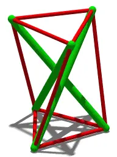
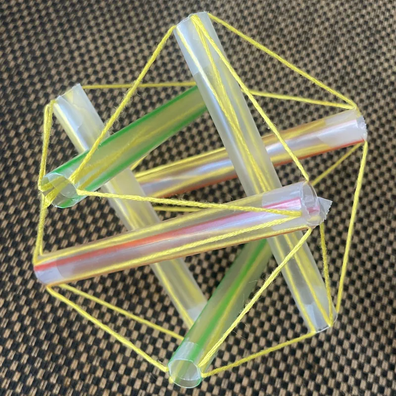
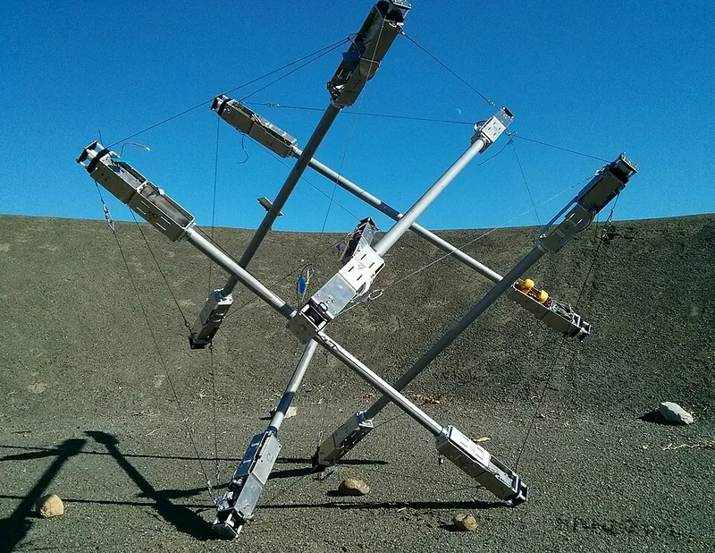

<figure class="eoc-pic eoc-pic-main"><picture><source media="(prefers-reduced-motion: reduce)" srcset="../media/tensegrity.still.webp"></picture><figcaption><strong>Animation.</strong> <a href="https://commons.wikimedia.org/wiki/File:Tensegrity_simple_3.gif">Tensegrity simple 3</a> by Cmglee, <a href="https://creativecommons.org/licenses/by-sa/3.0">CC BY-SA 3.0</a>, from Wikimedia Commons.</figcaption></figure>
<figure class="eoc-pic"><figcaption><strong>Photo.</strong> <a href="https://commons.wikimedia.org/wiki/File:Icosahedral_tensegrity_structure.png">Icosahedral tensegrity structure</a> by QuarterNotes, <a href="https://creativecommons.org/licenses/by-sa/4.0">CC BY-SA 4.0</a>, from Wikimedia Commons.</figcaption></figure>
<figure class="eoc-pic"><figcaption><strong>Photo.</strong> <a href="https://commons.wikimedia.org/wiki/File:NASA_SUPERball_Tensegrity_Lander_Prototype.jpg">NASA SUPERball Tensegrity Lander Prototype</a> by Sunspiral, <a href="https://creativecommons.org/licenses/by-sa/4.0">CC BY-SA 4.0</a>, from Wikimedia Commons.</figcaption></figure>

A structure in which rigid struts (or two rigid halves) never touch each other and are held in a fixed shape only by tensioned cords, cables or chains, giving the 'floating' look of tensegrity tables, shelves and sculptures.

**In plain words:** A 'floating' table, shelf or sculpture whose stiff sticks or blocks never touch each other: they hang in the air, held in place only by tight strings, wires or chains pulling on them from several directions. **Proper term:** Tensegrity (tensional integrity; floating compression).

**Also called:** tensional integrity, floating compression (Wikipedia 'Tensegrity'); 'floating compression' was sculptor Kenneth Snelson's preferred name (Wikipedia 'Kenneth Snelson'); tensegrity table, floating table, floating tensegrity table, tensegrity stand (maker and kit names; the-diy-life; COMSOL blog; Printables); three-strut tensegrity prism, T3-prism, Triplex, 3-way prism, simplex (the simplest strut tensegrity; Wikipedia 'Tensegrity'); tensegrity icosahedron, 6-strut (6-bar) tensegrity, built on Jessen's icosahedron (Wikipedia 'Tensegrity'); X-module, X-piece (Snelson's 1948 form; Wikipedia 'Tensegrity'); [print-in-place](../glossary.md#print-in-place) tensegrity, string tensegrity (printed models whose 'strings' are single lines of filament or printed chains; 3DWithUs; Printables); magnetic tensegrity table (the central tie is replaced by two attracting magnets with a gap; the-diy-life; Skulls in the Stars); biotensegrity (the idea applied to bodies and cells; Wikipedia 'Tensegrity').

## How it works

Every stiff part is pushed on (compression) and every cord is pulled tight (tension), and the stiff parts don't touch: the tight cords alone fix where each part sits (Wikipedia 'Tensegrity'). In a floating table the top half literally hangs from the bottom half by the short central tie between two overlapping arms; the outer ties stop it tipping, because tipping would lift one edge and the taut tie on that edge can't stretch to let it (Skulls in the Stars; the-diy-life). In a strut tensegrity each strut end is pulled by at least three cords in different directions, like a mast held by guy ropes, and the struts push outward while the cords pull inward, so the whole thing is pre-stressed and stiff (Wikipedia 'Tensegrity'). It only works while every cord stays taut: a slack or broken cord lets the structure fold up (Skulls in the Stars).

## Parts

A small assembly that acts as one unit. Table type: a base with an upward hooked arm, a top with a downward hooked arm, one short central tie between the two arms, and three or four outer ties from the base edge to the top edge (the-diy-life; COMSOL blog). Strut type: three or more straight struts (dowels, tubes, printed rods) and at least three cords at every strut end, e.g. 3 struts and 9 cords for the T3-prism (Wikipedia 'Tensegrity'). Plus anchors for the cord ends (holes with knots or glue, screw-in hooks, threaded or ball-ended cable fittings, printed chain links) and usually a tensioner (turnbuckle, threaded adjuster screw, or a printed screw knob) (Hackaday.io 'Stable Cable Table'; GadgetBuilder; Printables 243319).

## Everyday examples

- 'Floating' tensegrity desk tables and phone stands, sold as kits and widely 3D printed (the-diy-life; Printables 243319, about 37,700 downloads)
- A bicycle wheel: the hub hangs in the middle of the rim from spokes pulling in all directions (spectrUM 'Tensegrity Table' sheet; COMSOL blog)
- Tensegrity sculptures such as Kenneth Snelson's Needle Tower, and Brisbane's Kurilpa Bridge, called the world's largest tensegrity bridge (Wikipedia 'Tensegrity'; COMSOL blog)
- LEGO tensegrity tables built from chains and bricks (JK Brickworks design, ToyPro article)

## When to use it

Use it for display pieces where the 'impossible' floating look is the point: desk toys, plant stands, small side tables, shelves and sculptures carrying light loads, and science demonstrations of tension and compression (ASEE paper; the-diy-life; COMSOL blog). It is very light for its [stiffness](../glossary.md#stiffness), because only thin cords carry the pulling loads and the stiff parts work only in compression (Wikipedia 'Tensegrity'; Ben Kahla et al. 2020: 'high strength-to-mass ratio'). Strut tensegrities also suit springy, impact-absorbing frames, such as experimental rolling robots and landers (Wikipedia 'Tensegrity', NASA SUPERball), and teaching models made from dowels and rubber bands.

## When not to use it

Don't use it for anything a person sits, stands or leans on, for heavy or off-centre loads, or where a sudden collapse would hurt someone or break what is on it: one broken or slack cord drops the whole structure (the-diy-life; Skulls in the Stars). Use an ordinary framed table, bracket shelf or a Strut hub (space-frame) structure instead. Avoid it where things on top must stay still, because it wobbles and keeps [oscillating](../glossary.md#oscillating); one maker concluded the style suits benches and chairs better than tables 'where you will be placing food and drinks which could potentially spill' (aesdes.org). If you want a self-supporting stick structure without cords, use a Reciprocal frame. To tension a single line, use a Turnbuckle or Guy-line runner rather than a whole tensegrity.

## Details

- **What it does (jobs):**
  - join and hold: holds struts or two rigid halves in a fixed shape without them touching, as a floating table, shelf, stand or sculpture
  - tighten and hold tension: the cords must be pre-tensioned (with turnbuckles, threaded adjusters, printed tensioner knobs or careful cord lengths) and stay tight for the structure to stand
- **Movement:** none: once tensioned it is meant to stay still, but it is springy and can wobble, bounce and twist slightly (a built steel table shows twisting oscillations that last up to several minutes; Hackaday.io 'Stable Cable Table'). Robot versions move on purpose by changing cable lengths (Wikipedia 'Tensegrity', NASA SUPERball).
- **Directions it can move (degrees of freedom):** 0 when every cord is taut: the cords pin each part in place. Some forms keep a tiny built-in give: the tensegrity icosahedron is 'stable ... albeit with infinitesimal mobility', so stretching a cord a little moves the struts a lot (Wikipedia 'Tensegrity'). If a cord goes slack, parts gain freedom and the structure falls (Skulls in the Stars).
- **Special behaviour:**
  - tensioning (takes up slack and holds): the cords are pre-tensioned and the design usually includes a way to tighten them, e.g. turnbuckles, threaded cable ends, adjuster screws or the built-in screw knobs of the popular print-in-place table, turned with pliers (Hackaday.io 'Stable Cable Table'; GadgetBuilder; Printables 243319)
  - self-aligning or self-centring: outer cables angled a few degrees from vertical push the top back to the centre after a nudge, 'both in response to a disturbance and at rest' (Hackaday.io 'Stable Cable Table')
- **How it holds:**
  - spring force (a spring or springy part presses it in place): the stretched cords act as stiff springs that pull every strut into place; the structure is only as stiff as the cord pre-tension allows (Wikipedia 'Tensegrity': prestressed tension members)
  - shape (the parts interlock; [form-fit](../glossary.md#form-fit--force-fit--material-bond)): cord ends are anchored by shape, e.g. knots behind holes, chain links, ball or threaded cable ends in holes, screw-in hooks (the-diy-life; Hackaday.io 'Stable Cable Table'; Hometalk); some models glue line ends instead (material bond), and the magnetic version replaces the central tie with two attracting magnets (the-diy-life)
- **Input and output:** not applicable
- **Power:** passive (no power needed). Tensegrity robots such as NASA's SUPERball are the powered exception: motors change cable lengths to move them (Wikipedia 'Tensegrity'); if power is lost they keep their last shape ⚑ [uncertain].
- **Load:** Light. Strong in a straight downward load near the centre, which the central tie carries almost alone: in COMSOL's model the outer strings carried zero force under a central vertical load of up to 500 N (COMSOL blog). Weak against loads near an edge, sideways pushes and twisting: an edge load must be held by the single opposite outer cable while the central tie carries about double, like a lever (Hackaday.io 'Stable Cable Table'). A laser-cut MDF desk model with fishing line held just under 200 g before its outer lines flexed (the-diy-life); a 300 mm wooden table hung on 2 mm steel wire rope was said to hold 5 kg, untested beyond that (Hometalk); a magnetic-gap version 'can't really hold much weight' (the-diy-life). A welded steel table with 1/16 in stainless aircraft cable (480 lb mean break) was designed for at least 50 lb added load; its theoretical 956 lb (centre) and 478 lb (edge) limits would be 'a lot less' in practice because of fittings, stretch and pre-load (Hackaday.io 'Stable Cable Table'). Any single cord breaking brings the whole thing down (the-diy-life).
- **Play and precision:** noticeable: it springs and wobbles under a touch; a flicked desk table 'shivers' for up to 45 seconds (GadgetBuilder), and a steel coffee-table base twisted back and forth for minutes until a small oil slosh damper was added (Hackaday.io 'Stable Cable Table'). The top's height and level depend on cord lengths, so cords that stretch lower it (aesdes.org: 'the cables stretched more than I expected'). Unequal outer lines tilt the top (the-diy-life).
- **Taking it apart:** removable: cords tied, hooked or screwed in can be undone and the parts separated (the-diy-life suggests using only a little glue at first 'so that you can undo a joint'); glued fishing-line versions are semi-permanent, and print-in-place models are permanent (the strings are printed into the parts).
- **How often it can be reused:** many times for kits with knots, hooks, chain or threaded cable ends (they can be re-tied or re-hung and re-tensioned); once for print-in-place models and glued lines. A remix of the popular print-in-place table splits it into separate chains held by self-tapping screws so failed chains can be replaced (Printables 402957).
- **Sealing:** none: it is an open frame.
- **Adjustable:** yes: cord lengths and tension are set after assembly by turnbuckles, threaded cable ends or adjuster screws (GadgetBuilder; Hackaday.io 'Stable Cable Table'), by the built-in screw tensioner of print-in-place models (Printables 243319), or by re-tying or re-gluing lines until the top is level (the-diy-life; OH WOW! Children's Museum). One student design runs all outer lines as one cable over pulleys so they equalise (aesdes.org 'Adjustable Tensegrity Table').
- **Access needed:** both sides: you need to reach both the top and the base (or both ends of each strut) to fix and tension the cords; the Hackaday.io build needed an assistant to hold the top while hanging it.
- **Materials:** Struts and halves: wooden dowels or sticks, MDF, plywood or acrylic (laser cut), steel or aluminium tube, printed PLA or PETG (the-diy-life; ASEE paper; aesdes.org; Printables). Tension members: clear nylon fishing line (doesn't fray and is stiff enough to thread), sewing thread, rubber bands, chain, music wire, or stainless steel aircraft cable, chosen in a steel build for 'enormous tensile strength and low elasticity' (the-diy-life; OH WOW!; GadgetBuilder; Hackaday.io 'Stable Cable Table'). Printed tension members: single extruded lines of filament or printed chains (3DWithUs; Printables 243319). Stretchy members (rubber bands, elastic cord) make a forgiving, wobbly model; low-stretch cable or chain makes a stiff one.
- **Heat, cold, water and wear:** Heat and sun: thin printed filament strings stretch when warm, so don't leave printed models in the sun (Printables 1051893); PLA parts in general soften in hot cars ⚑ [uncertain]. [Creep](../glossary.md#creep) and stretch: cords and cables stretch under constant tension, lowering and tilting the top over time (aesdes.org: 'the cables stretched more than I expected'); rubber bands and elastic cord lose tension as they age ⚑ [uncertain]. Vibration: tensegrities have 'low structural [damping](../glossary.md#damping) which make them sensitive to vibrations' (Ben Kahla et al. 2020), so they keep wobbling after a knock (GadgetBuilder; Hackaday.io). Outdoors: use stainless or coated steel cable and UV-resistant cord; a steel build used stainless aircraft cable (Hackaday.io 'Stable Cable Table').

## Making it

- **Ways to make or get it:**
  - 3D print (FDM): the two halves of a table with holes or slots for string, or fully print-in-place models with printed chains or single-line filament strings (Printables 243319, 72508, 18031; 3DWithUs)
  - laser cut: flat MDF, plywood or acrylic parts slotted and glued together (the-diy-life; OH WOW! kit)
  - woodwork: dowel struts, or timber table halves hung on chain or wire rope from screw-in hooks (ASEE paper; the-diy-life community build; Hometalk)
  - sheet metal: welded steel tube or plate halves with steel cable for furniture (aesdes.org; Hackaday.io 'Stable Cable Table')
  - off-the-shelf part: fishing line, chain, stainless wire rope with threaded or ball end fittings, turnbuckles, screw-in hooks, rubber bands, magnets
- **Printing it in one piece (print in place):** yes: popular models print fully assembled, either with printed chains as the tension members and a built-in screw tensioner (Printables 243319, printed with built-in supports; tension by turning the small knobs in the centre with pliers) or with 'strings' that are single extruded lines of filament (3DWithUs; Printables 72508, 1051893).
- **Tools:** Small models: scissors, a fine drill (1 mm for fishing line), super glue or wood glue, a ruler, and optionally a laser cutter (the-diy-life); rubber-band dowel models need no tools (ASEE paper). Print-in-place: pliers to turn the tensioner knobs (Printables 243319). Furniture size: drill, screw-in hooks or tapped holes (Hometalk), spanner or screwdriver for turnbuckles and threaded cable ends; a welded steel version also needed a bandsaw, MIG welder and grinder (aesdes.org; Hackaday.io 'Stable Cable Table').
- **Difficulty:** easy: a three-stick rubber-band prism or a desk table from two printed or laser-cut halves and fishing line is a school-level build (ASEE paper: grades 5-8; spectrUM), and print-in-place models need no assembly. Getting all lines the same length so the top sits level 'takes a bit of patience' (the-diy-life), and furniture sizes become a moderate to hard woodwork or welding project (Hackaday.io 'Stable Cable Table').

### 3D printing tips

1) Two-part tables: print the top and base halves and add string afterwards; slots that hide the knots let the parts sit flat, and making the centre string slightly short pulls the outer strings tight (Printables 18031). 2) Single-line 'string' tensegrities: model each string one layer high and one nozzle-width wide, print at a larger layer height (about 0.3 mm) because thinner layers give thinner strings that break, orient the strings along X/Y, tick 'detect thin walls' or 'print thin lines' in the slicer, and leave a one-layer gap round each string so it prints as one unbroken extrusion; check the preview shows unbroken strands with no empty layers (3DWithUs; Printables 72508). 3) Make the base at least as wide and deep as the top so it doesn't tip, and don't make anchor points thin or narrow, because they carry the string tension (3DWithUs). 4) Printed-chain table: print with the built-in supports (easy to remove); it printed fine at 0.25 mm layers in PLA (Printables 243319); a failed print-in-place can waste around 400 g of filament, so a remix prints the chains separately and screws them in (Printables 402957). For separate printed chains, use 0.2 mm layers, and when mirroring a half remember its thread becomes left-handed (Printables 1295813). 5) Remove string models from the bed by bending at right angles to the strings, or the lower strings take all the strain and break (Printables 1051893). 6) Keep printed strings out of the sun or a hot car: thin strands 'are very susceptible to stretching when they get warm' (Printables 1051893).

### Buying one (off-the-shelf parts)

Clear nylon monofilament (fishing line), braided cord, rubber bands and elastic cord; light chain (a community build on the-diy-life hung a wooden table on chains); vinyl-coated steel wire rope (2 mm in one wooden table) hung on screw-in round hooks (Hometalk 'How to Make Floating Tensegrity Table'); stainless steel wire rope (aircraft cable, e.g. 1/16 in 7x7) with swaged threaded-stud or ball-end fittings and weld nuts (Hackaday.io 'Stable Cable Table'); turnbuckles and threaded tension adjusters (aesdes.org; GadgetBuilder); neodymium disc magnets for the magnetic version (the-diy-life); wooden dowels (ASEE paper). Search terms: 'turnbuckle', 'wire rope threaded stud fitting', 'swaged ball end cable', 'wire rope clip' or 'ferrule and stop', 'eye screw', 'nylon monofilament'.

## Rules of thumb

- Each strut end needs at least three cords, and the angle between any two cords at that end must be less than 180 degrees for the end's position to be fixed; extra cords add redundancy (Snelson's Needle Tower uses five per node) (Wikipedia 'Tensegrity').
- Three-strut prism (T3-prism): 3 struts and 9 cords, six forming the top and bottom triangles and three joining each strut top to its neighbour's bottom; in the stable shape the top triangle is turned 5π/6 (150 degrees) relative to the bottom triangle (Wikipedia 'Tensegrity', citing Burkhardt's 'A Practical Guide to Tensegrity Design').
- Floating table: the central tie carries the weight; the outer ties only keep the top level and carry almost no force while the load is central (COMSOL blog: zero force in the outer strings for central loads up to 500 N; the-diy-life). Angle the outer cables a few degrees from vertical (about 2 degrees in one build) so the top self-centres (Hackaday.io 'Stable Cable Table').
- Worst case is a load at the very edge: the single opposite outer cable then carries about the same force as the load and the central tie about twice the load divided by 2cos(α); design every tie for this, not for the central load (Hackaday.io 'Stable Cable Table', equations 3-5).
- Desk-size starting dimensions (3 mm MDF, fishing line, 1 mm holes): a 50-60 mm gap between the two centre arms and outer lines of about 130 mm; set the outer lines so the centre tie has 'a little bit of tension' and the top stays parallel to the base (the-diy-life). A kit version keeps no more than 2 in between base and top so the middle thread is tensioned (OH WOW! Children's Museum).
- Dowel models: 1/8 in dowels 4-6 in long with size #32 rubber bands; finish with two bands at each end of every dowel (ASEE paper, May 2016).
- Print-in-place strings: one layer high (about 0.3 mm layer height), one nozzle-width wide, thin-wall detection on, with a one-layer [clearance](../glossary.md#clearance) gap round each string (3DWithUs; Printables 72508).

## Common failures

Top tilted or wobbly: the outer lines are not equal or not tight; re-tie or adjust until the top is parallel and the centre tie is tight (the-diy-life; OH WOW!). Collapse: a slack, cut or slipped line (Skulls in the Stars), or a magnetic gap pulled apart by too much weight (the-diy-life); reset and re-tension. Outer lines flexing and the top sagging under load: the table is overloaded; a desk MDF model managed just under 200 g (the-diy-life). Height dropping over time: cords or cables stretch; use low-stretch cable or chain and leave adjustment room in the tensioners (aesdes.org; Hackaday.io). Long-lasting twisting oscillation: add damping, angle the side cables, or raise tension (Hackaday.io: tension reduced but did not stop the oscillation; a small oil slosh damper helped). Arms bending: in a table the hooked arms carry bending as well as compression ('this design isn't true tensegrity ... the arms have [torque](../glossary.md#torque) applied'; GadgetBuilder), so make them deep and stiff, with load along their strong axis (Hackaday.io). Printed failures: thin anchor points snap (3DWithUs); strings print broken or not at all when the slicer drops thin walls (3DWithUs); strings snap when the model is peeled off the bed the wrong way (Printables 1051893); a failed print-in-place thread can sometimes be drilled out (Printables 402957).

## Safety

Sudden collapse: 'If any of these four lines are cut, the table will collapse under its own weight' (the-diy-life), and slack in a side wire makes it fall (Skulls in the Stars); a study simulating sudden cable rupture in a tensegrity footbridge observed 'nonlinear dynamic instabilities caused by cable slackening' in all its simulations (Ben Kahla et al. 2020, Latin American Journal of Solids and Structures). So keep loads light and central, never sit or stand on a hobby tensegrity, keep glass tops and heavy items off small models, and check cords and fittings for fraying, stretch and loosening. Stored tension: bigger dowel models build up a lot of tension and compression while assembling, 'so be careful' (ASEE paper); a snapping wire or cable can whip, so wear eye protection while tensioning ⚑ [uncertain]. Magnetic-gap versions use small strong magnets, which are a swallowing hazard for children (see Magnetic joint). Pinch points between the arms when the top drops.

## Related

- Reciprocal frame (self-supporting stick bridge): also self-supporting with no separate joints, but its sticks rest on and press against each other, with no cords at all; the nearest relative
- Strut hub (geodesic dome hub and space-frame node): struts meet and are bolted at hubs, so stiff parts touch and carry both push and pull; much stronger and safer for real loads
- Turnbuckle: the threaded tensioner often used inside a tensegrity to set one cord's length and tension
- Guy-line runner (line tensioner): adjusts a single guy rope; a tensegrity is in effect struts guyed to each other
- Elastomer tension spring (elastic band, shock cord): stretchy members used in teaching models; makes a forgiving but wobbly tensegrity
- Stopper knot and cord-end anchor: how the cord ends are usually fixed into holes in the struts or table halves
- Magnetic joint: the magnetic-gap tensegrity table replaces the central tie with two attracting magnets, holding far less
- Tensile structure and cable-stayed or cable-net roofs: cables carry most loads but are anchored to masts and the ground, rather than the struts floating (Wikipedia 'Tensegrity', see also)

## Make it yourself

- [Print In Place Tensegrity (rcmz, Printables) (URL seen in search results; details from Printables API)](https://www.printables.com/model/243319-print-in-place-tensegrity): Print-in-place tensegrity table using printed chains as the tension members, with a built-in screw tensioner turned with pliers; print with the built-in supports *(licence: Creative Commons Attribution-NonCommercial)*
- [Hexagon tensegrity table print-in-place (3DPrintBunny, Printables) (URL from Printables API, page not opened)](https://www.printables.com/model/72508-hexagon-tensegrity-table-print-in-place): Small supportless table held up by single lines of filament; 0.3 mm layers and 'detect thin walls' needed *(licence: Standard Digital File License)*
- [Tensegrity (HoldenArt, Printables) (URL from Printables API, page not opened)](https://www.printables.com/model/18031-tensegrity): Two printed halves with slots for strings that hide the knots; you add your own string, which makes it easy to try different lengths *(licence: Creative Commons Attribution)*
- [Risk Free Tensegrity (environmental friendly) (Tritschi, Printables) (URL from Printables API, page not opened)](https://www.printables.com/model/402957-risk-free-tensegrity-environmental-friendly): Remix of the print-in-place table split into separate halves and chains held by self-tapping screws, so a failed chain can be reprinted or swapped for metal chain *(licence: Creative Commons Attribution-NonCommercial-ShareAlike)*
- [Print-in-place Tensegrity Cube (SmoothDragon, Printables) (URL from Printables API, page not opened)](https://www.printables.com/model/1051893-print-in-place-tensegrity-cube): Cube-shaped string tensegrity whose filament strings print in place; the designer says it holds a soda can *(licence: Creative Commons Attribution)*
- [Building Tensegrity Structures to Explore Interactions Between Tension and Compression (V. May, ASEE 2016)](https://peer.asee.org/26416.pdf): Free illustrated step-by-step instructions for 3-dowel and 6-dowel tensegrity models made from dowels and rubber bands *(licence: link only (ASEE copyright))*

## Pictures, videos and models

- [Tensegrity simple 3.gif (Wikimedia Commons, by Cmglee)](https://commons.wikimedia.org/wiki/File:Tensegrity_simple_3.gif): Spinning animation of the simplest tensegrity, the three-strut T3-prism: three green struts that don't touch, each end held by three red cables *(licence: CC BY-SA 3.0)*
- [Icosahedral tensegrity structure.png (Wikimedia Commons, by QuarterNotes)](https://commons.wikimedia.org/wiki/File:Icosahedral_tensegrity_structure.png): Photo of a home-made six-strut tensegrity icosahedron made from boba straws threaded with embroidery string *(licence: CC BY-SA 4.0)*
- [Make Your Own Desktop Tensegrity Tables (The DIY Life, Michael Klements, 2020)](https://the-diy-life.com/make-your-own-desktop-tensegrity-tables/): Step-by-step photos and video of laser-cut MDF tables held by fishing line, plus a magnetic-gap version and a community chain-and-timber build *(licence: link only (licence not stated on the page))*
- [Modeling Tensegrity with a Floating Table (COMSOL Blog, 2024)](https://www.comsol.com/blogs/modeling-tensegrity-with-a-floating-table): Force diagrams and simulation plots of a floating table under a central load and a twisting load, showing which wires carry force *(licence: link only)*
- [Tensegrity Models - Designs for 3D Printing and Slicer Settings (3DWithUs, Natalie Cheesmond / 3DPrintBunny)](https://3dwithus.com/tensegrity-models-designs-for-3d-printing-and-slicer-settings): Images of part shapes, minimum string placement, and slicer screenshots for printing single-line filament strings in place *(licence: link only)*

## Needs confirming

⚑ marks something nobody has confirmed yet: a fact the research could not confirm from a source, a finder value that is a best guess, or an open point from the research notes. Corrections are welcome (see `research/needs-confirming.md`).

- ⚑ 4 sentences on this page marked [uncertain].
- ⚑ Finder value `cord_use` = a fitted part (best guess): carried over from the finder's old rule on entry names (R33), for "What do you need?" under "Hold two things together > Strap, cord, rope or fabric"
- ⚑ Finder value `cord_part` = join or grip ends (best guess): carried over from the finder's old rule on entry names (R33), for "What should the part do?" under "Hold two things together > Strap, cord, rope or fabric > Fit a part"
- ⚑ Finder value `tightens` = strap, cord or rope (best guess): carried over from the finder's old rule on entry names (R33), for "What are you tightening?" under "Tighten something, or take up slack"
- ⚑ Research note: *Tensegrity*: one maker (GadgetBuilder) says the popular floating table 'isn't true tensegrity' because its arms bend; the entry says so.

## Sources

- <https://en.wikipedia.org/wiki/Tensegrity>
- <https://en.wikipedia.org/wiki/Kenneth_Snelson>
- <https://en.wikipedia.org/wiki/Reciprocal_frame>
- <https://commons.wikimedia.org/wiki/File:Tensegrity_simple_3.gif>
- <https://commons.wikimedia.org/wiki/File:Tensegrity_simple_4.gif>
- <https://commons.wikimedia.org/wiki/File:Icosahedral_tensegrity_structure.png>
- <https://commons.wikimedia.org/wiki/File:Tensegrity_Dome.jpg>
- <https://the-diy-life.com/make-your-own-desktop-tensegrity-tables/>
- <https://www.hometalk.com/diy/build/furniture/how-to-make-floating-tensegrity-table-44300780>
- <https://skullsinthestars.com/2024/03/01/physics-demonstrations-tensegrity-table/>
- <https://www.comsol.com/blogs/modeling-tensegrity-with-a-floating-table>
- <https://3dwithus.com/tensegrity-models-designs-for-3d-printing-and-slicer-settings>
- <https://ohwowkids.org/pages/tensegrity-table>
- <https://peer.asee.org/26416.pdf>
- <https://cdn.hackaday.io/files/1931058261804320/stable%20cable%20table%20contest%20submission.pdf>
- <https://www.aesdes.org/2021/04/29/floating-coffee-table-final-report/>
- <https://www.aesdes.org/2023/04/05/adjustable-tensegrity-table/>
- <https://gadgetbuilder.com/TensegrityTable.html>
- <https://lajss.org/index.php/LAJSS/article/download/5907/2856/19112>
- <https://umt.edu/spectrum/education/resources/resources-images/tensegrity-table-heman-final.pdf>
- <https://www.toypro.com/en/news/463/can-you-build-a-lego-r-tensegrity-examples-building-instructions>
- <https://api.printables.com/graphql/>
