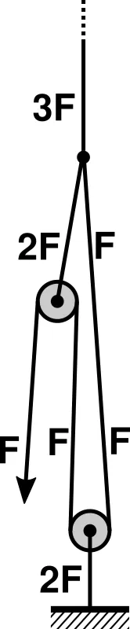

*Picture: [Truckers hitch pulley model.png](https://commons.wikimedia.org/wiki/File:Truckers_hitch_pulley_model.png) by Buz11, [CC BY-SA 4.0](https://creativecommons.org/licenses/by-sa/4.0), from Wikimedia Commons.*

Knots that tension a line and hold it with no hardware: the trucker's hitch ties a loop into the rope that works like a pulley so you can haul a lashing tight, while friction hitches such as the taut-line, rolling, adjustable grip and Prusik hitches wrap round a rope or pole, grip when the line is loaded and slide by hand when it is slack, so the line can be tightened or moved again later.

**In plain words:** Knots that pull a rope or cord tight and keep it tight with no buckle or [ratchet](../glossary.md#ratchet): a rope 'pulley' tied into the line itself for lashing down a load, a sliding loop on a tent line that you push along to tighten it, and a loop of cord wrapped round a rope or pole that grips when it is pulled and slides when you push the knot. **Proper term:** Tensioning and adjustable hitches: the trucker's hitch (a rope tackle tied in the line), the taut-line or midshipman's hitch (an adjustable loop made with a rolling hitch), the rolling hitch, the adjustable grip hitch, and the Prusik and its relatives (slide-and-grip friction hitches).

**Also called:** trucker's hitch (ABOK #2124, p. 344, per Animated Knots; Wikipedia also lists #1514, #2125, #2126): also harvester's hitch, haymaker's hitch, lorry knot or lorry driver's hitch, power cinch, wagoner's hitch, dolly knot, hay knot, rope tackle (Animated Knots 'Trucker's Hitch'; Wikipedia 'Trucker's hitch'); McCarthy hitch: Andrew Skurka's name for a simplified trucker's hitch on tarp guy lines, using the fixed loop at the tarp as the pulley (Skurka); taut-line hitch, tautline hitch, tent-line hitch, tent hitch, rigger's hitch, adjustable hitch (ABOK #1856, the version taught by the Boy Scouts of America, and #1800; #1857 is the same with the last half hitch reversed) (Wikipedia 'Taut-line hitch'); midshipman's hitch (ABOK #1855, p. 310): the more secure taut-line version, built on rolling hitch #1735; Animated Knots also lists it as 'Taut Line Hitch' (Animated Knots 'Midshipman's Hitch'; Wikipedia 'Taut-line hitch'); awning hitch: the first two tucked turns of a rolling hitch, which already hold temporarily while tent lines are rigged (ABOK #1798, p. 304 in Animated Knots 'Rolling Hitch'; ABOK #1854, p. 310 in Animated Knots 'Midshipman's Hitch'); rolling hitch, Magnus hitch, Magner's hitch (ABOK #1734 to a pole or rod, #1735 to another rope, #1736 the Magnus hitch with the last hitch reversed) (Wikipedia 'Rolling hitch'; Animated Knots 'Rolling Hitch'); adjustable grip hitch, adjustable loop, Cawley adjustable hitch (no ABOK number; devised by Canadian climber Robert Chisnall in 1982) (Wikipedia 'Adjustable grip hitch'); Prusik, Prusik knot, Prusik hitch, triple sliding hitch, often misspelled Prussik (ABOK #1763, p. 300, shows the same structure for hoisting a spar) (Wikipedia 'Prusik'; Animated Knots 'Prusik Knot'); slide-and-grip knots, friction hitches, 'hold and release to slide' hitches: the family name (Animated Knots 'Slide & Grip Knots'; Wikipedia 'Taut-line hitch', 'List of friction hitch knots'); other friction hitches that do the same jobs: Klemheist or French Machard (ABOK #1762), Blake's hitch, Distel hitch, autoblock (French Prusik), Bachmann hitch, icicle hitch, Farrimond friction hitch (Wikipedia 'List of friction hitch knots').

## How it works

The trucker's hitch ties a loop into the standing part of the rope; the free end goes round a hook or rail and back through that loop, so the loop acts as a pulley and, in theory, every unit of pull on the end puts three units of tension into the rope over the load; rope rubbing on rope cuts this to something like 1.6:1, but the same friction helps hold the gain while you tie the end off with half hitches (Animated Knots 'Trucker's Hitch'; Wikipedia 'Trucker's hitch'). Friction hitches work like a rope wrapped round a capstan: each wrap multiplies the grip, and the force needed to make a line slip grows exponentially with the total wrap angle and the friction between the surfaces (Wikipedia 'Capstan equation'). Pulling on the loaded end tightens the wraps and puts a slight kink (dog-leg) into the rope they grip, which locks them; pushing on the knot itself loosens the wraps so it can be slid (Animated Knots 'Rolling Hitch'; Wikipedia 'Prusik'). The taut-line hitch is a rolling hitch tied round the line's own standing part after it has gone round an anchor, so sliding the knot changes the size of the loop and therefore the line's length without retying (Wikipedia 'Taut-line hitch').

## Parts

Single piece for most of them: just the rope or cord (trucker's, taut-line, rolling and adjustable grip hitches, and Blake's hitch). A Prusik or Klemheist uses two pieces: a closed loop of thinner cord (the Prusik loop) wrapped round the main rope or a pole. Plus whatever the line goes round: a hook, rail, ring, peg, tree or pole.

## Everyday examples

- Tent guy lines tightened with a taut-line hitch, 'a common use' (Wikipedia 'Taut-line hitch'; Practical Sailor: 'Every Boy Scout uses this hitch to secure tent guy lines to tent pegs')
- A rope lashing a load or tarpaulin onto a trailer, truck or roof rack with a trucker's hitch (Wikipedia 'Trucker's hitch'; Animated Knots)
- A tarp or hammock ridge line with a Prusik or Farrimond hitch to position and tension the tarp (Wikipedia 'Prusik'; Animated Knots 'Farrimond Friction Hitch')
- An adjustable clothesline loop made with a midshipman's (rolling) hitch (Animated Knots 'Rolling Hitch')

## When to use it

Use these when a rope or cord has to be pulled tight and kept tight with no hardware, or re-tightened later: lashing a load or tarp onto a trailer or roof rack (trucker's hitch), tensioning tent guy lines, tarp ridge lines and clotheslines that sag as the fabric and rope stretch (taut-line, midshipman's, adjustable grip and Farrimond hitches), and attaching a cord to a rope, pole or tube so it can be slid along and then hold a lengthwise pull (rolling, icicle and Prusik hitches) (Wikipedia; Animated Knots). They are useful for prototypes, camping kit and garden or workshop jobs where a buckle or ratchet would be lost, broken or overkill, and the trucker's hitch gives a pulley-like pull with nothing but the rope (Skurka; Animated Knots).

## When not to use it

Not for climbing, rescue, tree work or anything that holds a person without proper training and rated gear: the Prusik and its relatives are life-safety tools only in trained hands (Wikipedia 'Prusik'; Animated Knots 'Safety'). Not in slippery cord (Dyneema, Spectra, polypropylene, some thin guy-line cords): use a splice, a stitched knot or a cleat or line-lock made for that cord (Animated Knots 'Rope Materials'). Not where the load jerks, flaps or shock-loads the line, or pulls at an angle to the rope the hitch grips (Wikipedia 'Adjustable grip hitch'; Animated Knots 'Rolling Hitch'). For road loads, cargo or anything heavy, use rated ratchet or cam-buckle straps; for fine, lasting tension in wire or rod, a turnbuckle; for one-handed quick adjustment on thin cord, a guy-line slider or cord lock; for repeated hauling, a block and tackle with a mechanical rope grab.

## Details

- **What it does (jobs):**
  - tighten and hold tension: the trucker's hitch hauls a lashing tight with a built-in pulley effect, and the sliding hitches take up slack in tent lines, ridge lines and clotheslines and hold it
  - join and hold: ties a line to a hook, rail, peg or tree, or attaches a cord to another rope or a pole
  - stop it moving back (one-way): the rolling hitch is 'designed to resist lengthwise movement for only a single direction of pull' (Wikipedia 'Rolling hitch'), as are the Klemheist, Blake's and icicle hitches; a Prusik riding against a pulley acts as a rope ratchet (progress capture device) (Wikipedia 'Prusik')
  - lock, and release by hand: slide the knot by hand to adjust it; slipped finishes pull undone with one tug
- **Movement:** slide: a friction hitch is meant to be slid along the rope or its own standing part by hand when it is slack, to change the loop size or its position; while a trucker's hitch is being tensioned its end slides through the loop. Once loaded and tied off, nothing should move, and slipping counts as failure.
- **Directions it can move (degrees of freedom):** 0 while loaded and holding; 1 (sliding along the line) when slack and pushed by hand.
- **Special behaviour:**
  - tensioning (takes up slack and holds): the trucker's hitch multiplies your pull (ideally 3:1) and the taut-line hitch lets a line be re-tightened whenever it sags, 'without retying the knot' (Wikipedia 'Taut-line hitch')
  - hand-release only (locks under load, releases when a person operates it): friction hitches hold when the line is loaded and slide only when the knot itself is pushed; 'When weight is removed, the loop can be moved along the rope by placing a hand directly on the barrel' (Wikipedia 'Prusik')
  - one-way (moves freely one way, locks the other): the rolling, Klemheist, Blake's and icicle hitches hold a pull in one direction only; the Prusik is symmetrical and grips both ways (Animated Knots 'Prusik Knot'; Wikipedia 'Prusik')
  - quick-release: the trucker's hitch is usually finished with a slipped half hitch, and the slipped adjustable grip hitch 'can be easily untied by pulling the end ... even under quite heavy load' (Wikipedia 'Trucker's hitch', 'Adjustable grip hitch')
  - torque-limiting, loosely: an overloaded Prusik 'will initially slip', which rescuers treat as a warning or 'pressure relief device', but the slip point varies widely with cord, rope and age, so it is not a reliable set limit (Wikipedia 'Prusik'; Rhodes and others quoted by McCullar, USFA)
- **How it holds:**
  - friction or clamping ([force-fit](../glossary.md#form-fit--force-fit--material-bond)): wraps of cord squeezed onto a rope, a pole or the line's own standing part, gripping harder the harder the line is pulled (Wikipedia 'Capstan equation', 'Prusik')
  - shape (the parts interlock; form-fit): the fixed loop that forms the trucker's hitch 'pulley' (e.g. an alpine butterfly or directional figure-eight loop) and the half hitches that tie it off (Wikipedia 'Trucker's hitch')
- **Input and output:** Trucker's hitch only: a hand pull on the free end -> tension in the rope over the load, in line. Ideal 3:1 when the lower anchor is fixed and you pull away from it (Animated Knots), but only 2:1 if the hitch is used to hoist a weight hanging from it (IGKT forum, quoting an earlier Wikipedia text); in practice 'may be more like 1.6:1' because rope runs over rope (Animated Knots), i.e. roughly 50% efficient [derived from Animated Knots' figures]. Once tied off it cannot run backwards (not back-drivable), and the friction 'helps hold the gain while the end is secured' (Animated Knots). Not applicable to the sliding friction hitches, which hold rather than pass motion on.
- **Power:** passive (no power needed)
- **Load:** Light to medium, and only as a pull along the line. Knots weaken rope: assume even new rope gives 'no more than 50% of its rated breaking strength' (Animated Knots 'Safety'). Trucker's hitch: the rope over the load ideally gets 3 times your pull while the hook or rail it goes round is pulled with 2 times your pull (Wikimedia Commons diagram 'Truckers hitch pulley model'), but friction cuts the real gain to about 1.6 times (Animated Knots). Friction hitches hold until they slip, and the slip load depends on the cord: in Practical Sailor's 2009 test at jib-sheet loads (the hitch must hold 'about 2,000 pounds' on a 40-foot boat), the rolling hitch slipped on every material except 9/16 in Dacron double braid, while the icicle hitch held on all of them. Prusik figures for 8 mm nylon cord on 11-12.5 mm rescue rope, side by side: about 9 kN (Olson and Thorne), slipping at 7.0-9.5 kN (Smith), at 1,200 lbf, about 5.3 kN (Ray), or at 800-1,200 lb (Rhodes), all quoted by McCullar for USFA; McCullar's own tests averaged 14.1 kN on new 11 mm rope and 14.8 kN on new 12.5 mm rope, but only 10.9-11.2 kN with older ropes and cords, failing by stripping the rope's sheath or by the cord snapping, sometimes 'with little warning' (1 kN is about 100 kg-force). The adjustable grip hitch 'will hold fast when loaded, but slip when shock loaded' (Wikipedia). Weak against jerks, flapping and pulls at an angle to the gripped rope: 'If the tension is away from the standing rope or pole, this knot is likely to fail' (Animated Knots 'Rolling Hitch'). Never for holding people without training and rated gear.
- **Play and precision:** not applicable (they don't locate parts). Note that friction hitches can [creep](../glossary.md#creep): in three-strand nylon 'a Midshipman's Hitch may slide over time' (Animated Knots), and stretchy rope relaxes, which is why a taut-line hitch is used where a line 'will need to be periodically adjusted in order to maintain tension' (Wikipedia).
- **Taking it apart:** removable, and tool-free quick release when the finish is slipped: all of these untie by hand. A heavily loaded Prusik 'can be quite constricted and difficult to untie' (Wikipedia 'Prusik'), and an unslipped finishing half hitch on a trucker's hitch can jam under large loads (Wikipedia 'Trucker's hitch').
- **How often it can be reused:** many times: the same rope or cord is tied and untied again and again, but a trucker's hitch tied repeatedly in the same spot wears the rope where the end runs through the loop (Wikipedia 'Trucker's hitch', citing Riley 1912 and Pawson), and a friction hitch that has slid under load can be glazed or melted by friction heat (Frank, quoted by McCullar, USFA).
- **Sealing:** none
- **Adjustable:** yes: this is the point of them. A taut-line or midshipman's hitch is slid along the standing part to shorten or lengthen the loop: hold the standing part inside the loop, pull toward the anchor and slide the hitch away to take up slack, or slide it toward the anchor to loosen (Wikipedia 'Taut-line hitch'). A Prusik or Klemheist is pushed along the rope when slack. A trucker's hitch can be re-tensioned by untying the half hitches and hauling again, or permanently adjustable if it is finished with a taut-line or Farrimond hitch (Wikipedia 'Trucker's hitch'; Animated Knots: 'Finishing with a Rolling Hitch has the advantage that it facilitates adjustment').
- **Access needed:** not applicable: you need a free end of the line (or a bight for slipped finishes) and room to pass it round the anchor. A Prusik loop can be put on the middle of a rope or round a pole without reaching either end of it.
- **Materials:** Any rope or cord, but the friction hitches depend heavily on the rope: 'When rope was mostly tarred hemp, they all gripped. Those days are over, and many of these knots (all?) will fail with modern slippery ropes such as Spectra, and Dyneema (HMPE)' (Animated Knots 'Slide & Grip Knots'). HMPE fibres are 'slippery (very low coefficient of friction)' and melt at only 144-152 °C, and in HMPE rope 'usually trusted knots slip undone easily - at loads as low as 15% of the breaking strength' (Animated Knots 'Rope Materials'); Wikipedia says Dyneema/Spectra should not be used for Prusik loops unless made for it. With polypropylene too, assume the hitch 'will just slide' (Animated Knots 'Midshipman's Hitch'). Three-strand nylon is slippery enough to creep (Animated Knots). The Farrimond friction hitch 'holds fairly well in paracord' (Animated Knots). Grip is better when the gripping cord is thinner than the rope it grips and when the line is older and rougher: 'This is one of the few applications where old line is preferable to new' (Practical Sailor 2009; Wikipedia 'Prusik'). Prusik loops are made of 5-6 mm nylon accessory cord joined with a double fisherman's bend (Animated Knots; Wikipedia). Rolling hitch #1734 and the icicle hitch also grip poles, rails and tubes; the icicle hitch held even on greased stainless-steel tube (Practical Sailor).
- **Heat, cold, water and wear:** Wet, frozen, icy or muddy rope reduces friction: 'Prusiks are ineffective upon frozen wet ropes' (Wikipedia 'Prusik'), and 'may not hold in icy or muddy conditions' (Hudson and Vines, quoted by McCullar, USFA). Nylon rope is weakened 10-20% by soaking (reversibly), stretches about 10% at 30% of breaking load and 'exhibits some creep under high loads', so lines slacken and need re-tensioning; polyester (Dacron) stretches less and creeps negligibly (Animated Knots 'Rope Materials'). Sunlight: polypropylene 'is degraded by ultra-violet light' (Animated Knots 'Rope Materials'). Heat: friction from a hitch sliding under load heats the cord; nylon can melt and bond (Frank, quoted by McCullar, USFA), and HMPE melts at only 144-152 °C (Animated Knots). Repeated loading, wind and vibration shake knots loose: 'Many knots can loosen with prolonged intermittent strain' (Animated Knots 'Safety').

## Making it

- **Ways to make or get it:**
  - off-the-shelf part: rope, cord, paracord or accessory cord, tied by hand
  - 3D print (FDM): the hooks, rails, pegs, cleats and knot-practice boards that these hitches are tied to (see make_it_yourself)
- **Printing it in one piece (print in place):** no: the knots are tied in cord; only the parts they pull on, or practice boards, are printed.
- **Tools:** none. A pointed spike (marlinspike or fid) helps to free a jammed hitch: Practical Sailor needed 'a marlinspike and 10 minutes of hard work' to free a sailor's hitch from Spectra line (Practical Sailor, Aug 2009).
- **Difficulty:** easy to moderate: no tools or parts are needed, but each hitch takes practice to tie and dress neatly, and every friction hitch has to be tested in the actual cord before it is trusted (Animated Knots 'Klemheist Knot': 'test it to see that it both grips and releases well').

### 3D printing tips

The knots aren't printed, but they are often tied to printed parts. 1) A printed hook, ring or rail that a trucker's hitch goes round carries two legs of rope, so it is pulled with about twice the tension in the line (Wikimedia Commons diagram 'Truckers hitch pulley model': rope 3F, anchor 2F); size it for that, not for the line tension alone ⚑ [uncertain for the sizing margin]. 2) Print hooks and posts so the pull runs along the layers rather than prying them apart: 'Like wood, FFF prints are stronger in one direction than another' (Prusa Knowledge Base, 'Modeling with 3D printing in mind'). 3) Round and smooth every edge a loaded cord bends over; rope running under tension over a sharp printed edge chafes, and the trucker's hitch already wears the rope where it runs through its own loop (Wikipedia 'Trucker's hitch') ⚑ [uncertain for printed edges specifically]. 4) A friction hitch tied round a smooth printed rod behaves like one round a smooth tube: use a hitch made for lengthwise pull on a pole (rolling hitch #1734 or the icicle hitch, which held on greased stainless tube in Practical Sailor's test) and test it before relying on it. 5) Makers use the Prusik as a grip: RepRap developers tied a Prusik round filament to measure an extruder's pulling force and the filament's tensile strength (Wikipedia 'Prusik'). 6) If a knot keeps slipping in thin, slick cord, a printed guy-line runner or cam cleat may be the better answer (see Guy-line slider).

### Buying one (off-the-shelf parts)

Rope and cord sold by fibre, diameter and breaking strength (nylon, polyester, polypropylene, paracord, HMPE such as Dyneema (brand)); nylon accessory cord (5-6 mm) and sewn Prusik loops; tent pegs, guy-line cord, hooks, rails and cleats to tie to; a Prusik-minding pulley for hauling systems (Wikipedia 'Prusik'). Hardware that does the same jobs: guy-line sliders (e.g. Line-Lok (brand)), cam and clam cleats, cam buckles, ratchet tie-down straps and mechanical rope grabs. Choose rope with a breaking strength 5 to 12 times the load (Cordage Institute guideline quoted by Animated Knots 'Safety').

## Rules of thumb

- Trucker's hitch gain, side by side: theoretical 3:1, 'In practice the [mechanical advantage](../glossary.md#mechanical-advantage) is much less, may be more like 1.6:1' (Animated Knots); 3:1 only when the lower anchor is fixed and you pull away from it, and 2:1 if you use it to lift a weight hanging from it (IGKT forum 'Trucker's hitch myths', quoting an earlier Wikipedia text); 'reduced substantially by friction when using knots' (Wikipedia).
- Make the trucker's hitch loop so it can't close: use a fixed loop (alpine butterfly, directional figure-eight, bowline on a bight) and form it so the working end, not the standing end, passes through it: 'If the standing end goes through the loop, it will close under load' (Wikipedia 'Trucker's hitch'). A sheepshank-style loop is quicker but 'can fall apart under too little load or too much load' (Wikipedia); a plain figure-eight loop 'tends to be hard to untie after heavy loads' (Animated Knots).
- Hold the gain while tying off: pinch the rope where it passes through the loop, then tie two half hitches below the loop (Animated Knots); for one-pull release use a slipped half hitch (Skurka; Wikipedia), or finish with a taut-line or Farrimond hitch so the line can be re-tensioned without jamming (Wikipedia). Pulling the line sideways and taking in the slack ('sweating' the line) adds tension (Wikipedia).
- Taut-line hitch choice: the midshipman's hitch (#1855) is the more secure; #1856 and #1857 adjust more easily, and #1857 twists less (Wikipedia 'Taut-line hitch'; Ashley via Animated Knots). Snug the hitch firmly round the standing part, then 'Load slowly and adjust as necessary' (Wikipedia).
- Pull along the line, never sideways: 'The "pull" MUST be in line with the main rope (or the pole)' (Animated Knots 'Rolling Hitch'). Never tie the adjustable grip hitch close to a tree or large object, as 'the knot may release' (Animated Knots).
- In slippery rope add turns: an extra initial wrap and/or an extra finishing half hitch (Wikipedia 'Taut-line hitch'; Animated Knots 'Midshipman's Hitch'); three wraps instead of two for the adjustable grip hitch (Animated Knots); Blake's hitch goes from 4/2 to 5/2 turns in slippery rope (Prohaska via Wikipedia 'Blake's hitch'). With Spectra, Dyneema or polypropylene assume a rolling hitch 'will not hold at all' (Animated Knots).
- Gripping line should be thinner than the line it grips (Practical Sailor 2009); 'the greater the difference between the diameter of the cord used for the hitch and the main line, the greater the ability for the hitch to hold', but thinner cord has a lower safe load and jams more (Wikipedia 'Prusik').
- Prusik: two to four wraps 'depending on the materials' (Wikipedia), three as standard (Animated Knots); webbing Prusiks are not recommended for heavier loads because they have been shown to slip (Wikipedia, citing Freedom of the Hills).
- Test first: 'before using any Slide and Grip knot, test it to see that it both grips and releases well', changing the number of turns to suit the ropes (Animated Knots 'Klemheist Knot').
- Aircraft tie-down (Wikipedia 'Taut-line hitch'): one taut-line hitch 15-30 cm from the aircraft, adjusted for tension, then a second one 5-20 cm further away finished with a half hitch.

## Common failures

Slipping or creeping: the hitch slides along the rope because the cord is too slick, too thick or too new, has too few turns, or wasn't snugged before loading; 'If the hitch is not made very snug before applying any strain, it will not tighten further under load' (Wikipedia 'Rolling hitch'); fix with more wraps, thinner or rougher gripping cord, or a better-gripping hitch such as the icicle hitch (Practical Sailor 2009). Pulling at an angle: a rolling hitch loaded away from the line it grips 'is likely to fail' (Animated Knots). Shock-loading: the adjustable grip hitch slips when jerked (Wikipedia). Trucker's hitch problems: the loop closes up because it was made the wrong way round, a sheepshank-style loop falls apart or capsizes, the finishing half hitch jams under load, or the rope wears where the end runs through the loop (Wikipedia 'Trucker's hitch'). Jamming: a heavily loaded Prusik becomes 'quite constricted and difficult to untie' (Wikipedia 'Prusik'), and the sailor's hitch jammed badly on Spectra (Practical Sailor). Heat damage: a hitch that slides under load glazes or melts the cord (McCullar, USFA). Twisting: the taut-line hitch can twist the line under load; version #1857 has 'less tendency to twist' (Wikipedia).

## Safety

Friction hitches can let go suddenly: in slippery cord, under a jerk, or if the knot itself is grabbed while loaded. Animated Knots warns that gripping the turns of a loaded Klemheist 'may be dangerous and will generate heat', and that holding and pulling directly on a Blake's hitch 'loosens the knot and allows descent - unexpected and uncontrolled'. In USFA rescue tests some Prusik failures 'occurred with little warning and would result in the load falling to the ground' (McCullar). Climbing, tree-climbing and rescue uses need training and rated gear; never trust a home-made knot, hitch or splice to hold a person (Animated Knots 'Safety'). A rope hauled tight with a trucker's hitch stores energy and can whip back if it or its anchor breaks; nylon in particular recoils with enough energy 'to maim or kill' (Animated Knots 'Rope Materials'). Never stand in a loop or bight that may suddenly tighten, and never wrap the line round your hand for grip (Animated Knots 'Safety').

## Related

- Guy-line slider (friction line tensioner): a small plate or toggle that does the taut-line hitch's job on thin cord, quicker to adjust but one more part to lose
- Hitches to a post, rail, ring or eye (clove hitch, round turn and two half hitches): tie a line to something solid but don't tension or slide
- Fixed loop knots (bowline, figure-eight loop, alpine butterfly): make the fixed loop that forms the trucker's hitch's pulley
- Basic knots (overhand, half hitch, reef knot): the half hitches that finish these hitches; the reef knot must never be used to join ropes
- Bends for joining two cords: the double fisherman's bend closes a cord into a Prusik loop
- Cam cleat and Clam cleat: hold a hauled rope with teeth or a grooved V, released with one flick
- Rope grab and ascender (cam rope clamp): a mechanical, rated version of the Prusik's grip; faster but heavier, and toothed cams can strip a rope's sheath
- Pulley system (block and tackle): real pulleys give close to the ideal gain that the trucker's hitch loses to friction
- Ratchet tie-down strap and Cam buckle: rated strap hardware for road loads and anything heavy
- Turnbuckle: screw-thread tensioning for wire, rod or rope that holds for years
- Cord lock (spring toggle): pinches a cord at any point; for drawstrings rather than tensioned lines
- Capstan and windlass: the same wrap-friction effect used to hold or haul a heavily loaded rope

## Make it yourself

- [Sailors Knots Trainings tool (Lars, Printables) (URL from Printables API, page not opened)](https://www.printables.com/model/244290-sailors-knots-trainings-tool): Printed practice block with a ring, a railing and a cleat to tie knots on, e.g. to practise a trucker's hitch round the rail *(licence: Creative Commons Attribution-ShareAlike)*
- [Segelknoten - Übungsbrett / Sailing knots - practice board (Chris K, Printables) (URL from Printables API, page not opened)](https://www.printables.com/model/1049426-segelknoten-ubungsbrett-sailing-knots-practice-boa): Printed practice board with a ring, cleat, bollard and rail to tie hitches onto *(licence: Standard Digital File License (Printables))*
- [Marlin spike for tying knots (Pioter, Printables) (URL from Printables API, page not opened)](https://www.printables.com/model/939800-marlin-spike-for-tying-knots): Printed marlinspike, with an optional M6 aluminium rod inside for strength, for loosening jammed knots *(licence: Creative Commons Attribution)*

## Pictures, videos and models

- [Trucker's Hitch (Animated Knots by Grog)](https://www.animatedknots.com/truckers-hitch-knot): Step-by-step animation and video of the trucker's hitch with a directional figure-eight loop, finished with two half hitches; notes on the 3:1 versus 1.6:1 gain and the alternative loops *(licence: link only)*
- [Midshipman's Hitch / Taut Line Hitch (Animated Knots by Grog)](https://www.animatedknots.com/midshipmans-hitch-knot): Animation of the adjustable loop built on a rolling hitch, including the intermediate awning hitch and the reversed 'adjustable hitch' variant *(licence: link only)*
- [Truckers hitch pulley model.png (Wikimedia Commons, by Buz11)](https://commons.wikimedia.org/wiki/File:Truckers_hitch_pulley_model.png): Diagram of the trucker's hitch as a pulley: a pull F gives 3F in the rope over the load and 2F on the anchor *(licence: CC BY-SA 4.0)*
- [AdjustableHitchVariations.jpg (Wikimedia Commons, by David J. Fred)](https://commons.wikimedia.org/wiki/File:AdjustableHitchVariations.jpg): Photos of rolling hitch (1), rolling hitch (2) and Magnus hitch above the adjustable loops (taut-line, midshipman's and reversed versions) made from each, labelled with ABOK numbers *(licence: CC BY-SA 2.5)*
- [Prusik Knot (Animated Knots by Grog)](https://www.animatedknots.com/prusik-knot): Animation of a Prusik loop wrapped three times round a rope, plus the Klemheist, Bachmann and Valdotain variants *(licence: link only)*

## Needs confirming

⚑ marks something nobody has confirmed yet: a fact the research could not confirm from a source, a finder value that is a best guess, or an open point from the research notes. Corrections are welcome (see `research/needs-confirming.md`).

- ⚑ 2 sentences on this page marked [uncertain].
- ⚑ Finder value `overload_response` = slips and keeps going (best guess): several overload behaviours named: clicks or pops out and resets, slips and keeps going
- ⚑ Finder value `usual_process` = by hand (tied or wrapped) (best guess): first-listed process was "off-the-shelf part: rope, cord, paracord"; knots family, so set to by hand (tied or wrapped)
- ⚑ Research note: *Tensioning and adjustable hitches*: recorded side by side: trucker's hitch gain (3:1 in theory, about 1.6:1 in practice, 2:1 when lifting a hanging weight); Prusik slip and break loads (5.3-9.5 kN quoted in the literature against measured averages of 14.1-14.8 kN on new rope and 10.9-11.2 kN on old rope, McCullar's USFA study); Practical Sailor 2009 (the rolling hitch slipped on every material but one, the icicle hitch held on all).

## Sources

- <https://en.wikipedia.org/wiki/Trucker%27s_hitch>
- <https://en.wikipedia.org/wiki/Taut-line_hitch>
- <https://en.wikipedia.org/wiki/Rolling_hitch>
- <https://en.wikipedia.org/wiki/Adjustable_grip_hitch>
- <https://en.wikipedia.org/wiki/Prusik>
- <https://en.wikipedia.org/wiki/Blake%27s_hitch>
- <https://en.wikipedia.org/wiki/Klemheist_knot>
- <https://en.wikipedia.org/wiki/Distel_hitch>
- <https://en.wikipedia.org/wiki/Icicle_hitch>
- <https://en.wikipedia.org/wiki/Farrimond_friction_hitch>
- <https://en.wikipedia.org/wiki/List_of_friction_hitch_knots>
- <https://en.wikipedia.org/wiki/Capstan_equation>
- <https://en.wikipedia.org/wiki/Knot>
- <https://en.wikipedia.org/wiki/The_Ashley_Book_of_Knots>
- <https://www.animatedknots.com/truckers-hitch-knot>
- <https://www.animatedknots.com/rolling-hitch-knot>
- <https://www.animatedknots.com/midshipmans-hitch-knot>
- <https://www.animatedknots.com/adjustable-grip-hitch-knot>
- <https://www.animatedknots.com/slide-grip-knots>
- <https://www.animatedknots.com/prusik-knot>
- <https://www.animatedknots.com/klemheist-knot>
- <https://www.animatedknots.com/blakes-hitch-knot>
- <https://www.animatedknots.com/farrimond-friction-hitch-knot>
- <https://www.animatedknots.com/icicle-hitch-knot-loop-method>
- <https://www.animatedknots.com/scouting-knots>
- <https://www.animatedknots.com/safety>
- <https://www.animatedknots.com/rope-materials>
- <https://cdn.practical-sailor.com/wp-content/uploads/2020/02/PS0809_GrippingHitches.pdf>
- <https://apps.usfa.fema.gov/pdf/efop/efo49199.pdf>
- <https://discourse.igkt.net/t/truckers-hitch-myths/5615>
- <https://andrewskurka.com/guyline-tension-system-backpacking-tents-tarps-hammocks/>
- <https://help.prusa3d.com/article/modeling-with-3d-printing-in-mind_164135>
- <https://commons.wikimedia.org/wiki/File:Truckers_hitch_pulley_model.png>
- <https://commons.wikimedia.org/wiki/File:AdjustableHitchVariations.jpg>
- <https://api.printables.com/graphql/>
