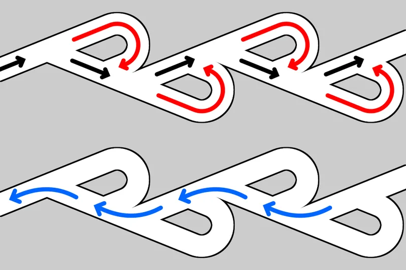

*Picture: [Tesla valve principle.svg](https://commons.wikimedia.org/wiki/File:Tesla_valve_principle.svg) by Cmglee, [CC BY-SA 4.0](https://creativecommons.org/licenses/by-sa/4.0), from Wikimedia Commons.*

A fixed-shape channel whose teardrop-shaped side loops give much more resistance to flow in one direction than the other, so it favours one-way flow with no moving parts, but it is only a 'slightly leaking valve' that slows backflow rather than sealing like a [check valve](../glossary.md#check-valve).

**In plain words:** A pipe or channel with a row of looping side pockets and no moving parts: water or air going one way slips straight through, but going the other way it is split into the loops and sent back to crash into itself, so it flows much less easily. It only slows the backflow; it never shuts it off, so it always leaks a little. **Proper term:** Tesla valve (valvular conduit; fixed-geometry fluidic diode).

**Also called:** valvular conduit (Nikola Tesla's own name, US patent 1,329,559, 1920) (Wikipedia 'Tesla valve'); fixed-geometry passive check valve, no-moving-parts valve (Wikipedia 'Tesla valve'); fluidic diode, leaky diode (Wikipedia 'Fluidics'; Nguyen et al. 2021); Tesla diode, Tesla conduit, Tesla-type microvalve (Nguyen et al. 2021); D-valve (a Tesla-type valve design studied by De Vries et al.; Wikimedia Commons); one-way flow restrictor (Printables 'Nested 3D Tesla Valve'); Not the same as: a Tesla 5-way (diverter) valve tool or valve caps for Tesla-brand cars, which share only the name.

## How it works

Flow in the easy (forward) direction runs along a fairly straight path past the loops (Wikipedia 'Tesla valve'). Flow in the hard (reverse) direction is split at each stage: part of it is turned round a loop and sent back across the main stream, where it collides with the oncoming flow and breaks it up (Wikimedia Commons 'Tesla valve principle'; Make:). This only works once the flow is fast enough: at low flow rates both directions resist equally, but above a certain speed the reverse flow turns turbulent and 'plugs' the pipe with vortices (Nguyen et al. 2021; ScienceDaily 2021). Because nothing actually closes, some fluid always gets through backwards; it works best with pulsing or back-and-forth flow, which it turns into a net one-way flow (Wikipedia 'Fluidics'; Nguyen et al. 2021).

## Parts

Single piece: one channel with a series of looping segments (Tesla's drawing shows eleven, but any number can be used) (Wikipedia 'Tesla valve'). Often made as a flat channel sandwiched between two lids (laser-cut acrylic in Nguyen et al. 2021), or printed as one closed part or two screwed halves (Printables models).

## Everyday examples

- Loop liquid cooling in some Xiaomi (brand) phones, which uses a Tesla valve to keep the coolant flowing one way (Wikipedia 'Tesla valve')
- Valveless pulsejet engines in hobby and model builds, which breathe in and blow out through one opening (Wikipedia 'Tesla valve'; Hackaday 2019)
- Printed science toys and school kits where you push water through with a syringe and compare the two directions (Printables 781760, 1611773)
- Nature's cousin: the spiral intestines of sharks and rays, which favour one-way flow with no flaps (University of Washington 2024)

## When to use it

Use a Tesla valve where flow pulses or reverses quickly and a moving flap or ball would wear out, flutter or stick: valveless pulsejets, pumping fluids with vibration, [oscillating](../glossary.md#oscillating) heat pipes and phone cooling loops (Wikipedia 'Tesla valve'; Nguyen et al. 2021). It is handy where you want to bias flow without anything that can jam, in microfluidic chips that can't contain moving parts, and as a mixer, since the reverse flow becomes turbulent at unusually low speeds (ScienceDaily 2021). It is also a great printable demonstration of fluid behaviour.

## When not to use it

Don't use it where backflow must be stopped: it always leaks (Wikipedia 'Tesla valve'). Use a check valve (flap, ball, reed or duckbill) to keep air in an inflatable, stop an aquarium siphoning back, keep a pump primed or hold pressure in an [actuator](../glossary.md#actuator), and an approved backflow preventer for drinking water (Wikipedia 'Backflow prevention device'). It also does little for slow, steady flows or thick liquids (Nguyen et al. 2021), and its forward path still adds some resistance, so it is a poor choice where every bit of flow matters.

## Details

- **What it does (jobs):**
  - stop it moving back (one-way): it favours flow in one direction, but only partly; it never fully stops backflow (Wikipedia 'Tesla valve')
  - seal it, or pass cables or fluid through: it passes water or air along a tube or channel (it does not seal)
  - slow it, stop it or keep its speed steady: it slows (does not stop) flow in the reverse direction, acting like a one-sided flow restrictor (Printables 'Nested 3D Tesla Valve'; Nguyen et al. 2021)
- **Movement:** none: nothing moves except the fluid
- **Directions it can move (degrees of freedom):** 0: it is one fixed shape with no moving parts
- **Special behaviour:**
  - one-way (moves freely one way, locks the other), but leaky: it resists reverse flow more than forward flow, typically about 2 to 4 times in steady-flow tests, and never seals (Wikipedia 'Tesla valve'; Nguyen et al. 2021)
  - motion conversion: with pulsing or back-and-forth flow, a set of Tesla valves turns the oscillation into a net one-way flow, like an AC-to-DC rectifier (Nguyen et al. 2021)
  - none of the mechanical behaviours otherwise: with no moving parts it cannot stick, wear or click (Wikipedia 'Tesla valve')
- **How it holds:**
  - not a holding joint (it moves or passes on motion): it is a shaped flow path; it holds nothing and passes fluid
- **Input and output:** not applicable for motion. For flow: forward flow passes with lower resistance than reverse flow; the ratio of reverse to forward resistance (diodicity) is about 1 at low flow, rising to about 2 once the flow is fast enough (Reynolds number about 300 to 1500 in the NYU tests) (Nguyen et al. 2021). Four Tesla valves in a bridge turn back-and-forth flow from a piston into a one-way flow in a second branch (Nguyen et al. 2021).
- **Power:** passive (no power needed): the flow itself does the work; it needs a pump, pressure head or pulsing flow to drive fluid through it
- **Load:** light: not a structural part. Printed plastic versions are for low-pressure water and air; it has no pressure rating of its own ⚑ [uncertain]
- **Play and precision:** not applicable (it doesn't locate parts or pass on motion)
- **Taking it apart:** removable: it is fitted in line with hoses or tubes and can be taken out; printed versions may be one closed piece or two halves joined with M2 screws (Printables 518822)
- **How often it can be reused:** effectively unlimited: with no moving parts it is 'much more resistant to wear and [fatigue](../glossary.md#fatigue)', especially where pressure reverses often, as in a pulsejet (Wikipedia 'Tesla valve')
- **Sealing:** none: it never closes, so some fluid always leaks back; Tesla's own patent called it 'a slightly leaking valve' (Wikipedia 'Tesla valve'). The part around the channel must itself be watertight or airtight (printed walls can leak, see making tips)
- **Adjustable:** no: its behaviour is fixed by the channel shape and the number of loops; more loops give more one-way effect (Printables 1611773; Wikipedia 'Tesla valve')
- **Access needed:** end of a tube or shaft: fitted in line where tubes end
- **Materials:** Any material that can hold the channel shape: clear acrylic layers laser-cut and bonded (Nguyen et al. 2021), laser-sintered nylon (Make:), FDM-printed plastic such as PLA (Hackaday 2019), transparent filament to see the flow (Printables 781760), silicon or polymer at micro scale for microfluidics (Wikipedia 'Tesla valve'). For hot gases (pulsejets) plastics melt (Hackaday 2019).
- **Heat, cold, water and wear:** No moving parts, so no wear or fatigue from frequent pressure reversals (Wikipedia 'Tesla valve'). Performance depends on flow speed and viscosity: slow flows and thick liquids behave like low Reynolds number, where it hardly works (Nguyen et al. 2021 used water-glycerol mixtures to reach low Reynolds numbers). Heat: printed plastic valves melt near hot gases such as pulsejet exhaust (Hackaday 2019). Water, chemicals and sunlight limits are those of the material it is made from ⚑ [uncertain].

## Making it

- **Ways to make or get it:**
  - 3D print (FDM): one-piece or two-half printed channels (Printables 158643, 518822)
  - 3D print (resin) or SLS: smooth internal channels; a laser-sintered nylon valve is shown by Make: ⚑ [uncertain] (for resin: no source tested a resin print)
  - laser cut: channel cut through acrylic sheet and sandwiched between two plain sheets, then bonded (Nguyen et al. 2021)
  - microfabrication: micro-scale Tesla valves in lab-on-a-chip devices (Wikipedia 'Tesla valve')
  - off-the-shelf part: built into some products, e.g. a phone's loop liquid-cooling system (Wikipedia 'Tesla valve'), but not usually sold as a separate part
- **Printing it in one piece (print in place):** yes: it is one fixed channel, so it prints complete and working with nothing to assemble (Printables 158643 '3D Tesla Valve'); some designs are printed as two halves and screwed together so the channel can be seen and cleaned (Printables 518822)
- **Tools:** none to fit (push tubes on or use a Luer syringe connector, as in Printables 781760); a 3D printer or laser cutter to make one; M2 screws and nuts for two-half designs (Printables 518822); hot glue for the school test kit (Printables 1611773)
- **Difficulty:** easy: free models print in one piece or two halves on any printer, and testing needs only a syringe or a tube of water (Printables 158643, 781760, 1611773); the hard part is getting a channel that doesn't leak through the printed walls

### 3D printing tips

1) Orientation: print the channel flat (lying in the XY plane) so the loops are formed by the walls, not by [overhangs](../glossary.md#overhang--bridging); a two-half design avoids bridging the channel roof (Printables 518822) ⚑ [uncertain] (orientation advice not tested in a source). 2) Use transparent filament if you want to watch the flow, and print at high resolution so a Luer syringe cone comes out round enough to seal (Printables 781760). 3) Make the walls leak-proof: FFF-printed hollow parts often leak (Zhai et al. 2023); makers printing airtight parts raise the flow rate (over-extrude) and use several [perimeters](../glossary.md#perimeters) (Printables 11188; Zenodo 8127332), or you can seal the outside. 4) Keep the channel reasonably large (the NYU test channel was about 9 mm wide, 19 mm deep and 30 cm long) and push the fluid hard: the valve only starts to work above a certain flow speed (Nguyen et al. 2021). 5) Print several versions with 1, 3 and 5 loops and time how fast water drains through each way: more loops give a stronger one-way effect (Printables 1611773). 6) For hot gases, such as a pulsejet, ordinary PLA melts; a maker used plaster cast around a dissolvable PVA print instead (Hackaday 2019). 7) Test it as a flow restrictor, not as a seal: block the outlet with a finger, then compare how long a fixed amount of water takes to pass each way (Printables 1611773).

### Buying one (off-the-shelf parts)

Usually none: it is a shape you make. To connect a printed valve: barbed hose connectors, Luer-lock syringe fittings (Printables 781760), clear acrylic tube and plastic hose for a drain test rig (Printables 1611773). If backflow must stop completely, buy a check valve (non-return valve) instead

## Rules of thumb

- Diodicity (Di) = reverse flow resistance / forward flow resistance; Di > 1 means it favours one direction (Wikipedia 'Tesla valve')
- Real valves in steady flow reach a diodicity of only about 2 to 4 (Wikipedia 'Tesla valve'); NYU measured Di about 2 for Reynolds numbers 300 to 1500 and said Tesla's claimed ratio of 200 'seems well beyond reach' (Nguyen et al. 2021)
- It does nothing at slow flow: Di stays close to 1 up to a Reynolds number of about 100 and switches on between about 100 and 300 (Nguyen et al. 2021); slow drips or slow syringe pushes go through almost equally well both ways (ScienceDaily 2021)
- Pulsing or back-and-forth flow improves it, as Tesla claimed (Nguyen et al. 2021; Wikipedia 'Tesla valve')
- More stages, more effect: a computer simulation found reverse resistance about 15 times forward with two segments and about 40 times with four (Wikipedia 'Tesla valve', simulation, higher than real tests); a school kit shows the effect growing with 1, 3 and 5 windings (Printables 1611773)
- To pump, put four in a bridge (like an electronic full-wave rectifier) and drive one branch back and forth; with a low-resistance outlet the best possible pumping effectiveness is (Di - 1)/(Di + 1), only about one third for Di = 2 (Nguyen et al. 2021)
- If backflow must stop completely (keeping air in a ball, protecting a pump or drinking water), use a check valve, not a Tesla valve (Wikipedia 'Tesla valve'; Wikipedia 'Backflow prevention device')

## Common failures

1) Expecting it to seal like a check valve and finding water or air leaking back: it is a 'slightly leaking valve' by design (Wikipedia 'Tesla valve'). 2) Flow too slow to make it work, so both directions look the same (Nguyen et al. 2021). 3) Fitted backwards: the easy direction is the one where flow runs straight along the channel, not into the loops (Wikimedia Commons 'Tesla valve principle'). 4) Leaks through printed layers or the joint between two halves (Zhai et al. 2023; Printables 518822). 5) Too few loops to notice an effect (Printables 1611773). 6) Melted parts in hot-gas uses (Hackaday 2019).

## Safety

None known for the valve itself, as long as nobody relies on it to stop backflow: it always leaks, so never use it to protect drinking water or anything safety-critical (Wikipedia 'Tesla valve'; Wikipedia 'Backflow prevention device'). Demonstrations with fire (burning propane, as in NightHawkInLight's video) and printed pulsejets involve flames, heat and loud noise, and plastic parts can melt (Hackaday 2019); leave those to experienced makers. Never hold stored pressure in a 3D-printed part.

## Related

- Check valve (flap, ball, reed or duckbill): actually seals against backflow, but has a moving part that can wear or stick
- Shark-intestine (helical) pipes: 3D-printed pipes with internal spirals; soft printed versions performed at least seven times better than previously measured Tesla valves (University of Washington 2024)
- Labyrinth seal: another fixed winding path with no moving parts, used to slow leakage past a shaft rather than to favour one direction
- Fluidic oscillators and amplifiers: other no-moving-parts flow devices from fluidics (Wikipedia 'Fluidics')
- Air-logic valve: switches air with a moving membrane and can make true on/off decisions
- Diaphragm pump and peristaltic pump: when you need real one-way pumping rather than a biased channel

## Make it yourself

- [3D Tesla Valve (sjogerst, Printables) (URL from Printables API, page not opened)](https://www.printables.com/model/158643-3d-tesla-valve): Printable one-piece Tesla valve; the author also made a 'Nested 3D Tesla Valve' (model 158642) with the loops nested inside each other *(licence: CC BY)*
- [Tesla Valve Experimentation Kit for Schools (TeslaVentile, Printables) (URL from Printables API, page not opened)](https://www.printables.com/model/1611773-tesla-valve-experimentation-kit-for-schools): Test rig parts and valves with 1, 3 and 5 windings for timing how fast water drains through each way; needs an acrylic tube, hose and a stand *(licence: CC BY-SA)*
- [Tesla valve bathtub toy (HankoTom, Printables) (URL from Printables API, page not opened)](https://www.printables.com/model/781760-tesla-valve-bathtub-toy): Tesla-valve toy with a Luer cone for a syringe, to feel and see which way water flows more easily; print in transparent filament *(licence: CC BY-NC)*
- [Tesla valve (Philip Everts, Printables) (URL from Printables API, page not opened)](https://www.printables.com/model/518822-tesla-valve): Two-half Tesla valve joined with M2 screws and nuts, for water or gas *(licence: CC BY-SA)*

## Pictures, videos and models

- [Tesla valve principle.svg (CMG Lee; Wikimedia Commons)](https://commons.wikimedia.org/wiki/File:Tesla_valve_principle.svg): Diagram of the blocking direction (part of the flow turned round each loop and colliding with the main stream) and the easy direction *(licence: CC BY-SA 4.0)*
- [Tesla valve cross-section.png (from Nikola Tesla's US patent 1,329,559; Wikimedia Commons)](https://commons.wikimedia.org/wiki/File:Tesla_valve_cross-section.png): Tesla's original patent drawing of the valvular conduit *(licence: Public domain)*
- [D-valve (Tesla valve) velocity magnitude (De Vries, Florea, Homburg and Frijns; Wikimedia Commons)](https://commons.wikimedia.org/wiki/File:D-valve_(Tesla_valve)_velocity_magnitude_1-s2.0-S0017931016310560-gr3.jpg): Computer-simulated flow speed and streamlines in a Tesla-type valve, forward flow beside reverse flow *(licence: CC BY 4.0)*
- [Tesla Valve Explained With Fire (NightHawkInLight, YouTube)](https://www.youtube.com/watch?v=tcV1EYSUQME): High-speed video of burning propane showing the flame racing through the easy direction and being turned back in the hard direction *(licence: link only (standard YouTube licence))*
- [Early turbulence and pulsatile flows enhance diodicity of Tesla's macrofluidic valve (Nguyen, Abouezzi and Ristroph, Nature Communications 2021; open-access copy on PubMed Central)](https://pmc.ncbi.nlm.nih.gov/articles/PMC8128925/): Photos and dye visualisations of a laser-cut acrylic Tesla valve, graphs of diodicity versus flow speed, and a four-valve pump circuit *(licence: CC BY 4.0)*

## Needs confirming

⚑ marks something nobody has confirmed yet: a fact the research could not confirm from a source, a finder value that is a best guess, or an open point from the research notes. Corrections are welcome (see `research/needs-confirming.md`).

- ⚑ 4 sentences on this page marked [uncertain].

## Sources

- <https://en.wikipedia.org/wiki/Tesla_valve>
- <https://en.wikipedia.org/wiki/Fluidics>
- <https://en.wikipedia.org/wiki/Backflow_prevention_device>
- <https://pmc.ncbi.nlm.nih.gov/articles/PMC8128925/>
- <https://www.ebi.ac.uk/europepmc/webservices/rest/PMC8128925/fullTextXML>
- <https://api.semanticscholar.org/graph/v1/paper/DOI:10.1038/s41467-021-23009-y>
- <https://www.sciencedaily.com/releases/2021/05/210517083626.htm>
- <https://www.machinedesign.com/mechanical-motion-systems/article/21164409/the-tesla-valve-bringing-back-a-forgotten-invention>
- <https://makezine.com/article/digital-fabrication/3d-printing-workshop/the-tesla-valve-one-way-flow-with-no-moving-parts/>
- <https://hackaday.com/2019/12/27/3d-printed-pulsejet-uses-tesla-valve/>
- <https://washington.edu/news/2024/09/25/tesla-coil-shark-intestines>
- <https://www.sciencedaily.com/releases/2023/07/230727212035.htm>
- <https://commons.wikimedia.org/wiki/File:Tesla_valve_principle.svg>
- <https://commons.wikimedia.org/wiki/File:Tesla_valve_cross-section.png>
- <https://commons.wikimedia.org/wiki/File:D-valve_(Tesla_valve)_velocity_magnitude_1-s2.0-S0017931016310560-gr3.jpg>
- <https://commons.wikimedia.org/wiki/File:Valvular_conduit_-_Patent_by_Nikola_Tesla_-_February_3rd,_1920.pdf>
- <https://www.youtube.com/watch?v=tcV1EYSUQME>
- <https://api.printables.com/graphql/>
- <https://www.printables.com/model/158643-3d-tesla-valve>
- <https://www.printables.com/model/158642-nested-3d-tesla-valve>
- <https://www.printables.com/model/1611773-tesla-valve-experimentation-kit-for-schools>
- <https://www.printables.com/model/781760-tesla-valve-bathtub-toy>
- <https://www.printables.com/model/518822-tesla-valve>
- <https://www.printables.com/model/11188-pillow-soft-robotic-actuator>
- <https://zenodo.org/records/8127332>
