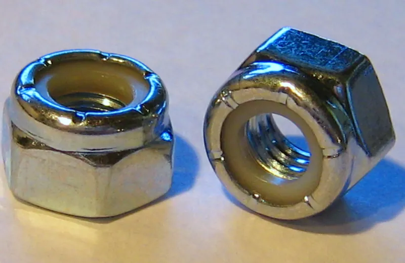
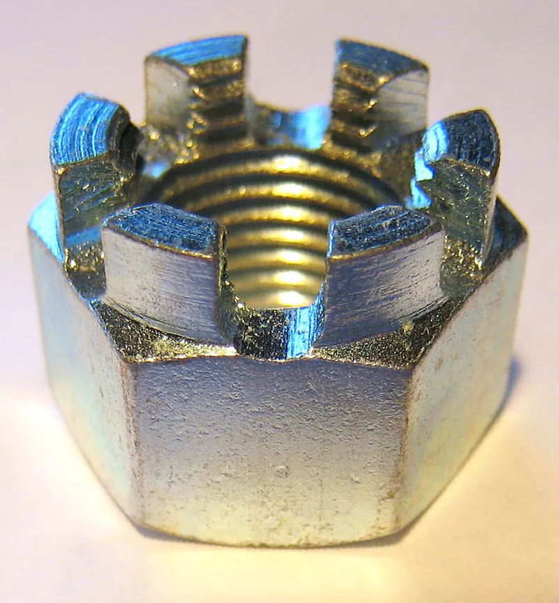
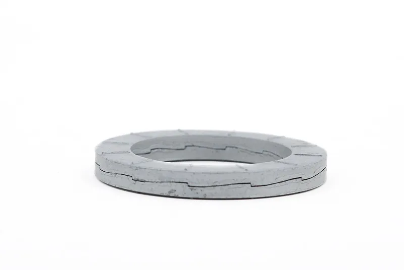

<figure class="eoc-pic eoc-pic-main"><figcaption><strong>Photo.</strong> <a href="https://commons.wikimedia.org/wiki/File:Nylon_Lock_Nut.png">Nylon Lock Nut</a> by Original uploader was Btarski at en.wikipedia., <a href="http://creativecommons.org/licenses/by-sa/3.0/">CC BY-SA 3.0</a>, from Wikimedia Commons.</figcaption></figure>
<figure class="eoc-pic"><figcaption><strong>Photo.</strong> <a href="https://commons.wikimedia.org/wiki/File:Castellated_Nut_(new).png">Castellated Nut (new)</a> by Btarski at English Wikipedia, <a href="http://creativecommons.org/licenses/by-sa/3.0/">CC BY-SA 3.0</a>, from Wikimedia Commons.</figcaption></figure>
<figure class="eoc-pic"><figcaption><strong>Photo.</strong> <a href="https://commons.wikimedia.org/wiki/File:Wedge_Locking_Washer.jpg">Wedge Locking Washer</a> by Doctorfastener, <a href="https://creativecommons.org/licenses/by-sa/4.0">CC BY-SA 4.0</a>, from Wikimedia Commons.</figcaption></figure>

Ordinary-looking nuts, washers and pins that stop a bolted joint undoing itself: a nylon ring or deformed thread that drags on the bolt, a washer that springs, bites or wedges, or a pin through the bolt that physically blocks the nut.

**In plain words:** Special nuts, washers and pins that stop a nut or bolt shaking loose: a nut with a nylon ring inside that grips the thread, springy or toothed washers, and a soft metal pin pushed through a hole in the bolt and bent over so the nut can't turn. **Proper term:** Thread-locking hardware (locknuts, locking washers and positive locking pins).

**Also called:** nylon-insert lock nut, nyloc nut, Nylock, polymer-insert lock nut, elastic stop nut ('Nyloc' is a registered trademark in Australia; ESNA elastic stop nut is a brand) (Wikipedia 'Nyloc nut'); locknut, lock nut, locking nut, [self-locking](../glossary.md#self-locking) nut, prevailing-torque nut, stiff nut; all-metal types such as the distorted-thread, split-beam or Philidas nut (brand) (Wikipedia 'Locknut'; NASA RP-1228); nylon pellet or patch (e.g. Nylok, brand): a small nylon plug or coating on the thread instead of a ring (Wikipedia 'Nyloc nut'; NASA RP-1228); lock washer: split washer, spring washer, spring lock washer, helical spring washer (DIN 127 B, ASME B18.21.1, NASM 35338); tooth lock washer, star washer or serrated washer (internal, external, countersunk); tab washer; wedge-locking washer (Nord-Lock, brand); conical spring washer or Belleville washer (DIN 6796) (Wikipedia 'Washer (hardware)'; Bolt Science; Nord-Lock user manual); split pin (UK) or cotter pin / cotter key (US); 'split cotter' in the UK; sizes to ISO 1234 / DIN 94 / BS 1574 (Wikipedia 'Split pin'; RoyMech); castellated nut or castle nut, slotted nut: a nut with slots for a split pin (Wikipedia 'Castellated nut'); jam nut, lock nut or counter nut: a second, often thin, nut tightened against the first (Wikipedia 'Jam nut'); safety wire or lockwire; serrated-face or serrated flange nut; free-spinning locking bolt, e.g. Whizlock (brand) (NASA RP-1228; Bolt Science).

## How it works

Bolts mostly work loose when the joint slips sideways a little, over and over: each slip cancels the thread friction for a moment, and the thread's slope then turns the nut backwards (Bolt Science 'Self-loosening'; the Junker test). Locking hardware fights this in three ways. Friction: a nylon ring slightly smaller than the bolt is squeezed out of shape by the thread and grips it, so the nut needs a 'prevailing [torque](../glossary.md#torque)' to turn even when it isn't tight (Wikipedia 'Nyloc nut', 'Locknut'). Springiness or wedging: a split washer was meant to keep pressure on the nut, though tests show it doesn't work, while a wedge-locking washer pair has ramps steeper than the thread, so turning the nut back would have to stretch the bolt (Bolt Science; Nord-Lock user manual). A physical block: a split pin through a slot in a castellated nut and a hole in the bolt stops the nut turning at all (NASA RP-1228).

## Parts

A few parts, always used with an ordinary bolt or screw. Nylon-insert nut: a steel, stainless or brass hex nut with a nylon (polyamide) ring fixed in its top (Wikipedia 'Nyloc nut'; Aspen DIN 985 sheet). Lock washer: one split or toothed spring-steel washer, or a glued pair of wedge-locking washers (Nord-Lock user manual). Positive lock: a castellated nut, a bolt with a cross-hole drilled through its threaded end, and a split pin (a doubled-over half-round wire with an eye) (NASA RP-1228; Wikipedia 'Split pin').

## Everyday examples

- A car's front wheel-bearing nut held by a castellated nut, or a slotted nut cover, and a split pin (Wikimedia Commons 'Car hub cotter pin.jpg'; NASA RP-1228)
- Nylon-insert nuts on the pivot bolts of tractor loader and backhoe [linkages](../glossary.md#linkage), left un-tightened so the joint moves (TractorByNet forum)
- The 'Nylock mod' on Prusa MK3 3D printers, where nylon-insert nuts on the heated bed's screws are used to fine-tune levelling (Prusa forum)
- A split pin through a clevis pin on a trailer hitch or garden-machinery linkage; split pins 'are frequently used to secure other fasteners, e.g. clevis pins' (Wikipedia 'Split pin')

## When to use it

Use locking hardware on any bolted joint that vibrates, moves, flexes or heats and cools: machines with motors, vehicles, bikes, printers and robots (Bolt Science). Use a nylon-insert nut when the nut must stay at a set position without being tightened hard, e.g. a pivot bolt, a levelling or adjusting screw, or a bolt through wood or a 3D print that can't take much clamping. Use a castellated nut with a split pin, or safety wire, when the lock must be positive and easy to check by eye, e.g. a wheel-bearing nut on a trailer or kart (NASA RP-1228; Wikipedia 'Castellated nut'). Use a split pin, or an R-clip, to keep a clevis pin in a linkage (Wikipedia 'Split pin').

## When not to use it

Don't rely on a split spring washer as a lock: use a nylon-insert or all-metal locknut, a wedge-locking washer on metal, or liquid [threadlocker](../glossary.md#threadlocker) instead (Bolt Science; NASA RP-1228). Don't use nylon-insert nuts above about 120 °C, e.g. near exhausts, engines or hot ends: use an all-metal locknut or safety wire (ISO 2320; NASA RP-1228). Don't use them where the joint is taken apart every day: they wear out, so use a tool-free fastener (wing nut, thumbscrew, hitch pin and R-clip) or a quick-release pin instead. Don't use wedge-locking washers or toothed washers on wood or plastic (Nord-Lock user manual; NASA RP-1228). Don't use a split pin to carry real [shear](../glossary.md#peel-vs-shear) load, since it is soft; it only stops something turning or sliding out (Wikipedia 'Split pin'). If the joint should never come apart, liquid threadlocker (see Anaerobic adhesive) is stronger and simpler.

## Details

- **What it does (jobs):**
  - join and hold: keeps a bolted or screwed joint from shaking loose under vibration, temperature changes or movement (Bolt Science 'Self-loosening')
  - let it move (turn, slide or bend): keeps a nut on a pivot bolt, or a clevis pin in a hinge, while the joint is left free to turn, with no need to clamp it tight (TractorByNet forum; Wikipedia 'Split pin')
- **Movement:** none: the hardware itself stays put. When a nylon-insert nut or split pin retains a pivot bolt or clevis pin, the joint it holds is 'rotate'.
- **Directions it can move (degrees of freedom):** 0 for a clamped bolted joint. 1 (turning about the pin) when it only keeps a pivot bolt or clevis pin from coming out.
- **Special behaviour:**
  - self-locking (holds under load, won't back-drive): a prevailing-torque nut resists turning at any position on the thread, even before it is tightened (Wikipedia 'Locknut'); a wedge-locking washer pair blocks loosening because 'the cam angle (α) is greater than the thread [pitch](../glossary.md#pitch) (β)' (Nord-Lock user manual); a castellated nut with a split pin is a 'positive locking device' that can't turn at all (Wikipedia 'Castellated nut')
  - one-way (moves freely one way, locks the other): split spring washers and toothed washers are meant to let the nut tighten but bite when it turns back, and nylon-insert nuts can only be fitted one way up, with the nylon end away from the joint (Wikipedia 'Washer (hardware)'; Aspen DIN 985 sheet). Tests show split washers don't actually stop loosening (see rules_of_thumb)
- **How it holds:**
  - friction or clamping ([force-fit](../glossary.md#form-fit--force-fit--material-bond)): nylon-insert and all-metal prevailing-torque nuts drag on the thread; jam nuts lock two nuts against each other (Wikipedia 'Nyloc nut', 'Jam nut'; Bolt Science)
  - shape (the parts interlock; form-fit): a split pin through a castellated nut and a cross-drilled bolt, safety wire, tab washers, and the teeth of star, serrated or wedge-locking washers that dig into the surfaces (NASA RP-1228; Wikipedia 'Washer (hardware)'; Nord-Lock user manual)
  - spring force (a spring or springy part presses it in place): split spring washers and conical spring washers (DIN 6796). Only conical spring washers are designed to keep clamp force as the joint settles; split washers flatten early and don't lock (Bolt Science 'Helical spring washers')
- **Input and output:** not applicable
- **Power:** passive (no power needed)
- **Load:** As strong as the bolted joint it locks (light to heavy, depending on the bolt): the locking part adds no strength of its own. Split pins are soft metal and should not be used to resist strong shear forces (Wikipedia 'Split pin'). A castellated nut and split pin 'works extremely well for low-torque applications such as holding a wheel bearing in place' (NASA RP-1228 p.7). Locking hardware can't save a joint whose clamp force is too low to stop it slipping sideways: the bolt will then wear or break from [fatigue](../glossary.md#fatigue) even if the nut stays on (Bolt Science).
- **Play and precision:** not applicable for a clamped joint. On a castellated nut and split pin, the nut can only stop at one of its slots, so bearing [preload](../glossary.md#preload) is set in 1/6-turn steps (NASA RP-1228 p.7). A nylon-insert nut can be set at any angle.
- **Taking it apart:** removable: nylon-insert nuts and lock washers come off with a spanner. The split pin is pulled out with pliers but should then be thrown away and replaced (Wikipedia 'Split pin').
- **How often it can be reused:** a few times. Nylon-insert nuts 'may be re-used a limited number of times' (Aspen DIN 985 sheet); the ISO 2320 standard checks locking up to the 5th removal and warns that re-use reduces prevailing torque (ISO 2320:2015 abstract via iTeh); all-metal deformed-thread locknuts can be re-used about 10 times (NASA RP-1228 p.7); a nylon pellet 'will also be damaged quickly by reassembly' (NASA RP-1228 p.7). Split pins: once, because bending fatigues them (Wikipedia 'Split pin'). Authorities disagree on re-using nylon-insert nuts: the FAA allows re-use if the prevailing torque is still in specification, while a US Air Force order requires new ones in critical places (Wikipedia 'Nyloc nut').
- **Sealing:** none. The nylon collar of a nylon-insert nut 'provides some sealing action from gas and moisture leakage' along the thread (NASA RP-1228 p.7), but it is not a seal.
- **Adjustable:** yes for prevailing-torque nuts: they stay wherever you leave them on the thread, so you can set a pivot to turn freely or fine-tune a bed-levelling screw (TractorByNet forum; Prusa forum 'Nylock mod'). Castellated nuts adjust only in steps of one slot, usually 1/6 turn (six slots) (NASA RP-1228 p.7). Lock washers: no.
- **Access needed:** both sides for a bolt and nut: hold the bolt head while turning the locknut, and reach both ends of a split pin's hole. One side only (blind) for a screw into a tapped hole with a locking washer, where the tapped hole does the rest (Nord-Lock user manual 'Tapped holes').
- **Materials:** Nylon-insert nuts: zinc-plated steel, A2 or A4 stainless or brass, with a polyamide (nylon) insert (Aspen DIN 985 sheet). Split pins: mild steel, brass, bronze, stainless or aluminium (Wikipedia 'Split pin'), usually zinc-plated low-carbon steel (RoyMech). Split washers: hardened carbon steel, also aluminium, bronze, stainless and Monel (NASA RP-1228 p.9). Wedge-locking washers: steel or stainless, and they must be harder than the surfaces they sit on. Nord-Lock does not recommend them on 'very soft mating surfaces — for example, wood and plastic' (Nord-Lock user manual p.3). Toothed washers bite best into soft metals such as aluminium (Wikipedia citing Carroll Smith), but they scratch and damage the surfaces, which can start cracks and corrosion (NASA RP-1228 p.10). The joint can be metal, wood or plastic, but in wood and plastic the clamped material itself squashes and [creeps](../glossary.md#creep) over time (see environment_limits).
- **Heat, cold, water and wear:** Nylon inserts: -50 °C to +120 °C (ISO 2320:2015 note); about 250 °F (121 °C) (Wikipedia 'Nyloc nut'; NASA RP-1228), and 'certain chemicals' also limit them (Aspen DIN 985 sheet). All-metal prevailing-torque nuts: -50 °C to +150 °C (ISO 2320). Wedge-locking washers: steel -50 °C to 200 °C, stainless -160 °C to 500 °C (Nord-Lock user manual p.4). Plain steel parts rust outdoors, so use zinc-plated or stainless hardware. Vibration is exactly what they are for, but combined sideways and [axial](../glossary.md#axial--radial) loads can still make prevailing-torque nuts come completely loose (Bolt Science, Fastener and Fixing 2009 article summary). In plastic and wood the clamped material creeps, so clamp force fades even if the nut doesn't turn (FilamentSpecs creep guide; Bolt Science on embedding and relaxation).

## Making it

- **Ways to make or get it:**
  - off-the-shelf part: always bought
  - 3D print (FDM): printed parts get hex pockets (nut traps) for nylon-insert nuts, holes for bolts, and loops or holes for clevis pins with split pins (Hubs; Thingiverse bed-level knob models)
  - woodwork: nylon-insert nuts and washers on bolts through wood, e.g. furniture pivots and garden gates ⚑ [uncertain: example not from a source]
  - CNC: drill the cross-hole for a split pin, or machine a castellated nut seat
  - sheet metal: toothed and wedge-locking washers under nuts on metal panels
- **Printing it in one piece (print in place):** no: the locking parts are metal hardware fitted after printing. Printed split pins and snap pins exist, but they are a different joint (see Related).
- **Tools:** Two spanners or a spanner and a screwdriver: a prevailing-torque nut has to be turned with a spanner all the way on, not spun on by hand (Wikipedia 'Locknut'). For split pins: a drill to cross-drill the bolt or pin (or buy it drilled), and pliers to spread and bend the legs; 'hammer lock' split pins are set with a hammer (Wikipedia 'Split pin'). Safety wire needs a drilled bolt head and lockwire pliers (NASA RP-1228).
- **Difficulty:** easy: buy the part and fit it with ordinary spanners and pliers. The only extra jobs are drilling a cross-hole for a split pin, and designing a deeper pocket in 3D prints for the taller nylon-insert nut.

### 3D printing tips

1) Use real metal locking hardware with printed parts rather than printing it. 2) Nylon-insert nuts are taller than plain nuts, so make the nut pocket deeper: DIN 985 thin nylon-insert nuts are 5 mm tall for M4 and M5, 6 mm for M6 and 8 mm for M8, with the same across-flats as plain nuts (7, 8, 10 and 13 mm) (Aspen DIN 985 sheet). Hubs suggests starting with a 0.2 mm offset around the nut (0.1 mm each side) for a loose fit, then adjusting by test prints, and a wall at least as thick as the fastener diameter (Hubs threaded fasteners guide). Tolerance-test prints such as the 'Nutchecker' step the pocket size by 0.05 mm (Thingiverse). 3) Fit the nut with the nylon end facing away from the part; it only works one way up (Aspen DIN 985 sheet), and leave about two threads of the bolt sticking out beyond the nylon so the insert fully grips (Fastener Training Minute 157). 4) A nylon-insert nut needs torque all the way along the thread, so the hex pocket must stop it turning. A round or oversized pocket lets it spin and the plastic can split ⚑ [uncertain: general printing practice]. 5) Best use in prints: pivots and adjusters. Because the nylon grips even when the nut isn't tight, you can leave a printed hinge or lever just snug so it turns freely while the nut stays put (TractorByNet forum: 'the nyloc is serving the same purpose as a cotter pin would'). Printed bed-levelling knobs hold a nylon-insert nut for the same reason: plain threaded inserts 'do not hold screw over time due to vibrations from stepper motor' (Thingiverse 'Bed level knob for M4 nylock nut'). 6) Don't expect locking hardware to keep a printed joint tight: the plastic under the nut or washer creeps and 'can compress over time and reduce clamping force even when the fastener has not rotated' (FilamentSpecs creep guide). Spread the load with a large flat washer, and for clamped joints consider metal spacers or [heat-set inserts](../glossary.md#heat-set-insert). 7) Skip split spring washers and wedge-locking washers on printed plastic: split washers don't lock even in steel (NASA RP-1228: 'useless for locking'), wedge-locking washers are not recommended for plastic (Nord-Lock user manual), and toothed washers dig into and damage soft surfaces (NASA RP-1228). 8) If you print your own clevis pin with a cross-hole for a steel split pin, the plastic around the small hole is weak; a steel clevis pin with a ready-made hole is far stronger ⚑ [uncertain: general advice].

### Buying one (off-the-shelf parts)

Search supplier catalogues for: 'nylon insert lock nut' (DIN 985 / ISO 10511 thin type; regular-height types such as DIN 982 / ISO 7040 ⚑ [uncertain: DIN-ISO equivalence for the regular type not checked on an opened page]), also sold as 'nyloc' or 'nylock' nuts (Aspen; Wikipedia); 'all-metal prevailing torque nut', 'distorted thread lock nut', 'split beam lock nut' (NASA RP-1228; Wikipedia 'Locknut'); 'serrated flange nut' or 'flange lock nut'; 'keps nut' or 'K-lock nut' (nut with a captive star washer) (Wikipedia 'Locknut'); 'jam nut' or 'thin nut'; 'castellated nut', 'castle nut' or 'slotted nut'; 'split pin' or 'cotter pin' (ISO 1234 / DIN 94), often sold in assortment boxes, plus 'clevis pin' with a cross-hole (RoyMech; Wikipedia); 'spring lock washer' or 'split washer' (DIN 127 B); 'internal / external tooth lock washer' or 'star washer'; 'wedge-locking washer' (Nord-Lock, brand); 'conical spring washer' (DIN 6796); 'tab washer'; 'safety wire' or 'lockwire'; and bolts with a 'pre-applied threadlocker patch' or 'nylon patch' (Nylok, brand) (Wikipedia 'Washer (hardware)'; Bolt Science; NASA RP-1228).

## Rules of thumb

- Clamp force comes first: 'the key to preventing self loosening' is enough clamp force to stop the joint slipping sideways, allowing for settling, then a proven locking device (Bolt Science 'Self-loosening of bolts and nuts').
- In Junker (sideways vibration) tests, 'the chemical locking category provides the greatest resistance to vibration loosening, followed by the free spinning locking fastener' (serrated flange types); prevailing-torque nuts such as nylon-insert nuts are also a proven type. 'Loose washers, of the plain or spring variety, are not generally advisable' (Bolt Science 'Self-loosening').
- Split (helical) spring washers don't lock: they 'flatten out at between 10% to 20% of the target preload' for property class 8.8 and stronger bolts (Bolt Science 'Helical spring washers'); NASA: 'a lockwasher of this type is useless for locking' (NASA RP-1228 p.9). DIN withdrew several lock-washer standards in 2004 for this reason (Bolt Science).
- Nylon-insert nuts work from -50 °C to +120 °C; all-metal prevailing-torque nuts from -50 °C to +150 °C (ISO 2320:2015 notes, via iTeh abstract). Wikipedia (citing Carroll Smith) and NASA both give about 250 °F (121 °C) as the nylon limit (Wikipedia 'Nyloc nut'; NASA RP-1228 p.7).
- Leave about two full threads of the bolt sticking out beyond the nylon insert so that it fully grips; 2-3 threads is the general rule for any nut (Fastener Training Minute 157, Fasteners Clearinghouse).
- Re-use: prevailing torque drops with each re-use; ISO 2320 type-tests to the 5th removal (ISO 2320:2015 abstract). NASA gives about 10 re-uses for all-metal deformed-thread nuts (NASA RP-1228 p.7). Split pins are single-use (Wikipedia 'Split pin').
- Choose a split pin by the hole it goes in: ISO 1234 split pins are named by hole size, and the pin itself is slightly thinner (e.g. size 2.0 has a 1.8 mm pin, size 3.2 a 2.9 mm pin, size 4.0 a 3.7 mm pin) (RoyMech). Wikipedia's table pairs a 2 mm pin (2.4 mm hole) with an M8 bolt and a 3 mm pin (3.4 mm hole) with M12-M14 (Wikipedia 'Split pin', from Jensen 2001).
- Castellated nut: tighten to the specified torque, then turn to the nearest slot that lines up with the hole and fit the split pin. Wikipedia says turn forward (tighter); NASA says forward or backward depending on preference (Wikipedia 'Castellated nut'; NASA RP-1228 p.7).
- Two nuts: the thin nut goes next to the joint, not on top (Bolt Science 'Self-loosening'); tighten the inner nut to about a quarter to a half of the outer nut's torque, hold it, then tighten the outer nut fully (Wikipedia 'Jam nut'). NASA calls jam nuts 'too unpredictable to be reliable' except where they carry no tension, e.g. on a turnbuckle (NASA RP-1228 p.7).
- Wedge-locking washers need surfaces softer than the washer, one pair under the bolt head and another under the nut in a through-hole, and are not recommended for wood or plastic (Nord-Lock user manual pp.3-4).

## Common failures

1) Nut still works loose because the joint was never tight enough to stop it slipping sideways; the bolt may then also break from fatigue (Bolt Science). 2) Split spring washer flattened and gives no lock; nut backs off (Bolt Science; NASA RP-1228). 3) Nylon-insert nut re-used too many times or overheated, so it now spins freely (ISO 2320; NASA RP-1228). 4) Bolt too short: the thread doesn't reach through the nylon ring, so the lock never engages (Fastener Training Minute 157). 5) Nylon-insert nut fitted upside down (Aspen DIN 985 sheet). 6) Split pin re-used, not bent over, or too small for its hole, so it fatigues, breaks or falls out (Wikipedia 'Split pin'; RoyMech). 7) Castellated nut backed off to line up a slot, so the preload is lost (Wikipedia 'Castellated nut' says turn forward). 8) Jam nuts in the wrong order or at the wrong torques, so both turn together (Bolt Science; NASA RP-1228). 9) Toothed washers scratch the surfaces, starting cracks and corrosion (NASA RP-1228). 10) In plastic or wood, clamp force fades as the material creeps and settles (FilamentSpecs; Bolt Science).

## Safety

Locking hardware that fails can let wheels, brakes or linkages come apart: a 2007 UK train derailment was traced to nuts, fitted with helical spring washers, that came completely off their bolts (Bolt Science 'Helical spring washers'). Use new split pins and, on safety-critical parts, new locknuts; a US Air Force order requires replacing self-locking nuts in critical areas (Wikipedia 'Nyloc nut'). The cut ends of split pins and safety wire are sharp; bend them flat against the nut or pin ⚑ [uncertain: general workshop advice]. A split pin that sticks out can snag clothing or brush ⚑ [uncertain: general advice].

## Related

- Anaerobic adhesive (threadlocker, retaining compound): liquid locking that gave the greatest resistance to vibration loosening in Bolt Science's summary; permanent or semi-permanent
- Ordinary screw joint (bolt and nut, machine screw): the joint this hardware protects; enough clamp force matters more than the lock
- Retaining ring ([circlip](../glossary.md#circlip), E-clip): holds a part on a grooved shaft, where a split pin needs a cross-hole
- Tool-free fasteners (thumbscrew, wing nut, hitch pin and R-clip): an R-clip does a split pin's job but can be removed and re-used by hand
- Quick-release pin (ball-lock pin): a pin that locks itself with spring balls, for joints taken apart often
- Clevis joint (fork-and-pin joint): the pivot most often held by a split pin or R-clip
- [Captive nut](../glossary.md#captive-nut) pocket (nut trap) and heat-set threaded insert: ways to put a metal thread into a 3D print; a nylon-insert nut can sit in a nut trap
- Wave and disc springs (compact axial springs): conical spring washers (DIN 6796) keep clamp force as a joint settles, which split washers don't
- Snap pin (split-leg push-in pin): a printed or plastic pin with springy legs, not the same as a metal split pin

## Make it yourself

- [Bed level knob for M4 nylock nut (JGFTW, Thingiverse)](https://www.thingiverse.com/thing:4618066): Printable 3D-printer bed-levelling knob that holds an M4 nylon-insert nut so the levelling screw stays where you set it despite stepper-motor vibration *(licence: CC BY 4.0)*
- [Thumbwheel for M3 standard and nyloc nuts (andygock, Thingiverse)](https://www.thingiverse.com/thing:39459): Printable thumbwheel that clamps tightly around an M3 plain or nylon-insert nut, used for bed levelling on a Prusa Mendel *(licence: CC BY-SA 4.0)*
- [Nutchecker - M3 - M4 - M5 - M6 (tolerance test) (ginoadriano, Thingiverse)](https://www.thingiverse.com/thing:6043489): Test print with hex pockets that grow by 0.05 mm per step, for finding the right nut-trap size on your printer before designing pockets for locknuts *(licence: CC BY 4.0)*
- [Nord-Lock Wedge-Locking Washers - Junker Vibration Test (Nord-Lock Group, YouTube; title confirmed via oEmbed, not watched)](https://www.youtube.com/watch?v=IKwWu2w1gGk): Manufacturer video of the Junker sideways-vibration test used to compare locking methods (brand demonstration) *(licence: link only (YouTube))*

## Pictures, videos and models

- [Nylon Lock Nut.png (Btarski, Wikimedia Commons, 2007)](https://commons.wikimedia.org/wiki/File:Nylon_Lock_Nut.png): Photo of a nylon-insert lock nut showing the nylon ring in the top of the nut *(licence: GFDL 1.2 or CC BY-SA 3.0)*
- [CotterPins.svg (Kivaan, Wikimedia Commons, 2007)](https://commons.wikimedia.org/wiki/File:CotterPins.svg): Diagram of a split pin new (A) and fitted with its legs bent back (B), an R-clip (C) and the pin's half-round cross-section (D) *(licence: Public domain)*
- [Castellated Nut (new).png (Btarski, Wikimedia Commons, 2007)](https://commons.wikimedia.org/wiki/File:Castellated_Nut_(new).png): Photo of an unused castellated (castle) nut with its slots for a split pin *(licence: GFDL 1.2 or CC BY-SA 3.0)*
- [Wedge Locking Washer.jpg (Doctorfastener, Wikimedia Commons, 2019)](https://commons.wikimedia.org/wiki/File:Wedge_Locking_Washer.jpg): The two halves of a wedge-locking washer, showing the ramps (cams) on one face and the radial teeth on the other *(licence: CC BY-SA 4.0)*
- [Nuts & Bolts - Lock Washer & Lock Nut Vibration Test (Hacks by Dad, YouTube; title confirmed via oEmbed, not watched)](https://www.youtube.com/watch?v=4H-HOHZ3chA): A home vibration test comparing lock washers and lock nuts *(licence: link only (YouTube))*

## Needs confirming

⚑ marks something nobody has confirmed yet: a fact the research could not confirm from a source, a finder value that is a best guess, or an open point from the research notes. Corrections are welcome (see `research/needs-confirming.md`).

- ⚑ 6 sentences on this page marked [uncertain].
- ⚑ Finder value `connects` = any solid parts (best guess): joins parts, but no specific kind of part found; set to any solid parts
- ⚑ Finder value `clicks` = clicks (best guess): the text uses both clicking and silent words

## Sources

- <https://en.wikipedia.org/wiki/Nyloc_nut>
- <https://en.wikipedia.org/wiki/Locknut>
- <https://en.wikipedia.org/wiki/Washer_(hardware)>
- <https://en.wikipedia.org/wiki/Split_pin>
- <https://en.wikipedia.org/wiki/Castellated_nut>
- <https://en.wikipedia.org/wiki/Jam_nut>
- <https://ntrs.nasa.gov/api/citations/19900009424/downloads/19900009424.pdf>
- <https://www.boltscience.com/pages/vibloose.htm>
- <https://www.boltscience.com/pages/helicalspringwashers.htm>
- <https://www.boltscience.com/pages/junkertestvideo.htm>
- <https://standards.iteh.ai/catalog/standards/cen/2479d383-c8c7-43e0-bcb6-2d5ad3ffa1c3/en-iso-2320-2015>
- <https://www.aspenfasteners.com/content/pdf/Metric_DIN_985_spec.pdf>
- <https://www.nord-lock.com/shop/private-use/how-it-works/>
- <https://www.nord-lock.com/globalassets/mediavalet/web-assets/downloads/user-manual/00095_nl_user_manual_nlo_2026_v01_digital2.pdf>
- <https://roymech.org/Useful_Tables/Circlips/Split_Cotter_Pins.html>
- <https://roymech.org/Useful_Tables/Circlips/index.html>
- <https://news.fastenersclearinghouse.com/ftm-157-thread-stick-out/>
- <https://www.hubs.com/knowledge-base/how-assemble-3d-printed-parts-threaded-fasteners/>
- <https://filamentspecs.com/creep-resistance-3d-printed-parts/>
- <https://www.tractorbynet.com/forums/threads/nyla-nuts.430100/post-5823756>
- <https://forum.prusa3d.com/forum/original-prusa-i3-mk3s-mk3-user-mods-octoprint-enclosures-nozzles/guide-nylock-mod-for-mk3-and-mk3s/>
- <https://www.thingiverse.com/thing:4618066>
- <https://www.thingiverse.com/thing:39459>
- <https://www.thingiverse.com/thing:6043489>
- <https://commons.wikimedia.org/wiki/File:Nylon_Lock_Nut.png>
- <https://commons.wikimedia.org/wiki/File:CotterPins.svg>
- <https://commons.wikimedia.org/wiki/File:Castellated_Nut_(new).png>
- <https://commons.wikimedia.org/wiki/File:Wedge_Locking_Washer.jpg>
- <https://commons.wikimedia.org/wiki/File:Car_hub_cotter_pin.jpg>
- <https://www.youtube.com/oembed (titles of 4H-HOHZ3chA and IKwWu2w1gGk)>
