<figure class="eoc-pic eoc-pic-main"><picture><source media="(prefers-reduced-motion: reduce)" srcset="../media/drawn/threadless-ball-screw.svg"></picture><figcaption><strong>Animation.</strong> Diagram drawn for the encyclopaedia from the research notes. ⚑ Needs confirming: a drawing can simplify or get details wrong; a real photo or a better diagram is welcome.</figcaption></figure>

Bearings pressed at an angle against a smooth spinning rod roll round it in a spiral and so carry their housing (the 'nut') along the rod, turning rotation into straight-line motion with no [backlash](../glossary.md#backlash), and slipping harmlessly instead of jamming when overloaded.

**In plain words:** Three ordinary ball bearings clamped at a slant around a smooth steel rod: when the rod spins, the bearings roll round it in a spiral and walk along it like a nut on a screw, but with no thread, so it slips instead of jamming. **Proper term:** Rolling-ring drive (threadless ball screw).

**Also called:** threadless ballscrew / threadless ball screw; rolling ring drive / rolling-ring linear drive; rolling ring traverse (in winding machines); rolling nut on a smooth shaft; Rollringgetriebe (German); Uhing linear drive (brand; sold in the US by Amacoil); Roh'Lix linear [actuator](../glossary.md#actuator) (brand, Zero-Max).

## How it works

Each bearing presses on the rod at a slight tilt, like a wheel steered a little to one side. When the rod spins it rolls every bearing round, and because they are tilted they roll in a spiral path, so the nut moves along the rod a fixed distance per turn, as if on a thread (Hackaday likens the contact to a temporary thread pressed into the rod). The drive comes only from friction at the contact points, so the clamping force sets how hard it can push before it slips, and the tilt angle sets the travel per turn: more tilt, faster travel. In commercial units the shaft passes through special bearings with a ridged inner race; tilting them the other way reverses the direction of travel while the shaft keeps turning the same way.

## Parts

A small assembly that acts as one unit: a smooth hardened steel rod turned by a motor through a coupler, a nut body, three (sometimes four or more) ball bearings mounted on bolts at a slight tilt around the rod, and something that sets how hard they press (the bolts themselves, a spring or a [set screw](../glossary.md#set-screw)). Commercial units add a pitch-setting lever, a free-movement lever and a spring-loaded reversing mechanism.

## Everyday examples

- Industrial wire, cable and yarn winding machines, where a rolling-ring traverse lays the product evenly on a spool and reverses at each end by itself (Uhing; Amacoil)
- Some automatic doors, according to a Hackaday reader, with micro switches along the path to correct for any slip ⚑ [uncertain]
- Home-made 3D-printer Z axes from the RepRap era, which used printed threadless ball screws instead of lead screws (Hackaday)

## When to use it

Use it when you want smooth, quiet, backlash-free straight-line motion from a spinning rod and would rather it slipped than jammed or broke: moving a carriage back and forth for spraying, feeding or winding, long [strokes](../glossary.md#stroke) where a long smooth rod is simpler than a long screw, and machines where an obstruction or bottoming out must not cause damage. Commercial units are the classic choice for level-winding wire and cable, because they reverse at the ends and change [pitch](../glossary.md#pitch) mechanically without any electronics. It is also a fun, cheap printable demonstration of friction drive.

## When not to use it

Avoid it where position must be exact and repeatable without feedback (CNC axes, printer axes without homing): it drifts; use a lead screw, ball screw, belt or rack. Avoid it for lifting or holding heavy loads, especially vertically: it slips, most of all going up, and a released load can drop; use a lead screw ([self-locking](../glossary.md#self-locking) with a fine lead) or a worm drive. Avoid heavy side loads on the nut, and oily or dirty conditions where the contact loses grip. For back-and-forth traversing with a fixed stroke, a reversing (diamond) screw is simpler to print and cannot slip.

## Details

- **What it does (jobs):**
  - change the kind of motion: continuous rotation of a smooth rod into straight-line travel of the nut
  - slip or let go when overloaded: the nut slips along the rod instead of jamming if it hits an obstruction or end stop
  - change speed or turning force: the tilt angle sets the travel per turn; commercial units adjust it with a lever and can reverse direction without reversing the motor
- **Movement:** rotate+slide: the rod turns and the nut slides along it; travel is limited only by the rod length (Uhing units reach up to 16 ft / about 5 m of stroke, Amacoil)
- **Directions it can move (degrees of freedom):** 1: in normal running the nut's position follows the rod's rotation; any slip adds unwanted, uncontrolled sliding along the rod
- **Special behaviour:**
  - motion conversion (rotary to linear): the spinning rod drives the nut along it
  - torque-limiting (slips at a set force): the push is limited by friction, so the nut slips at a thrust set by how tightly the bearings are clamped
  - [fail-safe](../glossary.md#fail-safe--fail-secure) or breakaway: if travel is blocked, the shaft simply slips until the blockage is cleared, instead of jamming or stripping a thread (Machine Design)
- **How it holds:**
  - friction or clamping ([force-fit](../glossary.md#form-fit--force-fit--material-bond)): only friction at the bearing-to-rod contacts moves the nut; there is no interlocking thread
  - spring force: commercial units keep the bearings pressed on with a factory-set thrust screw or springs; many printed nuts use a fixed interference set by the bolts instead
- **Input and output:** Continuous rotation of a smooth rod -> straight-line motion of the nut along the same axis (in line). Travel per turn rises with the bearing tilt (the Uhing patent gives feed proportional to tan of the tilt angle): a printed nut with about 10 degrees of tilt on an 8 mm rod moved about 4.5 mm per turn (2n2r5), and Uhing drives cover roughly 6-70 mm per turn depending on size, adjustable over about 10:1. Thrust: about 30 N to 3,600 N across Uhing sizes (15-80 mm shafts); Amacoil quotes up to 800 lb, and four-ring units give twice the thrust of three-ring units (Machine Design). Efficiency: high, because everything rolls (Uhing claims 'maximum efficiency' but gives no figure) ⚑ [uncertain]. Back-drivable: ⚑ [uncertain] a push along the rod tends to make the nut slip rather than hold, so do not rely on it to hold a load; printed Z-axes slipped when lifting (Soliforum).
- **Power:** passive (no power needed) as a mechanism, but it is normally motor-driven. If the motor stops, the nut is held only by friction on the rod, so a hanging load can [creep](../glossary.md#creep) or slide down ⚑ [uncertain]; Uhing warns that operating the free-movement lever can let a load drop in an uncontrolled way
- **Load:** Light to medium along the rod: thrust is limited by friction, from a few newtons for printed nuts to about 3,600 N for the largest commercial units, and it slips beyond that. Weak against side loads and twisting (moment) loads: these cut the thrust sharply and wear the bearings, so the payload should ride on its own guide rails or slide and only be pushed by the nut (Machine Design; Amacoil).
- **Play and precision:** Backlash: none, because the bearings are always pressed onto the rod. [Repeatability](../glossary.md#repeatability--accuracy): poor unless you add feedback, because small slips add up: Maker's Muse's printed unit drifted badly within a few minutes (Hackaday 2026), printed Z-axes slipped more going up than down (Soliforum), and Uhing sets the pitch difference between the two directions only to within 2.5%. Commercial units are typically accurate to about +/-0.005 in (+/-0.13 mm), premium ones +/-0.0004 in (Amacoil); Uhing suggests slowdown cams where +/-0.5 mm stopping accuracy is enough. [Misalignment](../glossary.md#misalignment): needs a straight, round, hardened rod and a twist-free coupling to any separately guided load.
- **Taking it apart:** removable: loosen the bearing bolts (or, on commercial units, flip the free-movement lever that releases the [preload](../glossary.md#preload)) and slide the nut off the end of the rod
- **How often it can be reused:** many times: nothing is permanently deformed when it is fitted; the bearings and rod are wear parts
- **Sealing:** none: the rod and bearings are open; commercial units can be fitted with rubber scrapers at the shaft openings to wipe off dirt (Amacoil)
- **Adjustable:** yes: the slip force is set by the bearing clamping (tighten the bolts, or the factory thrust screw on commercial units); the travel per turn is set by the tilt angle (fixed in printed designs, lever-adjustable about 10:1 in 100 notched steps on Uhing RG drives); the direction is reversed by tilting the bearings the other way, automatically at adjustable end stops on commercial units
- **Access needed:** end of a tube or shaft: the nut is slid on from an end of the rod (printed nuts are fitted with the bearings backed off, then tightened onto the rod)
- **Materials:** Rod: induction-hardened, ground steel; Uhing requires at least 50 HRC, h6 diameter [tolerance](../glossary.md#tolerance), Ra 0.35 um or smoother and no more than 0.1 mm/m runout, and supplies Cf53 steel (60-64 HRC) or rust-resistant 1.4034 and 1.4112 stainless shafts. Bearings: standard deep-groove ball bearings pressing with their outer edge in printed versions (e.g. 625ZZ on an 8 mm rod); specially machined rolling-ring bearings with a ridged inner race in commercial units. Nut body: printed PLA or PETG (100% [infill](../glossary.md#infill) recommended) or metal housings.
- **Heat, cold, water and wear:** Uhing units are rated for -10 to +80 C (RGK types to +50 C) (Uhing technical information) and have worked in Antarctica at -20 C (Uhing). Lubricants matter: silicone, graphite and MoS2 lubricants cause slip; a 2013 Amacoil article in Machine Design said no lubricant should be used at all, while Uhing's current instructions call for a thin film of MoS2-free ball-bearing grease, so follow the maker's own instructions. The smooth rod doesn't trap debris, but dirt between rod and bearings hurts grip, so scrapers are used in dirty places. Printed nuts: heat build-up loosens the bearings unless printed with 100% infill (2n2r5), and PLA softens above about 60 C (Prusa).

## Making it

- **Ways to make or get it:**
  - 3D print (FDM): the nut body holding the tilted bearings
  - off-the-shelf part: hardened smooth rod, ball bearings, bolts and coupler; or a complete commercial rolling-ring drive (Uhing, Amacoil, Roh'Lix (brands))
- **Printing it in one piece (print in place):** no: the nut body is printed, then standard ball bearings and bolts are fitted and it is clamped onto a bought steel rod
- **Tools:** Hex keys and spanners for the bearing bolts (M5 in 2n2r5's printed nut) and for the coupler set screws; a rag and suitable grease for the shaft. No special tools.
- **Difficulty:** easy to moderate: a printed nut, three small bearings, bolts and an 8 mm smooth rod are cheap and simple, but getting the angle and clamping right takes fiddling, and it will slip and drift; buy a commercial rolling-ring unit for continuous industrial duty

### 3D printing tips

1) Start from a customisable design: 2n2r5's OpenSCAD threadless ballscrew (Thingiverse thing:124706) supports up to 5 bearings, many standard bearing sizes (603 to 696 series) and several rod sizes, and outputs both the pitch and the bearing angle; he settled on 625ZZ bearings (5 x 16 x 5 mm) on an 8 mm smooth rod with M5 x 15-20 mm bolts, washers and nuts. 2) Print strong: at most 0.15 mm layers, at least 3 [perimeters](../glossary.md#perimeters) and 100% infill, because there is a lot of force on the bearings and bolts; with less infill the plastic flexes, heat builds up and the bearings work loose, and nuts can pull through the plastic (2n2r5, Soliforum). 3) Tilt: most builders set the bearings at about 10 degrees; about 10 degrees on an 8 mm rod gave about 4.5 mm of travel per turn (2n2r5). Printing tolerances make the real angle, and so the pitch, only roughly right, so measure travel over many turns and calibrate your steps per mm. 4) Fitting: start with the bearings loose, about 5 mm proud of the nut body, slide the rod through, then tighten each bearing bolt one turn at a time until they seat; 2n2r5 offset each bearing 0.4 mm towards the rod in the model for a very tight grip. 5) If it slips, add bearings: one builder cured slipping on a lifting bed with a four-bearing nut plus a second offset set underneath (8 bearings), but another found a very tight four-bearing nut cut a shallow groove in the rod, so don't over-tighten (Soliforum). 6) Guide the load separately: let the nut only push, and carry the carriage on its own rails with a short, twist-free connection (Uhing; Machine Design). 7) Use a hardened, ground rod (a normal 3D-printer smooth rod), not soft steel or threaded rod. 8) Keep oil, silicone and graphite off the contact; a thin film of MoS2-free ball-bearing grease is what Uhing specifies (see environment_limits). 9) Expect drift: add an end-stop switch and home often, or use an encoder, for anything that must return to the same place (Hackaday comments; Maker's Muse).

### Buying one (off-the-shelf parts)

Deep-groove ball bearings (625ZZ, 608ZZ skate bearings), M5 bolts, washers and nuts; hardened, ground linear shaft ('smooth rod', e.g. 8 mm h6 case-hardened shaft as used on 3D-printer axes); flexible or rigid shaft coupler (e.g. 5 mm to 8 mm); complete rolling-ring linear drives: Uhing RG (variable pitch), RS (fixed pitch) and KI units (brand), sold in the US by Amacoil (brand), and Roh'Lix linear actuators (brand, Zero-Max); Uhing precision shafts, rubber shaft scrapers and load-carrier slides such as the Amacoil L4 (brand).

## Rules of thumb

- Travel per turn grows with the bearing tilt: the Uhing patent gives feed velocity proportional to tan(beta), beta being the angle between the rolling rings and the shaft (US4253342). Worked example: 2n2r5's printed nut at about 10 degrees on an 8 mm rod travelled about 4.5 mm per turn (Soliforum). ⚑ [uncertain] This matches travel per turn of roughly pi x rod diameter x tan(tilt) (pi x 8 x tan 10 degrees = 4.4 mm), which is our own geometry, not a quoted formula.
- Most builders set the bearing angle to about 10 degrees (2n2r5, Soliforum).
- Print the nut at 0.15 mm layers or finer, with at least 3 perimeters and 100% infill (2n2r5, Soliforum).
- Thrust depends on bearing size and count: four-ring drives give twice the [axial](../glossary.md#axial--radial) thrust of three-ring drives, and a large unit gives up to about 800 lb (Machine Design); Uhing sizes run from about 30 N (15 mm shaft) to 3,600 N (80 mm shaft) (Uhing).
- Shaft: at least 50 HRC surface hardness, h6 diameter tolerance, Ra 0.35 um or better and no more than 0.1 mm/m runout (Uhing RG technical information, via Amacoil).
- Don't let the nut stall on a turning shaft: Uhing recommends switching off the shaft drive if the unit stands still for more than 5 s at full rated thrust, to protect the shaft (Uhing RG technical information).
- Recommended shaft speed for Uhing units is 5 to 3,000 rpm; reversal needs a travel of about one shaft diameter at the end stop (Uhing RG technical information).
- Carry heavy or off-centre loads on a separate slide: moment loads dramatically reduce thrust and increase bearing wear (Machine Design).
- No silicone lubricants: they cause slipping (Amacoil FAQ). Uhing specifies a thin film of MoS2-free ball-bearing grease on the shaft, monthly (Uhing technical information) or weekly (Amacoil FAQ).

## Common failures

1) Slipping: caused by the wrong lubricant, excessive load, poor mounting or long mounting screws, or worn bearings (Amacoil FAQ); printed nuts slip mostly when lifting (Soliforum). Fix with more or better-clamped bearings, less load, a separate guide and a clean rod. 2) Lost position (drift): small slips add up; home against a switch or add an encoder (Hackaday; Maker's Muse). 3) Worn rod: over-tight bearings or long periods of slipping on a turning shaft wear a groove in the rod (Soliforum; Uhing's 5-second stall rule). 4) Worn bearings: ordinary ball bearings are not designed for the sideways thrust and spinning contact at the rod, so they wear faster than the special rolling rings in commercial units (Hackaday comments) ⚑ [uncertain]. 5) Printed nut loosening or flexing over time: print with 100% infill and re-check the bolts (2n2r5). 6) Wobble or binding from a bent rod or a misaligned motor coupler (Soliforum).

## Safety

The moving traverse can crush, and must be guarded like the rotating shaft (Uhing security advice). On units with a free-movement lever, make sure the load cannot drop in an uncontrolled way before releasing it, or injury could result (Uhing). Because it is a friction drive that can slip, never use it to hold a load over people. ⚑ [uncertain] A long spinning bare rod can also catch hair or loose clothing.

## Related

- Lead screw and nut: a positive threaded drive that doesn't slip, holds position and can be self-locking, but has backlash and needs a threaded rod
- Ball screw: balls in a threaded groove; precise and efficient but costly, and it jams or breaks rather than slipping
- Reversing screw (diamond-thread or level-wind screw): crossing grooves give automatic back-and-forth traverse with a fixed stroke and no slip
- Half nut (split nut): a threaded nut that can be opened off the screw for free sliding
- Ring screw (Roy Featherstone): rolling rings running in a threaded rod, a positive rolling-contact screw reported at 91% efficiency
- Friction slip clutch (slip coupling): the same 'slip instead of break' idea, for rotating drives
- Rack and pinion or timing belt: positive, fast linear drives that don't slip

## Make it yourself

- [OpenSCAD Threadless Ballscrew - Highly Customizable by 2n2r5 (Thingiverse) (page is JavaScript-only; details from search results and the author's Soliforum thread)](https://www.thingiverse.com/thing:124706): Customisable OpenSCAD nut for up to 5 bearings, with choice of bearing size, rod size and mounting holes; calculates pitch and bearing angle *(licence: ⚑ [uncertain] not visible)*
- [Thingiverse 'Threadless Ballscrew' - Customizable (SoliForum build thread by 2n2r5)](https://www.soliforum.com/topic/3343/thingiverse-threadless-ballscrew-customizable-level-2-techie/): Build log with bill of materials (3 x 625ZZ bearings, M5 bolts, 300 mm of 8 mm smooth rod, coupler), print settings, fitting procedure and users' slipping fixes *(licence: forum post (link only))*
- [Threadless Ball Screw. No More Backlash by MSollack (Thingiverse) (page is JavaScript-only; details from search results)](https://www.thingiverse.com/thing:112718): The original printable threadless ball screw nut that 2n2r5's OpenSCAD version is based on; slips without damage when the force limit is exceeded *(licence: ⚑ [uncertain] not visible)*
- [Threadless ballscrew. 5mm, 10mm, and 15mm pitch by mcentric (Thingiverse) (page is JavaScript-only; title from search results)](https://www.thingiverse.com/thing:310263/files): Printable nuts in three fixed pitches, to compare how the bearing angle changes the travel per turn *(licence: ⚑ [uncertain] not visible)*

## Pictures, videos and models

- [The Threadless Ball Screw is Incredible! ...yet flawed. (Maker's Muse, YouTube)](https://www.youtube.com/watch?v=w1TeHUBbVLQ): Video demonstration of a 3D-printed threadless ball screw: how it works, its history, force tests, drift tests and a two-nut carriage *(licence: link only)*
- [Threadless Ballscrew For 3D Printer (Hackaday, 2016)](https://hackaday.com/2016/04/28/threadless-ballscrew-for-3d-printer/): Article with an embedded video of 2n2r5's printed three-bearing nut driving a 3D printer axis, plus a long reader discussion of wear and drift *(licence: link only)*
- [Basics of Rolling-Ring Linear Motion (Machine Design, Amacoil, 2013)](https://www.machinedesign.com/motors-drives/article/21833157/basics-of-rolling-ring-linear-motion): Illustrated explainer with photos of a rolling-ring bearing, a reciprocating application and a twin-shaft slide carrier *(licence: link only)*
- [Mechanism for bar advancing 1 (Nguyen Duc Thang, thang010146, YouTube)](https://www.youtube.com/watch?v=X7xW8_aRckM): CAD animation of the same friction principle: spring-loaded rollers set at an angle feed a smooth bar forward, with speed set by the roller angle *(licence: link only)*
- [How RG Drives Work (Amacoil)](https://www.amacoil.com/products/rg-linear-drives/how-it-works/): Explanation of the ridged rolling-ring bearings, the pitch control lever and automatic mechanical reversal *(licence: link only)*

## Needs confirming

⚑ marks something nobody has confirmed yet: a fact the research could not confirm from a source, a finder value that is a best guess, or an open point from the research notes. Corrections are welcome (see `research/needs-confirming.md`).

- ⚑ 10 sentences on this page marked [uncertain].
- ⚑ Finder value `slide_kind` = pushed by a screw, chain or crank (best guess): carried over from the finder's old rule on entry names (R33), for "What kind of slide?" under "Let something move > Slide in a straight line, or telescope"
- ⚑ Finder value `straight_drive` = screw (best guess): carried over from the finder's old rule on entry names (R33), for "What kind of straight-line motion?" under "Change a movement > Turning into straight-line motion, or back"

## Sources

- <https://en.wikipedia.org/wiki/Ball_screw>
- <https://hackaday.com/2016/04/28/threadless-ballscrew-for-3d-printer/>
- <https://hackaday.com/2026/04/02/the-threadless-ball-screw-never-took-off-but-dont-write-it-off/>
- <https://www.youtube.com/watch?v=w1TeHUBbVLQ>
- <https://www.soliforum.com/topic/3343/thingiverse-threadless-ballscrew-customizable-level-2-techie/>
- <https://www.soliforum.com/topic/3343/thingiverse-threadless-ballscrew-customizable-level-2-techie/page/3/>
- <https://reprap.org/forum/read.php?4,240047>
- <https://www.amacoil.com/products/rg-linear-drives/how-it-works/>
- <https://www.amacoil.com/resources/faqs/>
- <https://www.amacoil.com/news-articles/understanding-rolling-ring-linear-drives/>
- <https://www.amacoil.com/uploads/2018/12/uhing-rg-linear-drive-technical-information.pdf>
- <https://www.machinedesign.com/motors-drives/article/21833157/basics-of-rolling-ring-linear-motion>
- <https://www.uhing.com/en/products/detail/rolling-ring-drive>
- <https://patents.google.com/patent/US4253342A/en>
- <http://royfeatherstone.org/ringscrew/index.html>
- <https://www.youtube.com/watch?v=X7xW8_aRckM>
- <https://cs448m.github.io/lectures/machines/doc/4.pdf>
- <https://help.prusa3d.com/article/pla_2062>
- <https://www.thingiverse.com/thing:124706>
- <https://www.thingiverse.com/thing:112718>
- <https://www.thingiverse.com/thing:310263/files>
