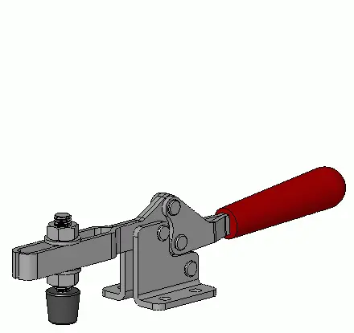

<figure class="eoc-pic eoc-pic-main"><picture><source media="(prefers-reduced-motion: reduce)" srcset="../media/toggle-clamp.still.webp"></picture><figcaption><strong>Animation.</strong> <a href="https://commons.wikimedia.org/wiki/File:Toggle-clamp_manual_horizontal_3D_animated.gif">Toggle-clamp manual horizontal 3D animated</a> by Silberwolf, <a href="https://creativecommons.org/licenses/by-sa/2.5">CC BY-SA 2.5</a>, from Wikimedia Commons.</figcaption></figure>

A lever-and-link clamp that swings its arm or plunger onto the work, multiplies the hand force as its links straighten, and locks just past the straight position (over centre) so it holds the part firmly without any hand pressure until you pull the handle back.

**In plain words:** A lever clamp you screw to a bench or jig: push the handle over and it snaps down to press a part firmly in place and stays locked; flick the handle back and it lets go. **Proper term:** Toggle clamp (toggle lever clamp, quick-action toggle clamp).

**Also called:** toggle lever clamp; quick-action toggle clamp; quick-release clamp (Halder's name for them); hold-down clamp / hold-down toggle clamp; vertical-handle and horizontal-handle hold-down clamps (vertical and horizontal toggle clamps); push-pull toggle clamp / straight-line action clamp / plunger clamp / push rod clamp; latch-action clamp / latch clamp / hook-type toggle clamp / U-bolt latch clamp; squeeze-action clamp / gripper clamp / toggle pliers; pneumatic (air-powered) toggle clamp; auto-adjusting (self-adjusting) hold-down clamp; DESTACO / De-Sta-Co clamp (brand); Kniehebelspanner (German).

## How it works

The handle, a short link, the clamping arm and the base form a four-bar [linkage](../glossary.md#linkage) (toggle action). Moving the handle first swings the arm quickly onto the work, then the linkage straightens and the force multiplies (DESTACO quotes 2:1 to 10:1 across its manual clamps). Just before the handle reaches its stop, the middle pivot crosses the line joining the other two (over centre), so the push of the work against the spindle now holds the handle shut instead of opening it, and the clamp stays locked with no hand force (Carr Lane; DESTACO). Pulling the handle back past centre releases it. Horizontal, vertical, push-pull, latch and squeeze styles all use this same linkage, arranged differently.

## Parts

A small assembly that acts as one unit: a base (flat or flanged, with mounting holes), a handle, one or two short links, a clamping arm (solid, or slotted so the spindle can move along it) or a sliding plunger, pivot pins or rivets, and a spindle (a threaded bolt with a rubber or hard tip, locked by nuts) that touches the work. Latch versions replace the arm and spindle with a U-bolt or hook and a separate latch plate.

## Everyday examples

- Woodworking jigs: router-table, tenoning and [taper](../glossary.md#taper) jigs where toggle clamps hold the workpiece down and keep fingers away from the blade (Rockler)
- Welding, drilling and assembly fixtures in factories (Carr Lane; DESTACO)
- Drill-press and T-slot table hold-downs (DrTomFlint's printed clamp was made for a small drill press)
- Latch-style versions on old-fashioned Kilner jars and swing-top bottles (Rowse)

## When to use it

Use a toggle clamp when you clamp the same kind of part again and again and want it fast, one-handed and repeatable: jigs for routing, sawing, drilling, gluing and welding, test and assembly fixtures, and holding panels or lids shut (latch style). Pick a horizontal-handle clamp where height above the work is limited, a vertical-handle clamp for more [holding force](../glossary.md#holding-force), a push-pull clamp to push a part sideways against a stop, a latch clamp to pull two parts together, and a squeeze clamp to grip parts between jaws (Rowse; Carr Lane).

## When not to use it

Avoid it when part thickness varies a lot from one clamping to the next, since each change needs the spindle readjusted: use a screw clamp, F-clamp or an auto-adjusting clamp instead. Avoid it when you need very high, finely set clamping force or heavy machining of steel; Carr Lane notes toggle clamps suit wood, plastics, carbon fibre and non-ferrous metals because their clamping force is limited, so use screw clamps, strap clamps or a vice. Don't use it where there is no room for the handle to swing, or where it can be bumped open without a locking handle. It is not a locating device: pair it with stops or pins.

## Details

- **What it does (jobs):**
  - join and hold: holds work down on a jig, fixture or bench for drilling, routing, sawing, gluing or welding
  - lock, and release by hand: locks with a push on the handle and releases with a pull, with no tools
  - tighten and hold tension: latch-action versions pull lids, covers and doors shut and keep them squeezed
- **Movement:** multiple: the handle and clamping arm rotate through a limited arc on pivot pins (hold-down, latch and squeeze styles), while push-pull styles slide a plunger in a straight line
- **Directions it can move (degrees of freedom):** 1 while moving: the handle angle sets the position of every part; effectively 0 once locked over centre, because the work can only push it harder against its stop
- **Special behaviour:**
  - [over-centre](../glossary.md#over-centre) (snaps past a point and stays): the linkage passes its straight-line point and locks against a fixed stop (M.J. Vail / DESTACO)
  - [self-locking](../glossary.md#self-locking) (holds under load, won't back-drive): force from the work goes along the aligned links into the base, so it cannot push the handle open (mechanical-engineering.com; Carr Lane)
  - hand-release only (locks under load, releases when a person operates it): only pulling the handle back past centre opens it
  - quick-release: clamps and unclamps with a single one-handed movement of the handle
  - motion conversion (force multiplication): a long, light handle movement becomes a short, strong clamping movement, 2:1 to 10:1 (DESTACO)
  - [fail-safe](../glossary.md#fail-safe--fail-secure) or breakaway: pneumatic toggle clamps stay mechanically locked even with total loss of air pressure (DESTACO)
- **How it holds:**
  - friction or clamping ([force-fit](../glossary.md#form-fit--force-fit--material-bond)): it holds the work by pressing it against the base or fixture
  - shape (form-fit): the lock inside the clamp is geometric, with the linkage resting past centre against a stop
- **Input and output:** Handle swing -> swing of the clamping arm (hold-down, squeeze and latch styles) or straight [stroke](../glossary.md#stroke) of the plunger (push-pull style). Force ratio ([mechanical advantage](../glossary.md#mechanical-advantage)) 2:1 to 10:1 across DESTACO's manual range; on one example arm, 10:1 at the clamping point nearest the base and 5.3:1 further out (DESTACO). Efficiency: not usually quoted. Back-drivable: no once locked over centre; the work cannot push it open.
- **Power:** passive (no power needed) for manual clamps. Powered versions: pneumatic (air-powered) toggle clamps for production work, and air-powered push clamps (McMaster-Carr). DESTACO states its pneumatic toggle clamps stay mechanically locked even with total loss of air pressure, so they keep their last state
- **Load:** Light to heavy depending on size and style. Typical maximum holding capacities: horizontal up to about 1,300 lbf (5.8 kN), vertical up to about 5,060 lbf (22.5 kN), push-pull 100-16,000 lbf (0.4-71 kN), latch up to 7,500 lbf (33 kN), squeeze 100-1,200 lbf (0.4-5.3 kN) (Rowse); Halder's range is 0.25-8 kN. Strongest in the clamping direction; holding capacity is rated with the spindle nearest the handle or base and falls as the spindle moves out along the arm (DESTACO; Carr Lane). Sideways ([shear](../glossary.md#peel-vs-shear)) loads on the spindle and arm are its weak direction, so let fixed stops take cutting and sliding forces ⚑ [uncertain]
- **Play and precision:** Small play; it closes to the same point every time, a 'more consistent clamping point' than a cam-action clamp (DESTACO). The rubber tip and slight flexing let it accept slightly different part thicknesses without readjustment (Carr Lane). It is not a locating device on its own: push the part against fixed stops or pins and let the clamp hold it there (Roche)
- **Taking it apart:** tool-free quick release for the work being clamped; the clamp itself is screwed or bolted to the jig or bench and is removable with tools
- **How often it can be reused:** effectively unlimited: clamping and unclamping is its normal use; the mounting can also be moved many times
- **Sealing:** none: it only presses parts; latch-action versions can hold a lid down on a gasket, and the gasket does the sealing
- **Adjustable:** Yes: the threaded spindle screws up and down (or in and out) to set the clamping height and force, and on open (slotted) arms it can be moved along the arm; latch types have threaded U-bolts or hooks; auto-adjusting models adapt to different thicknesses by themselves (McMaster-Carr); spring-action spindles allow more variation (Carr Lane)
- **Access needed:** one side only (blind) when screwed down from the top into a jig or bench; through-bolts (recommended by Roche for vibration) need both sides
- **Materials:** Mostly zinc-plated steel; also stainless steel (for corrosion, washdown and higher temperatures), aluminium and lightweight composite, with plastic or rubber handle grips and rubber-cushioned or bare hex-head spindles (DESTACO; Carr Lane; JW Winco; McMaster-Carr). Makers print them in PETG or PLA with steel bolts as pins, or build them from hardwood with aluminium-rod pivots (Woodsmith)
- **Heat, cold, water and wear:** Zinc-plated steel rusts outdoors or in washdown areas; stainless versions resist corrosion and suit elevated temperatures (JW Winco; Carr Lane). Rubber spindle tips wear and harden over time ⚑ [uncertain]. Printed clamps: PLA softens and deforms above about 60 °C and PETG is fine below about 80 °C (Prusa); plastic parts and pads [creep](../glossary.md#creep) under a clamp that stays closed for a long time, so the grip loosens. In high-vibration or high-cycle work, check that the handle cannot be bumped free (Roche) and consider positive-locking handles (Carr Lane).

## Making it

- **Ways to make or get it:**
  - off-the-shelf part: the usual choice; cheap and widely available
  - 3D print (FDM): several mostly or fully printed designs for light jigs and 3D-printer or drill-press hold-downs
  - woodwork: shop-made hardwood clamps with metal-rod pivots (Woodsmith)
  - CNC and sheet metal: commercial clamps are steel parts pinned or riveted together ⚑ [uncertain]
- **Printing it in one piece (print in place):** no: the printed designs found are printed as separate parts and assembled with bolts (DrTomFlint, PA1_MAKER, Tom), with printed pins and a few drops of glue (Cristian), or assembled with no fasteners or glue (Macshay)
- **Tools:** None to use. To fit and adjust: a drill, screws or through-bolts with washers and lock nuts (Roche), and a spanner for the spindle lock nuts; Popular Woodworking suggests swapping one hex nut for a wing nut so the spindle can be adjusted by hand
- **Difficulty:** easy to fit, moderate to make: commercial ones are cheap and just screw down; printed or wooden versions work for light jigs but need metal pins, strong prints and a correctly placed stop

### 3D printing tips

1) Pins: use steel bolts through the pivots (M3-M6 in the designs found, with lock nuts), not printed pins, for anything that takes real force; DrTomFlint's clamp uses two M3x20, two M3x40 and one M4x12 screw, Tom's PETG 'Kniehebelspanner' uses M5 bolts with lock nuts. Fully printed designs (Cristian's vertical-lever clamp, printed pins glued in; Macshay's no-fastener clamp) suit light duty. 2) Walls over [infill](../glossary.md#infill): PA1_MAKER recommends at least 5 walls (7 used) with 25% infill; DrTomFlint uses 3 [perimeters](../glossary.md#perimeters) for the base, link and handle and 5 perimeters for the arm to reduce flex; Tom printed 15 outer lines in PETG for [stiffness](../glossary.md#stiffness). 3) Orientation: lay parts out so the lever's shear forces run along the layers, and raise the nozzle temperature a little on the shaft parts for better layer bonding (PA1_MAKER). Print threaded parts with fine layers (0.15 mm, DrTomFlint) so the threads are clean. 4) Threads and nuts: use a real bolt as the spindle and embed a nut by pausing the print (Tom pauses to insert an M6 nut); threaded blocks and arms may need supports. 5) Pad: print the clamping pad in TPU so it grips and adds a little springiness, which the over-centre lock needs to hold a force (PA1_MAKER). 6) Set the stop and spindle so the pad touches the work slightly before the handle goes over centre; the handle should snap down with firm hand pressure (Roche). 7) Material: PETG or tougher for workshop use; PLA softens above about 60 °C (Prusa) and can creep under a constant clamping load (zx82net observed printed PLA latches loosening). 8) Mount it on a stiff base with all mounting holes used (DESTACO), or on a T-slot adapter (DrTomFlint's design fastens to aluminium T-slot extrusion).

### Buying one (off-the-shelf parts)

Hold-down toggle clamps (vertical-handle and horizontal-handle; low-profile, compact, heavy-duty and auto-adjusting versions), push-pull (straight-line) toggle clamps with plungers and optional locking handles, latch-style toggle clamps with a U-bolt or hook and a latch plate (including right-angle versions for lids), squeeze-action clamps (toggle pliers), pneumatic (air-powered) toggle clamps and power clamps, and clamp spindles (hex-head, rubber-cushioned or spring-action) with lock nuts (McMaster-Carr; Carr Lane; Halder; JW Winco).

## Rules of thumb

- Holding capacity is the maximum force the locked clamp can resist without permanent deformation; it is rated with the spindle as close as possible to the handle or base and gets smaller towards the end of the arm (Carr Lane; DESTACO).
- The clamping force you actually apply is normally less than the holding capacity (Carr Lane; DESTACO); roughly half the stated holding capacity can be applied by hand with medium effort (Carr Lane).
- Mechanical advantage of manual toggle clamps ranges from 2:1 to 10:1; to rate a different clamping point, work out the moment (force x distance) and divide by the new distance (DESTACO).
- Uncushioned hex-head spindles give the greatest clamping force; cushioned tips give less (Carr Lane).
- Set the spindle height so the handle snaps into the locked position with firm hand pressure; if you have to muscle it, back the spindle off (Roche).
- Bolt clamps to a rigid base so the force goes into the work, not into flexing the jig; use through-bolts with washers and lock nuts against vibration (Roche); use all the mounting holes provided (DESTACO).
- Typical maximum holding capacity by style: horizontal up to 1,300 lbf, vertical up to 5,060 lbf, push-pull 100-16,000 lbf, latch up to 7,500 lbf, squeeze 100-1,200 lbf (Rowse).
- Maximum clamping force occurs when the three pivot points are in a straight line; the right amount of over-centre travel is 'a carefully calculated and controlled dimension' (DESTACO, via M.J. Vail).

## Common failures

1) Spindle set too high or too low: too high and the handle won't go over centre (forcing it bends parts or wears the clamp); too low and the part is not held. Set it so the pad touches just before over centre (Roche). 2) Workpiece slips: the clamp pushes the part away from its stops; align the clamp so it pushes the part into its supports (Roche). 3) Mounting screws loosen or the jig flexes: use through-bolts, lock nuts and a stiff base (Roche). 4) Overloading: exceeding holding capacity, or clamping far out on the arm where capacity is lower, bends the arm or links (DESTACO; Carr Lane). 5) Worn pins and linkages reduce the lock; inspect, clean, lubricate and replace worn parts (Roche). 6) Printed clamps: layers split along the arm or pins shear; print with more walls and use steel bolts.

## Safety

Pinch points: keep fingers out of the linkage and from under the spindle while closing it (Roche, citing OSHA machine-guarding guidance on pinch points). DESTACO fits red handle grips and a patented safety feature to prevent accidental injury to the operator when opening the clamp, so treat opening as a hazard too. Do not exceed the stated holding capacity, which already includes a safety factor (DESTACO). Check that the clamp handle, arm and screws are clear of saw blades and cutters before starting a machine (Roche). Printed clamps can snap suddenly under the multiplied force.

## Related

- Over-centre linkage (toggle linkage): the general principle inside every toggle clamp
- Draw latch (over-centre latch): the same linkage made into a lid or door fastener; a latch-action toggle clamp is a heavy-duty draw latch
- Eccentric cam lever (cam clamp): clamps by flipping an off-centre cam; quicker to make, but its clamping point is less consistent than toggle action (DESTACO)
- Locking pliers: a hand-held squeeze-action toggle clamp with a screw to set the jaw opening
- Screw clamp (F-clamp, C-clamp): slower, but adapts to any thickness and gives more adjustable force
- Magnetic or vacuum hold-downs: hold flat parts without any arm over the top ⚑ [uncertain]

## Make it yourself

- [Toggle Clamp (DrTomFlint, Printables)](https://www.printables.com/model/828667-toggle-clamp): Printed hold-down toggle clamp for aluminium T-slot extrusion, made for a small drill press; adjustable screw section; OpenSCAD source included; needs M3 and M4 screws *(licence: CC BY)*
- [Vertical Lever - Toggle Clamp (Cristian, Printables)](https://www.printables.com/model/273002-vertical-lever-toggle-clamp): Fully printable vertical toggle clamp including printed pins and nuts; assembled with a few drops of glue *(licence: CC0 (public domain))*
- [Toggle Clamp (Kniehebelspanner) (Tom, Printables)](https://www.printables.com/model/1115293-toggle-clamp-kniehebelspanner): Sturdy PETG bench toggle clamp for a 20 mm bench hole; M5, M6 and M8 bolts, and an M6 nut inserted during a print pause *(licence: CC0 (public domain))*
- [TOGGLE CLAMP (PA1_MAKER, Printables)](https://www.printables.com/model/462782-toggle-clamp): Strong printed work-surface toggle clamp with a TPU pad and M5 bolts as pivots; parts pre-oriented for strength *(licence: CC BY-NC-ND)*
- [HUANGYAN920 Mechanical: interactive mechanism animations (entry 'TOGGLE-CLAMP', no. 36)](https://huangyan920.github.io/Mechanical/): Browser-based parametric animation of a toggle clamp whose handle drives the link past the dead point to self-lock; adjustable link length and pivot position *(licence: MIT)*
- [Build Your Own Toggle Clamp (Woodsmith)](https://www.woodsmith.com/article/build-your-own-toggle-clamp/): Woodworking project for a shop-made toggle clamp from hardwood parts with aluminium-rod pivots and an adjustable bolt 'finger' *(licence: link only)*

## Pictures, videos and models

- [Toggle-clamp manual horizontal 3D animated.gif (Wikimedia Commons, by Silberwolf)](https://commons.wikimedia.org/wiki/File:Toggle-clamp_manual_horizontal_3D_animated.gif): Animated 3D drawing of a manual horizontal toggle clamp opening and closing *(licence: CC BY-SA 2.5)*
- [Toggle-clamp manual vertical 3D animated.gif (Wikimedia Commons, by Silberwolf)](https://commons.wikimedia.org/wiki/File:Toggle-clamp_manual_vertical_3D_animated.gif): Animated 3D drawing of the principle of a manual vertical toggle clamp *(licence: CC BY-SA 2.5)*
- [Toggle-clamp manual push-pull 3D animated.gif (Wikimedia Commons, by Silberwolf)](https://commons.wikimedia.org/wiki/File:Toggle-clamp_manual_push-pull_3D_animated.gif): Animated 3D drawing of a manual push-pull toggle clamp moving between closed and open *(licence: CC BY-SA 2.5)*
- [Toggle clamp 2b (Nguyen Duc Thang, YouTube thang010146)](https://www.youtube.com/watch?v=lrL2_5tj1IE): CAD animation of a toggle clamp built as a four-bar linkage, with the connecting rod and lever coming into toggle *(licence: link only (standard YouTube licence))*
- [Toggle Clamps: Different Types and Where They Are Used (OneMonroe, YouTube)](https://www.youtube.com/watch?v=HmAuAiFl2hM): Video overview of the main toggle clamp types and their uses *(licence: link only (standard YouTube licence))*

## Needs confirming

⚑ marks something nobody has confirmed yet: a fact the research could not confirm from a source, a finder value that is a best guess, or an open point from the research notes. Corrections are welcome (see `research/needs-confirming.md`).

- ⚑ 4 sentences on this page marked [uncertain].
- ⚑ Finder value `motion_in` = back-and-forth turning (best guess): both sides turn, but no shaft layout named
- ⚑ Finder value `motion_out` = back-and-forth turning, straight push or pull (best guess): both sides turn, but no shaft layout named
- ⚑ Finder value `shaft_layout` = not applicable (best guess): both sides turn, but no shaft layout named

## Sources

- <https://www.carrlane.com/engineering-resources/technical-information/manual-workholding/how-do-toggle-clamps-work>
- <https://www.carrlane.com/engineering-resources/technical-information/manual-workholding/how-do-toggle-clamps-work/holding-capacity-clamping-force>
- <https://www.carrlane.com/engineering-resources/technical-information/manual-workholding/how-do-toggle-clamps-work/toggle-clamp-applications-guide>
- <https://www.destaco.com/resources/how-to-buy-guides/how-to-calculate-exerting-force-clamping-force--holding-capacity>
- <https://www.destaco.com/resources/blogs-and-insights/what-to-know-about-manual-quick-action-toggle-clamps>
- <https://www.destaco.com/resources/blogs-and-insights/how-to-select-the-right-destaco-manual-clamp>
- <https://www.destaco.com/clamping/Pneumatic/Pneumatic-Toggle-Clamp.html>
- <https://www.mjvail.com/destaco/intropage3.html>
- <https://www.jwwinco.com/en-us/products/2.4-Tensioning-with-clamping-mechanisms/Toggle-clamps>
- <https://www.halderusa.com/PM/Standard-Parts/Clamping-Elements/Toggle-Clamps>
- <https://www.mcmaster.com/products/toggle-clamps/>
- <https://www.rowse.co.uk/blog/post/how-to-choose-holding-toggle-clamps>
- <https://rochehardware.com/how-to-use-toggle-clamps/>
- <https://mechanical-engineering.com/toggle-clamps-mechanics/>
- <https://www.rockler.com/learn/five-uses-for-toggle-clamps>
- <https://www.popularwoodworking.com/tricks/fast-toggle-clamp-adjustment/>
- <https://www.woodsmith.com/article/build-your-own-toggle-clamp/>
- <https://en.wikipedia.org/wiki/Clamp_(tool)>
- <https://en.wikipedia.org/wiki/Locking_pliers>
- <https://commons.wikimedia.org/wiki/File:Toggle-clamp_manual_horizontal_3D_animated.gif>
- <https://commons.wikimedia.org/wiki/File:Toggle-clamp_manual_vertical_3D_animated.gif>
- <https://commons.wikimedia.org/wiki/File:Toggle-clamp_manual_push-pull_3D_animated.gif>
- <https://commons.wikimedia.org/wiki/File:Toggle-clamp_manual_push-pull_opened_3D.png>
- <https://commons.wikimedia.org/wiki/Category:Drawings_of_toggle_lever_clamps>
- <https://www.youtube.com/watch?v=lrL2_5tj1IE>
- <https://www.youtube.com/watch?v=HmAuAiFl2hM>
- <https://help.prusa3d.com/article/pla_2062>
- <https://help.prusa3d.com/article/petg_2059>
- <https://www.printables.com/model/828667-toggle-clamp>
- <https://www.printables.com/model/273002-vertical-lever-toggle-clamp>
- <https://www.printables.com/model/1115293-toggle-clamp-kniehebelspanner>
- <https://www.printables.com/model/462782-toggle-clamp>
- <https://www.printables.com/model/1483751-3d-printed-toggle-clamp/related>
- <https://www.printables.com/model/49414-zx82net-customizable-rugged-waterproof-box>
- <https://api.printables.com/graphql/>
- <https://huangyan920.github.io/Mechanical/>
