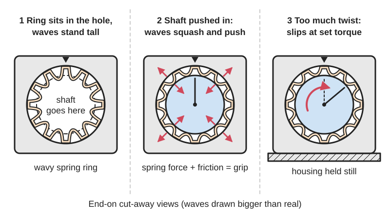
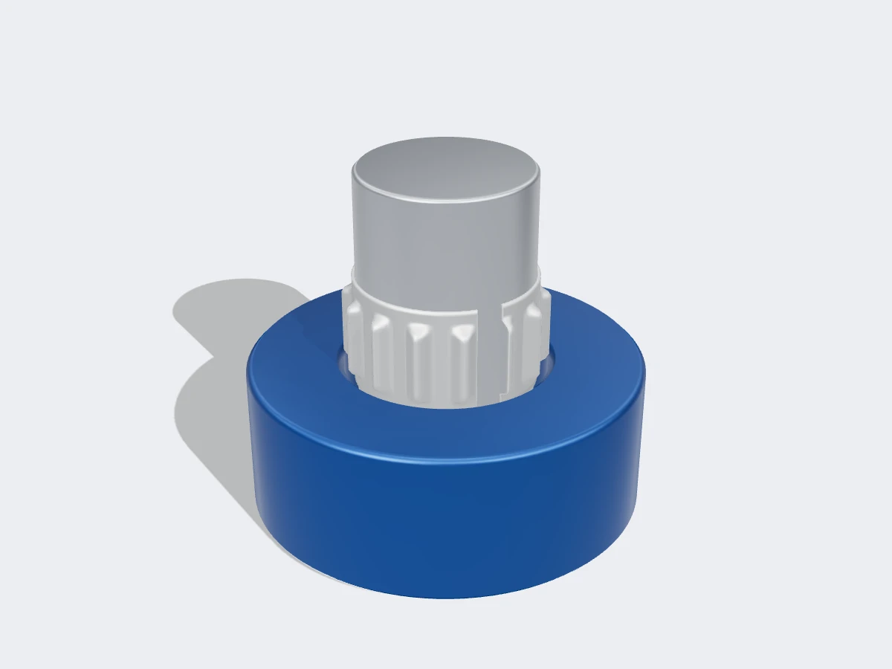

<figure class="eoc-pic eoc-pic-main"><figcaption>Diagram drawn for the encyclopaedia from the research notes. ⚑ Needs confirming: a drawing can simplify or get details wrong; a real photo or a better diagram is welcome.</figcaption></figure>
<figure class="eoc-pic"><figcaption><strong>Render.</strong> A 3D model made for the encyclopaedia, not a photo: a stand-in until a good real photo is found. ⚑ Needs confirming: a model can simplify or get details wrong; a real photo is welcome.</figcaption></figure>

A thin spring-steel strip with a row of waves, curled into a ring and pressed between a shaft and a bore, where every wave acts as a small stiff spring, so the joint holds by friction, copes with loose machining and different heat growth, centres the parts, and slips at a predictable [torque](../glossary.md#torque) instead of breaking.

**In plain words:** A thin, springy steel band with a row of bumps, squeezed into the gap between a shaft and the hole it sits in, which grips both by friction so you don't need a perfectly sized hole, keeps gripping as things heat up, and lets the shaft slip if it is twisted too hard. **Proper term:** [Tolerance](../glossary.md#tolerance) ring (corrugated spring-steel frictional fastener).

**Also called:** tolerance ring; corrugated ring, wavy band, wave ring ⚑ [uncertain] (note: 'wave ring' is also used for wave spring washers); bearing tolerance ring, bearing shim (McMaster-Carr wording); elastic shim; frictional fastener; AN / ANL ring or HV / HVL ring (waves facing inward, fitted into a housing bore: 'housing variable'); BN ring or SV ring (waves facing outward, fitted over a shaft: 'shaft variable'); tabbed, flanged, multiplex and crown rings (variants); Rencol ring (Saint-Gobain brand); Toleranzring (German).

## How it works

The gap between the shaft and the bore is made smaller than the height of the waves, so pushing the parts together squashes every wave a little; each wave then acts like a stiff spring pressing outwards on the bore and inwards on the shaft (USA Tolerance Rings; Wikipedia 'Tolerance ring'). The total spring force times the friction between the metal surfaces resists twisting and sliding, so the joint carries torque, end loads and side loads without keys, [set screws](../glossary.md#set-screw) or glue. Because the waves are springs rather than a solid [interference fit](../glossary.md#interference-fit), the grip changes only a little if the hole is slightly large or small or grows with heat, and the waves centre the shaft in the hole. If the twisting force exceeds the friction, the parts slip past each other inside the ring and grip again when the overload passes, so the same ring can be designed as a cheap slip clutch (torque limiter) or as a joint that slides along at a set force (Saint-Gobain RENCOL brochure; Machine Design).

## Parts

Single piece: one corrugated (wavy) strip of spring steel or stainless steel, cut to length and curled into an open ring. It works between two parts you already have: a shaft (or the outside of a bearing, gear hub or knob) and a bore (a housing, gear, pulley or hub), often with a shallow groove or shoulder to keep the ring in place

## Everyday examples

- Inside a computer hard disk drive, where a tolerance ring holds the pivot bearing of the arm that carries the read/write heads (USA Tolerance Rings catalogue; Wikipedia 'Tolerance ring')
- A car's steering-column lock, which lets the steering shaft slip inside the lock if someone forces the wheel, instead of breaking (Wikipedia 'Tolerance ring'; USA Tolerance Rings catalogue)
- The bevel gear inside an angle grinder and the blade drive of a hedge trimmer, which slip rather than break if the tool jams (Machine Design)
- A car's powered tailgate motor and a fold-down armrest pivot, where the ring slips if you push against the motor or holds the armrest in place with a set feel (Wikipedia 'Tolerance ring')

## When to use it

When you need to fix a bearing, gear, pulley, fan or knob to a shaft or into a housing without keys, set screws, [splines](../glossary.md#spline) or glue, and without machining to a very tight press-fit size. When the two parts are different materials that grow differently with heat (a steel bearing in an aluminium or plastic housing). When you want a compact, zero-backlash drive that slips at a set torque to protect a motor or gearbox from jams and shock loads, or a telescoping part that slides at a set force. To rescue a worn or oversize bore (open it up to fit a ring). When you may want to take the joint apart again later

## When not to use it

Not as a clutch that slips often or for long: continuous slipping wears the surfaces and changes the torque (use a friction slip clutch, a ball-detent torque limiter or a magnetic coupling). Not where the release torque must be exact (a ball-detent torque limiter is more precise). Not for very high torque on a small shaft where a key, spline or keyless locking bush would be stronger. Not in soft or thin-walled plastic parts that will [creep](../glossary.md#creep) and loosen (use a screw clamp hub, crush ribs designed for plastic, or glue). Not where you can't press the parts together squarely, or need a seal along the joint

## Details

- **What it does (jobs):**
  - join and hold: fixes bearings, gears, pulleys, fans and knobs onto shafts or into housings by friction
  - slip or let go when overloaded: slips at a set torque (or a set sliding force) to protect gears and motors, then keeps holding
  - line parts up exactly: the evenly compressed waves centre the shaft in the bore
- **Movement:** none: a fixed joint in normal use; when overloaded the parts rotate or slide relative to each other (rotate, or slide in collapsible steering columns)
- **Directions it can move (degrees of freedom):** 0 while holding; when the slip torque or slip force is exceeded, 1 (rotation, or sliding along the shaft) and up to 2 if both are exceeded
- **Special behaviour:**
  - torque-limiting (slips or clicks at a set force/torque): 'The application slips at a predetermined torque level controlled by the design characteristics of the Tolerance Ring', acting as 'an inexpensive slip clutch' (Saint-Gobain RENCOL brochure); used this way in angle-grinder gear mounts, hedge trimmers and car seat-height adjusters (Machine Design)
  - self-aligning or self-centring: the waves press evenly all round, keeping about 0.0008 in (0.02 mm) concentricity for parts up to 2 in (50 mm) diameter (USA Tolerance Rings FAQ) and accepting up to 1/2° of [misalignment](../glossary.md#misalignment) (USA Tolerance Rings catalogue; McMaster-Carr)
  - [fail-safe](../glossary.md#fail-safe--fail-secure) or breakaway: in a collapsible steering column the ring lets the shaft slide at a set force in a crash, and in a steering lock it lets the shaft turn inside the lock under heavy force instead of breaking it (Wikipedia 'Tolerance ring')
- **How it holds:**
  - friction or clamping ([force-fit](../glossary.md#form-fit--force-fit--material-bond)): the squashed waves press the parts together and friction carries the load
  - spring force (a spring or springy part presses it in place): each wave is a small [radial](../glossary.md#axial--radial) spring, which keeps the grip as sizes change with tolerance and temperature
- **Input and output:** Continuous rotation -> the same rotation, ratio 1:1, with zero [backlash](../glossary.md#backlash) while holding (Saint-Gobain RENCOL appliance brochure: 'Zero backlash system as parts are physically connected through tolerance ring'); when the slip torque is exceeded the output stops or slips while the input keeps turning. Close to 100% efficient while holding (no sliding) ⚑ [uncertain]. Shaft arrangement: in line (a hub, gear or bearing on a shaft). Back-drivable: yes
- **Power:** passive (no power needed)
- **Load:** Medium to heavy for its size: e.g. a V-belt pulley on a 30 mm shaft held by one ring transfers at least 88 N·m (about a 4.3 kW motor at 1,400 rpm with a safety factor of 3) (Bosch Rexroth tolerance ring catalogue); rings range from 'strong enough for off-road equipment' to 'delicate enough to hold miniature ball bearings' (USA Tolerance Rings FAQ). Carries twist (torque), end pull (axial) and side (radial) loads together, but the highest torque and the highest radial capacity cannot both be had at once: torque is highest at the tightest fit, while radial capacity falls at the tightest fit (USA Tolerance Rings catalogue). Weak against shocks in the 'free' arrangement; a shoulder close to the mating part protects the ring (USA Tolerance Rings catalogue)
- **Play and precision:** No backlash while holding (Saint-Gobain). Centres well: about 0.0008 in (0.02 mm) concentricity for parts up to 2 in diameter, depending on how accurately the shaft and bore themselves are made (USA Tolerance Rings FAQ). Tolerates up to 1/2° draft or misalignment (USA Tolerance Rings catalogue; McMaster-Carr) and much wider machining tolerances than a press fit. Under side load the shaft can move slightly on the springy waves unless a shoulder or stepped diameter limits it (centred arrangement); the free arrangement may sit slightly off-centre and loses about 20% of catalogue torque (Bosch Rexroth)
- **Taking it apart:** removable: unlike glue or a heavy press fit it can be pressed apart for rework or repair (USA Tolerance Rings FAQ: 'allowing for future disassembly of components'; Saint-Gobain: 'Allows rework'), but it needs a press or puller, and a ring flattened or scratched by a crooked fit should be replaced ⚑ [uncertain]
- **How often it can be reused:** a few times: the joint can be taken apart and re-assembled (Saint-Gobain appliance brochure: 'Allows easy and repeatable disassembly and re assembly'); each overload slip and each re-assembly can wear or damage the waves and surfaces, so performance may drop (USA Tolerance Rings catalogue); how many times is not stated ⚑ [uncertain]
- **Sealing:** none: the gaps between the waves leave open channels along the joint
- **Adjustable:** no: the slip torque is fixed by the ring design (material, thickness, wave [pitch](../glossary.md#pitch) and height) and by the chosen shaft and bore sizes. Rings can be stacked side by side, separated by flanges, for more capacity (Euro-Bearings; Bosch Rexroth)
- **Access needed:** end of a tube or shaft: the ring and the mating part slide on from the end of the shaft or into the open end of the bore
- **Materials:** Rings: hardened carbon spring steel (higher spring rate and load) or 301 stainless steel (better corrosion resistance and heat stability); 18-8 stainless for wet and outdoor use; Hastelloy C-276 and Monel K-500 for very hot or corrosive places (USA Tolerance Rings FAQ; McMaster-Carr; Euro-Bearings). Mating parts: steel or non-ferrous metal shafts and housings (catalogue ratings assume steel on steel or steel on many non-ferrous metals) (Bosch Rexroth); common in aluminium housings with steel bearings, silicon carbide sleeves and glass-filled plastic impellers (USA Tolerance Rings catalogue), and used to mount ball bearings in moulded plastic housings (Machine Design), though plastic housings bring creep and relaxation concerns (USA Tolerance Rings blog). Test any pairing that differs a lot from steel in strength (Bosch Rexroth)
- **Heat, cold, water and wear:** Heat: ratings differ between makers. Carbon-steel rings: about 120 °C continuous (Euro-Bearings), 250 °F / 121 °C (USA Tolerance Rings) or 200 °C continuous with brief peaks to 250 °C (Bosch Rexroth). Stainless (301) rings: 250 °C continuous, brief peaks to 300 °C (Bosch Rexroth; Euro-Bearings), or 450 °F / 232 °C (USA Tolerance Rings). Monel K-500 rings have been used to 600 °F (316 °C) and Hastelloy C-276 to 900 °F (482 °C) (USA Tolerance Rings FAQ). Catalogue torque values apply up to 100 °C (Bosch Rexroth). Corrosion: carbon steel rusts; stainless resists water and outdoor use (McMaster-Carr; USA Tolerance Rings FAQ). Vibration: rings can 'walk out' in high vibration, which tabbed rings prevent (Saint-Gobain RENCOL brochure); rings behave as springs and shift vibration frequencies rather than [damping](../glossary.md#damping) them, which can reduce or increase noise (USA Tolerance Rings FAQ), although Wikipedia and McMaster-Carr describe them as damping vibration. Creep: plastic housings creep and relax, lowering grip over time (USA Tolerance Rings blog)

## Making it

- **Ways to make or get it:**
  - off-the-shelf part: the ring itself (stamped and rolled spring or stainless steel strip)
  - CNC: lathe-turned or machined bores, shafts, grooves and lead-in [chamfers](../glossary.md#chamfer--fillet)
  - 3D print (FDM): a printed housing, hub or knob can take a steel ring, with care (plastic creeps)
  - woodwork, laser cut, sheet metal: not suitable (they can't hold a round bore to the needed size) ⚑ [uncertain]
- **Printing it in one piece (print in place):** no: the steel ring is a separate bought part pressed in after the housing or hub is made
- **Tools:** An arbor press (or a vice or bench press for small rings) and a fixture to push the parts together squarely; hammering or aligning by hand risks crushing waves on one side (USA Tolerance Rings catalogue). Very light rings can be pushed in by hand. A lathe, reamer or accurate drill to make the bore and shaft, with a rounded or chamfered lead-in
- **Difficulty:** moderate: you buy the ring (e.g. from McMaster-Carr or a tolerance ring maker) rather than make it, and you need a bore and shaft of the right size with a lead-in chamfer and a way to press the parts together squarely; the slip torque varies with surfaces and must be tested

### 3D printing tips

The ring can't usefully be printed (its waves must be hard spring steel), but a steel ring can be fitted into a printed housing or hub: tolerance rings are used to mount ball bearings in moulded plastic housings, where they cope with size variation and heat growth (Machine Design), and the classic use is saving a hole that came out oversize (USA Tolerance Rings catalogue). Expect lower and less lasting grip than in metal, because plastic housings 'introduce creep and relaxation concerns' (USA Tolerance Rings blog) and catalogue torque values only apply to steel-on-steel or non-ferrous pairs up to 100 °C (Bosch Rexroth). Keep printed parts well below PLA's softening point of about 60 °C (Prusa), or use PETG, ABS, ASA or nylon. Make the bore to the ring maker's table for that ring (bore = shaft diameter + twice the wave height, minus the compression) and print it undersize then drill or ream it, since printed holes come out small and faceted ⚑ [uncertain]. Print the bore with its axis vertical so it is round ⚑ [uncertain]. Add a generous radius or a shallow 15-20° chamfer on the entry edge (USA Tolerance Rings; Bosch Rexroth) and ideally a groove with square walls to trap the ring (the 'centred' arrangement), which also lets a shoulder take shock loads instead of the waves. Press the parts together squarely in a vice or press rather than hammering. For a printable, all-plastic alternative, use crush ribs or flexing fingers designed into the print (see Related)

### Buying one (off-the-shelf parts)

Tolerance ring (AN/HV type for a housing bore, BN/SV type for a shaft, ANL/HVL light-duty for small bearings), bearing tolerance ring or bearing shim (sold by bearing size, e.g. R2 to 6316; McMaster-Carr), tabbed tolerance ring (resists walking out under vibration), flanged tolerance ring, multiplex and crown rings (Saint-Gobain RENCOL brochure); Bosch Rexroth series R0810 (AN), R0820 (BN), R0801 (ANL), R0804 (slanted-edge, for large bearings in light-metal housings); ball bearings, pulleys, fan hubs and knobs designed for tolerance-ring mounting

## Rules of thumb

- Slip torque estimate: T = 0.5 x d x (friction coefficient) x (total wave spring force), where the total force = wave compression x single-wave [stiffness](../glossary.md#stiffness) x number of waves; single-wave stiffness k ≈ c x E x w x (t/p)^3 with c about 3-7; steel on steel friction about 0.15; waves stay elastic up to roughly 10-18% compression. Use only as an order-of-magnitude guide (USA Tolerance Rings, 'Tech Information on Tolerance Rings')
- Axial [holding force](../glossary.md#holding-force) ≈ 2 x catalogue torque / ring diameter, and assembly (pressing) force ≈ 7 x catalogue torque / ring diameter, as guide values (Bosch Rexroth tolerance ring catalogue R999000491, p. 13; the first matches USA Tolerance Rings' T = 0.5 x d x F)
- Safety factor on catalogue torque: 2.5-3 for fixing pulleys, 6 for reversing motion; allow 20% less torque in the 'free' arrangement (plain bore and shaft, no groove) than in the 'centred' (grooved) arrangement (Bosch Rexroth catalogue, pp. 10-13)
- Shaft tolerance up to ISO h9 and bore up to H9 (h11/H11 in exceptional cases), compared with a tolerance range of about 0.0005 in (0.013 mm) needed to mount a bearing without a ring; with a ring, a range of .002 in, and up to .006 in on large diameters, is acceptable (Bosch Rexroth, p. 12; USA Tolerance Rings catalogue)
- Round the entry edge of the part that slides over the waves with a generous radius or a shallow chamfer: 15° (USA Tolerance Rings) or 20° if the recommended radii can't be made (Bosch Rexroth); sharp edges dig into the ring
- Retaining groove: corner radius no more than 0.010 in for diameters under 2 in (0.020 in above), and groove width at least 3 x corner radius + ring width (USA Tolerance Rings catalogue)
- Tolerates up to 1/2° of misalignment (draft angle) (USA Tolerance Rings catalogue; McMaster-Carr)
- Heat: a 2 in ball bearing held in aluminium by a 0.0012 in interference fit needed 500 lb to press in and came loose at 170 °F; with a tolerance ring it needed 320 lb and still held 230 lb at 270 °F (USA Tolerance Rings catalogue). Similarly a 200 mm bearing's press-out force fell to zero at 80 °C without a ring but was still 2,000 N at 170 °C with one (Bosch Rexroth)
- As an overload slip clutch it suits slow rotation, short slips and a broad break-away torque range; it is not a precise, continuous-slipping clutch (USA Tolerance Rings catalogue: it 'may replace [shear](../glossary.md#peel-vs-shear) pins' in such cases)
- To carry more load, fit two or more rings side by side, separated by flanges or webs so they cannot slide over each other (Euro-Bearings; Bosch Rexroth)

## Common failures

Waves crushed on one side because the parts were pushed together at an angle or hammered, or cut by a sharp entry edge, which lowers the grip (USA Tolerance Rings catalogue). Slips in normal use because the fit was on the loose side of the tolerances, a shock or start-up load was higher than expected, or a plastic housing crept (USA Tolerance Rings catalogue and blog). Performance drops after repeated overload slips (USA Tolerance Rings catalogue: 'degradation of performance may result'). Ring walks out of a plain bore under vibration (use a groove or a tabbed ring) (Saint-Gobain). Torque changes with heat because the parts grow apart or together (USA Tolerance Rings blog). Excessive pressing force or a cracked [brittle](../glossary.md#brittle--ductile) part if the fit is too tight ⚑ [uncertain]. Avoid by designing for worst-case tolerances, using chamfers and grooves, pressing squarely and testing the slip torque

## Safety

Thin stamped steel rings can have sharp edges; handle with gloves. Press parts together with a proper press and fixture rather than hammering. As a torque limiter it lets the drive slip, so a motor may keep turning while the load stops, and a slipping joint should not be relied on to hold a raised load. Its torque can drift with wear, heat and plastic creep, so don't use it as the only safety device where slipping too late or too early could hurt someone ⚑ [uncertain]

## Related

- Press fit (interference fit): solid metal-to-metal grip that needs much tighter machining, can crack brittle parts and loosens when parts grow differently with heat
- Crush ribs and spring-fit features (compliant press fit): the printable plastic version of the same idea, with small ribs or flexing fingers moulded into the hole
- Friction slip clutch (slip coupling, slipper clutch): an adjustable spring-loaded friction clutch built for repeated slipping; bigger but made to slip
- Ball-detent torque limiter: releases at a more exact torque and resets itself, but costs more and takes more space
- Shear-pin coupling (breakaway link): breaks once at the limit and must be replaced; a tolerance ring slips and carries on
- Keyless locking bush (taper-lock bush, shaft locking device): clamps a hub on a shaft much harder with screws and tapered rings, and can be adjusted and released
- Shaft-to-hub joints and rigid couplings (key, set screw, D-flat, clamp hub): the usual ways to fix a hub; they need keyways or flats and can have backlash
- Friction hinge (torque hinge): uses a similar controlled friction to hold a lid or arm at any angle
- Magnetic coupling: slips without contact or wear, but carries far less torque for its size
- Torque-limiting gear with flexing spring arms (compliant slip hub): a one-piece printed plastic slip hub for light loads

## Make it yourself

- [Bearing Tolerance Rings (McMaster-Carr)](https://www.mcmaster.com/products/bearing-tolerance-rings/): Catalogue of stock 18-8 stainless bearing tolerance rings sized by bearing (R2 to 6316), so you can buy one and try it with a bearing in a printed or machined housing *(licence: link only (supplier page))*
- [Tolerance ring design formulas (USA Tolerance Rings)](https://usatolerancerings.com/resources/tolerance-rings-101/): Formulas to estimate single-wave stiffness, radial force, axial retention, slip torque and radial capacity of a ring before you buy or test one (order-of-magnitude guide only) *(licence: link only)*

## Pictures, videos and models

- [USA Tolerance Rings catalogue (Rev. 08-28-2013)](http://www.usatolerancerings.com/uploads/PDFs/USA%20Tolerance%20Rings_Catalogue_Rev.08-28-13_A.pdf): Drawings of AN, ANL and BN rings, the free, piloted and centred mounting arrangements, the hard-disk actuator-arm bearing mount, lead-in chamfer and groove details, a graph of torque and radial capacity against fit, and application photos *(licence: link only (manufacturer document))*
- [Tech Information on Tolerance Rings (USA Tolerance Rings)](https://usatolerancerings.com/resources/tolerance-rings-101/): Photos and labelled drawings of ring parts and wave nomenclature, cross-sections of rings between shaft and bore, and the spring-and-friction formulas for holding force and slip torque *(licence: link only)*
- [Tolerance Rings - Guide and Technical Information (Euro-Bearings Ltd)](https://www.euro-bearings.com/tol1.htm): Photos of AN (housing) and BN (shaft) tolerance rings with a plain-English FAQ on choosing, fitting and slipping *(licence: link only)*
- [Bosch Rexroth Tolerance rings catalogue R999000491 (2004)](https://automation-control.meggroup.com.au/wp-content/uploads/sites/4/2023/11/Bosch-Rexroth-Tolerance-Rings-catalogue.pdf): Drawings of ring series, free and centred arrangements, a V-belt pulley and tandem-mounted rings, required radii and chamfers, and a graph of bearing retention against temperature with and without a ring *(licence: link only (manufacturer document))*
- [An Introduction to Tolerance Rings Webinar (USA Tolerance Rings, YouTube)](https://www.youtube.com/watch?v=48arfVE4BzU): Manufacturer's introductory webinar on how tolerance rings work and where they are used (title and channel confirmed through YouTube oEmbed; not watched) *(licence: link only (YouTube, all rights reserved))*

## Needs confirming

⚑ marks something nobody has confirmed yet: a fact the research could not confirm from a source, a finder value that is a best guess, or an open point from the research notes. Corrections are welcome (see `research/needs-confirming.md`).

- ⚑ 9 sentences on this page marked [uncertain].

## Sources

- <https://en.wikipedia.org/wiki/Tolerance_ring>
- <http://www.usatolerancerings.com/uploads/PDFs/USA%20Tolerance%20Rings_Catalogue_Rev.08-28-13_A.pdf>
- <http://usatolerancerings.com/uploads/images/White%20Paper/US-Tolerance-Rings-FAQ-(MD)-1-25-18-v2.pdf>
- <https://usatolerancerings.com/resources/tolerance-rings-101/>
- <https://usatolerancerings.com/blog/how-to-specify-a-tolerance-ring/>
- <https://www.euro-bearings.com/tol1.htm>
- <https://automation-control.meggroup.com.au/wp-content/uploads/sites/4/2023/11/Bosch-Rexroth-Tolerance-Rings-catalogue.pdf>
- <https://techniekgids.nl/wp-content/uploads/doc-Saint-Gobain-rencol-tolerancerings-brochure.pdf>
- <https://theengineer.markallengroup.com/production/content/uploads/2012/03/Appliance-Rencol.pdf>
- <https://www.machinedesign.com/archive/article/21818364/tolerance-rings-do-double-duty-as-shims-or-slip-clutches>
- <https://www.mcmaster.com/products/bearing-tolerance-rings/>
- <https://help.prusa3d.com/article/pla_2062>
- <https://www.youtube.com/watch?v=48arfVE4BzU>
