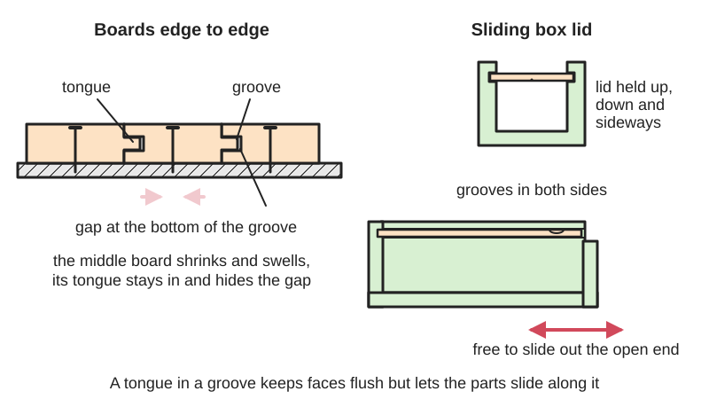
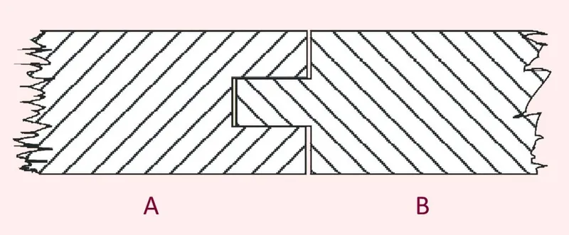
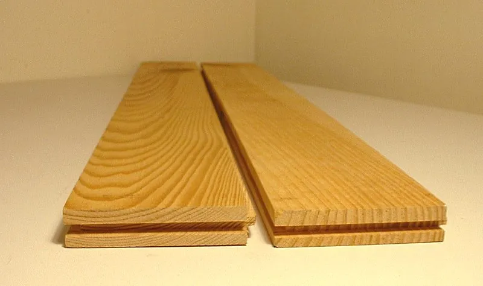

<figure class="eoc-pic eoc-pic-main"><picture><source media="(prefers-reduced-motion: reduce)" srcset="../media/drawn/tongue-and-groove-joint.svg"></picture><figcaption><strong>Animation.</strong> Diagram drawn for the encyclopaedia from the research notes. ⚑ Needs confirming: a drawing can simplify or get details wrong; a real photo or a better diagram is welcome.</figcaption></figure>
<figure class="eoc-pic"><figcaption><strong>Diagram.</strong> <a href="https://commons.wikimedia.org/wiki/File:Pi%C3%B3ro_i_wpust_(ubt).jpg">Pióro i wpust (ubt)</a> by tsca, <a href="http://creativecommons.org/publicdomain/zero/1.0/deed.en">CC0</a>, from Wikimedia Commons.</figcaption></figure>
<figure class="eoc-pic"><figcaption><strong>Photo.</strong> <a href="https://commons.wikimedia.org/wiki/File:Dusheme.jpg">Dusheme</a> by unknown, <a href="http://creativecommons.org/licenses/by-sa/3.0/">CC BY-SA 3.0</a>, from Wikimedia Commons.</figcaption></figure>

A tongue on one edge fits a groove in the other, joining boards edge to edge into one flat surface that stays flush, or, with a groove on each side of a box, holding a lid that slides in and out.

**In plain words:** A thin ridge along the edge of one board that slots into a matching channel along the edge of the next, so boards lock flush side by side; the same channel idea lets a flat lid slide in and out of a box. **Proper term:** Tongue-and-groove joint (including grooves for sliding lids and captured panels).

**Also called:** tongue and groove, T&G, tongued and grooved boards (Wikipedia 'Tongue and groove'; DT Online 'Widening Joint'); matched boarding, matchboard, V-groove (chamfered) or beaded tongue and groove (DT Online; Woodcraft; Wikipedia); slip tongue, loose tongue, tongue in groove, [spline](../glossary.md#spline), key (a separate strip in two grooves; Wikipedia; DT Online); end-matched boards (tongued and grooved on the ends as well; Wikipedia); click flooring, locking tongue and groove (Wikipedia 'Wood flooring'); groove, plough (plow) groove, through groove, stopped groove; a dado is the same cut across the grain (Wikipedia 'Groove (joinery)'); sliding lid, slide-top box, sliding-lid box (Fine Woodworking; Boxes.py 'SlidingLidBox'); floating panel in a groove (frame and panel, rail and stile) (Wikipedia 'Frame and panel'); Nut und Feder (German), pióro i wpust (Polish) (Wikimedia Commons file names).

## How it works

The tongue fits snugly in the groove, so neighbouring boards can't move up or down relative to each other and their faces stay flush, but they can still slide along the joint (Wikipedia 'Tongue and groove'; Popular Woodworking). The tongue is made a little shorter than the groove is deep, so the board shoulders close tight while leaving room for glue or wood movement (Wikipedia; Woodworker's Journal). Boards are usually not glued: they are nailed or fixed down, and each board can shrink and swell a little without splitting, with the tongue hiding the gap (Wikipedia). A sliding lid is the same idea turned around: the lid's thin edges act as tongues running in grooves cut along the inside of the box sides, so the lid is held in every direction except along the grooves, and slides out of the open end (Fine Woodworking; Boxes.py).

## Parts

Single feature on each part, or a few parts: one board with a groove along one edge (or two adjacent edges) and a tongue on the opposite edge, repeated board after board; or two grooved edges with a separate loose tongue (spline) between them; or a box whose sides are grooved to hold a sliding lid and a captured bottom (Wikipedia 'Tongue and groove'; Fine Woodworking 'Make a Sleek Box with a Sliding Lid').

## Everyday examples

- Wooden floorboards and parquet blocks, which lock together edge to edge (Wikipedia 'Tongue and groove', 'Wood flooring')
- Tongue-and-groove wall panelling, V-groove wainscot and the back panels of bookcases (Woodworker's Journal; DT Online 'Matched Boarding')
- A wooden pencil box with a sliding top (Fine Woodworking: the author's childhood pencil box inspired his design)
- Printed or wooden boxes for board-game pieces with a slide-out lid (Printables 'Parametric Sliding Lid Box')

## When to use it

Use tongue and groove to join many boards edge to edge into a flat surface that must stay flush but still move with the seasons: floors, wall and ceiling panelling, cladding, cabinet backs and web frames (Wikipedia; Woodcraft). Use it in edge glue-ups when you want the boards to line up by themselves as you clamp (Popular Woodworking; USDA). Use a groove to capture a floating panel or a drawer or box bottom (Wikipedia 'Frame and panel', 'Groove (joinery)'). Use grooves and a sliding lid for simple boxes that open without hinges or latches, such as pencil boxes and game-piece boxes, in wood, 3D prints or laser-cut sheet (Fine Woodworking; Printables; Boxes.py). Use a loose tongue (spline) when both edges are grooved, e.g. in plywood (Wikipedia; DT Online).

## When not to use it

Don't add a tongue and groove for strength in an edge glue-up; a well-glued plain edge is as strong (USDA Wood Handbook ch. 10), so use dowels or biscuits only if you need alignment. Don't use it for end-grain or corner joints that carry load; use a mortise and tenon, finger or dovetail joint (The Wood Whisperer calls tongue and groove the mortise and tenon's 'little brother'). Avoid gluing wide solid-wood tongue-and-groove panels into frames or across their width; let them float (Wikipedia). For exterior cladding of sheds, shiplap is commonly used instead (DT Online). For a lid that must seal out water or dust, use a gasketed or snap-fit lid; for a lid opened often with one hand, a hinge is easier ⚑ [uncertain].

## Details

- **What it does (jobs):**
  - join and hold: joins boards edge to edge into floors, walls, ceilings, cabinet backs and wider panels (Wikipedia 'Tongue and groove'; Woodcraft)
  - line parts up exactly: keeps the faces of boards flush during glue-ups and installation (USDA Wood Handbook ch. 10; Popular Woodworking)
  - let it move (turn, slide or bend): a sliding lid slides along its grooves; a panel captured in a groove floats so it can shrink and swell (Fine Woodworking; Wikipedia 'Frame and panel')
- **Movement:** slide: a sliding lid moves along its grooves over the length of the box; none once boards are glued, nailed or fixed down
- **Directions it can move (degrees of freedom):** 1 before fixing: the parts can only slide along the joint (and pull apart sideways in the board's plane until pushed home); a sliding lid keeps this 1 degree of freedom in use. 0 once glued or nailed.
- **Special behaviour:**
  - self-aligning or self-centring: the tongue registers the faces flush, so boards 'can't [creep](../glossary.md#creep) out of alignment' as clamps are tightened (Popular Woodworking); the USDA notes shaped edge joints let parts be 'quickly aligned in clamps or presses' (USDA Wood Handbook ch. 10)
- **How it holds:**
  - shape (the parts interlock; [form-fit](../glossary.md#form-fit--force-fit--material-bond)): the tongue in the groove stops the boards moving out of line, and a sliding lid is held in its grooves by shape alone (Wikipedia; Fine Woodworking)
  - material bond (glue, solvent or melting): when edge-glued into a panel, or when floating floors are glued tongue to groove with PVA (Wikipedia 'Wood flooring')
  - friction or clamping (force-fit): nails or screws into the framing below hold floorboards and cladding, and a snug tongue fit adds friction (Wikipedia 'Wood flooring'; Popular Woodworking)
- **Input and output:** not applicable
- **Power:** passive (no power needed)
- **Load:** Light to medium. The tongue mainly aligns; a glued tongue-and-groove edge joint is no stronger than a plain glued edge joint, which can already be almost as strong as the wood itself (USDA Wood Handbook ch. 10). Strong against boards moving up and down relative to each other ([shear](../glossary.md#peel-vs-shear) across the faces); weak in pulling apart sideways unless glued or nailed; the thin tongue can snap at its shoulder if it is long or loaded, and a tight tongue can split the groove walls (Popular Woodworking). Several tongue-and-groove joints can be stacked one above another in thick material (Wikipedia). A sliding lid carries only light loads.
- **Play and precision:** small: aim for a 'firm press fit' that does not rattle (Popular Woodworking) or parts that 'slide together with a bit of friction' without force (Woodworker's Journal). Shaped edges can't be machined perfectly, so part of the glue area may not touch (USDA Wood Handbook ch. 10). A V-groove (chamfered) edge hides any slight [misalignment](../glossary.md#misalignment) of the faces (Woodcraft). A sliding lid needs deliberate [clearance](../glossary.md#clearance) to slide: Boxes.py makes the lid gap 10% of the material thickness larger and the lid slightly narrower (Boxes.py 'SlidingLidBox').
- **Taking it apart:** tool-free quick release for a sliding lid, which just slides out; removable for 'click' floors, where no adhesive makes board replacement easier (Wikipedia 'Wood flooring'); semi-permanent for nailed boards ⚑ [uncertain]; permanent when glued
- **How often it can be reused:** effectively unlimited for a sliding lid, until the grooves wear or the wood warps ⚑ [uncertain]; many times for unglued click or floating floors ⚑ [uncertain]; once for glued joints
- **Sealing:** loose: the tongue closes and hides the gap between boards as they shrink (Wikipedia), which is why tongue-and-groove boards were used for sheathing and concrete formwork, but the joint is not watertight or airtight ⚑ [uncertain]; a sliding lid is not sealed
- **Adjustable:** no, but a sliding lid's fit can be eased by planing or sanding its edges (Blue Spruce Toolworks), and panels left floating in grooves adjust themselves to seasonal movement (Wikipedia 'Frame and panel')
- **Access needed:** not applicable: the boards are pushed together edge to edge from the side, and a sliding lid goes in from one open end of the box; nothing is reached from behind
- **Materials:** Mostly wood: solid softwood and hardwood boards (floorboards, parquet, panelling, cladding), plywood (subfloor sheets are often supplied tongued and grooved), and MDF (Wikipedia 'Tongue and groove', 'Wood flooring'). Plywood flooring may use separate plastic tongues (Wikipedia). Quarter-sawn or rift-sawn wood is preferred for floorboards because it wears better (DT Online) and for sliding lids because it stays flat (Fine Woodworking). Loose tongues are plywood or solid wood with the grain running diagonally or across the tongue (DT Online). 3D-printed boxes and lids in PLA or PETG (Printables), and laser-cut plywood or acrylic sliding-lid boxes, which use glued-on rails instead of routed grooves (Boxes.py).
- **Heat, cold, water and wear:** Wood swells and shrinks across the grain with humidity (tangential [shrinkage](../glossary.md#warping--shrinkage) is about twice [radial](../glossary.md#axial--radial); USDA Wood Handbook ch. 4), so glued solid boards can split or pull their tongues off (Wikipedia), and a sliding lid made too snug can bind in damp weather; leave clearance and use quarter-sawn wood for lids (Fine Woodworking). Floating floors need an expansion gap at the room edges (Wikipedia 'Wood flooring'). A 3D-printed PLA box softens at about 60 °C and PETG at about 80 °C (CNC Kitchen).

## Making it

- **Ways to make or get it:**
  - woodwork: router table, table saw with dado cutter, hand planes or spindle moulder (Wikipedia; Woodcraft; Popular Woodworking)
  - CNC: a CNC router can cut grooves and tongues with slot-cutting or T&G bits, as a router table does ⚑ [uncertain]
  - 3D print (FDM): sliding-lid boxes are among the most common printable containers, including support-free and dovetailed-lid designs (Printables)
  - 3D print (resin): possible, with the finer resin clearances (about 0.2 mm; Hubs), untested here for sliding lids ⚑ [uncertain]
  - laser cut: Boxes.py's SlidingLidBox makes a finger-jointed box where the lid runs between glued-in upper and lower rails (Boxes.py)
  - off-the-shelf part: ready-made tongue-and-groove flooring, panelling, cladding and T&G plywood sheets (Wikipedia; DT Online)
- **Printing it in one piece (print in place):** no: the box and lid (or the two tongue-and-groove parts) are printed separately and slid together; e.g. one printable dovetailed sliding-lid box is printed with the box upright and the lid upside down (Printables 'Fully Parametric Dovetail Sliding Lid Box')
- **Tools:** Router table with a matched pair of tongue-and-groove bits, a reconfigurable single bit, a slot cutter, or a straight bit plus a rabbeting bit; featherboard and push sticks (Woodcraft; Woodworker's Journal); or a table saw with a dado cutter (Popular Woodworking); or hand planes: a plough plane for the groove and a tongue plane, a pair of match planes or a combination plane (Wikipedia 'Tongue and groove'; DT Online); or a spindle moulder (shaper) (Wikipedia). For sliding lids: a router table with a small straight bit (1/8 in. in Fine Woodworking's box) or a table saw to cut the grooves, and a hand plane to fit the lid (Fine Woodworking; Blue Spruce Toolworks). Glue and clamps for glued panels; nails for floors, possibly with a flooring nailer ⚑ [uncertain].
- **Difficulty:** moderate for wood: easy with a matched router-bit set in a router table, but needs a careful setup, a centred groove and consistent stock thickness (Woodcraft; Popular Woodworking); easy for 3D-printed sliding-lid boxes from a parametric model (Printables)

### 3D printing tips

1) Avoid supports in the lid grooves: a groove cut sideways into an upright wall has a flat overhanging roof. Prusa says [overhangs](../glossary.md#overhang--bridging) of 45-60 degrees print cleanly and short bridges print without support (Prusa knowledge base), so give the groove a 45-degree sloping top, or shape the lid edge and groove as a dovetail; several printable boxes are sold as support-free for this reason (Printables 'Sliding Lid Box, Customizable and Support-Free'; 'Fully Parametric Dovetail Sliding Lid Box', printed box upright and lid upside down with no supports or brim). 2) Clearance: one maker found a 0.1 mm clearance on a Snapmaker 2.0 kept the lid 'tight enough to not fall out but easy to pull out' (Printables 'Parametric Sliding Lid Box' by KarnEdge); Prusa suggests at least 0.3 mm for moving parts and says its printers are accurate to about 0.2 mm; Hubs suggests 0.5 mm for FDM interlocking parts. Printers differ, so print a short test section of groove and lid first. 3) [Elephant's foot](../glossary.md#elephants-foot): a lid printed flat can have a slightly flared first layer that jams in the groove; PrusaSlicer's 'Elephant foot compensation' can improve this (Prusa knowledge base), or [chamfer](../glossary.md#chamfer--fillet) the lid's bottom edges. 4) Chamfer the leading edges of tongues and lids so they start into the groove easily (Prusa: a chamfer on the edges of parts that slot together 'can save you a lot of effort'; Hubs: a small radius eases assembly and reduces [stress concentration](../glossary.md#stress-concentration)). 5) Tongue-and-groove joints between printed panels: keep the tongue's root from being a single layer line, because layers bond at only about 55% (PLA) or 46% (PETG) of flat strength (CNC Kitchen); a tongue about one-third of the wall thickness follows the woodworking rule (Popular Woodworking), though whether it suits plastic is ⚑ [uncertain]. 6) Large flat lids can warp; the wood-box advice to keep the lid flat so it never binds applies equally to prints (Fine Woodworking), though this is untested for plastic ⚑ [uncertain]. 7) PLA softens at about 60 °C, so a PLA box left in a hot car may distort and jam (CNC Kitchen).

### Buying one (off-the-shelf parts)

Tongue-and-groove router bits: matched 2-bit sets, reversible single bits, 'convertible' bits with adjustable cutter spacing, and V-groove (bevelled) sets (Woodcraft); slot-cutter bits with interchangeable bearings (Woodworker's Journal); dado cutter sets for the table saw (Popular Woodworking); ready-made tongue-and-groove floorboards (solid floors are mostly 0.75 in. thick), engineered and 'click' floors, T&G plywood subfloor sheets, matchboard panelling and shiplap cladding (Wikipedia 'Wood flooring', 'Tongue and groove'; DT Online); plastic loose tongues for grooved plywood flooring (Wikipedia); Spaceballs (brand) small rubber balls, or cork, that centre a floating panel in its groove (Wikipedia 'Frame and panel'); plough, tongue and match planes (Wikipedia; Wikimedia Commons 'Tongue and Groove Wood Plane').

## Rules of thumb

- Proportions: a square tongue about one-third of the stock thickness, centred on the edge; for 3/4 in. stock, a 1/4 in. thick by 1/4 in. long tongue. A longer (e.g. 1/2 in.) tongue is prone to break at the shoulder, and a deep groove's walls may crack (Bill Hylton, Popular Woodworking). Woodcraft and DT Online also give one-third.
- Depth by purpose: 1/4-3/8 in. groove depth for joints assembled without glue; a 1/8 in. groove is enough for a glued joint, and a 1/8 in. tongue is enough just to register faces in a panel glue-up (Popular Woodworking). The USDA agrees a shallow tongue and groove aligns as well as a deep one and wastes less wood (USDA Wood Handbook ch. 10).
- Make the groove about 1/32 in. deeper than the tongue is long, so glue has room and the shoulders close (Woodworker's Journal); Wikipedia: the tongue 'projects a little less than the depth of the groove'.
- Fit: a firm press fit; if you have to knock the pieces together and struggle to pull them apart it is too tight, and a tongue 'a hair too fat' can split the groove walls over time; it should not rattle either (Popular Woodworking).
- Cut the groove first and fit the tongue to it; centre the groove by making two passes, flipping the board end for end (Woodworker's Journal; Popular Woodworking). Make all cuts with the show face against the router table for consistency (Woodcraft).
- Strength: a glued tongue-and-groove edge is no stronger than a plain glued edge, because the shaped faces can't be machined precisely enough; its value is fast alignment (USDA Wood Handbook ch. 10).
- Don't glue solid-wood tongue-and-groove boards or panels across their width: shrinkage would pull the tongue off (Wikipedia 'Tongue and groove'). Let panels float, cut about 1/4 in. short of the bottom of the groove; a wide solid panel can change width by as much as half an inch (Wikipedia 'Frame and panel').
- Wood movement: wood shrinks most along the growth rings (tangentially), about half as much across them (radially) and only 0.1-0.2% along the grain (USDA Wood Handbook ch. 4), so boards and lids change width, not length.
- Sliding lid in sheet material (Boxes.py defaults): lid gap = (1 + 0.1) x material thickness; lid made narrower by 0.05 x thickness on each side 'to prevent the lid from jamming'; rails 1.5 x thickness wide (wider rails are more stable but make the opening smaller) (Boxes.py 'SlidingLidBox').
- Sliding lid in wood: use quarter-sawn or rift-sawn stock and mill it to thickness in stages ('double and even triple-milling') so the lid stays flat and slides without binding (Michael Cullen, Fine Woodworking #255).
- Loose tongues: grooves about one-third of the thickness (e.g. the nearest standard plywood thickness); if the tongue is solid wood, run its grain diagonally or across its width for strength (DT Online 'Widening Joint').
- Stopped grooves (grooves that stop short of the ends) should be cut with a router or spindle moulder, not a table saw (DT Online, citing HSE WIS16).

## Common failures

Tongue breaking off at its shoulder when it is too long or thin (Popular Woodworking). Groove walls cracking because the groove is too deep or the tongue too fat (Popular Woodworking). Joint not closing because the tongue bottoms out; make the groove 1/32 in. deeper (Woodworker's Journal). Faces not flush because the groove is off-centre (fix with two flipped passes; Woodworker's Journal) or because stock thickness varies between separate router cuts (Woodcraft recommends single-pass matched bits). Glued solid boards shrinking and pulling the tongue off, or a glued-in panel cracking or distorting the frame (Wikipedia 'Tongue and groove', 'Frame and panel'). Sliding lids binding after the lid twists or cups, or when the fit is too tight; use flat quarter-sawn stock and plane the edges to fit (Fine Woodworking; Blue Spruce Toolworks). In 3D prints: supports stuck in grooves, flared first layers jamming the lid, or lids too loose; design support-free grooves and print a fit test (Prusa; Printables).

## Safety

Tongue-and-groove router bits are large and heavy: use a powerful, variable-speed router in a router table with a split fence, a featherboard, push sticks or a push block, and dust collection, because they throw a lot of chips (Woodcraft). Table-saw grooving with a dado cutter carries kickback and blade-contact risk: use guards and push sticks (OSHA table saw eTool), and don't cut stopped grooves on a table saw (DT Online, citing HSE WIS16). Small box parts need extra care near cutters (Fine Woodworking). Otherwise none known.

## Related

- Sliding dovetail: a groove with angled sides that also stops the parts pulling apart
- Dovetail slide with gib strip: the machine-tool version of a sliding tongue in a groove, with adjustment for wear
- Dowel and biscuit joints: short pins or wafers that align edges; a loose tongue is like a continuous biscuit
- Butt and lap wood joints: the plain edge joint that tongue and groove improves on; shiplap is a lapped cladding cousin
- Mortise and tenon: a much deeper, stronger tongue for rails meeting posts (The Wood Whisperer)
- Finger joint (box joint): how the corners of sliding-lid boxes are often joined (Boxes.py; Popular Woodworking's Japanese sliding-lid box)
- Snap-lock sheet joint and [cantilever](../glossary.md#cantilever) snap fit: locking versions, like 'click' floors whose tongues snap into modified grooves (Wikipedia 'Wood flooring')
- Oldham coupling: uses tongue-and-groove slots at right angles to join slightly misaligned shafts
- Drawer slide (telescopic ball-bearing slide): the hardware alternative for sliding parts

## Make it yourself

- [Boxes.py SlidingLidBox generator (online)](https://boxes.hackerspace-bamberg.de/SlidingLidBox?language=en): Free web generator for a laser-cut finger-jointed box with rails that hold a sliding lid; set inside sizes, material thickness, burn (kerf) correction, rail width, lid margins and an optional grip hole, then download SVG, DXF, PDF and other formats *(licence: GPL v3+ (Boxes.py is free software))*
- [Parametric Sliding Lid Box by KarnEdge (Printables) (URL from Printables API, page not opened)](https://www.printables.com/model/263548-parametric-sliding-lid-box): A simple printable sliding-lid box with a Fusion 360 file whose height, width, length, wall thickness and clearance can be changed; 0.1 mm clearance worked on the author's printer. Read through the Printables public API. *(licence: CC BY)*
- [Sliding Lid Box, Customizable and Support-Free by pvillano (Printables) (URL from Printables API, page not opened)](https://www.printables.com/model/179677-sliding-lid-box-customizable-and-support-free): An OpenSCAD-customisable sliding-lid box (inside width, height, depth, thickness) designed to print without supports. Read through the Printables public API. *(licence: CC BY)*
- [Parametric sliding lid box by Billiam (Printables) (URL from Printables API, page not opened)](https://www.printables.com/model/425966-parametric-sliding-lid-box): A sliding-lid box with a downloadable in-browser configurator (sizes, wall thickness, corner radius, lid text) that exports STL or STEP; prints at 0.3 mm layers with no supports. Read through the Printables public API. *(licence: CC BY-NC-SA)*
- [Fully Parametric Dovetail Sliding Lid Box by Cybxr (Printables) (URL from Printables API, page not opened)](https://www.printables.com/model/1312583-fully-parametric-dovetail-sliding-lid-box): A Fusion 360 parametric box whose lid slides in dovetail-shaped grooves, with an adjustable dovetail clearance; printed box upright and lid upside down, no supports. Read through the Printables public API. *(licence: CC BY-NC-SA)*

## Pictures, videos and models

- [Pióro i wpust (ubt).jpg (Wikimedia Commons, by tsca)](https://commons.wikimedia.org/wiki/File:Pi%C3%B3ro_i_wpust_(ubt).jpg): A tongue-and-groove joint with the tongue (B) and groove (A) labelled *(licence: CC0)*
- [Nut-Feder.jpg (Wikimedia Commons, by S.Wetzel)](https://commons.wikimedia.org/wiki/File:Nut-Feder.jpg): A tongue-and-groove (Nut-Feder) connection from woodworking *(licence: CC BY-SA 4.0)*
- [Dusheme.jpg (Wikimedia Commons)](https://commons.wikimedia.org/wiki/File:Dusheme.jpg): Solid parquet boards with tongues on one side and grooves on the other, and end-matched tongues and grooves on the ends (used on Wikipedia 'Tongue and groove') *(licence: CC BY-SA 3.0)*
- [Master Tongue & Groove Joints — Traditional to Modern Methods (YouTube, WOOD magazine)](https://www.youtube.com/watch?v=7NulJL7R4Ok): Video of cutting tongue-and-groove joints by several methods (title checked via YouTube oEmbed) *(licence: link only (standard YouTube licence))*
- [The Woodwright's Shop, Sliding Lid Boxes (PBS, Season 36, Episode 2)](https://www.pbs.org/video/woodwrights-shop-sliding-lid-boxes/): Roy Underhill showing how to make easy wooden gift boxes with sliding lids *(licence: link only)*

## Needs confirming

⚑ marks something nobody has confirmed yet: a fact the research could not confirm from a source, a finder value that is a best guess, or an open point from the research notes. Corrections are welcome (see `research/needs-confirming.md`).

- ⚑ 10 sentences on this page marked [uncertain].
- ⚑ Finder value `reuse_cycles` = effectively unlimited (source uncertain): `reuse_cycles` is marked ⚑ [uncertain] here: "…unlimited for a sliding lid, until the grooves wear or the wood warps ⚑ [uncertain];…"
- ⚑ Finder value `tools` = press or vice, power tools, hand tools (source uncertain): `tools_needed` is marked ⚑ [uncertain] here: "…s for glued panels; nails for floors, possibly with a flooring nailer ⚑ [uncertain].…"

## Sources

- <https://en.wikipedia.org/wiki/Tongue_and_groove>
- <https://en.wikipedia.org/wiki/Frame_and_panel>
- <https://en.wikipedia.org/wiki/Groove_(joinery)>
- <https://en.wikipedia.org/wiki/Wood_flooring>
- <https://commons.wikimedia.org/wiki/File:Pi%C3%B3ro_i_wpust_(ubt).jpg>
- <https://commons.wikimedia.org/wiki/File:Nut-Feder.jpg>
- <https://commons.wikimedia.org/wiki/File:Dusheme.jpg>
- <https://commons.wikimedia.org/wiki/File:Veer_en_groef.jpg>
- <https://commons.wikimedia.org/wiki/File:Woodworking-joint-groove.gif>
- <https://commons.wikimedia.org/wiki/File:Tongue_and_Groove_Wood_Plane.jpg>
- <https://www.fpl.fs.usda.gov/documnts/fplgtr/fplgtr190/chapter_10.pdf>
- <https://www.fpl.fs.usda.gov/documnts/fplgtr/fplgtr190/chapter_04.pdf>
- <https://www.popularwoodworking.com/techniques/tongue-groove-joinery/>
- <https://www.woodworkersjournal.com/three-tongue-groove-routing-options/>
- <https://www.woodcraft.com/blogs/cabinetry-furniture-making/tongue-and-groove>
- <https://wiki.dtonline.org/index.php/Widening_Joint>
- <https://thewoodwhisperer.com/articles/are-biscuits-strong-enough/>
- <https://www.finewoodworking.com/project-guides/boxes/sleek-box-with-a-sliding-lid>
- <https://bluesprucetoolworks.com/blogs/projects/sliding-lid-box-for-fun-and-practice>
- <https://www.popularwoodworking.com/projects/japanese_sliding-lid_box/>
- <https://www.pbs.org/video/woodwrights-shop-sliding-lid-boxes/>
- <https://boxes.hackerspace-bamberg.de/SlidingLidBox?language=en>
- <https://raw.githubusercontent.com/florianfesti/boxes/master/boxes/generators/slidinglidbox.py>
- <https://raw.githubusercontent.com/florianfesti/boxes/master/README.rst>
- <https://help.prusa3d.com/article/modeling-with-3d-printing-in-mind_164135>
- <https://www.hubs.com/knowledge-base/how-design-interlocking-joints-fastening-3d-printed-parts/>
- <https://www.cnckitchen.com/blog/comparing-pla-petg-amp-asa-feat-prusament>
- <https://www.osha.gov/etools/machine-guarding/saws/table>
- <https://www.youtube.com/watch?v=7NulJL7R4Ok>
- <https://api.printables.com/graphql/>
