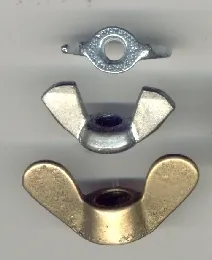
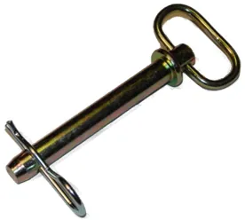

<figure class="eoc-pic eoc-pic-main"><figcaption><strong>Photo.</strong> <a href="https://commons.wikimedia.org/wiki/File:Wingnut-hardware.jpg">Wingnut-hardware</a> by Nut-hardware.jpg: Muke derivative work: Xoristzatziki (talk), Public domain, from Wikimedia Commons.</figcaption></figure>
<figure class="eoc-pic"><figcaption><strong>Photo.</strong> <a href="https://commons.wikimedia.org/wiki/File:HitchPin.jpg">HitchPin</a> by Chris Cross, Public domain, from Wikimedia Commons.</figcaption></figure>

Everyday fasteners with a shape your fingers can grip, such as a ridged or winged head, a knob, or a pin with a springy wire clip, so that a joint can be done up, adjusted and taken apart again and again without any tools.

**In plain words:** Ordinary screws, nuts and pins made to be done up and undone with your fingers: a screw with a big ridged head, a nut with two 'wings' to twist, and a pin pushed through holes and held by a springy wire clip shaped like an R. **Proper term:** Tool-free (hand-operated) fasteners: thumbscrew, wing nut, hitch pin and R-clip.

**Also called:** thumbscrew, thumb screw, knurled thumb screw (high head DIN 464, low head DIN 653; ASME B18.6.8 types A and B) (Wikipedia 'List of screw drives'; AIMS Industrial thumb screw guide); wing nut, wingnut or butterfly nut (ASME B18.6.9 types A-D); wing screw or wing bolt (DIN 316) (Wikipedia 'Wingnut (hardware)'; Wikimedia Commons 'DIN 316 M5x30 Winged Screw'); knurled nut or thumb nut; clamping knob, star knob, T-knob or T-head screw (DIN 6336) (Wikipedia 'Knurled nut'; AIMS Industrial; Elesa 'Clamping knobs and thumb screws'); captive thumb screw or captive panel screw: a thumbscrew that stays attached to the panel (AIMS Industrial); PC case thumbscrew (#6-32 UNC); D-sub connector jackscrew (#4-40 UNC) (Wikipedia 'Computer case screws'); hitch pin, clevis pin with a cross-hole; linch pin or lynch pin (a pin with a spring ring) (McMaster-Carr; Wikipedia 'Linchpin', 'Clevis fastener'); R-clip, R-pin, R-key, hairpin cotter (pin), hitch pin clip, bridge pin, spring cotter (pin); single- or double-coil (DIN 11024) (Wikipedia 'R-clip'; Aspen DIN 11024 sheet); RC car 'body clip' (a small R-clip) (Wikipedia 'R-clip').

## How it works

The threaded ones work exactly like a normal screw or nut. Turning them pulls the parts together and friction in the thread holds them, but the head is made big, ridged or winged so that your fingers can turn it; the wings act as levers that turn finger force into more twisting force (Wikipedia 'Wingnut (hardware)'; AIMS Industrial). A hitch pin works by shape instead: it passes through holes in both parts, so they can't separate. The R-clip's straight leg goes through the hole near the pin's tip, and its curved 'belly' springs round the outside of the pin and grips it, so the clip can't fall out; the angled end helps it slide on (Wikipedia 'R-clip').

## Parts

A few parts. Thumbscrew or wing screw: a single screw with a large knurled, flat or winged head, used with a tapped hole or nut. Wing nut or knob: one nut (or a plastic knob with a metal nut or stud moulded in) on an ordinary bolt. Hitch pin and R-clip: a plain pin with a head and a cross-hole near its tip, plus a spring-steel R-shaped wire clip; a linch pin has a spring ring on a hinge instead of a separate clip (Wikipedia 'R-clip', 'Linchpin', 'Wingnut (hardware)', 'List of screw drives').

## Everyday examples

- The ridged thumbscrews holding the side panel of a desktop PC, and the small thumbscrews on each side of a VGA or serial cable plug (Wikipedia 'Computer case screws')
- Wing nuts and wing bolts on drum-kit and cymbal stands (Wikipedia 'Wingnut (hardware)'), and on old bicycle wheels before quick-release skewers (Wikipedia, citing Sheldon Brown)
- The pin and R-clip that hold a trailer's tow-bar insert in the car's hitch receiver, or an implement on a tractor's three-point hitch (Wikipedia 'R-clip', 'Linchpin')
- The knurled levelling knobs under the heated bed of many 3D printers (AIMS Industrial; Thingiverse bed-levelling thumbwheels)

## When to use it

Use tool-free fasteners on anything opened, adjusted or taken apart often, where hunting for a tool would slow you down: access covers and guards, jigs and fixtures, fences on a workbench, lamp, camera, music and drum stands, printer bed levelling, and attachments that are swapped over (AIMS Industrial; Wikipedia 'Knurled nut', 'Wingnut (hardware)'). Knurled heads also discourage over-tightening and stripping (Wikipedia 'Knurled nut'). Choose wing screws or big knobs where people wear gloves or need more clamping force (AIMS Industrial). Use a hitch or clevis pin with an R-clip for a strong pinned joint or pivot that can be pulled apart by hand, e.g. a trailer insert, a removable [linkage](../glossary.md#linkage) or a tow bar (Wikipedia 'R-clip').

## When not to use it

Don't use them for structural or highly loaded bolted joints: hand [torque](../glossary.md#torque) is far below a bolt's normal tightening torque, so use spanner-tightened bolts (Wikipedia 'List of screw drives'; AIMS Industrial). Avoid plain thumbscrews and wing nuts where there is strong vibration: they can back off; use a locknut, a thumbscrew that also takes a screwdriver, or a quarter-turn or cam-lock fastener (Wikipedia 'Knurled nut'; see Thread-locking hardware). If the joint must be opened in one quick movement, a cam lever (quick-release skewer), bayonet, quarter-turn fastener or ball-lock quick-release pin is faster than several turns of a thread; the quick-release skewer was invented because a racer's frozen fingers couldn't undo his wing nuts (Wikipedia 'Wingnut (hardware)', citing Sheldon Brown). Where brush or clothing can snag it, a hairpin R-clip can be pulled out; a properly fitted and bent split pin would not pull out (TractorByNet forum). Where children or the public must not open something, use a tool-operated or security fastener instead ⚑ [uncertain: general design advice].

## Details

- **What it does (jobs):**
  - lock, and release by hand: joins parts that must be opened, adjusted or removed often without a tool, such as covers, guards, jigs, stands and attachments (AIMS Industrial; Wikipedia 'Knurled nut')
  - join and hold: an ordinary clamped joint (thumbscrew, wing nut) or pinned joint (hitch pin) (Wikipedia 'Wingnut (hardware)', 'R-clip')
  - let it move (turn, slide or bend): a hitch or clevis pin is often the pivot of a linkage that can be pulled out by hand; a loosened thumbscrew or wing nut lets a stand or slide be moved and re-clamped (Wikipedia 'Clevis fastener', 'Wingnut (hardware)')
- **Movement:** none when done up. A hitch pin or clevis pin used as a pivot gives 'rotate' about the pin; a slot with a thumbscrew or wing nut gives 'slide' while it is loosened.
- **Directions it can move (degrees of freedom):** 0 when a thumbscrew or wing nut is tightened. 1 (rotation about the pin) when a hitch pin or clevis pin forms a pivot, as in a clevis joint (Wikipedia 'Clevis fastener').
- **Special behaviour:**
  - quick-release: done up and undone by hand in seconds, with no tool needed and nothing to lose if the fastener is captive or tethered (a double-coil R-clip lets you attach a tether cord) (Wikipedia 'R-clip'; Aspen DIN 11024 sheet; AIMS Industrial)
  - none of the cleverer behaviours: thumbscrews and wing nuts are ordinary threaded fasteners, only shaped for the hand
- **How it holds:**
  - friction or clamping ([force-fit](../glossary.md#form-fit--force-fit--material-bond)): thumbscrews, wing nuts and knobs clamp the parts with the bolt's tension, and thread friction holds them (Wikipedia 'Wingnut (hardware)')
  - shape (the parts interlock; form-fit): the hitch pin passes through holes in both parts (Wikipedia 'R-clip', 'Clevis fastener')
  - spring force (a spring or springy part presses it in place): the R-clip's springy belly grips the pin so the clip stays in its hole; a linch pin's spring ring snaps down over the pin's end (Wikipedia 'R-clip'; McMaster-Carr 'Linch Pins')
- **Input and output:** not applicable
- **Power:** passive (no power needed)
- **Load:** Thumbscrews and wing nuts: light to medium clamping only, because your hand limits the torque. A retailer's guide gives typical hand torques of about 0.3-1.5 N·m for small knurled screws (M3-M5), 1-3 N·m for larger knurled screws (M6-M10), 2-5 N·m for wing screws (M5-M8) and 3-8 N·m for T-handles and knobs, against about 25 N·m normally used on an M8 grade 8.8 socket screw (AIMS Industrial) ⚑ [uncertain: retailer figures without test data]. Thumbscrews 'are usually not found in structural applications' (Wikipedia 'List of screw drives'). Hitch and clevis pins: strong in [shear](../glossary.md#peel-vs-shear) (sideways across the pin); a vehicle hitch pin carries towing loads, while the R-clip carries almost no load and only stops the pin sliding out (McMaster-Carr 'Hitch Pins'; Wikipedia 'R-clip'). A bolt is a poor substitute for a clevis pin in shear: its strength is set by the smaller diameter at the bottom of its thread (Wikipedia 'Clevis fastener').
- **Play and precision:** Thumbscrew or wing-nut clamps have no play once tight, but they only return to the same position if something else locates the parts; drum kits use a separate 'memory' collar so the stand goes back to the same setting (Wikipedia 'Wingnut (hardware)'). Hitch and clevis pins have noticeable play in their holes; they 'should be closely fitted to the holes in the clevis to limit wear' (Wikipedia 'Clevis fastener').
- **Taking it apart:** tool-free quick release
- **How often it can be reused:** many times: that is their purpose. R-clips 'are easier to remove and are re-usable' compared with split pins (Wikipedia 'R-clip'), and knurled fasteners are used 'where the fasteners will be removed regularly' (Wikipedia 'Knurled nut'). Printed plastic threads and knobs wear faster than metal ones (Hubs).
- **Sealing:** none
- **Adjustable:** yes for thumbscrews, wing nuts and knobs: they clamp at any position along a slot or tube, e.g. drum and cymbal stands (Wikipedia 'Wingnut (hardware)'). Hitch pins: no, or only in steps if the parts have a row of holes.
- **Access needed:** one side only (blind) for a thumbscrew or wing screw into a tapped hole or [captive nut](../glossary.md#captive-nut); both sides for a wing nut on a loose bolt (unless the bolt head is held captive) and for a hitch pin, whose clip goes on the far side.
- **Materials:** Metal thumbscrews and wing nuts come in zinc-plated steel, stainless steel and brass ⚑ [uncertain: typical catalogue materials, not from an opened data sheet]; wing nuts are cold-formed, hot-forged, die-cast or stamped (Wikipedia 'Wingnut (hardware)', from ASME B18.6.9). Knobs, T-handles and wing nuts are often moulded technopolymer (engineering plastic) with a steel insert or stud, or aluminium, cast iron or A4 stainless steel (AIMS Industrial; Elesa; JW Winco). R-clips are hardened spring-steel wire, harder than split-pin wire, also sold in A4 stainless (Wikipedia 'R-clip'; Aspen DIN 11024 sheet). They join metal, wood and plastic parts; 3D-printed knobs and wings are usually PLA or PETG around a metal nut or bolt head (Printables knob models).
- **Heat, cold, water and wear:** Plain steel rusts and wing nuts can seize: use stainless or brass outdoors ⚑ [uncertain: general advice]. Stainless R-clips (A4) suit wet and marine use (Aspen DIN 11024 sheet). Cold or gloved hands can't grip small knurled heads; wings help (AIMS Industrial; Wikipedia 'Wingnut (hardware)'). Vibration loosens hand-tight threads (Wikipedia 'Knurled nut'). Plastic knobs and printed grips can soften in heat and sunlight, and printed parts clamped by hand [creep](../glossary.md#creep) and lose clamp force over time (FilamentSpecs creep guide) ⚑ [uncertain: no temperature figure found for knobs].

## Making it

- **Ways to make or get it:**
  - off-the-shelf part: thumbscrews, wing nuts, knobs, hitch pins and R-clips are cheap catalogue parts
  - 3D print (FDM): knobs, star grips and wing adapters that fit over a standard hex nut, hex bolt head or socket-cap screw; printed wing nuts with printed threads for M5 and larger (Printables 'Screw knob for metric hex and Allen bolt and nuts'; Printables 'Nut and Bolt Adapters'; Hubs)
  - woodwork: bolts through jigs, fences and workbench fixtures clamped with printed or bought knobs and wing nuts (Printables knob model description: 'to mount things like milling fences to my workbench')
  - CNC: turned and knurled thumbscrews and pins, drilled cross-holes for R-clips
- **Printing it in one piece (print in place):** partly: a printed knob, star grip or wing adapter prints as one piece but needs a metal nut or bolt head pressed or glued in (Printables knob and adapter models). Fully printed wing nuts and thumbscrews with printed threads are possible, but Hubs advises avoiding FDM-printed threads smaller than M5.
- **Tools:** none. Some knurled nuts and thumbscrews also have a screwdriver slot, so a tool can be used where vibration is a concern or extra tightness is needed (Wikipedia 'Knurled nut', 'List of screw drives').
- **Difficulty:** easy: buy standard parts, or print a knob or wing that grips an ordinary nut or bolt head (Printables and Thingiverse adapter models).

### 3D printing tips

1) Don't print the thread if you can avoid it: print a knob, star grip, T-handle or wing that grips a standard metal hex nut, hex bolt head or socket-cap screw head, so the metal carries the thread (Printables models by trses, bryanpryor and Asa; Thingiverse 'Instant Wingnut Adapter'). Hubs advises against FDM-printed threads smaller than M5; if you do print threads, screw the fastener in and out several times to clean them (Hubs threaded fasteners guide). 2) Pocket fit: Hubs suggests a 0.2 mm offset around the nut (0.1 mm each side) for a loose fit, adjusted by test prints; bryanpryor's parametric knob uses a slight press fit for a 1/4-20 nut or bolt head, with optional glue, and recommends 'at least 4 walls to get more strength under the bolt head/nut' (Hubs; Printables 'Parametric Knob for Nuts'). 3) Leave enough plastic round the corners of the hex pocket: trses rotated the hex cut-out by 30° in his knob 'for better wall thickness' (Printables 'Screw knob for metric hex and Allen bolt and nuts'). 4) Make it big: torque grows with the grip radius, and wings act as levers (AIMS Industrial), so a 50 mm knob gives much more clamping force than a small knurled head; bryanpryor's base knob is 50 mm with a 25 mm version for tight spaces (Printables). 5) Print knobs flat, with the pocket opening facing up or down so no supports are needed; Asa's adapters need 'no supports' and the nut key is printed upside down (Printables 'Nut and Bolt Adapters'). 6) Holes for hitch or clevis pins: printed horizontal holes come out slightly undersized or oval, so drill or ream them to size, and give moving pins at least 0.3 mm [clearance](../glossary.md#clearance) (Prusa knowledge base) ⚑ [uncertain: 'undersized horizontal holes' is general printing experience]. Standard R-clips (DIN 11024) start at pins of about 9 mm diameter (Fixawell DIN 11024 table), so for small printed pins use a split pin, a snap pin or a printed clip instead. 7) A hand-tight clamp on printed parts slowly loses force as the plastic creeps under the nut (FilamentSpecs creep guide); use a large washer and re-tighten from time to time.

### Buying one (off-the-shelf parts)

Search catalogues for: 'knurled thumb screw' (DIN 464 high head, DIN 653 low head), 'wing screw' or 'wing bolt' (DIN 316), 'wing nut' or 'butterfly nut' (ASME B18.6.9), 'knurled nut' or 'thumb nut', 'clamping knob', 'star knob', 'lobe knob', 'T-knob' or 'T-head screw' (DIN 6336), 'captive thumb screw' or 'captive panel screw', 'PC case thumbscrew 6-32' (Wikipedia; AIMS Industrial; Elesa); 'hitch pin' and 'clevis pin' (with a cross-hole), 'linch pin', 'R-clip', 'hairpin cotter pin', 'hitch pin clip', 'spring cotter pin DIN 11024' (single or double coil), and 'quick-release pin' (ball-lock, a separate entry) (Wikipedia 'R-clip'; McMaster-Carr 'Hitch Pins'; Aspen DIN 11024 sheet). Torque-limiting knobs, knurled knobs and wing nuts that 'release after reaching the desired torque' are also sold (JW Winco 'Torque Limiting Knobs'; Elesa 'Clamping knobs and thumb screws').

## Rules of thumb

- Expect only a few newton-metres from a hand: typical hand torque is about 0.3-1.5 N·m on small knurled screws (M3-M5), 1-3 N·m on M6-M10 knurled screws, 2-5 N·m on wing screws (M5-M8) and 3-8 N·m on knobs and T-handles, against about 25 N·m normally used on an M8 grade 8.8 socket screw (AIMS Industrial thumb screw guide) ⚑ [uncertain: retailer figures, no test data given].
- Bigger grip, more torque: wings and knobs are [lever arms](../glossary.md#lever-arm), so choose a wing screw or a large knob rather than a small knurled head when you need more clamping force, or when people wear gloves (AIMS Industrial).
- R-clip size (DIN 11024) is the diameter of the cross-hole in the pin: size 2.5 (2.25 mm wire) fits pins of 9-11.2 mm, size 3.2 (2.8 mm wire) 11.2-14 mm, size 4 (3.6 mm wire) 14-20 mm, size 5 (4.5 mm wire) 20-26 mm, size 6.3 (5.6 mm wire) 26-34 mm (Fixawell and Boltsfastener DIN 11024 tables; Aspen DIN 11024 sheet).
- Fit clevis and hitch pins closely in their holes to limit wear; use a real clevis or hitch pin, not a bolt, where the load is sideways across the pin (Wikipedia 'Clevis fastener').
- Printed threads: avoid FDM-printed threads below M5, and use a metal nut, insert or cut thread instead (Hubs).
- Nut pocket in a printed knob: start with a 0.2 mm offset for a loose fit (Hubs), or a slight press fit plus at least 4 walls (Printables 'Parametric Knob for Nuts').

## Common failures

1) Works loose under vibration because hand torque gives little clamp force (Wikipedia 'Knurled nut'; AIMS Industrial). 2) Printed knob spins on its nut or bolt head because the pocket is too loose or the walls too thin (Printables knob notes; Hubs). 3) Printed threads strip or wear, especially below M5 (Hubs). 4) Wing nut or thumbscrew over-tightened with pliers, bending or breaking the wings or stripping the thread ⚑ [uncertain: general experience]. 5) R-clip or linch pin lost, leaving the pin free to slide out; tie it on with a cord through a double-coil clip (Wikipedia 'R-clip'; Aspen DIN 11024 sheet). 6) Pin holes worn oval because the pin is a loose fit (Wikipedia 'Clevis fastener'). 7) Corroded or frozen wing nuts that fingers can't turn (Wikipedia 'Wingnut (hardware)').

## Safety

A hitch pin whose R-clip is missing or pulled out by brush can let a trailer insert or implement come off (TractorByNet forum), so check the clip is fully home and use the pin size the maker specifies ⚑ [uncertain: general towing advice]. A hand-tight clamp can slip under a heavy or shock load, so don't rely on thumbscrews or wing nuts to hold anything overhead or to carry people. Small R-clips and RC-car body clips are easily lost and can be swallowed by small children ⚑ [uncertain: general advice]. Wings and knobs can pinch fingers when a clamped part suddenly moves ⚑ [uncertain: general advice].

## Related

- Eccentric cam lever (cam clamp, quick-release skewer): clamps with a flick of a lever instead of several turns; what replaced wing nuts on bicycle wheels
- Quick-release pin (ball-lock pin): a pin that locks itself with spring balls and releases with a button, so there is no separate clip to lose
- Quarter-turn fastener (Dzus-type) and cam latch (quarter-turn cam lock): panel fasteners that open with a quarter turn
- Bayonet mount (push-and-twist lock): tool-free joining with a push and a short twist
- Thread-locking hardware (nylon-insert nut, lock washer, split pin): the split pin is the tool-fitted, single-use cousin of the R-clip
- Clevis joint (fork-and-pin joint): the pivot that a hitch or clevis pin with an R-clip usually forms
- Indexing plunger (pull-knob index pin) and spring button lock: spring pins that drop into set holes, for adjustable positions without a separate pin and clip
- Toggle clamp: a lever clamp that gives much more clamping force than a hand-turned knob, for jigs and fixtures
- Captive nut pocket (nut trap) and heat-set threaded insert: ways to give a 3D print a metal thread for a thumbscrew

## Make it yourself

- [Screw knob for metric hex and Allen bolt and nuts - knurled and star shape parametric (trses, Printables; URL from search results, page not opened; details read through the Printables API)](https://www.printables.com/model/1116311-screw-knob-for-metric-hex-and-allen-bolt-and-nuts): Parametric OpenSCAD star and knurled knobs for ISO 4017 hex screws, ISO 4762 socket-cap screws and ISO 4032 hex nuts, M3 to M16, with Customizer settings *(licence: CC BY-NC-SA (Creative Commons Attribution-NonCommercial-ShareAlike))*
- [Nut and Bolt Adapters (wing nut, thumb screw, nut ring) Metric Sizes (Asa, Printables; URL from search results, page not opened; details read through the Printables API)](https://www.printables.com/model/503494-nut-and-bolt-adapters-wing-nut-thumb-screw-nut-rin): Printable adapters, M3 to M12, that turn ordinary nuts and bolts into hand-tightened wing nuts and thumbscrews; no supports needed *(licence: CC BY (Creative Commons Attribution))*
- [Parametric Knob for Nuts, Threaded Knob (Fusion 360) (bryanpryor, Printables; URL from Printables API, page not opened)](https://www.printables.com/model/625673-parametric-knob-for-nuts-threaded-knob-fusion-360): Parametric 50 mm (and 25 mm) knob that takes a pressed-in nut or bolt head, or prints with its own thread; notes on press fit and wall count *(licence: CC BY (Creative Commons Attribution))*
- [Instant Wingnut Adapter M3 M4 M5 M6 M8 M10 (MvM, Thingiverse)](https://www.thingiverse.com/thing:2121898): Printable clip-on wings that turn any M3-M10 hex bolt head or nut into a wing nut you can turn by hand *(licence: CC BY-NC 4.0)*
- [Thumbwheel for M3 standard and nyloc nuts (andygock, Thingiverse)](https://www.thingiverse.com/thing:39459): Printable thumbwheel that fits tightly round an M3 nut, used for hand-levelling a 3D printer bed *(licence: CC BY-SA 4.0)*

## Pictures, videos and models

- [Wingnut-hardware.jpg (Muke, cropped by Xoristzatziki, Wikimedia Commons, 2010)](https://commons.wikimedia.org/wiki/File:Wingnut-hardware.jpg): Photo of three wing nuts of different styles *(licence: Public domain)*
- [HitchPin.jpg (Chris Cross, Wikimedia Commons)](https://commons.wikimedia.org/wiki/File:HitchPin.jpg): A hitch pin with an R-clip fitted through the cross-hole near its tip *(licence: Public domain)*
- [R-Clip.jpg (Chris Cross, Wikimedia Commons)](https://commons.wikimedia.org/wiki/File:R-Clip.jpg): Close-up of an R-clip (hairpin cotter), showing the straight leg and the curved 'belly' that grips the pin *(licence: Public domain)*
- [Thumbscrews pc.jpg (Bloodshedder, Wikimedia Commons, 2006)](https://commons.wikimedia.org/wiki/File:Thumbscrews_pc.jpg): Knurled thumbscrews from an ATX PC case *(licence: CC BY-SA 2.5)*
- [DIN 316 M5x30 Winged Screw Flügelschraube.jpg (Phiarc, Wikimedia Commons, 2022)](https://commons.wikimedia.org/wiki/File:DIN_316_M5x30_Winged_Screw_Fl%C3%BCgelschraube.jpg): Photo of a stainless-steel M5 x 30 wing screw (DIN 316) *(licence: CC BY-SA 4.0)*

## Needs confirming

⚑ marks something nobody has confirmed yet: a fact the research could not confirm from a source, a finder value that is a best guess, or an open point from the research notes. Corrections are welcome (see `research/needs-confirming.md`).

- ⚑ 11 sentences on this page marked [uncertain].
- ⚑ Finder value `connects` = any solid parts (best guess): joins parts, but no specific kind of part found; set to any solid parts

## Sources

- <https://en.wikipedia.org/wiki/Wingnut_(hardware)>
- <https://en.wikipedia.org/wiki/List_of_screw_drives>
- <https://en.wikipedia.org/wiki/Thumbscrew>
- <https://en.wikipedia.org/wiki/Knurled_nut>
- <https://en.wikipedia.org/wiki/Computer_case_screws>
- <https://en.wikipedia.org/wiki/R-clip>
- <https://en.wikipedia.org/wiki/Linchpin>
- <https://en.wikipedia.org/wiki/Clevis_fastener>
- <https://aimsindustrial.com.au/blogs/product-guides/thumb-screw-guide>
- <https://www.elesa.com/en/elesab2bstoreus/hand-knobs-and-thumb-screws-us--1>
- <https://www.jwwinco.com/en-us/products/2.2-Tensioning-clamping-with-handles/Torque-limiting-knobs>
- <https://www.mcmaster.com/products/hitch-pins/>
- <https://www.aspenfasteners.com/content/pdf/Metric_DIN_11024_spec.pdf>
- <https://www.fixawell.com/din-11024.htm>
- <https://www.boltsfastener.com/standards/pins-keys-standard/din-11024.html>
- <https://www.hubs.com/knowledge-base/how-assemble-3d-printed-parts-threaded-fasteners/>
- <https://help.prusa3d.com/article/modeling-with-3d-printing-in-mind_164135>
- <https://filamentspecs.com/creep-resistance-3d-printed-parts/>
- <https://www.tractorbynet.com/forums/threads/nyla-nuts.430100/post-5823756>
- <https://www.thingiverse.com/thing:2121898>
- <https://www.thingiverse.com/thing:39459>
- <https://api.printables.com/graphql/ (models 1116311, 503494, 625673)>
- <https://commons.wikimedia.org/wiki/File:Wingnut-hardware.jpg>
- <https://commons.wikimedia.org/wiki/File:HitchPin.jpg>
- <https://commons.wikimedia.org/wiki/File:R-Clip.jpg>
- <https://commons.wikimedia.org/wiki/File:Thumbscrews_pc.jpg>
- <https://commons.wikimedia.org/wiki/File:DIN_316_M5x30_Winged_Screw_Fl%C3%BCgelschraube.jpg>
- <https://commons.wikimedia.org/wiki/File:Bicycle_wing_nuts.jpg>
