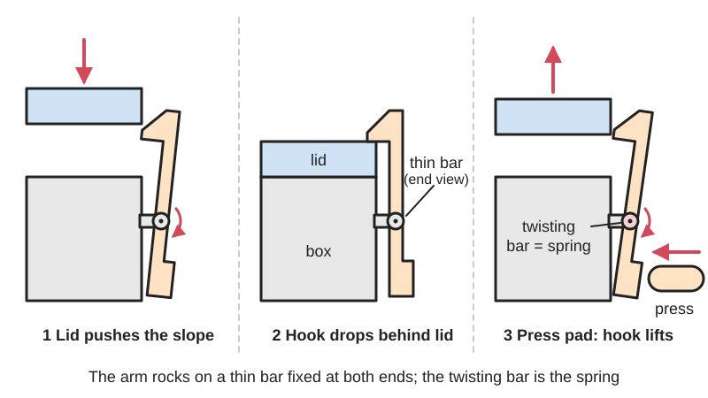
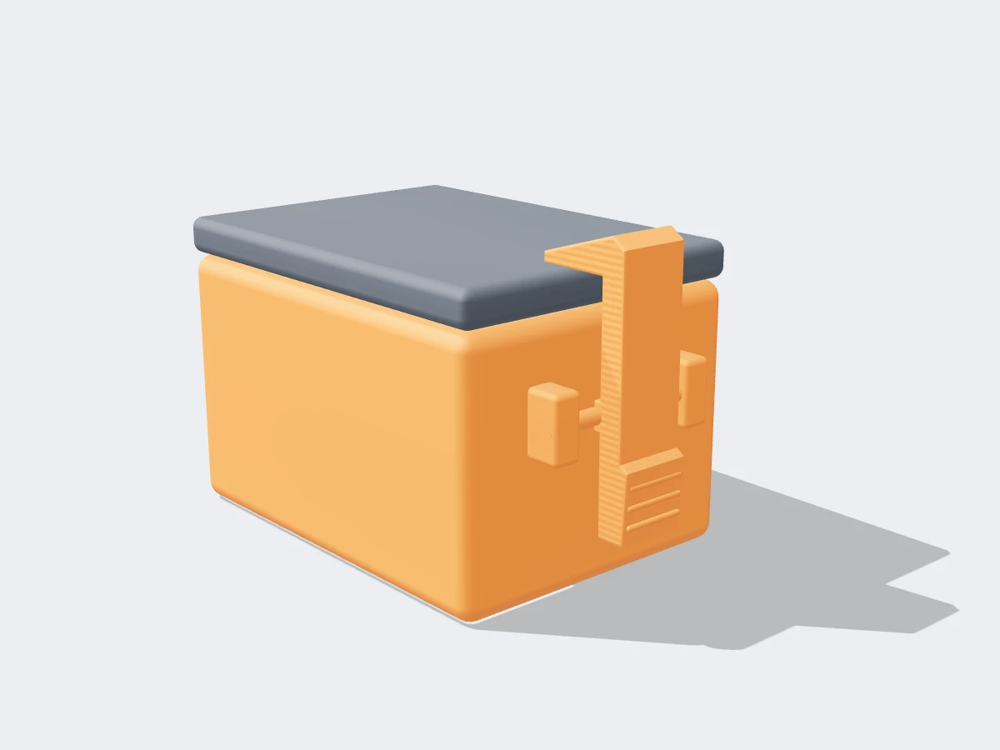

<figure class="eoc-pic eoc-pic-main"><picture><source media="(prefers-reduced-motion: reduce)" srcset="../media/drawn/torsional-snap-fit.svg"></picture><figcaption><strong>Animation.</strong> Diagram drawn for the encyclopaedia from the research notes. ⚑ Needs confirming: a drawing can simplify or get details wrong; a real photo or a better diagram is welcome.</figcaption></figure>
<figure class="eoc-pic"><figcaption><strong>Render.</strong> A 3D model made for the encyclopaedia, not a photo: a stand-in until a good real photo is found. ⚑ Needs confirming: a model can simplify or get details wrong; a real photo is welcome.</figcaption></figure>

A snap catch whose hooked arm is carried on a short bar that twists like a tiny spring ([torsion](../glossary.md#torsion) bar), so the hook clicks behind a lip when the lid closes and swings clear when you press the other end of the arm.

**In plain words:** A springy catch on a tiny see-saw: the hooked arm sits on a thin bar that twists instead of bending, so the catch clicks shut by itself, and pressing the far end of the arm tips the hook up and lets go. **Proper term:** Torsional snap fit (torsion snap joint).

**Also called:** torsion snap joint (name used in the Bayer/Covestro snap-fit design guide); torsion snap-fit / torsion snap; snap-fitting rocker arm / rocker-arm snap (Covestro's description of the arm); see-saw latch or see-saw snap (vendor guides, e.g. RapidDirect: 'a seesaw mechanism occurs when the hook's beam extends beyond the torsion bar axis'); torsion-bar latch; torsionally-biased latch (patent wording, US 5,924,749); torsional lock (lock style named in Bonenberger's The First Snap-Fit Handbook) ⚑ [uncertain: seen only in a search-result summary of the book's contents]; Beware: some supplier blogs use 'torsional snap fit' for twist-to-lock (rotate-to-engage) snaps, and a Yazaki patent titled 'Torsional snap-fit latch' (US 5,628,533) twists the latch head about its own axis as it is pushed in. These are relatives, not the see-saw catch described here.

## How it works

The arm is held part-way along its length by a short, thin bar fixed to the part at both ends, like a see-saw on a springy axle. When the lid closes, its edge pushes on the sloped face of the hook, the arm tips, and the bar twists (the plastic is loaded in [shear](../glossary.md#peel-vs-shear) instead of being bent, as in a [cantilever](../glossary.md#cantilever) snap); once the hook passes the lip, the twisted bar springs back and the hook drops behind it. To open, you press the pad on the other side of the pivot, which tips the arm the other way and lifts the hook clear, so the cover opens 'under a force P' (Covestro, pp. 6 and 18-19). Because the twisting bar is the spring, the arm itself can be stiff, and a longer bar can twist further without being overstressed (Covestro, p. 18). A patented phone battery cover works the same way: a long beam twists about its axis when the cover goes in and lets go when a thumb tab is pressed (US 5,924,749).

## Parts

Single piece: the catch is moulded or printed as part of one housing half, plus the lip it catches on. In plain words: a hooked arm (rocker arm or lever) with a sloped front on the hook; one or two thin bars (torsion bars) that hold the arm in the middle like the axle of a see-saw and twist when it tips; posts that join each end of the bar to the housing; a press pad or tab on the other end of the arm; and, on the mating part, a lip, ledge or slot (the keeper) for the hook to drop behind.

## Everyday examples

- Instrument and equipment housings whose cover opens when you press one end of a rocker catch that is moulded into the case (Covestro Fig. 5, a polycarbonate instrument housing)
- Mobile-phone battery covers held by a twisting-beam latch and released with a thumb tab (Ericsson patent US 5,924,749)
- Vendor guides also list stroller wheel locks, laundry-detergent cap lids and see-saw style buckles ⚑ [uncertain: vendor claims, not checked]

## When to use it

Use it for lids, battery doors, access covers and housing halves that people open often by pressing a button or tab, when you want the whole catch moulded or printed into one part with no metal spring. It suits places where the release has to be pressed from a different spot than the hook (the see-saw lets you press on one side and lift the hook on the other), where a low, flush catch is wanted, and where you want the spring spread along a bar instead of concentrated at the root of a bending arm.

## When not to use it

Avoid it for heavy loads, for closures that must not open if knocked or dropped, and for child-resistant or security closures: use a draw ([over-centre](../glossary.md#over-centre)) latch, a metal spring latch or a lock. For a quick printed project, a plain cantilever snap or a compliant latch with a press tab is easier to get right. Avoid it where the catch must keep a lid pressed hard against a seal, because a plastic bar held twisted [creeps](../glossary.md#creep); use screws or a draw latch. In PLA, or in hot places, expect the bar to lose spring; use PETG, ABS or nylon, or a separate arm with a metal torsion spring.

## Details

- **What it does (jobs):**
  - join and hold: keeps a lid, cover, battery door or housing half shut
  - lock, and release by hand: press the pad to open; it latches again by itself when pushed shut
- **Movement:** flex: the arm tips through a few degrees as the bar twists, and the largest safe twist angle is set by how much shear strain the plastic can take (Covestro, p. 18). The latched parts themselves do not move
- **Directions it can move (degrees of freedom):** 1 inside the catch (the arm rocks about the bar's axis); 0 between the two latched parts once it is shut
- **Special behaviour:**
  - hand-release only (locks under load, releases when a person operates it): pulling on the lid pushes against the back of the hook and doesn't open it; pressing the pad on the far side of the pivot does
  - quick-release: one press opens it, and it snaps shut again by itself when the lid is pushed closed
  - [fail-safe](../glossary.md#fail-safe--fail-secure) or breakaway: optional. Snap joints are separable or not depending on the shape of the [undercut](../glossary.md#undercut) (Covestro, p. 3), so a sloped back face on the hook lets a hard pull tip the arm and open it instead of breaking it ⚑ [uncertain: not shown for the torsion type specifically]
- **How it holds:**
  - shape (the parts interlock; [form-fit](../glossary.md#form-fit--force-fit--material-bond)): the hook sits behind the lip
  - spring force (a spring or springy part presses it in place): the twisted bar pushes the hook back into place
- **Input and output:** not applicable: it is a holding joint, not a motion converter
- **Power:** passive (no power needed)
- **Load:** Light to medium. Strongest against a pull straight away from the hook; weak against knocks on the release pad, prying, and anything that twists the bar further. The thin bar and the arm's 'backbone' are the weak points: a printed test arm snapped in half until it was made thicker (Printables 151102). Xometry Pro rates the load capacity 'low to moderate'.
- **Play and precision:** Small to noticeable: the parts need [clearance](../glossary.md#clearance) to close (about 0.5 mm for FDM snap fits, 0.3 mm for SLA, SLS and MJF; Hubs), so a latched lid can rattle slightly. The sloped front of the hook tolerates a little [misalignment](../glossary.md#misalignment) when closing.
- **Taking it apart:** tool-free quick release
- **How often it can be reused:** many times: it is meant for covers that are opened again and again (Covestro, p. 6; Wikipedia, Snap-fit), as long as the bar's twist stays within the frequent-use strain limit (about 60% of the one-time value, Covestro Table 2). Sources disagree: Xometry Pro rates torsional snap fits 'low' for reusability because the repeated twisting [fatigues](../glossary.md#fatigue) the bar, and a printed test version took a permanent twist when flexed before it had cooled (Printables 151102) ⚑ [uncertain: no cycle counts found]
- **Sealing:** none: the catch leaves a gap; it can hold a lid against a gasket, but plastic springs that are kept loaded creep and relax, so it won't keep a seal squeezed for long (DuPont, p. 36)
- **Adjustable:** no: once made, the [holding force](../glossary.md#holding-force) is fixed by the bar's length and thickness and the hook's depth. When designing, make the bar's cross-section easy to change, because that is how you tune its [stiffness](../glossary.md#stiffness) (Printables 151102)
- **Access needed:** one side only (blind): the press pad is on the outside of the housing; leave room for a finger and for the arm to swing
- **Materials:** Moulded: tough, springy thermoplastics. Covestro's example is an instrument housing in polycarbonate (Makrolon), with the bar and arm moulded with the lower housing in one shot (Covestro, p. 6); Xometry Pro suggests nylon or polycarbonate for fatigue resistance. 3D printed: PETG, ABS or nylon (SLS PA12 is best for snap fits; PLA and standard resins are [brittle](../glossary.md#brittle--ductile); Hubs). One maker's proof-of-concept torsion snap was printed in PLA and needed careful tuning (Printables 151102).
- **Heat, cold, water and wear:** Plastic springs under constant load or [deflection](../glossary.md#deflection) creep and relax, and temperature and chemicals change their spring properties (DuPont, p. 36), so the bar should rest untwisted when shut. Nylon's allowable strain changes with moisture (Zytel 101: 4% dry, 6% at 50% relative humidity for one-time assembly; DuPont Table 10.06, p. 75). A printed bar flexed while still warm takes a permanent twist (Printables 151102), so heat (for example a hot car) will weaken a PLA catch ⚑ [uncertain: no temperature figures verified]. Cold makes plastics more brittle and sunlight (UV) degrades many plastics outdoors ⚑ [uncertain].

## Making it

- **Ways to make or get it:**
  - injection moulding: the usual method; the bar and arm are moulded with one housing half in a single shot (Covestro, p. 6)
  - 3D print (FDM): possible, with tuning (Printables 151102)
  - 3D print (SLS or MJF nylon): the best printed material for snap fits in general (Hubs)
  - 3D print (resin): tough or durable resins only; standard resins are brittle (Hubs) ⚑ [uncertain: no printed torsion example in resin found]
- **Printing it in one piece (print in place):** yes: the arm and torsion bar print already working as part of one housing half, while the part it catches on is printed separately (as in the top and bottom pieces of Printables 151102)
- **Tools:** none: the pad is pressed with a finger
- **Difficulty:** moderate to hard: it prints as part of the box, but getting the bar's stiffness right takes trial and error (the maker of a test set calls it 'the most complicated version'), and a printed bar can take a permanent twist (Printables 151102). A plain cantilever catch is easier.

### 3D printing tips

Orientation: keep the torsion bar lying in the plane of the print bed (its length along X or Y), never standing up in Z, so the layer joints don't run across the bar where the twist is carried; Hubs gives the same advice for snap arms because layer bonding lowers strength ⚑ [uncertain: the bar-specific advice is our inference from Hubs]. Bar shape: a rectangular cross-section worked better than a round one, a fairly long bar twists without taking a permanent set, and you should make the bar's dimensions easy to edit because they set the stiffness (kaje, Printables 151102). Keep the twist small: Covestro's formula (see rules of thumb) shows the safe twist angle grows with bar length and falls with bar thickness. Arm: give the lever a thick 'backbone' so it doesn't snap, and angle the lever end slightly away from the neighbouring wall so it has room to swing (Printables 151102). Add [fillets](../glossary.md#chamfer--fillet) where the bar meets its posts (Hubs recommends a fillet at least half the thickness at snap-arm roots). Cooling: let the print cool completely before you work the catch, or the bar will take a permanent twist and stop springing (Printables 151102). Clearance: start around 0.5 mm between the hook, arm and surrounding walls for FDM (Hubs). Material: PETG, ABS or nylon for repeated use; PLA is fine for a first test (kaje printed PLA with 2 [perimeters](../glossary.md#perimeters) and 0% [infill](../glossary.md#infill)) but is brittle and creeps. Rest state: design the bar so it is untwisted when the catch is shut, because plastic springs held under load relax (DuPont, p. 36). Typical failures: bar takes a set and the hook no longer catches (cool fully, use a longer bar, lower the twist, switch to PETG or nylon); arm snaps (thicken it); hook or arm fused to the wall (more clearance, check [elephant's foot](../glossary.md#elephants-foot)).

### Buying one (off-the-shelf parts)

Usually none: the catch is part of the moulded or printed part. Ready-made alternatives to search for: 'rocker latch', 'push button latch', 'plastic snap latch', 'cabinet catch'. For a longer-lived spring, a separate arm on a metal pin with a 'torsion spring' does the same job with more parts.

## Rules of thumb

- Twist angle and hook travel: sin(phi) = y1/l1 = y2/l2, where y is the deflection at a point on the arm and l is its distance from the bar (Covestro, Snap-Fit Joints for Plastics, p. 18).
- Largest safe twist for a round bar: phi_max (degrees) = (180/pi) x gamma_max x l / r, where l is the bar length and r its radius, so a longer, thinner bar can twist further (Covestro, p. 18).
- Allowable shear strain: gamma_max is about (1 + nu) x epsilon_max, which is about 1.35 x epsilon_max for plastics (Poisson's ratio nu about 0.35), where epsilon_max is the material's permissible (bending) strain (Covestro, p. 18). Covestro's one-time strain limits include 4% for Makrolon PC and 2.5% for Bayblend PC/ABS; for frequent opening use about 60% of these (Covestro Table 2, p. 12).
- Worked example (our calculation from Covestro's formulas, not from the guide): PC for frequent use, epsilon = 0.6 x 4% = 2.4%, so gamma is about 3.2%; a round bar 2 mm in diameter and 10 mm long then twists safely up to about 57.3 x 0.0324 x 10 / 1, roughly 18.6 degrees.
- Force to tip the arm: P1 x l1 = P2 x l2 = gamma x G x Ip / r, doubled when the arm sits between two bars; Ip = pi x r^4 / 2 for a solid round bar, and the shear modulus G = Es / (2(1 + nu)) from the secant modulus Es (Covestro, p. 19).
- For non-round bars, the angle of twist is theta = T x l / (K x G), with torsional constants K for common sections in DuPont Table 4.02 (DuPont, General Design Principles for Engineering Polymers, Module I, p. 15).
- Snap features should return to a stress-free state after latching (Covestro, p. 3); plastic springs suit intermittent action, and constantly loaded springs should be spring steel (DuPont, p. 36).
- 3D-printed snap fits: about 0.5 mm clearance for FDM (0.3 mm for SLA, SLS, MJF), root fillets at least 0.5 x thickness, minimum 5 mm width, avoid building the flexing part in Z, use tough materials such as SLS nylon, ABS, PETG (Hubs, How to design snap-fit joints for 3D printing).
- Printed torsion bars: rectangular profile better than round; relatively long bar; let the print cool fully before flexing (kaje, Printables 151102).

## Common failures

The bar takes a permanent twist and the hook no longer catches (creep, or flexing a print before it has cooled): keep the twist within the frequent-use strain, make the bar longer, rest it untwisted, and use PETG, ABS or nylon. The bar or arm cracks after repeated use (fatigue, which Xometry Pro names as the main weakness of torsional snaps): add fillets, lower the twist angle, choose a tougher plastic. The arm snaps in half: give it a thicker backbone (Printables 151102). It won't open or opens too easily: change the hook depth, the back-face angle or the bar stiffness. The lever rubs on the housing: angle it away from the wall and add clearance. The hook fuses to the wall in printing: more clearance.

## Safety

Low hazard. A cracked or relaxed catch can let a lid fall open, so don't rely on one to hold anything heavy overhead or anything that must stay shut for safety. Small printed parts are a choking hazard for young children.

## Related

- Cantilever snap fit: the hook is on a bending arm instead of a twisting bar; simpler, the most common snap, but the strain is concentrated at the arm's root
- Compliant latch ([flexure](../glossary.md#flexure) latch): a one-piece bending-beam latch with a press or lift tab; the easier printed alternative
- Annular snap fit: a bead all round a round part; not normally opened by pressing a button
- Twist-to-lock (rotational) snap or bayonet: sometimes also called 'torsional' in supplier guides, but you turn the whole part to engage it
- Draw latch (over-centre latch): pulls a lid tight and is stronger and better for seals, but has several parts
- Spring-loaded rocker latch: the same see-saw arm, but pivoting on a pin with a separate metal spring; stronger and longer-lived
- Torsion bar (in suspensions and hinges): the same twisting-spring idea used to carry larger loads

## Make it yourself

- [Snap-Fit Joint Test Prints - Eight Versions, by kaje](https://www.printables.com/model/151102-snap-fit-joint-test-prints-eight-versions): Eight printable snap-fit test pieces based on the Bayer/Covestro guide, including a working torsion snap (Fig. 5 in the guide) with the maker's notes on bar shape, length and cooling; OnShape CAD linked from the page (read through the Printables API) *(licence: Creative Commons Public Domain (CC0))*

## Pictures, videos and models

- [Snap-Fit Joints for Plastics: A Design Guide (Covestro, formerly Bayer)](https://solutions.covestro.com/-/media/covestro/solution-center/brands/downloads/imported/1557218421.pdf): Fig. 5 (p. 6): drawing of a torsion snap joint on a polycarbonate instrument housing, with the torsion bar labelled and the opening force P; Fig. 21 (p. 18): coloured diagram of a snap-fitting arm on a torsion bar with the deflections and twist angle marked; p. 19: photo of a moulded snap-fitting rocker arm *(licence: link only (manufacturer's design guide))*
- [Torsional Snap-Fits : Design, Key Features, Limits and Tips (Xometry EMEA & APAC)](https://www.youtube.com/watch?v=SlUFQMtsoaM): Video explainer on torsional snap fits ⚑ [uncertain: title and channel checked with YouTube oEmbed; video content not viewed] *(licence: YouTube standard licence; link only)*
- [Snap-fit Joints for Plastics: Types, Design, Selection (Xometry Pro)](https://xometry.pro/en/articles/snap-fit-joints-for-plastics/): Article with an illustration of a torsional snap fit alongside the other snap-fit types, plus a comparison of load capacity and reusability *(licence: link only)*
- [US 5,924,749 Torsionally-biased latch arrangement (Ericsson, 1999)](https://patents.google.com/patent/US5924749A/en): Patent text and drawings of a battery-cover latch whose beam twists about its long axis and is released by pressing a tab *(licence: US patent documents are generally free of copyright ⚑ [uncertain]; link only)*
- [Types of Snap Fit Joints and Best Design Practices (RapidDirect)](https://www.rapiddirect.com/blog/snap-fit-design/): Vendor guide explaining torsion snap joints and the see-saw release, with snap-fit illustrations ⚑ [uncertain: which images show the torsion type was not checked] *(licence: link only)*

## Needs confirming

⚑ marks something nobody has confirmed yet: a fact the research could not confirm from a source, a finder value that is a best guess, or an open point from the research notes. Corrections are welcome (see `research/needs-confirming.md`).

- ⚑ 11 sentences on this page marked [uncertain].
- ⚑ Finder value `usual_process` = off-the-shelf part (best guess): first-listed process is off-the-shelf, but `print_in_place` is yes

## Sources

- <https://solutions.covestro.com/-/media/covestro/solution-center/brands/downloads/imported/1557218421.pdf>
- <https://www.distrupol.com/General_Design_Principles_for_Engineering_Polymers.pdf>
- <https://en.wikipedia.org/wiki/Snap-fit>
- <https://www.hubs.com/knowledge-base/how-design-snap-fit-joints-3d-printing/>
- <https://xometry.pro/en/articles/snap-fit-joints-for-plastics/>
- <https://www.rapiddirect.com/blog/snap-fit-design/>
- <https://www.clarwe.com/blog/guide-to-snap-fit-joints-types-design-and-manufacturing.html>
- <https://firstmold.com/tips/snap-fits/>
- <https://www.fictiv.com/articles/how-to-design-snap-fit-components>
- <https://patents.google.com/patent/US5924749A/en>
- <https://patents.google.com/patent/US5628533A/en>
- <https://www.youtube.com/watch?v=SlUFQMtsoaM (title verified via YouTube oEmbed)>
- <https://www.printables.com/model/151102-snap-fit-joint-test-prints-eight-versions (read via https://api.printables.com/graphql/)>
- <https://api.printables.com/graphql/>
