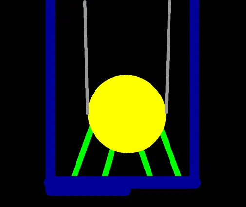

*Picture: [Tuned mass damper.gif](https://commons.wikimedia.org/wiki/File:Tuned_mass_damper.gif) by Anarchemitis at English Wikipedia, Public domain, from Wikimedia Commons.*

An extra weight on a spring, fixed to a part or structure that keeps shaking at one particular rate, tuned so that it swings the opposite way to the shaking and soaks up its energy, making the structure move much less while weighing much less than it.

**In plain words:** A weight on a spring (or a weight hanging like a pendulum) fixed to something that shakes, tuned to wobble at the same rate so that it swings against the shaking and calms it down. **Proper term:** Tuned mass damper (TMD), also called a dynamic vibration absorber.

**Also called:** dynamic vibration absorber (DVA); Den Hartog absorber for the damped version (Gavin, Duke CEE 541 notes); first invented by Frahm in 1909 (Scientific Reports 2025 review), so sometimes 'Frahm absorber' ⚑ [uncertain]; harmonic absorber, seismic damper (Wikipedia 'Tuned mass damper'); mass damper (the term used for the Renault Formula 1 device, Wikipedia); 'batteur' on the Citroen 2CV wheels (Wikipedia); pendulum damper or pendulum tuned mass damper (Taipei 101's 'wind damper'; Maurer MTMD-P); Stockbridge damper: the dumbbell-shaped tuned mass damper hung on power lines (Wikipedia 'Stockbridge damper'); tuned liquid damper or tuned liquid column damper: a water tank that sloshes instead of a solid weight (Wikipedia); harmonic damper, harmonic balancer, crankshaft damper or torsional damper: the rubber-and-ring version on a car engine's crankshaft pulley; centrifugal pendulum absorber is a related rotating type (Wikipedia 'Harmonic damper' and 'Tuned mass damper'); Schwingungstilger (German; Wikimedia Commons file name).

## How it works

Every springy structure has a rate at which it likes to wobble (its natural frequency, or resonance), and if something pushes it at that rate the wobble grows large. The tuned mass damper is a second, much smaller wobbler whose own rate is set (tuned) to match. When the structure shakes at that rate, the small weight swings strongly and out of step with it (about 180 degrees out of phase), so its spring pulls the structure back against its own motion, while the [damping](../glossary.md#damping) element turns the energy into heat (Wikipedia 'Tuned mass damper'; Gavin, Duke notes). The catch is that the pair now has two new resonances, one just below and one just above the old one, so the damper only helps over a band of frequencies around its tuning and can make things slightly worse well outside it (Wikipedia).

## Parts

A few parts: the extra weight (the tuned mass, e.g. a steel block, bolts and nuts, concrete or a water tank), a spring that lets it move (a coil spring, a springy rod or steel cable, a leaf of spring steel or plastic, or a pendulum cord), something that soaks up energy (a damping element: rubber, friction plates, an oil dashpot or a magnet near metal), and a clamp or bracket that fixes it to the vibrating part (Wikipedia 'Tuned mass damper'; Maurer; Wikipedia 'Stockbridge damper').

## Everyday examples

- The giant golden ball hanging inside the Taipei 101 skyscraper, a 660-tonne pendulum damper visitors can see (Wikipedia 'Taipei 101')
- The small dumbbell-shaped weights clamped to overhead power lines near the towers (Stockbridge dampers) (Wikipedia 'Stockbridge damper')
- The pulley on the front of a car engine's crankshaft, which has a heavy outer ring on a thin band of rubber (harmonic damper) (Wikipedia 'Tuned mass damper' and 'Harmonic damper')
- The dampers fitted under London's Millennium Bridge after it wobbled under crowds of walkers (Wikipedia 'Tuned mass damper')

## When to use it

Use one when a part or structure has one clear problem resonance that keeps getting excited: a tall, springy frame, a long arm or boom, a panel that hums at certain motor speeds, a cable that sings in the wind, or a footbridge that bounces. It is a good fix when stiffening the structure or adding damping directly is difficult or expensive (Wikipedia 'Tuned mass damper'), and when the shaking rate is fairly steady and known, because the damper must be tuned to it. It adds very little weight compared with the structure (Wikipedia) and needs no power.

## When not to use it

Don't use one when the shaking covers a wide or changing range of frequencies, or is random shocks: a single tuned damper only works in a band around its tuning and makes things slightly worse outside it (Wikipedia); use damping material, stiffening, or an adaptive damper (Maurer) instead. To stop vibration passing from a machine into a bench or floor, use isolation instead: rubber feet or an elastomer isolation mount (Hackaday: foam plus a concrete paver cut a 3D printer's noise by almost 8 dBA; Tom's 3D: anti-vibration feet beat a heavy paver for print quality). For 3D-printer ringing, firmware input shaping (Klipper) is the usual fix, and a very low ringing frequency (below about 20-25 Hz) calls for mechanical stiffening first (Klipper docs). To slow a single movement such as a closing lid, use a damper (dashpot). If the structure's frequency drifts with temperature, humidity or load, a fixed passive damper loses effect and needs a robust design or retuning (Wikipedia).

## Details

- **What it does (jobs):**
  - slow it, stop it or keep its speed steady: calms down shaking, swaying or ringing at one troublesome rate (a resonance) in a frame, panel, cable, bridge, building or engine
- **Movement:** multiple: the added weight moves back and forth relative to its mount, by sliding on springs, swinging as a pendulum, or bending on a springy rod or cable (Maurer MTMD-V, MTMD-H, MTMD-P; Wikipedia 'Stockbridge damper'). Its travel is small: millimetres in a small damper, though Taipei 101's 660-tonne ball swung 1 m in a typhoon (Wikipedia 'Taipei 101').
- **Directions it can move (degrees of freedom):** 1 per direction it is tuned for: the weight moves relative to the structure in one direction (a weight on a leaf spring or springs). A pendulum can swing in any horizontal direction, so it has 2. Each one adds a new way for the whole structure to vibrate (a second 'normal mode'), which is why the old single peak splits into two (Wikipedia; Gavin, Duke notes).
- **Special behaviour:**
  - none: it does none of the listed tricks. Its clever side is tuning: a weight on a spring that resonates at the same rate as the structure moves out of step with it and cancels most of the motion at that rate, using a weight much lighter than the structure (Wikipedia 'Tuned mass damper')
- **How it holds:**
  - not a holding joint (it moves or passes on motion): it doesn't join parts. Its weight is held by spring force (springs, a springy cable or a pendulum), and the whole unit is bolted or clamped to the vibrating part (Maurer; Wikipedia 'Stockbridge damper')
- **Input and output:** not applicable (it does not pass motion on; it soaks up vibration at one frequency)
- **Power:** passive (no power needed). Adaptive versions that adjust their tuning and damping while running need power and sensors; Maurer says these give 60-80% better vibration reduction than passive ones (Maurer). The Tremelo hand-tremor brace from Fresno State uses sets of tuned mass dampers in two enclosures (Hackaday 2019); commenters on that article describe it as a passive, unpowered resonator ⚑ [uncertain].
- **Load:** light to heavy, depending on size: it carries no useful load, only its own weight plus the back-and-forth (inertial) force of the swinging mass. The mount must hold that force without loosening ([shear](../glossary.md#peel-vs-shear) and pull at the fixing). Building dampers are huge: Taipei 101's is 660 tonnes (Wikipedia 'Taipei 101'); maker ones are a few bolts or nuts (Printables 'Stockbridge Damper').
- **Play and precision:** not applicable for locating parts. What matters is tuning [accuracy](../glossary.md#repeatability--accuracy): an undamped absorber is 'very sensitive to mis-tuning errors' and only suits a precisely known, unchanging forcing frequency; a damped one works over a wider band but with less cancellation at the centre (Gavin, Duke CEE 541 notes).
- **Taking it apart:** removable: it is bolted or clamped on and can be taken off or moved; Stockbridge dampers are even fitted to live power lines with insulated hot-stick tools (Wikipedia 'Stockbridge damper').
- **How often it can be reused:** many times: nothing is damaged by removing and refitting it, though it must be retuned if moved to a different structure
- **Sealing:** none
- **Adjustable:** yes, and it has to be: tune it by changing the weight (add or remove washers or nuts), moving the weight along a springy arm, changing the spring, or changing a pendulum's length (a pendulum's rate depends only on its length; Maurer MTMD-P, Wikipedia 'Pendulum (mechanics)'). Commercial dampers allow about plus or minus 10% frequency adjustment with springs and up to plus or minus 15% with pendulums (Maurer). Damping is adjusted by changing the rubber, friction or oil element.
- **Access needed:** one side only (blind): it is bolted or clamped to the outside of the vibrating part, at the spot that moves most
- **Materials:** Weights: steel, cast iron or concrete blocks (Wikipedia), steel plates welded into a ball (Taipei 101), metal bells on Stockbridge dampers, or water in a tank. Springs: steel coil springs (Maurer MTMD-V/H), steel messenger cable (Stockbridge), pendulum cables. Damping: rubber bands or blocks, friction plates (Maurer MTMD-P), hydraulic dashpots (Wikimedia 'Tuned mass damper.gif'). For makers: a printed frame or springy arm in PETG or similar plus steel bolts, nuts or washers as the weight (Printables 'Stockbridge Damper'; Microsoft Hacking STEM model uses washers on a dowel pendulum).
- **Heat, cold, water and wear:** The tuning drifts if either part changes: tall buildings' natural frequencies change with wind speed, temperature and humidity, so dampers must be designed to be robust to this (Wikipedia 'Tuned mass damper'). Printed springs change too: PLA starts to soften at about 60 C and PETG at about 80 C (CNC Kitchen), and PLA [creeps](../glossary.md#creep) under constant stress (Thrinter), so a printed spring can sag and detune in a warm enclosure. Rubber and oil damping elements get stiffer when cold and softer when hot ⚑ [uncertain]. Constant vibration can [fatigue](../glossary.md#fatigue) springs and fixings; on power lines, vibration fatigue of conductor strands is exactly what Stockbridge dampers are fitted to prevent (Wikipedia 'Stockbridge damper').

## Making it

- **Ways to make or get it:**
  - 3D print (FDM): the springy arm, frame or holder, with bolts, nuts or washers added as the weight (Printables 'Stockbridge Damper' for 3D-printer panel noise)
  - woodwork: demonstration models of a swaying 'building' with a pendulum damper (Practical Engineering and Microsoft Hacking STEM Instructables)
  - off-the-shelf part: Stockbridge dampers for cables, commercial tuned mass dampers for buildings, bridges and machines (Maurer), and crankshaft harmonic dampers for engines (Wikipedia 'Harmonic damper')
- **Printing it in one piece (print in place):** partly: the springy arm and holder can be one printed piece, but it needs added metal weights (bolts, nuts or washers) and usually a damping element (Printables 'Stockbridge Damper' adds M6 bolts as weights)
- **Tools:** A spanner or screwdriver to mount it, plus something to measure the shaking rate: Practical Engineering's model used an ADXL345 accelerometer board and an Arduino (Instructables 'Tuned Mass Damper Demonstration'); a stopwatch is enough for slow sway (measure the period). For printed versions, a tap to thread holes for bolts used as weights (Printables 'Stockbridge Damper').
- **Difficulty:** moderate: easy to build (a weight on a springy arm or a pendulum), but it only works if tuned, so you need to measure the problem frequency and adjust by trial and error

### 3D printing tips

1) Measure first: find the rate at which the part rings or sways before designing anything. Practical Engineering locked the damper, set the model swaying and worked out its natural period from accelerometer data (ADXL345 board and Arduino; Instructables). A slow sway can be timed with a stopwatch. 2) Use printed plastic only for the spring and holder, and metal for the weight: the printed Stockbridge damper on Printables has side holes tapped M6 for bolts as weights, and its author warns to clamp the part while tapping to stop layers splitting (Printables 'Stockbridge Damper'). 3) Build in adjustment, because you will not hit the tuning first time: a slot or threaded rod so the weight can slide along the arm, nuts that can be added or removed, or an adjustable pendulum length. Commercial dampers allow about plus or minus 10-15% (Maurer). 4) For a pendulum damper, the rate depends only on length: length in metres is about (period in seconds) squared divided by 4, so a 1 s sway needs about a 25 cm pendulum (Wikipedia 'Pendulum (mechanics)', rule of thumb section). 5) For a weight on a springy arm, a longer or thinner arm or a heavier weight lowers the rate; make the arm adjustable rather than calculating exactly ⚑ [uncertain]. 6) Give it some damping, or it will create two new sharp resonances either side of the old one: rubber or TPU pads, foam, friction, or a magnet close to a copper or aluminium plate (eddy-current damping) (Wikipedia; Gavin, Duke notes). 7) Avoid PLA for the spring if the part stays warm or under constant load: PLA starts to soften at about 60 C and PETG at about 80 C (CNC Kitchen), and PLA creeps under constant stress (Thrinter), which slowly changes the tuning; PETG, ASA or nylon are safer choices ⚑ [uncertain for the exact effect on tuning]. 8) Fix it rigidly to the spot that moves most (an antinode); Stockbridge dampers are placed at the nearest antinodes either side of a clamp (Wikipedia 'Stockbridge damper'). 9) Test with and without: lock the weight (tape or a wedge) and compare, as in the Practical Engineering demo. 10) Expect a modest gain: the printed Stockbridge damper's author says it is 'purely empirical' and 'reduced noise for my printer some' (Printables).

### Buying one (off-the-shelf parts)

Search terms: 'tuned mass damper', 'dynamic vibration absorber', 'Stockbridge damper' (vibration damper for overhead conductors), 'harmonic balancer' or 'crankshaft damper' (engines), 'pendulum damper'. Parts to build one: compression or extension springs, spring steel strip, steel wire rope, threaded rod with nuts and washers as adjustable weights, rubber bumpers or sorbothane-type pads for damping ⚑ [uncertain], and an 'ADXL345 accelerometer breakout' to measure the vibration (Instructables 'Tuned Mass Damper Demonstration'). Industrial makers such as Maurer build custom TMDs (MTMD-V vertical, MTMD-H horizontal, MTMD-P pendulum) (Maurer).

## Rules of thumb

- Simple (undamped) tuning: make the damper's own natural frequency, from the square root of spring [stiffness](../glossary.md#stiffness) divided by mass, equal to the forcing frequency. It then stops the structure's motion at that frequency, but it is 'very sensitive to mis-tuning errors' and only suits a precisely known frequency that does not vary (Gavin, Duke CEE 541 'Tuned Mass Dampers', eq. 6 and text).
- Best tuning for a damped damper (Den Hartog): set the damper's natural frequency to 1/(1 + mass ratio) times the structure's natural frequency, where the mass ratio is damper mass divided by structure mass; e.g. about 0.95 times for a 5% mass (Gavin, Duke notes, eq. 10; 0.95 worked from the formula).
- With that tuning and the best damping, the worst-case motion is the square root of (2 + mass ratio)/(mass ratio) times the static [deflection](../glossary.md#deflection): about 6.4 times for a 5% mass and 3.3 times for a 20% mass (Gavin, Duke notes, eq. 11; numbers worked from the formula). A heavier damper therefore gives a bigger reduction.
- Best damping (Den Hartog, in Gavin's notation where damping is measured against the main structure): damping ratio = square root of (3 x mass ratio cubed)/(8 x (1 + mass ratio) cubed) (Gavin, Duke notes, eq. 12). In practice the damper needs moderate damping: too little leaves two sharp peaks, and infinite damping simply locks the weight to the structure (Gavin, Duke notes, figures 3-4).
- Bigger mass ratio (damper mass divided by the structure's modal mass) gives more vibration reduction, a wider working band and less travel of the damper mass (Maurer). Slender structures have only about 0.5-1% damping of their own, which is why they need one (Maurer).
- A damper of 10% of the main mass cut the peak response in Wikipedia's example from 9 to 5.5 units, but the system then vibrated somewhat more than before at frequencies well below and well above the old peak (Wikipedia 'Tuned mass damper').
- Pendulum dampers are tuned by length, not weight: length (m) is about period (s) squared divided by 4 (Wikipedia 'Pendulum (mechanics)'; Maurer: 'Vibration frequency is determined by the length of the pendulum').
- Put it where the structure moves most: Stockbridge dampers go at the nearest antinodes (points of largest movement) either side of a clamp, normally two per span (Wikipedia 'Stockbridge damper'); building dampers go near the top (Taipei 101: 88th-92nd floors; Wikipedia).
- Allow tuning range: commercial spring dampers can be adjusted about plus or minus 10% in frequency and pendulum dampers up to plus or minus 15% (Maurer).

## Common failures

Mistuned: tuned to the wrong frequency, so it does little, or shifts the problem to another speed; measure the real frequency and make the damper adjustable (Gavin; Wikipedia). Too little damping: two new sharp peaks appear either side of the old one; add rubber, friction or eddy-current damping (Gavin, figure 3). Too much damping or a jammed weight: the weight just moves with the structure and adds mass but no cancellation (Gavin: infinite damping 'links' the absorber to the structure). Fitted at a still spot (a node) instead of the point of largest motion (Wikipedia 'Stockbridge damper'). The structure's frequency drifts, or a printed spring creeps or softens, so the tuning wanders (Wikipedia; Thrinter; CNC Kitchen). Weight too small for the job: a bigger mass ratio gives more reduction and a wider band (Maurer). Loose fixings or fatigue cracks in springs after long vibration ⚑ [uncertain].

## Safety

A big damper stores a lot of moving energy: Taipei 101's 660-tonne ball moved 1 m in a typhoon (Wikipedia), so large dampers need travel stops and clear space around them. Make sure weights cannot shake loose and fly off a vibrating machine ⚑ [uncertain]. A badly tuned damper can increase vibration at other speeds (Wikipedia). Never try to fit anything to power lines; Stockbridge dampers are fitted by line workers using insulated hot-stick tools (Wikipedia 'Stockbridge damper').

## Related

- Elastomer isolation mount (rubber bobbin mount): stops vibration passing between a machine and its frame instead of cancelling a resonance; works over a wide frequency range
- Damper (dashpot, rotary or linear soft-close damper): resists any movement in proportion to speed; often used as the damping element inside a tuned mass damper (Wikimedia 'Tuned mass damper.gif' shows hydraulic cylinders)
- Eddy-current brake: a magnet near a moving metal plate makes a contact-free damping element for a small tuned mass damper
- Coil spring and printed leaf spring (flat [cantilever](../glossary.md#cantilever) spring): the spring part of a tuned mass damper
- Harmonic damper (crankshaft damper) and centrifugal pendulum absorber: rotating versions that calm twisting vibration in engine crankshafts (Wikipedia)
- Tuned liquid damper: uses sloshing water in a tank instead of a solid weight (Wikipedia, e.g. Sydney Tower and Comcast Center)
- Input shaping (firmware): the software alternative for 3D printers and machines, which shapes the motion commands so they don't excite the resonance (Klipper docs)
- Speed governor (fly fan, centrifugal governor): also in the 'slows it down' family, but controls speed rather than vibration

## Make it yourself

- [Tuned Mass Damper Demonstration (Instructables, practicalengineering)](https://www.instructables.com/Tuned-Mass-Damper-Demonstration/): Build guide for a scrap-wood swaying 'building' on dowels with a pendulum damper and an ADXL345 accelerometer on an Arduino to record the sway; the demo locks the pendulum, sets the model swaying and measures its natural period *(licence: not shown on page)*
- [Microsoft Hacking STEM: Tuned Mass Damper (Instructables)](https://www.instructables.com/Microsoft-Hacking-STEM-Tuned-Mass-Damper/): Classroom build of a model tower from paper plates and dowels, with a pendulum made from a dowel carrying about 20 metal washers *(licence: not shown on page)*
- [Stockbridge Damper (Printables) (URL from Printables API, page not opened)](https://www.printables.com/model/609697-stockbridge-damper): Printed Stockbridge-style tuned mass damper to reduce noisy back-panel resonance on a 3D printer; M4 bolt mounting hole, side holes tapped M6 for bolts as weights; the author calls it purely empirical but says it reduced noise somewhat *(licence: CC BY-SA (Creative Commons Attribution-ShareAlike))*

## Pictures, videos and models

- [Tuned mass damper.gif (Wikimedia Commons, by Anarchemitis)](https://commons.wikimedia.org/wiki/File:Tuned_mass_damper.gif): Animation of a skyscraper swaying with and without a tuned mass damper at the top; green marks the hydraulic cylinders that damp the motion *(licence: Public domain)*
- [Tuned mass damper - Taipei 101 (Wikimedia Commons, photo by Guillaume Paumier)](https://commons.wikimedia.org/wiki/File:Tuned_mass_damper_-_Taipei_101_-_Wikimania_2007_0224.jpg): Photo of the huge steel pendulum ball damper inside Taipei 101 *(licence: CC BY-SA 2.5 / CC BY-SA 3.0 / GFDL 1.2+)*
- [Stockbridge damper new with ruler (Wikimedia Commons, photo by Alex P. Kok)](https://commons.wikimedia.org/wiki/File:Stockbridge_damper_new_with_ruler.jpg): A new Stockbridge damper next to a ruler: a small weight on a short cable, a larger weight on a longer cable, and the clamp in the middle; almost half a metre long *(licence: CC BY-SA 4.0)*
- [Tuned Mass Dampers, CEE 541 Structural Dynamics (H.P. Gavin, Duke University, 2016)](https://people.duke.edu/~hpgavin/StructuralDynamics/TunedMassDamper.pdf): Diagram of the Den Hartog absorber and graphs of the structure's response with an untuned, undamped and optimally damped tuned mass damper *(licence: CC BY-NC-ND (link only))*
- [Tuned Mass Damper Demonstration (Instructables, by practicalengineering, 2016)](https://www.instructables.com/Tuned-Mass-Damper-Demonstration/): Photos and accelerometer graphs of a wobbly wooden model building with a pendulum damper, locked and unlocked *(licence: not shown on page (link only))*

## Needs confirming

⚑ marks something nobody has confirmed yet: a fact the research could not confirm from a source, a finder value that is a best guess, or an open point from the research notes. Corrections are welcome (see `research/needs-confirming.md`).

- ⚑ 8 sentences on this page marked [uncertain].

## Sources

- <https://en.wikipedia.org/wiki/Tuned_mass_damper>
- <https://en.wikipedia.org/wiki/Stockbridge_damper>
- <https://en.wikipedia.org/wiki/Taipei_101>
- <https://en.wikipedia.org/wiki/Harmonic_damper>
- <https://en.wikipedia.org/wiki/Pendulum_(mechanics)>
- <https://people.duke.edu/~hpgavin/StructuralDynamics/TunedMassDamper.pdf>
- <https://www.nature.com/articles/s41598-025-98320-5>
- <https://www.maurer.eu/en/buildings/tuned-mass-damper/>
- <https://www.instructables.com/Tuned-Mass-Damper-Demonstration/>
- <https://www.instructables.com/Microsoft-Hacking-STEM-Tuned-Mass-Damper/>
- <https://hackaday.com/2019/12/08/controlling-tremors-as-they-happen/>
- <https://hackaday.com/2020/05/20/bricking-your-3d-printer-in-a-good-way/>
- <https://toms3d.org/2022/05/30/wobbly-3d-printer-makes-for-better-parts/>
- <https://www.klipper3d.org/Resonance_Compensation.html>
- <https://www.cnckitchen.com/blog/comparing-pla-petg-amp-asa-feat-prusament>
- <http://thrinter.com/creep-abs-pla-petg-alloy-910/>
- <https://www.printables.com/model/609697-stockbridge-damper>
- <https://commons.wikimedia.org/wiki/File:Tuned_mass_damper.gif>
- <https://commons.wikimedia.org/wiki/File:Tuned_mass_damper_-_Taipei_101_-_Wikimania_2007_0224.jpg>
- <https://commons.wikimedia.org/wiki/File:Stockbridge_damper_new_with_ruler.jpg>
