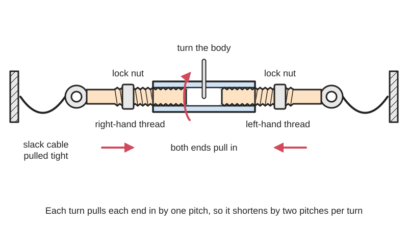
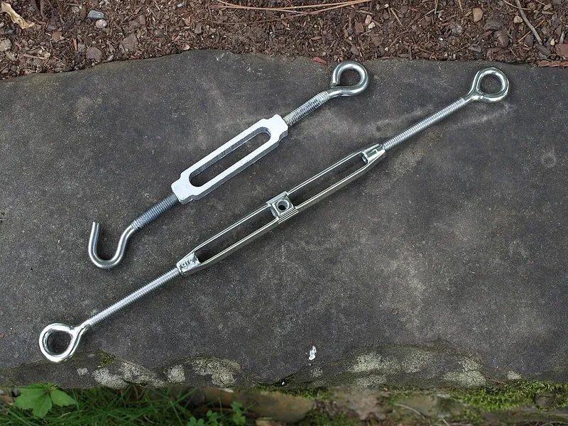

<figure class="eoc-pic eoc-pic-main"><picture><source media="(prefers-reduced-motion: reduce)" srcset="../media/drawn/turnbuckle.svg"></picture><figcaption><strong>Animation.</strong> Diagram drawn for the encyclopaedia from the research notes. ⚑ Needs confirming: a drawing can simplify or get details wrong; a real photo or a better diagram is welcome.</figcaption></figure>
<figure class="eoc-pic"><figcaption><strong>Photo.</strong> <a href="https://commons.wikimedia.org/wiki/File:Turnbuckles.jpg">Turnbuckles</a> by Ted Major from Tuscaloosa, Ala., USA, <a href="https://creativecommons.org/licenses/by-sa/2.0">CC BY-SA 2.0</a>, from Wikimedia Commons.</figcaption></figure>
<figure class="eoc-pic"><figcaption><strong>How it works.</strong> <a href="https://commons.wikimedia.org/wiki/File:Turnbuckle_James_Craig.JPG">Turnbuckle James Craig</a> by JohnsonL623, <a href="https://creativecommons.org/licenses/by-sa/3.0">CC BY-SA 3.0</a>, from Wikimedia Commons.</figcaption></figure>

A threaded sleeve with a right-hand thread at one end and a left-hand thread at the other, so turning the sleeve draws both end fittings in (or lets them out) at the same time, tightening or loosening a wire, rope, chain or rod without twisting it.

**In plain words:** A metal sleeve with a screw going into each end, one threaded the normal way and one backwards, so twisting the sleeve pulls both screws in at once and tightens the wire, rope or rod they are attached to. **Proper term:** Turnbuckle.

**Also called:** stretching screw (Wikipedia); bottle screw, bottlescrew (the closed, tube-bodied version); rigging screw (sailing); wire tensioner, cable tensioner; Spannschloss, Spannschraube, Wantenspanner (German); screw coupling (railway couplings use one spindle with a left- and a right-hand thread, German Wikipedia); AN/MS turnbuckle, clip-locking turnbuckle (aircraft: MS21251 body, MS21256 locking clip); turnbuckle link (RC cars: a rod threaded left-hand at one end and right-hand at the other); anti-sag gate kit (turnbuckle sold with cable and corner brackets).

## How it works

The two end fittings screw into opposite ends of the body, one with an ordinary right-hand thread and one with a left-hand thread. Because the threads spiral opposite ways, turning the body one way screws both ends in together, pulling them towards each other; turning it back lets them out; and this happens 'without twisting the eye bolts or attached cables' (Wikipedia). Each full turn moves each end by one thread [pitch](../glossary.md#pitch), so the whole assembly shortens by twice the pitch per turn, and the screw's leverage turns a modest hand effort into a large pull. Thread friction stops it unwinding under a steady pull, but vibration can turn it, so it is locked with jam nuts, safety wire or clips (Wikipedia; AC 43.13-1B).

## Parts

A few parts: a body (an open frame, or a closed tube called a bottle screw) with a right-hand internal thread at one end and a left-hand one at the other; two threaded end fittings (eye, hook, jaw or clevis with a pin, a plain stub for welding, or a swage stud or fork on wire rope); and locking parts: lock (jam) nuts, safety wire, locking clips, or split pins through a slotted body (Crosby; AC 43.13-1B; Petersen). Sailing rigging screws add a toggle so the stay can swivel (Seldén). A variant uses one central rod with both threads screwing into two threaded sleeves (German Wikipedia).

## Everyday examples

- An anti-sag gate kit: a diagonal cable and turnbuckle hold a wooden gate square (National Hardware)
- Shade sails, washing lines and cable fences or railings tensioned with turnbuckles (Sailrite; Wikipedia)
- Sailing-boat shrouds and stays (rigging screws) and ships' lashings (Wikipedia; Seldén)
- The corners of a wrestling ring, where padded turnbuckles tension the ropes (Wikipedia)

## When to use it

When a wire, rope, chain or rod needs to be pulled tight and held, or its length fine-tuned, and then left: guy wires, fence and railing cables, shade sails, gate braces, hanging scenery or shelves from cables, bracing frames and towers, boat rigging, and adjustable links. It gives large force from a small turning effort, adjusts smoothly in small steps, doesn't twist the cable, can be re-tightened as things stretch, and is cheap and widely available.

## When not to use it

When tension must be released quickly (use a lever or [over-centre](../glossary.md#over-centre) tensioner, a cam buckle or a quick-release); when a lot of slack must be taken up (take-up is limited: use a [ratchet](../glossary.md#ratchet) strap, winch or pulley system); when the pull isn't in a straight line (side loads bend it: add toggles or shackles, or use another fitting); where it will be vibrated and can't be locked; for lifting or life-safety loads with unrated hardware-store turnbuckles (use rated forged ones); or where a constant tension is needed as things stretch or warm up (use a spring tensioner, e.g. a belt tensioner or constant-force spring).

## Details

- **What it does (jobs):**
  - tighten and hold tension: pull a wire, rope, chain or rod tight and keep it there
  - line parts up exactly: fine-adjust the length of a stay, brace or link, e.g. making a hung scenery piece sit level in theatre rigging (Wikipedia)
  - join and hold: its end fittings link a cable to an anchor or to another cable
- **Movement:** rotate+slide: turning the body (rotate) moves the two ends in or out along the line (slide); total travel is the 'take-up', e.g. 4-1/2 in (114 mm) on a Crosby 5/16 in x 4-1/2 in turnbuckle
- **Directions it can move (degrees of freedom):** 1 while adjusting: turning the body and changing the length are locked together by the threads (a screw motion); 0 once it is set and locked. Eye, jaw and toggle ends can also pivot on their pins or shackles, and a toggle adds articulation (Seldén).
- **Special behaviour:**
  - tensioning (takes up slack and holds): its main purpose
  - motion conversion (e.g. rotary to linear): turning the body shortens or lengthens the line by twice the thread pitch per turn
  - [self-locking](../glossary.md#self-locking) (holds under load, won't back-drive): thread friction holds it under a steady pull, but vibration can turn it, so it is secured with lock wire, clips or jam nuts (Wikipedia; AC 43.13-1B)
- **How it holds:**
  - shape (the parts interlock; [form-fit](../glossary.md#form-fit--force-fit--material-bond)): the screw threads carry the pull
  - friction or clamping (force-fit): thread friction, plus jam nuts tightened against the body, stop it unwinding
- **Input and output:** rotation of the body -> straight-line shortening or lengthening; the two ends move towards or away from each other by one pitch each per turn, so 2 × pitch per turn (e.g. about 2.5 mm per turn for M8 threads, whose coarse pitch is 1.25 mm ⚑ [uncertain: pitch from the ISO coarse series, not from an opened page]); rough efficiency: low, as in any sliding screw thread ⚑ [uncertain: no figure found]; shaft arrangement: in line (both ends pull along one axis); back-drivable: only when vibrated (a steady pull does not unwind it)
- **Power:** passive (no power needed)
- **Load:** Light to heavy, in straight pull only: Crosby's turnbuckles are 'recommended for straight or in-line pull only'. Hardware-store zinc-plated turnbuckles are light duty (National Hardware 1/4 in x 7-1/2 in hook/eye: 90 lb, about 41 kg, safe working load); forged galvanized rigging turnbuckles are far stronger (Crosby working load limits at a 5:1 design factor: 1/4 in 500 lb; 5/16 in 800 lb; 3/8 in 1,200 lb; 1/2 in 2,200 lb). Sizes run from about 10 g for garden-fence wire to tonnes for bridges and buildings (Wikipedia). Weak against bending and side loads.
- **Play and precision:** Small: a little [axial](../glossary.md#axial--radial) play in the threads until it is under tension ⚑ [uncertain: no amount found]. Adjustment is fine and repeatable (2 × pitch per turn, and part turns give finer steps). It tolerates little [misalignment](../glossary.md#misalignment): it must pull in a straight line, so rigging uses toggles to let it articulate (Seldén), and aircraft practice replaces a bent turnbuckle because it puts 'undesirable stress on the cable' (AC 43.13-1B).
- **Taking it apart:** removable: unscrew the body to release the tension, then unhook or unpin the end fittings; body and fittings can be reused
- **How often it can be reused:** many times: it is meant to be re-adjusted and reused, but stainless-on-stainless threads can gall and seize (Sailrite), and aircraft practice replaces turnbuckles with bent or distorted threads and never reuses safety wire (AC 43.13-1B)
- **Sealing:** none: nothing makes it seal
- **Adjustable:** yes: that is its job; turn the body to set the tension or length anywhere within the take-up range, then lock it
- **Access needed:** not applicable: it sits in the middle of the line; you only need room to reach and turn the body and to attach each end
- **Materials:** Forged, quenched-and-tempered or normalized, hot-dip galvanized steel for rigging (Crosby); zinc-plated steel for light hardware-store types (National Hardware); cast or seamless-tube 316 stainless steel for marine and architectural use; chrome-plated aluminium-bronze bodies with stainless end fittings, or bronze thread inserts, to stop threads [galling](../glossary.md#galling--fretting) (Seldén; Petersen); aluminium bodies on some cheap types (Wikimedia Commons photo description). Printed: PLA, PETG, ABS or ASA (Printables). It joins steel wire rope, synthetic rope, chain, rods and cables.
- **Heat, cold, water and wear:** Vibration loosens it unless locked (Wikipedia; AC 43.13-1B). Stainless threads gall, especially under tension; lubricate and use bronze-bodied rigging screws (Sailrite; Seldén). Hot-dip galvanized steel is the usual outdoor finish for rigging (Crosby); zinc-plated hardware-store types rust sooner ⚑ [uncertain]. One heavy closed-body range in the Crosby catalogue is rated from -4 °F to 392 °F (-20 °C to 200 °C). Cyclic loads such as boat rigging in waves can [fatigue](../glossary.md#fatigue) threads and fittings, which is why rigging uses toggles ⚑ [uncertain: fatigue link not stated in an opened source]. Printed plastic versions: PLA has low heat and UV resistance, PETG is fine below about 80 °C, ASA resists UV up to 93 °C (Prusa), and constant tension makes plastic [creep](../glossary.md#creep) ⚑ [uncertain].

## Making it

- **Ways to make or get it:**
  - off-the-shelf part: the usual route (hardware stores, rigging and marine suppliers)
  - 3D print (FDM): body and end fittings with modelled left- and right-hand threads (Printables 'Parametric turnbuckle'; BOSL2 threading.scad)
  - CNC: turning and threading the body and ends on a lathe ⚑ [uncertain: no DIY guide opened]
  - 3D print (resin): possible for small, light-duty parts ⚑ [uncertain: no tested example found]
- **Printing it in one piece (print in place):** no: printed as a body and two separate end fittings that are screwed in; the designs mark which end is left-handed with notches (one notch for left, two for right on the Parametric turnbuckle) so they go in the right ends (Printables 823324 and 451102)
- **Tools:** none for small ones (turned by hand); a bar or screwdriver through an open body, or a spanner on the flats of a closed body (German Wikipedia); spanners for jam nuts; pliers for safety wire, clips or split pins; anti-seize compound for stainless threads (Sailrite)
- **Difficulty:** easy to fit (buy one and hook it in); moderate to make: printed turnbuckles work for light loads with coarse threads and a parametric generator exists, but left-hand threads, thread [clearance](../glossary.md#clearance) and strength along the thread axis need care

### 3D printing tips

1) Model real threads, one left-handed: in OpenSCAD, BOSL2's threaded_rod() and threaded_nut() take left_handed=true, and $slop adds 4 × $slop of clearance to internal threads; Dalibor Frívaldský's Parametric turnbuckle (CadQuery) generates body, eye and hook ends with any thread diameter and take-up. 2) Go coarse and big: avoid FDM threads smaller than M5, and keep a wall around the internal thread at least as thick as the thread diameter (Hubs); the parametric design defaults to M10 with 100 mm take-up. 3) Mark the handedness with notches on the body and ends so you can't mix them up (Frívaldský; A_Str8). 4) Mind the layer direction: the end fittings are pulled along their length, so printed standing up the pull tries to split the layers ('it might break across the [layer lines](../glossary.md#layer-lines)', ThirtyThreeDown). For strong ends, print them lying down with a flat trimmed off each side (about 1/6 of the thread diameter) and use a trapezoidal thread with about 0.12 mm clearance (ThirtyThreeDown); print the body standing up so its internal threads come out round. 5) Settings that worked: PLA, 0.15 mm layers, 3 [perimeters](../glossary.md#perimeters), 15% gyroid [infill](../glossary.md#infill) (Frívaldský); 4 perimeters and 40% infill with no supports, where the heavier version held the designer's 80 kg and the lighter one at least 40 kg (super...Laserkatz, shade-sail turnbuckle). 6) Start moving-fit clearances at about 0.3 mm (Prusa) and test a short pair before printing the full length. 7) Material: ABS or ASA for weather resistance (super...Laserkatz); PETG suits outdoor use below about 80 °C and ASA resists UV up to 93 °C, while PLA has low UV and heat resistance (Prusa); plastic under constant tension slowly stretches (creeps), so re-check tension ⚑ [uncertain: no creep figure opened]. 8) Lock it: add a printed or metal jam nut, a pin through the body, or a cable tie, because printed threads can back off with vibration ⚑ [uncertain]. 9) Typical failures: ends snapping across the layers, threads stripping when too little is engaged, and threads binding when clearance is too tight.

### Buying one (off-the-shelf parts)

Turnbuckles by end fitting: eye-eye, hook-eye, hook-hook, jaw-jaw (clevis), jaw-eye and stub ends (for welding), with open (frame) or closed (pipe or bottle-screw) bodies. Forged galvanized rigging turnbuckles meeting ASME B30.26 (e.g. Crosby HG-223 hook-hook, HG-226 eye-eye, HG-227 jaw-eye, HG-228 jaw-jaw) and matching lock nuts; zinc-plated hardware-store turnbuckles; stainless marine rigging screws with toggles, swage studs, forks or eyes (e.g. Seldén, Petersen, Sta-Lok, brands); aircraft turnbuckles to AN/MS drawings with MS21256 locking clips or safety wire (AC 43.13-1B); anti-sag gate kits (turnbuckle, cable, corner brackets, cable clamps; National Hardware); DIN 1478 turnbuckles in Europe (German Wikipedia); RC-car turnbuckle links and turnbuckle wrenches.

## Rules of thumb

- Screw both ends in by the same amount, and when tensioned leave no more than three threads showing outside the body at either end (FAA AC 43.13-1B, paragraphs 7-166 and 7-179); some bodies have a 'witness hole' to check that the threads reach far enough in (7-167).
- Lock it against vibration: aircraft turnbuckles get safety wire (double-wrap preferred, each end wrapped at least four turns round the shank, never reused) or approved locking clips (AC 43.13-1B, 7-179 and 7-180); rigging turnbuckles use lock nuts (Crosby); closed marine bodies can be slotted for split pins (Petersen).
- Straight, in-line pull only; forged Crosby turnbuckles have a 5:1 design factor, a proof load of 2.5 × the working load limit, and are fatigue-rated to 20,000 cycles at 1.5 × the working load limit (Crosby catalogue page 225).
- Compare ratings before you trust one: Crosby forged galvanized 1/4 in 500 lb, 5/16 in 800 lb, 3/8 in 1,200 lb, 1/2 in 2,200 lb working load limit (Crosby catalogue) versus 90 lb safe working load for a zinc-plated 1/4 in x 7-1/2 in hook/eye hardware-store turnbuckle (National Hardware).
- Take-up = open length minus closed length, and it is the second number in the size: a Crosby 5/16 x 4-1/2 eye-eye is 13.92 in fully open and 9.42 in closed (Crosby catalogue).
- Each full turn of the body changes the length by twice the thread pitch, because both ends move one pitch at once (follows from the opposite-hand threads described by Wikipedia and AC 43.13-1B).
- Stainless-on-stainless threads gall: coat them with anti-seize and turn slowly (Sailrite); marine rigging screws use chrome-plated aluminium-bronze bodies, or aluminium-bronze thread inserts from 5/8 in up, to stop seizing (Seldén; Petersen).
- On boats, fit toggles so the stay can move freely: 'the main purpose of a toggle is to achieve correct articulation in the connection between the rigging and the mast or chainplate' (Seldén).
- For printed turnbuckles: no FDM threads below M5, a wall at least one thread diameter thick around internal threads (Hubs), about 0.3 mm clearance for moving fits (Prusa), and BOSL2 adds 4 × $slop to internal threads (BOSL2 threading.scad).

## Common failures

Loosens and loses tension: not locked against vibration; fit jam nuts, safety wire or clips (Wikipedia; AC 43.13-1B). Runs out of adjustment: the cable was cut too long or has stretched; shorten the cable rather than leaving only a few threads engaged (AC 43.13-1B). Seizes or galls: stainless on stainless, dirty or dry threads; use anti-seize and turn slowly (Sailrite), or bronze-bodied rigging screws (Seldén). Bends or cracks: side load or no toggle to let it align (Crosby 'straight or in-line pull only'; Seldén); replace bent ones (AC 43.13-1B). Breaks: an unrated turnbuckle overloaded. Ends in the wrong holes: left- and right-hand ends mixed up; check the markings or notches. Printed: ends snap across the layer lines or threads strip (ThirtyThreeDown; Hubs).

## Safety

A tight cable stores energy: if a turnbuckle, thread or end fitting fails, the cable can whip back ⚑ [uncertain: no source opened]. Never use more than the working load limit, and don't use light hardware-store turnbuckles (e.g. 90 lb safe working load) for lifting, swings, hammocks or anything that holds people; use rated, forged hardware. An open hook end can fall off if the line goes slack ⚑ [uncertain]. Keep enough thread engaged (no more than three threads showing, AC 43.13-1B), because an end screwed out too far can strip. Aircraft control-cable turnbuckles are flight-critical parts to be adjusted and safetied by qualified mechanics (AC 43.13-1B).

## Related

- Differential screw (fine adjustment screw): two threads of the same hand but different pitch give a tiny movement per turn, where a turnbuckle's opposite-hand threads give double movement
- Lead screw and nut: one thread driving a nut along it, used for motion rather than holding tension
- Ratchet tie-down strap (ratchet buckle): winds in webbing with a lever and ratchet; much more take-up and quick release, less fine adjustment
- Capstan and windlass: a crank-turned drum that winds in rope with a big force over long distances
- Guy-line slider (friction line tensioner): tensions a tent line by friction, quick but weak
- Belt tensioner (spring-loaded [idler](../glossary.md#idler)): keeps tension constant with a spring instead of a fixed setting
- Eccentric adjuster: a turned off-centre bush or nut that shifts a part a small amount
- Draw latch (over-centre latch) and toggle clamp: pull things tight with a lever that snaps past centre, fast to open
- Rod end and ball link (rose joint, RC ball link): the swivelling ends often screwed onto turnbuckle links in RC cars and [linkages](../glossary.md#linkage)

## Make it yourself

- [Parametric turnbuckle by Dalibor Frívaldský, Printables](https://www.printables.com/model/823324-parametric-turnbuckle): A CadQuery-generated, FFF-printable turnbuckle (body plus eye and hook ends) with adjustable thread diameter, take-up and eye size; default M10 thread, 100 mm take-up, 16 mm eyes; a Jupyter notebook and GitHub project for making other sizes are linked from the model. Details read through the Printables public API; the URL appeared in search results. *(licence: CC BY-SA)*
- [BOSL2 threading.scad (OpenSCAD library source)](https://raw.githubusercontent.com/BelfrySCAD/BOSL2/master/threading.scad): OpenSCAD modules threaded_rod() and threaded_nut() with a left_handed option and a $slop clearance setting, enough to model a turnbuckle body and ends; includes an example with left- and right-handed nuts on one rod *(licence: BSD 2-Clause)*
- [Spannschloss für Sonnensegen, turnbuckle by super...Laserkatz, Printables (URL from Printables API, page not opened)](https://www.printables.com/model/883466-spannschloss-fur-sonnensegen-turnbuckle): A printed turnbuckle for shade sails with left- and right-hand threaded hooks in light and heavy versions; printed in PLA with 4 perimeters and 40% infill, the heavy one held the designer's 80 kg; ABS or ASA suggested for outdoor use *(licence: CC BY-NC-SA)*
- [Wire Tensioner / Turnbuckle by A_Str8, Printables (URL from Printables API, page not opened)](https://www.printables.com/model/451102-wire-tensioner-turnbuckle): A small printed turnbuckle for tensioning string or wire (made to hang children's artwork); notches on the bolts and centre piece show which side each goes *(licence: CC BY-NC-SA)*

## Pictures, videos and models

- [Turnbuckles.jpg, Wikimedia Commons, photo by Ted Major](https://commons.wikimedia.org/wiki/File:Turnbuckles.jpg): A cheap 3 in turnbuckle (aluminium body, hook and eye) next to a 9 in cast stainless-steel turnbuckle, showing the open body and the two threaded ends *(licence: CC BY-SA 2.0)*
- [Turnbuckle James Craig.JPG, Wikimedia Commons, photo by JohnsonL623](https://commons.wikimedia.org/wiki/File:Turnbuckle_James_Craig.JPG): A bottle screw tensioning the main topmast fore stay of the barque James Craig *(licence: CC BY-SA 3.0)*
- [FAA AC 43.13-1B, 7-166 Turnbuckle Installation (transcription by Land Sea Sky Space)](https://www.landseaskyspace.com/ac4313/7-166.html): How far the threaded terminals must be screwed into the barrel, the clip-locking turnbuckle part numbers, and the witness hole, with references to figures 7-23 and 7-25 *(licence: Public domain (US FAA text); site layout by Land Sea Sky Space)*
- [Crosby turnbuckles, catalogue page 225 (PDF)](https://www.thecrosbygroup.com/wp-content/uploads/catalog/2022/en-US/225.pdf): Dimensioned drawing of an eye-and-eye turnbuckle with a table of working load limits, take-up and open and closed lengths *(licence: © The Crosby Group; link only)*
- [Understanding Turnbuckles and How They Are Used in Rigging | Lifting.com (Bishop Lifting, YouTube)](https://www.youtube.com/watch?v=5T_QNdU6t8s): Explainer on turnbuckle types, end fittings and use in rigging ⚑ [uncertain: title and channel confirmed through YouTube's oEmbed data; the video itself was not watched] *(licence: YouTube standard licence; link only)*

## Needs confirming

⚑ marks something nobody has confirmed yet: a fact the research could not confirm from a source, a finder value that is a best guess, or an open point from the research notes. Corrections are welcome (see `research/needs-confirming.md`).

- ⚑ 13 sentences on this page marked [uncertain].
- ⚑ Finder value `connects` = strap, cord or fabric (best guess): worked out from its name, but joining parts is not one of its two main jobs
- ⚑ Finder value `tightens` = strap, cord or rope (best guess): carried over from the finder's old rule on entry names (R33), for "What are you tightening?" under "Tighten something, or take up slack"
- ⚑ Finder value `tension_hold` = ratchet, winch or screw (best guess): carried over from the finder's old rule on entry names (R33), for "How should it hold?" under "Tighten something, or take up slack > A strap, lace, cord or rope"

## Sources

- <https://en.wikipedia.org/wiki/Turnbuckle>
- <https://de.wikipedia.org/wiki/Spannschloss>
- <https://commons.wikimedia.org/wiki/File:Turnbuckles.jpg>
- <https://commons.wikimedia.org/wiki/File:Turnbuckle_James_Craig.JPG>
- <https://commons.wikimedia.org/wiki/Category:Turnbuckles>
- <https://www.landseaskyspace.com/ac4313/7-166.html>
- <https://www.landseaskyspace.com/ac4313/7-179.html>
- <https://www.thecrosbygroup.com/wp-content/uploads/catalog/2022/en-US/225.pdf>
- <https://www.hhilifting.com/media/pdf/Crosby/TURNBUCKLES_2023.pdf>
- <https://www.national-hardware.com/p/2172-hook-eye-turnbuckles>
- <https://www.national-hardware.com/p/852-anti-sag-gate-kits>
- <https://www.sailrite.com/how-to-prevent-thread-galling>
- <https://www.seldenmast.com/products/rigging-hardware/>
- <http://www.petersen-stainless.co.uk/marine/turnbuckles-rigging-screws.html>
- <https://www.hubs.com/knowledge-base/how-assemble-3d-printed-parts-threaded-fasteners/>
- <https://help.prusa3d.com/article/modeling-with-3d-printing-in-mind_164135>
- <https://help.prusa3d.com/article/pla_2062>
- <https://help.prusa3d.com/article/petg_2059>
- <https://help.prusa3d.com/article/asa_1809>
- <https://thirtythreedown.com/2026/07/16/we-had-almost-solved-3d-printed-threads-i-took-them-to-the-finish-line/>
- <https://raw.githubusercontent.com/BelfrySCAD/BOSL2/master/threading.scad>
- <https://raw.githubusercontent.com/BelfrySCAD/BOSL2/master/LICENSE>
- <https://api.printables.com/graphql/>
- <https://www.youtube.com/oembed?url=https://www.youtube.com/watch?v=5T_QNdU6t8s&format=json>
