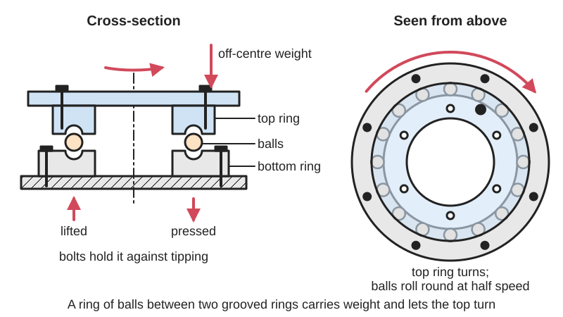
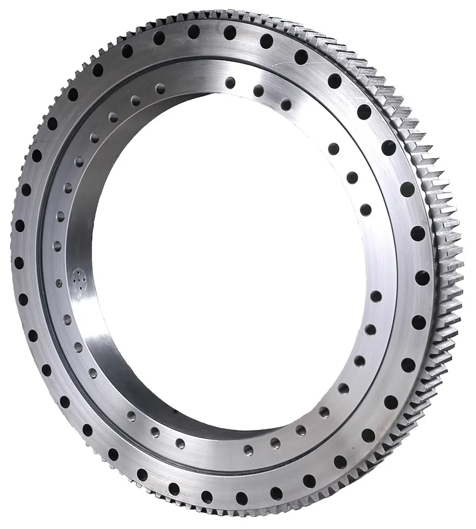
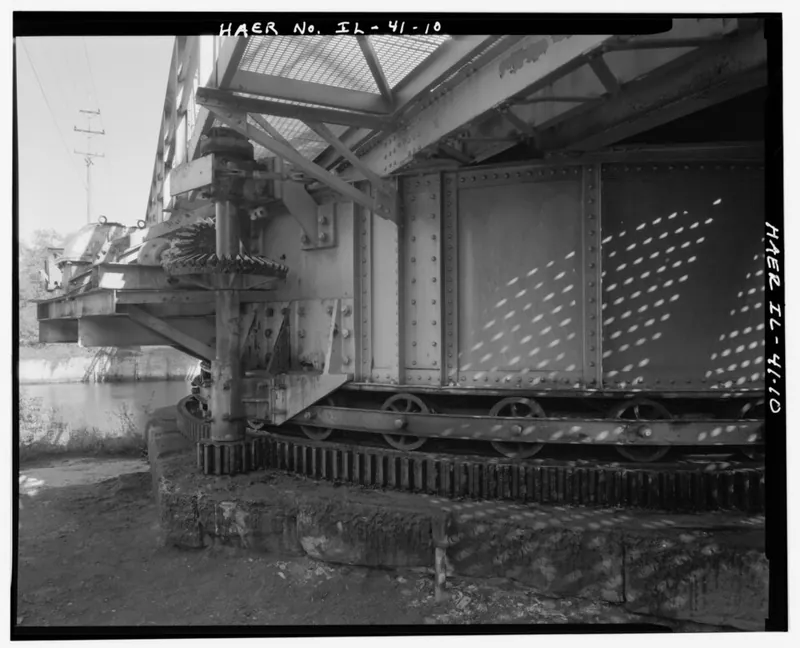

<figure class="eoc-pic eoc-pic-main"><picture><source media="(prefers-reduced-motion: reduce)" srcset="../media/drawn/turntable-bearing.svg"></picture><figcaption><strong>Animation.</strong> Diagram drawn for the encyclopaedia from the research notes. ⚑ Needs confirming: a drawing can simplify or get details wrong; a real photo or a better diagram is welcome.</figcaption></figure>
<figure class="eoc-pic"><figcaption><strong>Photo.</strong> <a href="https://commons.wikimedia.org/wiki/File:Slewing_bearing.jpg">Slewing bearing</a> by Dkluscious, <a href="https://creativecommons.org/licenses/by-sa/4.0">CC BY-SA 4.0</a>, from Wikimedia Commons.</figcaption></figure>
<figure class="eoc-pic"><figcaption><strong>How it works.</strong> <a href="https://commons.wikimedia.org/wiki/File:DETAIL_OF_RIM-BEARING_TURNTABLE,_LOOKING_EAST_-_Romeo_Road,_Sanitary_and_Ship_Canal_Bridge,_Spanning_Sanitary_and_Ship_Canal,_Romeoville,_Will_County,_IL_HAER_ILL,_99-ROM,_1-10.tif">DETAIL OF RIM-BEARING TURNTABLE, LOOKING EAST - Romeo Road, Sanitary and Ship Canal Bridge, Spanning Sanitary and Ship Canal, Romeoville, Will County, IL HAER ILL, 99-ROM, 1-10</a> by https://www.loc.gov/pictures/item/il0606.photos.037011p, Public domain, from Wikimedia Commons.</figcaption></figure>

A large-diameter, thin ring bearing, with balls (or rollers or plastic pads) running in grooves between two rings or plates, that lets a platform turn about an upright axis while carrying its weight and, in stronger types, tipping loads from off-centre weight.

**In plain words:** A flat, wide ring of balls sandwiched between two plates or rings, which lets a tabletop, display stand or robot turret spin round smoothly while carrying weight. **Proper term:** Turntable bearing (slewing bearing or slewing ring; lazy-Susan bearing for the light pressed-steel kind).

**Also called:** lazy Susan bearing, lazy Susan hardware (square or round pressed-steel plates); swivel base or swivel plate (Rockler calls one a 'low profile 12-in swivel base'); slewing ring, slewing bearing, slew ring, turntable bearing (Wikipedia); slewing ring bearing, four-point contact ball slewing ring (Kaydon); polymer slewing ring (igus iglidur PRT (brand)), which uses plastic sliding pads instead of balls; aluminium ring lazy Susan bearing (round, used on robot turrets; Chief Delphi); printed BB bearing, airsoft BB bearing, lazy Susan with 6 mm BBs (maker names); thrust bearing (used loosely for a flat lazy Susan bearing; Printables 1610510); lazy Susan, dumbwaiter or dining-table turntable (the rotating tray that sits on the bearing; Wikipedia).

## How it works

The two rings have facing grooves with a ring of balls between them, so one ring rolls round on the other with little friction. Because the balls sit far from the centre, the bearing resists wobble: weight placed off-centre presses down on the balls on one side and tries to lift the other side, and a slewing ring's raceways and full circle of bolts hold against this tipping (moment) load as well as the plain downward weight (Kaydon). Slewing rings are designed mainly for loads along the axis of rotation that press the rings together, plus the tipping moment; a sideways (radial) load of more than about 10% of the [axial](../glossary.md#axial--radial) load needs a modified design (Kaydon Catalog 390). Cheap lazy Susan plates work the same way but are made of thin pressed steel, so they carry downward weight well but resist sideways and lifting forces poorly (gm0; Chief Delphi). Printed versions use two printed rings with a groove filled with 6 mm airsoft BBs (Printables 33110, 73993).

## Parts

A small assembly that acts as one unit: two rings or plates with facing grooves (raceways), a ring of balls or rollers between them, and on industrial slewing rings a ball separator, seals on each side, grease fittings and sometimes gear teeth on one ring (Kaydon; Wikipedia). Lazy Susan hardware: two pressed-steel plates and a ring of steel balls (Craftparts). Printed versions: two printed rings plus 6 mm airsoft BBs, sometimes with a ball spacer or a small bolted 'access port' for loading the balls (Printables 33110, 686261, 172667). igus PRT: aluminium or stainless rings with replaceable plastic sliding pads (igus).

## Everyday examples

- The spinning tray in the middle of a round restaurant table (Wikipedia, Lazy Susan)
- Turntables for cake decorating, pottery, sculpture and spray painting (Wikipedia; Printables turntable models)
- Cranes and excavators, whose whole upper body turns on a huge slewing ring (Wikipedia, Slewing bearing)
- Swivel bases under TV stands, chairs and corner-cupboard carousels ⚑ [uncertain]

## When to use it

Use it when a wide, flat platform must turn about an upright axis while carrying weight that is spread out or off-centre: lazy Susans, display and photo turntables, spray-painting stands, robot and camera turrets, rotating bases for arms or cranes. The large diameter gives stability without a long shaft and leaves a big hole in the middle for cables or a drive. A bought lazy Susan plate is the cheapest choice for furniture-style loads; a printed BB bearing suits light maker projects; a slewing ring (steel, or igus polymer) is the choice when there are real tipping or sideways loads, as in robot arms.

## When not to use it

Avoid a lazy Susan plate when there are big sideways or lifting forces (a shooter's recoil, a heavy arm reaching out) or when wobble is unacceptable: use a slewing ring, a bearing-stack turret (small bearings round the edge sandwiching a disc) or a design with a centre bearing (gm0; Chief Delphi). For small, fast-spinning parts use an ordinary ball bearing on a shaft. For turning by exact steps use a Geneva drive or an indexing plunger. Don't use printed BB bearings for heavy loads, heat or high speed; use steel balls or buy a metal bearing.

## Details

- **What it does (jobs):**
  - let it move (turn, slide or bend): lets a platform, tray or turret turn all the way round
  - join and hold: holds the turning part onto the base while carrying its weight and, for slewing rings, tipping loads
- **Movement:** rotate: continuous, any number of turns
- **Directions it can move (degrees of freedom):** 1: turning about the central axis; the balls stop the platform tilting or lifting (well in slewing rings, poorly in thin lazy Susan plates)
- **Special behaviour:**
  - none: it is a plain rotary bearing. Some slewing rings have gear teeth cut into one ring so a small pinion can drive the platform (Wikipedia; Kaydon), and igus makes PRT rings with a belt tooth profile for belt drive (igus)
- **How it holds:**
  - not a holding joint (it moves or passes on motion): it lets the two parts turn
  - shape (the parts interlock; [form-fit](../glossary.md#form-fit--force-fit--material-bond)): the balls sit in grooves in both rings, so the rings can't come apart sideways; each ring is screwed or bolted to its part
- **Input and output:** not applicable: it supports a turning part rather than changing motion (on geared slewing rings the gear teeth, not the bearing, pass on the drive)
- **Power:** passive (no power needed)
- **Load:** From light to very heavy depending on type. Downward weight: good; e.g. a 6 in pressed-steel lazy Susan plate is rated 500 lb and a 12 in one 1,000 lb (Craftparts); igus PRT-01 polymer slewing rings take 15,000 to 150,000 N static axial load for sizes 20 to 300 mm (igus). Tipping (moment) loads: rated for slewing rings, e.g. 100 to 5,000 N·m for PRT-01 sizes 20 to 300 mm (igus); weak for lazy Susan plates, which 'aren't designed to handle lateral forces' (gm0). Sideways (radial) loads are the weakest direction; Kaydon treats radial load over 10% of the axial load as needing a special design. Hanging (suspended) loads concentrate stress round the bolts, so pressing loads are better (Kaydon). Printed: light to medium; a printed 7-roller geared turntable bearing was tested with more than 17 kg (Printables 136844).
- **Play and precision:** Noticeable in lazy Susan plates and printed BB bearings, which rock a little (Printables 686261: printed versions are less smooth than a metal lazy Susan bearing, and the version with balls in separate pockets had less play). Industrial slewing rings have a small internal [clearance](../glossary.md#clearance) so small mounting errors don't cause tight spots, and most are not made for accurate positioning (Kaydon Catalog 390); igus lists 0.7 mm axial and 0.9 mm radial clearance for one PRT type (igus PRT catalogue). [Misalignment](../glossary.md#misalignment) [tolerance](../glossary.md#tolerance) is low: the mounting faces must be flat and stiff (igus asks for 0.05 mm flatness in the bolting area), otherwise friction rises and life drops (Kaydon).
- **Taking it apart:** removable: each ring or plate is screwed or bolted to its part
- **How often it can be reused:** many times
- **Sealing:** none for lazy Susan plates and printed bearings; industrial slewing rings are dust-resistant, with an elastomer seal on each side, and may need an extra shroud in dirty or wet places (Kaydon)
- **Adjustable:** no: its friction and play are set by how it is made and mounted; in printed versions you can only change the ball count, ball type or [lubrication](../glossary.md#lubrication)
- **Access needed:** both sides: one ring fixes to the base and the other to the turning part. Lazy Susan plates solve this with an access hole in the lower plate, through which you drive the screws into the top from underneath (Rockler).
- **Materials:** Lazy Susan plates: 22-gauge electrogalvanised steel, supplied ungreased (Craftparts); round aluminium ring bearings (Chief Delphi). Slewing rings: 50Mn or 42CrMo steel, surface-hardened (Wikipedia). igus PRT: hard-anodised aluminium or 316 stainless rings with iglidur plastic sliding pads, -50 to +180 °C (igus). Printed: PLA is recommended for hardness, and 'the harder, the better' (Printables 33110); PETG where a snap-fit lid must flex (Printables 1610510). Balls: 6 mm plastic airsoft BBs (often PLA-based biodegradable plastic; Wikipedia), 3/8 in steel balls (Printables 686261) or 6 mm brass BBs (Hackaday, isaac879 camera mount).
- **Heat, cold, water and wear:** Kaydon steel slewing rings are specified for -40 to +60 °C, indoors or outdoors with indirect moisture; very dirty or wet places need extra seals or shields (Kaydon Catalog 390). igus PRT polymer rings run dry from -50 to +180 °C and are insensitive to dust and dirt (igus). Pressed-steel lazy Susan plates are electrogalvanised and supplied ungreased, so add grease (Craftparts); they may rust outdoors ⚑ [uncertain]. Printed PLA rings start to give at about 60 °C (CNC Kitchen), and cheap airsoft BBs are less round and less impact-resistant than good ones (Wikipedia, Airsoft pellets).

## Making it

- **Ways to make or get it:**
  - off-the-shelf part: lazy Susan plates, aluminium ring bearings, steel slewing rings (with or without gear teeth) and polymer slewing rings
  - 3D print (FDM): printed ring bearings with 6 mm airsoft BBs, steel or brass balls, or printed rollers
  - woodwork: lazy Susan tables, display turntables and cabinet carousels fitted with a bought bearing (Rockler)
  - CNC: machining flat, stiff mounting plates and bolt circles for slewing rings (Kaydon: mounting surfaces machined and reinforced)
- **Printing it in one piece (print in place):** no: the two rings are printed separately with their grooves facing up, filled with BBs, then closed with screws, a snap fit or a ball-loading plug (Printables 33110, 686261, 1610510); the herringbone roller turntable bearing holds itself together through its tooth shape once assembled (Printables 136844).
- **Tools:** Lazy Susan plates: a drill, a 3/4 in bit for the access hole, a screwdriver and #8 x 1/2 in screws (Rockler). Slewing rings: bolts and a [torque](../glossary.md#torque) wrench, tightened in a star pattern in three stages (Kaydon). Printed: none beyond loading the BBs and closing the rings with screws or a snap fit.
- **Difficulty:** easy: buy a lazy Susan plate and screw it between two boards, or print a ring bearing that uses airsoft BBs; moderate to make a stiff, wobble-free robot turret; hard to make a precise, heavy-duty slewing ring, so buy one

### 3D printing tips

1) Balls: use 6 mm airsoft BBs and measure them first (one designer's measured 5.9 mm; Printables 73993). Buy good, heavier BBs (0.30 g or more) without moulding seams (Printables 591895); cheap BBs can have flash and be less round (Wikipedia, Airsoft pellets). For heavier loads use steel balls, e.g. 3/8 in (Printables 686261), or brass BBs (Hackaday, isaac879 camera mount). 2) Test first: print a short test section of each ring; the BBs should roll freely in the groove but be held in by the rim (Printables 73993). 3) Printing: print rings flat with the groove facing up; 0.2 mm layers can work, but use 0.1 mm and slow down if the fit is hard to get; set a minimum layer time so small rings don't deform; use dry filament and a random seam (Printables 33110). 4) Material: harder is better so the races don't wear, and PLA is a good choice (Printables 33110); PETG gives a snap-fit lid a little more flex (Printables 1610510). 5) Fill the groove with as many balls as will fit for the smoothest running (Printables 33110), or use a ball spacer or pockets to need fewer balls; the pocketed version spins less freely but had less play (Printables 686261; Printables 172667). 6) Lubricate with silicone grease (Printables 73993) or a few drops of silicone oil, and run the bearing in under light pressure (Printables 591895). 7) Plan how the balls go in: a bolted access port (Printables 686261, M4 bolts) or a press-fit lid (Printables 1610510). 8) For tipping loads, make the ring as wide as possible and mount it on a flat, stiff plate; industrial practice is a full circle of bolts on both rings (Kaydon) and 0.05 mm flatness in the bolting area for igus PRT rings (igus). Big rings can be printed in bolted segments ⚑ [uncertain] (proposed but not yet tried in Printables 686261). 9) Heat: PLA starts to give at about 60 °C (CNC Kitchen), so keep printed turntables out of hot cars and direct sun. 10) Roller alternative: a self-retaining herringbone roller bearing with 7 rollers held more than 17 kg; print at 0.1 mm layers for a smooth rolling surface (Printables 136844).

### Buying one (off-the-shelf parts)

Search for: 'lazy Susan bearing', 'lazy Susan hardware', 'turntable bearing' or 'swivel plate' (square pressed-steel plates from about 3 in to 12 in and more, e.g. 6 in rated 500 lb and 12 in rated 1,000 lb; Craftparts), 'round aluminium lazy Susan bearing', 'slewing ring bearing' or 'slewing bearing' (with internal or external gear teeth; Kaydon), 'polymer slewing ring' (igus iglidur PRT (brand), 20 to 300 mm bore), 'thrust ball bearing', 'cam follower' and 'V-groove bearing' (for home-made roller turrets), bearing stacks for custom turrets (gm0), '6 mm airsoft BBs', 'steel balls', silicone grease.

## Rules of thumb

- Kaydon's 'normal application' for a slewing ring: vertical axis, mainly compressive thrust and moment loads, radial load no more than 10% of the [thrust load](../glossary.md#thrust-load), slow intermittent rotation, periodic lubrication and bolt checks (Kaydon Slewing Ring Bearings Catalog 390, section 2).
- Pressing (compressive) axial loads spread evenly round the ring; hanging (suspended) loads concentrate near the bolts and must be designed for (Kaydon Catalog 390).
- A stiff, flat mount matters more than a bigger bearing: don't use a higher-capacity bearing to make up for a flimsy structure, and avoid thin riser plates under the bearing (Kaydon white paper 'How mounting can optimize slewing ring bearing performance', 2016).
- Bolt a full circle of bolts through both rings (SAE Grade 8 or ISO class 10.9) and tighten in a star pattern in three stages, 30%, 80% and 100% of the final tension, then recheck regularly (Kaydon white paper).
- igus PRT polymer slewing rings: bolting surface flat to 0.05 mm, screws (class 8.8) engaged at least 2 x d deep, and load ratings only apply on a flat, stable surface (igus iglidur PRT catalogue, 09/2023).
- Lazy Susan plate sizing: a 6 in plate suits tops of 15 to 30 in and a 12 in plate tops of 20 in and up (Craftparts); Rockler's project uses a 12 in swivel base under a 14.5 in top.
- Fitting a lazy Susan plate: bore a 3/4 in access hole in the base and drive #8 x 1/2 in screws through the bearing into the top (Rockler).
- Printed BB bearings: a library of sizes from 20 to 200 mm outside diameter, all 7.1 mm thick, using 6 mm airsoft BBs, e.g. 47 BBs in the 100 mm size (Printables 33110).
- Lazy Susan plates are not designed for sideways forces, such as the recoil of a robot shooter (gm0, Full Turrets).

## Common failures

Wobble and play from a thin plate or a flexible mounting (Kaydon: mount on a stiff, flat structure); lazy Susan plates bent or destroyed by sideways loads (Chief Delphi: one FRC team destroyed at least two 12 in bearings); tight spots and a high turning force from an out-of-flat or out-of-round mounting (Kaydon Catalog 390); bolts working loose (Kaydon: check bolt tension regularly). Printed: poor BBs with seams roll roughly (Printables 591895), warped rings jam (Printables 33110: set a minimum layer time), races wear if softer than the balls (Printables 33110), and a dry race is rough and noisy (Printables 73993: add silicone grease).

## Safety

Pinch and crush points between the turning top and the base, especially on motor-driven turrets and heavy turntables. A heavy top loaded far off-centre on a lazy Susan plate can tip or lift, because the plate resists lifting poorly (gm0; Chief Delphi) ⚑ [uncertain]. Welding on or near a slewing ring can damage it (Kaydon Catalog 390). Loose airsoft BBs are small enough for young children to swallow ⚑ [uncertain].

## Related

- Plain pivot and rolling bearing (pin in hole, shoulder bolt, ball bearing): a single small bearing on a shaft; fine for light, centred loads but wobbles under off-centre weight
- Thrust bearing: a flat bearing for downward load only, usually paired with a separate centring bearing
- Bearing-stack turret: small bearings round the edge of a disc; custom-sized and better for sideways loads (gm0)
- Geneva drive: steps a turntable round by fixed amounts and holds it between steps
- Gimbal: rings pivoted at right angles so the middle can tilt, rather than spin
- Ball-and-socket joint: turns and tilts, but carries little tipping load

## Make it yourself

- [Bearings Library - Airsoft BBs (ᴜ ɴ ʀ ᴇ ᴀ ʟ, Printables; URL from search results, details read through the Printables API)](https://www.printables.com/model/33110-bearing-library-airsoft-bb-6mm): Ring bearings for 6 mm airsoft BBs from 20 to 200 mm outside diameter, all 7.1 mm thick, with a table of ball counts and STEP files for resizing *(licence: CC BY)*
- [Lazy Susan carousel bearing (multiple sizes) (Shaun, Printables) (URL from Printables API, page not opened)](https://www.printables.com/model/73993-lazy-susan-carousel-bearing-multiple-sizes): 200 mm and 140 mm lazy Susan bearings for 6 mm BBs, with test-print sections and a parametric FreeCAD file *(licence: CC BY-SA)*
- [Parametric Lazy Susan Bearing (Modern Hobbyist, Printables) (URL from Printables API, page not opened)](https://www.printables.com/model/686261-parametric-lazy-susan-bearing): A 5 in printed lazy Susan bearing with a parametric Fusion 360 file (diameter, ball size, gap, ball count), a full-race or pocketed inner ring, and a bolted ball-loading port *(licence: CC BY)*
- [All-Printed Lazy Susan Bearing (TheBandicoot, Printables) (URL from Printables API, page not opened)](https://www.printables.com/model/1610510-all-printed-lazy-susan-bearing): A support-free thrust bearing with 10 printed rollers in a cage and a press-fit lid; no hardware needed *(licence: CC BY-NC-SA)*
- [Herringbone Geared Turntable Roller Bearing (MrCliveMrClive, Printables) (URL from Printables API, page not opened)](https://www.printables.com/model/136844-herringbone-geared-turntable-roller-bearing): A self-retaining turntable bearing whose rollers are herringbone gears; with 7 rollers it held more than 17 kg *(licence: CC BY)*

## Pictures, videos and models

- [File:Slewing bearing.jpg (Wikimedia Commons)](https://commons.wikimedia.org/wiki/File:Slewing_bearing.jpg): Photo of a slew ring bearing *(licence: CC BY-SA 4.0 (Dkluscious))*
- [File:Lazy Susan (IMG 0257).jpg (Wikimedia Commons)](https://commons.wikimedia.org/wiki/File:Lazy_Susan_(IMG_0257).jpg): A black wooden lazy Susan turntable *(licence: CC BY-SA 4.0 (Matti Blume))*
- [How mounting can optimize slewing ring bearing performance (Kaydon Bearings white paper, 2016)](https://www.kaydonbearings.com/downloads/whitepapers/Kaydon-MountingSlewingWP.pdf): Diagrams of a shrouded slewing ring mounting, gussets near the bolt holes, allowable flatness charts and the star bolt-tightening pattern *(licence: link only)*
- [3D Printed DSLR Camera Pan Tilt Mount (Arduino/Stepper Driven) 2020 (YouTube, isaac879; title confirmed through YouTube oEmbed, video not watched)](https://www.youtube.com/watch?v=uJO7mv4-0PY): A printed pan-tilt camera mount built round a large printed ring bearing filled with 6 mm brass BBs (as described by Hackaday) *(licence: link only (standard YouTube licence))*
- [How Do You Install Lazy Susan Hardware? (Rockler)](https://www.rockler.com/learn/how-to-install-lazy-susan-hardware): How the access hole in the lower plate lines up with the top plate's screw holes so you can screw the top on from underneath *(licence: link only)*

## Needs confirming

⚑ marks something nobody has confirmed yet: a fact the research could not confirm from a source, a finder value that is a best guess, or an open point from the research notes. Corrections are welcome (see `research/needs-confirming.md`).

- ⚑ 5 sentences on this page marked [uncertain].
- ⚑ Finder value `connects` = any solid parts (best guess): joins parts, but no specific kind of part found; set to any solid parts

## Sources

- <https://en.wikipedia.org/wiki/Slewing_bearing>
- <https://en.wikipedia.org/wiki/Lazy_Susan>
- <https://en.wikipedia.org/wiki/Airsoft_pellets>
- <https://commons.wikimedia.org/wiki/File:Slewing_bearing.jpg>
- <https://commons.wikimedia.org/wiki/File:Lazy_Susan_(IMG_0257).jpg>
- <https://www.kaydonbearings.com/downloads/whitepapers/Kaydon-MountingSlewingWP.pdf>
- <https://www.kaydonbearings.com/downloads/catalog390/Kaydon_390_TechInfo.pdf>
- <https://www.igus.com/info/slewing-ring-overview>
- <https://igus.partcommunity.com/23d-libs/igus/iglidur_gleitlager/iglidur_prt/iglidur_prt_english.pdf>
- <https://www.rockler.com/learn/how-to-install-lazy-susan-hardware>
- <https://www.rockler.com/learn/lazy-susan-project>
- <https://www.craftparts.com/products/lazy-susan-bearings-6>
- <https://www.craftparts.com/products/lazy-susan-bearings-12>
- <https://gm0.org/en/latest/docs/common-mechanisms/turrets/full-turret.html>
- <https://www.chiefdelphi.com/t/lazy-susan-vs-bearing-stack-for-turret/400176>
- <https://hackaday.com/2020/06/15/giant-bearing-is-at-the-heart-of-a-camera-mount/>
- <https://www.cnckitchen.com/blog/comparing-pla-petg-amp-asa-feat-prusament>
- <https://www.youtube.com/watch?v=uJO7mv4-0PY>
- <https://api.printables.com/graphql/>
