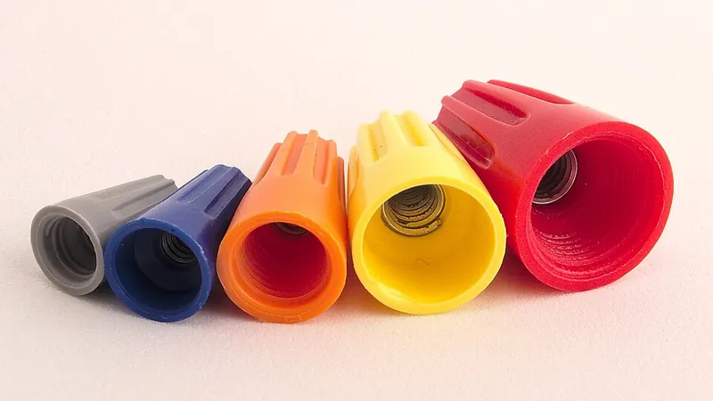
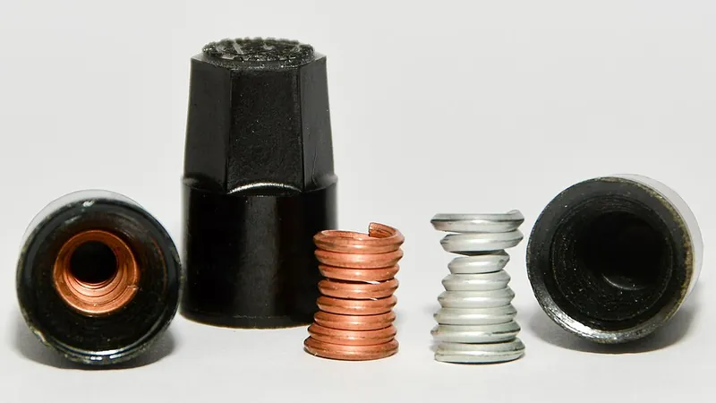
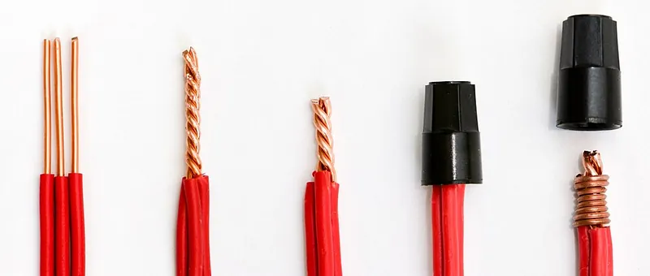

<figure class="eoc-pic eoc-pic-main"><figcaption><strong>Photo.</strong> <a href="https://commons.wikimedia.org/wiki/File:Array_of_twist-on_wire_connectors_aka_wire_nuts_in_different_sizes.jpg">Array of twist-on wire connectors aka wire nuts in different sizes</a> by Junkyardsparkle, <a href="http://creativecommons.org/publicdomain/zero/1.0/deed.en">CC0</a>, from Wikimedia Commons.</figcaption></figure>
<figure class="eoc-pic"><figcaption><strong>Cross-section.</strong> <a href="https://commons.wikimedia.org/wiki/File:Lasdoppen_met_veren.jpg">Lasdoppen met veren</a> by Alex P. Kok, <a href="https://creativecommons.org/licenses/by-sa/4.0">CC BY-SA 4.0</a>, from Wikimedia Commons.</figcaption></figure>
<figure class="eoc-pic"><figcaption><strong>How it works.</strong> <a href="https://commons.wikimedia.org/wiki/File:Gebruik_lasdop.jpg">Gebruik lasdop</a> by Alex P. Kok, <a href="https://creativecommons.org/licenses/by-sa/4.0">CC BY-SA 4.0</a>, from Wikimedia Commons.</figcaption></figure>

A twist-on wire connector is an insulating cap with a tapered coil spring inside that is screwed by hand onto the stripped ends of several wires, drawing them together and squeezing them into one electrical joint while covering the bare metal.

**In plain words:** A small coloured plastic cap, like a thimble, with a cone-shaped metal spring inside, that is screwed by hand onto the bare ends of two or more wires to join them and cover them. **Proper term:** Twist-on wire connector (wire nut).

**Also called:** twist-on wire connector / wire nut / wire connector / cone connector / thimble connector (Wikipedia 'Twist-on wire connector'); wire nut is a genericised trademark (Wikimedia Commons file description); Marrette (brand; used in Canada for connectors of any brand, after inventor William P. Marr) (Wikipedia 'Twist-on wire connector'); screw-on wire connector (Gardner Bender catalogue title cited by Wikipedia); Wing-Nut (Ideal, brand: a winged twist-on connector) (Ideal installation instructions); Highland, Secure Grip and Performance Plus (3M, brands) (3M wire connector brochure); lasdop (Dutch) (Wikimedia Commons file 'Gebruik lasdop.jpg'); gel-filled, grease-filled or silicone-filled wire connector; underground or direct-bury wire connector; direct bury splice kit (3M DBR data sheet); feed-through grounding connector / screw-on grounding connector (green, with a hole in the top for a bare earth wire); pigtail connector (with a short wire already fitted) (Wikipedia 'Twist-on wire connector'); ceramic wire connector (for hot places such as heating appliances) (Wikipedia 'Twist-on wire connector').

## How it works

The tapered coil inside the cap works like a cone-shaped internal thread: as the cap is turned onto the bunched wire ends, the coil threads onto them, draws them deeper into the narrowing cone and squeezes them hard together (Wikipedia 'Twist-on wire connector'). Current then flows both through the twisted wires touching each other and through the metal coil (Wikipedia). The plastic shell insulates the joint and its skirt covers the bare copper (3M brochure). Gel- or grease-filled versions surround the joint with a sealant that keeps water out (3M DBR data sheet).

## Parts

A few parts acting as one unit: a moulded flame-retardant plastic shell (often ribbed or with wings for grip, and a skirt that covers the insulation edge) and a tapered coiled metal insert, usually a steel spring; some types use moulded internal grooves instead of a spring; damp-location types are pre-filled with silicone gel or grease, or come with a grease-filled tube (Wikipedia 'Twist-on wire connector'; Purdue 4-H 'Wire Connectors'; 3M brochure and DBR data sheet).

## Everyday examples

- the coloured caps joining wires inside a ceiling-light fitting or switch box in a North American home (Wikimedia Commons 'Junction box.agr.jpg'); in Canada they are called Marrettes (Wikipedia)
- the joints on the leads of ceiling fans, doorbells, thermostats, smoke alarms and garage-door openers (Purdue 4-H lists these uses)
- buried garden-lighting or sprinkler-valve wire joints sealed in a grease-filled tube (3M DBR direct-bury kit) ⚑ [uncertain: garden lighting and sprinklers as uses come from search listings]

## When to use it

For splicing several solid or stranded copper wires together in a fixed, dry place inside an enclosure, where the joint should be quick to make and easy to undo later, as is usual in North American building wiring (Wikipedia; Purdue 4-H). For a maker, small sizes are handy for joining low-voltage DC wires while testing (a Hackaday commenter: 'whip out small wire nuts while testing low voltage dc power stuff') and for joining the leads of low-voltage lighting. For damp or buried low-voltage joints, choose a gel- or grease-filled type listed for wet locations (3M DBR data sheet; Wikipedia).

## When not to use it

Anything that moves, vibrates or gets pulled, such as vehicles, trailers, robots and drones: use a Crimped butt splice, a Soldered wire joint with heat-shrink, or a Solder sleeve (Wikipedia: twist-on connectors are 'not used in damp or vibration-prone locations, such as automotive or trailer applications'). Damp or outdoor places with an ordinary connector: use a gel-filled or direct-bury type (Wikipedia; Ideal). Aluminium wire: use only connectors and methods approved for it (CPSC Publication 516). Thick wire above AWG 10: use set-screw, clamp or crimp connectors (Wikipedia). Mains wiring in countries where they are not certified, which Wikipedia says is most of Europe: use the connectors your local rules allow, such as a Screw terminal or a Spring-clamp wire connector. Where a joint must be easy to get right first time: one Hackaday commenter complains that after fitting 'one wire falls out or gets pulled out with a light tug', and several say they now use a Spring-clamp wire connector (lever connector) instead (Hackaday commenters).

## Details

- **What it does (jobs):**
  - join and hold: joins two or more wire ends into one electrical splice and insulates it
- **Movement:** none in use; the cap is turned onto the wires when it is fitted
- **Directions it can move (degrees of freedom):** 0: the wires are locked together inside the coil
- **Special behaviour:**
  - none: it is a plain clamping splice; its practical advantages are that it is fitted by hand with no special tool and can be unscrewed again (Wikipedia 'Twist-on wire connector')
- **How it holds:** friction or clamping ([force-fit](../glossary.md#form-fit--force-fit--material-bond)): the tapered coil threads onto the wires and squeezes them together; spring force (a spring or springy part presses it in place): the coil spring expands as it goes on and keeps gripping (3M brochure: 'flexible spring that has generous room for expansion and a strong bite')
- **Input and output:** not applicable
- **Power:** passive (no power needed)
- **Load:** Electrical: up to about 30 A (the connector itself is rated by wire size and voltage, not current: listed connectors take wire up to about AWG 10 and are rarely used on anything thicker (Wikipedia 'Twist-on wire connector'); the current is set by the wire and its fuse or breaker ⚑ [uncertain: no current rating found on an opened page]); rated for mains (listed connectors carry ratings such as 600 V in building wire and 1000 V in signs or light fittings (Ideal Wing-Nut instructions; 3M brochure), but mains work must follow local law and they are not certified in most European countries (Wikipedia)). Mechanical: light; it is not meant to take a pull: a badly fitted wire can come out 'with a light tug' (Hackaday commenter), and vibration loosens it, so it is not used on vehicles or trailers (Wikipedia).
- **Play and precision:** not applicable
- **Taking it apart:** removable: it unscrews, which is why it is used instead of solder or crimps where wiring may be changed later (Wikipedia 'Twist-on wire connector'; 3M: 'engineered for easy back-off and reuse'); gel- or grease-filled direct-bury splices are better treated as one-use ⚑ [uncertain: one-use statement seen only in a search summary of Ideal's product listing]
- **How often it can be reused:** a few times: the connector can be backed off and refitted (3M brochure), but the wire ends become kinked or nicked and may need re-stripping ⚑ [uncertain]
- **Sealing:** none for ordinary connectors, which are for 'dry locations only' (Ideal Wing-Nut instructions); watertight for gel-filled or grease-filled types: 3M's DBR/Y-6 direct-bury kit (a connector in a grease-filled tube) is listed for 'wet, damp, direct bury and submersible locations' and rated IP68, but 'not recommended for long-term continuous submersion' (3M DBR data sheet)
- **Adjustable:** no
- **Access needed:** end of a tube or shaft: it goes onto the free ends of the wires, so all the wire ends must be brought out together
- **Materials:** Shell: insulating, flame-retardant plastic (Purdue 4-H; 3M DBR data sheet: 'Flame Retardant Insulator'); 3M Highland shells 'withstand temperatures up to 221°F (105°C)' (3M brochure); ceramic shells for high-temperature uses such as heating appliances (Wikipedia). Insert: a tapered steel coil spring (3M DBR data sheet), or moulded internal grooves (Purdue). Sealant types: silicone gel or a moisture-resistant grease (3M uses grease 711B in a UV-resistant polypropylene tube) (3M DBR data sheet). Joins copper wire, solid or stranded, to copper wire (Ideal: 'Use only on Copper to Copper (Cu/Cu) wire combinations'; 3M Highland 'work equally well with either solid or stranded copper wire'). Aluminium wire needs connectors specially marked for it ('AL-CU' or 'CU-AL' in Ontario's rules) and the US CPSC does not recommend ordinary twist-on connectors for it (Electrical Safety Authority; CPSC Publication 516).
- **Heat, cold, water and wear:** Ordinary connectors are for 'dry locations only' and shells are rated to 105 °C (Ideal; 3M Highland); not for damp or vibrating places (Wikipedia); ceramic versions are made for hot places such as heating appliances (Wikipedia). Grease-filled direct-bury kits: operating -40 to 105 °C, fitted at 0-49 °C, IP68, but not for long-term continuous submersion (3M DBR data sheet). Joints with aluminium wire deteriorate over time, raising resistance and causing overheating 'cumulative in effect' (CPSC Publication 516). Early porcelain versions could break apart and expose the wires, which is one reason some countries distrust the type (Wikipedia).

## Making it

- **Ways to make or get it:**
  - off-the-shelf part only (listed, colour-coded connectors; gel-filled or direct-bury kits for damp places)
- **Printing it in one piece (print in place):** no: it is a bought, safety-listed part and should not be printed
- **Tools:** none to fit (by hand); wire strippers and side cutters to prepare the wires; winged connectors can also be turned with a nut driver or special tool (Wikipedia 'Twist-on wire connector'), e.g. 3M's hand and power 'wire connector drivers' (3M brochure)
- **Difficulty:** easy: screwed on by hand, but always buy listed connectors in the right size for the wire combination; never make or 3D-print one

### 3D printing tips

Not applicable for the connector itself: real wire connectors are listed parts made from flame-retardant materials (Purdue 4-H) with a steel coil, so a printed copy must never be used to join wires that carry real current, and never on mains. Printable helpers exist: handles that grip several sizes of wire nut so they can be turned tighter than with fingers (print opening-down, 3 walls, 20% [infill](../glossary.md#infill), Printables 887096) and a version that fits a 1/4 in square drive for a drill (any non-flexible filament, no supports, Printables 896471).

### Buying one (off-the-shelf parts)

Search terms: 'twist-on wire connector' or 'wire nut' (sold in colour-coded sizes with a wire-combination chart on the pack), 'winged wire connector' (e.g. Ideal Wing-Nut, brand), 'Marrette' (Canada), 'gel-filled wire connector' or 'silicone-filled wire connector', 'underground wire connector', 'direct bury splice kit' (e.g. 3M DBR, brand), 'grounding wire connector' or 'feed-through grounding connector' (green), 'pigtail wire connector', 'AL/CU wire connector' (only types marked for aluminium), 'wire connector driver' or 'wire nut driver', 'ceramic wire connector' (for hot places). Low-voltage landscape-lighting and sprinkler-valve splices are sold as direct-bury kits ⚑ [uncertain: from search listings].

## Rules of thumb

- Sizes are shown by colour, but capacity differs between makers, so always follow the wire-combination chart on the pack; a de facto scheme for two equal wires is roughly grey or blue for AWG 22-16, orange for about AWG 18-14, yellow for AWG 18-12 and red for AWG 14-10 (Wikipedia, https://en.wikipedia.org/wiki/Twist-on_wire_connector; Purdue 4-H, https://www.extension.purdue.edu/county/newton/4-h-youth-development/_docs/all-levels-wire-connectors-1.pdf; 3M's own range runs from H-29 grey for 2 x AWG 22 to H-35 red, https://multimedia.3m.com/mws/media/68624O/3m-wire-connectors-family-brochure-low-res-pdf.pdf).
- Not often used on wire thicker than AWG 10 (5.26 mm²), because such solid wire is too stiff to join reliably this way; set-screw connectors, clamps or crimps are used instead (Wikipedia, https://en.wikipedia.org/wiki/Twist-on_wire_connector).
- A typical ordinary connector: copper to copper only, dry locations only, 105 °C maximum, 600 V in building wire or 1000 V in signs and light fittings (Ideal Wing-Nut instructions, https://assets.testequity.com/te1/Documents/pdf/Ideal/Ideal_30-451J_Manual_0825.pdf). Smaller 3M Highland sizes H-29 and H-30 are rated only 300 V (3M brochure, https://multimedia.3m.com/mws/media/68624O/3m-wire-connectors-family-brochure-low-res-pdf.pdf).
- For wet or buried joints use a kit listed for it: 3M's DBR/Y-6 is UL 486D listed for wet, damp, direct-bury and submersible locations, IP68, 600 V, operating -40 to 105 °C, applied at 0-49 °C, and 'not recommended for long-term continuous submersion' (3M data sheet, https://multimedia.3m.com/mws/media/653865O/3m-direct-bury-splice-kit-dbr-y-6-data-sheet-78-8129-9255-6-c.pdf). In US workplaces, 'Wire connectors or splicing means installed on conductors for direct burial shall be listed for such use' (OSHA 29 CFR 1910.303(c)(3)(ii), https://www.osha.gov/laws-regs/regulations/standardnumber/1910/1910.303).
- Aluminium: in CPSC laboratory and life tests 'substantial numbers of these connectors overheated severely' on aluminium wire, and 'Pigtailing with Twist-on Connectors Is Not a Recommended Repair' (CPSC Publication 516, https://www.cpsc.gov/s3fs-public/516.pdf); in Ontario, connectors used with aluminium must be marked 'AL-CU' or 'CU-AL' (Electrical Safety Authority Flash, https://www.powercheck.ca/pdfs/Ontario_ESA_Flash_Aluminum_wiring.pdf).
- An international standard exists for these devices: IEC 60998-2-4 covers twist-on connecting devices for copper conductors of 0.5-16 mm², total no more than 35 mm², in circuits up to 1000 V AC and 1500 V DC (IEC webstore, https://webstore.iec.ch/publication/4117); acceptance still differs by country (see safety_notes).

## Common failures

(1) A wire pulling out of the bundle: 'one wire falls out or gets pulled out with a light tug' (Hackaday commenter); use the connector size and wire combination given on the pack (Purdue 4-H), and check each wire is gripped ⚑ [uncertain: the cause (mixed or wrong-size wires) is not stated on an opened page]. (2) Loose, overheating joints on aluminium wire (CPSC Publication 516). (3) Corrosion in damp places with ordinary connectors (Wikipedia; Ideal 'dry locations only'). (4) Loosening from vibration in vehicles and trailers (Wikipedia). (5) Bare copper showing below the cap: 3M adds a flexible skirt 'to help prevent copper exposure' (3M brochure). (6) Overtwisted wires breaking, or thick solid wire (above AWG 10) too stiff to grip (Wikipedia) ⚑ [uncertain: breakage from overtwisting not on an opened page]. (7) Old porcelain connectors cracking and exposing wires (Wikipedia). (8) Water getting into a direct-bury splice when voids or water paths are left in the grease (3M DBR data sheet tip).

## Safety

MAINS: this entry describes the type only and gives no mains wiring steps. Mains work must follow local law: in England, electrical installation work in homes must meet Part P of the Building Regulations and some of it must be notified (Approved Document P, 2013); in US workplaces OSHA requires splices made 'with splicing devices identified for the use' and covered with insulation equivalent to the wire's (29 CFR 1910.303(c)(3)(i)). The maker's own warning: 'Contact with electricity can cause electrical fires, personal injury, or death... Consult local building codes to determine installation requirements' (Ideal Wing-Nut instructions). NOT ALLOWED EVERYWHERE: Wikipedia says that 'in most European countries, they are not certified for use' (its sources are forum pages), although an international standard for twist-on devices exists (IEC 60998-2-4), so rules differ by country; check yours. ALUMINIUM: CPSC testing found 'substantial numbers' of twist-on connectors 'overheated severely' on aluminium wire, and failing aluminium connections can overheat 'without any prior indications' (CPSC Publication 516); use only types marked for aluminium. DAMP AND VIBRATION: ordinary connectors are not for damp or vibrating places unless gel-filled (Wikipedia; Ideal). NEVER 3D-PRINT OR IMPROVISE a wire connector for real current: listed connectors are made of flame-retardant materials and tested (Purdue 4-H; 3M). Use the right size: an undersized or oversized connector, or the wrong wire combination, can leave a loose, heating joint or bare copper showing ⚑ [uncertain: general warning; Purdue only says to follow the label]. Low-voltage battery projects can still overheat a poor joint at high current.

## Related

- Spring-clamp wire connector (lever connector, push-in wire connector): the tool-free modern alternative; easier to get right and allowed in more countries; many makers have switched to it (Hackaday commenters)
- Crimped butt splice (crimp splice connector): better for vehicles and anything that vibrates, but needs a crimp tool and is permanent
- Soldered wire joint (soldered splice): the 'solder and tape' method the wire nut replaced; the rat-tail splice is the twist a wire nut often caps (Wikipedia)
- Solder sleeve (solder-seal splice): a sealed, permanent splice with heat
- Screw terminal (terminal block, barrier strip, connector strip): the usual way to join wires in many countries that don't use twist-on connectors
- Insulation-displacement connector (IDC, ribbon-cable plug, punch-down, T-tap): taps or joins small wires without stripping
- Heat-shrink tubing (heat-shrink sleeve, adhesive-lined heat-shrink): insulates and seals soldered or crimped splices
- Wire-end ferrule (bootlace ferrule, end sleeve): tidies stranded wire ends for screw terminals instead

## Make it yourself

- [Wire Nut Twister (Printables 887096; URL from Printables API, page not opened)](https://www.printables.com/model/887096-wire-nut-twister): Printed handle for turning several sizes of wire nut tighter than fingers can; a tool only, not a connector *(licence: CC BY (Creative Commons Attribution))*
- [Wire Nut Twister With 1/4" Drive (Printables 896471; URL from Printables API, page not opened)](https://www.printables.com/model/896471-wire-nut-twister-with-14-drive): Printed wire-nut driver that fits a 1/4 in square-drive socket adapter on a drill; a tool only *(licence: CC BY (Creative Commons Attribution))*

## Pictures, videos and models

- [Array of twist-on wire connectors aka wire nuts in different sizes.jpg (Wikimedia Commons, by Junkyardsparkle)](https://commons.wikimedia.org/wiki/File:Array_of_twist-on_wire_connectors_aka_wire_nuts_in_different_sizes.jpg): Five colour-coded sizes seen end-on, showing the metal coil inserts *(licence: CC0 (public domain dedication))*
- [Gebruik lasdop.jpg (Wikimedia Commons, by Alex P. Kok)](https://commons.wikimedia.org/wiki/File:Gebruik_lasdop.jpg): Stripped wires twisted and trimmed, a connector screwed on, then cut open to show the coil around the wires *(licence: CC BY-SA 4.0 (reuse with credit))*
- [Junction box.agr.jpg (Wikimedia Commons, by ArnoldReinhold)](https://commons.wikimedia.org/wiki/File:Junction_box.agr.jpg): Twist-on connectors joining wires inside a typical US junction box *(licence: CC BY-SA 3.0 (reuse with credit))*
- [Lasdoppen van keramiek.jpg (Wikimedia Commons, by Electroprof)](https://commons.wikimedia.org/wiki/File:Lasdoppen_van_keramiek.jpg): Early 20th-century ceramic twist-on connectors *(licence: CC BY-SA 4.0 (reuse with credit))*
- [3M Direct Bury Splice Kit DBR/Y-6 Data Sheet (3M, 2019, PDF)](https://multimedia.3m.com/mws/media/653865O/3m-direct-bury-splice-kit-dbr-y-6-data-sheet-78-8129-9255-6-c.pdf): Drawings of a twist-on connector sealed in a grease-filled tube for wet and buried joints, with its ratings and wire combinations *(licence: link only)*

## Needs confirming

⚑ marks something nobody has confirmed yet: a fact the research could not confirm from a source, a finder value that is a best guess, or an open point from the research notes. Corrections are welcome (see `research/needs-confirming.md`).

- ⚑ 8 sentences on this page marked [uncertain].
- ⚑ Finder value `load_max` = light (best guess): electrical entry whose mechanical load has no light/medium/heavy band; set to light
- ⚑ Research note: *Twist-on wire connector*: Wikipedia says these are 'not certified in most European countries', citing forum pages; an IEC standard for them exists (IEC 60998-2-4: 0.5-16 mm² copper, up to 1000 V AC). The entry gives both and says rules differ by country. The 'up to about 30 A' lead-in in `load` is [uncertain], because the connector is rated by wire size, not current.

## Sources

- <https://en.wikipedia.org/wiki/Twist-on_wire_connector>
- <https://www.extension.purdue.edu/county/newton/4-h-youth-development/_docs/all-levels-wire-connectors-1.pdf>
- <https://assets.testequity.com/te1/Documents/pdf/Ideal/Ideal_30-451J_Manual_0825.pdf>
- <https://multimedia.3m.com/mws/media/68624O/3m-wire-connectors-family-brochure-low-res-pdf.pdf>
- <https://multimedia.3m.com/mws/media/653865O/3m-direct-bury-splice-kit-dbr-y-6-data-sheet-78-8129-9255-6-c.pdf>
- <https://www.cpsc.gov/s3fs-public/516.pdf>
- <https://www.powercheck.ca/pdfs/Ontario_ESA_Flash_Aluminum_wiring.pdf>
- <https://webstore.iec.ch/publication/4117>
- <https://www.osha.gov/laws-regs/regulations/standardnumber/1910/1910.303>
- <https://assets.publishing.service.gov.uk/government/uploads/system/uploads/attachment_data/file/441872/BR_PDF_AD_P_2013.pdf>
- <https://hackaday.com/2023/12/18/ask-hackaday-what-do-you-do-when-you-cant-solder/>
- <https://commons.wikimedia.org/wiki/File:Array_of_twist-on_wire_connectors_aka_wire_nuts_in_different_sizes.jpg>
- <https://commons.wikimedia.org/wiki/File:Gebruik_lasdop.jpg>
- <https://commons.wikimedia.org/wiki/File:Junction_box.agr.jpg>
- <https://commons.wikimedia.org/wiki/File:Lasdoppen_van_keramiek.jpg>
- <https://api.printables.com/graphql/>
