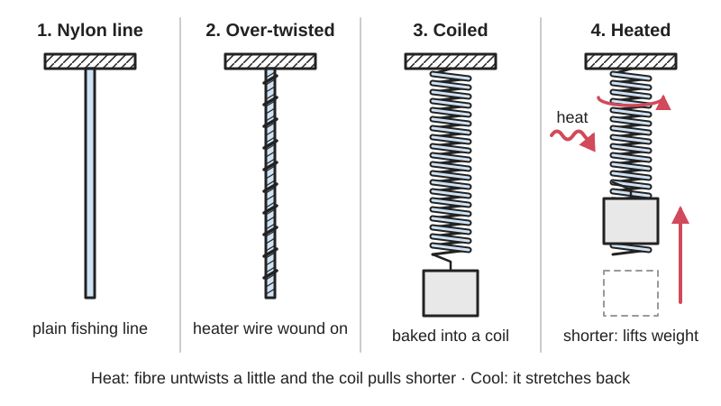

<figure class="eoc-pic eoc-pic-main"><picture><source media="(prefers-reduced-motion: reduce)" srcset="../media/drawn/twisted-and-coiled-polymer-muscle.svg"></picture><figcaption><strong>Animation.</strong> Diagram drawn for the encyclopaedia from the research notes. ⚑ Needs confirming: a drawing can simplify or get details wrong; a real photo or a better diagram is welcome.</figcaption></figure>

A twisted-and-coiled polymer muscle is a cheap nylon fishing line or sewing thread that has been over-twisted into a tight coil and heat-set, so that heating it (with a wrapped heater wire, a conductive coating, hot air or hot water) makes it shorten and pull, and cooling lets it stretch back out.

**In plain words:** A piece of ordinary nylon fishing line or sewing thread twisted so hard that it curls up like a phone cord, then baked so it keeps that shape: warm it and it shortens and pulls like a muscle, let it cool and it relaxes again. **Proper term:** Twisted-and-coiled polymer [actuator](../glossary.md#actuator) (TCP or TCPA; coiled polymer artificial muscle).

**Also called:** fishing-line artificial muscle / fishing line muscle / nylon muscle; supercoiled polymer (SCP) actuator (Yip and Niemeyer 2015); twisted coiled actuator (TCA) (Lizotte and Trejos 2022); coiled artificial muscle / coiled polymer fibre muscle; Nylon Linear Material Actuator (NLMA) (Hackaday Prize 2018 project name); hyper-wound or hyper-coiled nylon; self-coiled muscle and rod-coiled (mandrel-coiled) muscle (the two ways of forming the coils); homochiral muscle (contracts when heated) and heterochiral muscle (lengthens when heated); conductive-thread muscle (made from silver-plated nylon sewing thread).

## How it works

Commercial nylon line is made of long molecules lined up along the fibre; when it is heated the fibre gets slightly shorter and fatter (an untwisted fibre shortens only about 4% for a 250 K rise, Wikipedia 'Artificial muscle'). Twisting the line turns those molecules into helices, so heating now makes the fibre untwist a little; if you keep twisting under tension the line buckles into a tight coil, and baking it (annealing) fixes that coil shape (Haines et al. 2016, PNAS; Wang et al. 2024). With both ends held so they cannot spin, the small untwist of the fibre pulls the coils closer together, so the whole coil shortens by up to 49% (Haines et al. 2014) and relaxes again as it cools. If the coil is wound the opposite way round a rod (heterochiral), the same untwist makes it get longer instead (Haines et al. 2016).

## Parts

A few parts: (1) the coiled nylon muscle itself, often two muscles twisted together (plied) so they cannot untwist; (2) a heater: a thin resistance wire such as nichrome wound along it, a silver coating on conductive sewing thread, or an outside heat source such as a hot-air gun or hot water; (3) an anchor at each end, such as a knot round a metal paper clip or a crimped metal sleeve (Lizotte and Trejos 2022); (4) a load or return spring that keeps it under tension; (5) a driver: a power supply and a switch (MOSFET) with PWM control, and often a fan for faster cooling (Yip and Niemeyer 2015; WriterOfMinds compendium; Lizotte and Trejos 2022).

## Everyday examples

- A coiled telephone handset cord: a finished self-coiled muscle looks just like one (WriterOfMinds describes 'telephone-cord-like coils')
- Twisting a rubber band or a string until it kinks into tight loops, as in a wound-up rubber-band model plane, shows the over-twisting step that forms the coils ⚑ [uncertain]
- Window shutters that open and close by themselves with temperature, and textiles whose pores open when warm, both demonstrated with these muscles by Haines et al. (2014)
- A low-cost 3D-printed robot hand whose fingers are pulled by sewing-thread muscles along the forearm (Yip and Niemeyer 2015)

## When to use it

Use it for a light, silent, very cheap pulling actuator that you can make at home in any length: animatronic and art projects, small robot fingers and grippers pulled through tendons, slowly moving vents, louvres or shutters that react to warmth, and experiments in soft robotics. It is far lighter than a motor and gearbox, makes no noise, costs pennies, and gives far more [stroke](../glossary.md#stroke) than shape-memory-alloy wire (WriterOfMinds; Yip and Niemeyer 2015; Haines et al. 2014).

## When not to use it

Avoid it when you need speed, efficiency, precision or a large force from a small cross-section: it takes seconds to minutes to relax, wastes about 98% or more of its power as heat, changes with room temperature and drifts over many cycles (WriterOfMinds; Xiao et al. 2026; Tsai et al. 2024); a 2025 robotic wrist driven by these muscles was tested at only 1/60 to 1/120 Hz (one cycle every one to two minutes) and its authors plan fans to speed it up (Zhang et al., arXiv 2503.05508). For a quick, small, strong pull use shape-memory-alloy wire or a [solenoid](../glossary.md#solenoid); for a strong, fast pull from a motor use a twisted-string actuator or a servo with a cable; for precise positioning use a servo or lead screw; for a pull that must hold with the power off, add a latch.

## Details

- **What it does (jobs):**
  - hold or release using power: it pulls only while it is kept hot, and lets go as it cools
  - change the kind of motion: turns heat (usually from an electric current) into a straight-line pull, like a muscle pulling a tendon
- **Movement:** slide: the free end moves in a straight line as the coil shortens; about 10-20% of the muscle's length in hobby builds (10% is a good first target according to Haines, Science Friday; 10-18% in Wood's hackaday.io project), over 30% in lab muscles (Haines et al. 2016) and up to 49% at best (Haines et al. 2014)
- **Directions it can move (degrees of freedom):** 1: it only shortens and lengthens along its own axis; being a soft coil it also bends sideways, so the load needs its own guide (the muscles in Yip and Niemeyer's robot hand pulled tendons that ran through conduits)
- **Special behaviour:**
  - motion conversion (e.g. rotary to linear): here heat is converted into a straight pull; a twisted but uncoiled fibre instead gives a turning (torsional) motion (Haines et al. 2016)
  - none of the locking behaviours: it pulls only while warm and has no latch, so it is not [self-locking](../glossary.md#self-locking) and it relaxes when the power or heat goes away (WriterOfMinds; Yip and Niemeyer 2015)
- **How it holds:**
  - powered hold: the contraction lasts only while the muscle is kept at temperature with a holding current (WriterOfMinds)
  - spring force (a spring or springy part presses it in place): when cool it behaves like a soft spring ([stiffness](../glossary.md#stiffness) about 160 N/m for Yip and Niemeyer's 100 mm thread muscle)
- **Input and output:** Heat -> straight-line pull (tension only; it cannot push). The heat usually comes from electric current in a wrapped heater wire or a silver-coated thread, but hot air, hot water or warm surroundings also work (WriterOfMinds). Stroke: about 10-20% of length in practice, more than 30% in lab muscles and up to 49% in the best case (Haines et al. 2014, 2016). Efficiency is very low: typically 0.5-2% of the heat energy becomes work in nylon muscles (Xiao et al. 2026, arXiv 2602.06067), and Haines et al. (2016) note that thermal muscles 'provide limited efficiency'. Force rises roughly in a straight line with temperature (2.31 mN per degree C in Yip and Niemeyer's sewing-thread muscle). Arrangement: in line; the pull acts along the coil. Back-drivable: yes, in the sense that an outside pull stretches it like a soft spring, so it gives way under a sudden load.
- **Power:** powered (needs heat, normally an electric current through a heater wire or conductive coating; a hot-air gun or hot water also works). If power is lost it cools and relaxes back to its rest length, so it lets go: the time constant was about 3 s in still air and about 1 s with a fan for a sewing-thread muscle under 1 mm thick (Yip and Niemeyer 2015), but thick fishing-line muscles can take minutes (WriterOfMinds). It can also respond to warm surroundings with no power at all, as in Haines et al.'s temperature-driven window shutters (Haines et al. 2014).
- **Load:** Light: a single hobby muscle lifts from about a hundred grams to about half a kilogram (Haines suggests loading a 20-pound-test line muscle with about 400 g; Wood's nichrome-wrapped muscle contracted about 10% under about a pound, hackaday.io), and Yip and Niemeyer worked their thread muscle between 0.1 and 1 N. Weight for weight it is very strong ("lift loads over 100 times heavier than can human muscle of the same length and weight", Haines et al. 2014), but single fibres generally work at stresses of only 1-10 MPa (Xiao et al. 2026; Lizotte and Trejos quote up to 80 MPa for silver-coated nylon thread), so bigger loads need thicker line or bundles of muscles. Strong in pull only, zero in push; it bends and swings sideways.
- **Play and precision:** No gears, so no [backlash](../glossary.md#backlash), but it is soft and springy and its force-stretch curve shows [hysteresis](../glossary.md#hysteresis) (Yip and Niemeyer 2015). Because it is driven by temperature, the position changes with the room temperature and air movement, so precise movement needs a feedback sensor (WriterOfMinds). Over thousands of cycles the loaded length can [creep](../glossary.md#creep) longer or shorter even when the stroke stays the same (Tsai et al. 2024). It tolerates [misalignment](../glossary.md#misalignment) well because it is flexible, but its sideways floppiness means the load must be guided.
- **Taking it apart:** removable: the ends are knotted to hooks or crimped and can be undone; the muscle itself is a cheap consumable that can be remade (WriterOfMinds; Lizotte and Trejos 2022)
- **How often it can be reused:** many times: the end fixings can be undone and refitted, and the muscle can give thousands to millions of strokes in the lab ("millions of cycles of stroke without significant degradation", Haines et al. 2016; 10,000-cycle tests in Tsai et al. 2024), but a single overheating can flatten or melt a hobby muscle (WriterOfMinds)
- **Sealing:** none: it is an open coil of line; nothing about it seals
- **Adjustable:** yes: the amount of pull is set by how hot you keep it (current or PWM); the rest length and stroke are set when making it, by the load, by spreading the coils and re-baking them, and by the rod (mandrel) diameter, since wider coils give more stroke but less force and tighter coils give more force but less stroke (Haines et al. 2016; WriterOfMinds)
- **Access needed:** not applicable: it is built into a machine, anchored at both ends of its working length
- **Materials:** Muscle: nylon 6 or nylon 6,6 monofilament fishing line, nylon beading string or hedge-trimmer line (WriterOfMinds found every nylon it tried worked), silver-plated multifilament nylon 6,6 sewing thread (Yip and Niemeyer 2015; Lizotte and Trejos 2022) and polyethylene fibre (Haines et al. 2016); PVDF is being studied because, unlike nylon, it does not swell in water (Tsai et al. 2024). WriterOfMinds had not heard of a working muscle made from fluorocarbon fishing line, while a Hackaday reader suggested fluorocarbon holds coils better, so check the line type ⚑ [uncertain]. Heaters: nichrome resistance wire (30 or 36 AWG, hackaday.io), litz or tinsel copper wire, silver paint, or the conductive coating on the thread (WriterOfMinds). Anchors and mounts: metal hooks and crimps; printed parts near the hot muscle should be heat-resistant (Yip and Niemeyer printed their hand in ABS).
- **Heat, cold, water and wear:** Heat: it is driven by temperature, so warm surroundings change its length and force, and even a closed house on a summer day can spoil a muscle (WriterOfMinds); overheating flattens the coils or melts the nylon (WriterOfMinds), and Yip and Niemeyer's conductive thread burned out at about 10% contraction. Lab muscles are run at about 85-100 C (Lizotte and Trejos 2022), and nylon 6,6 fibre was heated to 140 C in Haines et al. (2016). Water: nylon swells in water, which changes its behaviour; PVDF does not (Tsai et al. 2024). Water or fans cool it faster but need more power to heat it (Yip and Niemeyer 2015). Creep: the loaded length can slowly grow or shrink over thousands of cycles (Tsai et al. 2024). Sunlight: nylon may weaken with long UV exposure ⚑ [uncertain]. Printed mounts near it: PLA softens above about 60 C (Prusa).

## Making it

- **Ways to make or get it:**
  - off-the-shelf part: nylon fishing line, silver-plated nylon sewing thread, nichrome wire, crimps and a MOSFET driver; the muscle itself is hand-made by twisting and baking
  - 3D print (FDM): twisting jigs, motor mounts, anchors, tendon guides and the robot hands or arms the muscles drive (Yip and Niemeyer printed their hand on a desktop FDM printer)
- **Printing it in one piece (print in place):** no: the muscle is twisted from line and heat-set in an oven, and the printed parts around it are separate
- **Tools:** To make: a hobby motor or a cordless drill to twist the line, a known hanging weight, metal paper clips as anchors, a way to stop the weight spinning (a skewer through the lower clip), and a toaster oven with a thermometer or a hot-air gun to heat-set it (Haines, Science Friday; WriterOfMinds). To fit: pliers, crimp sleeves or knots, a soldering iron for the heater-wire ends, and a power supply with a MOSFET switch or PWM controller (Yip and Niemeyer 2015).
- **Difficulty:** moderate: the materials cost pennies and a drill, a weight and a toaster oven are enough (Haines, Science Friday), but getting the twisting tension, heat-setting and heating current right takes trial and error, the line snaps or tangles easily at first, and the finished muscle is slow, power-hungry and easy to overheat (WriterOfMinds)

### 3D printing tips

1) Keep printed parts away from the hot muscle or make them from heat-resistant plastic: muscles are run at about 85-100 C (Lizotte and Trejos 2022) and heat-set near 150 C, while PLA gets soft above about 60 C, PETG is rated for use below 80 C and ASA up to 93 C (Prusa material guides); Yip and Niemeyer printed their hand in ABS. Anchor the muscle with metal hooks or crimps and leave an air gap round it. 2) Never put printed anchors in the oven: everything that is baked with the muscle must survive the heat-setting temperature, so use plain metal paper clips (WriterOfMinds). 3) A printed twisting jig needs a motor mount with a hook at the top and a slider or rod at the bottom that lets the weight move up and down but not turn (Haines, Science Friday). 4) The stroke is only about 10-20% of the muscle's length, so a long muscle is needed for a useful movement: Yip and Niemeyer's fingers needed 10-15 mm of pull, so the muscles ran along the forearm and pulled the fingers through tendons in printed conduits; design a long straight channel or a pulley to fold the muscle. 5) Add a duct for a small fan: forced air cut the cooling time constant from about 3 s to about 1 s (Yip and Niemeyer 2015), and an air channel cut cooling time by 42% (Lizotte and Trejos 2022). 6) Keep bundled muscles from touching each other or bare metal, as their heater wires short out (Wood, hackaday.io). 7) Give the muscle a [preload](../glossary.md#preload) or return spring in the printed frame, because a freshly made coil with touching coils has no room to contract unless it is stretched (WriterOfMinds; Haines, Science Friday).

### Buying one (off-the-shelf parts)

Nylon monofilament fishing line, 2-20 pound test for first muscles (Haines, Science Friday), e.g. 0.711 mm Trilene Big Game (brand) (WriterOfMinds); silver-plated nylon conductive sewing thread or yarn, e.g. Shieldex 117/17 (brand) (Yip and Niemeyer 2015) or four-ply thread from V Technical Textiles (brand) (Lizotte and Trejos 2022); nichrome resistance wire 30 or 36 AWG (hackaday.io); litz wire or tinsel wire (WriterOfMinds); crimp sleeves (ferrules); a logic-level MOSFET with an Arduino-type PWM controller and a bench power supply (Yip and Niemeyer); small 12 V fans or air pumps for cooling; a thermocouple or thin copper-wire temperature sensor (Lizotte and Trejos); extension springs for the return stroke.

## Rules of thumb

- Twisting (coiling) weight: about 11-12 grams per pound of the line's test rating, e.g. about 230 g for 20-pound-test line; too heavy and the line snaps, too light and it tangles instead of coiling (Haines, Science Friday). WriterOfMinds instead uses a stress of 17 MPa (mass = pi x r^2 x 17 MPa / g, credited to the original paper), which gives a somewhat heavier weight for the same line, so start light and adjust.
- After coiling, the coils touch and the muscle cannot contract: add another 50-100% of the coiling weight as the working load, or untwist slightly (Haines, Science Friday), or spread the coils on a rod and bake again (WriterOfMinds).
- Heat-setting (annealing): about 150 C for at least 20 minutes in an oven checked with a thermometer (WriterOfMinds); one maker found 350 F (about 177 C) gave a stiffer, tighter muscle that contracted more than 275 F (Wood, hackaday.io); with a hot-air gun Haines advises staying below 150 C (Science Friday).
- Training: for the first few heat cycles the muscle gets longer; keep cycling until its length settles before using it (Haines, Science Friday; Yip and Niemeyer heated their thread muscles 20 times at about 0.2 W per cm of length).
- Line length: l = pi x (rod diameter + line diameter) x number of coils, times about 1.15 for the shortening caused by twisting, plus at least 6 cm of tails for the end knots (WriterOfMinds, measured on 0.711 mm line).
- Wider coils (bigger rod, higher spring index) give more stroke but less force; tight coils give more force but less stroke (Haines et al. 2016, PNAS; WriterOfMinds).
- Twist and coil in the same direction (homochiral) to get a muscle that shortens when heated; coil the opposite way round a rod (heterochiral) to get one that lengthens by up to about 60% or more (Haines et al. 2016).
- Stop untwisting: tie both ends so they cannot spin, or ply two coiled muscles together, or fold one in half (Yip and Niemeyer 2015; Lizotte and Trejos 2022).
- Expect slow cycles: with passive cooling the bandwidth is about 0.03 Hz (about 30 s per cycle) (Lizotte and Trejos 2022, citing earlier work); thinner line heats and cools faster but lifts less (Haines, Science Friday).
- Efficiency is only about 0.5-2% in nylon muscles (Xiao et al. 2026), so budget plenty of electrical power; Wood used about 9 A to contract a muscle 10% in 30 s under about a pound (hackaday.io).

## Common failures

1) The line tangles into sideways 'whiskers' instead of coiling (too little weight) or snaps (too much): weigh it carefully (WriterOfMinds; Haines, Science Friday). 2) The coil untwists when released: keep both ends tethered, bake it, or ply two muscles together (Wang et al. 2024; Yip and Niemeyer 2015). 3) It will not contract because the coils already touch: add more load or spread the coils and bake again (WriterOfMinds). 4) Overheating flattens the coils or melts the line: use a short high-current burst then a lower holding current; a flattened muscle can be re-baked on a rod (WriterOfMinds). 5) The heater wire breaks inside the coil, or a painted coating cracks right round and stops conducting: check continuity before baking (WriterOfMinds). 6) Very slow relaxation: add fans, use thinner line or bundles of thin muscles (Yip and Niemeyer; Haines, Science Friday). 7) Bundled muscles short circuit against each other: separate them with plain nylon strands or insulation (Wood, hackaday.io). 8) Knots slip at the anchors under the large twisting tension: tie firm knots, tighten with pliers and leave long tails (WriterOfMinds). 9) The length drifts after many cycles (creep): allow adjustment, or predict it from the first 100 cycles (Tsai et al. 2024).

## Safety

Hot parts: a working muscle is hot enough to burn skin, and a bare muscle on a wearable device 'could burn the user' (Lizotte and Trejos 2022); heater wires carrying several amps (about 9 A in Wood's project) can overheat thin wiring, and an uncontrolled heater beside nylon or other plastics is a fire risk, so always limit current and time in hardware and software ⚑ [uncertain: fire risk not tested in a source]. Making it: Haines asks makers using a drill to take proper safety precautions 'because the line can accidentally snap in half during twisting' (Science Friday), so wear eye protection, and thick 2 mm line under a heavy weight can fly loose ("watch out for your eyeballs", WriterOfMinds); a released muscle can spin and flail its end clips (WriterOfMinds). Keep hair and clothing away from the spinning drill.

## Related

- Twisted-string actuator: a motor twists two or more strings so they shorten; driven by a motor rather than by heat, so it needs no cooling time, but it needs a motor, gearbox and thrust bearing (overtwisted strings can also coil up)
- Shape-memory-alloy (nitinol) wire: also shortens when heated by a current, and is stronger for its thickness, but only by about 4-5% (see that entry) and costs far more; WriterOfMinds lists low cost and home-making as the nylon muscle's advantages over nitinol
- Pneumatic artificial muscle (McKibben muscle): a braided rubber tube that shortens when pumped with air; strong and fast but needs an air supply
- Wax motors and bimetal strips: other heat-driven actuators, usually heated by their surroundings and bought as finished parts ⚑ [uncertain]
- Electroactive polymer and dielectric elastomer actuators: artificial muscles driven directly by electric fields instead of heat (Wikipedia 'Artificial muscle')
- Carbon nanotube yarn muscles: the more expensive lab ancestors that first showed twist-based coiled actuation (Haines et al. 2016)
- Coil spring: the same shape used passively; the heat-set muscle behaves like a soft extension spring when cool
- Stopper knots and cord-end anchors: knots round a hook or clip, and other ways to anchor the muscle's ends so they can't slip or spin
- Wire-rope terminations: crimped metal sleeves (ferrules) like those used to anchor muscle ends and heater wires

## Make it yourself

- [Nylon Fishing Line Artificial Muscle Knowledge Compendium (WriterOfMinds blog)](http://writerofminds.blogspot.com/p/nylon-fishing-line-artificial-muscle.html): A hobbyist's complete illustrated guide: choosing line and heater wire, the length and weight formulas, drill-twisting set-up, rod-coiled versus self-coiled muscles, oven heat-setting at about 150 C and electrical control *(licence: not stated (read and link))*
- [How to Make an Artificial Muscle Out of Fishing Line (Science Friday)](https://www.sciencefriday.com/articles/how-to-make-an-artificial-muscle-out-of-fishing-line/): Short step-by-step guide by the lead author of the 2014 Science paper, with the weight rule of thumb and a heat-gun training method *(licence: link only)*
- [Material Linear-Actuator for Robotics (Brandon T. Wood, hackaday.io)](https://hackaday.io/project/157004-material-linear-actuator-for-robotics): Build logs for nichrome-wrapped fishing-line muscles: hobby-motor twisting jig with washers as weights, annealing temperatures, bundling and insulating several muscles *(licence: not stated)*
- [A Device for Producing Artificial Muscles from Fishing Line (Iskanderuse, YouTube; title confirmed through YouTube oEmbed, video not watched)](https://www.youtube.com/watch?v=iMMGfzYXwAU): Video of the 'Artificial Muscle Twister', a machine with a 3D-printed case that winds heater wire onto nylon line and twists it into muscles (described in Semochkin's 2016 IEEE ISAM paper; its project page could not be opened, so its open-source files were not checked) *(licence: link only)*

## Pictures, videos and models

- [How to Make an Artificial Muscle Out of Fishing Line (Carter S. Haines, Science Friday, 2014)](https://www.sciencefriday.com/articles/how-to-make-an-artificial-muscle-out-of-fishing-line/): Photo of muscles of several sizes made from fishing line, plus the original author's step-by-step guide to twisting, loading and training a muscle *(licence: link only (photo credit University of Texas at Dallas))*
- [Active cooling of twisted coiled actuators via fabric air channels (Lizotte and Trejos, Frontiers in Rehabilitation Sciences, 2022)](https://pmc.ncbi.nlm.nih.gov/articles/PMC9748810/): Figures of a plied silver-coated nylon muscle, its test rig and a fabric cooling channel, with heating and cooling time graphs *(licence: CC BY (article licence))*
- [Researcher Spins Fishing Line into an Artificial Muscle (Discover Magazine, YouTube; title confirmed through YouTube oEmbed, video not watched)](https://www.youtube.com/watch?v=_ghKQGDTUwY): Video of fishing line being twisted into a coiled artificial muscle *(licence: link only)*
- [Making artificial muscles from fishing line (BionicMuscles, YouTube; title confirmed through YouTube oEmbed, video not watched)](https://www.youtube.com/watch?v=gzdZGKHdfsc): Video of a maker coiling fishing line into muscles *(licence: link only)*
- [Robotic Muscles From Fishing Line And Nichrome (Hackaday, 2018)](https://hackaday.com/2018/07/11/robotic-muscles-from-fishing-line-and-nichrome/): Photo of coiled nylon muscles wrapped with nichrome heater wire, from Brandon T. Wood's Hackaday Prize entry *(licence: link only)*

## Needs confirming

⚑ marks something nobody has confirmed yet: a fact the research could not confirm from a source, a finder value that is a best guess, or an open point from the research notes. Corrections are welcome (see `research/needs-confirming.md`).

- ⚑ 5 sentences on this page marked [uncertain].
- ⚑ Finder value `power_source` = electricity, compressed air, liquid, heat (best guess): `power` names several power sources, and not all may apply
- ⚑ Research note: *Twisted-and-coiled polymer muscle*: fluorocarbon line (WriterOfMinds: not known to work; a Hackaday commenter: coils better); marked [uncertain].

## Sources

- <https://en.wikipedia.org/wiki/Artificial_muscle>
- <https://api.semanticscholar.org/graph/v1/paper/DOI:10.1126/science.1246906?fields=title,abstract,year,venue,url>
- <https://api.crossref.org/works/10.1126/science.1246906>
- <https://pmc.ncbi.nlm.nih.gov/articles/PMC5081609/>
- <https://studios.disneyresearch.com/wp-content/uploads/2019/03/High-Performance-Robotic-Muscles-from-Conductive-Nylon-Sewing-Thread-Paper.pdf>
- <https://www.sciencefriday.com/articles/how-to-make-an-artificial-muscle-out-of-fishing-line/>
- <http://writerofminds.blogspot.com/p/nylon-fishing-line-artificial-muscle.html>
- <https://hackaday.com/2018/07/11/robotic-muscles-from-fishing-line-and-nichrome/>
- <https://hackaday.io/project/157004-material-linear-actuator-for-robotics>
- <https://pmc.ncbi.nlm.nih.gov/articles/PMC9748810/>
- <https://vtechworks.lib.vt.edu/server/api/core/bitstreams/84f71267-d807-4f8f-8f2d-bc1789def35d/content>
- <https://arxiv.org/pdf/2602.06067>
- <https://arxiv.org/pdf/2404.00802>
- <https://arxiv.org/pdf/2503.05508>
- <https://help.prusa3d.com/article/pla_2062>
- <https://help.prusa3d.com/article/petg_2059>
- <https://help.prusa3d.com/article/asa_1809>
- <https://www.youtube.com/watch?v=_ghKQGDTUwY>
- <https://www.youtube.com/watch?v=gzdZGKHdfsc>
- <https://www.youtube.com/watch?v=iMMGfzYXwAU>
