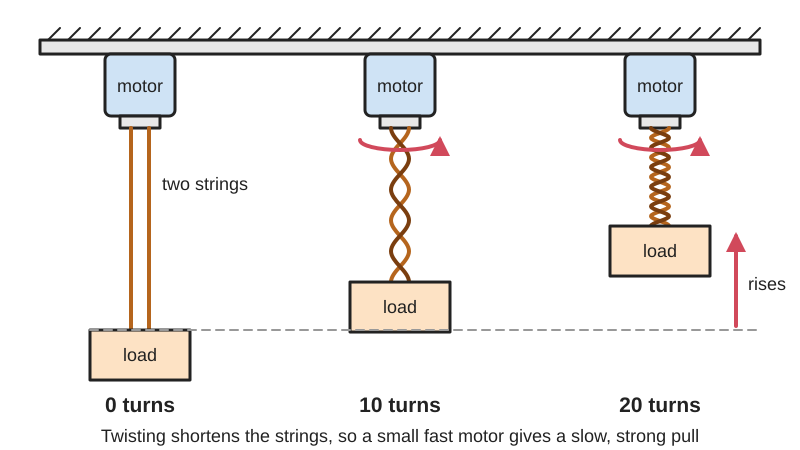
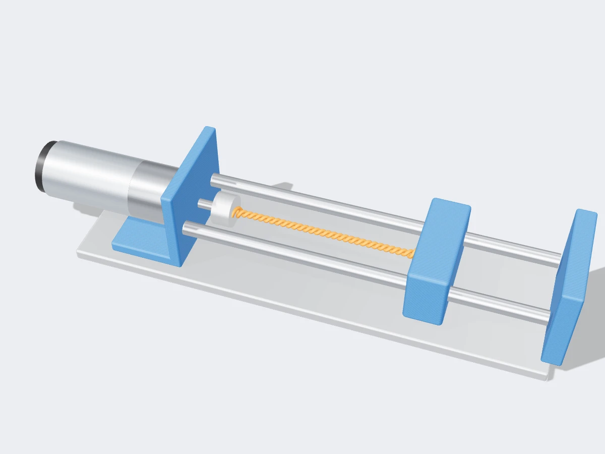

<figure class="eoc-pic eoc-pic-main"><picture><source media="(prefers-reduced-motion: reduce)" srcset="../media/drawn/twisted-string-actuator.svg"></picture><figcaption><strong>Animation.</strong> Diagram drawn for the encyclopaedia from the research notes. ⚑ Needs confirming: a drawing can simplify or get details wrong; a real photo or a better diagram is welcome.</figcaption></figure>
<figure class="eoc-pic"><figcaption><strong>Render.</strong> A 3D model made for the encyclopaedia, not a photo: a stand-in until a good real photo is found. ⚑ Needs confirming: a model can simplify or get details wrong; a real photo is welcome.</figcaption></figure>

A twisted-string [actuator](../glossary.md#actuator) turns a motor's rotation into a strong straight-line pull by twisting two or more strings together, so they shorten like a wrung-out cloth and act as a very high, self-changing [gear ratio](../glossary.md#gear-ratio) in almost no space.

**In plain words:** Two or more strings joined to a motor at one end and a load at the other: when the motor spins, the strings twist round each other, get shorter and pull the load in very hard, like twisting a rope with a stick to tighten it. **Proper term:** Twisted-string actuator (TSA; twisted string actuation system).

**Also called:** twisted string actuation system / twisted string transmission (research papers and patents); twist drive (Godler and Sonoda's robot hand); strand-muscle actuator (Suzuki's early robots); string-twisting actuator; Spanish windlass (the hand-powered version: a stick twisting a loop of rope); overtwisted / two-phase twisted string actuator (runs past the normal twist into coiling for more [stroke](../glossary.md#stroke)); dual-mode or two-speed twisted string actuator (can switch between fast pulling and strong twisting); Verdrillantrieb (German).

## How it works

The strings start side by side, joined to the motor hub at one end and the load at the other. Each turn of the motor wraps them round each other into a helix, and because the string length stays the same, the straight distance between the ends gets shorter: the twisted length is p = sqrt(L^2 - theta^2 x r^2), where L is the untwisted length, theta the twist angle in radians and r the string (bundle) radius (German Wikipedia 'Verdrillantrieb'; Crosby et al. 2026). At the start the strings barely shorten per turn, so a tiny motor [torque](../glossary.md#torque) gives a huge pull (a pager motor lifted 7 kg, Hizook), and as the twist builds each turn pulls in more but with less force, so the ratio changes as it goes. It can only pull, so a spring or a second actuator has to pull the load back, and because the relationship is non-linear it needs calibration or a position sensor for accurate movement (Hizook).

## Parts

A few parts: a small motor (usually a gearmotor with an encoder), a hub on the motor shaft with holes where the strings are tied, two or more strings (often braided UHMWPE such as Dyneema or Spectra, or Vectran), an attachment at the load end, often a separator plate that marks where the twisting zone ends, a thrust bearing so the pull does not go into the motor's own bearings, and a return spring or a second actuator to pull the other way.

## Everyday examples

- Twisting a stick in a loop of rope to tighten it (a Spanish windlass), as in improvised tourniquets and when pulling vehicles or cattle out of mud (Wikipedia 'Windlass')
- The button-on-a-string buzzer toy (button whirligig), which runs the idea backwards: pulling the twisted strings spins the button (Wikipedia 'Whirligig')
- Tendon-driven robot hands and wearable exoskeletons in research labs, such as the DEXMART hand (Tavakoli et al.; German Wikipedia)

## When to use it

Use it when you need a strong, compact, light straight-line pull from a small fast motor, especially for tendons and cables: robot fingers and grippers, prosthetic hands, exoskeletons and haptic devices, tensegrity robots, or pulling a cable along the motor's own axis in a slim limb. It is cheap (a motor and some string), quiet, naturally springy (compliant), which makes it safer around people, and it gives a huge reduction without a gearbox (Tavakoli et al.; Park and SunSpiral).

## When not to use it

Avoid it when you need to push, a long stroke compared with the actuator's length, fast motion, or millions of cycles: strings wear out after thousands rather than millions of cycles (Hizook), the stroke is usually under a third of the string length, and it is slow near the start of the twist. For precise, rigid positioning use a lead screw or rack and pinion; for long cable travel use a spool (winch) or capstan drive; for a pull that must hold with the power off, add a brake or use a [self-locking](../glossary.md#self-locking) lead screw or worm drive.

## Details

- **What it does (jobs):**
  - change the kind of motion: turns motor rotation into a straight-line pull
  - change speed or turning force: a very high, variable reduction, so a small fast motor gives a slow, strong pull
  - tighten and hold tension: tensions tendons, cables and straps (as in tensegrity robots, exoskeletons and tourniquet-style windlasses)
- **Movement:** rotate+slide: the motor end rotates many turns (tens of turns in the experiments) while the load end moves in a straight line; the pull usually shortens the strings by about 10-35% of their length, and up to about 70-81% with deliberate overtwisting (Tavakoli et al.; Konda et al.)
- **Directions it can move (degrees of freedom):** 1: the load's position is tied to the motor's angle through the string twist; the strings are flexible sideways, so the load end also needs its own guide or tendon path
- **Special behaviour:**
  - motion conversion (e.g. rotary to linear): motor rotation becomes a linear pull, with a transmission ratio that starts very high and falls as the strings twist
  - tensioning (takes up slack and holds): it winds tension into a cable or tendon and holds it while the motor holds its angle
  - none of the locking behaviours: the tension always tries to untwist the strings, so it is not self-locking ⚑ [uncertain]
- **How it holds:**
  - not a holding joint (it moves or passes on motion): it passes motor torque on as a pull
  - powered hold: the pull is kept only while the motor (or its gearbox) holds the twist
- **Input and output:** Continuous rotation (many turns) -> straight-line pull (tension only; it cannot push). Contraction x = L - sqrt(L^2 - theta^2 r^2), so the travel per turn grows as the twist builds and the pull per unit of motor torque shrinks; from the force relation F = torque / (r x tan(alpha)) with tan(alpha) = theta x r / p (German Wikipedia), the ratio is very high near zero twist. Typical stroke: under about 25% of the string length in most published designs, 81% with multi-string overtwisting (Tavakoli et al. 2016). Efficiency: about 79% for the strings alone in a high-power ankle exoskeleton (Tan and Collins 2025); German Wikipedia quotes 90%. Shaft arrangement: in line; the strings run straight out along the motor axis (a TSA does not need the motor mounted at right angles to the cable, unlike a spool; Park and SunSpiral, NASA). Back-drivable: yes in principle, since the load's pull always tries to untwist the strings and turn the motor backwards, but a high-ratio gearmotor's friction may hold it ⚑ [uncertain].
- **Power:** powered (needs a motor to twist the strings; the same principle also works by hand, as in the Spanish windlass). If power is lost, the load tries to untwist the strings and run back unless the motor's gearbox friction or a brake holds the twist ⚑ [uncertain].
- **Load:** Light to heavy depending on string and motor: a pager motor lifted 7 kg (Hizook); a 0.35 mm braided fishing line rated 321 N lifted 2 kg with a small 100:1 gearmotor (Tavakoli et al.); a 3 mm Vectran rope (9.5 kN breaking strength) drove an ankle exoskeleton at 43 N.m peak ankle torque and 700 W peak power (Tan and Collins). Strong in pull only; zero strength in push; the strings bend and swing sideways, so the load needs its own guide; the pull along the motor axis must be carried by a thrust bearing, not the motor shaft (Tan and Collins).
- **Play and precision:** No gear teeth, so no [backlash](../glossary.md#backlash), but the strings stretch (it is compliant, not rigid; Tavakoli et al.) and the twist-to-length relation is highly non-linear, so precise movement needs careful calibration or a position sensor (Hizook). Published models predicted displacement to within about 2.7-5.9 mm RMS over 60-100 mm of travel (Tavakoli et al.). It tolerates some angle between the strings and the motor axis if bearings take the sideways force (Tan and Collins), but the twisting zone must be kept straight and free of sharp edges.
- **Taking it apart:** removable: the strings are tied or looped to the motor hub and load and can be untied and replaced; they are a wear part
- **How often it can be reused:** many times: the hardware lasts, but the strings wear out; string life ranges from hundreds of cycles under heavy load in thin line (Tavakoli et al.) to 18,000-190,000 cycles for 1-2 mm Dyneema ropes at 15-25 kg (Nguyen et al. 2025)
- **Sealing:** none: open strings and an open motor hub; nothing about it seals
- **Adjustable:** yes: the pull and position are set by the motor angle; the ratio and stroke are chosen by string radius, number of strings and twisting-zone length (thicker bundles or more strands shorten more per turn, Hackaday / Guzek et al.; Tavakoli et al.); a small pre-twist sets where on the curve it starts; research versions add a clutch to switch between fast direct pulling and strong twisting (dual-mode TSA) or move the string attachment points to vary the ratio continuously
- **Access needed:** not applicable: it is built into a machine with the motor at one end and the load at the other
- **Materials:** Strings: braided UHMWPE (Dyneema, Spectra (brands)) is the most common and has the best tested [fatigue](../glossary.md#fatigue) life at moderate power (Liros Dyneema SK78 ropes, Nguyen et al.); Vectran (liquid-crystal polymer) survived best at very high power, where Dyneema overheated and split and Kevlar (aramid) frayed (Tan and Collins); braided fishing line (Tavakoli et al.), polyester bowstring (Poon et al.), nylon, aramid and polyethylene strings (Zheng et al.). Hardware: metal or printed motor hubs, separators and mounts, steel bearings.
- **Heat, cold, water and wear:** Friction between the twisting strings makes heat: at high power Dyneema exceeded its thermal rating and split within 3 minutes, and grease was needed to spread the heat (Tan and Collins). Life drops sharply with load (Tavakoli et al.; Nguyen et al.). Synthetic strings stretch and may [creep](../glossary.md#creep) under a constant load, changing the calibration over time, and aramid and some polymers weaken in sunlight ⚑ [uncertain]. Printed parts near the motor: PLA softens above about 60 C, PETG copes to about 80 C (Prusa).

## Making it

- **Ways to make or get it:**
  - off-the-shelf part: small gearmotors with encoders, braided Dyneema or Vectran line, ball and thrust bearings, return springs
  - 3D print (FDM): motor mounts, string hubs, separators, guides and housings
  - 3D print (resin): small, smooth string hubs and separators ⚑ [uncertain]
  - CNC: machined hubs and housings for high-force designs (e.g. the Tan and Collins ankle exoskeleton used a separate output shaft on [radial](../glossary.md#axial--radial) and thrust bearings)
- **Printing it in one piece (print in place):** no: the printed hub, separator and mounts are separate parts, and the motor, strings and bearings are added
- **Tools:** Scissors and knots (or loop ties) for the strings; small screwdriver or hex key for the motor hub and mounts; a lighter or heat sealer for synthetic string ends ⚑ [uncertain]; grease (Tan and Collins massaged Krytox grease into their Vectran braid)
- **Difficulty:** moderate: a demo is easy (a gearmotor, braided fishing line and a printed hub), but a reliable actuator needs a thrust bearing, rounded string paths, a return spring or second actuator, and an encoder with calibration because the pull is non-linear

### 3D printing tips

1) Never clamp strings under a grub screw or run them over a sharp printed edge: Crosby et al. traced string failures to pinch and bite points and fixed them by rounding every edge the string touches and using loop ties instead of grub screws. 2) Take the pull off the motor: print a hub on its own output shaft carried by a radial bearing and a thrust bearing, so the large axial pull (and any sideways force when the strings are not in line) does not reach the motor shaft (Tan and Collins). 3) Use an even number of strings arranged symmetrically round the hub so their sideways forces cancel on the motor shaft (Tavakoli et al.). 4) A printed separator (a plate with holes a few millimetres apart; 5 mm in Tavakoli et al.) limits where twisting happens, so everything beyond it moves straight; round and smooth its holes, because knots from overtwisting can jam in them. 5) Keep the stroke to about 10-20% of the string length unless you deliberately design for overtwisting: overtwist began at 10-20% contraction in Tavakoli et al.'s tests, and beyond about 55 turns their strings formed knots that would not untwist. 6) Add a return: a spring or a second, opposing actuator, because strings can only pull (Hizook). 7) Fit an encoder or measure the load position and calibrate, since each turn gives a different amount of pull-in. 8) Grease the braid to cut friction heat (Tan and Collins used Krytox) and pick Dyneema or Vectran over nylon monofilament, which suffered [torsion](../glossary.md#torsion) fatigue (Crosby et al.). 9) Printed parts near the motor get warm: PETG copes to about 80 C and PLA softens above about 60 C (Prusa).

### Buying one (off-the-shelf parts)

Micro metal gearmotors with encoders (e.g. Pololu 100:1, as in Tavakoli et al.; Maxon DCX16L (brand) in Zheng et al.); braided UHMWPE line and rope (Dyneema, Spectra (brands), e.g. LIROS D-Pro SK78 (brand)); Vectran rope (e.g. single-braid V-12 Vectran (brand), Tan and Collins); braided fishing line (e.g. Vega 'Potenza Braided Line' (brand), Tavakoli et al.); radial ball bearings and thrust bearings; extension springs for the return stroke; load cells and encoders for force and position control; PTFE or perfluoropolyether grease (e.g. Krytox GPL 205 (brand)).

## Rules of thumb

- Contraction: twisted length p = sqrt(L^2 - theta^2 x r^2), with L the untwisted length, theta the twist in radians and r the string (bundle) radius; contraction = L - p (German Wikipedia 'Verdrillantrieb'; Crosby et al., Frontiers in Robotics and AI 2026; Poon et al. 2024 use the same form).
- Force: load = motor torque / (r x tan(alpha)), where tan(alpha) = theta x r / p; so near zero twist a tiny torque gives a very large pull, and the pull per unit torque falls as the twist grows (German Wikipedia 'Verdrillantrieb').
- More strands or thicker strands shorten the actuator in fewer turns; fewer or thinner strands need more turns for the same stroke (Hackaday 2015, reporting Guzek et al., ASME J. Mechanisms and Robotics 2012).
- Normal twisting gives up to roughly a quarter to a third of the string length as stroke: earlier designs reached 12-24% (Tavakoli et al. 2016, Table IV), overtwisting began at 10-20% contraction, and regular twisting reached about 30-35% in Konda et al. (2022); deliberate overtwisting and coiling raised this to about 60-70% (Konda et al.) and 81% with six strings (Tavakoli et al.).
- Use an even number of strings so the sideways forces on the motor shaft cancel (Tavakoli et al. 2016).
- String life is set mainly by load: two 0.35 mm braided strings lasted 1,512 cycles at 2 kgf but only 130 cycles at 5 kgf (20 turns per cycle; Tavakoli et al.); in Dyneema SK78 ropes, heavier loads shorten life and larger diameters and more strands lengthen it (18,000-190,000 cycles at 15-25 kg, 1-2 mm; Nguyen et al., Sensors 2025).
- Support the output on a radial bearing plus a thrust bearing so neither the axial pull nor the sideways force from misaligned strings reaches the motor shaft (Tan and Collins, Wearable Technologies 2025).
- At very high power, choose Vectran and grease it: Kevlar frayed in under 2 minutes and Dyneema overheated and split in under 3 minutes, while Vectran lasted longest (Tan and Collins 2025).

## Common failures

1) Strings fray or snap at sharp edges, knots or grub screws: round every edge and use loop ties (Crosby et al.). 2) Strings overheat and fuse or split at high power: grease them and choose Vectran (Tan and Collins). 3) Overtwisting forms knots that jam in the separator and will not untwist: limit the number of turns (Tavakoli et al.). 4) The motor's bearings wear from the axial pull and side load: add a thrust bearing (Tan and Collins). 5) Position drifts from the model because the strings stretch and the bundle radius changes: re-calibrate or use closed-loop control (Tavakoli et al.; Hizook). 6) With no load or return spring the strings go slack and may snarl round each other ⚑ [uncertain].

## Safety

The strings carry a large tension from a small motor: a string that snaps can drop the load or whip back, so keep it enclosed and do not stand under a lifted load ⚑ [uncertain]. Twisting strings can catch fingers, hair or clothing like other rotating parts (OSHA machine guarding: rotating shafts can grip hair and clothing). A load may run back if the motor loses power or the twist is released ⚑ [uncertain].

## Related

- Spool or winch (cable drum): unlimited cable travel with a constant ratio, but needs a gearbox and a motor at right angles, and slack cable can fall off the spool (Park and SunSpiral, NASA)
- Capstan cable drive: a zero-backlash cable reduction for rotating joints, rather than a linear pull
- Lead screw and nut: rigid, can push and pull, and can self-lock, but heavier and less compliant
- Twisted and coiled polymer (fishing-line) artificial muscle: heat, not a motor, makes a pre-coiled nylon line contract (Hizook; Hackaday.io project)
- Spanish windlass: the hand-powered ancestor, a stick twisting a rope loop (Wikipedia 'Windlass')
- Bowden cable: carries the TSA's pull round corners to where it is needed
- Twisted-winching hybrid: winds the string onto a drum after twisting for more stroke (Poon et al. 2024)

## Make it yourself

- [Twisted-String-Actuator (skalouche, GitHub)](https://github.com/skalouche/Twisted-String-Actuator): Control algorithms for an Arduino-based twisted-string actuator *(licence: MIT)*
- [A Compact Two-Phase Twisted String Actuation System: Modeling and Validation (Tavakoli, Batista and Neto, arXiv / Mechanism and Machine Theory 2016)](https://arxiv.org/abs/1610.01117): Build reference: a 100:1 micro gearmotor, 0.35 mm braided line, a separator with holes 5 mm apart, measured stroke per turn for 2-8 strings, the contraction model and string life tests *(licence: arXiv non-exclusive distribution licence (read and link))*
- [TSA-project (Haimlem, GitHub)](https://github.com/Haimlem/TSA-project): Python code and a GUI that estimate twisted-string life from load, string diameter and number of strings (from the Sensors 2025 lifespan paper) *(licence: not stated)*

## Pictures, videos and models

- [DEXMARTAntrieb.svg (Wikimedia Commons; Benjamin Ehm)](https://commons.wikimedia.org/wiki/File:DEXMARTAntrieb.svg): Diagram of the basic twisted-string actuator: motor, twisting strings and load *(licence: CC BY-SA 4.0)*
- [Schnurhelix.svg (Wikimedia Commons; Nutzer1 / Benjamin Ehm, Ras67)](https://commons.wikimedia.org/wiki/File:Schnurhelix.svg): A twisted string unrolled into a triangle, showing how twist angle, string radius and length give the shortened length (German labels) *(licence: CC BY-SA 4.0)*
- [Twisted String Actuators: Surprisingly Simple, Cheap, and High Gear Ratio (Hizook, 2015)](http://www.hizook.com/blog/2015/01/13/twisted-string-actuators-surprisingly-simple-cheap-and-high-gear-ratio): Photos and video links of research TSAs, including the DEXMART hand and a pager motor lifting 7 kg *(licence: link only)*
- [Robot Gripper and Robot hand using 2-Speed Twisted String Actuation (TSA) (RIM Lab., YouTube; title verified via YouTube oEmbed)](https://www.youtube.com/watch?v=RxmGPmoC-yg): Video of grippers and a robot hand driven by two-speed twisted-string actuators *(licence: link only)*
- [Twisted String Actuator-powered Biomimetic Robotic Assistive Glove - RoboSoft 2020 (The Faboratory at Yale University, YouTube; title verified via YouTube oEmbed)](https://www.youtube.com/watch?v=EutbfHvetRI): Video of a wearable glove whose tendons are pulled by twisted-string actuators *(licence: link only)*

## Needs confirming

⚑ marks something nobody has confirmed yet: a fact the research could not confirm from a source, a finder value that is a best guess, or an open point from the research notes. Corrections are welcome (see `research/needs-confirming.md`).

- ⚑ 9 sentences on this page marked [uncertain].
- ⚑ Finder value `power_source` = electricity (source uncertain): `power` is marked ⚑ [uncertain] here: "…n back unless the motor's gearbox friction or a brake holds the twist ⚑ [uncertain].…"
- ⚑ Finder value `power_loss` = lets go (source uncertain): `power` is marked ⚑ [uncertain] here: "…n back unless the motor's gearbox friction or a brake holds the twist ⚑ [uncertain].…"
- ⚑ Finder value `tools` = hand tools (source uncertain): `tools_needed` is marked ⚑ [uncertain] here: "…or hub and mounts; a lighter or heat sealer for synthetic string ends ⚑ [uncertain]; grease (Tan and Collins mas…"

## Sources

- <https://de.wikipedia.org/wiki/Verdrillantrieb>
- <https://commons.wikimedia.org/wiki/File:DEXMARTAntrieb.svg>
- <https://commons.wikimedia.org/wiki/File:Schnurhelix.svg>
- <http://www.hizook.com/blog/2015/01/13/twisted-string-actuators-surprisingly-simple-cheap-and-high-gear-ratio>
- <https://hackaday.com/2015/01/17/twisted-string-actuators/>
- <https://arxiv.org/abs/1610.01117>
- <https://arxiv.org/pdf/1610.01117>
- <https://arxiv.org/abs/2209.11420>
- <https://arxiv.org/html/2410.12097v1>
- <https://pmc.ncbi.nlm.nih.gov/articles/PMC13080251/>
- <https://www.frontiersin.org/journals/robotics-and-ai/articles/10.3389/frobt.2026.1761507/full>
- <https://pmc.ncbi.nlm.nih.gov/articles/PMC12304788>
- <https://pmc.ncbi.nlm.nih.gov/articles/PMC12694270/>
- <https://pmc.ncbi.nlm.nih.gov/articles/PMC12467424/>
- <https://ntrs.nasa.gov/api/citations/20190001767/downloads/20190001767.pdf>
- <https://patents.google.com/patent/US9272425B2/en>
- <https://hackaday.io/project/157004-material-linear-actuator-for-robotics>
- <https://en.wikipedia.org/wiki/Windlass>
- <https://en.wikipedia.org/wiki/Whirligig>
- <https://www.osha.gov/etools/machine-guarding/introduction/hazardous-motions-actions>
- <https://help.prusa3d.com/article/pla_2062>
- <https://help.prusa3d.com/article/petg_2059>
- <https://www.youtube.com/watch?v=RxmGPmoC-yg>
- <https://www.youtube.com/watch?v=EutbfHvetRI>
- <https://www.youtube.com/watch?v=5NYkDOf0JgQ>
- <https://github.com/skalouche/Twisted-String-Actuator>
- <https://raw.githubusercontent.com/skalouche/Twisted-String-Actuator/master/README.md>
- <https://raw.githubusercontent.com/skalouche/Twisted-String-Actuator/master/LICENSE>
- <https://raw.githubusercontent.com/Haimlem/TSA-project/main/README.md>
