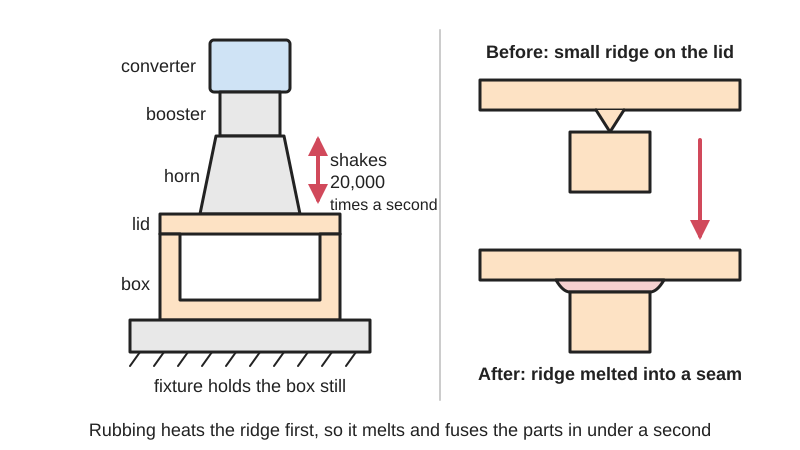
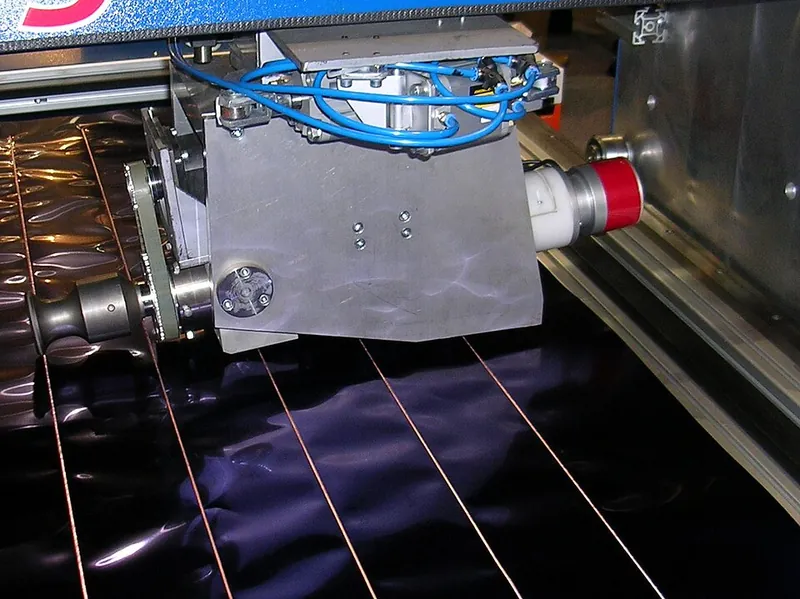
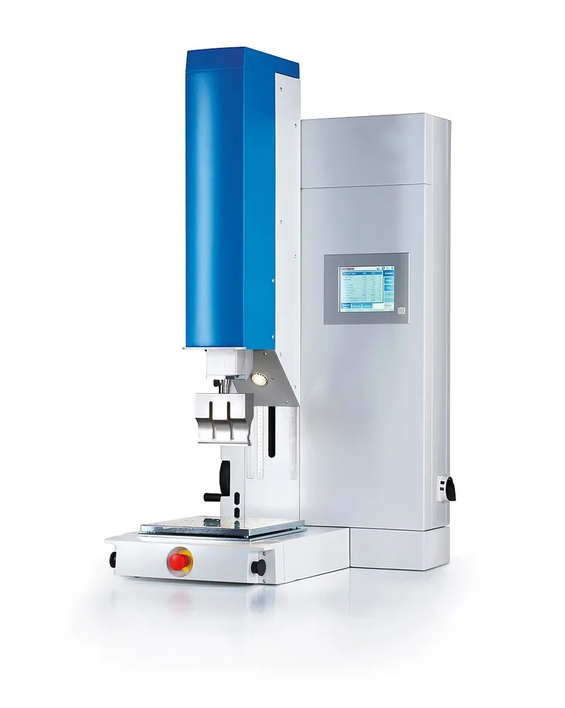

<figure class="eoc-pic eoc-pic-main"><figcaption>Diagram drawn for the encyclopaedia from the research notes. ⚑ Needs confirming: a drawing can simplify or get details wrong; a real photo or a better diagram is welcome.</figcaption></figure>
<figure class="eoc-pic"><figcaption><strong>How it works.</strong> <a href="https://commons.wikimedia.org/wiki/File:Ultrasonic_Welding.JPG">Ultrasonic Welding</a> by NearEMPTiness, <a href="https://creativecommons.org/licenses/by-sa/3.0">CC BY-SA 3.0</a>, from Wikimedia Commons.</figcaption></figure>
<figure class="eoc-pic"><figcaption><strong>Photo.</strong> <a href="https://commons.wikimedia.org/wiki/File:Ultraschall-Schwei%C3%9Fmaschine.jpg">Ultraschall-Schweißmaschine</a> by Herrmann Ultraschalltechnik GmbH &amp; Co. KG, <a href="https://creativecommons.org/licenses/by-sa/4.0">CC BY-SA 4.0</a>, from Wikimedia Commons.</figcaption></figure>

Ultrasonic welding presses two thermoplastic parts together under a horn that vibrates at about 15-40 kHz; the rubbing and internal heating melt a small ridge (energy director) or a slight overlap ([shear](../glossary.md#peel-vs-shear) joint) where the parts meet, and in well under a second they fuse into one sealed, permanent piece.

**In plain words:** A machine with a buzzing metal tool presses two plastic parts together and shakes them thousands of times a second, so a small ridge between them melts in under a second and the parts fuse shut for good, with no screws or glue; it is why many chargers, toys and blister packs have no way in. **Proper term:** Ultrasonic welding of plastics (ultrasonic plastic welding), usually with an energy director or shear joint.

**Also called:** ultrasonic welding, ultrasonic plastic welding, ultrasonic plastics assembly, ultrasonic bonding, ultrasonic sealing, 'sonic welding' (Wikipedia 'Ultrasonic welding'; Dukane 'Joint Design for Ultrasonic Plastic Bonding'; Herrmann); horn = sonotrode = welding horn; booster or booster horn; converter = piezoelectric transducer; generator = power supply; nest = anvil = holding fixture (Wikipedia; DuPont Design Guide Module I, pp. 95-99); energy director (ED): the small triangular (sometimes round) ridge moulded or printed on one part; energy director butt joint (Branson; Dukane; Herrmann); shear joint = interference joint, called a 'mash joint' by Herrmann; step joint; tongue-and-groove joint; double V joint (DuPont pp. 100-102; Dukane; Herrmann); near-field and far-field welding (horn close to, or far from, the joint) (DuPont p. 103); ultrasonic spot welding (the horn tip pushes through the top sheet, no energy director needed); ultrasonic stud welding; ultrasonic staking or heading; ultrasonic swaging; ultrasonic insertion (Herrmann; DuPont p. 108; Branson 2016); continuous or rotary ultrasonic seam welding of film, foil and fabric; ultrasonic sewing or sealing of nonwovens (e.g. masks and gowns) (Wikipedia 'Ultrasonic welding'); ultrasonic metal welding (wire splices, battery foils and tabs, wire bonding on chips) (Wikipedia 'Ultrasonic welding'); machine brands a beginner may meet in searches (brands): Branson (Emerson), Dukane, Herrmann Ultraschall, Sonics & Materials, Sonotronic; industrial cousins mentioned in this entry: laser transmission welding, infrared (IR) welding, hot-plate (heated tool) welding, radio-frequency (RF) welding = high-frequency (HF) welding = dielectric welding, vibration welding (Wikipedia 'Plastic welding').

## How it works

A converter turns an electrical signal into a tiny up-and-down vibration, typically at 15, 20, 30, 35 or 40 kHz; the booster and horn enlarge it (to roughly 5-50 micrometres, Herrmann) and press it into the top part while the bottom part sits in a rigid fixture (Wikipedia 'Ultrasonic welding'). The vibration heats the plastic by internal flexing and rubbing ([hysteresis](../glossary.md#hysteresis) and frictional heating, Branson 2016), most strongly where the parts touch: a sharp ridge called an energy director concentrates the energy, melts first and flows across the joint, and once it softens 'further melting occurs at a faster rate' (DuPont p. 102). In a shear joint the parts overlap slightly, so the plastic melts along the vertical walls as the lid telescopes into the base, and the smeared melt seals the joint without being exposed to air (DuPont pp. 100-101). The vibration then stops, the press holds the parts together for a fraction of a second while the melt freezes, and the two parts are one piece (DuPont p. 103-104). Related ways to melt a plastic joint without vibration include a laser shone through one clear part onto a dark one (laser transmission welding), a hot plate or infrared heater that melts both faces before they are pushed together, and radio waves that heat polar plastics such as PVC (RF welding) (Wikipedia 'Plastic welding').

## Parts

Single piece once welded. The joint itself is just shaped plastic: an energy director ridge, a step, a tongue and groove, or a slight overlap (interference) moulded or printed into the two parts. The machine is a small assembly: a generator (power supply), a converter (piezoelectric transducer), an optional booster, a horn (sonotrode) shaped to the part, a press (usually pneumatic or electric) to push the horn down, a nest (fixture or anvil) that holds the lower part, and a controller (Wikipedia 'Ultrasonic welding'; DuPont Module I, pp. 95-99).

## Everyday examples

- mains chargers and power adapters whose cases have no screws: iFixit says 'These power supply cases are ultrasonically welded together' (iFixit Answers, DualSense charging-station adapter)
- plastic toys: the first application of ultrasonic plastic welding 'was in the toy industry' (Wikipedia); Herrmann pictures a toy elephant's parts joined this way
- blister packs, sealed tubes and containers, and plastic-coated milk and juice cartons (Wikipedia)
- disposable butane lighters, TV remote controls, print cartridges and USB flash drives (Wikipedia; DuPont p. 117; Herrmann)

## When to use it

In manufacturing: to close plastic housings permanently in a fraction of a second with no screws, glue, solvent or drying time, often with a sealed joint, for many identical parts (Wikipedia; Herrmann). It suits small to medium parts such as electronics cases, toys, filters, lighters and packaging, and lets designers drop screws and gaskets. For makers: when designing a product that will be injection moulded and welded, so the energy director or shear joint is in the design from the start (Dukane; DuPont). If you can use a welder at work or at a makerspace, it can also join FDM prototype parts in weldable plastics, for example to build parts bigger than the print bed (Tiwary et al. 2025), as long as you accept that the result is less repeatable than with moulded parts (Branson 2016). It is also worth knowing about when a gadget won't open: no screws and a fine seam usually mean an ultrasonically welded case (iFixit).

## When not to use it

At home without an ultrasonic welder: use Friction-welded plastic, Melted plastic weld (soldering iron or hot air), Solvent welding for ABS and acrylic, or Cyanoacrylate. When the product must be opened for repair or battery replacement: use screws (Self-tapping screw into plastic, Heat-set threaded insert) or a [Cantilever](../glossary.md#cantilever) snap fit. For resin prints, thermosets, rubbers and PTFE, which can't be ultrasonically welded (Branson 2016; Herrmann). For two different plastics (e.g. ABS to PLA), which bond weakly (Tiwary et al. 2025): use glue or a mechanical joint, or Heat staking to hold plastic to metal. For parts with thin metal springs or fragile features, which the vibration can break (DuPont pp. 103, 117). Where the horn can't reach close to the joint, or for very large parts: horn width is limited to about 65-75 mm without slots (DuPont p. 98), so industry uses hot-plate or vibration welding for big parts (Wikipedia 'Hot plate welding', DuPont p. 117). For round parts: Friction-welded plastic (spin welding) is cheaper and simpler (DuPont p. 77). For PVC film and coated fabric: RF (high-frequency) welding or a Heat-sealed seam. For a clear part on a dark part with a hidden seam: laser transmission welding (Wikipedia 'Plastic welding').

## Details

- **What it does (jobs):**
  - join and hold: permanently joins two plastic parts, such as the two halves of a case (Wikipedia 'Ultrasonic welding')
  - glue or bond: a melted (material) bond made without glue, solvent or screws; Wikipedia calls it 'a good automated alternative to glue, screws or snap-fit designs'
  - seal it, or pass cables or fluid through: shear and tongue-and-groove joints give leak-free, even gas-tight, housings such as butane lighters (Wikipedia; Dukane; DuPont p. 117)
- **Movement:** none
- **Directions it can move (degrees of freedom):** 0: the two parts become one rigid piece.
- **Special behaviour:**
  - self-aligning or self-centring: only while welding, and only with some joint designs. A step joint or tongue and groove locates and centres the two halves before the melt starts (Herrmann calls this the 'Tetris effect'; Dukane). Once welded it is a plain permanent joint with no other special behaviour.
- **How it holds:** [material bond](../glossary.md#form-fit--force-fit--material-bond) (glue, solvent or melting): the two parts melt where they touch and fuse. (The related ultrasonic staking and swaging hold by shape instead, see Heat staking.)
- **Input and output:** not applicable
- **Power:** passive (no power needed) once welded. Making the weld needs a powered ultrasonic welder, a mains-powered generator driving a piezoelectric converter (Wikipedia; DuPont p. 97).
- **Load:** Medium to heavy for a plastic joint, depending on joint design and weld area. A shear joint telescoped 1.25-1.5 times the wall thickness can be stronger than the walls next to it (DuPont pp. 100-101), and a stud weld whose depth is half the stud diameter is stronger than the stud (DuPont p. 108). A bare energy-director butt joint gives less fused area and is weaker. With crystalline plastics such as acetal and nylon, DuPont says it is 'extremely difficult to produce strong joints or hermetic seals' (p. 101). Glass fibres do not cross the weld, so a weld in glass-filled nylon is only as strong as the unfilled plastic unless the joint area is made larger (DuPont pp. 106-107). Printed parts: layers 'may separate during the ultrasonic welding process, or during testing' (Branson 2016). In a lab study of FDM lap joints, ABS/ABS welds were about as strong in shear as the printed base material and PLA/PLA welds were stronger than it, while mixed ABS/PLA welds were weakest (Tiwary et al. 2025). Weakest directions: peeling or prying apart at the seam edge, and across the [layer lines](../glossary.md#layer-lines) of a print ⚑ [uncertain: no peel test data found].
- **Play and precision:** No play once welded. The parts must be held in line in a rigid fixture so pressure is even around the joint; if the lower part just sits on the table, both parts 'may slide out from under the horn' because the vibration cancels friction (DuPont p. 99). Parallel alignment matters most for butt joints and where finished dimensions are critical; the shear joint tolerates more warpage (DuPont p. 105). The parts move closer as the energy director or overlap melts (collapse), and the depth of weld can be measured to check a shear joint (DuPont p. 105). Shear joints need tight moulding [tolerances](../glossary.md#tolerance): Branson gives an interference of 0.008 in (0.2 mm) with a tolerance of +/-0.001 in (0.025 mm) for parts under 0.75 in (19 mm). Step and tongue-and-groove joints locate the parts before welding (Dukane; Herrmann).
- **Taking it apart:** permanent: the halves can only be pried, cracked or cut apart. iFixit says welded power-supply cases are 'hard to separate' and suggests prying them 'strategically' or cutting with a rotary tool and cut-off wheel (iFixit Answers, 2024).
- **How often it can be reused:** once
- **Sealing:** airtight or pressure, with the right joint. A shear joint 'provides the best path to a leak-free assembly' (Dukane) and is 'the best joint for strong, hermetic seals' (DuPont p. 100); a tongue-and-groove energy director joint is 'the easiest and most robust option' for sealed parts (Dukane). Butane lighters and other hermetic containers are ultrasonically welded and burst-tested (Wikipedia; DuPont p. 105). A plain energy-director butt joint 'provides a strength-only bond' (Dukane) and may not seal complex parts, and butt joints in crystalline plastics rarely seal (DuPont pp. 101-102). With FDM-printed parts, Branson warns that 'creating a consistent hermetic joint may be impossible' because of gaps between layers and print paths.
- **Adjustable:** no: fixed once welded
- **Access needed:** both sides: the horn presses on one part from above while a rigid fixture (nest or anvil) supports the other part from below, and the horn should touch the part directly above and close to the joint (near-field welding) (DuPont pp. 99, 103; Branson 2016). To undo a welded case you only need to reach the seam from outside (iFixit).
- **Materials:** Thermoplastics only. Amorphous plastics weld most easily: ABS, polystyrene, polycarbonate and acrylic (PMMA) are rated 'welded well and with ease' (Herrmann), and Branson calls ABS 'one of the easiest polymers to ultrasonically weld'. Semi-crystalline plastics such as nylon (PA), acetal (POM), PET, PP and PE need more energy, a shear joint or a sharper 60-degree energy director, and soft plastics such as polyethylene can only be welded with the horn right at the joint (near field) (DuPont pp. 100-103; Branson 2016; Dukane). Herrmann says 'Apart from PTFE, all thermoplastic materials can be welded', but 'Only identical thermoplastic materials can be welded homogeneously'; in a printed-parts study, ABS welded to PLA gave the weakest joints and the authors advise against that pair (Tiwary et al. 2025). Cannot weld: thermosets and elastomers (Herrmann; Branson), and resin (SLA, DLP, PolyJet) prints, because photopolymers 'cannot be melted, reshaped, or joined' this way (Branson 2016); a 2017 Formlabs forum reply says acrylic-based resins tend to 'burn and crumble' rather than melt. FDM prints in ABS, PLA and other weldable filaments can be welded with caveats (Branson 2016; Tiwary et al. 2025), and a Printables tester reports printed ASA, ABS and PA6-CF stakes welded to moulded PP passing a tensile test (Printables 833859). Wet nylon, pigments, flame-retardant additives and mould-release agents all make welding harder (DuPont pp. 106-107; Herrmann). Thin, soft metals (aluminium, copper, nickel foils, wires and battery tabs) can be welded on special ultrasonic metal welders, and fabrics and nonwovens can be ultrasonically sealed (Wikipedia).
- **Heat, cold, water and wear:** Once welded, the joint is the same plastic as the parts, so it shares their heat, UV and chemical limits ⚑ [uncertain: no figures found specifically for ultrasonically welded joints]. Things that weaken the weld before or during welding: moisture in nylon (1-2 days at 50% RH can halve weld quality, DuPont p. 107), pigments, flame-retardant additives and mould release (DuPont p. 107; Herrmann), and glass fibres, which do not cross the weld (DuPont p. 106). During welding the vibration spreads through the whole part and can crack or melt it at sharp inside corners, holes and unsupported tabs far from the joint (DuPont p. 103). Welded plastic joints [creep](../glossary.md#creep) under constant load like the base plastic, and creep-rupture tests are very sensitive to temperature: 'a temperature change of 1 degree Celsius affected the creep rupture time by 13%' in some cases (Wikipedia 'Plastic welding').

## Making it

- **Ways to make or get it:**
  - off-the-shelf part: the usual case is injection-moulded parts with the joint moulded in, welded on a production machine (Wikipedia; DuPont)
  - 3D print (FDM): prototype parts with printed energy directors or shear joints can be welded, with limits on strength, sealing and [repeatability](../glossary.md#repeatability--accuracy); ABS, PLA, ASA and PA6-CF prints have been welded (Branson 2016; Tiwary et al. 2025; Printables 833859)
  - 3D print (resin): no, because photopolymer resins cannot be ultrasonically welded; resin-printed injection moulds can make short runs of weldable test parts instead (Branson 2016)
  - CNC: machined thermoplastic parts weld more consistently than printed ones (Branson 2016 groups 'injection molded, extruded, or machined parts' together)
  - laser cut and sheet: flat thermoplastic sheets can be ultrasonically spot welded with no energy director, as the horn tip pushes through the top sheet (Herrmann)
- **Printing it in one piece (print in place):** no: the two halves are printed separately and welded afterwards on an ultrasonic welder
- **Tools:** To make: an ultrasonic welder (generator, converter, booster, a horn tuned to the machine's frequency, and a press or stand), plus a fixture (nest) shaped to hold the lower part. DuPont says horns must resonate very near the operating frequency and are best designed and tuned by equipment makers; simple aluminium step horns can be made in a lab for prototype welds but [fatigue](../glossary.md#fatigue), get nicked and mark parts (DuPont pp. 98-99). Hand-held ultrasonic welders also exist (e.g. Herrmann's 'HSG handheld ultrasonic welder' product page). Wear hearing protection and safety glasses (Wikipedia). To undo: plastic opening picks or a thin blade to pry along the seam, or a rotary tool with a cut-off wheel (iFixit).
- **Difficulty:** hard: you need an ultrasonic welder with a horn tuned to it and a fixture, which home makers rarely have; printing an energy director or shear joint into a part is easy, but printed parts weld 'sometimes', and not reliably (Branson 2016). Easier home alternatives are friction welding, a melted plastic weld or solvent welding.

### 3D printing tips

Only worth trying if you have access to an ultrasonic welder (for example at work, a lab or a makerspace); with a normal home kit, use friction welding, a melted plastic weld or solvent welding instead. A 2020 Prusa forum reply put it this way: there are 'probably easier ways to adhere PLA parts for the home gamer from glues to stir-welding'. Material: use the same weldable thermoplastic for both halves (ABS, PLA, PETG-type or nylon filaments; not resin). ABS welded to PLA gave the weakest joints in a 2025 study (Tiwary et al.), and Branson warns that 'Digital ABS' and other photopolymers that mimic ABS 'will not ultrasonically weld'. Energy director: a moulded ED is a sharp ridge 0.25-0.75 mm tall (Dukane) or 0.010-0.020 in (0.25-0.5 mm) tall with a 90-degree point for amorphous plastics and 60 degrees for semi-crystalline ones (Branson), but FDM can't print a sharp point that small. Branson's printed ED came out as a rectangle 0.014 in tall by 0.022 in wide (0.36 x 0.56 mm), and Tiwary et al. printed EDs 1-2 mm in size because 'Printing below 1 mm is challenging with FDM'. In that study, triangular and semicircular printed EDs worked better than rectangular ones. Run the ridge along the print path ([perimeters](../glossary.md#perimeters)) so it prints as a clean continuous bead, and expect printing orientation to change the result: Branson found a weld joint 'printed in three different orientations will produce different results'. [Infill](../glossary.md#infill): print every wall between the horn contact face and the joint, and between the joint and the support face, at 100% infill, as internal voids stop the vibration reaching the joint (Branson); Tiwary et al. found infill above 20% gave defect-free welds and 50% infill gave their best result, a sign that solid walls near the joint matter most. Horn and support faces: add a flat raised pad directly above the joint so a plain flat horn can touch it, and give the lower part a flat base under the joint so it can sit on a hard flat surface without a custom fixture (Branson). Keep [support material](../glossary.md#support-material) away from weld areas, because removing it damages the joint faces (Branson). Shear joints are hard to print because they need interference held to about +/-0.025 mm (Branson), so use energy-director or tongue-and-groove joints for prints. Settings reported in one study: a 20 kHz, 1500 W welder, welding time about 1.5-2 s, 80-100% amplitude, then about 2 minutes in the fixture to cool and avoid [warping](../glossary.md#warping--shrinkage) (Tiwary et al. 2025). Typical failures: layers splitting apart under the vibration, leaks through gaps between layers or print paths, and inconsistent results from part to part (Branson).

### Buying one (off-the-shelf parts)

Search terms: 'ultrasonic plastic welder' or 'ultrasonic welding machine' (press type), 'ultrasonic generator', 'ultrasonic converter' or 'piezoelectric transducer', 'booster', 'horn' or 'sonotrode', 'welding fixture' or 'nest', 'handheld ultrasonic welder' or 'ultrasonic spot welder', 'ultrasonic staking horn' and 'ultrasonic insertion' (Wikipedia; Herrmann; DuPont). Machine makers include Branson (Emerson), Dukane, Herrmann Ultraschall and Sonotronic (brands). Cheaper imported hand-held ultrasonic spot welders, often listed at 28 or 35 kHz, are widely sold online ⚑ [uncertain: seen only in search results, no listing opened]. Ear defenders or earplugs rated for high-frequency noise, and safety glasses.

## Rules of thumb

- Operating frequency: the converter, booster and horn are tuned to the same frequency, 'Typically 15, 20, 30, 35 or 40 kHz'; weld times are 'often below one second' (Wikipedia, https://en.wikipedia.org/wiki/Ultrasonic_welding). Herrmann gives 15-70 kHz with a horn amplitude of 5-50 micrometres (https://www.herrmannultraschall.com/en/welding-using-ultrasonics/welding-plastics/ultrasonic-welding-of-plastics), while DuPont gives 0.05-0.15 mm (50-150 micrometres) of total movement as suitable for welding its engineering plastics (DuPont Module I, p. 98); the sources disagree, so treat amplitude as something to tune with the machine maker.
- Energy director height: 0.25-0.75 mm (Dukane, https://www.dukane.com/resources/blog/item/choosing-the-right-join-design-for-ultrasonic-plastic-bonding); 0.010-0.020 in (0.25-0.5 mm) with an included angle of 90 degrees for amorphous and 60 degrees for semi-crystalline plastics, tip radius 0.002 in (0.05 mm) or less, and an optional texture 0.003-0.006 in deep on the facing part (Branson, https://www.engineering.com/how-to-ultrasonically-weld-3d-printed-parts/); 0.4 mm high with a 90-degree point for walls 1.5-3 mm thick, scaled for other walls (DuPont Design Guide Module I, p. 101, https://www.distrupol.com/General_Design_Principles_for_Engineering_Polymers.pdf).
- Shear joint: interference 0.2-0.4 mm, a 0.5-0.8 mm locating step, and weld depth 1.25-1.5 x wall thickness for full strength; the walls must be supported by a close-fitting fixture (DuPont Module I, pp. 100-101). Branson gives an interference of 0.008 in (+/-0.001 in) for parts under 0.75 in and about 0.014 in (+/-0.003 in) for parts 1.5-3.0 in (https://www.engineering.com/how-to-ultrasonically-weld-3d-printed-parts/).
- Stud welding: [radial](../glossary.md#axial--radial) interference 0.25-0.4 mm for studs up to 13 mm diameter, weld depth 0.5 x stud diameter so the stud breaks before the weld, at least 0.4 mm lead-in, and a [boss](../glossary.md#boss) outside diameter at least 2 x the stud diameter; more interference only lengthens the weld time (DuPont Module I, pp. 108-109).
- Process settings (DuPont engineering plastics): amplitude about 0.10-0.15 mm peak-to-peak, hold time 0.3-0.5 s, boosters from 0.4:1 up to 2.5:1; high amplitude needs low pressure and low amplitude needs high pressure (DuPont Module I, pp. 103-104).
- Horn size: a bar or hollow horn's width is usually limited to about a quarter of the sound's wavelength in the horn, about 65-75 mm for standard titanium horns, unless slotted (DuPont Module I, p. 98).
- Put the horn directly above and close to the joint (near field); soft plastics such as polyethylene can only be welded this way (DuPont Module I, p. 103).
- Nylon must be welded dry: 1-2 days at 50% relative humidity and 23 deg C can cut weld quality by 50% or more; pigments may need 50% longer weld times (DuPont Module I, p. 107).
- 3D-printed parts: print walls between horn, joint and support at 100% infill, add flat horn-contact and support faces, and keep support material off weld areas (Branson, https://www.engineering.com/how-to-ultrasonically-weld-3d-printed-parts/); printed energy directors were made 1-2 mm because features below 1 mm are hard to print with FDM (Tiwary et al. 2025, https://www.techscience.com/cmc/v84n3/63180/html).

## Common failures

(1) Overwelding: weld time too long gives heavy flash, degraded plastic, leaks in sealed parts, horn marks on the surface, and melting or cracking away from the joint at holes, weld lines and sharp corners (DuPont p. 103). Underwelding leaves an incomplete seal (Wikipedia, on cartons). Fix: tune amplitude and pressure first, then weld time (DuPont p. 106). (2) Parts slipping or misaligned: the vibration cancels friction, so parts slide out from under the horn unless held in a fitted fixture; uneven flash shows that the fixture needs shimming (DuPont pp. 99, 105). (3) Horn too far from the joint (far field): energy is lost on the way and the plastic melts under the horn instead (DuPont p. 103). (4) Energy director melt freezing too soon in crystalline plastics (nylon, acetal, PET): weak, [brittle](../glossary.md#brittle--ductile) or leaky butt joints; use a shear joint or a 60-degree director (DuPont p. 102; Branson). (5) Fixture resonating: an anvil about half a wavelength long vibrates with the horn and gives 'annoying squeals and howls' and poor welds (DuPont p. 99). (6) Wet nylon, pigments or mould release reducing weld strength (DuPont p. 107). (7) Printed parts: layers splitting, leaks through gaps between paths, energy directors printing blunt, and low infill blocking the vibration (Branson 2016); dissimilar printed plastics (ABS/PLA) bonding weakly (Tiwary et al. 2025). (8) Resin prints charring or crumbling instead of melting (Formlabs forum). (9) When opening a welded case: cracking or scratching the halves, because the weld is meant to be permanent (iFixit).

## Safety

HORN AND PRESS: 'operators must never place hands or arms near the welding tip when the machine is activated' (Wikipedia 'Ultrasonic welding'); the press closes with force, so keep fingers out of the gap between horn and fixture. NOISE: 15 and 20 kHz welders 'typically emit a potentially damaging high-pitched squeal in the range of human hearing', and large parts nearby can buzz with audible sub-harmonics (Wikipedia). One 20 kHz welder measured 108.5 dB (equivalent level) and 126.6 dB (maximum) in its 20 kHz band, above the Polish workplace limits of 90 dB over 8 hours and 110 dB maximum for that band; an acoustic enclosure cut this by 25 dB (Dobrucki et al., Archives of Acoustics 2010). Wear hearing protection and safety glasses (Wikipedia). HEAT AND ELECTRICITY: hazards 'include exposure to high temperatures and voltages', and covers and guards may only be removed with the power off, by a trained person (Wikipedia). FUMES AND BURNING: normal welding needs no fume extraction (Wikipedia), but overwelding scorches plastic; PP and PVC 'burn very quickly' and burning PVC 'forms hydrochloric acid' (Herrmann). In the related RF welding, melting urethane 'has been known to give off toxic cyanide gasses' (Wikipedia 'Plastic welding'). FLYING PIECES: vibration can make thin tabs or springs on a part break off (DuPont p. 103). OPENING WELDED CHARGERS: cutting or prying open a mains charger exposes parts meant to stay sealed away; this entry gives no mains repair steps, and Hertfordshire Fire and Rescue advises 'Replace unsafe or counterfeit chargers and leads'. Mains work must follow local law.

## Related

- Heat staking (melted plastic rivet): the same machines can melt a plastic post into a rivet head (ultrasonic staking) to hold metal or other non-weldable parts; a shape lock, not a fused seam
- Heat-set threaded insert: metal inserts can also be pushed into plastic ultrasonically (ultrasonic insertion), giving reusable threads instead of a permanent seam
- Friction-welded plastic (rotary-tool friction welding, spin welding): also melts by rubbing, but with slow, large movements (spin, or 100-300 Hz vibration welding); doable at home, and spin welding suits round parts
- Melted plastic weld (plastic welding with a soldering iron, 3D pen or hot-air gun): the home-workshop way to fuse plastic seams with outside heat and a filler rod
- Heat-sealed seam (heat-sealed plastic film and coated fabric): film and fabric sealing with heat; RF (high-frequency) welding of PVC and ultrasonic sealing are its industrial cousins
- Heat-fused plastic pipe (socket fusion, butt fusion, electrofusion): hot-plate style fusion of PE and PP pipe; Wikipedia says hot-plate welding is slower (10 s to minutes) but works on almost all thermoplastics and large parts
- Solvent welding (solvent cement): dissolves instead of melts; works at home on ABS, acrylic, PVC and polystyrene, but needs drying time
- Cantilever snap fit and Annular snap fit: moulded clips that can be designed to open again; Wikipedia names ultrasonic welding as an automated alternative to snap fits
- Self-tapping screw into plastic (thread-forming screw): a joint that can be undone for repair
- Cyanoacrylate (superglue) and Two-part epoxy: glues for joining or re-closing a case that was pried open
- Spot weld (resistance spot welding): the metal-sheet equivalent of a quick press-and-fuse joint; ultrasonic metal welding is used instead for thin foils, wires and battery tabs (Wikipedia)
- Welded metal joint (fusion welding): melts metal with an arc or flame; a different process for a different material that shares the word 'weld'

## Make it yourself

- [heat stake and ultrasonic welding test (Printables 833859; URL from Printables API, page not opened)](https://www.printables.com/model/833859-heat-stake-and-ultrasonic-welding-test): A printable test stake for pull-testing ultrasonic welds and heat staking of printed materials; the author reports that ASA, ABS and PA6-CF passed when welded to injection-moulded PP *(licence: Creative Commons Public Domain)*
- [Ultrasonic Welding of Similar/Dissimilar MEX-3D Printed Parts Considering Energy Director Shape, Infill, Welding Time and Amplitude (Tiwary, Arunkumar P. and Malik, Computers, Materials & Continua 2025)](https://www.techscience.com/cmc/v84n3/63180/html): An open-access recipe for printed lap-shear test coupons (96 x 25 x 4 mm, with rectangular, semicircular and triangular energy directors and alignment tabs) and the weld settings that worked, to copy if you can use a welder *(licence: CC BY 4.0)*

## Pictures, videos and models

- [Ultrasonic Welding of Plastics (Herrmann Ultraschall)](https://www.herrmannultraschall.com/en/welding-using-ultrasonics/welding-plastics/ultrasonic-welding-of-plastics): Animated drawings (GIFs) of each joint design it describes: step joint, tongue and groove, mash (shear) joint, staking, double V joint, swaging and spot welding *(licence: link only)*
- [Ultrasonic Welding: Can it be used with 3D Printed Parts? (Trevor Larcheveque, Branson Ultrasonics, engineering.com, 2016)](https://www.engineering.com/how-to-ultrasonically-weld-3d-printed-parts/): Photos comparing injection-moulded and 3D-printed energy-director and shear-joint test parts, drawings of an energy director and a shear joint, and a sketch of flat horn-contact and support faces on a printed part *(licence: link only)*
- [Ultraschall-Schweißmaschine.jpg (Wikimedia Commons, by Herrmann Ultraschalltechnik GmbH & Co. KG)](https://commons.wikimedia.org/wiki/File:Ultraschall-Schwei%C3%9Fmaschine.jpg): Photo of an ultrasonic welding machine, supplied by the machine maker *(licence: CC BY-SA 4.0 (reuse with credit))*
- [Ultrasonic welding of two polystyrene half-shells with inserted drinking straw - Sonotronic GmbH (YouTube; title confirmed via YouTube oEmbed)](https://www.youtube.com/watch?v=mSnDKx-UV8M): Two moulded polystyrene half-shells being welded shut around a drinking straw (described from the title) *(licence: link only)*
- [Ultrasonic welding (Wikipedia)](https://en.wikipedia.org/wiki/Ultrasonic_welding): Plain overview with photos, including a sonotrode rolling along a foil seam (Commons 'Ultrasonic Welding.JPG', CC BY-SA 3.0 / GFDL) and a butane lighter as a sealed welded product *(licence: CC BY-SA 4.0 text; images per file)*

## Needs confirming

⚑ marks something nobody has confirmed yet: a fact the research could not confirm from a source, a finder value that is a best guess, or an open point from the research notes. Corrections are welcome (see `research/needs-confirming.md`).

- ⚑ 3 sentences on this page marked [uncertain].
- ⚑ Research note: *Ultrasonic weld*: horn amplitude differs (Herrmann 5-50 µm; DuPont 50-150 µm), both recorded; energy-director height from three sources (Dukane 0.25-0.75 mm; Branson 0.25-0.5 mm; DuPont 0.4 mm for 1.5-3 mm walls). Cheap 28 or 35 kHz handheld welders were seen only in search results (listings returned 403), so `off_the_shelf_parts` is [uncertain]; no peel-strength figures found. The DuPont design guide was read from a distributor copy (distrupol.com).

## Sources

- <https://en.wikipedia.org/wiki/Ultrasonic_welding>
- <https://en.wikipedia.org/wiki/Plastic_welding>
- <https://en.wikipedia.org/wiki/Hot_plate_welding>
- <https://en.wikipedia.org/wiki/Radio-frequency_welding>
- <https://www.dukane.com/resources/blog/item/choosing-the-right-join-design-for-ultrasonic-plastic-bonding>
- <https://www.distrupol.com/General_Design_Principles_for_Engineering_Polymers.pdf>
- <https://www.engineering.com/how-to-ultrasonically-weld-3d-printed-parts/>
- <https://www.herrmannultraschall.com/en/welding-using-ultrasonics/welding-plastics/ultrasonic-welding-of-plastics>
- <https://www.herrmannultraschall.com/en/welding-using-ultrasonics/welding-plastics/which-plastics-are-suitable-for-welding>
- <https://www.herrmannultraschall.com/en/products/solutions/hsg-handheld-ultrasonic-welder>
- <https://www.techscience.com/cmc/online/detail/23728>
- <https://www.techscience.com/cmc/v84n3/63180/html>
- <https://acoustics.ippt.pan.pl/index.php/aa/article/download/240/230>
- <https://forum.formlabs.com/t/ultrasonic-welding/12096>
- <https://forum.prusa3d.com/forum/english-forum-general-discussion-announcements-and-releases/ultrasonic-welding>
- <https://ts.ifixit.com/Answers/History/833614>
- <https://www.hertfordshire.gov.uk/services/fire-and-rescue/home-fire-safety/electrical-safety.aspx>
- <https://commons.wikimedia.org/wiki/Category:Ultrasonic_welding>
- <https://commons.wikimedia.org/wiki/File:Ultraschall-Schwei%C3%9Fmaschine.jpg>
- <https://commons.wikimedia.org/wiki/File:Ultrasonic_Welding.JPG>
- <https://www.youtube.com/watch?v=mSnDKx-UV8M>
- <https://api.printables.com/graphql/ (model 833859)>
