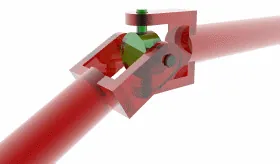

<figure class="eoc-pic eoc-pic-main"><picture><source media="(prefers-reduced-motion: reduce)" srcset="../media/universal-joint.still.webp"></picture><figcaption><strong>Animation.</strong> <a href="https://commons.wikimedia.org/wiki/File:Universal_joint.gif">Universal joint</a> by Van helsing, <a href="https://creativecommons.org/licenses/by/2.5">CC BY 2.5</a>, from Wikimedia Commons.</figcaption></figure>

Two forks joined by a cross-shaped piece that pivots both ways, so turning one shaft turns another shaft set at an angle to it, even while that angle changes.

**In plain words:** A joint with a small plus-shaped cross held between two forks, so one spinning shaft can turn another shaft that points off at an angle, like the joint at each end of a car's driveshaft. **Proper term:** Universal joint (Cardan joint, Hooke's joint).

**Also called:** U-joint; Cardan joint / cardan (after Gerolamo Cardano); Hooke's joint / Hooke joint (after Robert Hooke); Spicer joint / Hardy Spicer joint (names taken from Spicer (brand) and Hardy Spicer (brand)); cross and yoke joint / cross and bearing joint (the cross is also called the spider; its four arms are trunnions); pin and block universal joint (small industrial type with a square block and two pins instead of a cross); needle-bearing universal joint; double Cardan joint / double universal joint (two joints in one, for constant speed); cardan shaft / propeller shaft / prop shaft / driveshaft (a shaft with a universal joint at each end); universal joint socket adapter (the wobbly joint in a socket-wrench set); Kardangelenk / Kreuzgelenk (German); junta cardan (Spanish).

## How it works

Each fork holds opposite arms of the cross, and the two forks sit at right angles to each other, so the joint is really two hinges placed at 90 degrees to each other (Wikipedia). One hinge lets the shafts tilt up and down, the other lets them tilt side to side, so the output shaft can point in any direction within its range, but it cannot twist relative to the input: turning the input fork turns the cross, which turns the output fork. The catch is that at any angle the output does not turn at a steady speed: it speeds up and slows down twice every turn, and the bigger the angle the bigger the wobble. Putting two joints in a row with equal angles and the forks on the middle shaft lined up cancels the wobble (a double Cardan arrangement).

## Parts

A few parts: two forks (yokes), each fixed to one shaft; one cross (spider) with four short arms (trunnions); and four bearings or bushes where the cross arms sit in the forks (needle-roller bearing cups held by clips in cars, or plain pins). The small industrial pin-and-block type uses a square centre block and two cross pins instead. A double joint adds a second cross and a centre yoke.

## Everyday examples

- The driveshaft (propeller shaft) under a rear-wheel-drive car or truck, which has a universal joint at each end (Wikipedia 'Drive shaft')
- The steering column in almost every modern car, whose lower section has universal joints so the steering wheel can drive the steering gear at an angle (Wikipedia 'Steering column')
- A tractor's power take-off (PTO) shaft that drives mowers and other machinery, with a universal joint at each end under a bell-shaped guard (ag-safety.extension.org)
- The universal joint adapter in a socket-wrench set, which lets you turn a bolt from an angle

## When to use it

Use it when a motor or handle has to turn a shaft that points in a different direction, or when the angle between them changes as something moves: driving the wheels of a model car or robot through suspension, turning a mechanism from a hand [crank](../glossary.md#crank) or knob placed at an awkward angle, linking a motor to a camera pan head or a steering [linkage](../glossary.md#linkage), or joining two shafts that are well out of line (using two joints and a middle shaft). It is simple, strong for its size, easy to buy or print, and handles far larger angles than flexible couplings.

## When not to use it

Avoid a single joint at a large angle where smooth, steady speed or exact position matters (for example a camera slider or a precision positioning axis), because the output speeds up and slows down twice per turn: use two joints phased correctly, a constant-velocity (CV) joint, or bevel gears. For tiny [misalignments](../glossary.md#misalignment) between in-line shafts use a flexible coupling (beam, jaw or Oldham) instead, which is cheaper, simpler and has no play. For high speeds at large angles, or for very large angles, use a CV joint or a flexible drive shaft. Don't use it where exposed spinning joints could catch people unless you can guard it.

## Details

- **What it does (jobs):**
  - join and hold: connects two shafts so they turn together even though they point in different directions
  - let it move (turn, slide or bend): lets the angle between the shafts change while running, e.g. as a car's suspension moves
- **Movement:** multiple: passes continuous rotation while the shafts can also tilt relative to each other; common small pin-and-block joints run up to about 25 degrees (Wakefield Thermal/Curtis (brand)), catalogue joints of different types range from 10 degrees up to 136 degrees for special geared types (McMaster-Carr), and for smooth running the angle should be kept small (a few degrees at high speed)
- **Directions it can move (degrees of freedom):** 2: the two shafts can tilt relative to each other about two perpendicular pins (like a gimbal), but cannot twist relative to each other, which is why rotation is passed on (a spherical joint with a pin)
- **Special behaviour:**
  - none: its job is simply to pass rotation round an angle. Beginners should know its quirk: a single joint at an angle makes the output speed up and slow down twice per turn (non-constant velocity), which causes vibration; pairs of joints set up correctly cancel this (Wikipedia)
- **How it holds:**
  - shape (the parts interlock; [form-fit](../glossary.md#form-fit--force-fit--material-bond)): the forks, cross and pins interlock, so turning force passes by parts pushing on each other
  - not a holding joint (it moves or passes on motion): it is a moving joint; the fork hubs are fixed to their shafts separately ([set screws](../glossary.md#set-screw), pins, keys, [splines](../glossary.md#spline) or welding)
- **Input and output:** Continuous rotation -> continuous rotation at the same average speed (1:1), with the shafts meeting at an angle (intersecting shafts). With a bend angle β the output speed swings between (input speed x cos β) and (input speed / cos β) twice per turn (from Wikipedia's equation): about ±1.5% at 10 degrees, about -6% to +6.4% at 20 degrees and about -13% to +15.5% at 30 degrees. Two joints with equal angles and the forks on the middle shaft lined up give a steady output. Efficiency: high, with only rolling or rubbing at the pins ⚑ [uncertain: no reliable figure found]. Back-drivable: yes, it passes turning force either way.
- **Power:** passive (no power needed)
- **Load:** Medium to heavy: strong in twist (they carry the full engine [torque](../glossary.md#torque) in car driveshafts and tractor power take-off shafts, and McMaster-Carr lists joints rated from under 1,000 in·lbf (113 N·m) up to over 30,000 in·lbf (about 3,400 N·m)). Capacity and life fall as the angle, speed or load rises: each doubling of angle, speed or load roughly halves the joint's life (The Ranger Station). The pins and their bearings are the weak points. The joint does not support the shafts, so each shaft needs its own bearings ⚑ [uncertain].
- **Play and precision:** Small to noticeable play: plain pin-and-block joints need running [clearance](../glossary.md#clearance) and gain [backlash](../glossary.md#backlash) as they wear, although precision types are made with close fits (Wakefield Thermal); needle-bearing types run with less wear ⚑ [uncertain]. Even with no play, a single joint at an angle is not an exact copy of the input angle: the output leads and lags by up to about 0.4 degrees at a 10-degree bend, 1.8 degrees at 20 degrees and 4.1 degrees at 30 degrees (worked from Wikipedia's equation tan γ1 = cos β tan γ2). Misalignment: tolerates large angles (its purpose); a single joint accepts no sideways offset or change in length, which needs two joints and a sliding shaft.
- **Taking it apart:** removable: small joints fix to shafts with set screws, clamps, cross pins or keys and come off with a hex key or pin punch; car joints are held by clips in their forks and are usually pressed out and replaced as a unit ⚑ [uncertain]
- **How often it can be reused:** many times: the shaft fixings can be undone and redone repeatedly; the joint itself is a wearing part that runs until its bearings wear out (vehicle joints are typically rated for about 3,000 hours, per The Ranger Station)
- **Sealing:** none for plain joints; dust-resistant when fitted with a rubber boot or sealed bearings: boots on pin-and-block joints keep lubricant in and dirt out (Wakefield Thermal), and sealed needle-bearing joints are sold (McMaster-Carr)
- **Adjustable:** no settings to adjust, but the angle is free to change while it runs; with two joints and a sliding (splined or telescoping) middle shaft it also accepts changes in length and sideways offset (Wikipedia 'Drive shaft'; Wakefield Thermal)
- **Access needed:** end of a tube or shaft: each fork hub fits over (or into) a shaft end and is fixed there
- **Materials:** Steel (high-grade alloy steel is standard), with stainless steel, bronze and powdered-metal options (Wakefield Thermal); acetal plastic, zinc alloy, iron and neoprene (boots) also listed by McMaster-Carr. Toy and model versions are plastic (LEGO Technic (brand) has one). Printed versions work in PLA, PETG or nylon, ideally with metal pins or small ball bearings.
- **Heat, cold, water and wear:** [Lubrication](../glossary.md#lubrication) and dirt: the pins or bearings need grease or oil, and boots or sealed bearings keep dirt out; unprotected joints in dirty or wet places wear quickly (Wakefield Thermal; McMaster-Carr lists corrosion-resistant and sealed types for harsh places). Heat: printed PLA softens above about 60 °C and PETG above about 80 °C (Prusa). Vibration: running at too large an angle or out of phase causes vibration that shortens the joint's life (Spicer; The Ranger Station). Wear gradually adds play (Wakefield Thermal). No particular UV or cold limits beyond those of the material.

## Making it

- **Ways to make or get it:**
  - 3D print (FDM): very common for models, toys, light robot drives and tool accessories
  - 3D print (resin): ⚑ [uncertain] suits small display models; no load-tested example found
  - CNC: machined steel forks, cross or block for strong joints
  - off-the-shelf part: single and double universal joints, precision miniature joints, automotive cross-and-bearing kits, universal driveshafts
- **Printing it in one piece (print in place):** yes: several designs print fully assembled and working, e.g. eversoRAD's 'U-Joint Bit Holder ([Print-in-Place](../glossary.md#print-in-place))' (PLA, 0.10 mm layers, 4 [perimeters](../glossary.md#perimeters), brim) and Triple G Workshop's 'Universal Joint Chain - Print in Place' (joints must be gently loosened after printing). Joints meant to carry real torque are usually printed as separate forks and cross and assembled with metal pins or bearings
- **Tools:** Hex key for set screws or clamp hubs; pin punch for roll pins; a grease gun for greaseable joints (The Ranger Station); snap-ring pliers and a vice or press to replace a car's cross-and-bearing joint ⚑ [uncertain]. Printed joints need small metal pins, screws or wire, and sometimes ball bearings.
- **Difficulty:** easy to moderate: small steel universal joints are cheap to buy, and printed ones are simple two-fork-and-cross designs; the hard part is making the pins and fork arms strong enough, so use metal pins, screws or bearings for anything carrying real torque

### 3D printing tips

1) Use metal where the load goes: the cross arms and pins carry all the torque and a printed pin [shears](../glossary.md#peel-vs-shear) along its [layer lines](../glossary.md#layer-lines); OEP's tiny joint for 3 mm axles uses bent 1 mm steel wire as pins, John Beale's joint uses M3 screws through four small ball bearings (1/8 x 3/8 in) in the centre ball, and brandido2002's 'Fully printable U-Joint' uses four 608 skateboard bearings. 2) Orientation: print each fork lying so its pin holes are vertical, so the fork arms are made of continuous layers; if the arms stand up, bending loads pull the layers apart ⚑ [uncertain: reasoning, not a tested rule]. Schaffer.la notes that at larger sizes the holes need support in his orientation, and a brim is needed. 3) Clearance: leave about 0.5 mm between interlocking FDM parts (Hubs; resin about 0.2 mm); print-in-place joints must be freed gently after printing. 4) Strength settings: brandido2002 recommends at least 5 walls and 50% [infill](../glossary.md#infill) if the joint will be loaded; Schaffer.la printed in PLA but says PETG would be more robust. 5) Material: PLA is [brittle](../glossary.md#brittle--ductile) and softens above about 60 °C; PETG is tougher and handles up to about 80 °C (Prusa). 6) Fix the forks to shafts with metal: set screws into [captive nuts](../glossary.md#captive-nut) or [heat-set inserts](../glossary.md#heat-set-insert), or a hex or D-shaped bore that matches the shaft. 7) Keep angles modest and, if the output speed wobble matters, use two joints with equal angles and the middle forks lined up (see rules of thumb). 8) A little grease on the pins reduces wear and squeaking ⚑ [uncertain].

### Buying one (off-the-shelf parts)

Search for: 'single universal joint' and 'double universal joint' (with bore sizes, e.g. 3/32 in to 1 13/16 in, or 10-25 mm metric, per McMaster-Carr), 'pin and block universal joint', 'needle bearing universal joint', 'precision universal joint', 'clamp-on universal joint', 'universal joint boot' (neoprene), 'U-joint cross and bearing kit' (automotive), 'telescoping' or 'adjustable-length' double universal joints, 'constant-velocity universal joint', 'socket universal joint' (for socket wrenches), RC-car 'universal driveshafts', and LEGO Technic (brand) universal joints for models.

## Rules of thumb

- Output speed swings between cos β and 1/cos β times the input speed, twice per turn, where β is the bend angle: about ±1.5% at 10 degrees, about -13% to +15.5% at 30 degrees (worked from the equation in Wikipedia 'Universal joint').
- Two joints give steady output speed only when the input and output shafts make equal angles with the middle shaft and the two joints are 90 degrees out of phase, i.e. the forks on the middle shaft are lined up in the same plane (Wikipedia 'Universal joint'; Tom Wood's Custom Drive Shafts on phasing).
- For vehicle driveshafts: keep each joint's operating angle at least 0.5 degrees and no more than 3 degrees for vibration-free running, and the angles at the two ends equal within 1 degree (Spicer (brand) driveline operating angle calculator).
- Maximum normal operating angle falls as speed rises: about 3.2 degrees at 5,000 rpm, 5.8 degrees at 3,000 rpm and 11.5 degrees at 1,500 rpm (Spicer driveline operating angle calculator).
- Each doubling of operating angle, speed or load roughly halves the joint's life; as a rule of thumb a driveshaft angle should not exceed about 22 degrees (The Ranger Station, an off-road enthusiast site).
- Standard pin-and-block joints: up to 25 degrees and 1,750 rpm; heavier versions go higher (Wakefield Thermal, Curtis (brand) universal joints).
- HUANGYAN920's mechanism library gives an allowable angle of 25 degrees or less for a single universal joint.
- Catalogue joints span maximum operating angles of 10-136 degrees and speed limits of 1,000-6,000 rpm depending on type (McMaster-Carr universal joints page).
- Clearance between interlocking printed parts: about 0.5 mm for FDM and 0.2 mm for resin (SLA) (Hubs).

## Common failures

1) Worn cross bearings or pins, giving clunks when drive starts or stops and vibration from under a vehicle (Wikipedia 'Drive shaft'; The Ranger Station): keep it greased and replace worn joints. 2) Vibration and short life from running at too large an angle or too high a speed, or with unequal angles at the two ends of a shaft (Spicer; The Ranger Station): keep angles small and equal. 3) Vibration twice per turn from a two-joint shaft that is out of phase (the middle forks not lined up) (Tom Wood's Custom Drive Shafts): assemble the slip joint with the forks in line. 4) Retaining clips failing so the bearing caps come out of the forks (The Ranger Station). 5) Lack of lubrication causing heat and fast wear, especially at high speed and angle ⚑ [uncertain]. 6) Printed joints: the cross arms or pins shear, the fork arms split along layer lines, or print-in-place joints fuse because the gap was too small; use metal pins, lay the forks flat and leave enough clearance. 7) Set screws loosening on the shaft: tighten onto a flat, or use pins or clamp hubs.

## Safety

Spinning universal joints are serious entanglement hazards: on tractor PTO shafts turning at 540 or 1,000 rpm, clothing or a limb can be wrapped round the shaft several times before a person can react, and the uneven shape of the joint is what snags; always keep driveline guards and bell-shaped shields in place (ag-safety.extension.org). Fingers can be pinched between the forks and cross when the joint bends. A joint that fails on a vehicle driveshaft can let the shaft flail or drop ⚑ [uncertain].

## Related

- Constant-velocity (CV) joint: balls running in curved tracks give steady output speed at large angles, but it is more complex and usually needs a rubber boot and grease
- Double Cardan joint: two universal joints back to back with a shared centre yoke, giving near-constant speed (Wikipedia)
- Thompson coupling: a refined double Cardan joint with slightly better efficiency but much more complexity (Wikipedia)
- Beam coupling and other flexible couplings (jaw, Oldham, bellows): for small misalignment between nearly in-line shafts, with no play, but they can't handle large angles
- Flexible drive shaft (rotating cable): carries rotation round real bends, but twists under load
- Bevel gears: turn a shaft through a fixed angle (usually 90 degrees) at a steady speed, and can change speed too, but the angle can't vary
- Schmidt coupling: joins parallel shafts that are well offset sideways, at constant speed
- Ball-and-socket joint: also moves in several directions, but it doesn't pass turning force on (it is a pivot, not a drive)
- Gimbal: the same two-hinges-at-right-angles idea used to hold something level rather than to drive a shaft (Wikipedia notes the gimbal as its ancestor)
- Spline shaft (sliding spline): often paired with universal joints so a driveshaft can change length

## Make it yourself

- [Educational Model of Cardan Universal Joint (osamutake, Printables)](https://www.printables.com/model/1458401-educational-model-of-cardan-universal-joint): Printable teaching model on an 80 x 80 mm base that shows how the output of a single Cardan joint speeds up and slows down (details read via the Printables API) *(licence: CC BY)*
- [Educational Model of Double Cardan Universal Joint (osamutake, Printables) (URL from Printables API, page not opened)](https://www.printables.com/model/1498409-educational-model-of-double-cardan-universal-joint): Companion teaching model showing how two mirrored Cardan joints give a steady output speed *(licence: CC BY)*
- [Fully printable U-Joint (brandido2002, Printables)](https://www.printables.com/model/559830-fully-printable-u-joint): Printed universal joint that runs on four 608 bearings; the designer suggests at least 5 walls and 50% infill for use under load (details read via the Printables API) *(licence: CC BY-NC)*
- [U-Joint Bit Holder (Print-in-Place) (eversoRAD, Printables) (URL from Printables API, page not opened)](https://www.printables.com/model/1222842-u-joint-bit-holder-print-in-place): Hex-bit holder with a universal joint whose three moving parts print already assembled (PLA, 0.10 mm layers, 4 perimeters, brim) *(licence: CC BY)*
- [U Joint (Parametric, w/FreeCAD file) (Schaffer.la, Printables) (URL from Printables API, page not opened)](https://www.printables.com/model/615805-u-joint-parametric-wfreecad-file): Parametric universal joint driven by a FreeCAD spreadsheet: set the width of the cross and the rest scales *(licence: CC BY-NC-SA)*

## Pictures, videos and models

- [Universal joint.gif (Wikimedia Commons, by Van helsing)](https://commons.wikimedia.org/wiki/File:Universal_joint.gif): 3D animation of a single universal joint turning, showing the forks and cross *(licence: GFDL 1.2 or later, CC BY-SA 3.0, or CC BY 2.5 (choose one))*
- [Double Cardan Joint (animated).gif (Wikimedia Commons, by Catsquisher)](https://commons.wikimedia.org/wiki/File:Double_Cardan_Joint_(animated).gif): Animation of a double Cardan joint, two universal joints back to back that give steady output speed *(licence: Public domain)*
- [507 Mechanical Movements, 50 and 51: 'Two kinds of universal joints' (Brown, 1868)](https://507movements.com/mm_051.html): Historic drawing, with an animated version, of two kinds of universal joint *(licence: book public domain; website animation link only)*
- [HUANGYAN920 Mechanical: 'UNIVERSAL JOINT' (万向联轴节, no. 08) and 'DOUBLE-CARDAN' (双万向节机构, no. 92)](https://huangyan920.github.io/Mechanical/): Interactive animations of a single and a double universal joint *(licence: MIT)*

## Needs confirming

⚑ marks something nobody has confirmed yet: a fact the research could not confirm from a source, a finder value that is a best guess, or an open point from the research notes. Corrections are welcome (see `research/needs-confirming.md`).

- ⚑ 10 sentences on this page marked [uncertain].
- ⚑ Finder value `tools` = press or vice, hand tools (source uncertain): `tools_needed` is marked ⚑ [uncertain] here: "…pliers and a vice or press to replace a car's cross-and-bearing joint ⚑ [uncertain]. Printed joints need small m…"

## Sources

- <https://en.wikipedia.org/wiki/Universal_joint>
- <https://en.wikipedia.org/wiki/Drive_shaft>
- <https://en.wikipedia.org/wiki/Steering_column>
- <https://commons.wikimedia.org/wiki/Category:Universal_joints>
- <https://commons.wikimedia.org/wiki/Category:Animations_of_universal_joints>
- <https://commons.wikimedia.org/wiki/File:Universal_joint.gif>
- <https://commons.wikimedia.org/wiki/File:Double_Cardan_Joint_(animated).gif>
- <https://507movements.com/mm_051.html>
- <https://mm2-nitk.vlabs.ac.in/exp/universal-joint/theory.html>
- <https://spicerparts.com/calculators/driveline-operating-angle-calculator>
- <https://www.therangerstation.com/tech/all-about-universal-joints/>
- <https://4xshaft.com/blogs/faq/driveshaft-in-phase>
- <https://wakefieldthermal.com/industrial-solutions/universal-joints/>
- <https://www.mcmaster.com/products/universal-joints/>
- <https://ag-safety.extension.org/power-take-off-safety/>
- <https://huangyan920.github.io/Mechanical/>
- <https://raw.githubusercontent.com/HUANGYAN920/Mechanical/master/README.md>
- <https://api.printables.com/graphql/>
- <https://www.printables.com/model/1458401-educational-model-of-cardan-universal-joint>
- <https://www.printables.com/model/559830-fully-printable-u-joint>
- <https://interestingengineering.com/videos/3d-print-this-mesmerizingly-smooth-universal-joint-with-mini-bearings>
- <https://youmagine.com/designs/universal-joint>
- <https://www.hubs.com/knowledge-base/how-design-interlocking-joints-fastening-3d-printed-parts/>
- <https://help.prusa3d.com/article/pla_2062>
- <https://help.prusa3d.com/article/petg_2059>
