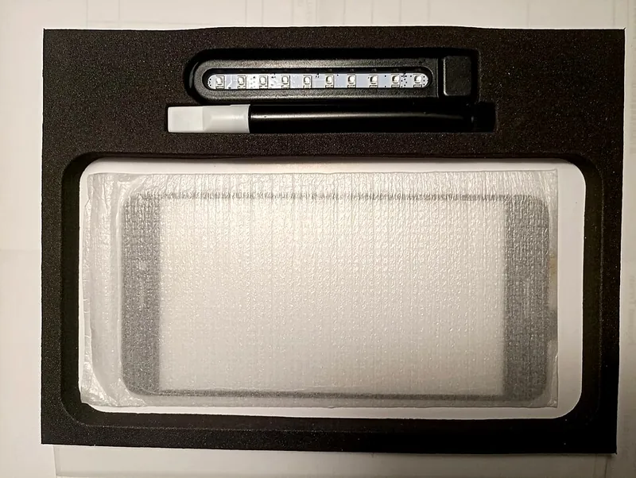
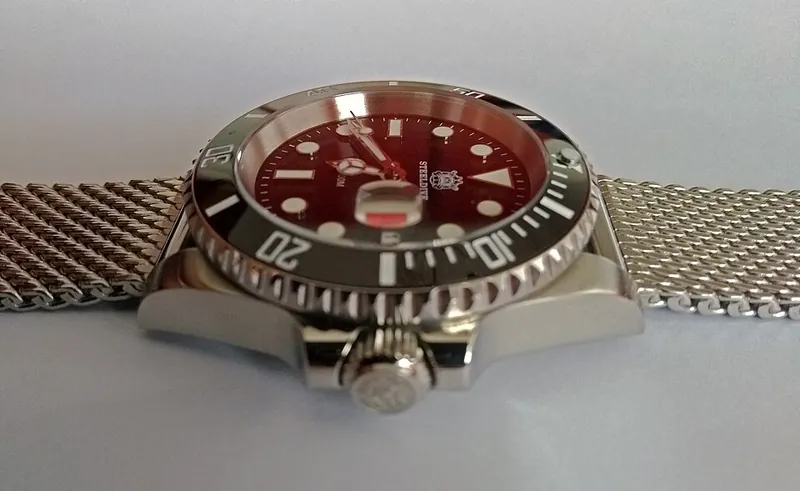

<figure class="eoc-pic eoc-pic-main"><figcaption><strong>Photo.</strong> <a href="https://commons.wikimedia.org/wiki/File:UV_curing_glue_kit_for_Huawei-Screen.jpg">UV curing glue kit for Huawei-Screen</a> by Mcapdevila, <a href="https://creativecommons.org/licenses/by-sa/4.0">CC BY-SA 4.0</a>, from Wikimedia Commons.</figcaption></figure>
<figure class="eoc-pic"><figcaption><strong>Photo.</strong> <a href="https://commons.wikimedia.org/wiki/File:Steeldive_SD8205-5.jpg">Steeldive SD8205-5</a> by Francis Flinch, <a href="http://creativecommons.org/publicdomain/zero/1.0/deed.en">CC0</a>, from Wikimedia Commons.</figcaption></figure>

A one-part liquid adhesive containing a light-sensitive starter (photoinitiator) that hardens into solid plastic within seconds when UV or violet light reaches it, so you can position parts at leisure and then fix them in place instantly.

**In plain words:** A clear liquid glue that stays runny for as long as you like, then turns hard in seconds when you shine an ultraviolet (UV) or violet light on it; leftover resin from a resin 3D printer can be used the same way. **Proper term:** UV-curing adhesive (light-curing adhesive, light-cure acrylic).

**Also called:** UV glue, UV adhesive, UV-cure adhesive; light-curing adhesive, light-cure adhesive, light curing materials (LCM) (Wikipedia 'Adhesive'; Henkel LOCTITE guide); light curing acrylic adhesive (the most common chemistry; Henkel LOCTITE guide p. 9); UV-curing epoxies, silicones and cyanoacrylates also exist (GA Lindberg); UV resin, craft or jewellery UV resin; resin welding, UV welding, gluing resin prints with resin (Raise3D; Formlabs); liquid plastic welder, UV plastic welder (marketing names; New Atlas); Bondic (brand), a pen-style kit with a built-in UV LED (New Atlas); UV-curing optical adhesive, UV glass glue (used for lenses, optics and glass); dual-cure adhesive (a light-curing adhesive with a second moisture, heat or anaerobic [cure](../glossary.md#cure) for areas the light can't reach; GA Lindberg).

## How it works

The liquid contains a photoinitiator, a small molecule that absorbs light of a particular wavelength and breaks apart into reactive fragments (free radicals, or an acid in UV-curing epoxies) (Wikipedia 'UV curing'; Henkel LOCTITE guide p. 9). These start a chain reaction that links the liquid's building blocks into a hard, cross-linked plastic (a thermoset), typically in 2 to 60 seconds (Henkel p. 9). The reaction only runs while enough light is shining on it, so glue in the dark stays liquid, and where the surface touches air, oxygen can stop it curing properly and leave it tacky (GA Lindberg; Dymax). Resin for resin 3D printers is the same kind of light-cured material, so a thin film of it between two resin parts, cured with light of the printer's wavelength (usually 405 nm), glues them with matching material (Formlabs; Raise3D).

## Parts

A few parts: (1) the liquid adhesive or resin, a mix of building-block molecules (monomers and oligomers) and a photoinitiator (Wikipedia 'UV curing'); (2) a light source whose wavelength matches it, usually 365-405 nm, such as a UV LED torch or lamp, a 405 nm laser pointer, a resin printer's curing station or direct sunlight (GA Lindberg; Formlabs; Hackaday); and (3) the two parts, at least one of which must let the light through to the glue line unless the glue sits in an open seam or [fillet](../glossary.md#chamfer--fillet) (GA Lindberg).

## Everyday examples

- Phone screen replacement kits that use a UV-curing glue and a small UV lamp (Wikimedia Commons photo)
- Laser and camera optics fixed to glass blocks with UV-curing adhesive (Wikimedia Commons photo of a Lightwave Electronics laser)
- Pocket UV repair pens sold as 'liquid plastic welders', such as Bondic (brand) (New Atlas)

## When to use it

Use it when you need time to line parts up exactly and then want them fixed instantly; when the joint should be clear or nearly invisible (glass, clear acrylic, clear or translucent resin prints); for gluing, repairing and hiding seams on resin prints with the same resin; for tiny parts, cracks and chips where a thin, runny glue can flow in; and for quick tack-welds that hold parts while a stronger glue cures (Henkel p. 9; Raise3D; Formlabs; GA Lindberg). It is one-part, needs no mixing and wastes little, since unused glue stays liquid until light hits it (Hackaday 2018).

## When not to use it

Avoid it where light can't reach the whole glue line, such as between two opaque parts (use superglue, epoxy or a dual-cure adhesive instead); for big gaps or thick layers (use epoxy); for joints that take impact, bending or [peel](../glossary.md#peel-vs-shear) (use a tougher adhesive such as epoxy, or screws); and for slippery plastics like polyethylene and polypropylene (use a structural acrylic adhesive for low-surface-energy plastics) (GA Lindberg; Raise3D; Henkel p. 9). Don't rely on resin welding alone for load-bearing resin parts; back it up with superglue or epoxy (Raise3D). Anyone who has developed an acrylate skin allergy should avoid it (DermNet).

## Details

- **What it does (jobs):**
  - glue or bond: bonds glass, clear plastics, resin prints and most metals, and fills small cracks and chips
  - join and hold: a permanent, often nearly invisible joint, fixed in seconds exactly where you placed the parts
- **Movement:** none: the cured adhesive is rigid (softer, flexible grades also exist; Henkel p. 9)
- **Directions it can move (degrees of freedom):** 0: once cured the parts are fixed together
- **Special behaviour:**
  - none of the listed behaviours. Its useful quirk is 'cure on demand': you can position and adjust the parts for as long as you need, then fix them in seconds by switching on the light (Henkel p. 9; GA Lindberg)
- **How it holds:**
  - [material bond](../glossary.md#form-fit--force-fit--material-bond) (glue, solvent or melting): the liquid wets both surfaces and hardens into a cross-linked plastic that adheres to them (Henkel p. 9)
- **Input and output:** not applicable
- **Power:** passive (no power needed): the cured joint needs no power. Curing it needs light, from a battery or mains-powered UV lamp, or from direct sunlight outdoors (Hackaday 2018)
- **Load:** Light to medium in hobby use. Industrial light-cure acrylics bond close-fitting parts strongly in shear (Henkel p. 9; LOCTITE AA 3105 datasheet), but most cured UV adhesives and printer resins are hard and rather [brittle](../glossary.md#brittle--ductile), so a joint can crack under impact, bending or peel, and [shrinkage](../glossary.md#warping--shrinkage) during curing adds stress (GA Lindberg; Raise3D). Resin used as glue is about as strong as the resin itself: a Formlabs forum user reports that properly cured joints break through the resin rather than along the seam, while Raise3D advises treating resin welding as mainly cosmetic and backing it up with superglue or epoxy for structural joints.
- **Play and precision:** not applicable: the glue doesn't locate the parts, but curing on demand lets you align parts precisely (for example in a jig) and then fix them in seconds without the glue shifting while it sets (Henkel p. 9; GA Lindberg). Acrylate-based formulations shrink quite a lot as they cure, which can pull parts slightly and adds stress (GA Lindberg).
- **Taking it apart:** permanent: cured light-cure adhesive is a thermoset that doesn't melt again; removing it needs heat, chemicals or mechanical force depending on the type, and GA Lindberg calls removal 'tricky'
- **How often it can be reused:** once
- **Sealing:** watertight ⚑ [uncertain]: a continuous cured bead is solid plastic, and light-curing adhesives are also used to seal and coat products (Wikipedia 'Adhesive'), but no pressure rating was found for hobby joints
- **Adjustable:** no: there is virtually unlimited time to reposition the parts before the light is switched on (Henkel p. 9), but none afterwards
- **Access needed:** one side only (blind), but the light must reach the glue: either through a part that lets UV or violet light pass, or from the open edge of the seam. Glue in shadow under an opaque part will not cure unless the product has a second cure mechanism (GA Lindberg; Henkel p. 9).
- **Materials:** Bonds well: glass, many plastics, ceramics and most metals (LOCTITE AA 3105 datasheet; Wikipedia 'Adhesive' lists glass and optical manufacturing among its main uses); cured resin prints, best of all with the same resin (Formlabs; Raise3D; Anycubic). A reader of Prusa's gluing guide reports printer resin cured with a UV torch works 'amazingly well' on PETG, ASA, polycarbonate and PLA prints, but only where the cross-section is small enough for the light to get through (single user report) ⚑ [uncertain]. Limits: at least one part must let the curing light through, and some transparent plastics block UV (a 405 nm blue-light grade may still work) (GA Lindberg); opaque and black parts block the light (Prusa forum). Before it cures, the liquid adhesive can cause stress cracking in polycarbonate that is under stress (LOCTITE AA 3105 datasheet, ASTM D3929 test). Adhesion to low-surface-energy plastics such as polyethylene, polypropylene and silicone is expected to be poor ⚑ [uncertain].
- **Heat, cold, water and wear:** Temperature depends on the product: as one industrial example, LOCTITE AA 3105 kept 100% of its lap-shear strength on polycarbonate after 340 hours at 93 °C, tested back at room temperature (datasheet); cheap craft UV resins are not documented ⚑ [uncertain]. Too much light degrades the adhesive and discolours it (GA Lindberg), and Raise3D warns that prolonged UV exposure can make cured resin brittle ⚑ [uncertain]. Acrylate types shrink as they cure, leaving built-in stress in the joint (GA Lindberg). Any glue left uncured in shadow stays soft liquid and never gains strength (GA Lindberg).

## Making it

- **Ways to make or get it:**
  - 3D print (resin): the main maker use, gluing, repairing or hiding seams on resin prints with the same resin and a 405 nm light (Formlabs; Raise3D; Anycubic)
  - 3D print (FDM): small joints, seam filling and cosmetic repairs; printer resin brushed onto PLA prints cures into a sandable coating (Hackaday 2018, 2022; Prusa reader comment)
  - laser cut: clear acrylic or glass parts can be joined with clear UV adhesive where the sheet lets enough curing light through ⚑ [uncertain]
  - off-the-shelf part: bonding glass, lenses and optics, and small electronics, phone-screen and jewellery repairs (Wikipedia 'Adhesive'; Wikimedia Commons photos)
- **Printing it in one piece (print in place):** no: it is a glue applied after printing. Resin used as glue is the same material as a resin print, but the parts are still printed separately and joined afterwards.
- **Tools:** A UV or violet light matched to the adhesive: a 365-405 nm LED torch or lamp (GA Lindberg), a 405 nm laser pointer for Formlabs resins (Formlabs), or a resin printer's curing station for the final cure (Prusa forum); a needle-tip bottle, syringe, micro-brush or toothpick to apply thin films (Raise3D); tape, clamps or fingers to hold the parts for the first seconds; UV-blocking safety glasses and nitrile or neoprene gloves (Raise3D; Formlabs safety page; DermNet); isopropyl alcohol and a cloth to wipe off a tacky surface layer (Raise3D).
- **Difficulty:** easy: no mixing, and a UV torch kit, or leftover printer resin plus the printer's curing light, is all you need; the main skill is getting enough light to every part of the glue line

### 3D printing tips

1) For resin prints, use the same resin as glue: clean and dry the parts, dry-fit them, apply a very thin film, press and hold the parts together, then 'spot-tack' the joint by shining the light on one area for 10-30 seconds and working around the seam before giving the whole part a final post-cure under the lamp or in a curing station (Raise3D; Prusa forum). Matching resin gives matching colour and hardness, and on clear parts matching refractive index makes the seam almost invisible (Raise3D; Formlabs forum). 2) Match the light to the resin: most resin printers use 405 nm, and Formlabs says its resins need a 405 nm laser pen to work as glue; a green (532 nm) laser pointer will not cure them (Formlabs; Formlabs forum). Direct sunlight works outdoors, but most windows block UV (Hackaday 2018). 3) Get light to the whole glue line: it works best on small cross-sections and on clear or translucent parts. On opaque or black parts, glue the middle of the joint with superglue or epoxy and use resin only on the edges, or fill the seam with resin after gluing (Prusa reader comment; Formlabs forum). 4) Keep layers thin: thick layers shrink more and can leave uncured liquid inside (Raise3D). As an unofficial guide, a Formlabs forum reply suggests exposing a thick joint at least 10 times as long as a thin (under 1 mm) layer needs, and says a 12 mm thick joint is probably too thick to cure through. Build up bigger gaps in several thin layers (New Atlas on layering). 5) A tacky surface after curing is oxygen inhibition: cure longer or with a stronger light, cover the glue with a clear film while curing, or wipe it with isopropyl alcohol afterwards (Raise3D; Dymax). 6) For FDM prints, resin can be used like a quick-setting filler: Hackaday reports printer resin brushed onto PLA and cured in sunlight, and resin thickened with talcum powder brushed on to fill [layer lines](../glossary.md#layer-lines) before sanding (Hackaday 2018, 2022). Make sure it is fully cured before sanding. 7) Never pour used or contaminated resin back into the printer's vat or bottle (Hackaday 2018), and keep resin bottles shaded so room light doesn't partly cure them (Raise3D). 8) Solvent cements can't bond cured resin prints, so resin, superglue or epoxy are the options (Raise3D).

### Buying one (off-the-shelf parts)

Search for: 'UV curing adhesive', 'light cure adhesive' or 'UV glue' (glass, optical or plastic-bonding grades); 'UV resin' (craft and jewellery); 'UV LED flashlight 365 nm' or '395 nm', '405 nm UV flashlight' or '405 nm laser pointer'; 'UV curing lamp' or a resin printer 'curing station'; 'UV-blocking safety glasses'; 'nitrile gloves'. Pen-style kits with a built-in LED and refill cartridge are sold as 'liquid plastic welders', e.g. Bondic (brand) (New Atlas). Industrial examples: LOCTITE AA 3105 (brand), a light-cure acrylic for plastics, glass and metal (datasheet); 'dual cure' adhesives for shadowed joints (GA Lindberg).

## Rules of thumb

- Light-curing acrylics typically cure in 2 to 60 seconds, come in viscosities from 50 cP (water-thin) to non-running gels, and with industrial lamps can cure more than 13 mm (0.5 in) deep (Henkel 'LOCTITE Design Guide for Bonding Plastics', vol. 6, p. 9).
- Most light-curing adhesives cure at about 365-405 nm; the wavelength must match the adhesive's photoinitiator. GA Lindberg gives a lamp intensity of over 50 mW/cm² for its adhesives and says sunlight, at about 2-5 mW/cm², is not enough; 2-3 times the recommended light dose is usually fine, too little leaves it under-cured and far too much degrades and discolours it; practical depth limit is about 10 mm (GA Lindberg 'Basics of light curing adhesives').
- Example industrial product: LOCTITE AA 3105 fixes glass microscope slides together in 15 seconds or less under a 6 mW/cm² black light measured at 365 nm, and its surface cure improves with short-wave UV (220-260 nm) (LOCTITE AA 3105 technical data sheet, 2015).
- Short-wave UV (280-320 nm) cures the surface best but not deep; longer wavelengths (400-500 nm) cure deeper; 320-450 nm gives the best balance. A 'tack-free' surface is not the same as a full cure (Dymax 'How to Overcome Oxygen Inhibition').
- Formlabs resins need a 405 nm light (laser pen or pointer) to work as glue (Formlabs 'Advanced 3D Printing Techniques').
- Unofficial: expose a thick joint at least 10 times as long as it takes to cure a thin (under 1 mm) droplet; 12 mm is probably too thick to cure through (Formlabs community forum reply).
- Spot-tack joints for 10-30 seconds, then post-cure the whole part for several minutes (Raise3D).
- Outdoor sunlight works but most windows block UV; resin coatings took about two to three hours of winter sun to lose their tackiness (Hackaday 'Print Smoothing Tests With UV Resin', 2018).

## Common failures

Joint stays wet or falls apart because the light never reached the glue (opaque or black parts, UV-blocking plastic, shadowed areas): use a clear part, cure from the open edges, or use a dual-cure adhesive, superglue or epoxy inside (GA Lindberg; Prusa reader comment). Nothing cures because the light is the wrong wavelength or too weak: match 365-405 nm to the adhesive, and don't use a green laser pointer or cure through window glass (GA Lindberg; Formlabs forum; Hackaday 2018). Uncured liquid trapped inside a thick layer, and distortion from shrinkage: use thin films and build up in layers (Raise3D). Sticky surface from oxygen inhibition: more light, a clear film cover or an isopropyl alcohol wipe (Dymax; Raise3D). Brittle joint cracks when bumped or flexed (Raise3D). Yellowed or weakened glue from over-curing (GA Lindberg). Crazing of stressed polycarbonate touched by the liquid adhesive (LOCTITE AA 3105 datasheet). Resin in the bottle thickens because room light partly cured it (Raise3D).

## Safety

UV light is harmful to eyes and skin, so wear UV-blocking glasses and keep the beam off your skin (GA Lindberg; Raise3D); never shine a laser pointer into anyone's eyes (Formlabs forum), and note that Formlabs describes the lasers in its printers as Class 3B, able to injure eyes or skin with direct exposure. Uncured acrylates are a common cause of allergic contact dermatitis (itching, burning, blistering, usually on the fingers and hands); acrylates were named Contact Allergen of the Year 2012, and DermNet advises everyone handling acrylate monomers to avoid skin contact. Wear nitrile or neoprene gloves (Formlabs safety page); DermNet notes methyl methacrylate passes through latex and vinyl gloves within minutes and recommends double gloving. Work with ventilation (Raise3D), keep uncured resin from contaminating the workspace, and don't sand it before it is fully cured (Hackaday 2022). Industrial high-intensity lamps create ozone that must be vented (Henkel p. 9).

## Related

- Cyanoacrylate (superglue): also fast and one-part, but cures from surface moisture without light, so it works in hidden and opaque joints; similarly brittle
- Two-part epoxy: cures without light and fills bigger gaps; slower, but better for structural joints on resin prints (Raise3D)
- Anaerobic adhesive ([threadlocker](../glossary.md#threadlocker)): the opposite trigger, curing when shut off from air between close-fitting metal parts
- Solvent welding: fuses thermoplastics by dissolving them, but can't bond cured resin prints (Raise3D)
- Hot-melt adhesive (glue gun): also sets in seconds, but by cooling; gap-filling but weak and softens with heat
- Dual-cure adhesives: light-curing adhesives with a second moisture, heat or anaerobic cure so shadowed areas harden too (GA Lindberg)
- Silicone and MS-polymer adhesive sealants: UV-curing silicones exist (Henkel), but the usual ones cure from air moisture and stay flexible

## Make it yourself

- [Glue strength test pieces (MethodicalMaker, Printables)](https://www.printables.com/model/236948-glue-strength-test-pieces): Printable shear, tension and torque test pieces for comparing adhesives, for example resin-welded against superglued joints. Details read through the Printables public API; the URL appeared in search results. *(licence: CC BY (Creative Commons Attribution))*
- [Glue tensile strength test object (Patrol_maverick, Printables)](https://www.printables.com/model/1352973-glue-tensile-strength-test-object): Two printed rings with a 6 x 6 mm glue face, bonded together and loaded with a bucket of water until the joint fails. Details read through the Printables public API; the URL appeared in search results. *(licence: CC BY-SA (Creative Commons Attribution-ShareAlike))*
- [3D Printering: Print Smoothing Tests With UV Resin (Hackaday)](https://hackaday.com/2018/03/08/3d-printering-print-smoothing-tests-with-uv-resin/): A try-it-yourself write-up of brushing leftover printer resin onto prints, thinning it with isopropyl alcohol and curing it in sunlight *(licence: link only)*

## Pictures, videos and models

- [UV curing glue kit for Huawei-Screen (Wikimedia Commons, by Mcapdevila)](https://commons.wikimedia.org/wiki/File:UV_curing_glue_kit_for_Huawei-Screen.jpg): Photo of a consumer UV-curing glue kit with a small UV lamp, used for replacing a phone screen *(licence: CC BY-SA 4.0 (also GFDL))*
- [Lightwave Electronics model 142 Laser Optics Fix (Wikimedia Commons, by Samuel M. Goldwasser)](https://commons.wikimedia.org/wiki/File:Lightwave_Electronics_model_142_Laser_Optics_Fix.jpg): Close-up photo of laser optics mounted on a glass block and fixed to a platform with UV-curing adhesive *(licence: CC BY-SA 3.0 (also GFDL))*
- [UV Curing Process (Wikimedia Commons, by Bonobo12345)](https://commons.wikimedia.org/wiki/File:UV_Curing_Process.jpg): Diagram of cross-linking during light-triggered polymerisation (curing) *(licence: CC BY-SA 4.0)*
- [Basics of light curing adhesives (GA Lindberg knowledge hub)](https://www.galindberg.se/en/knowledge-hub/Basics-of-light-curing-adhesives): Illustrated explanation of the curing steps (light activates the photoinitiator, polymerisation runs while lit) with pros and cons *(licence: link only)*
- [3D Printering: Print Smoothing Tests With UV Resin (Hackaday, 2018)](https://hackaday.com/2018/03/08/3d-printering-print-smoothing-tests-with-uv-resin/): Photos of printer resin brushed onto FDM prints and cured in sunlight, with notes on thinning and curing *(licence: link only)*

## Needs confirming

⚑ marks something nobody has confirmed yet: a fact the research could not confirm from a source, a finder value that is a best guess, or an open point from the research notes. Corrections are welcome (see `research/needs-confirming.md`).

- ⚑ 6 sentences on this page marked [uncertain].
- ⚑ Finder value `seal` = watertight (source uncertain): `seal` is marked ⚑ [uncertain] here: "watertight ⚑ [uncertain]:…"
- ⚑ Finder value `bonds_well` = PLA, PETG, ABS or ASA, resin prints, slippery plastics (PE or PP), silicone, acrylic or polycarbonate, metal, glass or ceramic (source uncertain): `materials` is marked ⚑ [uncertain] here: "…ion is small enough for the light to get through (single user report) ⚑ [uncertain]. Limits: at least one part m…"
- ⚑ Finder value `bonds_poorly` =  (source uncertain): `materials` is marked ⚑ [uncertain] here: "…ion is small enough for the light to get through (single user report) ⚑ [uncertain]. Limits: at least one part m…"

## Sources

- <https://en.wikipedia.org/wiki/UV_curing>
- <https://en.wikipedia.org/wiki/Adhesive>
- <https://www.ellsworth.com/globalassets/literature-library/manufacturer/henkel-loctite/henkel-loctite-design-guide-plastic-bonding.pdf>
- <https://www.galindberg.se/en/knowledge-hub/Basics-of-light-curing-adhesives>
- <https://dymax.com/resources/news-and-media/blog/common-questions/how-to-overcome-oxygen-inhibition-in-light-curable-adhesives>
- <https://datasheets.tdx.henkel.com/LOCTITE-AA-3105-en_GL.pdf>
- <https://formlabs.com/blog/advanced-3dp-techniques/>
- <https://forum.formlabs.com/t/clear-prints-with-seamless-joints-on-multi-part-prints-uv-glue-laser-curing/29063>
- <https://forum.prusa3d.com/forum/original-prusa-sl1-general-discussion-announcements-and-releases/whats-the-best-method-to-join-uv-resin-parts/>
- <https://blog.prusa3d.com/the-great-guide-to-gluing-and-assembling-3d-prints_44908/>
- <https://www.raise3d.com/blog/best-resin-prints-glue/>
- <https://store.anycubic.com/blogs/3d-printing-guides/best-glue-for-resin-prints>
- <https://dermnetnz.org/topics/allergy-to-acrylate>
- <https://formlabs.com/global/support/Safety-Formlabs-SLA-printers/>
- <https://newatlas.com/bondic-uv-liquid-plastic-welder/35085/>
- <https://hackaday.com/2018/03/08/3d-printering-print-smoothing-tests-with-uv-resin/>
- <https://hackaday.com/2022/01/04/uv-resin-perfects-3d-print-but-not-how-you-think/>
- <https://commons.wikimedia.org/wiki/File:UV_curing_glue_kit_for_Huawei-Screen.jpg>
- <https://commons.wikimedia.org/wiki/File:Lightwave_Electronics_model_142_Laser_Optics_Fix.jpg>
- <https://commons.wikimedia.org/wiki/File:UV_Curing_Process.jpg>
- <https://commons.wikimedia.org/wiki/Category:UV_curing>
- <https://api.printables.com/graphql/>
