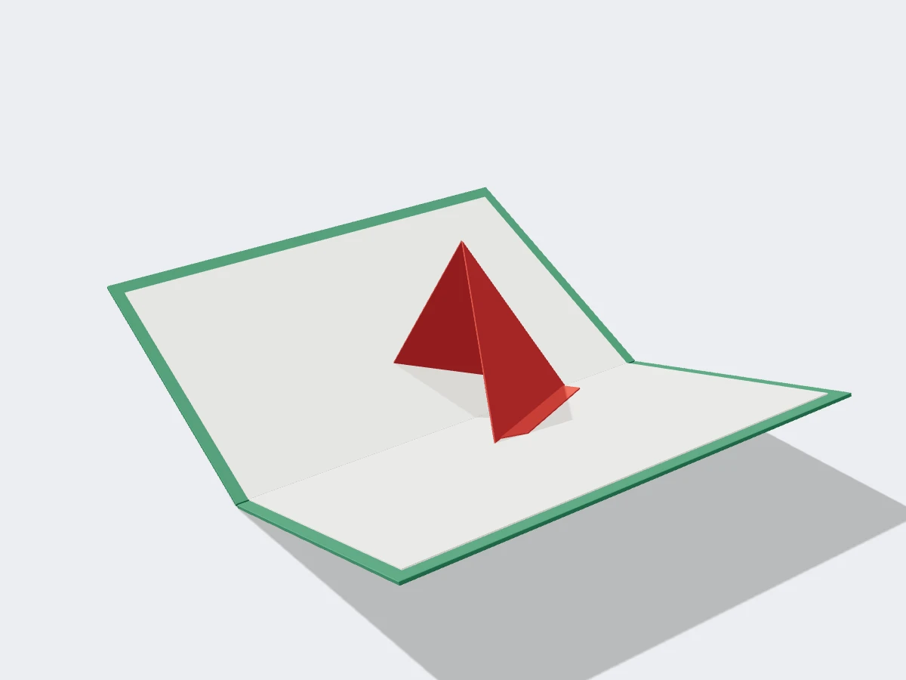

<figure class="eoc-pic eoc-pic-main"><picture><source media="(prefers-reduced-motion: reduce)" srcset="../media/drawn/v-fold-pop-up.svg"></picture><figcaption><strong>Animation.</strong> Diagram drawn for the encyclopaedia from the research notes. ⚑ Needs confirming: a drawing can simplify or get details wrong; a real photo or a better diagram is welcome.</figcaption></figure>
<figure class="eoc-pic"><figcaption><strong>Render.</strong> A 3D model made for the encyclopaedia, not a photo: a stand-in until a good real photo is found. ⚑ Needs confirming: a model can simplify or get details wrong; a real photo is welcome.</figcaption></figure>

A piece of card whose creases all meet at one point on the centre fold of a card, so opening the card swings it up and forward at an angle and closing it folds it flat between the pages.

**In plain words:** A piece of card cut or glued across the middle fold of a card at a slant, so that when you open the card it swings up and forward, like a pop-up mouth, beak, tree or monster. **Proper term:** V-fold pop-up (angle fold).

**Also called:** V-fold, simple V-fold (Make:, Chibitronics, Superplexus); angle fold (Georgia Tech Paper Museum; Warwick WMG lesson 2); mouth fold, mouth pop-up, single sheet mouth (Warwick; Robert Sabuda); beak pop-up (common name, no opened source) ⚑ [uncertain]; triangular pop-up (Carol Barton 1998: one cut and an angled fold); acute, obtuse and 90-degree V-fold; unequal V-fold (Superplexus); symmetric and asymmetric V-fold; front-leaning, balanced and back-leaning V-fold (Instructables 'Pop-Up Card'); double 45-degree fold (Instructables); M-fold (a triple V-fold; Duncan Birmingham via Cut Out + Keep); angled scenery flat, angled tent fold (Superplexus: 'the name describes intent, not necessarily the construction'); V-style pop-up (Li, Ju, Gu and Hu, SIGGRAPH 2011).

## How it works

The pop-up piece is folded down its middle and its two halves are fixed to the two pages, but at a slant to the centre fold, so that 'the three creases of the pop-up element converge at the same point on the spine or gutter of the base' (Georgia Tech Paper Museum). Because all its hinge lines pass through one point, it moves like a small spherical [linkage](../glossary.md#linkage) made of paper rather than a parallelogram: as the pages open, the two halves are pulled apart and the middle crease swings up and towards you, and as the pages close it folds down flat. It works only if the angles balance: on each side of the centre fold, the angle of the piece and the angle on the base must match the other side (Georgia Tech), written α1+β1 = α2+β2 or α1−β1 = α2−β2 depending on which way it folds (Instructables 'Pop-Up Card'); otherwise 'the page cannot be completely closed'. The piece's own angle must be at least as big as the angle of its glue lines on the base, or it will not pop (Georgia Tech; Judit Orosz: glue it at 'an even sharper angle' than the piece's own V). V-folds usually work with the card opened flat to 180 degrees (Barton 1998; Georgia Tech). Variants: the single-sheet mouth or beak (two triangles folded back from one cut and pushed through; a jagged cut gives teeth; Sabuda, Warwick), acute, obtuse and 90-degree V-folds, lopsided (asymmetric or unequal) V-folds, V-folds stacked on V-folds ('a big v-fold with a little v-fold on top', Make:), the M-fold (a triple V-fold, Cut Out + Keep) and the double 45-degree fold, which makes a panel stand upright (Instructables). Li, Ju, Gu and Hu (SIGGRAPH 2011) define a design that works as one that 'can be closed flat while maintaining the rigidity of the patches', needs no extra force beyond holding the two pages, does not collide with itself, and stays inside the page border when closed: a useful check for any V-fold.

## Parts

Single piece or a few parts. Single-sheet version: one folded card with one slanted cut (or a straight cut and folds at 45 degrees) and the triangles pushed through (Make:, Sabuda, Warwick). Glued-on version: a separate cut-out shape folded down its middle, with two glue tabs along its base, glued across the centre fold of a base card (Barton; Superplexus; Chibitronics). Parts in plain words: base card, centre fold (gutter or spine), V-shaped pop-up piece, its middle crease, two glue tabs.

## Everyday examples

- pop-up 'talking mouth' or monster cards that open their jaws when the card opens
- pop-up books with trees, mountains, dragons' wings or ship bows that lean out of the page
- the classic Make: / Robert Sabuda studio pop-up monster card
- pop-up birthday cards with a V-fold bouquet or cake (Chibitronics floral bouquet)

## When to use it

Use it when a shape should rise from the centre fold and lean out towards the reader or back from them, especially with the card opened flat: mouths and beaks, wings, trees, mountains and backdrops, ship bows, and walls of pop-up rooms (90-degree V-folds). It gives the most height and the most dramatic movement from one piece (Judit Orosz: 'The V-fold is the "engine" of pop-up art'; Superplexus: projects above or below the page edge when open and disappears when closed). Stack smaller V-folds or parallel layers on its creases to add eyes, teeth or foreground (Make:; Instructables).

## When not to use it

Not for a flat step, stage or box whose top stays parallel to the page, or for a picture that should float above the page: use a parallel-fold pop-up (box fold, floating layer). Not for moving a picture across the page or flipping a flap on demand: use a pull-tab and slider mechanism. Not for heavy or wet use (card tears at the point on the spine). For a rigid version, use real hinges whose axes meet at one point (a spherical linkage), or a printed [living hinge](../glossary.md#living-hinge).

## Details

- **What it does (jobs):**
  - change the kind of motion: opening the card turns into the piece swinging up and forward, often faster or further than the pages move
- **Movement:** rotate: the piece's middle crease swings up through an arc about the point where the creases meet the spine (the halves turn about their glue lines), from flat when shut to standing or leaning when the card is open flat
- **Directions it can move (degrees of freedom):** 1: the card's opening angle sets the piece's position; a stacked V-fold or M-fold is still driven by that one opening
- **Special behaviour:**
  - motion conversion: the opening of the card becomes an up-and-forward swing; a wide glue-in angle makes the swing 'very fast' (Superplexus 'V-Folds')
  - none of the other listed behaviours apply; note that if a V is glued beyond its limit the card no longer opens to 180 degrees and the V 'may flip and fold the opposite way' when closing (Superplexus)
- **How it holds:**
  - not a holding joint (it moves or passes on motion): it is a folding mechanism
  - [material bond](../glossary.md#form-fit--force-fit--material-bond) (glue, solvent or melting): glued-on V-folds are held by two glue tabs; single-sheet versions need no glue
- **Input and output:** Input: the card's pages turning about the centre fold (usually up to 180 degrees). Output: the V-shaped piece swinging up and forward about the meeting point of the creases. Ratio: set by the cut angle and glue-in angle: a small glue-in angle tilts the piece less and gives less movement, a wide one makes the swing fast and lays it nearly flat so it projects beyond the pages (Superplexus 'V-Folds'). Efficiency: not meaningful (paper creases). Arrangement: creases intersecting at one point on the spine. Back-drivable: yes in practice, folding the V down helps close the card, as Make: shows ('push the main point forward as you close the card') ⚑ [uncertain: not tested as a mechanism].
- **Power:** passive (no power needed): powered by the reader opening the card
- **Load:** light: it carries its own card and light paper decorations. Carol Barton calls the V-fold 'one of most strongest and most versatile paper engineered forms', and Superplexus 'very common and physically powerful'; it is weakest at the glue tabs and at the point on the spine, which tears if it is not lined up with the centre fold (Superplexus)
- **Play and precision:** Small play from springy creases. Little [tolerance](../glossary.md#tolerance) on alignment: the corner where the creases meet must sit exactly on the centre fold and the angles must balance, or the card will not close flat, the piece sticks out, or it tears or creases in the wrong place (Georgia Tech; Instructables; Superplexus).
- **Taking it apart:** permanent: cut from the card or glued in; it tears if pulled off
- **How often it can be reused:** once: it is not taken apart; it is made to open and close many times
- **Sealing:** none: nothing makes it seal
- **Adjustable:** no once glued; before gluing, the glue-in angle and the position along the spine can be tried out to change lean, speed and size (Superplexus; Cut Out + Keep 'M-fold': 'experiment with the position on the page ... The different positions create very different shapes')
- **Access needed:** both sides: for single-sheet mouths you push the triangles through to the inside; glued V-folds are set by gluing one tab, laying the V down, gluing the second tab and closing the card onto it so it finds its symmetrical place (Superplexus 'Glue Tab Installation'; Judit Orosz; Barton)
- **Materials:** Made for paper and card. Single-sheet mouths and Make:'s monster use 110 lb card stock; Sabuda allows card stock, construction paper or a manila folder; Chibitronics: 110 lb ideal, 65 lb works; Barton cuts the glued V from text-weight paper on a card-stock base; Superplexus recommends about 80 lb / 216 gsm Bristol and a base heavier than the pieces. Reinforcing the base (two layers glued together) helps (Judit Orosz). Not suited to rigid sheets such as wood, metal, acrylic or ordinary 3D prints: the motion depends on paper creases; a rigid version would need real hinge pins on lines through one point (a spherical linkage).
- **Heat, cold, water and wear:** Paper and card: damp softens creases and makes paper cockle; too much wet glue warps paper (Superplexus 'Physical Tools'); paint buckles thin card (Sabuda 'Single Sheet Mouth'). Acidic papers yellow and go [brittle](../glossary.md#brittle--ductile); use acid-free card if it must last (Superplexus 'Paper'). Creases slacken after many openings ⚑ [uncertain: no measured source].

## Making it

- **Ways to make or get it:**
  - hand cutting and folding (scissors or craft knife, ruler, bone folder)
  - laser cut or die-cut card (popuplady glossary; Barton 1998 on die-cutting)
  - printing a template on card stock before cutting (Chibitronics, Instructables)
  - not 3D print (FDM), 3D print (resin), CNC, woodwork or sheet metal in its normal form
- **Printing it in one piece (print in place):** no: it is folded paper; a printer can only make tools such as angled scoring boards
- **Tools:** scissors or a craft knife, cutting mat, ruler, scoring tool (bone folder or blunt point), protractor or 45-degree triangle helpful; glue or double-sided tape for glued-on pieces (Make:; Chibitronics; Superplexus 'Physical Tools')
- **Difficulty:** easy: a single-sheet mouth needs one cut and two folds (Sabuda; Warwick); glued and lopsided V-folds are moderate because the angles and the point on the spine must be placed accurately

### 3D printing tips

not applicable: V-folds are cut and folded from paper or card. A printed angled scoring board helps make clean slanted creases (Printables 'Scoring Boards (Parallel and Angled)'), and a printed bone folder helps crease them. No tested rules for 3D-printed V-folds were found ⚑ [uncertain].

### Buying one (off-the-shelf parts)

Card stock or Bristol board (sold by lb, gsm or points); text-weight paper for light pieces; bone folder; scoring board; craft knife and cutting mat; protractor or 45-degree set square (triangle); PVA glue, glue stick or double-sided tape; for light-up versions conductive fabric tape, LED stickers and a coin-cell holder (Chibitronics (brand)) (Superplexus 'Physical Tools'; Chibitronics).

## Rules of thumb

- All the creases of the piece must meet at one point on the centre fold, and the angles must balance left and right: the angle on the piece plus the angle on the base on one side equals the same sum on the other side (Georgia Tech Paper Museum); α1+β1 = α2+β2 or α1−β1 = α2−β2 (Instructables 'Pop-Up Card').
- The angle of the pop-up piece must be greater than or equal to the angle on the base, or it will not pop (Georgia Tech); glue it at 'an even sharper angle' than the V of the piece (Judit Orosz). A piece built on the outside of another V needs a bigger angle than the one it sits on: α1<β1 and α2<β2 (Instructables).
- Glue-in angle: never 0 degrees (it would not spread apart) and never equal to the cut angle (it would lie flat); a small glue-in angle tilts the piece less, so a narrow V stands more upright, while a wide glue-in angle makes it swing fast and lie nearly flat, projecting outside the pages (Superplexus 'V-Folds'). ⚑ [uncertain: the outline's 'a narrow V stands taller' is read from this; no source states it in those words]
- Acute V-fold: cut angle between 0 and 90 degrees; nearer 90 degrees it tilts very little. Obtuse V-fold: cut angle between 90 and 180 degrees; the bigger it is, the more the piece leans away (Superplexus).
- 90-degree V-fold: it stands perpendicular to the opened spread whatever angle it is glued at, and with each tab at 45 degrees to the gutter it is 'perfectly squared up', useful for rooms and buildings (Superplexus). Double 45-degree fold: a symmetric 45-degree V-fold spans 90 degrees when open and holds a panel upright (Instructables).
- Barton's glued V-fold: piece cut from text-weight paper with a flat base at least 5 in wide, folded at 90 degrees to the base, with 1/2 in glue tabs; it stands straight up. Reducing that 90-degree angle makes it lean forward or back, and 'At 45 degrees, the pop-up will not function properly' (Barton 1998). This 45 degrees is the angle between the piece's middle fold and its base, not the 45-degree tab angle above.
- Mouth fold: cut at 90 degrees to the fold, just under halfway across, then fold back at 45 degrees (Warwick lesson 2); Make:'s monster uses a cut at about 45 degrees from the fold to the middle of the page.
- Position along the spine: an acute V is biggest when its corners touch the edge of the closed card; an obtuse V placed far back will stick out when closed (Superplexus). Glue tabs about 1/4 in (6 mm) deep (Superplexus).
- Crease each fold both ways to break the fibres (Warwick lesson 2; Make:). Close the card slowly before the glue sets: 'If there is resistance, your angles are fighting each other' (Judit Orosz); then leave it under a weight for a day.

## Common failures

The card will not close flat or fights back: the angles do not balance, or the point where the creases meet is not on the centre fold; re-check angles and close slowly before the glue sets (Georgia Tech; Instructables; Judit Orosz). The V does not pop: the piece's angle is smaller than the glue-line angle, or it is glued at its limit (Georgia Tech; Superplexus). It flips the wrong way when closing: glued beyond its limit (Superplexus). It sticks out of the closed card: piece too big or placed too far back or too far out; check it fits inside the closed card (Superplexus; Judit Orosz). It tears or creases in the wrong place: the corner is not lined up with the gutter. It looks droopy: tabs not glued right up to the crease (Superplexus). A weak base card flexes and the movement is poor: double the base (Judit Orosz).

## Safety

Craft knives: cut to the side of yourself, on a cutting mat, with a safety ruler for straight cuts, keep the blade sharp and wear eye protection when changing blades (University of Greenwich workshop guidance). Make:'s monster uses scissors only, which suits children. Light-up versions use coin cells; keep them away from young children ⚑ [uncertain: risk not described on the pages opened].

## Related

- Parallel-fold pop-up (box fold, step fold, floating layer): creases parallel to the spine instead of meeting at one point; makes steps, boxes and floating stages that stay parallel to the page
- Pull-tab and slider mechanism: moves a picture by a pulled strip; an automatic pull-strip can raise a flap that in turn drives V-folds
- Four-bar linkage (including parallelogram linkage): the rigid planar cousin; a V-fold behaves like a spherical four-bar because its creases meet at one point
- Origami mechanisms (waterbomb, Kresling): uncut fold patterns; a single-vertex fold with four creases is the uncut relative of the V-fold
- Score-and-fold hinge (scored crease): the crease each V-fold is made of
- Living hinge: the plastic counterpart of a paper crease
- Spring-powered paper pop-up: stands up from stored energy rather than the page opening

## Make it yourself

- [Pop-Up Monster, Make:](https://makezine.com/projects/pop-up-monster): A free scissors-only project: a V-fold with a smaller V-fold on top and two layer folds for eyes, from one sheet of 110 lb card stock *(licence: not stated)*
- [Single Sheet Mouth, Robert Sabuda](https://www.robertsabuda.com/single-sheet-mouth.html): Free single-sheet mouth (beak) pop-up instructions, with a teeth variation *(licence: not stated)*
- [Instructables Pop-Up Card (ruudcreates)](https://www.instructables.com/Instructables-Pop-Up-Card/): Printable PDF templates for six V-fold types (symmetric and asymmetric; front-leaning, balanced and back-leaning), outside V-folds and the double 45-degree fold *(licence: CC BY-NC-SA 4.0 (Instructables licence field))*
- [Simple V-Fold Light-Up Pop-Up Floral Bouquet, Chibitronics](https://chibitronics.com/2026/05/14/simple-v-fold-light-up-pop-up-floral-bouquet-featuring-chibitronics/): PDF template for a simple V-fold (shown inverted) with a paper-circuit diagram and props *(licence: not stated; free download)*
- [Scoring Boards (Parallel and Angled) by CloudedCat, Printables (URL from Printables API, page not opened)](https://www.printables.com/model/1719617-scoring-boards-parallel-and-angled): Printable scoring boards, including an angled one, for clean fold lines in paper cards; details read through the Printables public API *(licence: CC BY-NC)*

## Pictures, videos and models

- [V-Folds, Superplexus (Michael McGinnis)](https://new.superplexus.com/3d-design/possible-projects/pop-up-book/mechanisms-1/v-folds): Photos of obtuse, acute, 90-degree and unequal V-folds, glue-tab positions, step-by-step gluing methods and an 18-minute demonstration video *(licence: Copyright Michael McGinnis; link only)*
- [Pop-Up Monster, Make: (Shelby Arnold, Robert Sabuda's studio)](https://makezine.com/projects/pop-up-monster): Photo steps for a single-sheet V-fold monster with a small V-fold on top and layer-fold eyes *(licence: not stated (Make: magazine); link only)*
- [Single Sheet Mouth, Robert Sabuda](https://www.robertsabuda.com/single-sheet-mouth.html): Photo steps for the mouth pop-up: one cut, two triangles folded back and pushed through; jagged-cut teeth variation *(licence: not stated; link only)*
- [Physics of Paper Engineering, Georgia Tech Paper Museum](https://paper.gatech.edu/kinetic-joy/physics-paper-engineering): Diagram of an angle fold with the four balancing angles coloured, and a diagram of how the angle to the gutter makes a pop-up stand straight, lean back or lean forward *(licence: not stated; link only)*
- [PopupCinderella.gif, Wikimedia Commons (Hans Hartung)](https://commons.wikimedia.org/wiki/File:PopupCinderella.gif): Animated GIF demonstrating a pop-up book being opened (Commons description: 'Vorführung eines Pop-up-Buches'); which mechanisms it shows was not checked frame by frame ⚑ [uncertain] *(licence: CC BY-SA 2.0 DE)*

## Needs confirming

⚑ marks something nobody has confirmed yet: a fact the research could not confirm from a source, a finder value that is a best guess, or an open point from the research notes. Corrections are welcome (see `research/needs-confirming.md`).

- ⚑ 7 sentences on this page marked [uncertain].
- ⚑ Finder value `motion_in` = back-and-forth turning (best guess): read from the "Input: ... Output: ..." wording of `input_output`, not the usual "in -> out" form; pop-up: opening the page read as a part turn, not steady turning
- ⚑ Finder value `motion_out` = back-and-forth turning (best guess): read from the "Input: ... Output: ..." wording of `input_output`, not the usual "in -> out" form; pop-up: opening the page read as a part turn, not steady turning
- ⚑ Finder value `shaft_layout` = not applicable (best guess): read from the "Input: ... Output: ..." wording of `input_output`, not the usual "in -> out" form; pop-up: opening the page read as a part turn, not steady turning
- ⚑ Research note: *Parallel-fold pop-up* (419), *V-fold pop-up* (420), *Pull-tab and slider mechanism* (421): lattice pop-ups have no how-to source ⚑; "a narrow V stands taller" has no source and is written from Superplexus's glue-in angle, flagged; Barton's "at 45 degrees the pop-up will not function properly" measures a different 45 degrees from Superplexus and Make: (the entry explains); construction paper allowed for beginners (Sabuda) versus never (Superplexus); paper weights are quoted as each source gives them (80 lb / 216 gsm / 10 pt; 110 lb; 65 lb; 160 g). Unsourced: how a pull-down is built, humidity and static, coin-cell risk, split-pin legs, pressing a pop-up flat.

## Sources

- <https://paper.gatech.edu/kinetic-joy/physics-paper-engineering>
- <https://www.instructables.com/Instructables-Pop-Up-Card/>
- <https://www.instructables.com/json-api/showInstructableModel?urlString=Instructables-Pop-Up-Card>
- <https://warwick.ac.uk/fac/sci/wmg/about/outreach/resources/paperengineering/paper_engineering_pop-up_book_l2.pdf>
- <https://www.robertsabuda.com/single-sheet-mouth.html>
- <https://www.robertsabuda.com/how-to-books.html>
- <https://makezine.com/projects/pop-up-monster>
- <https://chibitronics.com/2026/05/14/simple-v-fold-light-up-pop-up-floral-bouquet-featuring-chibitronics/>
- <https://en.wikipedia.org/wiki/Pop-up_book>
- <https://commons.wikimedia.org/wiki/File:PopupCinderella.gif>
- <https://www.cutoutandkeep.net/projects/m-fold>
- <https://popuplady.com/about-pop-ups/glossary-of-pop-up-terms/>
- <https://cg.cs.tsinghua.edu.cn/people/~xianying/Papers/V-Popup/index.html>
- <https://cg.cs.tsinghua.edu.cn/people/~xianying/Papers/V-Popup/vpopup(1.8M).pdf>
- <https://collections.centerforbookarts.org/Detail/objects/1928>
- <https://new.superplexus.com/3d-design/possible-projects/pop-up-book/mechanisms-1/v-folds>
- <https://new.superplexus.com/3d-design/possible-projects/pop-up-book/mechanisms-1/v-fold-variations>
- <https://new.superplexus.com/3d-design/possible-projects/pop-up-book/mechanisms-1/scenery-flats>
- <https://new.superplexus.com/3d-design/possible-projects/pop-up-book/technical/paper>
- <https://new.superplexus.com/3d-design/possible-projects/pop-up-book/technical/tools-and-materials>
- <https://new.superplexus.com/3d-design/possible-projects/pop-up-book/guidelines/technical-and-aesthetic-criteria>
- <https://guildofbookworkers.org/sites/default/files/standards/1998-Barton_Carol.pdf>
- <https://juditorosz.substack.com/p/v-fold-pop-up-tutorial-bringing-your>
- <https://blogs.gre.ac.uk/designsupport/?p=783>
- <https://api.printables.com/graphql/>
